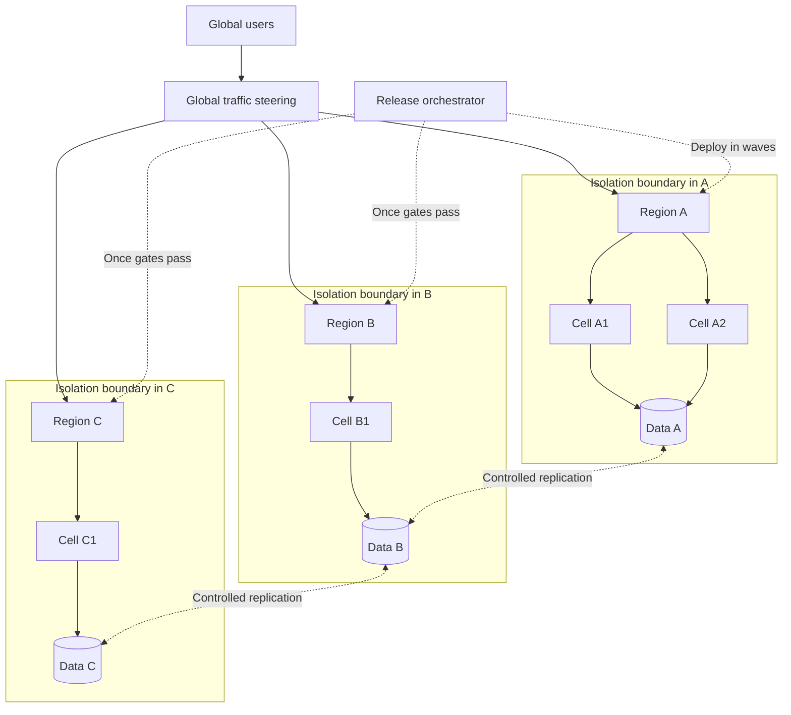

# Regional Rollouts and Blast Radius Containment

> **Chapter:** Global Architecture  
> **Scope:** CLOUD_ARCHITECTURE — designing cloud application architectures from business requirements across networking, compute, data, and deployment models; balancing trade-offs among reliability, security, scalability, cost, and operations under Well-Architected principles.

An application serving multiple countries typically runs across multiple **cloud regions** to lower latency, meet data residency requirements, and survive infrastructure outages. However, if software updates roll out to every region simultaneously, a single buggy release can take down the entire system. **Regional rollout** is the practice of deploying a new version across controlled scopes, observing impact, and only then expanding. Its purpose is **blast radius containment** and preserving a safe retreat path when incidents occur.

## Learning Objectives

After this lesson, you will be able to:

1. Distinguish failure scopes across instances, availability zones, cells, regions, and globally shared components.
2. Design multi-region release sequences using canary, rolling, blue-green, and feature-flag techniques.
3. Estimate the share of traffic exposed at each stage while recognizing when that formula no longer holds.
4. Set automated advance, pause, rollback, or traffic-shift criteria based on SLOs and data-integrity signals.
5. Account for coupling across networking, compute, data, security, operations, and cost when containing failures.

## 1. Why Can a Global Rollout Cause a Global Outage?

Suppose an order service runs across three regions A, B, and C. A new release adds retry logic when calling the payment service. If deployed everywhere at once, a retry bug can create duplicate charges in all three regions. Even though each region's infrastructure is independent, **every region receives the same software defect**, so geographic redundancy cannot solve the problem.

Distinguish two scenarios:

- **Single-region failure:** power, network, compute cluster, or database outage in A; steering traffic to B/C *can* restore service if capacity and data permit.
- **Faulty release deployed to every region:** B/C run the same buggy code; steering traffic merely sends users somewhere else that is still broken. The proper fix is halting the rollout, disabling the offending feature, or restoring a known-good version.

**Blast radius** is the scope of resources, users, tenants, or business operations impacted by a change or incident. Do not measure it by server count alone: a shared authentication config change can break the entire system even if triggered from one machine.

| Fault-Isolation Unit | Example | What Can Escape Beyond It? |
| --- | --- | --- |
| Instance or pod | A new application process crashes | Traffic can be impacted if load balancers/health checks fail to eject the broken instance. |
| Availability zone (AZ) | An intra-region compute or network cluster fails | Services relying on a single-AZ database or queue can still go down. |
| **Cell** | Group of apps and data serving a defined tenant set | Shared dependencies, cross-cell data operations, or misrouting can widen impact. |
| **Region** | Entire stack in one geography fails | Global routing, identity, config, and global data can still cause correlated failures. |
| Global | Shared schema, secret, DNS, policy, or library change | Every region can hit the same failure despite separate infrastructure replicas. |

A **failure domain** is a boundary that can fail relatively independently. A **rollout unit** is the scope updated in a single deployment wave. The two need not match: you can roll out to 5% of users in one cell of one region rather than updating an entire region at once.

## 2. Architecting for Regional Fault Isolation

Staged rollouts help only when faults stay contained inside the deployed scope. The architecture must clarify request paths, state storage, dependencies, and control planes.



This diagram is a **conceptual model**; do not assume every application uses bidirectional replication or shares data across cells. Replication topology must fit data residency and actual read/write models.

An architecture designed to contain failures should satisfy the following conditions:

| Component | Design Approach | Risk If Done Wrong |
| --- | --- | --- |
| **Compute** | Independent instance groups, configs, autoscaling, and health checks per region/cell. | One bad autoscaling change or broken image starves every region of capacity. |
| **Networking & steering** | Ability to shift or drain traffic by region, cell, or version; health checks reflect business paths. | Homepage returns HTTP 200 while checkout is completely broken. |
| **Data** | Explicit write ownership, replication, consistency, failover, and data-residency boundaries. | Corrupt data or destructive writes replicate globally before code can roll back. |
| **Config & feature flags** | Scoped by region/cell/tenant, audited, with kill switches; shared changes roll out sequentially. | One global flag accidentally enables a broken feature everywhere. |
| **Identity, secrets, dependencies** | Graceful degradation when shared services degrade; limit coupling on critical paths. | Healthy regions go down because a central auth service or secret store fails. |
| **CI/CD & governance** | Each region can pause/roll back releases independently; requires approvals and audit logs. | Pipeline forces simultaneous upgrades across all regions or deletes the last stable artifact. |
| **Observability** | Measure by region, cell, version, route, and cohort alongside global views. | Global averages mask severe errors in a small canary. |

In practice, the **data plane** handles live customer requests, whereas the **control plane** manages deployments, routing, configuration, and policies. If the global release orchestrator temporarily loses connectivity, serving regions should keep handling requests using their last known valid state while deployments pause until recovery. Never let a pipeline outage take down the entire data plane.

### Regions, AZs, and Cells Serve Distinct Roles

- **Multi-AZ within one region** protects against local infrastructure failures, but cannot stop region-wide incidents or region-wide code pushes.
- **Multi-region** improves geographic availability, at higher networking, data-sync, and operational cost.
- **Cell partitioning inside each region** further shrinks blast radius for software bugs or noisy-neighbor tenants. Cells work only when resources and dependencies are properly bounded; multiple cells sharing one overloaded database still share a single point of failure.

Not every application needs global active-active. Choose isolation depth based on SLOs, RTO/RPO, data requirements, and budget; avoid duplicating infrastructure without governing shared dependencies.

## 3. Progressive Rollouts Across Multiple Regions

A safe process combines **region-by-region waves** with **gradual traffic ramping inside each region**. Delivering artifacts to servers and activating new behavior can also be separated into two steps.

### Common Deployment Strategies

| Strategy | How It Operates | Best Fit | Key Caveats |
| --- | --- | --- | --- |
| **Rolling deployment** | Replaces groups of instances incrementally within a region. | Routine updates where versions can coexist side by side. | Requires API, session, event, and schema compatibility between old and new versions. |
| **Canary** | Routes a small share of live traffic to the new version and compares against a baseline. | High-risk changes or behaviors hard to validate pre-prod. | Canaries lose signal if sample sizes are too tiny, unrepresentative, or shared data widens impact. |
| **Blue-green** | Stands up an environment running the new version and shifts traffic when ready. | Fast cutover while keeping the old environment intact for instant return. | High compute cost; rolling back app code does not undo mutated data. |
| **Feature flags** | Deploys code first, then enables behavior per cohort/region. | Decoupling code deployment time from behavior activation time. | Flag configuration is itself a release channel; enforce permissions, audits, and convergence time. |

These strategies compose cleanly: rolling deployment ships artifacts to 5% of instances in Region A, canary steering routes matching traffic to them, and a feature flag activates only for selected tenants.

### Recommended Rollout Workflow

1. **Prepare:** confirm the change, data/schema impact, tenant scope, data residency rules, rollback capability, compatible versions, and support plan. Verify current SLOs are healthy and no active incidents exist.
2. **Pre-production validation:** run automated tests, API/event contract checks, backward-compatible migrations, startup probes, artifact security scans, and rollback drills. Use production-like environments where feasible, without treating them as a substitute for live canaries.
3. **Select the first region:** choose one representative enough to observe real behavior while keeping impact acceptable. Weigh peak time zones, strategic customers, regulatory constraints, traffic volume, and operational maturity; never assume the lowest-traffic region is always most representative.
4. **Small canary in the first region:** allocate traffic by percentage or stable cohort; tag version and cohort across metrics, logs, and traces. Monitor both technical metrics and business outcomes.
5. **Soak, evaluate, and ramp:** advance to the next stage only when sufficient traffic, observation time, and safety gates all pass. A progression might be 5% → 25% → 100% *within one region*; these numbers are illustrative, not mandatory ratios.
6. **Roll out in regional waves:** proceed through remaining regions in approved order, still canarying inside each region. Preserve the ability to halt the entire campaign on negative signals.
7. **Close out:** confirm no broken versions remain, archive rollout evidence, check for latent errors, and clean up feature flags/compatibility shims after the stabilization window.

**Key rule:** if Region A shows errors, **do not** push the release onward to B/C hoping "the bug is specific to A." Triage the root cause and prove it is safe before continuing.

### Calculating Traffic Exposed to the New Release

Given regions \(r\), let:

- \(w_r\): share of global requests reaching region \(r\), such that \(\sum_r w_r = 1\).
- \(c_r\): fraction of requests within region \(r\) served by the new version.

Then the fraction of global requests directly served by the new version is:

\[
B_{\text{request}} = \sum_r w_r c_r
\]

For example, if A serves **20%**, B **30%**, and C **50%** of global traffic:

| Stage | New Version in A | In B | In C | Total Traffic on New Version |
| --- | ---: | ---: | ---: | ---: |
| Initial canary | 5% | 0% | 0% | 1% |
| Finish A | 100% | 0% | 0% | 20% |
| Start B | 100% | 5% | 0% | 21.5% |
| Finish A and B | 100% | 100% | 0% | 50% |
| Global completion | 100% | 100% | 100% | 100% |

That **1%** in the first step measures only requests directly hitting the new code; **it does not guarantee incidents stay confined to 1%**. If a canary writes corrupt records to a shared database, floods a queue, alters DNS, or overloads a central service, users on the old version suffer too. For data, blast radius must measure **affected tenants/records** and downstream consumers.

Set a **rollout exposure budget**—for example, capping the maximum share of traffic or critical tenants exposed to an *unverified* change. Pair that budget with concrete fault boundaries and halt rules; never treat a canary percentage as proof of isolation.

## 4. Decision Criteria: Advance, Pause, or Roll Back

A mature pipeline enforces **release gates**. Decisions rely on user usability and business correctness, not merely whether deployment jobs exited with status zero.

| Signal Group | Examples to Monitor | Why It Matters |
| --- | --- | --- |
| **Availability / errors** | 5xx rates, timeouts, order/payment/login failure rates by region and version. | Detects releases degrading SLO compliance. |
| **Performance** | p95/p99 latency, queue wait times, CPU/memory saturation, autoscaling lag. | A release can return 200 yet be too slow to use. |
| **Data correctness** | Duplicate orders, negative balances/stock, idempotency errors, replication lag, conflicts, DLQs. | Stops data-corrupting releases that code rollbacks cannot undo. |
| **Business behavior** | Payment success rate, order completion, checkout abandonment; segmented by market. | Catches bugs invisible to raw HTTP metrics. |
| **Failover headroom** | Resource utilization in B/C, quotas, database capacity, bandwidth, connection limits. | Prevents shifting load into regions unable to absorb it. |
| **Security & cost** | Authorization errors, abnormal secret/API access, spikes in data transfer or retries. | Evaluates impact beyond raw uptime. |

Compare the canary against a **control group in the same region, handling the same request mix under comparable conditions**; comparing only against a global average lets geography and time-of-day skew conclusions. For low-traffic canaries, require minimum sample sizes and soak times, alongside emergency stop triggers that fire immediately on data-integrity violations without waiting for full sample counts.

Illustrative release policy example:

```yaml
# Illustrative pseudoconfiguration, not syntax for a specific CI/CD platform.
rollout:
  first_region: A
  region_order: [A, B, C]
  in_region_stages_percent: [5, 25, 100]
  minimum_observation_minutes: 30
  minimum_comparable_requests: 5000
  advance_only_when:
    - slo_burn_rate_within_approved_limit
    - checkout_success_not_degraded
    - latency_p95_within_approved_limit
    - no_data_integrity_alarm
    - receiving_regions_have_capacity
  stop_immediately_when:
    - confirmed_duplicate_charge
    - confirmed_data_corruption
    - critical_security_signal
  on_gate_failure: pause_all_regions_and_page_owner
```

Values such as **30 minutes**, **5,000 requests**, and **5%/25%/100%** are illustrative only. Each service must choose thresholds suited to its traffic volume, seasonality, risk profile, and SLOs; rare daily-batch bugs may require longer observation windows. Enforce both per-region gates and global gates so healthy numbers in B/C never mask degradation in A.

Make action rules explicit:

- **Continue:** sufficient observation data, no guardrail violations, capacity and compatibility checks pass.
- **Pause:** inconclusive signals, blind observability, unhealthy source region, or unclassified dependency issues. Never expand a release while impact cannot be observed.
- **Rollback code/flag:** fault stems from a reversible change; revert the canary cohort first, then expanded scopes as needed.
- **Fail forward or controlled data recovery:** used when migrations/writes altered state such that rolling back code is unsafe; follow a dedicated business remediation path.
- **Traffic failover:** apply only when the root cause is regional failure or isolating a flow, and the target region has sufficient capacity and eligible data.

## 5. Traffic Steering and Failover Are Not Rollouts

**Regional rollout** decides *which version runs where*; **traffic steering** decides *which requests go where*; **failover** moves requests away from a location that can no longer serve safely. All three must coordinate yet hold independent activation conditions.

A global routing layer may use DNS, Anycast, or a global load balancer. Select based on health-checking capability, weighting, session protection, and convergence sensitivity. **A low DNS TTL does not guarantee instant client cutover** because caches, resolvers, and open connections prolong transitions. For long-lived connections or multi-step transactions, design draining, retries, and idempotency.

### Three Questions Before Shifting Traffic

1. **Does the target have capacity?** If A carries 40% of traffic, B/C need sufficient headroom, autoscaling speed, and quotas to absorb the load. Adding compute instances is not enough if databases, queues, or third-party APIs cannot scale to match.
2. **Does the target hold valid data?** Replicated data may lag; immediate cutover can hide transactions users just created. Define RPO (acceptable data loss) and RTO (target recovery time), plus resynchronization rules on failback.
3. **Is shifting data and requests permitted?** Data residency restrictions, access rights, tenant placement, encryption keys, and service contracts may prohibit moving certain flows to another region.

**Active-active** serves traffic across multiple regions, reducing single-region dependence at the cost of harder concurrent writes and conflict resolution. **Active-passive** usually keeps the write path simpler, but requires maintaining warm enough standby capacity to hit RTO. Either way, rehearse both failover and **failback** when new writes have occurred in the recovery region.

Never automatically fail over to a region running the exact same broken release. When every region shares a code or config defect, prioritize disabling the change and restoring the last known-good version.

## 6. Databases and Events: Where Blast Radius Crosses Regional Boundaries

Compute rolls back quickly; persisted data is much harder to undo. For instance, if a new release miscalculates tax and writes corrupt `total_amount` values, reverting app code does not fix already-stored orders. Every rollout must therefore evaluate both **data compatibility** and **data repair**.

### Schema Changes via Expand → Migrate → Contract

1. **Expand:** add new columns/tables/APIs/events in a backward-compatible form; older code keeps working.
2. **Migrate:** deploy code capable of reading both old and new formats; backfill or migrate data incrementally while watching correctness and replication lag.
3. **Contract:** remove old fields/formats only after every region, worker, and consumer has upgraded, data is verified, and the compatibility window has closed.

Never deploy breaking schema changes globally before the first region rolls out; while B/C still run the older version, they must continue reading and writing safely.

### Decisions to Make Explicit

- **Single-writer or multi-writer?** For strongly consistent data such as balances or inventory, assign one authoritative writer per partition/tenant rather than letting multiple regions write arbitrarily. Multi-writer demands domain-specific conflict resolution.
- **Synchronous or asynchronous replication?** Async replication cuts write latency but introduces replication lag and potential update loss on failover; cross-region sync adds latency and network-availability coupling.
- **Retries and idempotency?** For payments, orders, and message handling, use idempotency keys, deduplication, and explicit transaction boundaries. Retries must never trigger duplicate business effects.
- **Event/API versioning?** Can consumers in un-upgraded regions process new events without crashing? Test bidirectional compatibility during parallel runs.
- **Where does corrupt data spread?** A bad record replicated, cached, or published onto an event bus can poison multiple regions; ensure mechanisms exist to halt propagation, quarantine records, and repair data.

Separate **application rollback** (reverting code), **configuration rollback** (toggling off flags or policies), **routing revert** (re-steering traffic), and **data recovery** (restore/compensation/reconciliation). These are four distinct operations with different risks and recovery times.

## 7. Feature Flags, Configuration, and Global Changes

Feature flags let teams deploy code first and activate behavior later—for example, enabling a new payment method for 2% of tenants in A. Requirements include:

- **Explicit scoping:** region, cell, tenant, request type, and app version; avoid confusing 5% of requests with 5% of users.
- **Sticky cohorts:** a tenant or user should see consistent behavior across multi-step flows; avoid random flipping between requests that corrupts state.
- **Scoped kill switches:** ability to turn off a feature in A alone without waiting for a new global deployment.
- **Flag-system failure behavior:** define safe defaults, valid local caches, convergence windows, and detection of flag skew across instances.
- **Permissions and auditing:** restrict who can alter global configs; enforce approvals, audit trails, and rollback capability.

Changes not bound to a single region—such as rotating shared secrets, IAM policies, DNS, central API gateways, or global database schemas—require **dedicated change plans**. Name them explicitly in blast-radius analyses; never assume regional rollouts automatically shield against failures in global components.

## 8. Incident Response Runbook When a Canary Fails

Suppose 5% of traffic in A is running `v2` and metrics show an abnormal spike in duplicate payments. The runbook must define decision owners, execution order, and recovery verification:

1. **Freeze the campaign:** pause rolling `v2` to other cells/regions; record build ID, commit, timestamp, cohort, and config diffs.
2. **Contain impact immediately:** if safe, turn off the feature flag or revert the canary to `v1`; stop faulty retries. For financial flows, temporarily halt affected write paths before more data corrupts.
3. **Isolate scope:** slice metrics/traces/logs by `region`, `cell`, `version`, `tenant`, and `route`. Check shared dependencies to determine whether impact stays within A or has spread.
4. **Protect data:** quarantine bad messages, detect duplicates, and list transactions needing reconciliation; never delete records or bulk-replay queues without verified idempotency.
5. **Select recovery path:** roll back versions, flip flags, isolate traffic, or shift regions depending on root cause, data readiness, and capacity. Never shift load to B if B runs the same broken `v2`.
6. **Verify:** check user journeys, business KPIs, errors/latency, backlogs, and replication lag; verify using per-region and end-to-end signals rather than pod status alone.
7. **Resume rollout under control:** reopen the campaign only after root cause is understood, fixed, backed by test evidence, and guardrails/thresholds are updated.
8. **Post-incident learning:** identify why tests, canaries, fault isolation, or stop gates failed to prevent impact; update runbooks and validate via drills.

Always maintain an **incident communication channel** and designated owners authorized to pause, roll back, shift traffic, repair data, and notify customers. Automation should support both instant auto-halt and controlled manual intervention.

## 9. Design Scenario: Global Order Service

An e-commerce system runs in A, B, and C with traffic shares of 20%, 30%, and 50%. `order-api` `v2` adds retries toward the payment provider. Business goals are zero duplicate orders or charges, keeping payment latency within SLO, and enabling region-by-region maintenance.

**Rollout design:** deploy schema-compatible code; A receives `v2` for 5% of controlled tenants while keeping `v1` as a baseline and observing live transactions. Meanwhile, B/C stay on `v1`. Once gates pass, expand A incrementally, then proceed to B and C, validating each wave with per-region metrics. `v2` attaches idempotency keys across HTTP retries and async events; the order store, payment webhooks, and reconciliation jobs must all recognize duplicates.

**Simulated incident:** after a few minutes, HTTP 5xx stays low while `duplicate_payment_attempt` climbs, even though checkout success rate appears unchanged. The data-integrity gate fires immediately without waiting out the soak period. The system halts the rollout, disables the new retry logic in A, holds B/C on `v1`, quarantines anomalous attempts, and reconciles payments. If A emitted events affecting B/C, remediation must cover global consumers—never claim the bug affected only 1% of requests.

**Trade-offs:** keeping `v1` infrastructure alive longer increases cost, longer canaries slow release velocity, and per-cohort metrics raise observability costs; in return, operations gain the chance to catch and stop business defects before multiple regions are affected. This balances **reliability, security, performance, cost, and operational excellence** under Well-Architected principles.

## 10. Common Mistakes

| Mistake | Consequence | Fix |
| --- | --- | --- |
| Deploying all regions simultaneously because each is multi-AZ | A single software bug hits globally. | Stage waves by region/cell and keep a verified version available. |
| Tracking only global averages | Small canary errors are drowned out by healthy majority traffic. | Segment metrics by version, region, cell, cohort, and user journey. |
| Small canary writing freely to shared storage | Bad data leaks to tenants or regions outside the canary. | Map data blast radius, scope write authority, and enforce correctness checks. |
| Failing over automatically on a single failing health check | Target region overloads or lacks required data. | Combine business health checks with capacity, RPO/RTO, and data residency checks. |
| Rolling back code after a breaking migration | Old code fails to read new schemas/data. | Use expand–migrate–contract and a dedicated data-recovery plan. |
| Flipping global feature flags instantly without audits | One config typo impacts every region. | Scope by region/tenant, add kill switches, RBAC, and audit trails. |
| Pipeline disconnects and takes down the live app | Control-plane outage crashes the data plane. | Ensure serving regions continue running on last known valid state. |
| Halting web rollouts while ignoring queues, batch jobs, and consumers | Bad effects persist after web traffic rolls back. | Track and halt async workers, replays, and backlogs too. |

## 11. Architecture Review Checklist

Before approving a multi-region release design, verify:

- [ ] Rollout units and fault-isolation units are defined: instance, cell, region, tenant.
- [ ] Shared global components and data/event propagation paths are diagrammed.
- [ ] Region ordering, canary percentages, soak times, exposure budgets, and low-traffic plans exist.
- [ ] Per-region/cohort SLIs/SLOs and business guardrails are set, with emergency halt thresholds for data errors.
- [ ] Independent pause, code/flag rollback, and multi-version schema compatibility are supported.
- [ ] Routing/failover/failback runbooks check capacity, RTO/RPO, and data residency.
- [ ] Fallback plans exist when orchestration, observability, or shared config systems fail.
- [ ] At least one canary fault, one region outage, and one cross-region bad-data replication scenario have been drilled.
- [ ] Owners, permissions, change logs, communication plans, and standby budgets are approved.

### Design Exercise

A service must release `v3` across four regions, where one region serves 60% of customers and order data replicates asynchronously. Propose (1) the rollout sequence and per-region canary plan, (2) potential blast radius from corrupt writes, (3) release stop gates, (4) rollback/failover strategy when replication lag rises, and (5) protections for tenants requiring single-region data residency. Compare a fast rollout against a multi-wave rollout across SLO impact, deployment duration, standby cost, and operational effort.

A strong answer shows that **region ordering reduces risk only when dependency and data boundaries are well understood**; therefore, safe release engineering is part of global architecture design, not merely deployment pipeline configuration.
