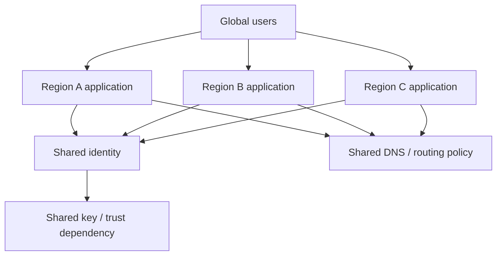
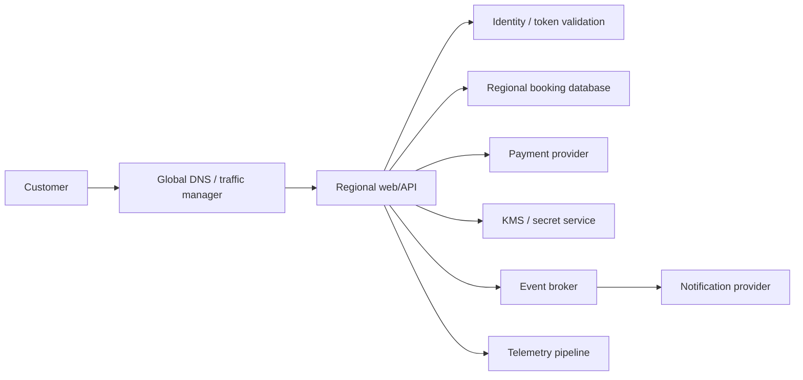

# Evaluating Global Dependencies That Can Become Common Points of Failure

## 1. Why Can a Multi-Region Architecture Still Have a Common Point of Failure?

A system deployed across multiple availability zones or regions is often assumed to be highly available. However, multiple application replicas do not guarantee those replicas are independent. They may share dependencies on a single DNS zone, identity provider, KMS key, network hub, control plane, registry, quota, or deployment pipeline. When that shared dependency fails, every region can lose serving capability simultaneously.

A **shared global dependency** is a component or service used jointly by multiple workloads, regions, accounts, or cells. It can be an internally operated service, a cloud provider service, an external SaaS, or a shared configuration/process. That dependency becomes a **common point of failure** when a fault in it can disrupt multiple failure domains that were designed to be independent.

A common point of failure is not just a single server. Even an active-active service can become a common point of failure if every region shares one faulty policy, one leaked credential, one routing hub, one quota, or one bad release.

In the **CLOUD_ARCHITECTURE** module, the **Global Architecture** chapter requires evaluating dependencies across multiple regions and failure domains. The evaluation must span identity, networking, data, security, deployment, and operations while balancing reliability, security, scalability, cost, and operability.

After this lesson, you will be able to:

1. Distinguish redundant components from independent failure domains.
2. Map dependency graphs across service, region, account, and organization scopes.
3. Identify shared dependencies capable of causing correlated failures.
4. Assess blast radius, failure modes, and operational continuity when a dependency becomes unavailable.
5. Analyze common dependencies such as DNS, identity, KMS, networking, control planes, quotas, and providers.
6. Design appropriate isolation, fallbacks, caching, local autonomy, and recovery paths.
7. Determine which dependencies need dedicated HA/DR and where coupling can be reduced.
8. Build tests, runbooks, and evidence to prove global resilience.

## 2. Shared Dependencies, Redundancy, and Common-Cause Failures

Distinguish three concepts:

- **Redundancy:** having multiple instances, paths, or replicas to substitute when one component fails.
- **Failure-domain independence:** replicas do not share a common cause or component capable of failing them all at once.
- **Common-cause failure:** a single shared cause triggering simultaneous failures across supposedly independent components.

For example, three regions might all:
- Share one identity tenant or federation service.
- Rely on one DNS provider/account and registrar.
- Use the same KMS key or key administration permissions.
- Traverse one network hub or firewall stack.
- Receive policies from one organization-level configuration.
- Deploy from a single pipeline or artifact registry.

In that setup, adding regions does not proportionally shrink the blast radius of the shared dependency.

### 2.1. Redundancy Does Not Equal Independence



Three application stacks are replicated, yet identity and DNS remain shared dependencies. A fault in any of those shared components can impact the entire access path.

### 2.2. Dependencies Can Be Logical, Not Just Infrastructure

A bad policy pushed simultaneously to every region is also a common-cause failure. Other examples:
- Certificates expiring in every region due to shared automation.
- A schema migration incompatible with all consumers.
- A mis-rotated secret pushed to all workloads at once.
- A global feature flag disabling a critical workflow.
- A broken container image deployed to every cell.
- A route/ACL change creating a loop or blackhole across the global network.

Architecture reviews must treat configuration, data, identity, change processes, and human operators as factors that can create shared failure domains.

## 3. Dependency Graphs: Tracing End-to-End Paths

A flat list of services is not enough. Model dependencies along user journeys and operational workflows.

Checkout example:



Dependencies can sit on:
- **Critical request path:** needed immediately to complete the request.
- **Async path:** can be deferred, retried, or buffered.
- **Management path:** deployment, configuration, scaling, key rotation, and recovery.
- **Observability path:** collecting logs/metrics/traces and firing alerts.
- **Recovery path:** backups, restores, break-glass access, DNS cutovers, and incident coordination.

A dependency outside the request path can still cause prolonged outages. For instance, an unavailable control plane may not stop running requests immediately, but blocks scaling out, updating routes, or replacing failed nodes.

### 3.1. Questions to Answer for Every Dependency

1. Which regions/services call it?
2. Is it synchronous or asynchronous?
3. Is it required at startup, on every request, or only on refresh?
4. If the dependency fails, how long can the service continue running?
5. Are there caches, local state, or fallbacks?
6. Are accounts, keys, quotas, credentials, or management planes shared?
7. Who operates it and who has permission to change it?
8. How are recovery time and recovery point measured?
9. Are there reverse or circular dependencies?
10. Has losing this dependency been tested under peak load?

### 3.2. Dependency Inventory

| Attribute | Details to Record |
| --- | --- |
| Dependency ID | Stable name and owner |
| Function | Role for the workload |
| Scope | Region, account, organization, provider |
| Consumers | Dependent services/cells/regions |
| Criticality | Critical, important, best effort |
| Failure mode | Timeout, deny, stale data, unavailable, misconfiguration |
| Fallback | Cache, alternate endpoint, queue, local operation |
| RTO/RPO | Targets and measured results |
| Shared controls | Identity, KMS, DNS, quotas, networking, pipelines |
| Test evidence | Date, scenario, and drill outcome |

## 4. Classifying Dependency Severity

Not every dependency needs to be eliminated. The goal is understanding impact and applying proportionate controls.

| Dependency Type | Examples | Failure Behavior to Examine |
| --- | --- | --- |
| Synchronous hard dependency | Identity validation, database commit | Request cannot complete or must fail closed |
| Synchronous soft dependency | Feature config, personalization | Use cache/defaults or degrade features |
| Asynchronous dependency | Notifications, analytics events | Queue/buffer and process later |
| Bootstrap dependency | DNS, registry, secret retrieval at startup | Running processes continue, but restarts fail |
| Management dependency | Cloud control plane, deployment APIs | Running workloads continue; operations are restricted |
| Observability dependency | Log/trace backends, alert manager | Loss of visibility; can buffer locally |
| Recovery dependency | Backup catalogs, KMS, break-glass access | Unable to restore during a disaster |
| Governance dependency | Organization policies, central configs | Mass changes or global lockouts |

### 4.1. Startup Dependencies Are Easily Underestimated

A running service may hold tokens, certificates, or secrets in memory. When identity/KMS/secret services fail, it keeps serving current traffic. However, once processes restart, nodes autoscale, or deployments run, new instances fail to bootstrap.

Evaluate both states:
- **Steady-state dependencies:** requests are served using already-held credentials and configs.
- **Cold-start dependencies:** a new process needs DNS, identity, registries, KMS, and secrets to start.

An architecture that survives a brief outage can still collapse during mass node replacement.

## 5. Quantifying Blast Radius and Risk

A practical assessment considers:
- Number of regions/cells/services impacted.
- Share of critical workloads traversing the dependency.
- Remaining functionality if fallbacks engage.
- Detection, mitigation, and recovery times.
- Likelihood of cascading failures into other dependencies.
- Exposure to compromise or misconfiguration.

A qualitative scoring table can help:

| Dimension | Question | High Risk When |
| --- | --- | --- |
| Scope | How many workloads depend on it? | Most regions/accounts depend on it together |
| Criticality | Which requests require it? | Critical user journeys require it on every call |
| Failure coupling | Do replicas share a root cause? | Shared credentials, control plane, routes, or policies |
| Recovery | Is there an alternate path? | No fallback or slow restore |
| Change risk | Can changes propagate widely? | A single action impacts everything globally |
| Detection | Would we notice it failing? | No independent monitoring |
| Security impact | Could it be hijacked or abused? | Global privileges, shared secrets/keys |
| Capacity | Can fallbacks carry the load? | Alternate paths lack capacity |

### 5.1. An Illustrative Impact Ratio

```text
Blast radius ratio =
  critical workload capacity affected by dependency failure
  / total critical workload capacity
```

A ratio near 1 means a failure in that dependency can wipe out most critical capacity. This metric does not replace a full risk assessment; it helps compare dependencies and prioritize remediation.

### 5.2. Failure-Mode Matrix

| Dependency | Failure Mode | Impact | Verification Questions |
| --- | --- | --- | --- |
| DNS | Fails to resolve or wrong records | Traffic cannot route | Are caches, secondary paths, and rollbacks ready? |
| Identity | Token issuance/validation fails | Logins or requests rejected | How long do existing sessions/local validation survive? |
| KMS | Encrypt/decrypt unavailable | Startup, storage, or restores fail | Are key replicas/recovery paths available? |
| Network hub | Hub/route/firewall outage | Multiple regions lose connectivity | Are direct paths or alternate transit available? |
| Control plane | API unavailable | Cannot deploy/scale/replace | How long can the data plane continue? |
| Quota | Capacity allocation denied | Cannot scale or fail over | Are quotas reserved and alternate shapes ready? |
| Artifact registry | Images/packages unavailable | Deployments/restarts fail | Are verified regional caches/mirrors present? |
| CI/CD | Pipeline or credentials broken | Changes/fixes cannot deploy | Is there a safe manual recovery path? |
| Observability | Telemetry backend unavailable | Loss of visibility/alerts | Are local buffers and out-of-band alerts in place? |

## 6. DNS and Global Traffic Management

DNS sits at the front of the access path and is shared across regions. A DNS provider outage, registrar/account compromise, zone deletion, DNSSEC error, or bad record rollout can disrupt the entire service.

### 6.1. Separating the DNS Control Plane and Data Path

- **Control plane:** editing records, zones, delegations, DNSSEC, and health policies.
- **Data path:** resolvers answering queries from caches and authoritative servers.

A control-plane failure does not immediately disconnect all clients because resolvers cache records. Conversely, low TTLs or varied caching behaviors can propagate bad edits rapidly.

Check:
- Are authoritative name servers distributed across failure domains?
- Do the registrar and DNS hosting share the same account/identity?
- Do DNSSEC keys and signing automation have a recovery path?
- Do TTLs align with failover objectives?
- How do resolver caching and negative caching behave?
- Can records be rolled back via an independent path?
- Do health checks share the same network/provider as the target?

### 6.2. DNS Failover Is Not Instant Failover

TTLs do not guarantee every resolver switches precisely when the TTL expires. Clients may hold open connections or local caches; recursive resolvers enforce varying policies; mobile/ISP networks behave differently.

Drills should measure end-to-end:
- Time to detect the failed endpoint.
- Time for health policies to flip.
- Time for resolvers/clients to pick up the new endpoint.
- How long old connections stay open.
- Percentage of requests still hitting the failed endpoint.
- Whether DNSSEC, certificates, and authentication work in the new region.

### 6.3. DNS Resilience

Consider:
- Provider/name server redundancy aligned with architecture needs.
- Zone record exports and version control.
- Multi-person approval for delegation and DNSSEC changes.
- Change validation and canary records.
- TTL strategies tailored by record type.
- Out-of-band access to the registrar/provider.
- Independent monitoring from multiple network vantage points.

Secondary DNS or multi-provider setups help only when delegations, signing keys, management credentials, and runbooks are also independently controlled. Two DNS services sharing the same identity/account and automation still share a common cause.

## 7. Identity, Federation, and Token Validation

Identity is frequently a shared global dependency because multiple regions trust a single tenant, federation, directory, or token issuer.

Failure modes:
- IdP cannot issue tokens or MFA is unavailable.
- Federation certificates expire.
- Signing key rotations fall out of sync.
- JWKS or metadata endpoints become unreachable.
- Directory lockouts or replication lag.
- Misconfigured conditional access policies applied globally.
- Compromised admin identities.
- Token endpoint quotas or rate limits exceeded.

### 7.1. Local Token Validation and Key Caching

If services validate JWTs offline using cached public keys, they can keep validating existing tokens during a brief IdP outage. However:
- New tokens cannot be issued.
- Revocations may not take effect immediately.
- Key rotations must propagate reliably.
- Overly long token expiries widen the window for compromised credentials.
- Service restarts may fail to fetch JWKS without persistent/fallback caching.

Choose the trade-off between availability and revocation/security. Never extend token lifetimes indefinitely just to "survive an IdP outage."

### 7.2. Break-Glass and Workload Identity

Emergency access must provide a recovery path when primary SSO fails, backed by least privilege, MFA/recovery factors, custodianship, auditing, and expirations. Workloads should use managed/federated identities or short-lived credentials; avoid sharing long-lived secrets across regions.

### 7.3. Global Policies and Blast Radius

Conditional access, organization roles, or trust policies pushed globally can lock out every operator. Use staged rollouts, test principals, canary scopes, rollback paths, and emergency identities exempt from the policy being changed.

## 8. KMS, Secrets, and Certificate Authorities

KMS/secret managers are critical dependencies for encryption, application bootstrapping, storage access, and DR.

A region may keep running if key material/DEKs are cached in memory, yet:
- New instances cannot unwrap data keys.
- Backup restores cannot decrypt.
- Database encryption operations fail.
- Secret rotations stall mid-flight.
- Certificate renewals fail.
- Restarting workloads cannot fetch credentials.

### 8.1. Key Dependency Mapping

Document:
- Key ID/alias and owner.
- Regions and replication semantics.
- Key policies/roles permitted to decrypt.
- Services using the key at runtime, startup, and restore.
- Protections against rotation/disable/deletion errors.
- Backup and recovery paths.
- KMS quotas and throttling limits.
- Cross-account/cross-region access.
- Audits and alerts on policy or key-state changes.

### 8.2. Key Replication and Key Independence

Replicated keys enable usage in another region under provider semantics, yet do not automatically make the two keys independent across governance, billing, or control planes. An organization-wide deny policy or compromised credential can still hit both.

For workloads needing DR, test decryption from the recovery region using the actual recovery role in an isolated environment. Encrypted backups without verified key access are not a recovery capability.

### 8.3. Certificates and Trust Chains

Often-forgotten dependencies:
- Public/private CAs.
- Certificate renewal automation.
- ACME account credentials.
- DNS challenge providers.
- Trust bundles baked into containers/images.
- Service mesh certificate authorities.
- CRL/OCSP or trust metadata endpoints.

Simultaneous certificate expirations can break TLS globally. Monitor expirations by hostname and region, test renewals, and keep runbooks for ACME/DNS/IdP outages.

## 9. Network Hubs, Transit, and Security Appliances

Multiple regions often connect through a central hub such as a transit gateway, WAN, firewall cluster, proxy, or inspection service. While easier to govern, this can create a shared bottleneck or common failure point.

Risks:
- Losing one hub isolates regions from one another.
- Misconfigured firewall policies deploy widely.
- NAT/egress quotas exhaust at one central choke point.
- Route propagation bugs create blackholes or loops.
- Central DNS resolvers go offline.
- Proxy/inspection certificates break across all traffic simultaneously.
- Cross-region links saturate during failover.

### 9.1. Hub-and-Spoke vs. Partial Mesh

| Pattern | Advantages | Risks |
| --- | --- | --- |
| Central hub | Centralized governance, inspection, and routing | Hub is a shared dependency/bottleneck |
| Dual hub | Redundant paths | Must avoid sharing region, provider, or control path |
| Partial mesh | Direct paths for critical flows | More routes and policies to manage |
| Regional autonomy | Regions handle most local traffic internally | Cross-region operations become more complex |
| Service endpoints/private links | Cuts public egress and central transit | Provider endpoint/service quotas still apply |

You do not always have to eliminate central inspection. Define which traffic genuinely must traverse the hub, capacity when one hub fails, and which fallback paths security policy allows.

### 9.2. Network Failover Capacity

If normal traffic splits across two transit hubs, losing one pushes all load onto the survivor. The surviving hub must handle peak traffic, replication, telemetry, and recovery flows simultaneously.

Test throughput, connection counts, packet processing, NAT ports, route convergence, and security inspection—not just ping reachability.

## 10. Cloud Control Plane and Data Plane

The control plane manages resource lifecycles, configuration, and orchestration. The data plane processes business workloads and traffic. When the control plane fails, the data plane can often continue serving for a while, though scaling, changes, and recovery become constrained.

Examples:
- Cloud management APIs cannot launch new VMs.
- Kubernetes API is unavailable while running pods keep serving.
- Managed database control APIs fail while existing connections keep working.
- Global traffic managers cannot update records even though old endpoints stay live.
- IAM policy services fail, blocking new role grants or credential rotations.

### 10.1. Data-Plane Autonomy

Designs should examine:
- Services continuing with current cached configs within safe bounds.
- Appropriate lifetimes for existing workload identities/tokens.
- Service discovery caching and sensible TTLs.
- Avoiding control-plane calls on every business request when unnecessary.
- Fallbacks for local health checks and routing.
- Workers not halting completely over transient management-endpoint errors.
- Manual/out-of-band procedures for emergency actions.

This is not an excuse to bypass policy enforcement. Local autonomy must be bounded in duration, scope, and behavior—failing closed when sensitive operations cannot verify permissions or integrity.

### 10.2. The Control Plane Is a Recovery Dependency

During a disaster, teams must provision compute, networking, storage, IAM, DNS, and key access. If the regional/provider control plane fails, automation may be unable to build recovery environments. Identify which resources must be pre-provisioned (warm standby/pilot light) and which operations can execute via provider support or an alternate region.

## 11. Quotas, Capacity Reservations, and Provider Limits

Quotas are often treated as administrative limits, yet during failover they become availability dependencies.

Examples:
- Insufficient VM/vCPU quotas to absorb traffic when another region fails.
- Exhausted IP/subnet space blocking new pods or instances.
- Load balancer, NAT gateway, or public IP quotas hit.
- API rate limits throttling orchestration.
- KMS request quotas slowing decryption/unwrapping.
- Database connection, storage, or IOPS quotas capping throughput.
- Cross-region transfer or broker partition limits exceeded.

### 11.1. Size Quotas for Failure Scenarios

Do not inspect only steady-state usage. Calculate needs when:
- An AZ or region goes down.
- DR environments scale up.
- Cold caches drive spikes in database load.
- Queue backlogs drain.
- Recovery jobs and user traffic run concurrently.
- All tenants retry and reconnect together.

Request quota increases ahead of time, reserve capacity, or benchmark alternate instance families. Getting quota approvals during an active incident rarely fits within RTO.

### 11.2. Dependency Quotas and Thundering Herds

A global identity endpoint or KMS API can get slammed by bursts from every region simultaneously after reconnecting. Apply client-side rate limits, exponential backoff with jitter, safe caching, staggered retries, and capacity headroom. Never let every region retry in lockstep.

## 12. Artifact Registries, Packages, and CI/CD

Deployment pipelines become global dependencies if every region pulls images/packages from one central registry or pipeline.

Failure modes:
- Registry outages or permission errors.
- Images deleted or retagged.
- Signing keys or provenance services unavailable.
- Compromised CI runners or credentials.
- Bad pipeline template updates breaking every deployment.
- Upstream package mirror changes.
- Non-reproducible build artifacts.
- A faulty release pushed to all regions simultaneously.

### 12.1. Decouple Build Paths from Runtime Paths

Existing workloads should keep running during CI/CD outages. Startups or node replacements may need the artifact registry, so:
- Pin immutable image digests instead of mutable tags.
- Cache/mirror artifacts in required regions.
- Retain verified artifacts within appropriate retention windows.
- Sign artifacts and verify signatures/provenance.
- Avoid pulling arbitrary runtime dependencies from the Internet at startup whenever possible.
- Test scale-outs and node replacements while the primary registry is unreachable.

### 12.2. Deployment Blast Radius

A global pipeline can propagate bugs at high speed. Enforce staged rollouts, canaries, regional waves, automated health gates, freeze/stop conditions, and rollbacks. Separate permissions for modifying pipelines, policies, and releases; audit every workflow change.

## 13. Observability, Alerting, and Incident Coordination

Telemetry pipelines, dashboards, pagers, and incident tools can also become shared dependencies.

Risks:
- Losing one collector/region blinds telemetry for all regions.
- SIEM/indexing backends overload during major incidents.
- Alert routing depends on a failing IdP or DNS.
- Pager notification providers fail to deliver.
- Dashboards depend on the control plane of the failed region.
- Log export egress gets blocked.
- Shared credentials get revoked, stopping agents everywhere from shipping data.

### 13.1. Observability Independence

Consider:
- Bounded local buffering for logs, metrics, and traces.
- Minimal out-of-band health signals.
- Alert channels independent of the application identity path.
- Synthetic checks across multiple providers/networks.
- Offline or readable backup copies of runbooks when documentation systems fail.
- Out-of-band incident contact trees.
- Never letting log-pipeline backpressure block business requests.

You do not need to duplicate the entire telemetry stack everywhere, but you must keep enough visibility to tell which services are healthy and coordinate recovery when shared backends fail.

## 14. Data Plane, Replication, and Global State

Data dependencies can create common points of failure even when compute is distributed:
- A single-writer global database.
- Shared schema registries.
- Shared object buckets/accounts.
- Centralized data catalogs.
- Global caches or session stores.
- Replication controllers.
- Shared encryption keys.
- Single global partitions/leaders.
- Centralized event brokers.

### 14.1. Global Single-Writer

Single-writer simplifies consistency but creates latency and availability coupling for other regions. When the writer region fails or partitions, surviving regions must decide:
- Continue read-only?
- Promote a new writer?
- Wait for quorum/lease expiration?
- Accept conflicts and reconcile later?
- Reject writes to protect correctness?

Never independently promote two writers without fencing and consensus; that causes split-brain and duplicate or lost updates.

### 14.2. Schema Registries and Contract Dependencies

An outage in a global schema registry can stop producers/consumers from starting or serializing new events if they fetch schemas on every call. Caching approved schemas, compatibility policies, and offline validation let workloads keep running temporarily. Schema changes still require governance and rollback plans.

### 14.3. Shared Storage and Object Access

A bucket/account shared across regions can become a global dependency. Evaluate replication, regional caching, versioning, access policies, KMS dependencies, lifecycles, and account-level quotas. Replicating objects while sharing one account admin or policy mutation path still leaves a common cause.

## 15. Third-Party SaaS and Provider Dependencies

External services often fall outside your failure-domain assumptions:
- Payment gateways.
- Email/SMS/push providers.
- Identity SaaS.
- Fraud/risk APIs.
- Geolocation/maps.
- DNS/CDN/WAF.
- Source control, CI/CD, and artifact services.
- Support/incident communication tools.

Verify:
- Does the service offer independent regional endpoints?
- Do SLAs specify measurement methods and exclusions?
- What are rate limits, quotas, and burst behaviors?
- Are sandboxes, fallbacks, or alternate providers available?
- How do data portability and exports work?
- What is the escalation path during outages?
- Do you share an underlying cloud, network, or identity provider?

### 15.1. Business-Driven Fallbacks

Not every dependency has an instant substitute:
- Notifications can queue for delayed delivery.
- Fraud checks can fail closed on high-risk transactions.
- Recommendation/search personalization can degrade gracefully.
- Payments need `pending` state and reconciliation—never assume payment succeeded on timeout.
- Identity can honor already-issued tokens within policy windows while controlling revocations.

Fallbacks must match business invariants and threat models rather than returning generic default responses to every error.

## 16. Global Configuration, Feature Flags, and Policy Distribution

Centralized configuration promotes consistency yet can broadcast faults worldwide:
- A bad endpoint pushed to every region.
- A feature flag turning off a critical workflow.
- Global rate limits set too low.
- Corrupted certificate/trust bundles pushed everywhere.
- Security policies locking out all operators.
- Schema/config versions incompatible with current app rollouts.

Guardrails:
- Schema validation and compatibility checks.
- Versioned, immutable configs.
- Canary/staged rollouts by region/cell.
- Approvals for high-impact settings.
- Rollbacks and version pinning.
- Local last-known-good caches with expiries and policies.
- Audited emergency overrides.
- Global blast-radius caps.

Never let stale config caches live forever. For security revocations, stale policies are dangerous; specify which configs may run stale and for how long.

## 17. Correlated Deployments and Change Management

A single change can break all regions at once despite independent compute and networks:
- Global image rollouts.
- Non-backward-compatible database schema migrations.
- Shared secret rotations.
- Global IAM policies.
- Organization-wide Terraform applies.
- DNS/certificate changes.
- Firmware/agent updates.
- Feature flag or config pushes.

### 17.1. Bounding Change Blast Radius

- Deploy via canaries, cells, and regional waves.
- Enforce health gates tied to service SLOs.
- Retain prior artifact/config versions.
- Separate schema expansion from contraction.
- Maintain backward-compatible API/event contracts.
- Rotate secrets/keys with overlap windows.
- Enforce freeze conditions and stop-the-line triggers.
- Never roll out globally before observing the first region.

Deployment isolation is itself a resilience control: when a release fails, un-upgraded regions remain healthy recovery capacity.

## 18. Resilience Patterns for Shared Dependencies

### 18.1. Redundancy and Geographic Separation

Provision multiple instances/paths across failure domains, while also verifying:
- Account/organization boundaries.
- Networks/providers.
- Identities/credentials.
- KMS keys/control paths.
- DNS/registrars.
- Change automation.
- Capacity/quotas.

Redundancy lowers risk only when components do not share a common cause.

### 18.2. Local Autonomy and Caching

Reduce synchronous global calls by:
- Caching public signing keys/JWKS per policy.
- Retaining last-known-good non-sensitive configurations.
- Caching read-only reference data.
- Using local service discovery.
- Maintaining regional artifact mirrors.
- Buffering telemetry locally.
- Using async replication/queues for non-critical operations.

Caches need TTLs, invalidation, signatures/integrity checks, and staleness rules. Never cache sensitive authorization decisions indefinitely.

### 18.3. Bulkheads and Cell Architecture

Isolate consumers, workers, credentials, accounts, networks, and data by cell/region to cap blast radius. Shared global services can be sharded or partitioned by tenant/region. Avoid a single shared connection pool, queue, or control path serving every region.

### 18.4. Circuit Breakers, Timeouts, and Retry Budgets

- Timeouts short enough to avoid tying up resources indefinitely.
- Circuit breakers to stop hammering failing dependencies.
- Backoff and jitter to prevent retry storms.
- Retry budgets to bound amplification.
- Queues for deferrable work.
- Fail closed for actions requiring security/consistency.
- Fail open only for bounded, risk-assessed features.

### 18.5. Degraded Modes

Examples:
- Identity provider temporarily unavailable: honor existing signed tokens within the policy window without granting escalated privileges.
- Recommendation API fails: display popular/curated lists.
- Notification provider fails: queue for later delivery.
- Analytics fails: buffer events durably.
- Search fails: serve a fallback read model or reduced feature set.
- Global config fails: fall back to last-known-good within safe time limits.

Degraded modes require sign-off from product, security, and operations, with clear user messaging, metrics, and recovery triggers.

## 19. Dependency Resilience Matrix

A matrix links incidents to expected behaviors and tests:

| Dependency | Normal Mode | Failure Behavior | Guardrail / Fallback | Evidence |
| --- | --- | --- | --- | --- |
| DNS | Global routing | Use caches/alternate paths within bounds | Versioned zones, secondary access | Resolver failover game day |
| Identity | Token issue/validate | Existing tokens per policy; new logins may fail | Local key caches, break-glass | IdP outage test |
| KMS | Encrypt/decrypt | Existing workloads continue with limits | Key recovery/replicas, safe cached DEKs | Restore/decrypt test |
| Network hub | Inter-region transit | Local regions continue; cross-region degrades | Dual paths/regional autonomy | Hub-loss test |
| Control plane | Provision/configure | Existing data plane continues | Pre-provisioned capacity | API outage test |
| Quota | Scale capacity | Scaling may be rejected | Pre-approved quotas/reservations | Quota-exhaustion test |
| Registry | Fetch artifacts | Existing workloads continue | Regional mirrors/caches | Registry outage + node replacement |
| CI/CD | Deploy changes | Freeze changes; runtime continues | Signed artifacts/manual recovery | Pipeline outage drill |
| Observability | Central telemetry | Local buffers/alternate alerts | Out-of-band signals | Telemetry backend outage |
| Payment SaaS | Authorize/capture | Pending/reconcile per contract | Idempotency, queues, valid alternate routing | Timeout/duplicate test |

## 20. Shared Dependency Assessment Process

1. **Select a user journey:** booking, payment, login, data access, or recovery.
2. **Draw the dependency graph:** synchronous, asynchronous, bootstrap, management, and recovery paths.
3. **Map failure domains:** accounts, regions, providers, identities, networks, teams, and change pipelines.
4. **Identify common causes:** credentials, keys, quotas, policies, endpoints, artifacts, and operators.
5. **Catalog failure modes:** unavailable, timeout, stale, deny, corrupt, rate-limited, misconfigured.
6. **Assess blast radius:** impacted regions, services, tenants, and critical capacity.
7. **Evaluate survival windows:** cache/token/config lifetimes, queue retention, and restart behavior.
8. **Define fallbacks:** local autonomy, alternate paths, buffers, degraded modes, or fail closed.
9. **Verify capacity:** alternate paths, retries, cold caches, recovery, and peak load.
10. **Protect changes:** canaries, staged rollouts, approvals, and rollbacks.
11. **Set SLOs/RTO/RPO:** covering both dependencies and end-to-end user journeys.
12. **Test and rehearse:** dependency loss, correlated failures, quotas, and recovery.
13. **Document residual risks:** owners, decisions, exceptions, and review dates.

## 21. Testing and Rehearsing Shared Failure Domains

Testing each region while all shared dependencies are healthy will never expose common points of failure. Simulate outages in shared dependencies directly.

| Scenario | How to Test | Pass Criteria |
| --- | --- | --- |
| DNS provider/control-plane outage | Block record updates in a test environment | Existing data paths and alternate procedures behave as designed |
| Identity issuer outage | Controlled block of token issuance/JWKS fetch | Local validation and fail-closed policies hold |
| KMS throttling/unavailable | Rate-limit requests or disable test endpoint | Existing workloads and restore paths behave predictably |
| Network hub loss | Sever one hub/transit path | Surviving regions/cells operate per design |
| Control-plane outage | Block provisioning APIs in test | Data plane continues; recovery limits are documented |
| Quota exhaustion | Lower quotas or hit test account limits | Alerts, fallbacks, and reserved capacity work |
| Registry outage | Block fetching new images | Cached artifacts support node replacement |
| CI/CD compromised/unavailable | Halt pipeline or inject a bad release | Change freezes, canaries, and rollbacks protect regions |
| Telemetry backend outage | Disconnect backend | Buffers and alternate alerts do not block requests |
| Global policy error | Deploy faulty policy to canary | Rollout halts before global impact |
| Certificate renewal failure | Block ACME/DNS validation in test | Expiry alerts and recovery paths function |
| Third-party outage | Inject timeouts/rate limits in test | Business-specific degraded modes work |
| Correlated failure | Combine AZ loss with dependency outage | SLOs and critical journeys meet approved scenario bounds |
| Failback | Restore old dependency/site | No split-brain; configs and ownership stay consistent |

### 21.1. What to Measure During a Game Day?

- Number of impacted regions/cells.
- Percentage of critical requests succeeding.
- Latency and errors by region and user journey.
- Detection, decision, and mitigation times.
- Cache/token/config age during fallback.
- Queue depth, oldest item age, and retry amplification.
- Alternate-path throughput and quota headroom.
- Data correctness, duplicates, and reconciliation backlogs.
- Ability to scale/restart while the primary dependency is down.
- Recovery and failback durations.
- Whether operators can access runbooks, identities, and audits.

## 22. Practical Scenario: Three Regions Sharing Identity and KMS

**Context:** A booking SaaS runs in three regions. Each region has its own application cluster, database replica, and cache. A global traffic manager routes to healthy regions. However, workload identities, the token issuer, KMS policies, and secrets live inside one shared organization/account. A faulty IAM edit prevents workloads in all three regions from fetching new secrets, while simultaneous retries from every region rate-limit the token issuer.

### 22.1. Why Current Redundancy Is Not Enough

- Application and database replicas are reasonably isolated in the data plane.
- Identity/secret paths are shared at the organization scope.
- KMS access policies share role/organization policy dependencies.
- Retries from all three regions trigger a request storm against the token issuer.
- Autoscaling/restarts spike secret fetches right when the dependency fails.
- The global traffic manager still sees live endpoints while critical business operations fail.

The problem is not a lack of application replicas. The problem is a shared bootstrap/security dependency with global blast radius.

### 22.2. Improved Design

1. Partition workload identities by region/cell and narrow trust scopes.
2. Use suitable token lifetimes, local validation for signed tokens, and safe signing-key caching.
3. Design secret access/rotation so running workloads do not fetch secrets on every request.
4. Verify KMS key replication and recovery paths under provider semantics.
5. Use staged rollouts for IAM/key policies with test principals and rollbacks.
6. Add rate limits, jitter, and retry budgets to prevent token-issuer storms.
7. Pre-provision capacity and artifacts to avoid forced mass restarts.
8. Maintain break-glass identities and recovery paths independent of primary federation.
9. Monitor auth failures, token throttling, secret fetches, and KMS latency per region.
10. Rehearse an IAM policy lockout combined with a regional outage.

### 22.3. Acceptance Criteria

- A region can keep serving existing sessions within the policy window during an identity-issuer outage.
- New workloads never gain broader permissions as a side effect of fallback.
- Secret/KMS recovery succeeds from the DR region using a verified recovery role.
- A faulty policy rollout is caught and halted at the canary stage.
- Retries do not cause token request storms.
- Recovery operators retain access to break-glass controls and audit trails.
- Global user journeys meet approved degraded SLOs.

## 23. Sample ADR: Eliminating Common Points in the Global Identity Path

```text
ADR-188: Separating Failure Domains for Identity and Secret Access

Context:
- Three regions have separate data planes but share an identity/secret path.
- An IAM policy mistake or token-issuer outage can impact all regions.
- Restarts/scale-outs during outages trigger sharp spikes in auth requests.

Options:
A. Keep the shared identity path and scale up issuer capacity.
B. Deploy completely independent local identity providers per region.
C. Keep a unified trust model while partitioning workload identities, caching safely, and preparing recovery paths.

Decision:
- Select Option C.
- Scope workload identities by region/cell with least privilege.
- Token validation uses signing-key caches with explicit TTLs and policies.
- Secret retrieval is kept off the per-request path; startup/restart behavior is controlled.
- IAM/key policy rollouts use canaries, rollbacks, and test principals.
- Break-glass and audit paths operate independently of primary SSO.
- Retry budgets and jitter protect token/KMS endpoints.

Trade-offs:
- Requires managing key/identity lifecycles and policy consistency.
- Caching boosts availability but introduces a bounded revocation window.
- Regional autonomy requires dedicated telemetry, testing, and runbooks.

Verification:
- Identity-issuer outage drill in each region.
- KMS/secret recovery test from the DR environment.
- Policy canary catching faults prior to global rollout.
- Retry storm test and rate-limit verification.
- Audits and break-glass functioning during an SSO outage.

Review Triggers:
- Changes in provider identity/KMS semantics.
- Changes in RPO/RTO or security requirements.
- Growth in regions or tenants.
- Drills showing blast radius or recovery time exceeding targets.
```

## 24. Common Mistakes

1. **Counting regions instead of verifying independence:** multiple regions still share identity, DNS, or network hubs.
2. **Mapping only the request path:** ignoring bootstrap, management, deployment, and recovery dependencies.
3. **Assuming control-plane outages are harmless:** running pods survive, yet node replacements and scale-outs fail.
4. **Skipping cold-start checks:** new instances cannot fetch keys, secrets, tokens, or artifacts.
5. **Using one identity/account for all regions:** bad policies or account lockouts cascade system-wide.
6. **Retrying simultaneously from all regions:** creating thundering herds against an already struggling dependency.
7. **Treating secondary DNS as independent:** registrar, DNSSEC keys, identities, and automation remain shared.
8. **Having key replicas without testing decryption:** encrypted backups still fail recovery.
9. **Lacking spare capacity in central network hubs:** failover funnels all load into a new bottleneck.
10. **Ignoring DR quotas:** waiting until an incident to request capacity increases.
11. **Replicating artifacts only by mutable tag:** tags can be overwritten or images deleted.
12. **Rolling out globally at once:** one release or policy defect breaks every region.
13. **Caching indefinitely:** raises availability at the cost of dangerous stale authorization/config.
14. **Failing open on every dependency:** turns outages into security holes or data corruption.
15. **Lacking business-aligned degraded modes:** any dependency glitch takes down the entire product.
16. **Routing observability over one shared path:** losing telemetry at the exact moment services fail.
17. **Failing to protect provider/support access paths:** operators cannot open tickets or access recovery consoles.
18. **Never rehearsing correlated failures:** isolated tests breed false confidence.
19. **Leaving ownership undefined:** shared services lack accountable teams and clear SLOs.
20. **Ungoverned global changes:** IAM, DNS, config, certificate, and secret rotations cause global outages.

## 25. Pre-Production Checklist

- [ ] Dependency graph covers request, async, bootstrap, management, observability, and recovery paths.
- [ ] Inventory records scope, owner, consumers, criticality, and failure modes for every dependency.
- [ ] Regions/cells are evaluated for common-cause failures, not just replica counts.
- [ ] Shared identity/federation enforces local validation, expiries, and break-glass policies.
- [ ] DNS, registrar, DNSSEC, and traffic management have versioning, monitoring, and recovery paths.
- [ ] KMS, secrets, and certificates have owners, rotations, quotas, and decrypt/renewal tests.
- [ ] Network hubs, transit, NAT, and firewalls have alternate paths and failover capacity.
- [ ] Control-plane outages do not needlessly cripple the data plane.
- [ ] Quotas, IPs, and capacity are sized for AZ/region loss, restarts, and backlog recovery.
- [ ] Artifact registries use immutable digests, signatures/provenance, and regional caches.
- [ ] CI/CD enforces canaries, staged rollouts, rollbacks, and protected policies.
- [ ] Observability and incident coordination retain minimal out-of-band paths.
- [ ] Global data/schema/single-writer dependencies have consistency and fencing plans.
- [ ] Third-party SaaS dependencies have documented quotas, SLAs, fallbacks, and business reconciliation.
- [ ] Global configs/policies have versioning, staged rollouts, and last-known-good rules.
- [ ] Retry budgets, timeouts, circuit breakers, and rate limits protect dependencies.
- [ ] Degraded modes are approved by product, security, and operations.
- [ ] Blast radius and residual risks have owners, scores, or documented rationale.
- [ ] Game days exercise dependency outages and correlated failures.
- [ ] Runbooks, break-glass access, alerts, and failback are verified.
- [ ] Dependency reviews are scheduled whenever regions, services, providers, or trust paths change.

---

**Key Takeaway:** A global architecture is truly resilient only when regions do not collapse together over a shared dependency, policy, credential, or change. Map dependency graphs across request, bootstrap, management, and recovery paths; quantify blast radius; design local autonomy, fallbacks, and change isolation; and rehearse dependency loss under peak load. Extra regions and replicas only deliver value when failure domains are genuinely independent.
