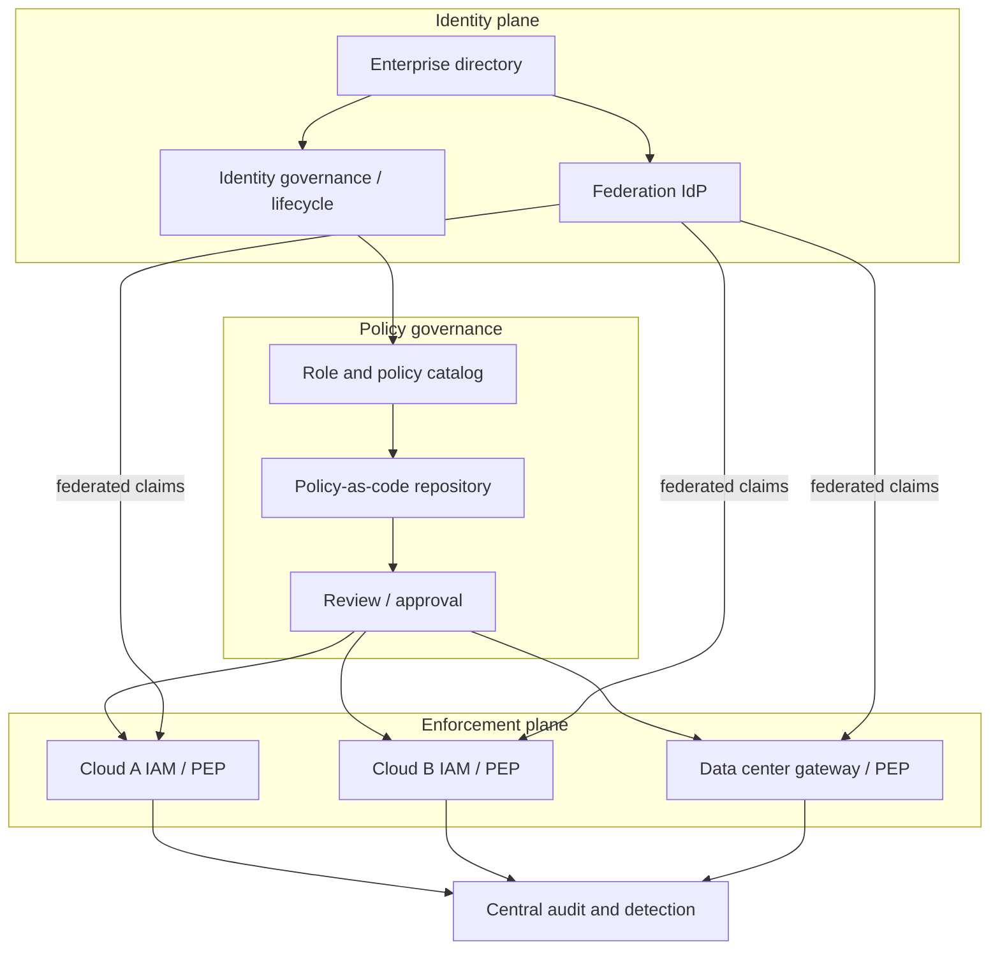

# Identity Federation and Cross-Platform Policy Management

In hybrid and multi-cloud architectures, an employee can sign in through an enterprise identity provider and then access consoles across public clouds, data centers, SaaS apps, and operational tools. A workload may also need to call APIs on another platform without using long-lived passwords or access keys. If every environment maintains its own users, roles, and policies, the organization struggles to control account lifecycles, access permissions, auditing, and incident response when an identity is compromised.

**Identity federation** enables a platform to trust identities or assertions issued by another identity system under a configured trust relationship. **Cross-platform policy management** helps an organization express and verify access requirements consistently across environments, while actual permissions still must be mapped and enforced using each platform's native mechanisms.

In the **CLOUD_ARCHITECTURE** module, this topic connects IAM, networking, workload identity, Kubernetes, CI/CD, secrets, auditing, and governance. The running example is an equipment-rental platform operating across a private data center and two cloud providers: employees access consoles, the Booking API calls the Inventory Service, and pipelines deploy workloads. Protocols, roles, and token lifetimes in this lesson are illustrative; production configurations must rely on the actual capabilities of your identity provider, cloud, protocol versions, and organizational standards.

## 1. Why Is Identity Federation Needed?

As the number of environments grows, each platform may end up with its own set of users, service accounts, groups, roles, and credentials. When managed manually:

- An employee transfers teams, but permissions in the old cloud are not revoked.
- A contractor finishes their engagement, yet an API key remains active.
- Developers share accounts across environments, making actions hard to trace.
- Workloads rely on static keys copied into secret stores or CI logs.
- Roles with the same name have different scopes across providers.
- Incident response must revoke tokens and credentials through inconsistent procedures.

Federation reduces the need to create and manage separate passwords on every platform. Users authenticate with an identity provider controlled by the organization; the target platform verifies the assertion/token, then maps the subject, groups, or claims to local roles.

### Federation Does Not Automatically Create Authorization

Federation answers “where does this identity come from and is it trusted?”. Authorization answers “what is this identity allowed to do on a specific resource?”. A validly signed-in user may still be denied permission to read the payment ledger or modify production firewalls.


## 2. Components in an Identity Model

| Component | Role | Example |
| --- | --- | --- |
| Identity | Entity to be identified | Employee, workload, service account |
| Identity provider (IdP) | Authenticates and issues identity information | Corporate directory/SSO |
| Service provider/relying party | Trusts assertions/tokens and provides services | Cloud console, SaaS |
| Federation trust | Trust rules between issuer and consumer | Trusted issuer, audience, signing key |
| Subject | Principal identifier in token/assertion | Immutable user ID or workload subject |
| Claims/attributes | Attributes about the identity/context | Group, department, tenant, auth time |
| Role/group | Permission set or group membership | booking-readonly, platform-operator |
| Policy decision point (PDP) | Evaluates access decisions | Policy engine |
| Policy enforcement point (PEP) | Enforces decisions | API gateway, cloud IAM, service |
| Audit system | Records authentication, decisions, and actions | Cloud audit log/SIEM |

One identity may have different names across systems. Use an immutable identifier as the federation key rather than an email address or display name that can change or be reassigned.

## 3. Distinguish SAML, OpenID Connect, and OAuth 2.0

These protocols are related but do not replace one another.

| Technology | Primary purpose | Typical payload | Use case |
| --- | --- | --- | --- |
| **SAML 2.0** | Federation for web SSO | XML assertion | Employees signing into SaaS or cloud consoles |
| **OpenID Connect (OIDC)** | Authentication layer on top of OAuth 2.0 | JWT ID token with claims | Web/mobile login, workforce federation, workload federation |
| **OAuth 2.0** | Delegated authorization | Access token | Clients calling APIs with granted scopes |

OAuth 2.0 on its own is not a user authentication protocol. If an application needs to know who signed in, OIDC adds the identity layer over OAuth 2.0. SAML and OIDC also do not define the entire cloud authorization model; the target platform still needs to map identities to permissions.

### 3.1. SAML SSO Flow

1. User visits the service provider (SP).
2. SP redirects the browser to the IdP with an authentication request.
3. IdP authenticates the user and may enforce MFA/conditional access.
4. IdP issues a signed assertion containing the subject and attributes.
5. Browser posts the assertion back to the SP’s ACS endpoint.
6. SP verifies signature, issuer, audience, destination, time conditions, and replay protection.
7. SP creates a session and applies local role mapping.

SAML is commonly used for workforce SSO and enterprise SaaS. Assertion verification must check the proper certificate/key, audience, and validity window; merely parsing XML and trusting its contents is insufficient.

### 3.2. OIDC Authorization Code Flow

Common flow for interactive applications:

1. Client redirects the user to the authorization endpoint.
2. User authenticates at the IdP.
3. IdP redirects an authorization code back to the client.
4. Client exchanges the code at the token endpoint using the appropriate client mechanism.
5. Client verifies the ID token according to OIDC rules.
6. Client uses the access token to call APIs matching the target scope/resource audience.

For public clients such as mobile/SPA apps, use Authorization Code Flow with PKCE; never embed a static client secret inside user-distributed applications.

### 3.3. ID Tokens and Access Tokens

- **ID token:** authentication information about the user and sign-in session intended for the OIDC client.
- **Access token:** credential accepted by a resource server/API to authorize requests based on audience, scope, and policy.
- **Refresh token:** can be used to obtain new access tokens per policy; must be strictly protected with rotation/reuse detection when supported by the provider.

Do not send an ID token to an API as if it were an access token. The resource server must verify that the token was issued specifically for that API, not merely validate a generic signature.

## 4. What Must a Trust Relationship Verify?

Federation creates a new trust boundary. The target platform should constrain:

- **Issuer:** the token/assertion was issued by the designated IdP.
- **Audience:** the token was issued for the correct relying party/resource.
- **Subject:** the principal identifier matches the known namespace and format.
- **Signature:** valid signature against trusted keys/certificates.
- **Time:** exp, nbf, iat, and clock skew within bounds.
- **Nonce/state:** replay/CSRF protection in applicable flows.
- **Authentication context:** MFA/assurance method when required.
- **Token type:** ID token, access token, or SAML assertion matching the context.
- **Algorithm/key lifecycle:** accept only allowed algorithms/keys, and handle rotation and revocation.

Do not trust any token merely because it is signed by a valid IdP. A token may have been issued for a different audience or contain claims unauthorized for granting access to the current resource.

### Trust per Relying Party

Avoid creating one broad trust policy for the entire organization if each workload only needs a subset of subjects. Restrict by issuer, audience, subject condition, repository/branch/environment, or workload namespace wherever the platform supports it.

## 5. Cross-Platform Identity Lifecycle

An IAM model must manage the full lifecycle:

1. **Joiner:** create identity, verify identity, and assign job-appropriate groups.
2. **Mover:** update groups/roles when changing teams, projects, or responsibilities.
3. **Leaver:** disable/revoke sessions and credentials, remove memberships, and check secondary identities.
4. **Periodic review:** owners confirm permissions are still needed.
5. **Exception:** exception permissions have a sponsor, scope, expiry, and risk acceptance.

### Authoritative Source

The organization should designate a source of truth for employee ID, employment status, department, and manager. Cloud groups/roles are synchronized or provisioned via workflows from this source. Avoid letting multiple platforms edit core attributes independently, which leads to conflicting states.

### Provisioning and Deprovisioning

SCIM is a common protocol for automating user/group provisioning and deprovisioning between identity systems and supported apps. However, SCIM alone does not guarantee every role mapping or permission is revoked across all resources; independently verify group memberships, sessions, API keys, service accounts, and credentials.

When a leaver event occurs, the process must revoke sessions/refresh tokens per provider capabilities, disable the identity, remove group memberships, revoke local keys, and inspect automations/ownership created by that identity.

## 6. Mapping Subjects and Claims to Roles

Tokens often carry claims such as subject, tenant, group, department, or authentication context. The target platform maps permitted claims to local roles.

| Claim | Mapping target | Scope |
| --- | --- | --- |
| sub = employee-1042 | Named principal | Stable identity |
| groups = booking-analyst | BookingDataReader | Curated booking views |
| groups = cloud-ops-oncall | ProductionOperatorJIT | Temporary role requiring approval |
| department = finance | Finance data access policy | Does not automatically grant access to all payment data |
| auth_strength = mfa | Condition for sensitive actions | Only one condition within a policy |

Do not use email as the sole principal key if email can change or be recycled. Do not map a broad `employees` group to read access across all data.

### Group Claim Explosion

A user belonging to too many groups can exceed token size limits or make role mapping hard to manage. Use scoped groups/roles, secure entitlement queries, or trimmed claims. Never solve this by skipping permission checks.

### Attribute Trust

Only trust claims originating from verified issuers and flows. Do not trust headers like `X-User-Role` sent directly by clients unless the API gateway strips and re-writes that header from a trusted authentication source.

## 7. RBAC, ABAC, and Contextual Policies

### Role-Based Access Control (RBAC)

RBAC assigns permissions to roles, then assigns users/workloads to roles. This is straightforward when job functions are relatively stable:

- BookingReadOnly: read approved reservation details.
- BookingOperator: perform limited operational actions.
- PlatformAdmin: administer the platform within a defined scope.

The risk is role bloat over time or a single role accumulating permissions across unrelated environments.

### Attribute-Based Access Control (ABAC)

ABAC makes decisions based on attributes of the principal, resource, action, and context:

- Principal: team, employment status, assurance level.
- Resource: owner, classification, tenant, environment.
- Action: read, write, approve, delete.
- Context: network zone, device posture, time, incident state.

For example: allow Finance team employees to read masked payment views only for their assigned tenant, from compliant devices, with recent MFA.

### Combining RBAC and ABAC

RBAC defines the baseline permission set; ABAC restricts by resource/context. Do not encode every dynamic condition into role names; put them in policies so they remain easy to audit and review.

## 8. Cross-Platform Policy Management

Multi-cloud spans multiple policy engines and permission models. A central policy catalog can define intent, but requires adapters/mappings to each platform.

| Layer | Example | Enforcement mechanism |
| --- | --- | --- |
| Enterprise identity | MFA for admins, leaver revocation | IdP/IGA/PAM |
| Organization guardrail | Deny public storage, require encryption | Cloud organization policies/config rules |
| Workload authorization | Service A can only call API B | IAM workload roles, service mesh, or gateway |
| Data access | Analysts read curated views | Database policies, catalogs, ABAC |
| Network | Private paths only between services | Firewalls, routes, security groups, network policies |
| Change governance | Production changes require approval | CI/CD gates, policy engines, SoD workflows |
| Audit/retention | Security logs retained per policy | Logging platform, immutable storage |

### Policy Intent vs. Provider Implementation

A policy intent might be “Production runtime can only read its own service’s buckets.” Across clouds, resource naming, actions, wildcards, conditions, and evaluation order differ. You cannot copy one JSON policy to every provider and expect identical semantics.

Manage policy intents with owners/rationale, mappings to provider-native policies, allow/deny test cases, versioning/approval/rollout, drift detection, time-bound exceptions, and audit evidence.

## 9. Policy-as-Code and Centralized Governance

Policy-as-code lets guardrails be written as code, reviewed through version control, and tested before enforcement.

```text
policy production-workload-identity:
  deny if principal.type == human_user
  deny if credential.type == long_lived_static_key
  allow if principal.federated == true
        and principal.environment == resource.environment
        and action in resource.approved_actions
        and principal.owner == resource.service_owner
```

This is pseudocode expressing intent, not a provider-specific language.

### Central Policy, Local Enforcement

1. The central governance team defines baselines and control intent.
2. The platform team implements policies using each cloud’s native tools.
3. Product teams use approved modules/templates.
4. CI checks for policy drift and resource configuration.
5. Runtime enforcement occurs in IAM, gateways, databases, and networks.
6. Audit/SIEM collects evidence and violations.

The central team should not become a manual approval bottleneck for every minor request. Guardrails can be automated; only exceptions or high-risk changes need independent review.

## 10. Workload Identity and Service-to-Service Federation

Workloads should not use personal accounts or long-lived static keys to call cloud APIs. Instead, workload identity provides a verifiable principal based on runtime/platform identity.

Examples:

- Kubernetes service accounts mapped to cloud IAM roles.
- CI/CD workloads obtaining short-lived OIDC tokens to assume deployment roles.
- VMs/containers using managed identities/instance identities.
- On-prem workloads federating through a controlled identity gateway.

A workload can obtain a token from its runtime issuer and exchange it for temporary credentials in the target cloud. Trust policies must verify issuer, audience, and subject. For example, a CI job can only assume a deployment role when running from an approved repository, branch, and environment.

Do not trust every token from an issuer if only specific repositories or namespaces require access.

### Audience and Subject Restrictions

Audience restricts tokens to a specific target resource/trust. Subject restrictions can bind Kubernetes namespaces/service accounts, repositories/branches/environments, or workload IDs. This reduces the risk of tokens being replayed elsewhere.

## 11. Secrets, Certificates, and Key Management

Federation reduces the need for static credentials but does not eliminate all secrets:

- Third-party API keys.
- Database passwords in legacy systems that do not support federation.
- Private keys/certificates for mTLS.
- Signing keys and encryption keys.
- Client credentials for services without workload identity support.

Principles:

- Store secrets in a secret manager/vault, never in source code, images, or logs.
- Grant secret read access by workload identity and resource scope.
- Use short-lived credentials or dynamic secrets whenever feasible.
- Perform rotation with overlap and verification to avoid downtime.
- Do not share one key across multiple services or environments.
- Audit secret access and alert on anomalous reads.
- Rehearse revocation/recovery.

TLS/mTLS certificates also have their own lifecycle: issuance, trust chains, expiration, rotation, revocation, and certificate authority governance. Federation tokens do not replace transport-layer service-to-service authentication certificates.

## 12. Session, Token, and Revocation Management

Identity federation can produce tokens/sessions that remain valid after a user is disabled. You must manage access token TTL, refresh token rotation/revocation, SSO session lifetimes, session termination, cached authorization, signing key rotation, and token audience/scope.

### Revocation Is Not Always Immediate

Self-contained JWTs can be verified offline by resource servers until they expire, unless a revocation list/introspection or supplementary mechanism exists. Disabling an account in the IdP does not necessarily invalidate all active access tokens on target platforms immediately.

Design trade-offs to balance:

- Short-lived tokens shrink the abuse window if stolen, but increase reliance on issuance/refresh flows.
- Introspection/revocation checks improve immediate revocation, but add latency and runtime dependencies.
- Local caching improves resilience, but introduces policy propagation delay.

Define revocation objectives by sensitivity; admin sessions need faster revocation than low-sensitivity dashboard read sessions.

## 13. Zero Trust and Conditional Access

Federation is one component of Zero Trust, not proof that a request is safe. Every access must evaluate identity, device, workload, resource, action, and context.

Conditional access can evaluate MFA/authentication age, device compliance, network/location risk, user risk, workload attestation, and resource classification.

Do not trust internal networks simply because a request arrives from a private subnet. A compromised workload can use legitimate network paths and still must not have permission to read every service.

## 14. Cross-Cloud Role Mapping: Avoid False Equivalence

Roles across providers are not identical. A role named Contributor or Editor may hold different actions and scopes.

| Enterprise role intent | Platform A | Platform B | Data center |
| --- | --- | --- | --- |
| Booking read-only | Read role on booking views | Read role on corresponding dataset | DB view SELECT |
| Booking operator | Scoped operational role | Scoped project role | Runbook command allowlist |
| Security auditor | Audit read role | Log viewer role | SIEM read role |
| Break-glass admin | Emergency role with approval | Emergency role with TTL | Bastion emergency account |

Mappings must be based on actual actions/resources rather than role names. Use permission diffs to detect when a provider role adds broader or sensitive permissions.

### Deny and Allow Semantics

IAM engines have different evaluation rules: explicit deny, implicit deny, policy inheritance, resource policies, permission boundaries, conditions, and organization guardrails. A policy intent is only considered implemented properly after testing on the target engine.

## 15. Multi-Cloud Authorization Architecture

A reference architecture separates the identity plane, policy governance, and enforcement:



Central governance maintains standards and visibility. Local enforcement decides on concrete resources. If a central policy catalog exists without actual resource enforcement or audit emission, the policy exists only on paper.

## 16. Kubernetes and Federation

Kubernetes has multiple identity layers: human identities accessing the Kubernetes API; service accounts for pods; node identities for kubelet/cloud integration; external identities for CI/CD; and application identities for APIs/services.

### Human Access

The IdP can issue OIDC tokens for the Kubernetes API server. Post-authentication authorization typically uses Kubernetes RBAC or an additional authorizer. RoleBindings/ClusterRoleBindings must constrain namespaces and verbs/resources; do not grant `cluster-admin` to the entire employee group.

### Workload Access

Cloud workload identity can bind cluster service accounts to cloud IAM roles. Trust scopes must bind the cluster issuer, namespace, and service account. Do not share one service account across all pods.

### Admission Policies

Admission controllers/policy engines can block privileged pods, disallowed `hostPath` mounts, unsigned images, or missing resource limits. These are workload platform policies; they do not replace IAM permissions when pods call cloud APIs.

## 17. CI/CD Federation and Software Supply Chain

Pipelines deploying to production are typically high-privilege workloads. Static cloud keys in repositories or CI secrets create risk if logs, runners, or forked jobs are compromised.

1. The CI runner has an identified identity/token issuer.
2. The cloud trust policy accepts only the issuer and subjects of approved repositories/branches/environments.
3. The job obtains temporary credentials for the right role.
4. Policy requires approval for production environments and signed artifacts.
5. The deploy identity holds only the required actions.
6. Audit records repository, commit, workflow run, actor, and target.

Do not trust every branch or every pull request from public repositories. Review forks, reusable workflows, runner isolation, and token exfiltration risks in untrusted jobs.

## 18. Auditing, Detection, and Identity Observability

| Signal | Meaning/risk |
| --- | --- |
| Failed logins/MFA fatigue | Brute force or identity attack |
| New federation trust/provider | Potential unauthorized trust path |
| Issuer/audience/signing key change | Change to trust foundation |
| Group membership/admin role increase | Privilege escalation |
| Unusual token exchange | Workload credential abuse |
| Cross-account role assumption | Out-of-pattern access |
| Secret read spike | Exfiltration or compromise |
| Long-lived key creation | Bypassing workload federation |
| Break-glass usage | Emergency access requiring review |
| Deprovision failure | Leaver may still have access |
| Policy drift | Native permissions no longer match baseline |

Logs should correlate principal ID, issuer, subject, target role, source workload, audience, auth context, action, resource, and correlation ID wherever possible. Never log raw tokens, assertions, passwords, or secrets.

### Identity Metrics

- Percentage of human access using SSO/federation.
- Number of active static keys and key age.
- Time from leaver event to full access revocation.
- Number of roles/groups without an owner.
- Privileged sessions with MFA/JIT coverage.
- Federation failures/latency and token exchange errors.
- Policy drift and overdue exceptions.
- Break-glass frequency and post-incident review completion.

Metrics need owners and targets; a high federation percentage alone does not prove role mappings are safe.

## 19. IdP Availability and Failure Modes

If the IdP becomes unavailable, users may not be able to start new sign-ins or refresh tokens. Workload token exchanges may also fail if dependent on the issuer. Designs must consider:

- IdP availability/SLA and regional resilience.
- Cached sessions/tokens with appropriate TTLs.
- How long can workloads continue using already-issued credentials?
- Do token endpoints have rate limits and capacity for peak demand?
- How does signing key rotation work during an issuer incident?
- Is there recovery/break-glass access for operators?
- Does a failover IdP preserve issuer/subject/trust semantics?

Do not create a broad bypass that “lets everyone sign in when the IdP fails.” Emergency access needs separate controlled identities, alerting, minimal scope, and post-event review.

### Dependency Budgets

API runtimes generally should not call the IdP on every request if tokens can be safely validated locally. Local validation requires key caching, rotation handling, and revocation objectives. Caching too long can keep old keys or revoked permissions; caching too briefly can cause a dependency outage to impact every request.

## 20. Cross-Platform Policy Testing

Policies must be tested for both allow and deny cases on each platform:

- Valid identity, wrong audience.
- Correct issuer, subject outside allowlist.
- Expired or not-yet-valid token.
- Deprovisioned user still holding a session/token.
- Missing or changed group claims.
- Workload from a different namespace/repository.
- Resource belonging to another tenant.
- Sensitive action when MFA/authentication age is insufficient.
- Role mapping containing permissions outside the catalog.
- Native policy drift or explicit deny precedence.

### Conformance Tests

A shared test suite can describe intent and expected decisions. Adapters translate inputs into provider-specific tests, collect results, and compare against expectations. Never assume one policy document behaves identically across clouds and data centers.

## 21. Phased Rollout

### Phase 1: Inventory and Baseline

- Inventory IdPs, directories, cloud accounts, SaaS, and data centers.
- List human/workload identities, groups, roles, keys, and owners.
- Identify sources of truth and lifecycles.
- Classify data/resources by sensitivity and criticality.
- Document existing trust relationships.

### Phase 2: Identity Standardization

- Choose an immutable subject identifier.
- Standardize group/attribute naming.
- Establish joiner/mover/leaver automation.
- Enable MFA/conditional access based on risk.
- Eliminate shared human accounts.

### Phase 3: Federation and Role Mapping

- Set up SAML/OIDC trust per service.
- Verify issuer, audience, keys, time, and subject.
- Create the role intent catalog.
- Map roles to provider-specific permissions.
- Test allow/deny and privilege escalation paths.

### Phase 4: Workload Identity

- Migrate CI/CD and workloads off static keys.
- Bind trust by namespace/repository/branch/environment.
- Grant scoped roles and short-lived tokens.
- Implement rotation/revocation and monitoring.

### Phase 5: Policy Governance and Operations

- Policy-as-code, reviews, and conformance tests.
- Drift detection and exception workflows.
- Audit/SIEM correlation.
- Break-glass and IdP outage drills.
- Periodic access certification.

Do not migrate all systems at once. Pick a pilot workload with an owner, few dependencies, and controllable business impact; standardize the pattern before scaling out.

## 22. RACI and Governance Ownership

| Activity | Identity team | Cloud/platform | Security | Data/service owner |
| --- | --- | --- | --- | --- |
| IdP and directory | A/R | C | C | I |
| Federation trust | R | R | A/C | I |
| Role/permission mapping | C | R | C | A |
| Data access policy | C | C | C | A/R |
| Workload identity | C | A/R | C | C |
| Policy-as-code baseline | C | R | A | C |
| Access review | R | C | C | A |
| Incident/revocation | R | R | A | C |
| Exception/risk acceptance | C | C | R | A |

RACI must assign an accountable owner for each decision. The identity team does not unilaterally decide data entitlements; the cloud team does not unilaterally approve all production permissions without data/security owners.

## 23. Common Anti-Patterns

1. **Federation equals admin everywhere.** A corporate group is mapped to an overly broad role.
2. **Using email as the immutable subject.** Mappings break when emails change or get reused.
3. **Trusting an issuer without checking audience.** Tokens meant for another app are accepted.
4. **Using ID tokens to call APIs.** Resource servers accept the wrong token type.
5. **Treating OAuth as authentication.** Applications lack a proper identity layer.
6. **Static keys in CI/CD.** Credentials can leak and persist indefinitely.
7. **One service account for many workloads.** Blast radius is unisolated.
8. **Group claims granting direct permissions without review.** Membership drift creates excessive privilege.
9. **Mapping roles by name.** Actions/resources are not compared across providers.
10. **Bypassing all policies during IdP outages.** Emergency paths become backdoors.
11. **Disabling a user while leaving sessions/API keys active.** Revocation is incomplete.
12. **Central policy without testing local enforcement.** Baselines exist only on paper.

## 24. Case Study: Hybrid/Multi-Cloud Equipment-Rental Platform

### Context

The platform runs the Booking API on Cloud A, analytics on Cloud B, and the Inventory Service in a private data center. Employees use corporate SSO; CI/CD deploys workloads across environments.

### Human Access

- Corporate IdP authenticates employees via OIDC/SAML depending on service support.
- The `booking-analyst` group maps to read-only curated views.
- The `platform-oncall` group is eligible only to request a JIT operator role.
- Data owners approve read permissions for payment/PII per dataset.
- Leaver events automatically disable the principal and trigger checks for remaining sessions/keys.

### Workload Access

- Booking API uses workload identity on Cloud A.
- To call Inventory in the data center, the service acquires an audience-scoped token dedicated to the Inventory gateway or uses mTLS identity per trust design.
- The analytics pipeline on Cloud B uses a federated CI/job identity to read only the scoped event bucket.
- No shared admin keys are used across the three environments.

### Policy Governance

- Baselines require encryption, auditing, private data paths, and workload identity.
- Policy intents are stored in version control.
- Cloud-native IAM, firewall, and Kubernetes policy mappings are tested independently.
- Exceptions opening cross-cloud data paths require an owner, expiry, and approval.

### Incident Scenario

A CI runner credential is suspected of compromise:

1. Disable/restrict the runner identity and revoke tokens per provider capabilities.
2. Halt untrusted workflows; inspect repository/branch/run history.
3. Check role assumptions across Cloud A/B and the data center gateway.
4. Search audit logs for API actions, data access, and secret reads.
5. Rotate/revoke dependent credentials.
6. Move pipelines to clean runner/workload identities.
7. Re-test trust conditions, policies, and supply-chain guardrails.

The incident demonstrates that a central IdP does not automatically protect workloads if trust policies on individual clouds accept overly broad subjects.

## 25. Trade-Offs

| Decision | Benefit | Trade-off |
| --- | --- | --- |
| Central IdP | Consistent lifecycle and authentication | IdP becomes a critical dependency |
| Independent local accounts | Can operate when federation fails | Identity sprawl and hard revocation |
| Short-lived tokens | Shrinks credential abuse window | Increases reliance on issuance/refresh |
| Local JWT validation | Reduces latency and runtime dependencies | Non-instant revocation, requires key rotation |
| Central policy catalog | Standardizes intent | Needs provider-specific adapters and mappings |
| RBAC | Simple, easy to review | Role sprawl and excess privileges |
| ABAC | Flexible by resource/context | Complex policies, harder debugging |
| Strict federation conditions | Narrows trust | Misconfiguration can disrupt deployments |

Good design does not centralize every decision. Centralize identity lifecycle governance and policy intent, while keeping enforcement close to resources and aligned with platform semantics.

## 26. Well-Architected Alignment

| Pillar | Supporting design | Trade-offs/risks | Verification questions |
| --- | --- | --- | --- |
| **Operational excellence** | Identity lifecycle, IaC, policy tests, access reviews, and runbooks | Multiple trusts/providers need owners and automation | Can an identity be traced and revoked across all environments? |
| **Security** | MFA, short-lived tokens, least privilege, workload identity, ABAC | Misconfigured trust mappings create privilege escalation | Have issuer, audience, subject, and role scope been verified? |
| **Reliability** | IdP resilience, local validation, controlled break-glass | Central IdP outage can block new access | Can operations and recovery run safely if the IdP fails? |
| **Performance efficiency** | Local token validation, bounded caching | Cache vs. revocation trade-off | Are latency and revocation objectives balanced? |
| **Cost optimization** | Fewer static secrets, shared identity tooling, automation | IdP/PAM/SIEM and integrations carry costs | Is identity governance cost lower than current toil/risk? |
| **Sustainability** | Platform reuse, reduced manual secret rotation and duplicate identity stores | Central services require capacity and retention | Are redundant identity stores eliminated while preserving resilience? |

## 27. Pre-Production Review Checklist

- Is there a clear source of truth for users, groups, and employment status?
- Are human identities and workload identities separated?
- Is the right federation protocol chosen for each use case: SAML, OIDC, or OAuth?
- Are issuer, audience, subject, signature, time, and replay conditions validated?
- Are ID tokens and access tokens used for their intended purposes?
- Do group/claim mappings use immutable identifiers and appropriate scopes?
- Do RBAC/ABAC policies have owners, rationale, and test cases?
- Are provider role mappings based on actions/resources rather than role names?
- Does workload federation restrict namespace/repository/branch/environment?
- Are static keys eliminated or covered by time-bound exceptions?
- Do joiner/mover/leaver workflows revoke groups, sessions, tokens, and keys?
- Are token TTLs, refresh, key rotation, and revocation objectives defined?
- Have IdP outages and break-glass procedures been rehearsed?
- Does policy-as-code have allow/deny conformance tests per platform?
- Do audit logs record principal, issuer, audience, target role, action, and resource?
- Do exceptions have owners, approvals, expiry, and compensating controls?
- Do CI/CD runners and service identities follow least privilege?
- Do access reviews and drift detection have cadences and owners?

## 28. Practice Exercises

### Exercise A — Valid Signature, Wrong Audience

Cloud A receives a JWT signed by the corporate IdP, but the token’s audience is for another internal application.

**Question:** should the token be accepted?

**Hint:** no. The resource/trust must validate exact audience alongside issuer, signature, validity window, subject, and token type.

### Exercise B — Leaver Still Has Access

An employee has been disabled in the directory, yet can still read objects on Cloud B using an existing session.

**Question:** which layers should be checked?

**Hint:** access token TTL, refresh tokens, local sessions, cloud role sessions, cached group mappings, standalone access keys, and revocation/introspection behavior.

### Exercise C — CI Runner Static Key

A pipeline uses a shared access key for both dev and production, stored in a secret variable.

**Question:** how should it be redesigned?

**Hint:** workload federation/OIDC, subject conditions per repository/branch/environment, short-lived roles, protected production approvals, runner isolation, and run-identity auditing.

### Exercise D — Non-Equivalent Role Mappings

The Editor role across two clouds grants different permissions; one allows modifying network policies while the other does not.

**Question:** how should this be standardized?

**Hint:** enterprise permission intent, provider-specific mappings, action/resource diffs, deny tests, owners, and periodic reviews. Never rely on role names.

### Exercise E — IdP Outage

The primary IdP is unavailable while on-call engineers need access to resolve a production incident.

**Question:** how do you maintain secure access while restoring the service?

**Hint:** independently protected emergency identities, MFA, scope/time limits, out-of-band auditing, alerting, and post-incident review; never bypass all policies.

### Exercise F — Oversized Group Claims

A user belongs to hundreds of groups, causing tokens to exceed header limits and some gateways to reject requests.

**Question:** how should this be addressed architecturally?

**Hint:** trim entitlement claims, use scoped groups or controlled entitlement lookups, check gateway/token limits, and preserve fail-closed deny policies when data is missing.

### Self-Assessment Criteria

| Capability | Required evidence |
| --- | --- |
| Federation | Trust configuration, issuer/audience/subject validation |
| Identity lifecycle | Joiner/mover/leaver and deprovisioning evidence |
| Authorization | Role catalog, RBAC/ABAC, and provider mappings |
| Workload identity | Token exchange, scoped trust, and short-lived roles |
| Policy governance | Policy-as-code, conformance tests, and exception workflow |
| Secrets/sessions | TTL, rotation, revocation, and key lifecycle |
| Operations | IdP outage/break-glass drills, auditing, and access reviews |

Federation establishes a trust path across platforms; policies determine what an identity can do on specific resources. By cleanly separating authentication, authorization, and enforcement, using stable subjects, restricting issuers/audiences, granting least privilege, automating lifecycles, and testing mappings per provider, an organization can operate hybrid/multi-cloud with consistent accountability and access evidence. Success does not lie in a single SSO login, but in managing permissions end-to-end from the moment an identity is created until it is revoked, even when a platform or identity provider fails.
