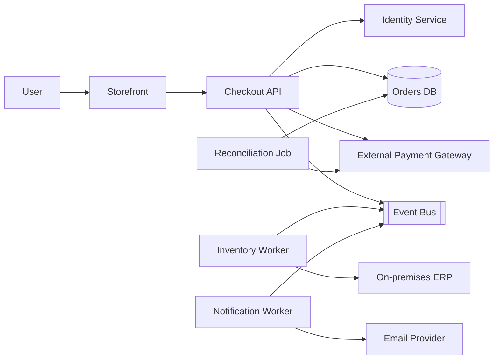

# Application Portfolio Assessment and Dependency Mapping

## 1. Why Assess Before Migrating to the Cloud?

A migration plan can fail even when every server has been migrated successfully. The root cause often lies in undiscovered relationships: an order service still accesses a database in the legacy data center, a reconciliation job only runs at month-end, an application depends on an internal authentication system, or a partner API only allows fixed IP addresses.

Therefore, before choosing virtual machines, containers, database services, or a modernization strategy, an architect needs to answer two questions:

1. **What applications and workloads are we operating, and what business capabilities do they serve?**
2. **How do those components depend on one another, and what happens if one component changes location, version, or stops operating?**

**Application portfolio assessment** creates a structured picture of applications, owners, business value, current technical state, data, and operational constraints. **Dependency mapping** adds the relationships across applications, services, data, platforms, and external parties. Together, these two activities serve as direct inputs for selecting migration strategies, designing the target architecture, estimating costs, grouping *migration waves*, and building the *cutover* plan.

Within the scope of **CLOUD_ARCHITECTURE**, we use assessment results to balance architectural attributes: **reliability, security, performance, scalability, cost, and operability** based on Well-Architected thinking. Without a trustworthy portfolio and dependency map, decisions on networking, compute, data, and deployment models are mere assumptions.

### Learning Outcomes

After this lesson, you will be able to:

- Design a set of metadata fields to inventory applications from both business and technical perspectives.
- Discover, describe, and verify synchronous, asynchronous, data, security, network, and operational dependencies.
- Represent dependencies as a directed graph with criticality, evidence sources, and confidence levels.
- Identify migration risks, group components that require coordination, and propose an evidence-based migration sequence.
- Evaluate assessment completeness and manage remaining uncertainties.

## 2. Identifying the Right Objects to Inventory

The following terms are related but not synonymous:

| Object | Meaning | Example |
|---|---|---|
| **Business capability** | The outcome the organization needs to produce | Order management, payment processing |
| **Application** | A software product that satisfies one or more business needs | E-commerce storefront system |
| **Service/component** | A functional or deployable unit inside or shared across applications | Checkout API, Identity Service |
| **Workload** | A collection of resources and processes performing a unit of work | Web cluster, event-processing task, reconciliation batch |
| **Infrastructure/data asset** | Resources used by a workload | VM, cluster, database, storage, load balancer |
| **Dependency** | A relationship in which one component needs another component to fulfill its function or operate | Checkout calls Payment API |

One application can consist of multiple workloads, one workload can use multiple assets, and multiple applications can share an authentication service or database. If you only count servers, the project team can easily miss SaaS, serverless, scheduled jobs, partner connections, and non-server dependencies.

The **primary unit of management** in the portfolio should be an application or business product with a stable identifier. At the dependency map layer, you can decompose down to services, databases, queues, jobs, and endpoints. The level of detail should serve migration decisions rather than attempting to diagram every process or packet.

## 3. Designing an Actionable Application Portfolio

A valuable portfolio must connect **accountable owner → business function → technical platform → non-functional requirements → migration options**.

### 3.1. Minimum Metadata Fields

| Group | Fields to Collect | Questions Answered |
|---|---|---|
| Identification | Application ID, name, description, environment, usage status | Which application is this? Production or non-production? |
| Business | Capabilities served, core processes, user count, criticality, peak periods | Who is affected by an outage and when? |
| Ownership | Business owner, technical owner, operations team, vendor | Who validates information and approves changes? |
| Architecture | Language/runtime, version, deployment model, OS, middleware, compute, topology | Can it be rehosted or does it require technical changes? |
| Data | Data stores, size, growth, storage location, data classification, data owner | Where does the data reside and how sensitive is it? |
| Integration | Inbound/outbound APIs, queues/topics, file transfers, batches, DNS, ports/protocols, partners | Who does the application communicate with and how? |
| Non-functional | SLO/SLA, traffic and peak load, latency, RTO, RPO, maintenance windows | What are the mandatory reliability and performance levels? |
| Security/compliance | IAM, service accounts, secrets, certificates, access controls, data residency requirements | Are there constraints preventing a change of environment? |
| Operations | Logging, monitoring, tracing, backup/restore, runbooks, CI/CD, past incidents | Is there sufficient observability and recovery capability after migration? |
| Economics/lifecycle | Infrastructure and license costs, contracts, support status, technical debt, replacement plans | Should we invest in modernization or retire it? |
| Preliminary assessment | Complexity, risk, candidate strategy, readiness level, open gaps | Which migration wave does the application fit into? |

**RTO** (*Recovery Time Objective*) is the maximum acceptable duration to restore a service after an outage. **RPO** (*Recovery Point Objective*) is the maximum acceptable amount of data loss, typically expressed in time. For example, `RTO = 2 hours` and `RPO = 15 minutes` are two distinct requirements; RTO cannot be used in place of RPO.

You should distinguish **target requirements** from **actual capabilities**. An application may require a 15-minute RPO while currently only backing up every 24 hours. That gap is a risk that must be recorded, not smoothed over during aggregation.

### 3.2. Example Portfolio Record

| Field | Illustrative Value |
|---|---|
| Application ID | `APP-014` |
| Name | Sales Portal |
| Business owner / Technical owner | Head of Digital Channels / E-commerce Engineering Team |
| Criticality | High: direct revenue impact |
| Components | Web frontend, Checkout API, order-processing worker |
| Current state | VMs in data center, dedicated relational database |
| Traffic | Surges heavily during promotional campaigns |
| Required RTO / RPO | 2 hours / 15 minutes |
| Key dependencies | Identity Service, Orders DB, Payment Gateway, Event Bus |
| Unresolved risks | Month-end batch schedule unconfirmed; payment partner enforces IP allowlist |
| Assessment status | Incomplete, items pending verification |

These values only illustrate how to fill in the record. In a real project, each record must trace back to verified configurations, interview notes, or operational telemetry.

### 3.3. Standardization and Source Governance

Because portfolios are gathered from multiple places, apply the following rules:

- Assign each application a **unique identifier**, regardless of differing names in the CMDB, finance systems, and development teams.
- Explicitly record the **environment** (`prod`, `staging`, `dev`); a test endpoint must never be automatically treated as a production dependency.
- Record the **observation/update date**, **evidence source**, **verifier**, and **confidence level** for critical information.
- Distinguish `no dependencies` from `no dependencies discovered yet`. These two states carry different risk levels.
- Mark unconfirmed owners as `Unknown` and place them on an action list rather than guessing who is accountable.
- Maintain a change history for traceability, because the portfolio is a living operational asset, not a one-time form.

## 4. Identifying All Dependency Types

An arrow `A → B` is defined as **A needs or uses B**. When B goes down or changes, A may be affected. A bidirectional channel may consist of two directed dependencies with different characteristics.

| Dependency Type | Practical Example | Migration Risk |
|---|---|---|
| Synchronous | Checkout calls an authentication REST API for an authorization decision | Added latency, timeouts, retry storms, network path sensitivity |
| Asynchronous | Order Service publishes an event to a queue for a worker to process | Lost or duplicate messages, out-of-order delivery, consumer lag, idempotency requirements |
| Data | Report Service queries the same database or reads shared files | Splitting environments introduces latency, data consistency issues, write conflicts |
| Identity/security | A service uses an IdP, secret store, KMS, or internal certificates | Authentication failure, invalid tokens, inability to decrypt data |
| Network and routing | Internal DNS, firewall rules, proxies, VPNs, IP allowlists | Broken name resolution, wrong routes, unreachable endpoints |
| Platform/operations | Schedulers, monitoring agents, backup servers, artifact registries | Jobs fail to run, blind observability, inability to restore or deploy |
| External parties | Payment Gateway, partner ERP, email/SMS providers | Contract limits, quotas, API support, changes to source IP or geographic region |
| Process and people | Manual reconciliation tasks, deployment approvals, maintenance windows | Unable to cut over on schedule or lacking responders during incidents |

Not every dependency has to move together. An external SaaS service can be **retained** and only have its connection updated. A database shared by multiple applications may need **data splitting or an access interface** before migrating each application independently. Thus, the map describes actual relationships; deciding how to bundle migration units is a subsequent analysis step.

## 5. Assessment and Dependency Discovery Process

### Step 1: Lock Scope and Success Criteria

Define the business units, applications, environments, deployment locations, and assessment timeline. Clearly state which **internal, cloud, SaaS, partner, on-premises, and shared systems** are in scope. Designate the business owners, application owners, data owners, security/network teams, and operations teams responsible for validation.

Opening questions include:

- How many applications are serving production, and how many can be retired?
- Which services can tolerate downtime, and which can barely be stopped?
- Are there requirements around storage location, data control, certificates, or software supported only in a specific environment?
- Will the assessment outputs be used to plan migration waves, estimate budgets, design target architectures, or all three?

Clearly define the target level of detail. For example: for high-criticality applications, every API, database, queue, authentication path, and scheduled job must be verified; for decommissioned applications, you may only need an owner and evidence to retire them.

### Step 2: Build the Initial Application and Asset List

Combine information from the CMDB, system diagrams, cloud/on-premises assets, VM and container inventories, repositories, CI/CD, DNS, load balancers, cost/license records, and owner interviews. Merge duplicate records, assign IDs, reconcile environments, and confirm owners.

Do not rely solely on the CMDB as an absolute source of truth: a CMDB can be incomplete or outdated. Conversely, scanning infrastructure only shows running resources without explaining which business processes they serve.

### Step 3: Combine Top-Down and Bottom-Up Discovery

**Top-down:** interview owners and operators, review architecture docs, business flow diagrams, batch schedules, partner contracts, and recovery plans. This approach uncovers rare relationships, business exceptions, and manual tasks.

**Bottom-up:** inspect application configurations, securely managed environment variables, DNS, API gateways, service meshes, distributed traces, access logs, network flow logs, database audit logs, queue metrics, job schedulers, and connection records. This approach uncovers traffic or endpoints absent from outdated diagrams.

| Discovery Source | Strong At Finding | Limitations to Note |
|---|---|---|
| Owner/operations interviews | Processes, rare events, manual operations | Easy to miss dependencies accumulated over time |
| Configurations, IaC, CI/CD | Endpoints, network rules, intended integrations | May contain stale configs or test-only values |
| Distributed tracing/APM | Request chains, latency, errors, caller/callee | Not all services are instrumented |
| Flow logs, firewalls, DNS | Communication endpoints and network paths | Not all traffic reveals the application or purpose |
| Database/queue/job telemetry | Data access, consumers, periodic jobs | Limited visibility permissions or partial time windows |
| Contracts and partner docs | IP allowlists, endpoints, quotas, maintenance windows | May not reflect the configuration actually in use |

**Do not collect passwords, API keys, private keys, or sensitive data payloads into the portfolio.** Only record the secret management system name, authentication mechanism, and accountable contact. Collecting traces/logs must adhere to access permissions, retention periods, and appropriate data masking controls.

### Step 4: Observe Full Operating Cycles

Look for dependencies during peak hours, off-peak hours, weekends, promotional events, month-end close, and reconciliation windows. If a system runs a monthly batch job, a few hours of traffic observation are insufficient to conclude that no connection exists.

For each finding, determine whether it is **required traffic**, redundant traffic, test connections, or remnants from legacy systems. Distinguish “not observed” from “proven not to exist.” Maintain an open-questions list for owners to confirm.

### Step 5: Model Relationships as a Directed Graph

Each **node** is an application, service, data store, or critical integration point. Each **edge** is a directed dependency with context. At a minimum, store:

| Edge Attribute | Description or Example Value |
|---|---|
| `source`, `target` | `Checkout API` → `Orders DB` |
| `environment` | `prod` |
| `dependency_type` | `data`, `sync-api`, `async-event`, `identity`, `network`, ... |
| `protocol / interface` | HTTPS:443, JDBC/TLS, AMQP, SFTP, ... |
| `criticality` | `blocking`, `degraded`, `optional` |
| `performance` | Call frequency, p95/p99 latency, throughput, or queue consumption lag |
| `failure_behavior` | 2-second timeout; max 2 retries; circuit breaker if present |
| `data / security` | Data classification, encryption requirements, access permissions |
| `evidence` | Trace, log, document, ticket, or confirming person |
| `confidence`, `observed_at` | `verified`, `inferred`, `unknown`; timestamp of check |

A dependency may be **mandatory for one function** without being mandatory for the entire application. For example, Payment Gateway is required for payment completion, whereas Email Service may only affect sending confirmations. Tagging by *business flow* helps avoid overestimating or overlooking impact.

### Step 6: Cross-Verify with Accountable Owners

Hold map review sessions with application owners, data owners, network, security, and operations teams. Every critical dependency should have at least one appropriate piece of technical evidence and confirmation from someone who understands the business flow; when two sources conflict, keep the status as `needs investigation`.

For example, a configuration containing an old database hostname is not enough to prove the application still uses it. However, production traces showing continuous access to that hostname are much stronger evidence. Conversely, seeing no access during a short observation window does not prove a database is no longer in use.

### Step 7: Turn Assessment Data into Architecture Decisions

Once confidence is sufficient, link the graph with business requirements and technical constraints to determine: candidate migration groups, dependencies to keep in place, foundational platform items to prepare, target architecture, test plans, and cutover order.

## 6. Example: E-Commerce Storefront System

Suppose an enterprise wants to migrate its e-commerce platform from self-managed infrastructure to the cloud. Initial discovery shows:

- `Storefront` receives user requests and calls `Checkout API`.
- `Checkout API` needs `Identity Service` to verify users, `Orders DB` to save orders, and a partner `Payment Gateway` to collect payments.
- After recording an order, Checkout publishes an event to `Event Bus`; `Inventory Worker` updates stock, and `Notification Worker` sends confirmations.
- `Inventory Worker` also calls `ERP` in the legacy data center.
- A `Reconciliation Job` runs periodically, reading order data to reconcile payments; the development team did not list this job initially.

The diagram uses the direction **consumer component → used component**, rather than directly depicting packet flow or full request ordering:



Because workers **consume** Event Bus, the edges `Inventory Worker → Event Bus` and `Notification Worker → Event Bus` represent the workers' operational dependence on the bus. If you need to analyze data propagation paths, draw a separate event-flow diagram with arrows `Event Bus → Worker`. State the convention explicitly rather than mixing two meanings in the same edge type.

### 6.1. Illustrative Dependency Table

| Consumer → Provider | Mechanism | Impact on Disconnect | Pre-Migration Checks |
|---|---|---|---|
| Checkout → Identity | Synchronous HTTPS | Cannot authenticate checkout flow | Network path, token/JWKS, cache TTL, timeouts |
| Checkout → Orders DB | Data access | Cannot write orders | Connectivity, data consistency, backups, RPO |
| Checkout → Payment Gateway | Partner HTTPS | Cannot process payments | IP allowlist, TLS, quotas, callbacks/webhooks |
| Checkout → Event Bus | Event publish | Order may save, but post-order processing breaks | Retry mechanism, outbox, idempotency, dead-letter queue |
| Inventory Worker → Event Bus | Event subscribe | Delayed inventory updates | Consumer offsets, backlog, replay mechanism |
| Inventory Worker → ERP | API over hybrid network | Inventory out of sync with ERP | Hybrid connectivity, latency, routing, ERP maintenance windows |
| Reconciliation Job → Orders DB | Periodic batch | Inaccurate or delayed reconciliation | Actual run schedule, access permissions, historical data |

### 6.2. What the Graph Reveals

**First, Checkout cannot be evaluated solely by server CPU/RAM.** Checkout depends on a database, authentication, payment, and an event bus. Placing Checkout in the cloud while keeping the database on-premises may send each transaction across the hybrid network multiple times. That affects latency, availability, and data transfer costs.

**Second, `Orders DB` has multiple consumers.** If you migrate the database and only test Checkout, the reconciliation job may fail at month-end. The dependency map helps identify all data consumers, execution schedules, and connection cutover mechanisms.

**Third, vendor boundaries create distinct risks.** Payment Gateway may require adding cloud source IPs to an allowlist, updating callback URLs, and verifying transaction limits. You cannot assume new infrastructure can automatically reach partners.

**Fourth, asynchronous flows require correctness checks beyond connectivity.** After cutover, duplicate events, late events, consumer lag, or out-of-order delivery may occur. You must verify idempotent processing, backlog monitoring, and appropriate replay procedures.

**Fifth, a map based solely on regular traffic can miss batch jobs.** To safeguard reconciliation quality, you must add job schedules and business owner confirmations.

## 7. From Dependency Graph to Migration Groups and Waves

### 7.1. Impact and Coupling Analysis

Inspect the graph using specific questions:

1. **Shared nodes:** Which services are used by many applications (IdP, DNS, message broker, shared database)? Changing those nodes carries a broad blast radius.
2. **Cross-boundary dependencies:** Which edges cross on-premises ↔ cloud, network zones, accounts, geographic regions, or partners? They require connectivity, latency, and access policy testing.
3. **Dependency cycles:** Cycles such as `Service A → Service B → Service A` can make moving components one by one difficult. Analyzing *strongly connected components* can suggest candidates for coordinated moves, though it does not automatically force them into the same wave.
4. **Central points of failure:** A widely used database or IdP can become a single point of failure or an incident amplifier; examine redundancy and recovery plans.
5. **Operational prerequisites:** Who has permission to change firewalls, DNS, certificates, secrets, licenses, pipelines, and job schedulers? These governance dependencies also dictate deployment schedules.

For critical systems, also inspect **transitive dependency chains**: Checkout may not call ERP directly yet still depends on ERP for inventory synchronization through Inventory Worker. When assessing *blast radius*, include indirect impact paths and recovery capabilities at every hop.

### 7.2. Readiness Scoring

You can score on an illustrative scale from `1` (favorable) to `5` (difficult/high risk) across dimensions:

| Evaluation Dimension | Indicators for a High Score |
|---|---|
| Business value and criticality | Outage heavily impacts revenue, safety, or customers |
| Dependency complexity | Many shared systems, heavy synchronous calls, or dependency cycles |
| Data and compliance | Sensitive data, large volumes, hard to sync, data residency rules |
| Technical portability | Unsupported runtimes, restrictive licenses, hardware-bound software |
| Non-functional requirements | Tight RTO/RPO, low latency, near-zero downtime window |
| Verifiability | Missing owner, missing logs, no test environment or runbooks |

Scores are only a **prioritization and discussion tool**, not a substitute for detailed analysis. Do not mechanically sum all scores and assume lower numbers must always go first: a shared component may need early preparation even if it carries high risk itself.

### 7.3. Outlining Migration Waves

For the e-commerce example, a *reference* sequence is:

| Phase | Activities | Exit Criteria |
|---|---|---|
| Platform preparation | Set up landing zone, identity, hybrid network, DNS, observability, backups, and key/secret management | Verified connectivity, access permissions, and recovery mechanisms |
| Integration testing | Provision target environment; test calls to IdP, Payment Gateway, ERP; verify bus and jobs | Critical flows and exception paths behave properly |
| Data and coupled service migration | Define sync/cutover approach for Orders DB, access paths for Checkout and Reconciliation Job | Data integrity, RTO/RPO, and rollback plans met |
| Application traffic shift | Migrate or deploy Storefront/Checkout/workers; switch DNS/routes per chosen strategy | Errors, latency, throughput, and backlog measured; zero lost orders |
| Stabilization and optimization | Verify reconciliation, costs, SLOs, permissions, autoscaling; retire old resources once qualified | Owners sign off, no hidden dependencies left on legacy systems |

This is an **execution sequence**, not a rule that all components must move at once. Depending on constraints, you might keep ERP on-premises, swap Payment Gateway to a compatible integration, or gradually refactor a shared database. Choose among **rehost, replatform, refactor, repurchase, retain, and retire** based on each application's goals and evidence.

If using dual-write or bidirectional data synchronization during transition, explicitly design conflict resolution rules, event ordering, primary write authority, and reconciliation procedures. Do not assume dual-write is always safer than a controlled write pause.

### 7.4. Target Architecture Constraints Under Well-Architected

| Pillar/Concern | What Assessment Data Helps Decide |
|---|---|
| Reliability | Common points of failure, HA, backup, failover, DR, RTO/RPO along dependency chains |
| Security | Access flows, network segmentation, least privilege, secrets, encryption, sensitive data scope |
| Performance efficiency | Communication latency, data locality, throughput, connection pools, API limits, queue lag |
| Cost optimization | Idle workloads, hybrid/cross-region data transfer traffic, licenses, and assets eligible for retirement |
| Operations | Runbooks, observability, ownership, CI/CD, configuration changes, incident drills |
| Sustainability (if included in the review framework) | Avoiding redundant resources, optimizing capacity, and retiring workloads without remaining value |

In particular, **dependencies do not automatically disappear when changing environments**. The target architecture must specify where each component lives, where communications traverse, who manages them, and how application behavior under failure is verified.

## 8. Deliverables to Hand Over

To make assessment outputs immediately usable by the migration project, an assessment should produce four linked deliverables:

| Deliverable | Mandatory Contents | Primary Audience |
|---|---|---|
| **Application inventory** | ID, function, owner, environment, tech stack, data, SLO/RTO/RPO, cost, lifecycle, verification status | Business owners, architects, program managers |
| **Dependency map & edge register** | Directed graph and edge list, communication type, criticality, evidence source, verification date | Application, network, security, and operations engineers |
| **Risk/unknown register** | Unverified assumptions, impact, priority, assignee, due date, evidence to collect | Risk managers, migration team |
| **Wave & cutover proposal** | System groups, ordering, prerequisites, tests, rollback, sign-off gates | Architects, operations, change management |

An entry in the *risk/unknown register* might read:

> `R-07`: Unconfirmed whether Reconciliation Job reads Orders DB directly on month-end. **Impact:** reconciliation may fail after changing the DB endpoint. **Owner:** finance and application teams. **Action:** cross-check scheduler, DB access logs, and test a reconciliation cycle before cutover. **Status:** unverified.

### Sample Edge Table for Management Tools

```csv
source_id,target_id,environment,type,criticality,evidence,confidence,owner
Checkout,OrdersDB,prod,data,blocking,db-audit-2026-10,verified,OrderTeam
Checkout,PaymentGateway,prod,sync-api,blocking,apm-trace-2026-10,verified,CheckoutTeam
InventoryWorker,ERP,prod,sync-api,degraded,owner-interview,inferred,InventoryTeam
ReconciliationJob,OrdersDB,prod,batch,blocking,monthly-schedule,inferred,FinanceTeam
```

The names and evidence entries in the CSV are **hypothetical for lesson purposes**. In a real project, links to evidence storage systems must allow authorized personnel to inspect them without leaking sensitive information.

### Assessment Completion Criteria

There is no single percentage threshold that fits every organization. Agree on criteria upfront and prioritize by impact; for example:

- All in-scope production applications have an ID, business owner, or an `Unknown` entry assigned for resolution; critical applications have confirmed owners.
- Critical flows (login, transaction writes, payment, reconciliation, backup/restore) have clear dependency lists and verification methods.
- Every critical edge has environment, relationship type, failure impact, evidence, and `verified`/`inferred`/`unknown` status.
- Scheduled cycles and peak load windows appropriate to each application have been reviewed.
- Cross-environment connections, shared services, and partner dependencies have assigned testing owners.
- Every unverified item has a priority, owner, and action; do not approve cutover if unresolved items can introduce unacceptable risk.
- Traceability exists from the inventory/graph to wave plans, test cases, rollback criteria, and sign-off records.

## 9. Common Mistakes and How to Avoid Them

| Mistake | Consequence | Remedy |
|---|---|---|
| Listing only VMs or IP addresses | Misses SaaS applications, business owners, batches, and data dependencies | Maintain application and workload layers, linked by ID |
| Relying solely on diagrams provided by dev teams | Misses connections that emerged in production | Cross-check traces/logs/configs and interview operations |
| Using short-term traffic to conclude no dependency exists | Misses month-end connections or rare events | Observe across full cycles and inspect batch schedules |
| Drawing arrows with inconsistent meanings | Misreads impact direction and migration ordering | Publish edge-direction conventions, separate dependency and data-flow diagrams |
| Ignoring shared dependencies | Migrating one application breaks several others | Analyze high-fan-in nodes and blast radius |
| Not recording evidence and confidence levels | Decisions rely on stale information, hard to audit | Attach evidence, verification date, owner, and open-question status |
| Treating mapping as a one-time task | Map quickly goes stale after deployments and changes | Update from CI/CD, CMDB, telemetry, and change management workflows |
| Testing only successful requests | Misses timeouts, retries, security, failover, and event handling | Test failures, recovery, latency, access controls, and reconciliation |

## 10. Practice Exercise: Choosing Migration Boundaries

**Scenario.** A booking management system consists of `Booking Web`, `Booking API`, `Booking DB`, `Identity Service`, `SMS Provider`, and `Nightly Report`. Booking API calls Identity Service and Booking DB over HTTP/database connections; after booking, the API emits an event so a worker sends an SMS. Nightly Report runs at 01:00 daily, directly querying Booking DB to generate reports for operations. The business wants to move `Booking Web` and `Booking API` to the cloud first, temporarily keeping `Booking DB` and Identity Service on-premises.

**Tasks:**

1. Draw a directed dependency diagram following the “consumer → provider” convention, indicating components remaining on-premises.
2. Identify at least four mandatory checks before shifting production traffic.
3. Pick one risk that cannot be verified from server metrics alone; describe how to collect evidence.
4. Propose a rollback condition specific enough for the operations team to monitor.

**Solution Evaluation Guide:**

- The graph must include `Booking Web → Booking API`, `Booking API → Identity Service`, `Booking API → Booking DB`, `Nightly Report → Booking DB`; for SMS, explicitly show the publisher, broker if any, and SMS consumer rather than assuming the API calls SMS synchronously.
- Key checks include hybrid network path and DNS, tokens/authentication, DB access latency, connection security, logs/traces, and Nightly Report availability. Determine how the application behaves if the DB or IdP fails.
- A potential risk is the 01:00 report still pointing to an old DB endpoint: check job schedules, configurations, and DB logs across execution cycles.
- An illustrative rollback condition is: “Within 10 minutes after cutover, the failed booking request rate exceeds the approved SLO threshold or transactions fail to commit; switch routes back to the legacy environment per the runbook, and reconcile any generated data.” Specific thresholds must be grounded in actual SLOs, observability capabilities, and data handling plans.

## 11. Takeaways

Application portfolio assessment answers **what applications exist, who they matter to, and what constraints apply**. Dependency mapping answers **which component needs which component, via what mechanism, and how far failures propagate**. Combining both results with operational evidence and business requirements enables a grounded migration and modernization plan with controlled risk and post-cutover verifiability.
