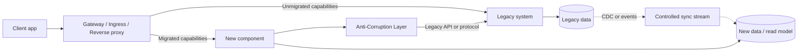

# Strangler Fig, Anti-Corruption Layer, and Incremental Modernization

## 1. The Problem: Modernizing a System While Keeping It Running

In cloud application architecture, **migration** may only mean changing where an application runs, whereas **modernization** transforms how components, data, deployments, and operations are structured to meet new requirements. Many long-lived systems still run critical business processes, making a single *big-bang replacement* high-risk: undocumented hidden behaviors, hard-to-split data, too many integrated consumers, and unacceptable downtime.

Three concepts help reduce the risk of a controlled replacement roadmap:

- **Strangler Fig pattern**: allow old and new systems to coexist, shift individual capability groups or traffic routes to the new components, and retire old parts once dependencies are gone.
- **Anti-Corruption Layer (ACL)**: place a translation layer at the domain boundary so legacy models and rules do not leak into the new design.
- **Incremental migration**: break work into slices that can be measured, released, verified, and operated independently during incidents.

None of the three inherently require microservices. The destination might be a **modular monolith**, a set of services, or a hybrid architecture. The objective is to improve reliability, security, performance, scalability, cost, and operability **according to actual business requirements**.

### When Does This Problem Arise?

Consider a retail system that has operated for years. A single monolith manages product catalog, cart, ordering, payment, and reporting; customer frontends, warehouse systems, and customer support teams all rely on its APIs. The business wants to scale order-status reads during promotions and release new features more frequently.

Replacing the entire monolith at once puts every transaction into a single cutover. An incremental approach can start with **order lookup**, while **order creation, payment, and refunds** remain on the legacy system until the team verifies data flows and business invariants.

## 2. Distinguishing the Three Concepts

| Concept | What Problem It Solves | Where It Lives | Signs of Sound Implementation |
|---|---|---|---|
| Strangler Fig | Incrementally replaces capabilities while serving users continuously | Request boundaries and replacement components | Traffic can route between old/new by capability, user segment, or feature flag |
| Anti-Corruption Layer | Prevents the legacy model from dominating the new domain model | Integration boundary between new components and legacy systems | New components speak their own domain concepts; legacy details stay inside adapters |
| Incremental migration | Shrinks incident blast radius and controls progress | Work, release, data, and operations strategy | Each slice has acceptance criteria, metrics, owners, and incident playbooks |

**Strangler Fig is the replacement strategy**, **ACL is the model-boundary protection mechanism**, and **incremental migration is how delivery and progress are governed**. They complement one another but do not all have to appear together.

For example, moving a read API to a new service while still exposing the legacy app's internal table structures and status codes may be Strangler Fig at the routing layer, yet it fails to establish a clean domain boundary. Conversely, an ACL can integrate two long-lived systems with no plan to retire the legacy one.

## 3. Mechanics of Strangler Fig

The pattern name evokes a new tree gradually growing around an older one. In software, a **stable entry point** receives requests and decides which capabilities are handled by the legacy system and which by new components.



*This diagram illustrates a transition phase and does not imply every project needs both an ACL and CDC. Dashed arrows indicate a data synchronization option when needed.*

Essential elements:

1. **Common entry point**: keeps the public API stable while backend services change; this can be an API Gateway, ingress controller, reverse proxy, or application orchestration layer.
2. **Routing rules**: define clear transition units, such as `GET /orders/{id}` or a pilot customer cohort. Avoid random routing that causes a single customer to observe inconsistent data across consecutive requests.
3. **Coexistence capability**: allows both sides to run during transition; requires monitoring old/new dependency flows and planning final dependency removal.
4. **Cross-boundary observability**: propagate correlation IDs/trace IDs, measuring error rates and latency by route, version, and segment.
5. **Exit conditions**: shut down a legacy component only when its user flows, background jobs, integrations, and data have been replaced or intentionally retired.

### Routing by Operation and User Cohort

Suppose you want to move only the order-status read API to a new service while order creation/modification stays in the legacy app:

```text
request = { method, path, tenantId, traceId }

if method == "GET"
   and path matches "/api/orders/{id}"
   and featureFlag.enabled("orders.read.v2", tenantId):
       forward request -> order-query-service
else:
       forward request -> legacy-application
```

This is **pseudocode** for the routing layer, not a fixed provider configuration. Use a stable `tenantId` to keep the same customer in the same test cohort; ensure authentication, authorization, and trace context are preserved across both routes. If the new API misses criteria, toggling the flag can revert **read traffic** to the legacy system provided the old read path remains compatible and data is intact.

Note: reversing routes is usually easier than **reversing data write authority**. Once order creation/updates move to the new component, flipping a routing flag off will not automatically restore new data accurately in the legacy system.

### Choosing a Business Slice

A good slice has a clear boundary, behavior small enough to verify, and measurable value. You can slice by:

- **Operation**: order lookup first, order creation later.
- **Business capability**: notifications or product catalog first, payments later.
- **Channel/audience**: internal staff first, pilot customer cohort later.
- **Geography/tenant**: a sufficiently independent market or tenant, when data and integrations allow.

Do not automatically pick the easiest code to rewrite. Weigh data coupling, transactions, traffic volume, sensitivity, hidden dependencies, and failure impact.

## 4. Anti-Corruption Layer: Protecting the New Domain Model

A common modernization mistake is copying legacy table names, fields, status codes, and quirks verbatim into the new system. When that happens, the new part runs on containers or cloud services yet remains tightly bound to old design decisions.

An **ACL** translates semantics between two models. It may include:

- **Adapters** to invoke legacy APIs, queues, files, or protocols.
- **Translators/mappers** to convert data types, status codes, currency units, identifiers, and business meanings.
- **Facades** to expose a stable interface to the new domain while hiding integration steps.
- **Error policies** for invalid data, unknown states, timeouts, and legacy contract changes.

For example, the legacy system represents order status as `N`, `S`, `X`, whereas the new application uses `PENDING`, `SHIPPED`, `CANCELLED`. The legacy system stores money in **minor currency units**, while the new domain represents amounts with explicit currency semantics. The ACL centralizes this translation:

```java
import java.math.BigDecimal;
import java.util.Currency;

enum OrderState { PENDING, SHIPPED, CANCELLED }

record LegacyOrder(
    String id, String statusCode, long totalMinor, String currencyCode
) {}

record OrderSummary(
    String id, OrderState state, BigDecimal total, String currencyCode
) {}

interface LegacyOrdersApi {
    LegacyOrder getById(String id);
}

final class LegacyOrderAcl {
    private final LegacyOrdersApi legacy;

    LegacyOrderAcl(LegacyOrdersApi legacy) {
        this.legacy = legacy;
    }

    OrderSummary load(String orderId) {
        LegacyOrder source = legacy.getById(orderId);
        Currency currency = Currency.getInstance(source.currencyCode());
        int digits = currency.getDefaultFractionDigits();
        if (digits < 0) {
            throw new IllegalStateException("Unsupported currency");
        }

        OrderState state = switch (source.statusCode()) {
            case "N" -> OrderState.PENDING;
            case "S" -> OrderState.SHIPPED;
            case "X" -> OrderState.CANCELLED;
            default -> throw new IllegalStateException(
                "Unknown legacy order status"
            );
        };

        return new OrderSummary(
            source.id(),
            state,
            BigDecimal.valueOf(source.totalMinor(), digits),
            currency.getCurrencyCode()
        );
    }
}
```

The Java snippet above illustrates a **translation boundary**. In production, add null/missing field checks, currency code validation, timeouts, access controls, safe logging, contract tests, and handling for newly introduced statuses. Calling `Currency.getDefaultFractionDigits()` avoids assuming every currency uses two decimal places (for instance, VND and JPY typically use 0).

**Design rule:** the new domain layer calls `LegacyOrderAcl.load()` and works with `OrderSummary`; it has zero dependency on `LegacyOrder`, single-character status codes, table names, or legacy-specific SDKs.

An ACL is **not synonymous with an API Gateway**: a Gateway primarily handles edge traffic, authentication, and policies, whereas an ACL handles **business semantic translation**. An ACL can live inside the new service, in a dedicated integration library, or in an intermediary service if clearly justified. Splitting it into a network hop solely to have "an ACL microservice" can increase latency and failure points.

### Scenarios an ACL Should Handle Explicitly

| Scenario | Approach to Consider |
|---|---|
| Unmapped legacy status | Reject or route to exception handling and alert; avoid silently mapping to a wrong business state |
| Differing identifiers across systems | Maintain a governed mapping table with uniqueness rules and provenance |
| Legacy payload missing new fields | Supply defaults when valid in business rules; otherwise return a recognizable error |
| Slow legacy responses | Timeouts, concurrency limits, circuit breakers; retry carefully only when safe or with idempotency keys |
| Differing pricing/tax rules | Designate an authoritative rule source, test edge cases, and validate historical data |
| Legacy model changes | Use contract tests, versioning, and translation error monitoring instead of letting changes silently propagate |

## 5. Data Is the Hardest Part of Incremental Migration

Switching an endpoint can finish quickly, yet **data and transactions** determine whether the new component is truly independent. The first question for every entity is: **which system holds official write authority (system of record / source of truth)?**

### Three Common Transition States

| State | Write Authority | Read Path | Criteria to Advance |
|---|---|---|---|
| **A — Legacy owns** | Legacy handles order writes | Legacy reads; a new read model may be built alongside | Sync lag measured, data reconciled, new API fit verified |
| **B — Gradual read shift** | Legacy remains primary writer | Some users read from new projection; remainder read legacy | Read SLOs met, reconciliation trusted, fault isolation and route fallback ready |
| **C — Write handoff** | New service becomes primary writer for defined scope | New service handles main flow; legacy keeps only defined compatibility feeds | All key consumers migrated or supplied with compatible data; recovery procedures rehearsed |

A transitional data model can use **backfill** for historical records and **CDC (change data capture)** or **domain events** for new changes. With events, account for duplicate delivery, ordering by business key, latency, transient failures, reprocessing, and reconciliation. In transactional systems, a **transactional outbox** often writes business changes and event records within the same database transaction, while a separate process publishes events afterward. An outbox does not guarantee each event is processed exactly once: consumers still need **idempotency**.

For example:

```text
Legacy DB --backfill--> New Order read model
     |
     +--CDC / outbox event--> update read model
                                   |
                                   +--> GET /orders/{id} in new service
```

At this point the new API can scale reads, but order status may still **lag behind the write source**. If business rules require *read-your-writes* immediately after placing an order, design explicitly for it: route post-write reads to the primary source, supply a version/watermark to wait for the projection, or move the entire transaction under one data owner. Never assume eventual consistency is always acceptable.

### Why Avoid Direct Dual-Write?

Suppose order creation writes sequentially to both the old and new databases. If the first write succeeds and the second fails, the two systems drift out of sync. A local ACID transaction does not span two independent databases automatically. Attempting bidirectional sync also invites infinite loops, overwrites, and version conflicts.

Safer practice is to:

1. Designate **one write owner** per entity or business boundary at any point in time.
2. Propagate events/changes to read replicas or compatibility systems in an intentional direction.
3. Use idempotency keys, versions/sequences, bounded retries, and dead-letter/replay mechanisms as needed.
4. Reconcile periodically by records, counts, monetary totals, and business invariants rather than checking event counts alone.
5. Upon transferring write authority, block or reroute every legacy write path, including background jobs, batches, and admin tools.

If an overlapping dual-write phase is unavoidable, establish conflict resolution protocols, narrow scope, failure tests, and clear ownership. **This is an architectural decision that must be evaluated**, not default Strangler Fig behavior.

### Write Handoff Affects Rollback

While legacy still owns the data, reverting reads to the old route is relatively simple. Once the new service accepts orders, payments, or inventory updates, reverting to the old write path requires knowing whether legacy received every change, whether event order was preserved, and whether operations remain valid. Options include pausing writes, controlled reverse sync, restoring from an appropriate backup, or executing **compensating transactions**. Never describe flipping a route back as a complete rollback in this state.

## 6. Slice-by-Slice Implementation Process

A migration can be organized into the following stages. Stages can repeat per business capability rather than waiting for the entire system to finish.

| Stage | Core Work | Evidence to Advance |
|---|---|---|
| **1. Discovery and baseline** | Map user journeys, APIs, batches, integrations, data, hidden dependencies; measure errors, latency, cost, and compliance needs | Dependency list, SLOs, and business constraints confirmed |
| **2. Slice selection and ownership** | Select feature group, data ownership, API/event contracts, read/write paths, and exit criteria | Domain boundary, owners, and failure scenarios designed |
| **3. Entry point and observability** | Configure routing/feature flags, tracing, dashboards, old/new route tagging, auth, and rate limits | Can prove where each request ran; legacy route remains operational |
| **4. Deploy new component and ACL** | Build new domain, legacy adapters, contract tests, and data transformers | Functional completeness for the slice, handling exception codes/states |
| **5. Data sync and reconciliation** | Backfill, CDC/outbox as needed, idempotency, replay, variance checks | Completeness, freshness, and consistency thresholds met |
| **6. Testing and canary** | Integration, load, and security tests; ramp gradually by tenant/traffic percentage while watching SLOs | Error/latency/drift thresholds respected; read traffic fallback rehearsed |
| **7. Write handoff (if in scope)** | Block legacy write paths, switch transaction logic, monitor async processing and recoverability | Single write owner proven; downstream dependencies updated |
| **8. Retire legacy parts** | Migrate batches, admin tasks, consumers; archive data, revoke permissions and resources | Zero valid traffic/dependencies left; backup, archive, and ops sign-off |

For each stage, an Architecture Decision Record (**ADR**) should capture boundary rationale, rejected options, consistency tolerance, SLO targets, dual-run costs, and progression/recovery conditions.

### Example Rollout for an E-Commerce System

**Initial phase — order lookup.** Legacy continues accepting `POST /orders`. The team builds `order-query-service` with a tailored query model, loads history via backfill, and updates it from change streams. The gateway routes selected tenants to the new `GET /orders/{id}`; an ACL is used if the query service still asks legacy for unmigrated fields or states.

**Expansion phase — other read features.** Shift order lists, filters, and customer support views once the new data model satisfies access controls and consistency. Note that fast latency returning wrong data is a failure; reconcile statuses, monetary totals, order ownership, and sensitive data masking.

**Later phase — write operations.** Only after isolating invariants such as inventory reservations, credit limits, payments, and refunds should you move order creation or status transitions. Multi-step transactions may require orchestration or sagas with compensation, though do not introduce sagas if a single-owner ACID transaction solves the problem more simply.

**Closing phase.** Remove legacy APIs and workers once zero consumers remain; remove temporary sync pipelines and unused ACL layers. Run post-retirement checks to ensure no monthly batch job or third-party integration was missed.

## 7. Release Control, Reliability, and Security

### SLOs and Canary Criteria

Targets must derive from baselines and business commitments. The table below is only an **example of how to structure criteria**, not universal thresholds for all systems.

| Signal | How to Observe | Example Evaluation Criterion |
|---|---|---|
| Availability / errors | 5xx rate, timeouts, errors by operation and tenant; old vs. new comparison | Does not exceed agreed SLO error budget |
| Performance | End-to-end p50/p95/p99, gateway load, ACL, DB, and queue latency | Canary p95 is no worse than the approved threshold |
| Data accuracy | Reconciliation of IDs, statuses, amounts, and access rights | Zero discrepancies on critical financial invariants |
| Projection freshness | CDC lag, last-event age, backlog, and dead-lettered events | Within maximum staleness tolerated by the user journey |
| Operational safety | Alerts, traces, replay tooling, and runbooks | Sync/connectivity failure and read-route fallback rehearsed |
| Cost | Dual-run compute, duplicate storage, egress, and ops effort | Transition spend within budget, legacy shutdown milestone set |

When testing with *shadow traffic*, mirror only read traffic or operations guaranteed to have **zero side effects**. Never replay payment, email, order placement, or inventory mutation requests into both systems; doing so creates duplicate transactions.

### Common Risks and Design Mitigations

- **Cascade failure**: new service calls legacy synchronously via the ACL, increasing latency and dependency chains. Apply timeouts, connection caps, circuit breakers, and bulkheads; cache only when consistent with freshness requirements.
- **Loss of traceability**: request IDs are dropped across gateway, service, messaging, and legacy layers. Standardize trace context, structured logging, per-route metrics, and PII redaction in logs.
- **Authorization gaps**: new endpoints omit order-owner or tenant access rules. Enforce both authentication and authorization at the edge and inside services; apply least privilege across components, encryption in transit, and centralized secret management.
- **Breaking contract changes**: new schemas/events lack backward compatibility. Run consumer-driven contract tests, version interfaces, roll out sequentially, and time-box dual-contract support.
- **Data bottlenecks**: backfill competes with production transactions, CDC falls behind, or consumers process duplicates. Rate-limit backfills, monitor lag, use checkpoints, and test replays.
- **Unrecoverable states**: switching write authority without sync or compensation plans. Document rollback feasibility per state, rehearse recovery, and define safe abort points.

## 8. Evaluating Against Well-Architected Pillars

A modernization decision needs multi-dimensional review. The table below uses the familiar six Well-Architected pillars to frame questions; individual cloud platforms may phrase pillars or provide supporting services differently.

| Pillar | Questions When Applying Strangler Fig and ACL |
|---|---|
| **Operational Excellence** | Which team owns each slice? Are dashboards, playbooks, ADRs, post-incident reviews, and transition closure plans ready? |
| **Security** | Are authN/authZ consistent across old/new routes? Does the ACL mask sensitive data, validate inputs, and protect secrets? |
| **Reliability** | Do synchronous legacy calls create single points of failure? Are retries, idempotency, data errors, and post-handoff recovery handled? |
| **Performance Efficiency** | Do gateway/ACL hops add costly latency? Does the read model handle peak traffic without pressuring the legacy DB? |
| **Cost Optimization** | How long is the parallel run? Do CDC, egress, logs, dual environments, and ops push costs beyond expected benefits? |
| **Sustainability** | Upon completion, are legacy resources, interim pipelines, and duplicate storage shut down? Is actual utilization measured? |

No architecture optimizes every pillar simultaneously. For instance, reading from a new projection scales well and relieves the old DB, yet adds sync infrastructure and consistency lag. The decision record must state **which trade-offs were accepted, why, and how they are measured**.

## 9. Anti-Patterns to Avoid

| Anti-Pattern | Consequence | Remedy |
|---|---|---|
| **Distributed monolith**: splitting multiple services that still write to one shared schema | Coupled deployments, unclear ownership, broad blast radius on schema changes | Establish domain boundaries and data ownership before splitting components |
| **ACL that merely renames fields** | Legacy rules leak everywhere, scattering special-case conditionals | Translate business semantics, states, errors, and invariants |
| **Routing everything through an ACL permanently** | Extra network hops, coupling, and cost; fails to retire legacy | Pair every temporary adapter with a removal plan and accountable owner |
| **Shifting traffic before verifying data quality** | New API is fast yet returns stale or wrong data | Finish reconciliation, freshness checks, and read-your-writes validation before canary |
| **Unconditional dual-write** | Drift and broken rollbacks when one side fails | Designate a single writer, use outbox/CDC, and run variance checks |
| **Expanding canary by gut feel** | No objective basis to know whether shifting more traffic is safe | Gate progression on SLOs, error budgets, load tests, and stop conditions |
| **Keeping the legacy system indefinitely** | Parallel-run overhead becomes permanent | Track remaining dependencies and include decommissioning in the definition of done |

## 10. When This Fits vs. When Another Approach Is Needed

**Prefer Strangler Fig** when a system must stay online continuously, functional boundaries can be identified, a common entry point can be placed in front, and replacement risk needs to be spread over time. It is especially useful when full legacy behavior is unclear, yet individual slices can be instrumented and verified.

**Consider alternatives** in these situations:

- Very small applications with few dependencies, tolerable short downtime, and a well-tested replacement: a single cutover may cost less than running two systems.
- The goal is purely changing underlying infrastructure without redesign: **rehost/replatform** may satisfy immediate needs.
- Components share data and transactions too tightly without clear boundaries: prioritize an **internally modularized monolith**, establishing interfaces and ownership first.
- Lack of monitoring, reconciliation, or incident response capabilities: invest in operational foundations and traceability before migrating high-risk transactions.
- Retention regulations, third-party contracts, or strict consistency prohibit two parallel paths: design an appropriate cutover strategy with a controlled maintenance window.

Never build a complex distributed system merely to claim you applied a named pattern. Every slice must carry concrete benefits and success criteria.

## 11. Decision Checklist for a Slice

Before approving traffic into a new component, architects and operations teams should answer:

1. **Scope**: which user journeys, APIs, batches, and events are inside the slice; which dependencies remain in legacy?
2. **Domain model**: which data and rules require an ACL; are any legacy concepts leaking into the new domain?
3. **Write authority**: who is the primary data owner at each stage; how are uncontrolled concurrent writes prevented?
4. **Consistency**: what are the read-your-writes requirements, event ordering guarantees, sync lag limits, and reconciliation workflows?
5. **Observability**: can a single trace distinguish failures across gateway, ACL, legacy, new service, and data pipeline?
6. **Release safety**: have canary cohorts, ramp/halt conditions, flag controls, and recovery procedures been rehearsed?
7. **Security**: are authentication, tenant authorization, secrets, PII handling, and auditing equal to or stronger than the old path?
8. **Trade-offs**: do p95/p99, SLOs, RTO/RPO, dual-run costs, and operational staffing remain within targets?
9. **Completion**: which dependencies will be deleted, when is the temporary ACL removed, how is legacy data archived, and who signs off resource teardown?

A slice is **done** when business behavior and data meet criteria, operations can handle incidents, and legacy components/dependencies in that scope are resolved. Simply getting a new endpoint running is insufficient to declare modernization successful.

## 12. Core Takeaways

Strangler Fig enables **incremental replacement along routable boundaries**; an ACL keeps the **new domain model independent of legacy semantics**; incremental migration provides **release cadence, measurement, and risk control**. In the cloud, success depends far more on **data ownership, consistency, observability, security, and recoverability** than on any specific runtime technology choice.

Keep two principles constant: **each slice needs verified evidence before scaling up**, and **every transitional state must explicitly document what can roll back and what requires data recovery or compensating transactions**.
