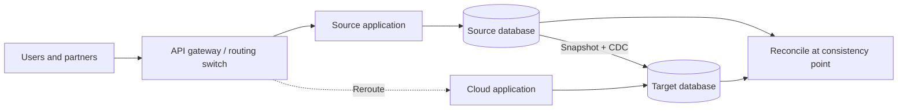

# Designing Cutover, Reconciliation, and Rollback Plans

Migrating an application to the cloud does not finish once servers, networking services, and databases are provisioned in the new environment. The greatest risks typically emerge at the moment real traffic shifts: requests may arrive at both environments, records may be missed or processed twice, external systems may still call old addresses, and a rollback plan may wipe out data created after transition.

This lesson teaches how to design **cutover** (shifting live operations to the target system), **reconciliation** (verifying data completeness and accuracy), and **rollback/failback** (returning to the prior environment) as a single architectural plan with quantitative criteria, accountable owners, and verifiable evidence. This is a core discipline of cloud application modernization: networking, compute, data, and deployment choices must be evaluated simultaneously across reliability, security, scalability, cost, and operability in line with Well-Architected principles.

## 1. Distinguishing the Three Activities and Setting Targets

| Concept | Question to Answer | Expected Outcome |
| --- | --- | --- |
| **Cutover** | When and how do we move users, background processes, and integrations to the new environment? | A single authoritative write path at any moment, with controlled traffic transition. |
| **Reconciliation** | What evidence proves data and business outcomes were not lost, duplicated, or corrupted? | Comparison report at a consistent watermark, list of discrepancies, and remediation actions. |
| **Rollback/failback** | If the transition fails, how do we return to a safe serving state? | Rehearsed recovery runbook that preserves confirmed transactions. |
| **Roll-forward** | If reverting is no longer safe, how do we fix issues directly in the new environment? | Forward-recovery mechanism that still meets data and downtime commitments. |

End-to-end example: an ordering system running in a private data center is moving to the cloud using a managed application runtime and a managed relational database. The application has an API, an orders database, an event queue, and a payment integration. The figures below are **illustrative assumptions only**, not thresholds for every system:

- Confirmed orders must meet **RPO = 0**: losing a transaction reported as successful to a customer is unacceptable.
- **RTO = 30 minutes** for transition failures: core functionality must be restored within that limit, including detection, decision, execution, and verification.
- A planned 15-minute maintenance window is proposed, though actual duration must be measured and negotiated with the business.
- Data can be pre-seeded via snapshot and kept current via **CDC** (*Change Data Capture*), provided the tooling supports the exact change types, transaction ordering, and schema in use.

RPO, RTO, and maintenance windows are three distinct constraints. A system that fails back in 5 minutes while dropping 20 confirmed orders still violates RPO = 0. Conversely, preserving every record while taking hours to resume service can violate RTO.

## 2. Defining Transition Boundaries and Invariants

Before choosing a strategy, define the **unit of transition**: the whole application, a customer/tenant cohort, a single capability, or only the application compute layer. Moving compute while keeping the same database is fundamentally different from moving compute and data together.

Map the real path of a transaction, not just the deployment topology:

| Component | Pre-Cutover Checks | Risk If Overlooked |
| --- | --- | --- |
| DNS, CDN, load balancer, API gateway | Routing switch points, TTLs, long-lived connections, cache invalidation, health checks | Some clients continue hitting the old system. |
| API and user sessions | API contract compatibility, sessions/tokens, idempotency keys, connection pools | Login failures, duplicate order submissions, post-switch connection errors. |
| Databases and object storage | Schemas, keys, record versions, attachments, permissions, encryption | Missing data, broken references, diverging state on both sides. |
| Queues, event buses, batches, schedulers | Consumer groups, offsets, retries, dead-letter queues, schedules, outboxes | Jobs run twice or events go unprocessed. |
| Partners and dependent systems | Webhooks, IP allowlists, certificates, callback endpoints, timeouts | Payments or order confirmations stall. |
| Operations and security | IAM, secrets, KMS, monitoring, access logs, backups, on-call rotation | Inability to observe errors or recover. |

Lock **architectural invariants** into test criteria:

1. **Single authoritative write source:** for any dataset at any moment, only one system may accept writes; if partitioned by tenant, partitioning rules must be explicit. Changing DNS alone does not enforce this.
2. **Zero loss of confirmed outcomes:** a request returning success must exist in the authoritative system and must not vanish after failback.
3. **Non-duplicated side effects:** payments, notifications, and invoicing require idempotency keys, processing states, and clear retry rules.
4. **Evidence at a common data watermark:** metrics from both sides are meaningful only when representing a single consistent set of transactions/versions.
5. **Clear stop and decision authority:** the cutover lead, data, application, network, security leads, and business representative know who can declare *GO*, *NO-GO*, or *ROLLBACK*.

## 3. Choosing a Cutover Strategy Based on Data State

| Strategy | Execution | Advantage | Conditions and Trade-Offs |
| --- | --- | --- | --- |
| **Big bang** | Stop writes, finish final data sync, switch all traffic at once. | Simple sequence, one crisp transition moment. | Requires a downtime window; rollback must account for new writes. |
| **Blue/green** | Pre-build two app environments and flip ingress to *green*. | Easy to test and revert compute routing. | If both environments use different data stores, reverting app routing **does not equal** data rollback. |
| **Canary** | Shift a small traffic slice to measure errors before ramping. | Limits blast radius and validates quality. | Safe for writes only when sharing one authoritative data source or isolated write partitions. |
| **Strangler by feature/tenant** | Shift individual business domains or tenant cohorts via routing rules. | Shrinks each wave; simplifies scoped verification. | Requires handling cross-domain links and interface versions. |
| **Active/active** | Both sites serve concurrently with conflict resolution. | High availability when engineered properly. | Very complex consistency, routing, and conflict logic; never pick by default merely to avoid downtime. |

In our example moving both the app and database, the practical choice is usually **blue/green readiness for compute + snapshot/CDC for data + write cutover at an explicit watermark**. Before that watermark, *green* can be tested with synthetic data or read-only requests; live write traffic opens only after write-authority handoff.



**Common pitfall:** the diagram above depicts the preparation phase. During cutover, the system must enforce a lock/fence on the legacy write path and confirm the new write path is exclusive. Allowing both apps to write to two separate databases diverges state even when replication is fast.

### Pre-Transition Compatibility Prep

- Use **expand–migrate–contract** schema changes: add compatible columns/tables, deploy code reading both old and new versions, migrate data, and remove old structures only after the rollback window closes.
- Keep ingress endpoints stable where possible (gateway/load balancer) instead of relying entirely on DNS TTLs. Long-lived connections, client DNS caches, and partner webhooks may still hold onto old routes.
- Migrate secrets and least-privilege permissions; verify certificates, private links, ACLs, encryption in transit, and encryption at rest ahead of time.
- Verify backups can **actually be restored**, not merely that they show “backup succeeded.” Freeze unrelated deployment changes during the cutover window.

## 4. Designing the Data Cut Point and Execution Sequence

A cutover with continuously changing data requires a **logical watermark**. Depending on technology, this may be a transaction log position/LSN, SCN, binlog offset, checkpoint, or equivalent cursor. You must know with certainty *which transactions committed on source* and *were completely applied on target*. Wall-clock timestamps from two servers cannot prove this.

### Before Cutover

1. Seed target from a consistent snapshot; confirm how CDC starts from that snapshot without transaction gaps.
2. Load historical data, attachments, reference tables, and required configurations; run preliminary partitioned reconciliation.
3. Monitor CDC lag, apply errors, log volume, replication throughput, queue debt, and DDL hazards. Never infer “in sync” merely because a replication process is running.
4. Run a *dry run* with representative data volume, near-production load, and business tests; time every step and rehearse the rollback path.
5. Publish a runbook naming executors, approved commands/actions, expected outputs, stop triggers, and failure handling per step.

### At the Cutover Mark

1. **Stop new writes at the source** using maintenance mode, gateway policies, or strong fencing. Let in-flight transactions finish cleanly; never cut mid-flight after charging payment but before saving the order.
2. **Control async processing:** pause producers/consumers or ensure they run on one side only; record offsets, in-flight events, DLQs, and scheduled jobs. Never run cron jobs in both environments simultaneously.
3. **Lock watermark `W`:** once remaining source transactions commit/abort, record the durable log position. Wait until target CDC applies **at least through `W`** and confirm zero apply errors or hung transactions.
4. **Reconcile at `W`:** verify critical datasets at the exact consistent version; discrepancies in financial data or confirmed orders are a *NO-GO* condition.
5. **Switch write authority and routing:** decisively disable source writes, update gateway/routes, enable target services and target schedulers/consumers, and ensure old entry points cannot accept writes. If using DNS, account for clients caching old addresses.
6. **Controlled smoke tests:** verify login, order reads, test order creation in an appropriate scope, event processing, and keyed queries; inspect both responses and persisted state/side effects.
7. **Ramp traffic per plan, monitor, and record evidence.** If ramping gradually, preserve the single-writer invariant at each step; shifting traffic percentages alone does not keep two databases safe.

For applications that cannot pause writes, design and prove an alternative write-handoff protocol (such as migrating independent tenants, sharing a database, or using a durable command queue as the single ingress). **Ad-hoc dual-write** from an application to two databases is not atomic: one succeeds, the other fails, and retries can create duplicates or reorder operations.

## 5. Reconciliation: Verifying Data and Business Outcomes

Reconciliation is not “both sides have roughly two million rows.” Design explicit checks for every anomaly: missing, extra, duplicate, wrong content, broken relationships, divergent processing, or repeated side effects.

### 5.1. Locking a Comparable Dataset

For meaningful comparison, pick the same business key set and the same watermark `W`:

- If source writes were paused, compare a consistent read snapshot on source against target state applied through `W`.
- If writes continued, you need the ability to reconstruct state at the exact log offset/version or reconcile over a transaction set with a stable watermark; diffing two live mutating tables at different instants causes *false positives*.
- For partitioned/tenant data, record the key set, timestamp, schema version, filters, deleted records (*tombstones*), and transformation rules. Never hide drift by arbitrarily omitting columns.

### 5.2. Multi-Layer Reconciliation

| Layer | Sample Checks | Illustrative Acceptance Level |
| --- | --- | --- |
| **Structure** | Tables, indexes, constraints, data types, time zones, encodings, foreign keys, grants | All business-impacting differences resolved before *GO*. |
| **Data coverage** | Primary/business key sets, row counts by tenant/day/status, deleted rows | Zero missing or extra confirmed orders at `W`. |
| **Content** | Normalized record hashes or key-by-key comparison of critical fields | Discrepancies in money, owner, or order status: 0. |
| **Business aggregates** | Paid order counts, monetary totals in minor units, refund totals, ledger balance | Financial variance: 0. |
| **Relationships & side effects** | Order ↔ payment ↔ invoice, attachments, emitted events, idempotency state | Zero payment confirmations lacking a valid order. |
| **Asynchronous state** | Consumer offsets, outboxes, retries, DLQs, pending transactions | Distinguish valid pending items from lost ones; every backlog item assigned with due date. |

Example aggregate query executed **on two datasets frozen at the same watermark** (adjust SQL syntax per engine):

```sql
SELECT tenant_id,
       status,
       COUNT(*) AS order_count,
       SUM(total_minor_units) AS total_amount_minor
FROM orders
GROUP BY tenant_id, status
ORDER BY tenant_id, status;
```

Compare both `order_count` and `total_amount_minor` per group. Use integers in minor currency units or exact decimal types; avoid `FLOAT` rounding errors when reconciling money. Even so, equal sums **do not prove** every individual order is right: one missing order and one extra order can cancel out. Therefore, also compare key sets, critical fields, and inspect anomalous groups in detail.

For large datasets, compare by stable partitions (tenant, ID range, business date), compute hashes of **deterministically ordered, normalized representations**, and drill down into mismatched partitions key by key. Normalization must handle timestamp formats, `NULL`, decimals, encoding, and field ordering. Full-scan reconciliation creates read load and I/O cost; benchmark it first, use appropriate replicas/snapshots, and schedule to avoid hurting production.

### 5.3. Continuous Post-Cutover Reconciliation

After `W`, the target system begins accepting new transactions, so source state is no longer an exact mirror by default. Post-cutover reports need explicit watermarks and sources of truth:

- **Immediately before GO:** verify historical state up to `W`, especially confirmed orders and balances.
- **Right after opening traffic:** cross-check received requests against database records, outboxes, payments, invoices, and DLQs by correlation ID; check whether any requests still hit the old route.
- **Post-stabilization:** reconcile business days, inspect delayed jobs, retries, webhooks, and end-of-day reports; record run ID, watermark, counts, variances, resolution evidence, and approver.

Set thresholds by **data criticality**, not one blanket percentage. For example, analytics reporting lagging by a few minutes may be acceptable per SLA, whereas an order confirmed to a customer that does not exist is a migration blocker. Avoid logging raw sensitive data in reconciliation logs; use authorized IDs, mask/encrypt sensitive fields, and govern evidence retention.

## 6. Designing Rollback Before Pressing GO

Rollback is a **conditional data state transition**. Switching a gateway from cloud back to on-premises proves only network rerouting; it does not prove orders created after cutover will survive.

### 6.1. Classifying Timing and Recovery Paths

| State | Where Does Live Data Exist? | Safe Strategy |
| --- | --- | --- |
| **A. Target writes not yet opened** | Source remains authoritative; target synced to `W`. | Keep/restore source route and reopen source writes after confirming the new path is locked. This is the simplest rollback window. |
| **B. Target accepted new writes, proven reverse replication exists** | Target holds transactions created after `W`. | Fence/stop target writes, **reverse-sync** valid changes back to source through a new watermark `W2`, reconcile, then return write authority to source. |
| **C. Target accepted new writes without safe reverse sync** | Source is stale; switching straight back loses or overwrites new transactions. | Do not blindly revert writes. Execute a *roll-forward* fix, controlled service recovery, or a specialized data-recovery procedure pre-reviewed with the business. |

The **point of no return** must be defined by real data preservation capability, not clock time alone. Without reverse replication and with RPO = 0, the moment the target commits its first new transaction is the moment simple rollback to source becomes invalid. Restoring an old source snapshot would discard those new transactions unless replay and verification mechanisms exist.

### 6.2. Rollback Triggers and Runbook

Thresholds below are rehearsal examples; tune them to SLOs, traffic baselines, and approved limits:

- *Pre-cutover NO-GO:* replication has not reached `W`, checksums or critical key sets diverge, source writes cannot be fenced, core smoke tests fail, or insufficient time remains to revert within the approved window.
- *Post-cutover ROLLBACK consideration:* 5xx error rate exceeds 2% continuously for 5 minutes **with sufficient sample volume**, severe failures in order/payment confirmation, or single-writer invariant breached. Do not wait a full 5 minutes if lost or duplicated confirmed transactions are detected.
- *ROLL-FORWARD decision:* once new writes exist and reverse sync is unrehearsed or cannot finish within RTO/RPO, operations chooses the recovery path with lower data-loss risk and communicates service status clearly.

Rollback runbook while safe conditions still hold:

1. Incident commander declares the decision and logs the timestamp; temporarily lock writes on the currently active side.
2. Confirm no remaining requests, workers, crons, or webhooks can write to the side losing authority. Use fencing/versioning or database-level write grants if needed; do not rely solely on frontend config changes.
3. Capture confirmed transactions, offsets, and background job states; if returning to source after target writes occurred, reverse-sync the entire delta and verify order/integrity.
4. Run reconciliation at the failback watermark, verifying RPO and external dependencies (payments, message brokers, partner systems).
5. Switch routes, open writes on **strictly one** side, run smoke tests, monitor, and notify stakeholders.
6. Preserve logs, metrics, and evidence for root-cause investigation; schedule a retry after fixing the underlying cause.

Measure rollback duration as **detection + triage + decision + sync/reroute + verification**. A 30-second button press does not mean the full procedure meets a 30-minute RTO.

## 7. Sample Runbook and Decision Criteria

| Reference Time | Lead | Actions and Evidence to Capture | Decision Gate |
| --- | --- | --- | --- |
| **T−7 days** | Architect, SRE, DBA, business | Full-flow rehearsal, backup restore, measure CDC throughput and rollback duration; resolve critical defects. | Lock schedule only when rehearsal meets RTO/RPO. |
| **T−24 hours** | Release lead, security | Freeze change scope, verify IAM/secrets/certs, notify partners, confirm on-call roster and comms channels. | Zero unassigned blockers remaining. |
| **T−60 minutes** | SRE, DBA | Snapshots/checkpoints, CDC health, replication lag, queue depth, error/latency baselines, capacity and target health. | Clearance to enter maintenance window. |
| **T0** | Incident commander / cutover lead | Fence source writes, drain in-flight work, record `W`, wait for CDC apply completion, run reconciliation. | **GO/NO-GO** grounded in data and write safety. |
| **T+ a few minutes** | Network/app lead | Switch routes, open target writes, run smoke tests, confirm old route accepts zero writes. | Ramp traffic further or halt/recover. |
| **T+15 to 60 minutes** | SRE, DBA, business owner | Review SLIs, order/payment confirmations, events and DLQs, post-cutover reconciliation; update status. | Continue monitoring, conditional rollback, or roll-forward. |
| **T+24 hours and post-cycle** | System & data owners | Reconcile reports, delayed batches/webhooks, confirm ops handover, retain source for approved horizon. | Decommission source only after passing gates and rollback horizon. |

A *GO/NO-GO* ticket should record: cutover session ID, deployment/IaC version, watermark `W`, dataset scope, test results, lag metrics, restore points, SLO criteria, on-call roster, and authorized signatures/approvals. When any operational step slips, recalculate remaining time to verify abort or recovery still fits inside limits.

## 8. Reconciliation and Rollback Decision Example

Suppose at `W` the source holds **2,000,000 orders**, where the confirmed subset matches financial reporting totals exactly. The target has only **1,999,998 orders** because two records have not yet been applied by CDC. Even though the gap is just `0.0001%`, the result is still **NO-GO** if those two records belong to confirmed orders. The data team must locate the log position and root cause, apply all missing changes, and rerun key, status, and monetary checks before opening target writes.

After a successful cutover, suppose the cloud accepts **300 new orders**. The on-premises source does not automatically have these 300 orders. If a compute issue occurs and operators simply point the gateway back on-premises, customers may see 300 confirmed orders disappear. To honor RPO = 0, you must either have verified reverse sync with concurrent-write protection, or keep source closed to writes and resolve the issue in the cloud via roll-forward.

This example highlights two separate decisions: **GO** proves historical data moved accurately at `W`; **ROLLBACK** after `W` must prove newly created data is preserved as well.

## 9. Evaluating Against Well-Architected Pillars

| Pillar | Cutover Architecture Review Questions | Required Practices |
| --- | --- | --- |
| **Reliability** | If CDC fails or traffic still hits source, can transactions be lost or split-brain occur? | Single-writer/fencing, RPO/RTO, backup restore, rehearsed rollback, roll-forward readiness. |
| **Security** | Do permissions, secrets, sensitive data, and links transition safely? | Least privilege, encryption, audit trail, post-cutover temporary credential revocation, protected reconciliation reports. |
| **Performance efficiency** | Can target handle real load and backlog bursts when traffic opens? | Load tests, capacity headroom, p95/p99 latency, connection limits, retry-storm controls. |
| **Cost optimization** | How long must both environments, CDC, and data replicas run in parallel? | Parallel-run cost estimates, egress/log/I/O budgets, explicit decommissioning milestones. |
| **Operational excellence** | Who calls GO, who monitors, who holds abort authority, where is evidence stored? | Versioned runbooks, dashboards and alerts, rehearsals, decision logs, postmortems. |
| **Sustainability** | Is an extended dual-environment phase truly necessary? | Controlled cleanup of temporary resources once criteria and recovery windows finish. |

Never optimize one pillar by neglecting the others: shortening parallel run saves cost yet can sacrifice reconciliation or recovery capability; leaving full CDC and verbose logging running too long drives up cost and load. Decisions should rest on business objectives, real tests, and owned risks.

## 10. Design Exercise

A subscription app has 500,000 accounts, a payment transactions table, email jobs, and partner webhooks. Due to maintenance rules, the business permits at most 10 minutes of downtime; confirmed payment transactions require RPO = 0. The engineering team proposes running two app clusters and two databases, using DNS to shift 10% of traffic to the cloud and gradually ramping to 100%.

Prepare a design covering:

1. Diagram write paths, read paths, queues, and webhooks; explain why splitting 10% of traffic across **two independent write databases** risks state divergence.
2. Select a write-handoff method, how to create/lock watermark `W`, and how to handle requests hitting the old address.
3. Propose three measurable *GO/NO-GO* gates where payment reconciliation checks both keys and amounts, not row counts alone.
4. Write two incident paths: one where zero new writes occurred in the cloud; one where 100 confirmed transactions already happened in the cloud without reverse replication.
5. Budget time across detection, decision, rerouting, and verification; verify whether the plan truly fits within 10 minutes.

**Completion criteria:** the design must identify *who* holds decision authority, *what conditions* permit cutover or reversal, *what data evidence* confirms accuracy, and *how* committed transactions are preserved even if the primary plan fails.
