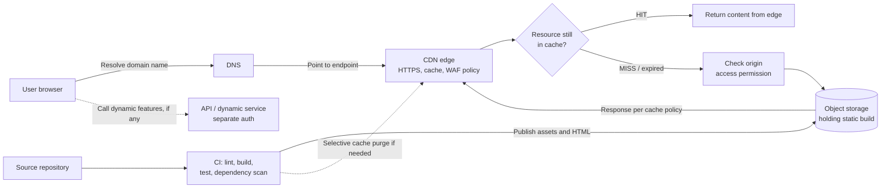
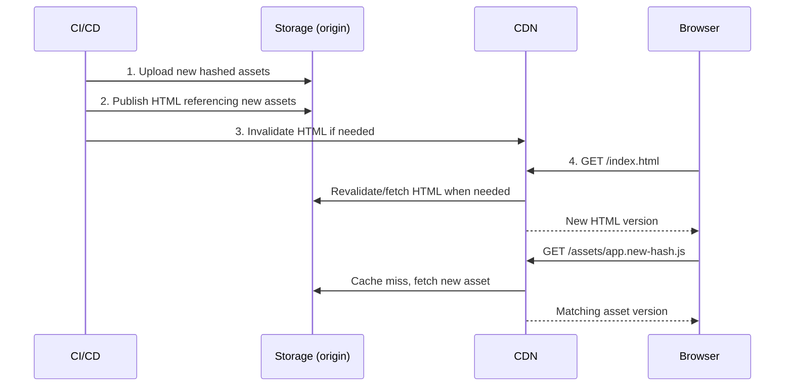

# Static Websites and CDN-Distributed Content

> **Module:** CLOUD_ARCHITECTURE — Designing cloud application architectures from business requirements to network, compute, data, and deployment model choices.  
> **Chapter:** Reference architecture patterns.  
> **Lesson focus:** Designing, deploying, and evaluating a CDN-backed static website across trade-offs in reliability, security, performance, scalability, cost, and operations.

## 1. Problem Statement and Target Outcomes

An organization needs to operate a product showcase website, documentation site, landing page, or the frontend interface of a web application. Visitors are distributed across multiple geographic regions; page loads must be fast, traffic spikes must be absorbed, and content updates must be controllable. Most content is generated before users send requests, so an application server is not needed to generate HTML per view.

A **static website** consists of pre-built HTML, CSS, JavaScript, images, fonts, and other assets delivered over HTTP(S). "Static" describes **how resources are served**, not necessarily the user experience: browser-side JavaScript can still call APIs, handle login, or support real-time interactions. Those capabilities add dynamic services, with their own data and security models.

A **Content Delivery Network (CDN)** is a distributed network of points of presence (*point of presence*, PoP/edge) that can store copies of resources close to users. When a resource is in a valid cache, the edge returns it directly; when it is missing or expired, the CDN fetches it from the **origin** according to configured policies.

After this lesson, learners can:

1. Decide when to use a static website + CDN architecture and when dynamic components are needed.
2. Diagram the delivery flow from DNS, TLS, and CDN to where source files are stored.
3. Design caching, new version releases, and rollbacks without breaking open pages.
4. Protect the origin, domain name, and public resources; distinguish CDN security from API security.
5. Propose observability, incident response, and architecture evaluation against the Well-Architected pillars.

## 2. Reference Architecture



In the diagram:

| Component | Primary responsibility | Architectural decisions |
|---|---|---|
| DNS | Map the domain name to the distribution endpoint | Zone administration rights, appropriate records, DNS TTL, and incident response plan |
| TLS certificate and HTTPS | Encrypt the browser connection to the request entry point | Issuance, renewal, valid domain names, and HTTP-to-HTTPS redirection |
| CDN | Serve cache at the edge, connect to origin when needed, support access policies | Cache key, TTL, error handling, compression, logging, coverage, and egress pricing |
| WAF / bot protection (risk-dependent) | Filter anomalous requests before reaching the origin/API | Blocking rules, rate limiting, false-positive monitoring; WAF does not replace authentication |
| Object storage | Store version-controlled builds | Origin read permissions, versioning, encryption, release mechanism, and recovery |
| CI/CD | Produce and distribute reproducible artifacts | Build quality, release ordering, secrets, testing, and rollback |
| API / identity provider (if any) | Handle data, login, or business operations | Cache separation and personal data authorization |

**Critical trust boundary:** the browser is an untrusted environment; content published through a CDN can be viewed or copied. Never embed secret keys, passwords, server tokens, or private data into JavaScript, HTML, or public source maps.

### 2.1. Resource Read Flow

1. The browser resolves `www.example.com` to the CDN endpoint and performs a TLS handshake.
2. The CDN applies protection policies, normalizes the request, and determines the **cache key** (typically consisting of host, path, and an allowed set of query parameters/headers).
3. On a **cache hit**, the CDN returns the resource from the edge; round-trip time to the origin is eliminated from that request.
4. On a **cache miss** or when freshness revalidation is needed, the CDN fetches the resource from the origin; the response may be cached according to cache directives and CDN policy.
5. The browser applies client-side caching, loads secondary assets, and only calls APIs if the page has dynamic features.

A cache hit reduces load and latency; it is **not guaranteed** for every request. A cold edge, infrequently accessed resource, newly deployed version, or evicted content can all cause a cache miss.

### 2.2. Content Update Flow

From a source code change, the pipeline runs tests, creates a build, uploads new assets to storage, publishes the HTML entry points, and then invalidates the HTML cache if needed. Content-hashed filenames are used so multiple HTML versions can safely reference their corresponding set of assets.

Example build structure:

```text
site/
├── index.html
├── docs/index.html
├── assets/app.4f82c1.js
├── assets/main.90ac2e.css
├── assets/logo.122ad4.svg
└── robots.txt
```

## 3. When Is It Suitable, and When Is Another Architecture Needed?

| Need | Assessment | Recommendation |
|---|---|---|
| Marketing site, documentation, pre-built blog | Very suitable | Object storage + CDN + automated build |
| SPA application backed by a data API | Suitable for the presentation layer | CDN serves static files; API and authentication run separately |
| Website requiring SEO, per-request personalized content | Needs review | Static Site Generation if content can be pre-published; SSR/edge rendering for parts that must be dynamically generated |
| Sensitive content where each user has different viewing permissions | Cannot rely solely on public URLs | Use authentication/authorization at the delivery layer or backend; configure identity-scoped caching or disable shared caching |
| Global traffic or campaign spikes | Especially beneficial | Check origin scalability on cache misses, configure protection, and evaluate delivery cost |
| Very low-traffic, internal-only website | May still be suitable | Weigh CDN benefits against complexity, minimum cost, and private access requirements |

A landing page with a contact form can still be a static website if the form submits to a protected API service. A page displaying an account balance does not become "static" just because the initial HTML is identical: balance data is private data that must be returned by a dynamic component and must not be publicly cached.

## 4. Cache Design and Release Consistency

Caching is the most important architectural decision in this pattern. Distinguish between:

- **Browser cache:** the copy on the user's device, governed by `Cache-Control` and the browser's cache state.
- **CDN/shared cache:** the shared copy at the edge; may follow `s-maxage`, CDN policy, or origin revalidation rules.
- **Origin:** the controlled release source; the fallback for fetching content when caches are insufficient.

### 4.1. Typical Policies

| Resource type | Example HTTP header | Rationale |
|---|---|---|
| Asset with a content-hashed filename | `Cache-Control: public, max-age=31536000, immutable` | Content at that URL never changes; leverage long-term browser and CDN caching |
| Entry-point HTML | `Cache-Control: public, max-age=0, s-maxage=60, stale-while-revalidate=300` | Browser revalidates; shared cache can hold briefly and serve stale temporarily while refreshing, if supported by the CDN |
| Frequently changing public config files | `Cache-Control: public, max-age=300` | Reduces repeat requests while updating relatively quickly |
| Responses containing personal information | `Cache-Control: private, no-store` (per security requirements) | Do not store in shared cache; `no-store` instructs caches not to store the response |

These TTLs are **illustrative values**; they must be chosen based on actual freshness requirements. Do not set `immutable` on `index.html` if the HTML URL does not change. `s-maxage` applies to shared caches; `stale-while-revalidate` is only useful when the cache layer actually supports it and stale responses are acceptable for the configured window.

If the origin provides `ETag` or `Last-Modified`, the CDN or browser can perform conditional requests and receive `304 Not Modified`. `304` saves content transfer bandwidth, but still requires a validation round-trip to the upstream layer.

### 4.2. Cache Key: What to Store and by Which Factors?

The CDN must use a key that identifies each response variant. For files whose content is identical for everyone, host and path are usually enough; for images varying by size, language, or format, a controlled set of query parameters or headers may be needed.

Examples:

- `/assets/logo.svg?utm_source=email`: tracking parameters usually do **not** change the content, so they should not create separate cache entries.
- `/image?id=42&width=640`: the `width` parameter may change the image, so it must be in the cache key if the CDN uses it to select a variant.
- Responses depending on login cookies or `Authorization`: must not enter the default public cache. A strategy to separate origins, separate endpoints, or disable shared caching is required.

A common pitfall is **cache poisoning**: the CDN stores a response influenced by an input that is not included in the cache key. Keep CDN logic, origin logic, `Vary` headers, and query normalization consistent; allow only the variants that are truly necessary.

### 4.3. Release Workflow Without Breaking Older Versions



**Why upload assets before HTML?** If new HTML appears before the new JS/CSS exist, users receive 404 errors. **Why not delete old assets immediately?** Users still hold older HTML in open tabs or caches and still need the old files. To roll back, you can republish the previous release's HTML as long as its corresponding assets still exist.

Points to note:

- Invalidation only affects the specified CDN's cache; it does not guarantee immediate clearance of browser caches, service workers, or every proxy.
- If using a service worker/PWA, you must separately manage its cache lifecycle and application update mechanism.
- CDNs may cache 404/5xx errors according to policy. Check **negative caching** settings to avoid prolonging errors after a fix is deployed.
- With multiple interconnected HTML files, consider a release versioning strategy and test critical pages after publishing.

## 5. Routing, SEO, and Page Load Optimization

Two models must be distinguished:

1. **Multi-page static website (MPA/SSG):** the origin has `/docs/index.html`, `/pricing/index.html`, etc. The server or CDN maps URLs to the exact files.
2. **Single Page Application (SPA):** usually has only `index.html`; navigation to `/dashboard` is handled by the JavaScript router after HTML is returned.

With an SPA, directly accessing `/dashboard` can result in a 404 at the origin. The solution is to configure a **fallback to `/index.html` for application navigation routes**. Do not blindly fall back on all paths: a missing `/assets/app.js` must return a proper error instead of HTML with status 200, otherwise the browser reports MIME errors and monitoring becomes misleading.

For SEO and link sharing, pages need proper metadata, a sitemap, canonical URLs where needed, and must ensure indexable content is rendered according to the chosen rendering strategy. An SPA relying entirely on post-load data fetching may face crawler limitations; SSG or SSR is more suitable when complete HTML is needed in the initial response.

Commonly valuable optimizations:

- Optimize image dimensions and choose suitable formats; use `srcset` and lazy loading for off-screen images.
- Enable Brotli/Gzip compression for text assets; ensure caches handle `Accept-Encoding` variants properly.
- Split JavaScript bundles, load only needed code, and minimize third-party scripts.
- Place fonts, critical CSS, and above-the-fold resources appropriately; avoid over-preloading.
- Use HTTP/2 or HTTP/3 if supported by the CDN service; measure real-world effectiveness over mobile networks and across regions.

**A CDN does not automatically make a website fast** if images are oversized, JavaScript blocks rendering, or dynamic APIs are slow. Both network performance and user experience must be measured.

## 6. Layered Security Design

### 6.1. Protecting the Origin

The standard deployment pattern prefers a **private origin bucket/container**, with the CDN as the only entity permitted to read builds via a provider-supported origin access mechanism (e.g., signed origin requests, identity-based access, or private connectivity). When the service or origin type does not support this, an appropriate access control plan must be designed and direct-access risks identified.

Recommended controls:

- Enable storage encryption at rest and HTTPS between the CDN and origin where HTTPS connectivity is available.
- Grant write permissions to the CI/CD account with least privilege; staging environments must not share production permissions.
- Restrict origin access that bypasses the CDN so distribution policies cannot be circumvented.
- Enable versioning or retain release artifacts for reliable rollback data.
- Control permissions to modify DNS, CDN, certificates, and pipelines; record audit logs for configuration changes.

**Distinction to keep in mind:** a "private origin" does not mean the website becomes private to users; files served publicly by the CDN remain accessible via the public domain.

### 6.2. Protecting the Delivery Path and Browser

- Serve over HTTPS only, maintaining valid certificates and a renewal plan. Enable HSTS with an appropriate scope only after verifying that all related subdomains are ready for HTTPS.
- Use headers such as `Content-Security-Policy`, `X-Content-Type-Options: nosniff`, `Referrer-Policy`, and `Permissions-Policy` suited to the application.
- Prefer having no inline scripts; if necessary, design CSP using nonces/hashes rather than relaxing it with `unsafe-inline`.
- Perform dependency checks, license checks, third-party script vetting, and Subresource Integrity where appropriate for external resources.
- Design WAF and rate limiting around threat models; balance bot controls against the risk of blocking legitimate users.
- Do not treat CORS as authorization. CORS restricts how browser scripts read cross-origin responses; protected resources must still enforce authorization checks on the server.

Example CSP for a **fully self-hosted resource website** (adjust if using APIs, third-party images/CDNs, iframes, or analytics):

```http
Content-Security-Policy: default-src 'self'; object-src 'none'; base-uri 'self'; frame-ancestors 'none'
X-Content-Type-Options: nosniff
Referrer-Policy: strict-origin-when-cross-origin
```

Never place privileged API tokens, cloud access keys, passwords, or business secrets in environment variables bundled into the frontend. Any information inside a JavaScript bundle can be read by visitors.

### 6.3. If the Website Has an API and Login

Separate the two routes:

```text
https://www.example.com/*       -> CDN -> static origin (controlled caching)
https://api.example.com/*       -> API gateway/load balancer -> backend
```

The API is responsible for authentication and object-level authorization; personalized responses require appropriate `Cache-Control` policies. If using cookies, address `Secure`, `HttpOnly`, `SameSite`, CSRF, and domain scope. If using browser tokens, choose storage and refresh mechanisms suited to the threat model. WAF/CDN complement but do not replace API authorization logic.

## 7. Reliability, Scalability, and Recovery

When content is validly cached, many requests can be served without touching the origin, absorbing traffic spikes and reducing reliance on a single data source. However, having multiple CDN edges **does not mean** the entire system is automatically multi-region or always available when the origin fails.

Scenarios to analyze:

| Incident | Potential impact | Design mitigations |
|---|---|---|
| Origin temporarily unreachable | Cache hits may still work; cache misses risk errors | Reduce origin dependency via appropriate TTLs, stale-serving mechanisms where supported, origin recovery, and consider a secondary origin if required |
| HTML deployed before assets | Users load the page but lack JS/CSS | Upload assets first, retain old versions, run post-release smoke tests |
| DNS misconfiguration or expired certificate | Browsers cannot establish a valid connection | Manage DNS changes, expiration alerts, automated renewal, and failover drills |
| Incorrect cache key | Serves wrong variants or risks data leakage | Test query/header/cookie handling, never cache personalized responses in shared caches |
| WAF false positives or CDN misconfiguration | Legitimate users hit 403/5xx errors | Staged configuration rollouts, monitoring, configuration rollback capability |
| Rapid traffic surge with many cache misses | Origin cost and load spike | URL normalization, asset optimization, request collapsing/origin shield if supported, abuse rate limits |
| Dynamic API failure | UI loads but business features fail | Monitor API separately, display error states, bounded retries, and graceful degradation |

Set targets before selecting services: primary user regions, availability target, Recovery Time Objective (**RTO**), Recovery Point Objective (**RPO**), and staleness tolerance. For a static website, RPO usually ties to recovering **release artifacts/configurations**, whereas write data from forms/APIs belongs to the dynamic system and requires its own RPO.

If the business requires continuity during an entire cloud region outage, evaluate cross-region artifact replication, multi-origin/failover, and switchover procedures. Real-world testing is mandatory: not all CDNs fail over origins automatically, and origin failover does not automatically resolve DNS, certificate, configuration, or API data failures.

## 8. Deployment Pipeline and Rollback Strategy

A sample release lifecycle:

```text
Commit/PR
   |
   v
Lint + tests + dependency security checks
   |
   v
Static build, produce hashed assets
   |
   v
Validate links, routes, headers, and bundle sizes
   |
   v
Upload new assets to origin
   |
   v
Publish HTML + release manifest
   |
   v
Selective HTML invalidation (if needed)
   |
   v
Smoke test against public URL + observe metrics
```

Infrastructure configuration should be deployed via Infrastructure as Code if the team operates multiple environments: DNS, certificates, buckets, CDN, WAF, policies, logging, and alerts should all be reviewed. For production write operations, use dedicated pipeline credentials, appropriate approval gates, and an audit trail.

**Practical rollback:** retain artifacts for at least the releases needed for recovery; when a new release causes issues, republish the previous release's HTML/manifest and refresh the HTML cache. If the JS/CSS referenced by the old release were deleted or overwritten, rolling back HTML alone will not suffice. When API or data format changes are involved, verify backward compatibility between frontend and backend versions.

Example post-deploy checks (pseudocode, provider-agnostic):

```text
GET /                   => 200, Content-Type: text/html
GET /assets/app.HASH.js => 200, Content-Type: application/javascript
GET /assets/missing.js  => 404 (must not return HTML)
GET /docs/              => 200 if page exists
HEAD /                  => verify TLS, Cache-Control, and security headers
Verify current release version, key links, API interactions, and console errors
```

## 9. Observability and Operations

Three perspectives must be monitored separately: **browser**, **CDN**, and **origin/API**. Measuring only request counts at the origin misses most traffic when the CDN caches effectively.

| Metric/signal | Question to answer | How to use |
|---|---|---|
| p50/p95/p99 latency and Time to First Byte by geography | Are users actually receiving the first byte quickly? | Break down by region, network, and resource type |
| LCP, INP, CLS from real-user data | Does the page load and respond smoothly? | Optimize images, fonts, CSS, JavaScript, and main-thread tasks |
| Cache hit ratio **by requests and by bytes** | Is the CDN reducing origin traffic as expected? | Distinguish many small requests from a few large files |
| CDN 4xx/5xx vs. origin 4xx/5xx | Do errors originate from routing, edge, policy, or origin? | Alerting and incident isolation |
| Origin requests and egress | How much do cache misses increase load/cost? | Tune cache keys, TTLs, bot rules, and upload policies |
| TLS, DNS, and release health | Are there certificate, configuration, or release errors? | Active synthetic monitoring from multiple locations |
| CDN, WAF, logging, storage, and build costs | Are costs rising due to traffic or configuration? | Budget forecasting and anomaly detection |

CDN logs may contain IP addresses, paths, and query details; minimize sensitive data collection, control access permissions, and enforce retention periods per applicable regulations. Never put tokens in URLs, as they easily leak into access logs and browser history.

At a minimum, set up periodic synthetic checks on critical routes, anomaly alerts on error rates, certificate expiration alerts, and incident runbooks for bad deployments, origin outages, and WAF false positives.

## 10. Design Example for a Nationwide Campaign

**Illustrative requirements:** a business is launching a campaign website at `www.example.com`. Content includes 12 pages, images, and video thumbnails; it links to an API for submitting registration details. Viewers are concentrated in Vietnam, with potential sharp traffic spikes when ads run; the site must be able to update banners within a few minutes.

**Reference approach:**

1. Use a static site generator/SSG to output HTML and assets; optimize images to display dimensions.
2. Store builds in object storage; distribute through a CDN with HTTPS and coverage tailored to users.
3. Enable proper origin access controls, restrict upload permissions to CI/CD, and enable configuration change logging.
4. Content-hashed assets keep long cache lifetimes; HTML uses a short TTL or revalidation mechanism, meeting the requirement to update banners within minutes.
5. The registration form submits to a separate API with authentication/rate limiting, input validation, and no-cache policies on responses.
6. The pipeline uploads assets before HTML; tests key routes and monitors 4xx/5xx, LCP, and cache hit ratios post-deploy.
7. Maintain a ready rollback to the previous release and cost anomaly alerts during the campaign window.

### 10.1. Estimating Transfer Volume for Cost Modeling

Assuming **one million views/month**, with an average of **1 MB of files transferred to the user per view** (after browser caching effects), total transfer from CDN to clients is approximately:

```text
1,000,000 views × 1 MB/view ≈ 1,000,000 MB ≈ 1 TB/month
```

If the CDN **byte hit ratio** is **90%**, the bytes the CDN must fetch from the origin to serve this content is approximately:

```text
Origin transfer ≈ 1 TB × (1 − 0.90) ≈ 100 GB/month
```

This is an **approximate model for framing design questions**, not a pricing quote: additional factors include request charges, storage, API, TLS/WAF, logs, cache invalidation (if billed), bot traffic, hit ratio shifts, and regional pricing tiers. If users cache effectively on their devices, actual transferred bytes may be lower than the 1 MB/view assumption; if pages contain heavy video, costs may be much higher. Actual cost estimates must use the unit prices and terms of the selected provider at design time.

### 10.2. Decisions to Finalize Before Production

| Decision | Default choice in example | Conditions to change |
|---|---|---|
| Distribution source | Object storage + CDN | Internal-network-only requirement, special regulatory constraints, or provider feature limitations |
| HTML updates | Short TTL + selective invalidation | Need near-instant updates or release pipelines spanning multiple cache tiers |
| Origin protection | Allow CDN-only access via supported mechanism | Different origin type or custom deployment requirements |
| Static assets | Hashed filenames, long cache, no overwriting | Files forced to keep fixed URLs with an explicit invalidation process |
| Form handling | Independent API, no caching of personal responses | Business case has zero user-submitted data |
| Recovery | Retain prior releases + HTML rollback | Must survive a regional disaster, requiring origin redundancy and failover testing |

## 11. Well-Architected Evaluation

Well-Architected principles help evaluate the full design lifecycle, not just a diagram that works on paper.

| Pillar | Evaluation question | How it is implemented in the pattern |
|---|---|---|
| **Operational Excellence** | Can a release be reproduced, monitored, and rolled back? | CI/CD, IaC, release artifacts, smoke tests, runbooks, and auditing |
| **Security** | Can the origin be accessed bypassing the CDN? Can data leak in bundles or caches? | Least privilege, HTTPS, CSP, dependency scanning, API auth, and cache policies |
| **Reliability** | What happens on a cache miss when the origin fails? Can releases be recovered? | Appropriate TTLs/stale serving, versioning, artifact backups, RTO/RPO targets, recovery testing |
| **Performance Efficiency** | Do distant users actually experience fast loads? | Well-matched CDN coverage, compression, optimized images, small bundles, RUM/Core Web Vitals measurement |
| **Cost Optimization** | What drives egress bytes and request volume growth? | Proper caching, asset optimization, tracking request/byte hit ratios, traffic-based forecasting |
| **Sustainability** | Is unnecessary data being transferred and processed? | Reducing asset sizes, avoiding duplicate downloads, efficient TTLs and pipelines |

There is no single "best" cache, WAF, or redundancy configuration for every website. For instance, a very long TTL reduces origin load but slows content updates if URLs do not change; a very short TTL increases freshness but raises request volume and origin dependency. Using dual multi-region origins improves resilience while increasing cost, testing effort, and version desynchronization risk.

## 12. Design Checklist and Self-Assessment Scenarios

Before signing off on the architecture, verify:

- [ ] Public content, private data, and dynamic requirements are identified.
- [ ] DNS, TLS, and certificate renewal have owners and alerts.
- [ ] The origin is protected by an appropriate access mechanism; production write permissions are restricted.
- [ ] Cache keys, TTLs, HTML, and hashed assets are specified; query/header variants are tested.
- [ ] SPA deep links, asset 404s, MIME types, and SEO behave as intended.
- [ ] The deploy process uploads assets before HTML and retains enough releases for rollback.
- [ ] CDN and origin logs/metrics, synthetic checks, alerts, and runbooks are in place.
- [ ] Egress, requests, cache misses, WAF/logging costs, and API load are estimated.
- [ ] Staleness tolerance, RTO/RPO, regional outage behavior, and recovery requirements are defined.
- [ ] Decisions are reviewed against Well-Architected pillars with explicit trade-offs documented.

**Scenario Exercise A — CSS not updating:** the site deployed new CSS, but a group of users still sees the old UI. Distinguish between browser cache, CDN cache, filenames, and service workers; propose how to inspect each layer. If CSS uses a hashed filename while the HTML still points to the old filename, will invalidating the CSS solve the root cause?

**Scenario Exercise B — CDN returning another user's data:** an API returns profile data based on a cookie, but the API route was added to the CDN with a public cache configuration. Identify the violated trust boundary, immediate emergency mitigation, and long-term policy for private responses.

**Scenario Exercise C — Sudden traffic spike:** the cache hit ratio drops from 95% to 40% during a promotional campaign; the origin begins overloading. Investigate cache key fragmentation from query tracking, hashed assets, TTLs, anomalous requests, asset sizes, and enabling origin protection mechanisms. Distinguish request hit ratio from byte hit ratio in your reasoning.

### Key Takeaways

The **static website + object storage + CDN** pattern leverages pre-built content to avoid running application servers per view. Practical quality depends on **cache policies, versioned releases, origin protection, dynamic data boundaries, and observability**. When choosing this pattern, articulate trade-offs among content freshness, global performance, reliability on cache misses, cost, and operational overhead based on specific business requirements.
