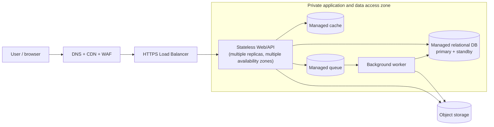

# Multi-Tier Web Applications with Managed Services and Managed Databases

## 1. The Architectural Problem

A web application usually starts with concrete business requirements: users need to access a site, log in, look up data, and execute transactions. A cloud architect must translate those requirements into a design that can be deployed, operated, and scaled. The decision is not merely choosing a server or a database, but also defining which components are exposed to the Internet, how data is protected, how the system responds to failures, and how costs grow with load.

The **reference architecture pattern** in this lesson is a multi-tier web application running on managed compute, using a managed database and supporting services as needed. This is a common pattern for customer portals, ordering systems, admin applications, and many SaaS products.

Learning objectives for this lesson:

- Distinguish the **presentation**, **application/business**, and **data** tiers; understand that logical tier separation does not mandate separate physical servers.
- Diagram request flows from users to the application and database while identifying network boundaries and access permissions.
- Select managed compute, storage, queuing, caching, and database services based on business requirements.
- Evaluate trade-offs across reliability, security, performance, cost, and operations in the spirit of **Well-Architected**.
- Plan verifiable deployment, observability, scaling, backup, and recovery.

### Running Example

Consider an online ordering system with a product showcase site, an order-creation API, and a transactional database. The assumptions below are **illustrative inputs** only and must be confirmed with the product owner before actual design:

| Requirement | Assumption for example | Architectural impact |
| --- | --- | --- |
| Traffic | Peak 300 requests/sec; 80% reads, 20% writes | Requires evaluating application load, DB queries, and scaling approach |
| Experience | p95 response time under 500 ms for core APIs | Requires end-to-end measurement and controlling slow queries |
| Availability | 99.9% monthly SLO | Requires eliminating single points of failure where budget permits |
| Acceptable data loss | Max 15-minute RPO in a defined disaster scenario | Requires backup/replication policies and recovery verification |
| Recovery time | Max 60-minute RTO in that scenario | Requires feasible recovery procedures and infrastructure |
| Security | Contains personal data and order records | Authorization, encryption, auditing, retention policies |
| Financial | Monthly operating budget | Must consider both fixed costs and usage-based costs |

**SLO** is Service Level Objective; **p95** is the threshold at or below which 95% of measured samples fall; **RPO** is the maximum acceptable data loss measured in time; **RTO** is the expected maximum time to restore service after an incident within a defined scope. In a 30-day month, a 99.9% availability SLO corresponds to roughly 43.2 minutes of downtime, if measured by time with no exclusions. An SLO number alone does not determine RPO or RTO.

## 2. Separating Tiers to Manage Responsibilities

A three-tier architecture is typically described as follows:

| Tier | Primary responsibility | Example components | Principle |
| --- | --- | --- | --- |
| **Presentation** | Render UI, receive user interactions | Static HTML/CSS/JavaScript on CDN; server-rendered frontend | Never let the browser access the DB directly |
| **Application/business** | Authentication, authorization, input validation, business rules, API serving | PaaS web app, managed containers, serverless functions | Never trust client data; keep durable state in out-of-process services |
| **Data** | Consistent storage, querying, backup, and recovery | Managed relational DB, object storage | Only authorized entities may access |

"Three-tier" should not be misunderstood as "requiring three servers." A small application can co-locate the frontend and API in a single deployment unit while still separating responsibilities in source code. Conversely, the API can expand into multiple services; the data tier can also span a DB, cache, and object storage. **Separation of concerns** makes it easier to change, secure, and scale each part independently; deployment separation should match actual complexity.

Supporting services are typically added when there is a clear justification:

- **CDN** caches copies of static content close to users, reducing latency and origin load.
- **L7 Load Balancer** distributes HTTP(S) connections, runs health checks, and routes traffic to the application.
- **Managed cache** speeds up frequently read data; requires expiration and refresh strategies.
- **Queues and workers** offload latency-inducing tasks to asynchronous processing.
- **Object storage** stores images, documents, and uploaded files; the DB only keeps metadata and references where appropriate.
- **Secrets management, encryption keys, and workload identities** control service access permissions.
- **Monitoring, logs, traces, and alerts** provide fault detection and traceability.

## 3. Reference Diagram and Network Boundaries



The diagram shows the **logical flow**, not a subnet blueprint or a mandatory resource list. In a typical deployment, Internet entry points are the CDN/WAF and load balancer. Application replicas run in a private network; the DB and cache have no public IP addresses. Object storage and queues may be regional services residing outside the VPC/VNet at the provider infrastructure level, yet accessed via private endpoints, identity policies, and controlled connectivity.

To survive an **availability zone (AZ)** failure, application replicas can be spread across at least two AZs and a DB supporting cross-AZ HA can be chosen. A region may contain multiple AZs; **multi-AZ does not mean multi-region**. Actual standby, failover, and endpoint behaviors depend on the selected service type.

### Least-Privilege Connectivity Controls

| Source → destination | Required connectivity | Recommended policy |
| --- | --- | --- |
| Internet → CDN/WAF/load balancer | Public HTTPS | Valid certificates, rate limiting, and appropriate WAF rules |
| Load balancer → web/API | Approved application port | Accept traffic only from the load balancer; dedicated health checks |
| Web/API → DB | DB protocol/port | Allow access only from authorized application identities and network groups |
| Web/API → cache/queue/object storage | Corresponding service protocol | Task-scoped permissions, encryption in transit |
| Worker → DB/object storage | Least-privilege background permissions | Never grant full infrastructure admin rights |
| Operations components → environment | Controlled administrative channel | SSO, MFA, audit logs; avoid exposing admin ports directly to the Internet |

Use of private subnets, security groups/firewalls, private endpoints, route tables, and egress controls must be verified against provider capabilities. A NAT gateway is only needed if private workloads must reach the outside over a network path requiring NAT; NAT and network data transfer costs can be significant. Being inside a "private" subnet **does not replace** authentication and authorization at the service layer.

## 4. Two Core Processing Flows to Understand

### 4.1. Querying a Product Catalog

1. The browser loads static assets via the CDN and calls the API over HTTPS.
2. The WAF applies protection rules; the load balancer forwards the request to a healthy API replica.
3. The API authenticates the request if the resource requires login, then validates permissions and parameters.
4. The API attempts to read matching data from the cache. On a cache miss, it queries the DB, returns the data, and may populate the cache with a TTL.
5. The API returns the status code, payload, and request tracking info; the system records metrics, logs, and traces.

Caching reduces DB read volume but introduces stale data challenges. Choose **TTL**, invalidation rules, and cache-failure handling carefully. Never cache private per-user data under a shared cache key; never treat the cache as the authoritative source of truth for transactions.

### 4.2. Order Creation and Background Processing

1. The client sends an order-creation request with authentication credentials and an **idempotency key** so retries do not create duplicate orders.
2. The API checks permissions, input payloads, inventory, and business conditions.
3. The API writes the order inside a DB transaction. If reliable business event emission is needed, it writes an **outbox** record in the same transaction.
4. An event-publishing process reads the outbox and enqueues tasks; workers handle notifications or tasks outside the main response path.
5. Workers implement deduplication and bounded retries; persistently failing tasks move to a **dead-letter queue (DLQ)** or manual remediation workflow.

Pseudocode example for the data write step:

```text
BEGIN TRANSACTION
  find order by (customer_id, idempotency_key)
  if already exists: return result of previous order

  validate and update business data requiring consistency
  create order
  create outbox_event(order_created) in the same transaction
COMMIT

separate process: outbox_event -> queue -> idempotent worker processing
```

A matching unique constraint must exist in the DB to prevent two concurrent requests from both passing the "find order" check. Common queues provide **at-least-once** delivery: tasks can be redelivered, so workers must be safe under repeated execution. An outbox prevents situations where the DB commits but the event is lost because queue publishing failed. Not every application needs an outbox; this choice carries operational and codebase overhead.

## 5. Choosing Managed Services Based on Needs

A **managed service** means the provider handles part of the operational work such as infrastructure provisioning, platform patching, backups, or failover under service terms. The engineering team remains responsible for application code, configuration, authorization, data, query performance, and verifying recovery capabilities.

| Decision | Typical options | When appropriate | Trade-offs and questions to verify |
| --- | --- | --- | --- |
| Running web/API | PaaS web app; managed containers; serverless | PaaS is simple for traditional web apps; containers for runtime/deployment flexibility; serverless for spiky loads and short tasks | Startup time, execution duration limits, DB connections, autoscaling, control level, and portability |
| Transactional storage | Managed relational DB | Orders, internal payments, relational data, and ACID transactions | HA cost, connection limits, schema migrations, failover, and compatibility |
| Image/file storage | Object storage | Unstructured content, large volumes | Access policies, lifecycle rules, versioning, request and egress costs |
| Read acceleration | Managed cache | Repeated reads with measured DB bottlenecks | Cache loss, TTL, stale data, cache stampedes, cost of a continuously running cluster |
| Background work | Queue + worker | Sending emails, image processing, external service sync | Acceptable latency, retries, ordering, duplicates, DLQ |
| Operations | Secrets management, observability, IaC, CI/CD | Repeatable deployments, tracking, and auditing needed | Log ingestion/storage fees, access permissions, pipeline maintenance, and config management |

There is no single "best" choice for every workload. For example, serverless can optimize costs under low, uneven traffic, yet requires managing concurrency and DB connection pools. A simple PaaS is often sufficient for small apps; container orchestration is more powerful but adds configuration, resource overhead, and operational skill requirements. A managed relational DB suits orders due to transactionality; NoSQL should only be chosen if access patterns and consistency requirements genuinely fit.

### Decisions on Application State

Web/API replicas should **not keep critical session state in local memory**. If server-side login sessions are required, store them in a shared state store or use an appropriate, secure session mechanism. User files must be persisted outside an instance's ephemeral filesystem. This allows the load balancer to route requests to other replicas during deployments, autoscaling, or instance failures. "Stateless" does not mean the system has no state: state is externalized to services with clear durability and backup strategies.

## 6. Designing Reliability and Recovery

Reliability is built by defining **failures to tolerate** and verifying whether the design handles each one.

| Scenario | Planned mitigation | What can still happen |
| --- | --- | --- |
| Single API instance fails | Health check removes instance; other replicas serve traffic | Reduced capacity; autoscaling has warm-up lag |
| Single AZ loses connectivity | Multi-AZ app replicas; cross-AZ HA DB if available | Remaining AZ needs sufficient capacity; DB failover may disrupt connections |
| Primary DB fails | Managed DB automatically fails over to standby | Brief interruption window; application must reconnect and retry safely |
| DB overloaded or out of connections | Query optimization, indexing, connection pooling, concurrency limits, targeted read caching | Adding more API instances may overload the DB further |
| Queue/worker temporarily stops | Queue buffers work, retries, message age alerts, and DLQ | Background processing lags; backlog growth must be bounded |
| Buggy release | Progressive rollout, health checks, application rollback | Incompatible data migrations can block rollback |
| Data deletion or logic bug | Backups, point-in-time restore (if supported), restore testing | HA/replicas may replicate accidental deletions too |
| Entire region outage | Multi-region DR design when strictly required | Sharply increases cost and complexity of data sync, DNS failover, and operations |

Three commonly confused concepts:

- **High availability (HA)** reduces disruption when infrastructure or components fail, such as automatic failover from primary DB to standby.
- **Backup and restore** recovers data after accidental deletion, logic corruption, or disaster using available recovery points.
- **Disaster recovery (DR)** is the plan to restore full service capability after a major event; it may require a second region, redirection procedures, and periodic drills.

RPO/RTO cannot be inferred solely from labels like "managed," "multi-AZ," or "auto failover." You must inspect service SLAs, backup/replica capabilities, replication lag, and **measure drill durations** against concrete scenarios. If deployed in a single region, do not claim tolerance for a full-region disaster.

### Rules for Retries, Timeouts, and Overload

Applications must set timeouts on DB and dependency connections; retry with **exponential backoff and jitter**, capped at a maximum attempt count, and only when the operation is safe to repeat. For writes, idempotency is required to avoid duplicate side effects. Cap concurrency and apply circuit breakers or load shedding where appropriate to keep one service's failure from cascading. Health checks should distinguish liveness (process is running) from readiness (capable of accepting work); do not make health checks overly aggressive such that the entire fleet is replaced simultaneously when the DB slows down.

## 7. Multi-Layered Security

Security must start from data and access paths, not firewalls alone:

1. **User identity:** choose appropriate authentication (e.g., OIDC), enforce MFA on admin accounts, and check resource-level authorization at the API.
2. **Workload identity:** grant web/API and workers distinct scoped roles; prefer short-lived platform identities over static access keys.
3. **Network:** expose only strictly necessary public endpoints; keep DB/cache behind private boundaries; control outbound Internet access.
4. **Encryption:** HTTPS/TLS in transit, encryption at rest for data and backups, key and certificate lifecycle management.
5. **Secrets:** store DB passwords, tokens, and keys in a secret manager; grant restricted read access, support rotation; never put secrets in repositories, images, or logs.
6. **Application:** validate inputs, prevent SQL injection via parameterized queries, mitigate XSS/CSRF per app type, enforce rate limiting, and manage dependencies.
7. **Auditing:** log privileged logins, IAM/firewall changes, sensitive data access; control retention periods and mask sensitive fields.

WAF, private subnets, and encryption are **complementary layers** and cannot replace proper authorization. Storing personal data also depends on legal requirements regarding data residency, retention periods, deletion, and organizational access controls.

## 8. Scaling and Performance Optimization

As user traffic grows, do not simply add more API instances. Identify the **actual bottleneck** through measurement.

### Initial Estimation from Business Load

In the 300 requests/sec peak example, if 80% are reads, there are roughly 240 read requests/sec and 60 write requests/sec. Assuming only cacheable read requests hit the cache with a 75% cache hit ratio, read requests reaching the DB drop from roughly 240 to 60 requests/sec.

Under the very simplified assumption that each remaining request generates exactly one DB access, the total is roughly:

```text
DB request-equivalents/sec
  = 300 × [0.8 × (1 - 0.75) + 0.2]
  = 120
```

**120 is not a guaranteed SQL queries/sec number.** In practice a single request may execute multiple queries, long transactions, heavy joins, or experience simultaneous cache misses. The calculation's purpose is to highlight assumptions that must be measured via load testing and query profiling.

If average request processing time is 200 ms at steady load, Little's Law estimates around `300 × 0.2 = 60` concurrent in-flight requests within the measured scope. This number is not the thread/CPU count to provision; CPU, I/O, queuing, pool limits, and runtime characteristics must also be factored in.

### Common Bottlenecks

| Bottleneck | Symptoms | Priority actions |
| --- | --- | --- |
| Web/API CPU or memory | p95 rises alongside utilization, many timeouts | Profiling, code optimization, bounded scale-out with limits |
| DB queries | Slow queries, high I/O, lock waits | Inspect execution plans, proper indexing, pagination, eliminate N+1 |
| DB connections | Pool exhaustion, connection spikes on autoscale | Pooling, concurrency caps, consider a connection proxy |
| Repeated data reads | Same keys queried heavily | Caching with TTL/invalidation and cache-stampede protection |
| Reporting reads impacting transactions | Long read queries hurting writes | Isolate reporting workloads; read replicas if replication lag is acceptable |
| Slow tasks | API waiting on email/image processing | Queue and worker with queue age/backlog metrics |

Read replicas typically exhibit **replication lag**, making them unsuitable for reads that must immediately observe newly written data unless consistency guarantees exist. Adding caches or replicas before measuring can also increase cost and complexity without fixing the root issue.

## 9. Deployment and Continuous Operations

An architecture is only complete when the team can reproduce environments, deploy safely, and detect incidents.

### Reference Deployment Workflow

1. **Infrastructure as Code (IaC):** define networking, permissions, compute, DB, observability, and backup policies in versioned, reviewed configuration.
2. **Environment separation:** dev/staging/prod maintain strict access and data boundaries; never use real customer data for testing unless authorized and adequately protected.
3. **CI:** build, lint, run appropriate tests, and scan dependencies/images before release.
4. **CD:** rolling, canary, or blue/green deployments depending on platform; shift traffic only when health checks and live metrics pass thresholds.
5. **Schema changes:** prefer **expand–migrate–contract** so old and new API versions can coexist during transitions.
6. **Recovery:** maintain application rollback commands, DB recovery runbooks, and restore-tested backups.

Do not equate code rollback with data rollback. A migration dropping columns or irreversibly transforming data can prevent older code from running; therefore compatibility and remediation plans must be designed upfront.

### Observability and Alerting

| Group | Metrics to track | Example operational questions |
| --- | --- | --- |
| User experience | Request rate, error rate, p50/p95/p99 latency, availability vs. SLO | Are users currently experiencing errors or slowness? |
| Web/API | CPU, memory, replica count, restarts, saturation, timeout rate | Is autoscaling keeping up with load? |
| DB | Query latency, slow queries, connection count, lock waits, storage, replication lag | Is the DB the bottleneck or nearing its limits? |
| Queue | Backlog, oldest message age, retries, DLQ | Is background work piling up? |
| Security | Anomalous logins, IAM/firewall changes, secret access, WAF events | Is there suspicious activity to investigate? |
| Cost | Spend by service/environment, egress, log ingestion, backups, quotas | Which component's cost is diverging from forecast? |

Propagate trace/correlation IDs across CDN/load balancer, API, and workers when supported by the platform. Logs should be structured with sufficient diagnostic fields while **stripping passwords, tokens, and unnecessary personal data**. Prioritize alerts on user-impacting signals, resource exhaustion risks, and SLO violations rather than standalone CPU alerts.

## 10. Costs and Architectural Trade-Offs

Total operating cost goes beyond web instances and DB pricing. A rough model can be written as:

```text
Monthly cost ≈ compute + managed DB/HA + storage/backups
             + cache/queue + load balancer + NAT/private endpoints
             + bandwidth/egress + logs/metrics/traces
             + security services and related operational costs
```

Often overlooked items include standby instances, cross-AZ data transfer, Internet egress, NAT gateways, overly long log retention, over-provisioned DBs, and maintaining staging environments. Billing models differ across providers; use pricing calculators and measured usage in the target region.

| Decision | Benefit | Cost / limitation |
| --- | --- | --- |
| Multi-AZ Web/API | Reduces risk of single-AZ loss | Requires baseline capacity, load balancing, and operations |
| Managed HA DB | Reduces self-management toil and supports failover | Higher cost than single-AZ; still requires restore testing |
| Serverless for uneven load | Avoids paying for idle capacity | Cold start risk, runtime limits, DB connection bursts |
| Dedicated cache | Reduces DB reads, improves latency | Service cost, invalidation complexity, and stale data |
| Queue/worker | Absorbs spikes, isolates slow work | Processing delay, duplicate handling, and monitoring overhead |
| Multi-region DR | Protects against full-region failure by design | High cost, data synchronization complexity, and drill overhead |

**Design rule:** only add a component after identifying the requirement it solves and how its effectiveness will be measured. For example, a small internal portal can start with a simple PaaS and managed DB with clear backup/restore; a transactional system with a strict SLO needs HA and failover testing sooner.

## 11. Well-Architected Review

The Well-Architected pillars provide systematic check questions for this pattern:

| Pillar | Evaluation question | Expected evidence |
| --- | --- | --- |
| **Operational excellence** | Can you deploy, monitor, handle incidents, and learn from them? | IaC, pipelines, runbooks, dashboards, game-day drills |
| **Security** | Who can access each component and dataset? | IAM policies, data-flow diagrams, permission reviews, audit logs, secret rotation |
| **Reliability** | When an instance/AZ/DB fails, does the service still meet its SLO? | Failure tests, restore tests, measured RPO/RTO, capacity reserves |
| **Performance efficiency** | Do services and resources match workload characteristics? | Load tests, p95 metrics, query plans, scaling tests, saturation metrics |
| **Cost optimization** | How do costs scale when traffic doubles or data retention lengthens? | Cost breakdowns, tagging, budgets, and alerts |
| **Sustainability** | Are idle resources and unnecessary data retention minimized? | Right-sized autoscaling, lifecycle policies, right-sizing |

Do not use checklists as a substitute for architectural reasoning. Every choice must tie back to business objectives, acceptable risk, cost, and operational ownership.

## 12. Design and Validation Exercise

Suppose the ordering system team has confirmed: peak 300 requests/sec, API p95 under 500 ms, 99.9% SLO, personal data involved, max 15-minute RPO, and max 60-minute RTO **for incidents defined within DR scope**. Draft an initial design and explicitly list missing assumptions.

### A Defensible Starting Proposal

| Aspect | Initial proposal | Must measure/verify before finalizing |
| --- | --- | --- |
| Entry point | DNS, CDN/WAF, HTTPS load balancer | Domestic/international traffic mix, cache ratio, bot protection |
| Compute | Stateless Web/API on PaaS or managed containers; at least two replicas across multiple AZs | Capacity on single-AZ loss, startup time, autoscale limits |
| DB | Managed relational DB with cross-AZ HA, encryption, and suitable backup/PITR | Actual failover behavior, restore time, DB throughput, ability to meet RPO/RTO |
| Auxiliary data | Object storage for images/files; cache only if measurements show benefit | Bucket permissions, TTLs, request/egress costs |
| Asynchronous | Queue + worker for notifications and slow processing | Idempotency, DLQ behavior, acceptable job latency |
| Security | Private connectivity, workload identity, secret manager, TLS, RBAC | Data residency, admin workflows, auditing |
| Operations | IaC, CI/CD, SLO dashboards, alerts, backup/restore drills | On-call procedures, DB migration rollback plan |

The proposal above is **insufficient to claim meeting RPO/RTO on a full-region outage**. Clarify disaster scenarios, backup storage locations, cross-region restore capabilities, and actual timings. If the business requires surviving a full-region outage within 60 minutes, the design may need DR infrastructure, data replication, and cross-region failover drills.

### Architecture Acceptance Tests

1. **Load test:** generate 300 requests/sec matching the assumed read/write ratio; evaluate p95, error rate, DB connections, and saturation; include bursts beyond peak to find limits.
2. **Instance/AZ failure:** terminate a replica or simulate an AZ outage; confirm sufficient remaining capacity and load rebalancing behavior.
3. **DB failover:** trigger primary switchover via supported procedures; measure error window, reconnection behavior, and verify no duplicate/lost transactions.
4. **Restore drill:** restore a backup into a test environment, validate data integrity, and measure scenario RPO/RTO.
5. **Deploy/rollback:** release a backward-compatible migration; induce a controlled failure and time the rollback.
6. **Security verification:** confirm the DB is unreachable from the Internet, workloads hold least privilege, logs leak no secrets, and resources are encrypted.
7. **Cost validation:** run the load profile and compare projected spend per service; verify costs both under scale and at zero traffic.

### Recording Architecture Decisions (ADR)

Every significant decision should have a short record. Example:

```text
ADR-01 — Use Managed Relational DB with Cross-AZ HA
Context: Orders require transactions; small ops team; 99.9% SLO.
Decision: Choose managed relational DB with HA and backup/PITR enabled per policy.
Alternatives considered: Self-managed DB on VMs; single-AZ managed DB.
Trade-offs: Higher cost than single-AZ, less control over DB infrastructure;
            failover is not guaranteed to be zero-disruption.
Verification criteria: Load test, failover test, and restore drill meet targets.
Owners: Platform team and application team.
```

## 13. Common Mistakes

- **Exposing the DB to the Internet for convenience:** widens the attack surface; replace with private connectivity and authorized operational channels.
- **Storing sessions or user files on a single instance:** loses state on autoscale or failover; move to appropriate external stores.
- **Choosing multi-AZ and skipping backups:** HA does not recover accidental deletions or logic bugs; restore testing is mandatory.
- **Scaling the API unboundedly while the DB is capped:** triggers connection storms; apply limits, pooling, and DB capacity sizing.
- **Using a queue while assuming exactly-once execution:** retries can duplicate orders or notifications; design for idempotency and use a DLQ.
- **Using read replicas for every read immediately after a write:** data may lag; provide a consistent read path when business logic demands it.
- **Deploying breaking schema changes:** causes application rollbacks to fail; use expand–migrate–contract.
- **Enabling every supporting service from day one:** inflates cost and operational surface area; adopt based on measured evidence.

## 14. Self-Check Questions

1. Why can a system still be called "three-tier" even when the frontend and API are deployed together?
2. In the reference diagram, which components are Internet-facing and which should only be accessed over private networks/permissions?
3. When API p95 latency rises while web CPU remains low, in what order would you check the DB, cache, queue, and dependencies? Why?
4. Why is cross-AZ HA on the DB insufficient to conclude the system meets a 15-minute RPO and 60-minute RTO against a regional disaster?
5. When scaling API replicas from 2 to 20, what can happen to DB connection counts? How do you bound the risk?
6. When a queue redelivers the same message, what principle prevents the worker from creating duplicate business side effects?
7. When should you use a cache or a read replica? When do these two solutions violate data consistency expectations?
8. What measurements would you use to prove a multi-tier design meets reliability, security, performance, and cost requirements?

**Key takeaway:** a reference architecture is a starting point for design thinking, not an immutable template. A sound design makes data paths, responsibility boundaries, failure modes, costs, and test evidence explicit. An option is only appropriate when its trade-offs satisfy confirmed business requirements.
