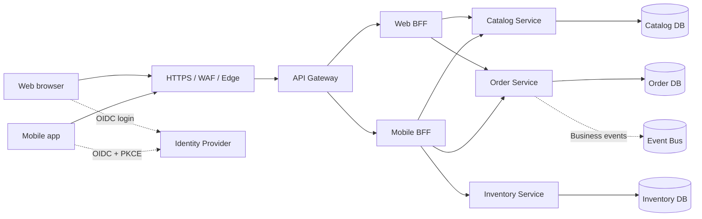
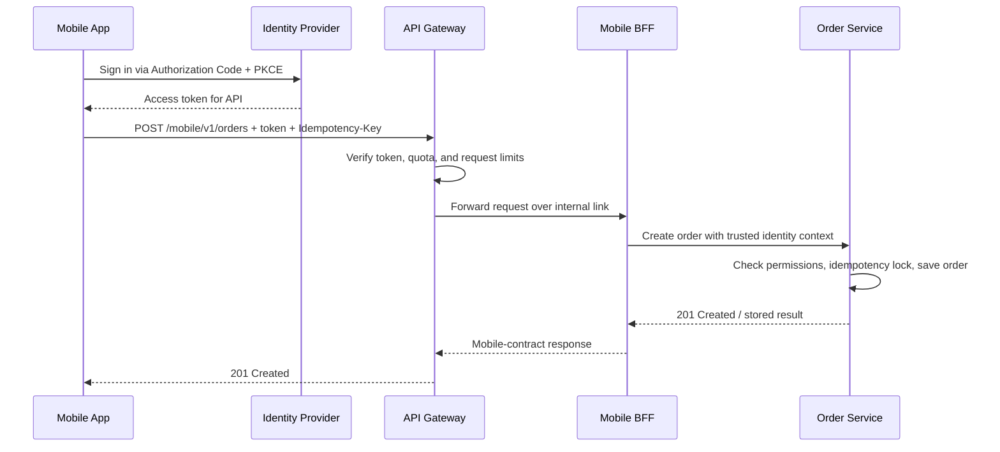

# API Gateways for Web Applications and Mobile Devices

A product with both a web interface and a mobile application typically shares customer, order, and product catalog data, yet differs in login mechanisms, screen sizes, bandwidth, release cadence, and offline/flaky-network behavior. If each client talks directly to every backend service, each frontend team must manage multiple API endpoints, security policies, and failure modes. As the number of services grows, the system becomes hard to evolve without breaking already-released apps.

The **API Gateway combined with Backend for Frontend (BFF) when needed** pattern creates a uniformly governed entry point for clients while enabling channel-specific API design. This is a **reference architecture pattern**: deciding which components to adopt must derive from business requirements, reliability, security, scalability, cost, and operability. The goal is not to stack as many intermediary layers as possible into every system.

## 1. Architectural Problem and Input Requirements

Suppose a commerce platform offers product search, inventory lookup, ordering, and delivery tracking across two channels:

- **Web:** users typically open multiple pages, need SEO for public content, may use cookie-based login sessions, and require data aggregation for admin screens.
- **Mobile:** requires compact payloads to save bandwidth and battery, operates over unstable cellular networks, must support older app versions, and must log in safely as a public client unable to keep a client secret.
- **Backend systems:** Catalog, Inventory, Order, and Customer services can be deployed, scaled, and maintained independently; each service owns its own business data.

Before drawing the architecture, agree on measurable requirements:

| Requirement area | Questions to answer | Example acceptance criteria |
|---|---|---|
| Business | Which features do the two channels need, and what data differs? | Mobile only needs a product summary; web needs detailed admin info. |
| Performance | How many requests/sec and response time at which percentile? | Core read API p95 under 500 ms in the defined load test. |
| Reliability | When a secondary service fails, which flows must keep working? | Product recommendation failures do not block viewing the cart. |
| Security | Who can call which API and access whose resources? | User A cannot read or modify User B's orders. |
| Compatibility | How long are older mobile app versions supported? | Version deprecation policy and tracking of active version usage. |
| Operations | Who owns errors at the gateway, BFF, and services? | Dashboards, alerts, and end-to-end request tracing. |
| Cost | What are traffic volume, Internet egress, and internal call counts? | Track cost per 1,000 completed requests. |

Numbers in this lesson are **illustrative assumptions**, not thresholds appropriate for every system.

## 2. Reference Architecture



The diagram shows **one option with two BFFs**. If web and mobile need the exact same API contract, traffic can route from the gateway to shared services without a BFF. Connections from BFFs to services are protected internal links; databases are never exposed to the Internet.

Roles of each layer:

| Component | Primary responsibility | Should not take over |
|---|---|---|
| Edge, CDN, WAF | Terminate HTTPS per design, filter anomalous traffic, serve static assets/public cached content. | Deciding per-order access authorization. |
| API Gateway | Routing, rate limiting, token validation where appropriate, enforcing common access policies, entry-point monitoring. | Business calculations, owning databases, coordinating long transactions. |
| Web BFF | Manage web sessions if using a session model, aggregate data, and shape responses to web UI needs. | Replacing all domain business services. |
| Mobile BFF | Produce compact mobile payloads, aggregate calls, support client version compatibility. | Trusting self-declared identity info from mobile clients. |
| Identity Provider (IdP) | Login, token issuance per identity protocols and policies. | Granular resource-ownership authorization on behalf of business services. |
| Business services | Verify securely propagated context, enforce **resource authorization**, process business logic, manage data. | Depending on the UI structure of individual channels. |
| Event Bus / queues | Deliver asynchronous events for tasks not required before responding. | Turning every immediate-result operation into an async task. |

The gateway is a **logical single entry point**, not a single physical server. Production deployments require multiple replicas or a high-availability managed service so the gateway does not become a single point of failure.

## 3. Choosing the Right Access Pattern

Three common approaches are all valid under different conditions:

| Approach | Appropriate when | Advantages | Trade-offs |
|---|---|---|---|
| **Client → Gateway → Shared API** | Web/mobile have similar data needs, few services, stable contracts. | Fewer components; simple deployment and operations. | Clients may need multiple API calls to render one screen. |
| **Client → Gateway → Channel BFF → Services** | Data needs and auth behaviors differ significantly across channels. | Aggregates responses, hides service topology, evolves channel UX independently. | Costs extra compute, adds network hops and maintenance overhead. |
| **Gateway → Shared API plus BFF for specific screens** | Only part of the functionality requires data aggregation. | Adds complexity only where it delivers clear value. | Requires clear conventions on which APIs belong to BFF vs. shared domain. |

**How to decide:** start by mapping user journeys and network calls per screen. If a mobile screen must call five services and stitch data together itself, a BFF can cut round-trips over cellular networks. Conversely, if a screen calls a single stable API, routing through a BFF just to pass payloads through untouched adds latency for little gain.

Do not turn a BFF into a "mega-business" service. Pricing rules, inventory reservation, quota checks, and order persistence must live in their respective domain services so both channels get identical outcomes.

## 4. Two Authentication Flows: Web and Mobile

### 4.1. Web with a Session-Managing BFF

A strong web design uses **OpenID Connect (OIDC) Authorization Code Flow** on the BFF side. The BFF handles exchanging the authorization code with the IdP, stores session state server-side, and sets a cookie with appropriate `HttpOnly`, `Secure`, and `SameSite` attributes. The browser sends the session cookie to the Web BFF through the gateway; access tokens never need to appear in page JavaScript.

Basic flow:

1. The browser requests a login-protected resource; the Web BFF redirects the user to the IdP.
2. After authentication, the IdP returns an authorization code to the registered callback; the BFF validates `state` and `nonce` where applicable and exchanges the code for tokens over a server-to-server channel.
3. The BFF creates a session and returns a secure cookie; subsequent web requests carry this cookie.
4. The BFF validates the session, then calls internal services using the designed service-to-service identity and delegation mechanism; the downstream service still checks authorization on the data.

Because browsers send cookies automatically, **CSRF** controls are required for state-changing operations, such as CSRF tokens and `Origin` checks; `SameSite` helps reduce risk but should not be the sole defense in all scenarios. Configure CORS with exact allowed origins if the UI and API live on different origins. **CORS is not an authentication or authorization mechanism.**

An SPA can also use Authorization Code + PKCE to obtain access tokens directly, though doing so requires carefully assessing XSS risks, token storage, and refresh token handling. No single login approach fits every web app; the choice depends on the frontend model, infrastructure, and acceptable risk.

### 4.2. Mobile App as a Public Client

Mobile apps should use **Authorization Code + PKCE** via the system browser, following native app recommendations. Never embed a client secret in the app, because installation packages can be reverse-engineered. When storing tokens, use OS-provided secure storage; avoid logging tokens or putting tokens in URLs.

A typical API request:

1. Mobile logs in at the IdP using PKCE and receives an access token scoped for the specified API.
2. Mobile calls the public HTTPS endpoint with `Authorization: Bearer ...`.
3. The gateway verifies the token signature or runs introspection depending on token type, checking `issuer`, `audience`, expiration, and required scopes; verification keys from the IdP can be cached and refreshed securely.
4. The gateway enforces quotas/rate limits, then forwards the validated request to the Mobile BFF over a trusted internal network.
5. The BFF calls business services; the service verifies the user/tenant context propagated over the trusted channel and decides whether to allow the operation on the specific resource.

**Distinguish authentication from authorization:** a valid token proves login context and broad scopes, not that the user owns or can edit order `order-123`. Order Service must check owner/tenant match and order state. Never treat client-supplied `X-User-ID` or `tenantId` headers/JSON fields as authoritative truth. When propagating identity between services, use verifiable internal tokens or protected delegation mechanisms alongside TLS/mTLS and least-privilege service permissions.

### 4.3. Non-Negotiable Control Layers

| Risk | Recommended control |
|---|---|
| Forged, mis-targeted, or expired tokens | Verify signature/allowed algorithms, `iss`, `aud`, `exp`, `nbf`, and appropriate revocation/session policies. |
| User accessing another tenant's data | Enforce object-level authorization inside services; scope data queries strictly to the right tenant. |
| DDoS, bots, credential stuffing, API spam | WAF/DDoS protection, principal/tenant quotas, IP rate limits for unauthenticated traffic, bot protection at suitable points. |
| Data leakage in logs or caches | Never log tokens, passwords, or sensitive data; enforce redaction rules and avoid public caching of personalized responses. |
| CORS, cookie, or login redirect abuse | Allowlist origins/redirect URIs; secure cookies, CSRF protection, and state/nonce validation in OIDC flows. |
| Overly broad internal connectivity or admin privileges | Private networking, TLS/mTLS where needed, least-privilege IAM, secret manager, and key rotation. |

## 5. Designing API Contracts Around User Experience

In the illustrative architecture, external paths can be separated as follows:

| Public endpoint | Client | Authentication | Handler |
|---|---|---|---|
| `GET /web/v1/home` | Browser | Session cookie | Web BFF aggregates web screen data. |
| `GET /mobile/v1/home` | Mobile | Bearer access token | Mobile BFF returns trimmed payloads, potentially paginated. |
| `POST /mobile/v1/orders` | Mobile | Bearer access token and proper scope | Mobile BFF forwards the command to Order Service. |

For instance, Web BFF might return catalog items, purchase recommendations, and personal stats in one response. Mobile BFF might return only thumbnails, prices, stock status, and a cursor for the next page. **Calls from BFF to backend services still happen**: cutting Internet round-trips does not automatically reduce backend load. If the BFF calls too many services sequentially, latency and failure probability rise.

An order-creation request from mobile:

```http
POST /mobile/v1/orders HTTP/1.1
Host: api.example.com
Authorization: Bearer <access_token>
Content-Type: application/json
Idempotency-Key: 5dc5de81-0b9d-4d1a-91e5-614c57ef74d0

{
  "items": [{"sku": "SKU-101", "quantity": 2}],
  "shippingAddressId": "addr-42"
}
```

```http
HTTP/1.1 201 Created
Content-Type: application/json
Location: /mobile/v1/orders/ord-901

{
  "id": "ord-901",
  "status": "PENDING_PAYMENT",
  "total": {"amount": 240000, "currency": "VND"}
}
```

`Idempotency-Key` handles cases where mobile retries after a network drop even though the server already created the order. The service owning orders must store results within a safe scope (e.g., tenant, user, operation, and key), check payload equivalence, handle concurrent requests, and apply an expiration policy. **Simply adding a header at the gateway does not magically make writes idempotent.** If a key is reused with different content, the service must return an appropriate conflict error instead of creating a new order.

A rate-limiting response can follow **Problem Details**:

```http
HTTP/1.1 429 Too Many Requests
Content-Type: application/problem+json
Retry-After: 3

{
  "type": "https://api.example.com/problems/rate-limit",
  "title": "Too Many Requests",
  "status": 429,
  "detail": "Temporary request rate limit exceeded."
}
```

Clients should retry only per `Retry-After` or with jittered backoff, avoiding retry storms. Several API conventions should be agreed upon early:

- Use HTTP methods semantically (`GET` read, `POST` create/command, `PUT`/`PATCH` appropriate update), consistent status codes, stable resource IDs, and structured error payloads.
- Use cursor pagination for large or rapidly changing datasets; cap page and payload sizes. Cache `GET` via `ETag`/`If-None-Match` when suitable, strictly separating public caches from per-user caches.
- Set timeouts and request/response size limits; accept only required content types. Never put sensitive data in query strings because URLs frequently appear in logs and history.
- Version and backward-compatibility management: `/v1` can be used, but path versioning does not replace contract-evolution processes, tracking legacy clients, and communicating end-of-support timelines.
- Distinguish errors clearly: `401` unauthenticated, `403` forbidden, `404` not found/non-disclosure of resource, `409` state conflict, `429` rate limit exceeded, `502` invalid upstream response, `503` temporarily unavailable, `504` upstream timeout.

## 6. Call Flows and Responsibility Boundaries



In practice, users are usually already signed in before creating an order. The login step in the diagram only illustrates token provenance; **do not re-authenticate on every request**. If payment processing takes time, Order Service can create a `PENDING_PAYMENT` order, emit an event via an outbox, and return a status for the client to poll. The Event Bus must not be used to mask missing policies for data consistency, duplicate event handling, or business compensation.

## 7. Scalability, Latency, and Failure Recovery

**Capacity estimation from realistic behavior.** Suppose there are 400,000 daily active users averaging 30 API requests/user/day:

```text
Total requests/day        = 400,000 × 30 = 12,000,000
Average traffic           = 12,000,000 / 86,400 ≈ 139 requests/sec
Assumed 12x peak          = roughly 1,667 requests/sec
30% headroom above peak   = roughly 2,167 requests/sec
```

This is only a **starting point for load planning**; real traffic can concentrate into a few promotional minutes, include bot surges, or skew by time zone. If each mobile request triggers four service calls through the BFF, 2,167 external requests/sec can generate many thousands of internal calls/sec. Measure fan-out factors, latency, and bottlenecks across databases, connection pools, caches, and queues.

For a journey needing a response under roughly 500 ms, you can sketch a **latency budget** across client network, edge/gateway, BFF, service calls, and buffer. Summing component P95 targets does not yield the end-to-end journey P95; measure end-to-end under representative loads, including target devices and network conditions.

Coordinated protection measures:

| Issue | Design and verification |
|---|---|
| Gateway/BFF overload | Scale horizontally across multiple instances or use a managed gateway; test autoscaling, connection pools, CPU/memory resources. |
| Availability zone failure | Spread instances across multiple availability zones, use health checks and routing to healthy instances; also check data dependencies. |
| Slow or hanging upstream | Finite, budgeted timeouts, circuit breakers, bulkheads; never wait indefinitely. |
| Retries amplifying failures | Bounded retries, exponential backoff + jitter; favor reads or writes with idempotency safeguards. |
| Auxiliary service failure | Allow graceful degradation, e.g., omit recommendations while still displaying the cart; never fabricate stock or payment data. |
| Public traffic spike | Rate limit by principal/tenant and IP per scenario; global quotas need defined fallback behavior when distributed counters fail. |
| Flaky mobile network | Compact payloads, valid caching, resync mechanisms, in-progress UI states, and duplicate-submission prevention on reconnect. |

Do not blindly retry every `5xx` or every `POST`. Timeouts can happen **after the server has already committed data**; retrying without idempotency can create duplicate orders or double charges. Also avoid letting the gateway retry repeatedly while the BFF and downstream services also retry, causing exponential request amplification.

To formalize reliability, define **SLIs/SLOs** for critical journeys, such as order-creation success rate and P95 latency under measurement context. A 99.9% availability SLO over 30 days equals roughly 43.2 minutes of total outage if converted purely by time; real error budgets are typically computed from valid request ratios. Explicitly define how client errors (`4xx`), throttling (`429`), and system errors (`5xx`) count toward each SLI.

## 8. Operations, Observability, and Rolling Out Changes

A system with multiple intermediary layers is only easy to operate when you can trace **a single request from mobile/web to the final service**:

- **Metrics:** traffic by route and client version, `5xx`, `429`, `401/403` rates, P50/P95/P99 latency, in-flight requests, and gateway/BFF/upstream saturation.
- **Distributed tracing:** propagate `traceparent`/correlation IDs through gateway, BFF, and services; distinguish network wait, processing time, and per-dependency fan-out.
- **Structured logging:** include request ID, route, outcome, and technical error codes; mask personal data and never log tokens/secrets. Avoid high-cardinality labels like user ID in metrics.
- **Alerting:** base alerts on SLO burn rates, core functional errors, and latency spikes; maintain on-call rotation, runbooks, and rollback capability.
- **Deployment:** manage gateway config as code, run API contract tests, use canary/blue-green rollouts, test legacy app versions, and monitor post-release.

For example, when `GET /mobile/v1/home` slows down, a trace may show the gateway spent 15 ms and the BFF spent 10 ms, while waiting 700 ms on Inventory. Adding CPU to the gateway will not fix the Inventory bottleneck. Correlate monitoring signals with configuration change logs and recent deployments to isolate root causes.

## 9. Costs and Trade-Offs of Intermediary Layers

A gateway/BFF design typically incurs the following cost groups:

```text
Approximate total cost = gateway per-request/capacity fees
                       + BFF and business service compute
                       + Internet and cross-region/zone transfer
                       + WAF/CDN, logs/traces/metrics, cache, data stores
                       + operational overhead and HA/DR reserve capacity
```

Adding a BFF can raise compute and operational costs, yet can also shrink payloads, cut Internet round-trips, and eliminate duplicate logic across clients. You cannot declare one option cheaper purely by counting boxes; measure on a meaningful unit such as **cost per 1,000 successful purchase journeys**.

Conditional optimizations: cache public content via CDN; use `ETag` for suitable resources; compress text responses; bound fan-out; tune trace sampling rates; adjust log retention; autoscale to actual load. Never publicly cache personal data or responses tied to `Authorization` without proving the cache policy is safe. Account for cross-zone/region transfer charges and the operational complexity of multi-region deployments.

## 10. Well-Architected Evaluation

| Pillar | Evaluation question | Expected evidence |
|---|---|---|
| **Operational Excellence** | When gateway errors spike, how does the team pinpoint the cause and roll back? | Dashboards, traces, runbooks, canary procedures. |
| **Security** | Do web and mobile authenticate with the right model? Does every service verify data permissions? | Threat model, IDOR/BOLA tests, IdP configuration, permission audits. |
| **Reliability** | Are the gateway/BFF HA? Does losing one upstream bring down the entire UI? | Fault-injection and recovery test results; SLOs/error budgets. |
| **Performance Efficiency** | How many round-trips does the BFF save? Where are bottlenecks? | Load tests, fan-out traces, per-journey P95/P99. |
| **Cost Optimization** | Which API drives most per-request or per-journey cost? | Breakdown reports by route, egress, gateway, compute, and logs. |
| **Sustainability** | Are oversized payloads being sent or idle resources kept running? | Cache hit ratio, average payload size, compute utilization. |

The evaluation's purpose is to record **evidence and trade-offs**, not merely tick "has API Gateway." A system that has a gateway yet still exposes internal APIs, lacks object-level authorization, or cannot recover from failures is not yet well-architected.

## 11. Design Exercise: From Requirements to Architecture Decisions

Given this scenario: web has an order-admin dashboard; mobile needs a home screen and order creation; during promotional peaks, Inventory sometimes stalls for 2 seconds and mobile networks frequently drop. Build a verifiable design following these steps:

1. **Diagram the flow:** mark the Internet entry point, private zones, IdP, gateway, BFF (if chosen), services, and databases. Indicate where identity is verified and where order-level authorization is decided.
2. **Choose the pattern:** compare shared API vs. separate BFFs. Count mobile network requests for the home screen, expected latency, and expected fan-out factor.
3. **Define contracts:** design `GET /mobile/v1/home` and `POST /mobile/v1/orders`; specify pagination, errors, idempotency, and legacy mobile version support.
4. **Simulate failures:** inject Inventory timeouts, expired tokens, quota-exceeding bursts, double-tapping "Place Order," and a gateway instance crash. Define safe outcomes for each case.
5. **Measure and tune:** load-test at average, peak, and peak-with-headroom levels; collect P95, error rates, fan-out, cache hit ratios, and cost. Refine the architecture from measurements.
6. **Write an ADR (Architecture Decision Record):** capture the decision, context, alternatives considered, rationale, consequences, and review trigger.

A brief ADR might read:

> **Decision:** use a Mobile BFF for the home screen because the client would otherwise aggregate multiple services over cellular networks; keep inventory reservation and order-creation rules in Order Service. **Consequences:** adds a service to deploy, monitor, and autoscale; in exchange, cuts round-trips and isolates mobile contracts from internal changes. **Re-evaluate:** when traffic, costs, or channel needs shift substantially.

### Minimum Test Scenarios

| Scenario | Expected outcome |
|---|---|
| Mobile access token expired | Returns `401`, no order created; client follows valid refresh/re-login flow. |
| User attempts to fetch another account's order | Service denies per policy (`403` or `404`), zero data leakage. |
| Two POSTs with same idempotency key and same payload | Returns the same business result per policy; only one order is persisted. |
| Two POSTs with same key but different payload | Rejects conflict, does not silently create a second order. |
| Inventory timeout on home screen | Secondary widget degrades gracefully; never reports fabricated stock status. |
| A gateway/BFF instance stops | Health check reroutes traffic; error rate and recovery time stay within SLO. |

## 12. Common Design Mistakes

- **Gateway doing everything:** putting business logic, database queries, and complex aggregation in gateway policies makes testing, changing, and scaling painful. Keep domain logic in domain services; put UI aggregation in BFFs when needed.
- **Pass-through BFF:** adds a network hop without cutting round-trips, payload size, or client coupling. Remove the redundant layer or prove measurable benefit.
- **Checking tokens only at the gateway:** services trust any `userId` in the request. Always enforce authorization where data is owned and protect internal identity context.
- **One global quota for everyone:** users behind a shared NAT IP can impact one another. Design distinct limits for anonymous IPs, authenticated users, client apps, tenants, and critical endpoints.
- **Unbounded retries:** upstream incidents trigger request storms and duplicate transactions. Define timeouts, retry budgets, backoff, and end-to-end idempotency.
- **Monitoring only the gateway:** gateway dashboards stay green while Order Service is overloaded or returning bad data. Track SLIs per business journey and trace across services.
- **No mobile compatibility plan:** backend releases break older clients before users update. Use contract tests, version telemetry, and clear deprecation policies.

## 13. Pre-Production Checklist

- [ ] Web and mobile flows, public/private boundaries, identity, and resource-level authorization are clearly documented.
- [ ] Rationale for using or omitting a BFF is backed by round-trip, latency, and cost measurements.
- [ ] IdP, OAuth2/OIDC, PKCE, web sessions/cookies, CSRF, CORS, and secrets management fit each client model.
- [ ] Gateway and business services have coherent quota, timeout, retry, and idempotency policies.
- [ ] APIs define contracts/versioning, error formats, pagination, payload limits, and legacy mobile support plans.
- [ ] Gateway/BFF span sufficient availability zones; slow upstreams, traffic spikes, and instance loss have been rehearsed.
- [ ] Metrics, tracing, sanitized logging, SLO-based alerts, runbooks, and rollback procedures are ready.
- [ ] End-to-end load from device through gateway to services, internal fan-out, real costs, and Well-Architected trade-offs have been measured.

**Key takeaway:** an API Gateway is the boundary for policy enforcement and routing; a BFF is an optional tool to optimize each client type's experience; business services remain responsible for data, access control, and correctness of operations. A strong architecture is one that proves these choices with concrete requirements, measurements, and failure testing.
