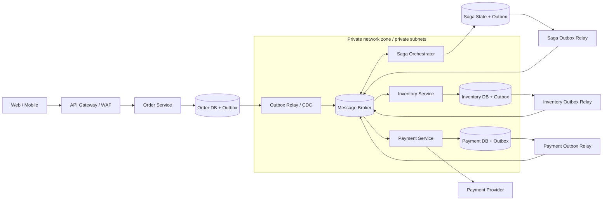
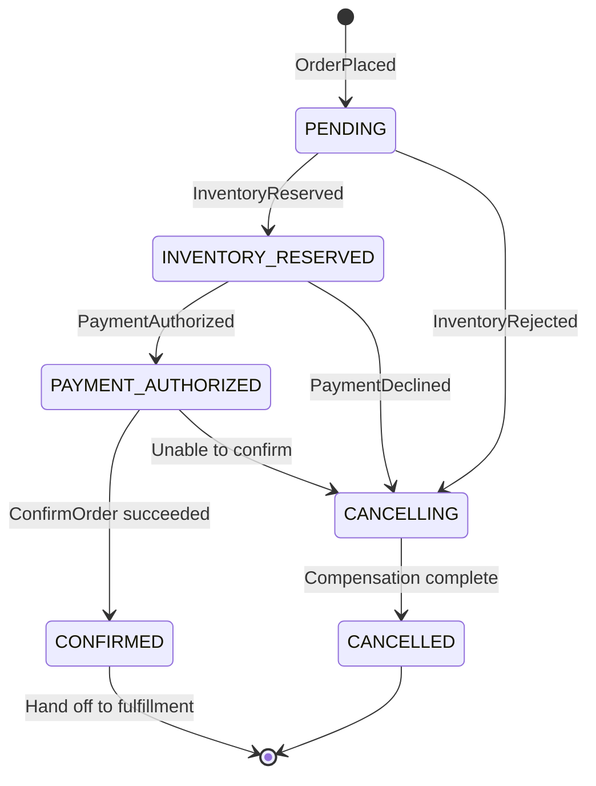
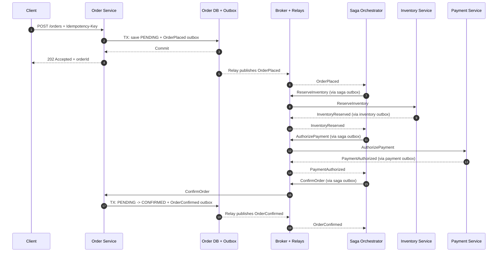

# Order Systems with Saga and Transactional Outbox

## 1. The Architectural Problem

Suppose a cloud-based e-commerce platform has three primary business domains:

- **Order Service** creates orders, manages order states, and exposes APIs for customers.
- **Inventory Service** reserves or releases sellable stock quantities.
- **Payment Service** interacts with a payment gateway to authorize, void, and capture funds.

An order is only confirmed once inventory has been reserved and payment has been validly authorized. However, each service owns its own database, and the payment gateway is an external system. No ordinary database transaction spans all three.

The system must solve two problems simultaneously:

1. **Distributed business transaction orchestration:** If inventory was reserved but payment authorization fails, the system must release the reserved stock. This is the role of the **Saga** pattern.
2. **Never losing events when persisting state:** Once Order Service saves an order, the `OrderPlaced` event must still be publishable even if the application or message broker crashes. This is the role of the **Transactional Outbox** pattern.

These two patterns complement each other: Saga determines **which business step runs next and how to compensate**; Outbox guarantees **local data changes and the intent to publish a message are committed in the same transaction**.

### Goals and Business Invariants

| ID | Invariant to preserve | Protection mechanism |
| --- | --- | --- |
| B1 | Resubmitting the same order request does not create multiple orders | `Idempotency-Key` and unique constraint in Order DB |
| B2 | Never reserve more than sellable inventory | Conditional, atomic inventory update in Inventory DB |
| B3 | Orders transition to `CONFIRMED` only with confirmed stock reservation and valid payment authorization | Saga verifies step outcomes and state-transition preconditions |
| B4 | A redelivered step or event does not deduct stock or charge twice | Unique keys per command, inbox/deduplication, and PSP-side idempotency |
| B5 | If a local state change requires emitting an event, its outbox record is committed together | Single ACID transaction on the same database |
| B6 | Do not ship goods before payment capture meets policy requirements | Separate order confirmation from fulfillment execution preconditions |

**Example assumption:** The ordering sequence is *reserve inventory → authorize payment → confirm order*. Payment *capture* runs when fulfillment conditions are met and must finish before shipping. This is a business choice; another system might capture early and use refunds as compensation, though refunds are not instant reversals.

## 2. Why Not Use a Single Shared Transaction?

An ACID transaction guarantees atomicity only for data inside that database's transaction scope. If Order Service performs:

1. Commit the order in Order DB.
2. Send `OrderPlaced` directly to the broker.

there is a gap between the two operations. For instance, the database commits, then the application crashes before publishing: the order exists, while downstream services never receive the event. Reversing the order to "publish first, commit later" creates the risk of downstream services processing an order whose database transaction rolled back.

A **distributed transaction/two-phase commit (2PC)** model can coordinate certain resources supporting that protocol, yet is usually infeasible across message brokers, payment gateways, or independent services. It also introduces availability coupling and lock-holding overhead. Saga accepts **eventual consistency** across services and uses business actions to handle failures.

Key distinctions:

- **Local transaction:** atomic within one database, e.g., updating order state and inserting an outbox row.
- **Saga:** a sequence of local transactions with state tracking and compensating actions, without global isolation or ACID-style global rollback.
- **Transactional Outbox:** a technique to avoid dual-writing to a database and a broker; by itself it does not guarantee exactly-once message delivery.
- **Idempotent consumer:** safe repeated execution under conditions where messages may be redelivered.

## 3. Cloud Reference Architecture



Lines connected to the broker in the diagram represent sending/receiving **commands** or **events**, not a transaction spanning every component. Each service manages its own database and outbox. The Saga Orchestrator must also durably persist progress state and outbound commands.

| Component | Role | Cloud deployment suggestion |
| --- | --- | --- |
| API Gateway | Authentication, rate limiting, receive `Idempotency-Key`, return order lookup ID | Managed Gateway/Load Balancer, WAF |
| Order Service | Validate requests, save `PENDING` order, handle confirm/cancel | Stateless containers or serverless |
| Saga Orchestrator | Persist saga state, issue commands, handle timeouts and compensation | Worker/service with durable DB or stateful workflow engine |
| Message Broker | Decouple producers/consumers, retain queues, retries, DLQ | Managed queue or event stream |
| Outbox Relay | Read outbox records, publish, track delivery status | Polling worker or CDC from transaction log |
| Inventory Service | Reserve/release stock with inventory constraints in a local transaction | Service + relational/transactional DB |
| Payment Service | Call payment provider and reconcile outcomes | Dedicated service, credentials in secrets manager |
| Databases | Maintain orders, reservations, payment operations, saga state, outbox/inbox | Managed DB, backups, multi-zone, and restore testing |

Microservices are not mandatory from day one: if scale and organization do not yet warrant splitting, domains can live inside a modular monolith. What matters is identifying **transaction boundaries** and event-emission responsibilities.

## 4. Designing the Saga for the Order Lifecycle

### 4.1. Steps and Compensating Actions

This example uses an **orchestration saga**: a central coordinator tracks overall state and sends commands to each service.

| Step | Command / local processing | Success | Failure to handle |
| --- | --- | --- | --- |
| 0. Create order | Order DB saves `PENDING` + outbox `OrderPlaced` | Start saga | Local transaction error: no order created |
| 1. Reserve stock | `ReserveInventory` | `InventoryReserved` | `InventoryRejected` → cancel order |
| 2. Authorize funds | `AuthorizePayment` | `PaymentAuthorized` | `PaymentDeclined` → `ReleaseInventory`, then cancel order |
| 3. Confirm order | `ConfirmOrder` conditioned on valid data/version | `OrderConfirmed` | If uncompletable: `VoidAuthorization` and `ReleaseInventory`, mark outcome accordingly |
| 4. Fulfillment | Capture funds per policy, then allow shipping | `PaymentCaptured` | Retry/reconcile; if capture fails, trigger post-confirmation cancellation flow per policy |

A saga can use `sagaId = orderId`. Each command should have a `commandId` and `stepId` that remain stable across retries. Inventory stores `reservationId`; Payment stores `paymentOperationId` and the matching idempotency key used when calling the payment gateway.



The diagram shows the **logical saga state**; the Order DB status may only need `PENDING`, `CONFIRMED`, `CANCELLING`, `CANCELLED`. Avoid duplicating every service's internal sub-states into the orders table unless there is a clear business query need.

### 4.2. Happy Path Flow



HTTP `202 Accepted` means the system **has accepted** the request, not necessarily that the order is confirmed yet. The client can poll `GET /orders/{orderId}` or receive push/webhook updates once the saga completes. The `PENDING` state may last a few seconds or longer if a downstream service is disrupted.

### 4.3. Rejections, Timeouts, and Ambiguous Outcomes

- **Inventory rejection:** order transitions to `CANCELLED`; no need to call Payment Service.
- **Explicit payment decline:** release the exact `reservationId`, wait for `InventoryReleased` confirmation, then finalize cancellation.
- **Payment timeout:** **do not equate timeout with failure**. The PSP may have granted authorization while the response was lost. Payment Service must look up the operation by idempotency key or reconcile via webhook/PSP before deciding to void or retry.
- **Late success event after cancellation begins:** the coordinator uses saga state and version checks to refuse confirming the order; if a late reservation/authorization appears, issue the corresponding compensating command.
- **Compensation failure:** the saga enters `COMPENSATION_PENDING` or `MANUAL_REVIEW`, continuing controlled retries and raising alerts. Never mark `CANCELLED` as though resources were already returned.
- **Authorization expiring before capture:** extend or re-authorize per PSP rules; never assume an authorization stays valid indefinitely.

Compensation is a **new business operation**. `ReleaseInventory` can free held stock, and `VoidAuthorization` can cancel an uncaptured hold; once funds are captured, `RefundPayment` incurs latency and fees and does not rewind the world to its prior state.

### 4.4. Orchestration vs. Choreography

| Criterion | Orchestration | Choreography |
| --- | --- | --- |
| Decision point for next step | Central coordinator | Services reacting to events |
| Tracking saga and timeouts | Centralized, easy status visibility | Distributed, demands strong correlation |
| Coupling | Logic depends on coordinator | Depends on event contracts between services |
| Best suited for | Multi-branch flows, complex compensation | Few-step flows, simple interactions |

Because ordering involves multiple steps, timeouts, and external payments, **orchestration** helps operators trace why an order is waiting. The coordinator must run safely across multiple instances using locks/leases or optimistic concurrency so two workers never issue commands for the same step simultaneously.

## 5. Transactional Outbox: Recording Data and Event-Emission Intent

### 5.1. Principle

When creating an order, Order Service executes **one local transaction** containing:

1. Insert the `orders` row in `PENDING` state.
2. Insert the `outbox_events` row carrying `OrderPlaced`.
3. Commit both or roll back both.

A relay publishes events not yet marked successfully emitted. If the broker is temporarily unavailable, the event remains safely in the database for redelivery. If the application crashes right after commit, an independently running relay can still read and publish the event.

### 5.2. Example Schema with PostgreSQL

```sql
CREATE TABLE orders (
    order_id         uuid PRIMARY KEY,
    customer_id      uuid NOT NULL,
    idempotency_key  text NOT NULL,
    status           text NOT NULL
                     CHECK (status IN ('PENDING', 'CONFIRMED',
                                      'CANCELLING', 'CANCELLED')),
    amount           numeric(18, 2) NOT NULL CHECK (amount >= 0),
    currency         char(3) NOT NULL,
    version          bigint NOT NULL DEFAULT 1,
    created_at       timestamptz NOT NULL DEFAULT now(),
    UNIQUE (customer_id, idempotency_key)
);

CREATE TABLE outbox_events (
    event_id          uuid PRIMARY KEY,
    aggregate_type    text NOT NULL,
    aggregate_id      uuid NOT NULL,
    aggregate_version bigint NOT NULL,
    event_type        text NOT NULL,
    payload           jsonb NOT NULL,
    created_at        timestamptz NOT NULL DEFAULT now(),
    published_at      timestamptz
);

CREATE INDEX outbox_unpublished_idx
    ON outbox_events (created_at, event_id)
    WHERE published_at IS NULL;
```

The transaction example below uses `:` parameters passed by the application layer; `gen_random_uuid()` requires appropriate UUID support on the PostgreSQL version in use:

```sql
BEGIN;

INSERT INTO orders
    (order_id, customer_id, idempotency_key,
     status, amount, currency)
VALUES
    (:order_id, :customer_id, :idempotency_key,
     'PENDING', :amount, :currency);

INSERT INTO outbox_events
    (event_id, aggregate_type, aggregate_id,
     aggregate_version, event_type, payload)
VALUES
    (gen_random_uuid(), 'Order', :order_id, 1,
     'OrderPlaced',
     jsonb_build_object(
         'orderId', :order_id,
         'sagaId', :order_id,
         'customerId', :customer_id
     ));

COMMIT;
```

This example is simplified to illustrate atomicity. In production applications, you must also check request contents when an `Idempotency-Key` already exists: if the payload matches, return the already-created order; if it differs, return a conflict error. Never automatically regenerate `orderId` on each retry.

Message envelopes should also carry `eventId`, `eventType`, `schemaVersion`, `aggregateId`, `aggregateVersion`, `occurredAt`, `correlationId`, and `causationId`. `correlationId` ties together the entire order journey; `eventId` supports deduplication. Never put raw card numbers, secret tokens, or unnecessary personal data into payloads.

### 5.3. Outbox Relay: Polling vs. CDC

A **polling relay** periodically selects rows with `published_at IS NULL`, sends them to the broker, and marks them published **only after broker acknowledgment**. With multiple relays, claim/lease mechanisms or partitioning are required to reduce contention; claim operations should keep transactions short. `FOR UPDATE SKIP LOCKED` can assist claiming in PostgreSQL, but avoid holding open database transactions/locks while waiting on network I/O.

**Change Data Capture (CDC)** reads the database transaction log/WAL and forwards outbox inserts to the broker. CDC avoids continuous polling and can lower latency; in return, it requires managing replication slots, log retention, connectors, checkpoints, and failure recovery.

| Criterion | Polling | CDC |
| --- | --- | --- |
| Initial simplicity | Typically easy to implement | Requires connector infrastructure and config |
| Latency | Depends on poll interval and backlog | Generally low, pipeline-dependent |
| Database load | Continuous queries if polling aggressively | Log/replication overhead and connector resources |
| Operations | Manage leases, batching, and retries | Manage WAL/offsets, snapshots, connectors |
| Event ordering | Must design partition keys and processing order | Must verify per-aggregate ordering through pipeline |

**There is no default end-to-end exactly-once guarantee.** If the broker receives an event and the relay crashes before updating `published_at`, the next run will replay it. Hence the default design is **at-least-once delivery + idempotent processing**. Enforce ordering rules **per aggregate** (e.g., keyed by `orderId` using `aggregateVersion`); never assume the broker guarantees global ordering across partitions.

The outbox needs a retention policy: archive/prune published rows old enough under audit, retention, and replay requirements. Cleanup must never delete events that have not yet been successfully published.

## 6. Idempotent Consumers, Inbox, and Concurrency Control

Suppose Inventory Service receives the `ReserveInventory` command multiple times. If it subtracts `available` every time, one order will reserve stock repeatedly. The safe approach:

1. Receive a `commandId`/`eventId` that remains stable across retries.
2. Within the **same local transaction**, insert an inbox row keyed uniquely by consumer name and message ID; if it already exists, skip the business mutation.
3. If the message is new, check reservation state, conditionally update inventory, insert the outcome event into the outbox, and commit.
4. ACK the broker only after the transaction commits. If the process crashes before ACK, redelivery is safely absorbed by the inbox.

```sql
CREATE TABLE inbox_messages (
    consumer_name text NOT NULL,
    message_id    uuid NOT NULL,
    processed_at  timestamptz NOT NULL DEFAULT now(),
    PRIMARY KEY (consumer_name, message_id)
);

-- Inside the stock reservation transaction, only run business steps
-- when the INSERT below actually creates a new row:
INSERT INTO inbox_messages (consumer_name, message_id)
VALUES ('inventory-reserve-handler', :command_id)
ON CONFLICT DO NOTHING
RETURNING message_id;

-- Must include a stock condition; UPDATE row count = 0 means insufficient stock.
UPDATE inventory
SET available = available - :qty,
    reserved  = reserved + :qty
WHERE sku = :sku
  AND available >= :qty;
```

This SQL illustrates two core mechanisms; the application must inspect the `RETURNING` result and `UPDATE` row count, store the reservation and outbox row together, and commit/roll back as **one** transaction. When reserving multiple SKUs, define a fixed locking strategy and lock order to avoid deadlocks, or compensate when part of the order cannot be reserved.

**A database inbox alone cannot prevent calling a PSP twice.** For external side effects, Payment Service must pass a business-generated idempotency key to the PSP, persist `paymentOperationId`, validate incoming webhooks, and reconcile state. If the PSP times out after succeeding, retries must carry **the exact same key** instead of creating a new payment. Verify idempotency limits and retention windows against the specific provider's contract.

**Race conditions when handling events:** Two workers may simultaneously observe a saga in `INVENTORY_RESERVED`. The coordinator needs conditional state updates, such as `UPDATE saga_state SET state = 'PAYMENT_AUTHORIZING', version = version + 1 WHERE saga_id = :id AND state = 'INVENTORY_RESERVED' AND version = :expected_version`. Only the winning worker writes the next command to the outbox within the same transaction. Late, out-of-step, or stale-version events must be ignored or routed to an explicit remediation path.

## 7. Failure Scenario Analysis

| Failure timing | What can happen | Mitigation mechanism |
| --- | --- | --- |
| Order DB rolls back before commit | No order and no outbox event exist | API returns appropriate error; client retries with the same idempotency key |
| Order DB commits, app dies before publishing | `PENDING` order and unpublished outbox event exist | Relay recovers and publishes |
| Broker receives event, relay dies before marking published | Message may be replayed | Inbox/idempotency absorbs duplicates |
| Inventory commits reservation but consumer hasn't acked | Broker redelivers command | Reservation ID and inbox prevent double stock deduction |
| PSP authorizes but HTTP response is lost | Payment status is ambiguous | Lookup/reconcile by operation ID; strictly avoid accidentally creating a new auth |
| Payment declined | Stock remains reserved | Saga sends `ReleaseInventory`, waits for confirmation before finalizing cancellation |
| Orchestrator restarts | In-flight saga stalls | Reload durable state, reschedule timeouts, resume safe next step |
| Success event arrives after saga starts cancelling | Late reservation/auth may occur | Check state and issue compensation for the exact resource |
| Extended broker or downstream service outage | Queue backlog, stuck sagas | Backoff/jitter retries, circuit breaker, DLQ, alerts, and replay tooling |
| Compensation keeps failing | Order cannot finish cleanly | Halt at `COMPENSATION_PENDING`, reconcile, and intervene operationally |

Retries must be **bounded**, using exponential backoff and jitter to avoid amplifying outages. Dead-letter queues (DLQ) hold messages that fail after reasonable attempts; DLQs require owners/procedures to investigate, fix root causes, and replay safely. Never treat a DLQ as an automatic signal that an order was cancelled.

A periodic **reconciliation** flow compares long-stuck `PENDING` orders, unreleased reservations, unreconciled authorizations, and stalled sagas. It serves as an extra safety net when messages, webhooks, or timers fail, not a replacement for the primary mechanism.

## 8. Designing API Experience and Event Contracts

Proposed order-creation API:

```http
POST /orders
Idempotency-Key: 3f7e7b4e-... 
Content-Type: application/json

{"items":[{"sku":"SKU-01","quantity":2}],"currency":"VND"}
```

Response upon successful acceptance:

```json
{
  "orderId": "d3b0c2f1-...",
  "status": "PENDING",
  "statusUrl": "/orders/d3b0c2f1-..."
}
```

The HTTP status can be `202 Accepted`. The lookup API should return a clear state, last-updated timestamp, and an appropriate error reason so the customer can decide whether to retry or pick another method. Never display `CONFIRMED` right after `OrderPlaced` is committed.

Events need **schema versioning** and compatibility rules when adding or removing fields. Commands express a request to perform an action (`ReserveInventory`); events state a fact that already happened (`InventoryReserved`). For breaking schema changes, roll out producers and consumers in an agreed upgrade order to avoid breaking queued messages already in flight.

Include `tenantId` in keys and authorization checks for multi-tenant systems, scoping business queries and idempotency keys by tenant; never trust unverified client-supplied tenant IDs.

## 9. Well-Architected Trade-Offs

| Pillar | Architectural decision | Risks/trade-offs to manage |
| --- | --- | --- |
| **Operational Excellence** | Trace by `orderId`/`sagaId`, saga dashboards, controlled replay, runbooks | More intermediate states and operational tooling than a synchronous API |
| **Reliability** | Outbox/inbox, retries, compensation, backups, multi-zone, reconciliation | Eventual consistency; must test duplicates and network partitions |
| **Security** | Least-privilege IAM, mTLS/TLS, secret manager, encryption, tokenization, webhook signatures | Event payloads replicate across components; restrict sensitive fields |
| **Performance Efficiency** | Scale workers by queue lag, partition by aggregate, batch relays, proper indexes | Hot partitions, stock-row lock contention on popular SKUs, DB contention cost |
| **Cost Optimization** | Choose queues over streams when large replay isn't needed; tune polling/batching/retention | Broker, DB I/O, CDC, and event volume drive load-proportional costs |
| **Sustainability** | Reasonable batching, scale-to-zero/down, reduce wasteful polling and redundant events | Overly large batches can increase processing latency |

### Networking and Security

- Place services and databases inside private networks; only the gateway/load balancer exposes public ports. Control outbound paths to PSPs via firewall/NAT or appropriate egress mechanisms.
- Separate service identities and permissions: Order must not write directly to Inventory DB; relays only read outboxes and update publish status; the coordinator owns only saga state.
- Encrypt data in transit and at rest; use a secret manager and rotate keys. Never store raw sensitive card details in events, logs, or payment tables when PSP tokens can be used; assess applicable PCI DSS scope.
- Verify payment webhook signatures and timestamps; prevent replay attacks and handle duplicate webhooks. Mask or restrict customer info in traces and logs.

### Scalability and Cost

Let `R` be orders per second and `E` be average events/commands per order; approximate message load is `R × E` messages/sec, **before counting retries, timeouts, and compensations**. Check payload sizes, retention, and I/O load to size brokers and outboxes. Services scale independently by CPU, queue lag, and throughput; inventory on a single hot SKU can remain a contention bottleneck even after scaling app compute.

A simple managed queue fits when reliable command delivery is all you need; an event stream fits better when multiple independent consumers, retention/replay, and high throughput are required. Choose based on ordering needs, storage, operational cost, and team capability—not technology popularity.

## 10. Observability, SLOs, and Incident Recovery

**Logs and traces:** Every request, command, and event should carry `traceId`, `correlationId`, `sagaId`, `orderId`, `messageId`, `attempt`, and `schemaVersion`; keep logs structured and free of sensitive data. Distributed traces link API → outbox relay → broker → coordinator → services, recognizing that traces across async boundaries may break and require supplemental correlation.

**Metrics to monitor:**

- Age of the oldest unpublished outbox event and pending outbox count.
- Queue lag, retry counts, DLQ depth, publish-to-process latency.
- Saga count per state; count of sagas stuck in `PENDING` or `COMPENSATION_PENDING` past thresholds.
- Order confirm/cancel rates, PSP timeout rates, reconciliation mismatch counts.
- p50/p95/p99 latency from `OrderPlaced` to `OrderConfirmed` or `CANCELLED`.
- Duplicates blocked by inbox, optimistic concurrency failures, and expired reservations.

SLOs should track **business outcomes** (e.g., percentage of orders reaching a terminal state within target duration), rather than API uptime alone. Concrete thresholds must come from real requirements; an API returning `202` fast can still accompany sagas stuck for hours.

**Incident recovery:** Back up and test restores separately for Order DB, Inventory DB, Payment DB, and Saga DB; define RPO/RTO based on acceptable data loss and downtime. Multi-zone setups mitigate availability-zone failures but do not replace backups or recovery from logic bugs. After a restore, event replay and PSP reconciliation may be needed to reconcile the restored database with external reality.

## 11. Practicing Architecture Review

### Scenario: Payment Succeeded While the Client Observed a Timeout

Suppose Inventory Service emitted `InventoryReserved`; Payment Service called the PSP with idempotency key `payment-auth:{orderId}`. The PSP authorized the charge, but the HTTP response dropped in transit.

1. Payment Service records `AUTHORIZATION_UNKNOWN` (or equivalent) and does not falsely assume `PaymentDeclined`.
2. The coordinator waits or triggers reconciliation; it prevents Order Service from transitioning to `CONFIRMED` without proof.
3. Payment Service queries the PSP by operation ID/idempotency key, or consumes a verified webhook.
4. If a valid authorization is confirmed, persist `AUTHORIZED` and `PaymentAuthorized` in the same transaction; the saga proceeds to confirm the order if the reservation is still valid.
5. If the reservation expired or the saga cancelled, the saga requests `VoidAuthorization` and verifies its outcome instead of confirming the order.
6. If status remains indeterminate, escalate to alerted reconciliation, avoiding retries that create a new financial transaction.

This scenario validates outbox durability, PSP-boundary idempotency, saga timeout management, and operational handling of ambiguous states.

### Minimum Fault-Injection Test Suite

| Test | Pass criteria |
| --- | --- |
| Kill Order Service immediately after commit | Order exists and relay eventually publishes `OrderPlaced` |
| Kill relay after broker ACK but before outbox update | Duplicate may occur; downstream executes business effect once |
| Send the same `ReserveInventory` 2–10 times | One reservation and one stock deduction |
| Cut PSP connection after PSP has authorized | No second authorization created; saga reconciles cleanly |
| Deliver `PaymentAuthorized` late after cancellation starts | Order is not wrongly confirmed; authorization is compensated |
| Restart orchestrator mid-saga | Resumes cleanly from durably persisted state |
| Stop broker then restore it | Outbox backlog drains with zero lost events |
| Persistent compensation failure | Saga stays in intervention-needed state with alert and runbook |
| Send two requests with same idempotency key, different payloads | Returns conflict instead of silently creating or altering an order |

### Pre-Deployment Review Questions

1. Which invariants are enforced by the database via unique constraints/conditional updates? Which are enforced only by the coordinator?
2. What happens if **any** message or webhook arrives twice, arrives late, or arrives out of order?
3. Does every critical local transition write its event/command to the outbox in **one transaction**?
4. On a payment timeout, how does the system verify true status? Who owns reconciliation?
5. Where does saga state survive if workers restart, the broker stops, or a database is restored from backup?
6. Which states allow cancellation, void, refund, or manual intervention?
7. How does an operator look up an `orderId` to see its current step, error, attempt count, and compensation effects?
8. Have queue lag, outbox lag, order-completion latency, and costs been measured at peak load?

## 12. Conclusion

**Saga** enables multi-step business workflows across independent services with compensating actions for failures; **Transactional Outbox** closes the gap between local data commits and persisting the intent to emit events. Together they yield a resilient order architecture when paired with **inbox/idempotency, durable saga state, payment reconciliation, observability, and operational procedures**.

The primary trade-off is accepting eventual consistency, intermediate states, and extra operational effort. A sound design explicitly defines **allowed business outcomes**, **state-transition rules**, **timeout/duplicate behavior**, and **incident recovery procedures** before picking a specific broker, workflow engine, or cloud platform.
