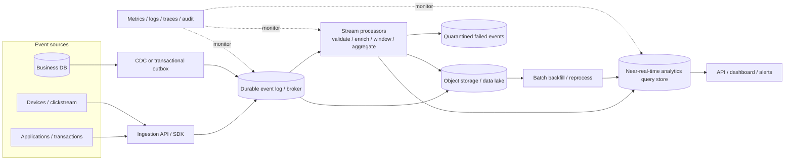
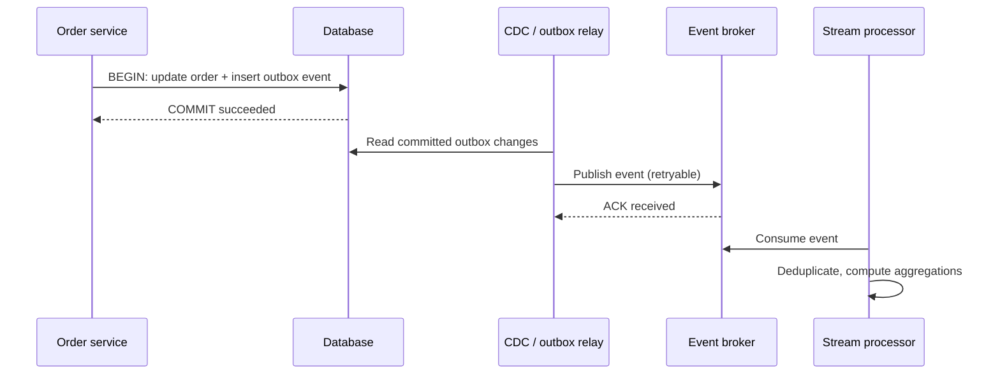

# Stream Processing and Near-Real-Time Analytics

> **Chapter:** Reference architecture patterns  
> **Module:** `CLOUD_ARCHITECTURE` — learn how to design cloud application architectures from business requirements to networking, compute, data, and deployment models; evaluate trade-offs in reliability, security, scalability, cost, and operations under Well-Architected principles.

An e-commerce marketplace wants to see revenue, failed payment counts, and fraud signals just seconds after a transaction occurs. Waiting for an hourly ETL job does not meet this requirement. Instead of periodically scanning the entire dataset, the system can **ingest events continuously, process them incrementally, and update query results as data arrives**. This is the core idea behind **stream processing** and **near-real-time analytics** architectures.

The architecture is not just a message broker and a dashboard. It must also handle late-arriving events, duplicates, out-of-order delivery, broken connections, sensitive data, overload, reprocessing, and verification of analytical outputs. This lesson guides building a **reference architecture pattern** adaptable to transaction analytics, clickstreams, IoT, observability logs, and business data-change streams.

## Learning Objectives

After completing this lesson, you can:

1. Distinguish batch, micro-batch, and streaming; turn "near-real-time" requirements into measurable latency.
2. Design flows from producers, ingestion, broker, and stream processors to analytical stores and APIs/dashboards.
3. Choose partitions, event keys, windows, event time, watermarks, and strategies for late and duplicate data.
4. Explain the practical boundaries of *at-most-once*, *at-least-once*, and *exactly-once* guarantees.
5. Perform preliminary calculations for throughput, retention capacity, latency, and recovery capacity as backlogs grow.
6. Design replay paths, reconciliation, access controls, observability, alerting, and cost controls.

## 1. How Does Streaming Differ from Batch and "Real-Time"?

An **event** describes something that happened: `OrderPaid`, `ProductViewed`, a sensor temperature reading, or a database row change. A **stream** is a continuous sequence of emitted events; arrival rates can fluctuate sharply over time. **Stream processing** transforms, filters, joins, and aggregates events as they arrive, often maintaining state to compute incremental results.

| Processing mode | How it works | Typical design latency | Best-fit examples | Key trade-offs |
| --- | --- | --- | --- | --- |
| **Batch** | Collect data and process on a schedule. | Minutes, hours, or days, depending on schedule. | End-of-day reports, full historical reconciliation. | Easy to control and cost-optimize in bulk, but fresh data arrives late. |
| **Micro-batch** | Group small batches on short intervals and process them. | Seconds to minutes, depending on interval and load. | Short-interval dashboards, incremental ETL pipelines. | Easy to bridge with batch models, but carries interval and job-run latency. |
| **Continuous streaming** | Process as events arrive, maintaining state and checkpoints. | Milliseconds to seconds or more, depending on system and query. | Fraud alerts, sensor telemetry, live operational metrics. | Requires managing ordering, state, late events, retries, and continuous ops. |

"**Near-real-time**" is not a fixed threshold. For an operations dashboard, **data appearing within 10–30 seconds** may suffice; for security alerts, **under 2 seconds** may be required. Both figures are examples of product requirements, not default capabilities of a cloud service.

You must define **the start and end points of latency**. For example:

\[
L_{\text{e2e}} = t_{\text{visible}} - t_{\text{occurred}}
\]

Here `t_occurred` is when the business event occurred according to an authoritative clock, and `t_visible` is when the record appears in queryable results for users. Measuring only broker-to-processor time can miss tens of seconds spent in ingestion, indexing, or dashboard cache refreshes. System clocks can drift; use synchronized timestamps and distinguish wall-clock measured latency from timestamp deltas affected by clock skew.

Express requirements as SLIs/SLOs, such as: **99% of valid payment events appear in revenue metrics within 15 seconds, measured over a 30-day window**, with explicit rules for late events from offline sources. A vague KPI like "fast dashboard" is insufficient for choosing an architecture.

## 2. End-to-End Reference Architecture

A streaming analytics architecture typically has two paths: a **hot path** delivering fresh updates to users, and a **cold or replay path** retaining durable data for auditing and recalculation when logic changes.



This is a **logical diagram**; each block need not be a standalone product. A managed service may combine ingestion, stream processing, or storage. What matters is clarifying each block's **responsibilities and failure boundaries**:

| Block | Responsibility | Design decisions to finalize |
| --- | --- | --- |
| **Producer / data source** | Emit business-meaningful events with consistent identifiers. | When is an event considered to have occurred? Who owns schemas and event IDs? |
| **Ingestion** | Authenticate, rate limit, pre-validate, acknowledge receipt. | Can loss be tolerated or must data be durably persisted before ACKing? Are retries and dedup supported? |
| **Broker / durable log** | Store ordered events within partitions, decouple producers from consumers, enable replay. | Partition key, retention, replica count, quotas, encryption, throughput capacity, and replay method? |
| **Stream processor** | Normalize, filter, join, compute windows, maintain state, emit outputs. | Event time or processing time? When do windows close? Checkpointing and error handling? |
| **Serving storage** | Serve fast queries along prepped dimensions. | How are time/tenant queries served? Are upserts, deletes/corrections, and concurrency supported? |
| **Archive / replay** | Retain raw/transformed events and reprocess when needed. | Durability, retention, file format, partitioning, lineage, logic versioning? |
| **API / dashboard / alerting** | Present metrics and trigger decisions. | Cache freshness, access permissions, "data still updating" indicators, and alert thresholds? |

A producer should not wait for a dashboard response to complete a transaction. The broker buffers event generation rates from processing rates, keeping business applications running when the analytics tier slows down. However, brokers have capacity and retention limits; if downstream stalls for too long, the backlog will exceed retention.

### Technologies That Can Fulfill Each Role

- **Broker/stream:** Apache Kafka, Amazon Kinesis Data Streams, Google Cloud Pub/Sub, Azure Event Hubs, or equivalents. Partitioning, replay, ordering, and quota models differ; do not treat them as drop-in replacements with identical configurations.
- **Processing:** Apache Flink, Spark Structured Streaming, Kafka Streams, or managed stream SQL/processing services. Choose based on event-time support, stateful processing, checkpointing, windowing, and team operational expertise.
- **Serving:** OLAP stores supporting fast ingestion, search/time-series databases, or continuously updated materialized views/aggregate tables. Traditional data warehouses also fit if ingestion and query latency meet SLOs.
- **Archive:** object storage and analytical lakehouse tables enabling schema-governed append writes and auditable reprocessing.

Technology selection follows from latency, data, query-pattern, and operational requirements. Do not deploy every database type merely because it appears on a reference diagram.

## 3. Starting from the Event Contract

Pipeline quality depends on the **event contract**. Example payment-succeeded event:

```json
{
  "event_id": "evt_9c31c5",
  "event_type": "OrderPaid",
  "schema_version": 2,
  "event_time": "2026-11-18T08:15:20.120Z",
  "order_id": "ord_4821",
  "tenant_id": "shop_vn_12",
  "region": "ap-southeast-1",
  "currency": "VND",
  "amount_minor": 1250000,
  "trace_id": "trace_8f42"
}
```

IDs and regions in this example are illustrative. `amount_minor` must have a clear currency definition and storage convention; never assume a single decimal scale across all currencies. `event_time` is when payment was confirmed at the authoritative source, **not necessarily when the event reached the broker**.

A sound contract requires:

1. **Deduplication ID:** an `event_id` stable across retries with an agreed uniqueness scope. For business logic, `order_id` or `payment_id` may need separate idempotency keys.
2. **Partition key:** typically `order_id`, `device_id`, or `tenant_id`, depending on ordering needs. Events sharing a key should land in the same partition when relative ordering is needed.
3. **Timestamps and clock source:** distinguish `event_time`, `ingest_time`, and `processed_time`, declare timezone/UTC, and handle clock skew.
4. **Versioned schema:** define types, required/optional fields, compatible changes, and ownership. Avoid silently changing field semantics without updating the contract.
5. **Business semantics:** `OrderPaid` means "funds successfully captured," not "capture request submitted"; model refunds, adjustments, and cancellations as distinct, explicitly defined events.
6. **Data classification:** include only fields genuinely needed in the stream; never push tokens, passwords, or raw personal data into analytics topics without strong justification and controls.

### Generating Events from a Database: CDC and Transactional Outbox

If an application writes `orders` first and then publishes an event, there are two independent operations: the database commit may succeed while publishing fails, losing `OrderPaid`. Reversing the order can emit an event even though the database transaction rolled back.

**Transactional outbox** eliminates this failure window by writing the business change and an `outbox` row inside **the same database transaction**, after which a relay/CDC reads the outbox and forwards it to the broker. Forwarding can still produce duplicates on retry; consumers must be idempotent.



Direct CDC from business tables is also useful for feeding database changes into a pipeline. However, a row mutation does not automatically convey full **business event semantics**. Decide when to use state-change CDC versus a domain-event outbox; also plan for initial snapshots and schema evolution.

## 4. Partitions, Ordering, and Scalability

Most streaming systems scale by **partitioning** and processing partitions in parallel. Events with the same partition key are generally processed in order within *that partition*, yet **there is no global ordering** across partitions or independent sources. Actual ordering guarantees also depend on producer retry settings and broker/consumer configurations.

| Partition key | Advantages | Risks |
| --- | --- | --- |
| `order_id` | Easy to keep events for a single order ordered. | High key cardinality; per-tenant calculations need a downstream aggregation step. |
| `tenant_id` | Convenient for isolated per-tenant analytics. | Large tenants can become **hot partitions** and bottleneck throughput. |
| `device_id` | Easy to maintain time-series state per device. | Regional totals require merging across many partitions. |
| Random or round-robin | Even load distribution when events are independent. | Loses per-entity ordering guarantees. |

A **hot key** occurs when one key generates so many events that the worker assigned to its partition bottlenecks while other workers sit idle. Mitigations include key salting/sharding, two-stage aggregation (partial aggregate then merge), or choosing another partitioning scheme. Key sharding trades off per-key ordering; do not use it when business rules require strict serialization of all updates for one entity.

Effective parallelism depends on partition count, worker capacity, per-event processing cost, state overhead, and bandwidth. Adding workers without increasing partitions—or when the bottleneck is the serving database—will not raise throughput.

## 5. Event Time, Processing Time, Windows, and Watermarks

An event can occur at 10:00:01 yet reach the processor at 10:00:20 due to offline devices, slow networks, or broker backlogs. Therefore distinguish:

- **Event time:** when the event actually occurred in business terms.
- **Ingestion time:** when the platform received the event.
- **Processing time:** when the processing job handled the event.

Suppose you compute revenue per minute. Using *processing time*, a transaction occurring in the 10:00 minute that arrives late at 10:01 gets counted under 10:01. When reports must reflect payment time, **event-time windows** align better with business semantics.

### Common Window Types

| Window | Concept | Example |
| --- | --- | --- |
| **Tumbling** | Splits time into non-overlapping intervals. | Total orders per minute `[10:00,10:01)`, `[10:01,10:02)`. |
| **Hopping/sliding** | Potentially overlapping intervals, updated continuously by a slide step. | Trailing 5-minute revenue, updated every 30 seconds. |
| **Session** | Groups events into sessions, closing after inactivity exceeds a gap threshold. | Group user clicks separated by less than 15 minutes. |

### Watermarks and Late-Arriving Data

A **watermark** estimates the event-time progress observed by the processor. An example watermark signals that the system expects most events prior to `10:00:58` have arrived, allowing the corresponding window to close or emit results. A watermark **does not prove** all older events have arrived. The design must specify how events arriving later than the watermark are handled.

Example one-minute window with a 2-minute allowed lateness:

```text
Event occurred          10:00:40   OrderPaid 100,000 VND
Arrived at processor    10:00:42   Counted in window [10:00, 10:01)

Event occurred          10:00:50   OrderPaid 200,000 VND
Arrived at processor    10:01:20   Still counted in window [10:00, 10:01)

Event occurred          10:00:55   OrderPaid 300,000 VND
Arrived at processor    10:04:10   Likely past watermark + allowed lateness
```

For the last case, the system needs a policy: **retract/update prior results**, route to a **late-events side stream** for backfill, or exclude from the fast dashboard while including in reconciliation tables. Late events are not worthless; financial metrics require an auditable correction path. Depending on the engine, a window may emit early previews and update multiple times before finalizing.

### Windowed Aggregation with Updates

The platform-agnostic pseudocode below illustrates the business logic; function names are conceptual, not runnable APIs:

```text
for each event in stream("OrderPaid"):
    validate_schema(event)
    if dedup_key_seen(event.event_id):
        continue

    minute = floor_to_minute(event.event_time)
    key = (event.tenant_id, minute, event.currency)
    state[key].revenue_minor += event.amount_minor
    state[key].paid_orders += 1
    emit_upsert("revenue_by_minute", key, state[key])

when watermark passes window_end + allowed_lateness:
    finalize_or_retain_for_correction(key)
```

The serving store must enforce a unique key, such as `(tenant_id, minute, currency)`, and support **upserts** if windows recompute. If each update appends as a new revenue row, the dashboard will double-count. Deduplication and window state must have expiration policies aligned with retry windows, lateness bounds, and storage cost.

## 6. Processing Guarantees: At-Most-Once, At-Least-Once, Exactly-Once

In distributed systems, a consumer may finish processing an event and lose connectivity before writing a checkpoint or ACK. Upon recovery, the system may redeliver the already-processed event. Different semantics carry distinct meanings:

| Semantics | Guarantee | Typical implications |
| --- | --- | --- |
| **At-most-once** | Each event is attempted at most once; events may be lost on failure. | Reasonable for non-critical telemetry when cost/simplicity dominates. |
| **At-least-once** | Events are not lost within durability, retention, and recovery assumptions, but may be reprocessed. | Requires deduplication or idempotent sinks to prevent double-counting. |
| **Exactly-once processing semantics** | An engine coordinates reads, state, and outputs inside a defined transaction/checkpoint boundary to avoid duplicate effects within that boundary. | Does not automatically guarantee external side effects like sending emails, calling payment APIs, or writing to non-transactional databases. |

Saying "Kafka/Flink has exactly-once so nothing can ever duplicate" is a fallacy. **End-to-end exactly-once** requires verifying the entire chain: producer, broker, state backend, sink, retries, and external side effects. For many systems, the practical choice is **at-least-once + idempotency + reconciliation**.

Common techniques:

- Generate a stable `event_id` across producer retries rather than minting new IDs for the same logical event.
- Use **upserts by business key and version** or unique constraints in the serving store.
- For operations that must execute once, use idempotency keys or unique constraints at the authoritative system.
- Commit checkpoints/offsets consistently with state and output commits so recovery replays safely.
- Design explicit event semantics for edits/cancellations: use compensating or reversal events rather than silently deleting history.
- Verify regularly by reconciling against authoritative business records rather than trusting processed event counts alone.

### Data Errors and Dead-Letter Queues

Invalid data errors differ from transient infrastructure failures. With bad schemas or unprocessable values, infinite retries can stall an entire partition. Classify errors clearly:

1. **Transient:** timeouts, rate limits, temporarily unavailable targets → retry with backoff, cap attempts, and avoid overloading dependencies.
2. **Permanent:** missing required fields, unsupported schema versions, malformed types → isolate in a **DLQ/quarantine** with failure reason, timestamp, topic/partition/offset, and correlation ID.
3. **Business-level:** refunds, cancelled orders, disputed transactions → controlled reconciliation or compensation workflows.

Never turn a DLQ into an unmonitored "trash bin." Assign owners, handling SLOs, access controls, and replay policies; error payloads may hold sensitive data needing encryption or redaction.

## 7. Choosing Where to Store and Serve Queries

**A broker is not a general-purpose dashboard query store.** Brokers excel at storing event sequences by offset and retention, whereas dashboards ask questions like "per-minute revenue across 500 stores over 24 hours, filtered by region and device type." Choose storage optimized for the query pattern:

| Query pattern | Suitable serving pattern | Considerations |
| --- | --- | --- |
| Counts/sums by minute, tenant, region | Aggregate tables, materialized views, fast-ingest OLAP. | Keyed upserts per window, cardinality limits, and audit trail for restatements. |
| State-sequence lookup for a single entity | Key-value/document store or ID-indexed table. | Enforce ordering, versioning, and appropriate TTLs. |
| Log/event exploration with flexible attributes | Search/analytics index. | Indexing cost and high schema/cardinality overhead. |
| Historical reconciliation, multi-month ad hoc queries | Warehouse/lakehouse over archive. | Higher latency than hot path, but strong auditability and flexible reprocessing. |
| Instant alerting | Processor emits alerts to alerting/rule engines. | Rate limiting, alert deduplication, and acknowledgment workflows. |

A product might use a **hot store** for the last 7 days and an **archive** for long-term reporting. Dashboards should surface the latest data timestamp (`data_as_of`), watermark time, and pipeline health so users know figures may still adjust. For revenue, separate "fast updated estimate" from "final reconciled figure" when business rules require it.

**When to choose Kappa vs. Lambda?** In a **Kappa** architecture, prefer one processing pipeline and replay the event log for recomputation. In **Lambda**, separate speed and batch paths generate outputs that must be merged. Kappa reduces duplicate logic if replay and state management work well; Lambda can help when historical batch requires different algorithms, yet raises the risk of the two paths diverging. Start with one pipeline that has a clean correction path, then add batch only when historical and audit demands justify it.

## 8. Sizing: Throughput, Retention, Latency, and Backlog

Architect for **peak traffic**, not just daily averages. Suppose the system ingests an average of **1,000 events/sec**, each encoded event is **1 KiB**, peak factor is **5x**, and the broker retains data for **3 days**.

### Calculating Input Rate and Raw Capacity

Assuming kibibytes (1 KiB = 1,024 bytes):

\[
R_{\text{bytes/s}} = R_{\text{events/s}} \times S_{\text{bytes/event}}
\]

- Average: `1,000 × 1,024` = **1,024,000 bytes/sec**, roughly **0.98 MiB/sec**.
- Peak: `5,000 × 1,024` = **5,120,000 bytes/sec**, roughly **4.88 MiB/sec**.
- Daily logical raw volume: `1,024,000 × 86,400` = **88,473,600,000 bytes**, roughly **82.4 GiB/day**.
- 3-day logical raw retention: roughly **247.2 GiB**, *excluding* replicas, indexes, metadata, message framing overhead, compression, storage overhead, or output data.

With **3 replicas** on the broker and ignoring compression, replication alone can require roughly **741.6 GiB** of physical storage for 3 days; actual storage mechanics, quotas, and pricing depend on the service. Never treat this rough multiplication as an exact billing forecast.

If a single worker sustainably processes **1,000 events/sec** in realistic load tests, a 5,000 events/sec peak needs **at least 5 equivalent processing units** before adding headroom, join/window state overhead, and partition constraints. Keep reserve capacity to recover from a failed worker, traffic surges, and checkpointing/rebalances.

### Backlog and Catch-Up Time

Suppose input runs at 1,000 events/sec and the processor stalls for 10 minutes:

\[
N_{\text{backlog}} = 1,000 \times 600 = 600,000\ \text{events}
\]

Once restored, if the processor sustains 1,500 events/sec while producers continue emitting 1,000 events/sec, net backlog drain is **500 events/sec**, requiring at minimum:

\[
T_{\text{catch-up}} = \frac{600,000}{1,500 - 1,000} = 1,200\ \text{s} = 20\ \text{minutes}
\]

This assumes steady arrival and processing rates with no costly retries or checkpoints. If processing rate is **not greater than** arrival rate, backlog never clears; increasing retention only buys time before loss, without fixing the bottleneck. Track **consumer lag in time**, not just record count, since message sizes and arrival rates vary.

### Latency Budget Allocation

If the SLO requires 99% of data visible within 15 seconds, the team can set **preliminary operational targets** per stage: ingestion 2s, broker 2s, processing 4s, serving write 3s, and query/render 2s, leaving the rest for variance. This is a management budget, **not a guarantee that summing per-stage p99 yields end-to-end p99**. Inter-stage dependencies and latency distributions mean end-to-end traces or timestamps must be measured on real events.

## 9. Reliability and Fault Handling Under Well-Architected Principles

| Scenario | Risk | Design response |
| --- | --- | --- |
| A worker stops abruptly | Loss of uncheckpointed state; partition temporarily unprocessed. | Durable/checkpointed state, auto-recovery, rebalancing, idempotency verification on replay. |
| Broker overloaded or loses an AZ | Producer timeouts, growing consumer lag, potential retention overflow. | Appropriate multi-AZ resilience, backoff retries, producer buffering/rate limits, load-shedding plan. |
| Serving database slows down | Processor backpressure or write failures, stale dashboards. | Capacity planning, optimized batch/upserts, circuit breakers, and data freshness monitoring. |
| Producer pushes incompatible schema | Mass event failures, pipeline halts or drops data. | Schema compatibility checks in CI/CD, contract tests, quarantine invalid events. |
| Replay runs concurrently with live traffic | Overwrites newer results, double-counting, load spike. | Versioned outputs/run IDs, idempotent upserts, resource isolation, and controlled cutover. |
| Region outage | Reduced ingest/processing capacity; un-replicated data loss risk. | Define RTO/RPO, standby region capacity, replication strategy, data residency compliance; failover drills. |
| Shared key/secret or config error | Multiple pipelines fail simultaneously. | Least privilege, controlled rotation, auditing, minimize control-plane dependencies on the live data path. |

**Pipeline availability** and **metric correctness** are distinct goals. A processor that stays up and emits metrics while doubling revenue is a business failure. When evaluating reliability, prove correctness via reconciliation samples—especially for financial transactions, inventory, and automated-action triggers.

### Single-Region vs. Multi-Region Deployment

Many streaming services deploy **multi-AZ within one region** to survive machine or zone outages. **Multi-region** raises geographic resilience while increasing cross-region transfer costs, duplicates, event ordering complexity, checkpoint/replay complexity, and security overhead. In streaming, you cannot assume failing over producers to Region B preserves offsets, IDs, or state from Region A. The design must explicitly specify failover flows, acceptable data-loss windows, deduplication on re-ingestion, and post-failback reconciliation.

Where data residency laws require data to remain within a country/region, **process granular data in the source region** and forward only approved aggregated results to a central analytics region. This decision requires formal legal and technical validation, not merely a broker setting change.

## 10. Security, Privacy, and Data Governance

Because stream systems ingest from many sources, attack surface and leak risks grow with topics, consumers, and replicas. At a minimum enforce:

- **Authentication and authorization:** producers write only to authorized topics, consumers read only authorized streams; use service identities and least privilege rather than shared system-wide credentials.
- **Encryption:** TLS in transit, encryption at rest, key management, and secret rotation policies; avoid putting tokens in events, logs, DLQs, or debug traces.
- **Schema and personal data governance:** classify sensitive fields, retain only attributes needed for analytics, and mask or hash/pseudonymize where appropriate and permitted.
- **Retention and deletion:** apply policies across topics, archives, serving stores, backups, and DLQs; when personal data must be erased, account for copies in immutable logs and replay history.
- **Quality controls:** validate value ranges, valid event types, versions, timestamps, currencies, duplicate rates, and missing fields.
- **Audit and lineage:** know which producer emitted an event, which processor version computed a result, which source offset/checkpoint was used, and who accessed or modified the pipeline.
- **Protecting public-facing consumers:** dashboards/APIs must enforce tenant authorization so misconfigured filters never leak cross-tenant aggregates or queries.

Do not retain raw events indefinitely merely because a broker supports replay. **Practical replayability** can be achieved through policy-governed archives, versioned schemas, and proper data protection; retention durations must reflect audit, recovery, and compliance obligations.

## 11. Pipeline Observability and Operations

An infrastructure dashboard showing only CPU and message counts is not enough. Monitor these layers:

| Metric | Interpretation | Problem signal |
| --- | --- | --- |
| **Ingest rate & error rate** | Events/sec and rejection/error rates at sources or ingestion. | Sudden drop to 0 or spike; sources may have stopped emitting rather than the pipeline being healthy. |
| **End-to-end freshness** | Actual age of events visible in serving/queries relative to occurrence time. | Dashboard responds quickly, yet data is stale. |
| **Consumer lag (offset/time)** | Distance between source head and consumer progress. | Continuously rising lag; processors cannot keep up with sources. |
| **Watermark lag** | How far the watermark trails wall-clock time or incoming event-time distribution. | Windows fail to close, state balloons, one idle partition stalls everything. |
| **Processing throughput & backpressure** | Actual throughput and time spent blocked by downstream. | Workers have spare CPU, yet the sink is too slow. |
| **Checkpoint health** | Frequency, duration, checkpoint failures, state recovery time. | Risky or slow recovery, large replay exposure. |
| **DLQ, retries, duplicates, late events** | Anomaly rates broken down by schema and tenant. | Silent data inaccuracy even while services return HTTP 200. |
| **Data reconciliation drift** | Divergence between aggregates and authoritative business sources. | Silent miscalculation or dropped records. |
| **Serving query latency & freshness** | p95/p99 latency, query errors, lag between sink and index. | Users experience slow or stale results. |
| **Cost per event / per query** | Ingest, processing, storage, and query cost relative to traffic. | Cost spikes from hot keys, retries, replication, or over-indexing. |

Tag metrics by `environment`, `region`, `pipeline`, `topic`, `processor_version`, and operationally useful dimensions. **Avoid putting `event_id` or `user_id` into metric labels** due to extreme cardinality; use properly protected logs/traces to investigate individual events.

Base alerts on **SLOs and recoverability**: for example, freshness exceeding thresholds for several minutes, projected backlog exceeding retention, DLQ spikes, or reconciliation drift. Do not page solely on 80% CPU if the pipeline meets its SLO. For streams with natural quiet periods, define expected-source-activity heartbeats to distinguish "no events" from "broken ingestion."

### Basic Runbook When Analytics Fall Behind

1. **Verify user impact:** check the timestamp of the newest visible event, separating slow APIs from stale data.
2. **Trace the pipeline backward:** are sources emitting → is ingestion failing → what are broker retention/lag → is the processor hitting backpressure/checkpoint errors → is the sink/index bottlenecked?
3. **Prevent data loss:** throttle non-critical sources if business permits, expand retention/buffers within limits, avoid letting backlog exceed retention before recovery.
4. **Controlled recovery:** scale the actual bottleneck, restart from valid checkpoints; avoid "skipping offsets" just to zero out lag, as that drops analytical data.
5. **Verify correctness:** reconcile event/record counts, deduplication, late events, and incomplete windows; recompute affected ranges if needed.
6. **Close the incident:** confirm freshness and critical business checks recovered, then update capacity plans, alerts, and operational learnings.

## 12. Safe Change Rollout and Reprocessing

In continuous streaming, changing an aggregation function alters the meaning of every result after deployment. If processor state changes schema or serialization, the new version may fail to restore the old version's checkpoint. Pipeline releases therefore need a dedicated workflow:

1. **Contract testing:** producers and consumers stay compatible with the new schema; test with sample events plus malformed and late inputs.
2. **State and window testing:** verify behavior across restarts, replays, reordered events, duplicates, and window-boundary watermarks.
3. **Canary/shadow:** run the new version against a mirrored stream or isolated input subset; compare results with the current version without letting both write uncontrolled into the same production aggregates.
4. **Define state upgrade paths:** use compatible migrations, savepoints/checkpoints, or rebuild state from archived events; budget time and cost when state is large.
5. **Controlled cutover:** isolate writes to the serving store by version/run ID, keeping rollback paths for both code and data routes.
6. **Post-change reconciliation:** audit boundary records, late events, and aggregate totals against authoritative sources.

**Backfill/replay** is not simply pushing old data back into a production topic. A safe approach writes outputs to a versioned table or namespace, validates against current production, and performs an **atomic/safe cutover** at the query layer once criteria pass. When replaying alongside a live stream, align offset/time boundaries consistently to avoid gaps or double-application. If recomputing only a historical window, define how adjacent windows outside that range are updated.

## 13. Design Scenario: Multi-Store Revenue Dashboard

**Context:** a platform operates 3,000 stores. The transaction system emits `OrderPaid`, `OrderRefunded`, and `OrderCancelled` events. Managers need near-real-time revenue by store and region; fraud teams need alerts when anomalous transactions spike. Data can arrive late because payment providers deliver delayed webhooks. At peak hours, traffic multiplies several times over average.

**Requirements translated into architectural decisions:**

| Requirement | Proposed design | Verification |
| --- | --- | --- |
| Dashboard updates within 15 seconds for most events | Outbox/CDC → durable broker → event-time processor → aggregate serving → API. | Track p99 end-to-end freshness by tenant/region and compliance rate. |
| No double-counted revenue | Stable event IDs, idempotent upserts, separate payment vs. refund tracking, reconciliation. | Replay an event 2–3 times without changing final totals; reconcile against ledger. |
| Late-arriving events | Watermarks, allowed lateness, windowed updates; formal correction path. | Inject late events before and after threshold; inspect dashboard and reconciliation tables. |
| Handle peak traffic | Appropriate partition keys, capacity headroom, hot-tenant checks, state-aware autoscaling. | Load-test at peak and measure backlog drain speed after outages. |
| Multi-tenant access isolation | Enforce authn/authz at API and data layers; minimize sensitive fields in events. | Tenant A cannot query or infer Tenant B's details. |
| Auditable historical reports | Policy-governed event retention, processor versioning, replay, and business-source reconciliation. | Recompute a past day and explain every variance. |

### Sample Business Flow

1. Order service commits successful payment and an `OrderPaid` outbox event in one transaction.
2. The outbox relay publishes to the broker. Partition by `order_id` to preserve per-order business ordering. Retries may emit duplicates.
3. The processor validates schema and `event_id`, normalizes currency, and routes the event to store-, currency-, and minute-windowed revenue calculations. If currency conversion is required, specify the exchange-rate source and effective timestamp; never sum amounts across differing currencies directly.
4. The processor issues **upserts** to aggregate serving. The API returns `revenue_minor`, `currency`, `window_start`, `data_as_of`, and whether the value is still subject to adjustment.
5. Refund/cancel events enter an adjustment flow keyed to the original transaction. Distinguish gross revenue, refunds, and net revenue to avoid ambiguous formulas.
6. Raw or suitably normalized events go to the archive. A scheduled reconciliation job compares against the official ledger and generates adjustment entries on drift.

### A Realistic Incident Drill

After deploying a new processor version, revenue jumped abnormally while unique `OrderPaid` counts stayed flat. Investigation showed each processor retry inserted **a new aggregate row** instead of upserting on `(tenant, minute, currency)`. Recovery entailed halting the rollout, blocking the faulty write path, rolling the processor back to the stable version, rebuilding affected windows from the auditable event archive, and switching the dashboard to the corrected table. Checking "consumer lag near 0" completely missed this bug; reconciliation and uniqueness constraints were the critical guardrails.

### Well-Architected Trade-Offs

- **Reliability:** durable brokers, checkpoints, DLQs, and replay raise recoverability, yet do not replace business reconciliation.
- **Performance efficiency:** stateful streaming and serving indexes provide high freshness; accept continuous compute spend and higher partitioning/windowing complexity than batch.
- **Security:** authentication, encryption, tenant isolation, and retention govern streams carrying replicated data copies.
- **Cost optimization:** set sensible retention, pick managed services when they reduce ops toil, avoid indexing every field, and use batch for historical queries not needing second-level freshness.
- **Operational excellence:** freshness SLOs, runbooks, schema checks, canaries, replay drills, and data lineage are core product features, not post-launch afterthoughts.

## 14. Common Mistakes

| Mistake | Consequence | Fix |
| --- | --- | --- |
| Saying "real-time" without defining measurement boundaries | Impossible to pick technologies or verify requirements. | Define an SLO measured from event occurrence to query visibility. |
| Using processing time for data that can arrive late | Business-time aggregations are skewed. | Use event-time windows, watermarks, and late-data policies. |
| Assuming the broker guarantees global ordering | Events in different partitions have misinterpreted causal order. | Design partition keys, versions, and explicit ordering boundaries. |
| Seeing "exactly-once" and skipping idempotency | Sink/API retries still cause duplicate side effects. | Verify end-to-end guarantees and build idempotent side effects. |
| Treating the broker as the sole data store | Retention expiry makes historical reprocessing impossible. | Maintain an archive/source store with policy and replay capability. |
| Adding workers while a hot partition or sink stays bottlenecked | Cost rises without reducing lag. | Measure the real bottleneck and fix partitioning, state, or serving. |
| Lacking reconciliation with authoritative sources | Silent data corruption persists indefinitely. | Implement reconciliation and formal correction paths. |
| Using user IDs as metric labels | Cardinality explodes, degrading monitoring cost and performance. | Keep metric dimensions bounded; use protected logs/traces for detail. |
| Replaying directly over live serving results | Metrics flicker, overwrite newer versions, or double-count. | Reprocess into a versioned namespace, verify, then cut over safely. |

## 15. Evaluation Checklist and Practice Exercise

Before selecting this pattern, verify:

- [ ] A use case requires second/minute updates; pure batch or micro-batch is proven unable to meet the SLO or required capability.
- [ ] Event contract, owner, schema version, event ID, business key, and time definitions are explicit.
- [ ] Event sources, reliable emission mechanisms, ACK points, retries, and duplicate possibilities are known.
- [ ] Partition keys, parallelism, hot-key risks, and ordering constraints are defined.
- [ ] Event time, watermarks, windows, late events, result updates, and backfills are handled.
- [ ] Durability/checkpoint/idempotency guarantees are accurately stated for broker, state, and sink; no unverified exactly-once claims.
- [ ] Sizing covers average, peak, retention, replicas, catch-up time, and serving store scalability.
- [ ] SLOs cover freshness, correctness, errors/DLQ, lag, query latency, and reconciliation workflows.
- [ ] Archive/replay/backfill paths and testable state/processor upgrade processes exist.
- [ ] Producer/consumer/tenant permissions, PII controls, retention, encryption, auditing, and data residency are enforced.
- [ ] Failure-domain shutdown/recovery runbooks, cross-region plans if needed, cost controls, and operational owners are assigned.

### Practice Exercise

You are tasked with designing a platform ingesting **8,000 events/sec** on average, **4x peak**, **2 KiB** per event, needing to show failed device counts by region within **10 seconds** for **99% of events**. Devices can go offline for up to **5 minutes** before flushing; some devices send duplicates on retry. Granular source data for certain customers must stay within a designated region.

Present a design covering: producer → ingest → broker → processor → serving/archive diagram; partition key; tumbling or hopping window; watermark and late-event policy; deduplication; daily raw data volume and 48-hour pre-replica retention; backlog catch-up capacity after a 15-minute consumer outage; four key SLO/alert metrics; and a safe processor rollout plan. Identify which assumptions require load-test verification and how data residency restrictions are satisfied.

**Calculation sanity check:** at average rate, `8,000 × 2 KiB = 16,000 KiB/s` (approx. 15.625 MiB/s), or roughly **1.288 TiB/day** of logical data before overhead; 48-hour retention needs roughly **2.575 TiB** before replication, compression, and metadata. Meeting the SLO also depends on backpressure, offline windows, and watermarks: you cannot guarantee every event delayed 5 minutes offline appears on the dashboard within 10 seconds of occurrence. Therefore, **explicitly define the eligible event cohort for the SLO**, while separately reporting ingestion latency for offline devices.

An effective streaming architecture proves **data arrives fast enough, computes accurately, recovers cleanly, and runs at acceptable cost**; raw processing speed alone is never enough for trustworthy analytics.
