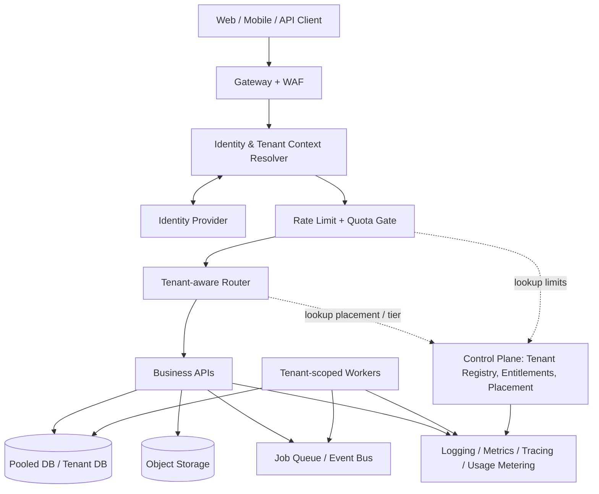
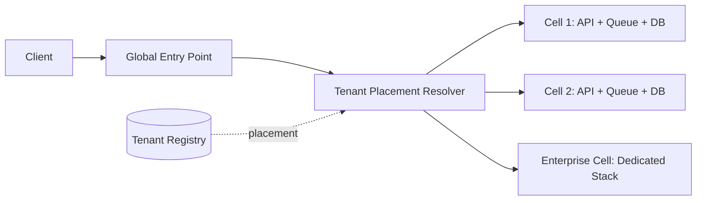
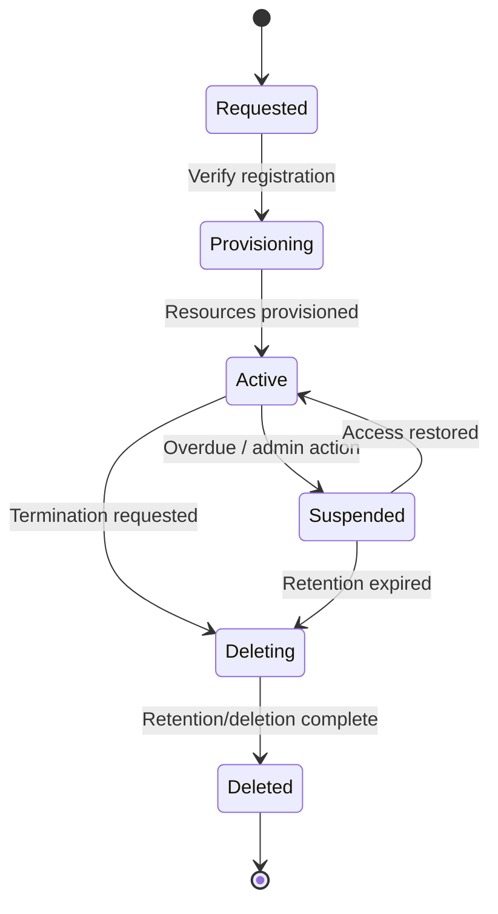

# Multi-Tenant SaaS Platforms with Data Isolation and Quotas

## 1. The Architectural Problem and Learning Objectives

A **Software as a Service (SaaS)** product may deliver the same application to hundreds or thousands of organizational customers. Customers share parts of the system yet expect their data, access controls, and experience to remain unaffected by other customers. This is the **multi-tenancy** problem.

In this lesson, a **tenant** is the customer boundary the system uses to govern identity, data, configuration, service entitlements, resources, and billing. One tenant usually represents one business; a tenant can contain multiple users, teams, workspaces, or projects. A user may belong to multiple tenants, but permissions in one tenant do not automatically apply to another.

For example, a project management SaaS serves three companies: A, B, and C. When Company A's user views the project list, the system returns only A's data; when B sends heavy API traffic, B must not degrade A's service below operational targets; when C upgrades its plan, C's concurrent job limit adjusts without reconfiguring the entire system.

Multi-tenant SaaS design must solve five challenges at once:

1. **Security and data isolation:** prevent cross-tenant access across queries, caches, queues, file storage, backups, logs, and admin tools.
2. **Usage isolation:** control request rates, concurrent tasks, storage capacity, and consumption to curb the *noisy neighbor* effect (one tenant monopolizing shared resources).
3. **Scalability and reliability:** accommodate tenant growth and peak traffic while meeting latency, availability, and recovery SLOs.
4. **Cost and operations:** leverage shared resources efficiently, measure per-tenant cost, and deploy and observe the entire platform cleanly.
5. **Product flexibility:** support varying service tiers, features, deployment regions, compliance obligations, and isolation levels.

After this lesson, you can distinguish **pool, silo, and bridge** models, design a SaaS architecture with a **control plane** and **data plane**, enforce tenant isolation across multiple layers, define **quota/rate-limiting** mechanisms, and analyze trade-offs using **Well-Architected** thinking.

> **Core principle:** A service is not multi-tenant merely because a database table has a `tenant_id` column. Tenant boundaries must be enforced consistently from incoming requests down through data, background jobs, resources, and operations.

## 2. Defining Business and Non-Functional Requirements

Before choosing databases, compute, or deployment models, define **who must be isolated from whom**, at what level, under what load conditions, and at what cost customers are willing to pay.

Suppose the `WorkHub` task-management platform offers three tiers. The numbers below are **illustrative assumptions only**, not standard limits for every SaaS:

| Requirement | Standard | Business | Enterprise |
|---|---:|---:|---:|
| Max API requests/minute/tenant | 600 | 3,000 | Per contract |
| Concurrent processing jobs/tenant | 3 | 15 | Per contract |
| Storage capacity/tenant | 20 GiB | 200 GiB | Per contract |
| Target data isolation model | Pooled, tenant-enforced | Pooled or dedicated partitioning | Optional dedicated DB/cell |
| Data residency requirement | Default product region | Selected region | Per contract terms |

Table figures must come with clear specifications: which requests count, whether failed requests count, whether limits use sliding or fixed windows, whether storage is measured pre- or post-compression, when plan changes take effect, and how over-quota resources are handled.

Beyond the tier matrix, evaluate these dimensions:

| Dimension | Architectural questions |
|---|---|
| Customer model | Can one user belong to multiple tenants? Do tenants have sub-workspaces? |
| Security | Which data is sensitive? Who may access it? Are customer-managed encryption keys required? |
| Data and compliance | Where must data reside? Are deletion, export, and audit evidence required? |
| Load | How many tenants, requests/sec, jobs/hour, growth rate, and what share does the largest tenant generate? |
| SLO | p95/p99 latency, success rate, recovery time objective, recovery point objective? |
| Operations | How automated are tenant onboarding and configuration? How are incidents and customer support handled? |
| Financials | Plan pricing, fixed cost/tenant, profit margin, criteria for dedicating infrastructure? |

**SLO** (*Service Level Objective*) defines measurable operational targets, such as successful valid request ratio or p95 latency over a period. **RTO** is maximum acceptable recovery duration, while **RPO** is maximum acceptable data loss, typically expressed in time. Both must be agreed per feature and service tier before designing HA/DR.

## 3. Choosing a Multi-Tenancy Model: Pool, Silo, and Bridge

The models below describe **resource-sharing levels**, not specific cloud service names.

| Model | Implementation | Strengths | Trade-offs | When suitable |
|---|---|---|---|---|
| **Pool** | Multiple tenants share compute and typically databases; data is separated logically | High resource efficiency, fast provisioning, low cost/tenant | Requires strict data access controls, noisy-neighbor defense, harder per-tenant restore | Many small/medium tenants where logical isolation satisfies requirements |
| **Silo** | Each tenant gets dedicated databases, workloads, or full stacks | Clear resource boundaries, easy per-tenant config/restore, meets strict mandates | High fixed cost, many resources to manage, complex fleet-wide upgrades | Large tenants, strict security/residency mandates, or dedicated SLAs |
| **Bridge (hybrid)** | Some layers shared, some isolated per tenant or tenant group | Balances cost and isolation, offers per-tenant upgrade paths | More complex routing, observability, operations, and config management | Multi-tier SaaS with diverse tenant sizes or requirements |

Pool/silo scope can vary across layers:

- **Compute:** shared service/process, shared cluster with separated namespaces, or dedicated clusters.
- **Database:** shared tables with `tenant_id`, shared instance with separate schemas/databases, or dedicated instances.
- **Storage:** shared bucket with prefixes and protective policies, dedicated buckets, or dedicated accounts/regions.
- **Networking and encryption:** shared policies, isolated segments, dedicated data keys, or dedicated infrastructure as required.

Never assume a **separate schema** or **separate database** automatically equals total isolation; access accounts, IAM, compute, caches, backups, logging, and admin channels may still be shared. Conversely, a pooled model can meet strict security requirements when properly designed, tested, and operated. Isolation levels must rest on threat analysis, contracts, and risk tolerance.

### 3.1. Choosing Per Layer

In the WorkHub scenario, one reference choice is:

1. Use **shared stateless frontend and API**, leveraging load-based autoscaling.
2. Use a **pooled database** for most tenants, enforcing cross-tenant query blocks and indexing by `tenant_id`.
3. Provision **dedicated databases or cells** for select tenants with heavy loads, data residency mandates, or dedicated commitments.
4. Run a **shared control plane** holding tenant metadata, tiers, and placement; the data plane looks up placement to route to the right resources.

This is not the only design: if contracts mandate strict infrastructure isolation, siloed resources may be a prerequisite from day one.

## 4. Reference Architecture: Control Plane and Data Plane

A SaaS architecture becomes easier to govern when separating two responsibilities:

- **Control plane:** tenant registration, status verification, subscriptions/entitlements, configuration management, provisioning policies, `tenant → region/cell/database` placement maps, usage metering and billing, tier-change or tenant-migration workflows.
- **Data plane:** serving tenant business traffic, enforcing authorization, processing transactions, reading/writing data, and executing jobs.

The diagram below is a **logical pattern**; boxes need not map 1:1 to cloud services or physical deployments.



In the diagram, `RES ↔ IDP` represents identity verification per the chosen mechanism (e.g., validating JWT signatures using cached keys or calling an IdP endpoint). Arrows to the control plane represent **logical interactions**: in production, use TTL caches, refresh policies, and graceful degradation when the control plane is unavailable rather than calling the control plane synchronously on every request.

### 4.1. Request Processing Sequence

1. The gateway terminates/validates the connection, applies input filters, and forwards the request to identity resolution.
2. The system verifies the token/session: signature, issuer, audience, expiration, and required status.
3. The application resolves the **active tenant** and **verifies the user or service principal has access to that tenant**. A tenant may be selected from URL or session, yet client-supplied values never grant permissions on their own.
4. Retrieve tenant status, tier, limits, and resource placement from a trusted registry or valid cache.
5. Enforce rate limits/quotas and route to the right data plane per the tenant placement map.
6. Inside business APIs, continue verifying permissions by **action and resource**; query data under the system-authenticated tenant context.
7. Emit usage, trace, and audit events tagged with the proper tenant ID; avoid logging secrets or unnecessary sensitive payloads.

**Trust boundary:** client-supplied `X-Tenant-Id`, URL paths, or JSON fields are only a **requested target tenant**. The application must validate them against server-managed identity and membership records. Never pass raw header values straight into database filters or authorization decisions.

### 4.2. Background Job Processing Sequence

Asynchronous jobs lack an active HTTP request at execution time. Therefore, each job needs metadata such as `tenant_id`, `job_id`, action type, payload parameters, and config version; messages must come from trusted producers and workers must verify authorized execution scope. Workers cannot skip tenant checks merely because a queue is internal.

When executing a job, re-apply tenant concurrency/rate limits, select the right data store, and record usage with deduplication safeguards. If one tenant enqueues millions of jobs, queue partitioning, routing, and fair scheduling become mandatory parts of the architecture.

## 5. Tenant Isolation from Identity to Data

### 5.1. Layers to Protect

| Layer | Design measures | Common mistakes |
|---|---|---|
| Identity | Verify token/session; user ↔ tenant membership map; tightly scoped service identities | Accepting arbitrary `tenant_id` headers |
| Authorization | Verify tenant, role, and **resource-level** permissions; least privilege | Checking tenant on login but skipping checks on download endpoints |
| Business API | Immutable tenant context per request, authenticated at entrypoint and propagated throughout | Reading tenant from query params deep inside business logic |
| Database | Row-level security or dedicated DB/schema, tenant-scoped foreign keys, cross-tenant tests | Queries missing `tenant_id` predicates; joins leaking rows |
| Cache | Cache keys include tenant and permissions when needed, clear TTL/invalidation | Key `project:123` shared between tenants A and B |
| Object storage | Tenant namespaces, IAM, short-lived signed URLs, pre-issuance auth checks | Returning another tenant's direct object URL |
| Search/analytics | Enforce tenant filters at data source and query time; isolate datasets/indexes | A search query omitting the tenant filter |
| Queue/job | Trusted tenant metadata, worker scoping, tenant routing, safe retry handling | Tenant A's job running under leftover DB context from Tenant B |
| Logging/backups | Restrict logged data, control exports/restores, audit admin operations | Exports and backups stored in public paths |
| Admin/support | Role-scoped support access, step-up auth, justification-gated access, audit and expiry | Support accounts holding unrestricted read access to all tenants |

No single control layer replaces the others. In a pooled model, data isolation is fundamentally **control-enforced logical isolation**; protect both normal traffic paths and administrative/recovery paths.

### 5.2. Tenant-Scoped Data Key Design

In a shared database, every table holding tenant-owned data should include `tenant_id` and appropriate indexes. In relational schemas, primary or unique keys can include `tenant_id` to prevent cross-tenant foreign-key references.

PostgreSQL example:

```sql
CREATE TABLE projects (
    tenant_id   uuid NOT NULL,
    project_id  uuid NOT NULL,
    name        text NOT NULL,
    PRIMARY KEY (tenant_id, project_id)
);

CREATE TABLE tasks (
    tenant_id   uuid NOT NULL,
    task_id     uuid NOT NULL,
    project_id  uuid NOT NULL,
    title       text NOT NULL,
    PRIMARY KEY (tenant_id, task_id),
    FOREIGN KEY (tenant_id, project_id)
        REFERENCES projects (tenant_id, project_id)
);

CREATE INDEX tasks_by_tenant_project
    ON tasks (tenant_id, project_id);
```

The composite foreign key `(tenant_id, project_id)` lets the database reject a task belonging to Tenant A referencing a project owned by Tenant B. This complements application authorization rather than replacing it. For non-tenant-specific reference tables like country codes, use a separately governed shared-data model.

### 5.3. Row-Level Security (RLS) Example

PostgreSQL supports **row-level security** to control which rows can be read, updated, or inserted. The example below assumes the application already authenticated the tenant at the API tier and uses a minimally privileged DB role:

```sql
ALTER TABLE projects ENABLE ROW LEVEL SECURITY;
ALTER TABLE projects FORCE ROW LEVEL SECURITY;

CREATE POLICY projects_tenant_policy ON projects
  USING (
    tenant_id = NULLIF(current_setting('app.tenant_id', true), '')::uuid
  )
  WITH CHECK (
    tenant_id = NULLIF(current_setting('app.tenant_id', true), '')::uuid
  );
```

`USING` restricts which rows are visible or modifiable; `WITH CHECK` restricts rows being inserted or updated. Without a valid tenant context, the expression matches no tenant and access is denied under policy enforcement. Apply equivalent policies to **every table holding tenant data**, including auxiliary and reporting tables.

The application must set the tenant inside **the same transaction** as SQL statements using safe bound parameters, as shown in pseudocode:

```text
tenant = authorizeTenant(authenticatedPrincipal, requestedTenant)

transaction(dbConnection, tx => {
    // Call SELECT set_config('app.tenant_id', $1, true)
    // with tenant.id as a bind parameter; true = transaction-local scope.
    tx.setLocalTenant(tenant.id)
    return tx.queryWithBoundParameters(
        "SELECT project_id, name FROM projects WHERE tenant_id = $1",
        [tenant.id]
    )
})
```

`SET LOCAL` or `set_config(..., true)` prevents tenant context from leaking beyond the transaction, especially under connection pooling. Keeping the explicit tenant predicate in the query signals intent and aids index selection; RLS acts as defense-in-depth.

**Mandatory prerequisites when using RLS:**

- Request-serving DB roles must lack `BYPASSRLS` and never run as superuser; verify table ownership and apply `FORCE ROW LEVEL SECURITY` appropriately.
- Never run tenant queries using privileged migration or backup accounts.
- `app.tenant_id` is a session setting settable by the application; if SQL injection or untrusted code runs under the same DB role, RLS relying on this setting alone **does not form an unbreakable boundary**. Parameterized queries, minimal DB grants, and isolating risky execution paths remain mandatory.
- Transactions, connection pools, stored procedures, views, background jobs, and support workflows must all be tested; never assume `FORCE` covers every bypass path.
- With multi-table RLS, write tests verifying: A cannot `SELECT`, `UPDATE`, `DELETE`, or `INSERT` B's rows; queries lacking tenant context are blocked; joins and batch jobs leak nothing.

### 5.4. Cache, Object Storage, and Encryption

Cache keys should include tenant and permission context whenever responses vary by permissions:

```text
WRONG:  project:42
RIGHT:  tenant:{tenant_id}:project:{project_id}

IF role/permission-dependent:
        tenant:{tenant_id}:user:{user_id}:project:{project_id}:view
```

Shared caches must govern invalidation and sensitive payloads; avoid caching personalized responses at a CDN without a verified tenant/user differentiation strategy.

For object storage, `tenants/{tenant_id}/...` paths are convenient for organization yet **do not enforce access control by themselves**. Check authorization before issuing signed URLs, bound lifetimes and actions, enforce IAM/bucket policies, and ensure workers/exports never write to the wrong namespace. Backups, snapshots, analytics datasets, and logs must also be partitioned and access-restricted.

**Encryption** in transit and at rest is foundational; per-tenant keys or customer-managed keys can add contractual control. However, separate keys do not stop data leaks if the application API is authorized to decrypt and accidentally returns the wrong record. Key management must account for rotation, revocation, restores, and loss of decryption access if a key is disabled.

## 6. Quotas, Rate Limits, and Resource Fairness

Distinguish three concepts:

- **Entitlement:** capabilities granted by a tier, e.g., advanced reporting, up to 50 users, or deployment in a dedicated region.
- **Quota:** total resource volume or consumption allowance over a period/state, e.g., 200 GiB storage, 100,000 tasks/month, 1,000 projects/tenant.
- **Rate limit / concurrency limit:** caps on request velocity or simultaneous operations, e.g., 3,000 requests/minute/tenant or at most 15 active jobs. These dampen spikes that could impact other tenants.

Billing/metering records actual consumption; metered usage informs invoicing or plan upgrades, yet **does not automatically** act as real-time load throttling.

### 6.1. Layers Where Limits Must Be Enforced

| Location | Control type | Why needed here? |
|---|---|---|
| API Gateway | Requests per tenant, IP, or client; burst protection | Block excess traffic early before burning compute |
| API/Business Service | Entitlements, entity counts, domain-specific limits | Gateways lack full business semantics |
| Worker/Scheduler | Concurrent jobs, queue limits, CPU/memory budgets | Stop background jobs from starving workers |
| Database/Storage | Connection pools, query cost, storage bytes, data partitioning | Prevent a tenant from overwhelming underlying stores |
| Control Plane/Billing | Plans, expirations, quota changes, usage aggregation | Maintain policies, metering, and auditability |

For example, Tenant A has a 600 requests/minute limit. When exceeded, the API can return **HTTP 429 Too Many Requests** with `Retry-After` if retry timing is known. Clients must use exponential backoff with jitter rather than retrying in lockstep. Tier/feature entitlement denials typically return a different status such as `403 Forbidden`; global system overload may return `503 Service Unavailable` so users do not mistake platform overload for exceeding their personal quota.

### 6.2. Rate-Limiting Algorithms

**Token bucket** is widely used to allow steady traffic plus short bursts:

- Each tenant has a bucket holding at most `capacity` tokens.
- Tokens replenish at `refill_rate` over time.
- Each request consumes tokens; if insufficient, reject or queue depending on the operation type.
- In distributed deployments, checking and deducting tokens must be **atomic** against shared state; separate `GET` then `SET` calls easily overshoot limits under concurrent requests.

```text
tenant = resolveAndAuthorizeTenant(request)
policy = cachedEntitlements(tenant.id)

decision = distributedLimiter.consumeAtomically(
    key = (tenant.id, "api.standard"),
    capacity = policy.burstCapacity,
    refillRate = policy.refillPerSecond,
    cost = requestCost(request)
)

if decision.denied:
    return HTTP_429(retryAfter = decision.retryAfter)

return processAuthorizedRequest(tenant, request)
```

This is algorithmic pseudocode, not production code handling all network faults. When the rate limiter is unavailable, enforce a **pre-defined policy** matching criticality: e.g., allow a bounded baseline, apply temporary local limits, or reject high-cost operations. Choosing *fail-open* vs. *fail-closed* depends on feature risk; never let a limiter outage silently grant unlimited resource consumption.

### 6.3. Storage and Entity-Count Quotas

Reading `usage < quota` before creating an entity is insufficient: two concurrent requests can both pass the check. Use **atomic updates** or transactional **reservations**, with rollback/release logic when operations fail.

Example upload workflow:

1. Authenticate tenant, check entitlements and upload permissions.
2. Reserve capacity via a tenant-locked reservation handling concurrency.
3. Upload bytes, verify actual size and object identity.
4. Commit actual usage or release the reservation on failure.
5. Reconcile usage counters against object storage periodically to heal mid-flight crashes.

Billable usage requires unique event IDs, **idempotency/deduplication**, late-event handling, and correction trails. Never assume a queue delivers events only once.

### 6.4. Defending Against Noisy Neighbors

Simple request counting does not guarantee fairness: one reporting request can burn tens of seconds of CPU while a lookup takes milliseconds. Combine multiple controls:

- **Weighted cost/rate limiting:** weight requests by endpoint type, query size, or defined complexity.
- **Concurrency limits:** cap simultaneous expensive queries or jobs per tenant.
- **Queue fairness:** per-tenant queues, weighted fair scheduling, or fair round-robin loops; prevent one tenant from monopolizing workers.
- **Bulkheads/cells:** partition tenants into resource cells to contain overload or outage blast radius.
- **Bounded autoscaling:** scale on queue lag, CPU, and latency without ignoring budgets, cloud quotas, or database impact.
- **Admission control and timeouts:** shed new work near saturation, paired with jittered backoff retries to avoid load amplification.

These controls need explicit priority policies. Large tenants may merit higher capacity, yet must never starve capacity committed to other tenants when fairness or tier SLOs are promised.

## 7. Cell-Based Architecture and Data Placement

As scale grows, one giant pool creates an unacceptably wide failure domain. **Cell-based architecture** groups tenants into relatively independent resource cells—for example, each cell owning dedicated API workers, queues, and databases. The tenant registry maps `tenant_id → region → cell → database/storage`.



Benefits include smaller *blast radius*, staged upgrades/scaling by group, and support for special tenants. In exchange, the system must solve tenant routing, cross-cell schema/version management, capacity planning, tenant balancing, and **migrating a tenant between cells**.

Moving a tenant from Cell A to Cell B requires write locking or fencing, data copying and verification, event ordering, updating placement versions, cutover routing, rollback readiness, and draining in-flight requests. The registry should maintain a version/epoch so stale requests and background jobs cannot hit the old cell mid-migration.

**Data residency** requirements must be evaluated across every copy and data path: databases, object storage, backups, audit logs, analytics, and support tooling. Placing the primary database in an approved region while shipping logs or replicas outside it can still violate customer mandates. Distinguish *data residency*, *data sovereignty*, and specific organizational compliance rules; never infer legal rules from country names alone.

## 8. Tenant Lifecycle and Platform Operations

### 8.1. Typical Lifecycle



These states are illustrative. Real transitions must verify contracts, legal obligations, billing status, and data retention windows. **Suspended** usually freezes access or features per policy; it does not necessarily mean immediate data deletion.

**Onboarding:** verify tenant, generate immutable ID, configure domain/SSO if applicable, create roles and tier, assign region/cell, provision data namespaces, keys, and policies, run smoke tests, and log audit events.

**Plan changes:** update versioned entitlements; define effective timing, in-flight requests/jobs, quota increases/decreases, and over-limit notifications. Never drop quotas abruptly in a way that destroys existing data; for storage, switch to read-only or block new writes per policy.

**Offboarding:** authenticate the request, revoke active sessions, halt jobs and webhooks, deliver exports if contractually required, observe mandatory retention periods, purge data across all stores, and retain deletion evidence. Deleting rows from the primary database does not prove data is gone from backups, caches, search indexes, or analytics stores; each store needs matching lifecycle and purge/recovery policies.

### 8.2. Per-Tenant Telemetry

Useful operational signals include:

| Signal | Purpose |
|---|---|
| `requests`, `errors`, `p95_latency` by tier/cell and monitored tenant cohorts | Track SLOs and spot impacted tenants |
| `rate_limited_requests`, `quota_remaining` | Diagnose 429s and forecast tier upgrades |
| `active_jobs`, `queue_wait`, `oldest_job_age` | Detect tenants saturating queues or worker shortages |
| `db_connections`, query latency, hot partitions | Identify database bottlenecks |
| `tenant_region`, `cell`, deployment version | Scope blast radius during releases or incidents |
| `usage_events`, storage bytes, cost allocation | Reconcile billing, budgeting, and cost optimization |
| Audit events: access, permission edits, exports, support actions | Investigate and prove administrative activity |

Watch **cardinality**: putting hundreds of thousands of `tenant_id` labels onto every metric can spike observability costs and load. Aggregate metrics by cell/tier and top tenants, while looking up tenant-level specifics via access-controlled logs/traces or analytics stores. Never attach personal data or secrets to telemetry just for debugging convenience.

### 8.3. Incident Operations

Runbooks should answer: which tenants are affected, which cell/region they reside in, whether the fault lies in auth, limits, jobs, DB, or networking, whether other tenants are impacted, whether to roll back a release or drain/shift a cell, and how to communicate with affected tenants.

In a pooled model, **restoring a single tenant's data** can be harder than restoring the whole database. Rehearse point-in-time restores into a staging environment, filtering rows for the target tenant, verifying referential integrity, and re-importing safely—rather than assuming a full-database restore is sufficient.

## 9. Well-Architected Analysis

Multi-tenant SaaS architecture is a continuous balance among business needs, security, reliability, scalability, cost, and operations.

| Architectural concern | Key decisions | Evaluation approach |
|---|---|---|
| **Security** | Tenant-aware authorization, RLS, IAM, encryption, auditing, support permissions | Cross-tenant tests, threat modeling, permission and policy reviews |
| **Reliability** | Cells, multi-AZ, queue retries, backup/restore, failover | Failure injection, RTO/RPO drills, blast-radius measurement |
| **Performance efficiency / scalability** | Autoscaling, partition keys, fair queues, concurrency limits | Multi-tenant load tests, heavy-tenant tests, expensive query profiling |
| **Cost optimization** | Resource sharing, right-sizing, cost per tenant, data transfer | Unit economics tracking and pool → silo migration threshold analysis |
| **Operations** | Automated provisioning, IaC, cell-based deployments, observability, runbooks | Measure tenant provisioning time, deployment failure rate, and MTTR |
| **Sustainability** | Eliminate idle capacity, optimize compute/storage efficiency | Measure resource utilization and prune redundant data/compute |

Consider a CPU-heavy reporting workload: co-locating it inside a shared API cluster may lower initial cost yet degrade latency for every tenant. Moving reporting to a separate worker pool, capping concurrency, and caching results can simultaneously improve SLOs and shrink main-cluster scaling needs. Validate this through measurement rather than relying solely on diagrams.

### 9.1. Estimating Cost Per Tenant

SaaS costs combine **shared costs** (gateways, control plane, clusters, observability, ops) and **variable usage costs** (compute, storage, DB I/O, data transfer, jobs). Start with a simple model:

\[
\text{CostPerTenant} \approx \text{AllocatedSharedCost} + \text{MeasuredVariableCost}
\]

Shared cost allocation needs transparent rules, such as weighting by compute-normalized requests, storage volume, CPU seconds, or tier. Avoid splitting shared costs flatly when some tenants consume vastly more than others; equally, do not mistake allocated average cost for the true marginal cost of adding one tenant.

**Silo migration thresholds** should consider not only dedicated VM/DB pricing, but also operational labor, cloud quotas, backups, security posture, recoverability, and shared-infrastructure risk. Cells/bridge models offer an intermediate stepping stone.

## 10. Design Scenario: One Tenant Generates 20x Load

WorkHub hosts 800 tenants in a pooled model. Tenant `T-Enterprise` bulk-imports data and launches thousands of concurrent reports; reporting worker CPU hits 100%, other tenants' queues back up, main API CPU remains low, yet users start seeing delayed reports.

### 10.1. Root-Cause Analysis

The issue is not total compute alone, but **lack of fairness controls at the job layer**. Gateway rate limits may still look healthy because thousands of jobs stemmed from just a few bulk-import API calls. Queues and workers must be tenant-aware; platform-wide averages mask small tenants waiting behind huge backlogs.

### 10.2. Architectural Remediation

1. Enforce quotas on enqueued jobs and concurrency caps on running jobs, optionally weighted by tier.
2. Split queues or add a tenant-aware scheduler guaranteeing other tenants a baseline share of worker capacity.
3. Isolate reporting workers from transactional APIs; constrain heavy queries and use read replicas/materialized views where consistency permits.
4. Measure queue wait, job completion time, errors, and cost per tenant rather than global CPU alone.
5. If heavy load persists and contracts justify it, migrate the large tenant to a dedicated cell or compute pool while preserving unified policies, metering, and deployments from the control plane.

**Trade-offs:** overly tight caps prevent large tenants from utilizing capacity they paid for; dedicating too much capacity to one tenant degrades platform performance for others. Tune via SLOs and tier entitlements, with controlled quota-increase workflows.

### 10.3. Acceptance Testing the Architecture

A test suite might establish assumptions like the following, tuned to real SLOs:

- Generate concurrent load from 100 medium tenants plus 1 large tenant running sustained heavy jobs.
- Verify API p95 latency and job wait times for the medium tenant cohort remain within defined SLOs.
- Test identical project IDs and object keys across two tenants; confirm zero cross-tenant reads or writes via APIs, queries, caches, exports, and workers.
- Exceed rate limits and quotas; verify accurate error responses, non-negative/non-duplicated usage counters, and resistance to concurrent-request limit bypasses.
- Fault-inject the cache/limiter/queue or a cell; verify overload behavior, recovery mechanics, and blast radius.
- Rehearse backups, restores, and tenant offboarding under data policies; measure actual RTO/RPO where committed.

Never declare "isolation achieved" from a single security scan or one load test. Bake automated checks into CI/CD and re-verify whenever new endpoints, tables, jobs, or export paths are added.

## 11. Anti-Patterns and Fixes

| Anti-pattern | Consequence | Fix |
|---|---|---|
| Trusting client-sent `tenant_id` | Users can pick another tenant's ID | Authenticate identity and verify membership on the selected tenant |
| Filtering by tenant only at the API layer | Jobs, exports, custom SQL, or admin tools may cross boundaries | Multi-layer controls, database policies, and end-to-end tests |
| Cache keys missing tenant or permissions | Leaks another tenant's or user's data | Namespace keys and invalidations by tenant; verify CDN behavior |
| Single FIFO queue for all workloads | Large tenant monopolizes workers, raising wait times globally | Tenant-aware scheduler, concurrency limits, dedicated pools |
| Relying on IP-only rate limiting | Multiple tenants share NAT; one tenant spans many IPs | Combine verified tenant ID, client ID, IP, and behavior signals |
| Read-then-write quota counters | Concurrent requests overshoot limits | Atomic reservations/counters and usage reconciliation |
| Running requests on privileged DB roles | RLS can be bypassed and blast radius expands | Least privilege, separate migration/admin roles, role verification |
| Putting all tenants in one region/cell with no scale plan | One outage impacts every customer | Cells/regions by demand, capacity planning, and recovery plans |
| Tagging every metric with tenant ID | Cardinality explosion and high observability cost | Selective metric aggregation; inspect tenant details via logs/traces |
| Deleting primary table rows equals offboarding complete | Copies linger in caches, search indexes, backups, analytics | Map all data stores and enforce lifecycle/purge policies per system |

## 12. SaaS Architecture Design Exercise

**Prompt.** A startup offers a document-management SaaS to 1,200 businesses. Most tenants have under 30 users, yet 15 tenants hold tens of thousands of documents with heavy search demand. Data includes internal documents, metadata, and search indexes. The company wants a low-cost Standard tier and an Enterprise tier with optional dedicated storage regions; preview generation and indexing run asynchronously. The ops team is small.

Design the architecture at a logical level, specifying and justifying:

1. Which pool/silo/bridge models apply to the API, database, object storage, search index, and workers? Why?
2. How tenant verification works when one user belongs to two companies; how to prevent forged `tenant_id`, cache leaks, and cross-tenant search results?
3. Which quotas or rate limits are needed for APIs, document storage, indexing, and concurrent jobs? What must be controlled atomically?
4. How to ensure the 15 large tenants do not starve small tenants waiting on indexing?
5. If Enterprise requires data residency in a specific region, which copies and processing components must be reviewed?
6. Which three security tests, three reliability/performance tests, and two cost metrics prove the design fits?

### Reference Solution and Grading Criteria

A well-reasoned design selects shared stateless APIs, a pooled database for small tenants, tenant-aware search and object storage, and fair queuing. For large tenants or strict isolation requirements, assign dedicated cells/databases/search indexes via a placement registry; the control plane maintains tenant IDs, tiers, entitlements, placement, and lifecycle.

Minimum solution requirements:

- Every tenant selection verifies membership and document permissions, including downloads, search, and exports.
- Caches, indexes, objects, and all jobs carry trusted tenant context; privileged support paths are gated and audited.
- Storage quotas use atomic reservations; indexing enforces concurrency caps and fair worker scheduling. Usage events apply idempotency to avoid double-billing.
- Data plans cover primaries, replicas, backups, logs, indexes, export flows, and third-party processors within contractual regions.
- Testing covers cross-tenant reads/writes, tenant spoofing, and cache leaks; heavy-tenant load tests, fault injection, recovery drills, and per-tenant/job/GiB cost evaluation.

There is no single fixed infrastructure blueprint for every case. What matters is proving the design **meets isolation, quota, SLO, and budget requirements** through tests and measured metrics.

## 13. Pre-Production Readiness Checklist for SaaS

- [ ] Tenant IDs are immutable, and user/service ↔ tenant relationships are verified at every entrypoint.
- [ ] CRUD, search, export, cache, file, and job operations enforce tenant access controls with cross-tenant tests.
- [ ] Database schemas, roles, RLS/policies, foreign keys, and admin permissions align with the data model.
- [ ] Dedicated policies exist for rate limits, concurrency, storage quotas, entitlements, and limiter-unavailable fallbacks.
- [ ] Usage counters tolerate concurrency, retries, and duplicate events, and reconcile cleanly for billing.
- [ ] Tenant placement, data regions, cells, encryption keys, and replicas match contractual commitments.
- [ ] Noisy-neighbor load tests across concurrent tenants verify p95/p99, queue lag, and tier/cell SLOs.
- [ ] Backup/restore, onboarding, tier upgrades/downgrades, suspension, export, deletion, and tenant migration have runbooks and audits.
- [ ] Cost allocation, capacity planning, and spend guardrails protect margins.
- [ ] Every schema, endpoint, or new worker change passes security, tenant isolation, and observability checks.

## 14. Key Takeaways

Multi-tenant SaaS architecture is a system of **deliberate trust and resource boundaries**. **Pool** optimizes sharing, **silo** optimizes dedicated isolation, and **bridge/cell** balances across tiers and scale. The control plane governs tenant lifecycle and placement; the data plane serves traffic under verified tenant context. Quotas, rate limits, resource fairness, and usage metering must be enforced at the right layers—especially databases, queues, and workers. Sound decisions are those verified with real measurements of safety, SLOs, scalability, cost, and operations.
