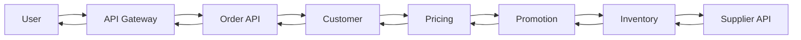
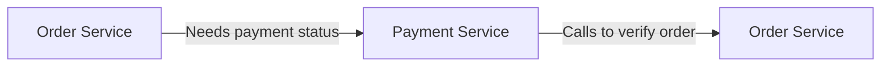
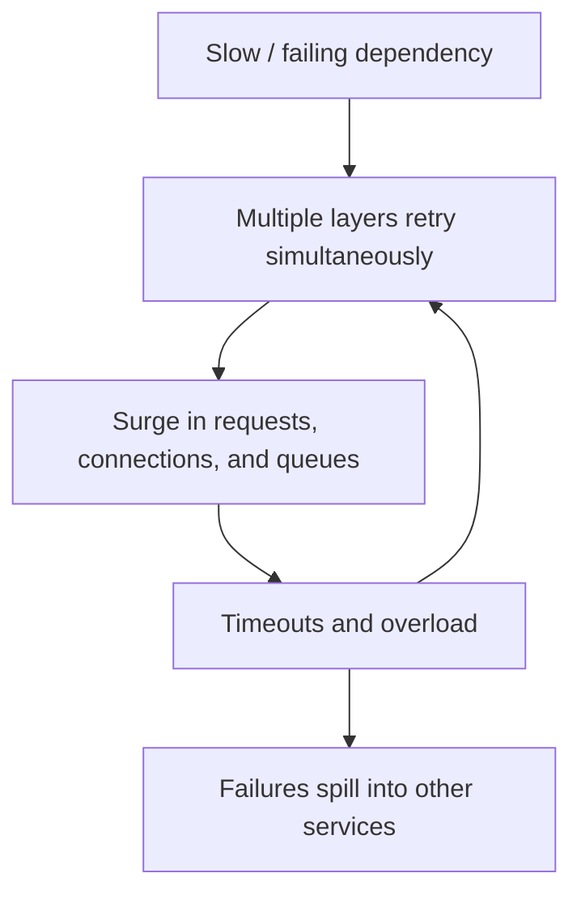
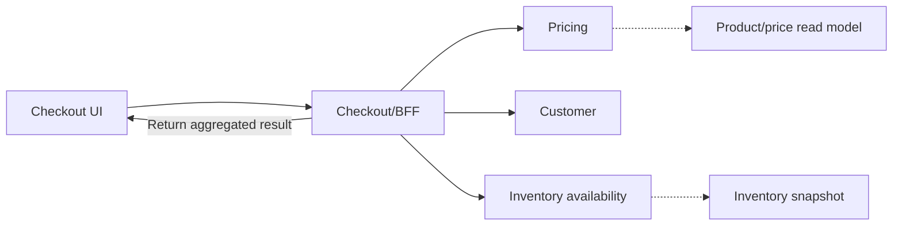
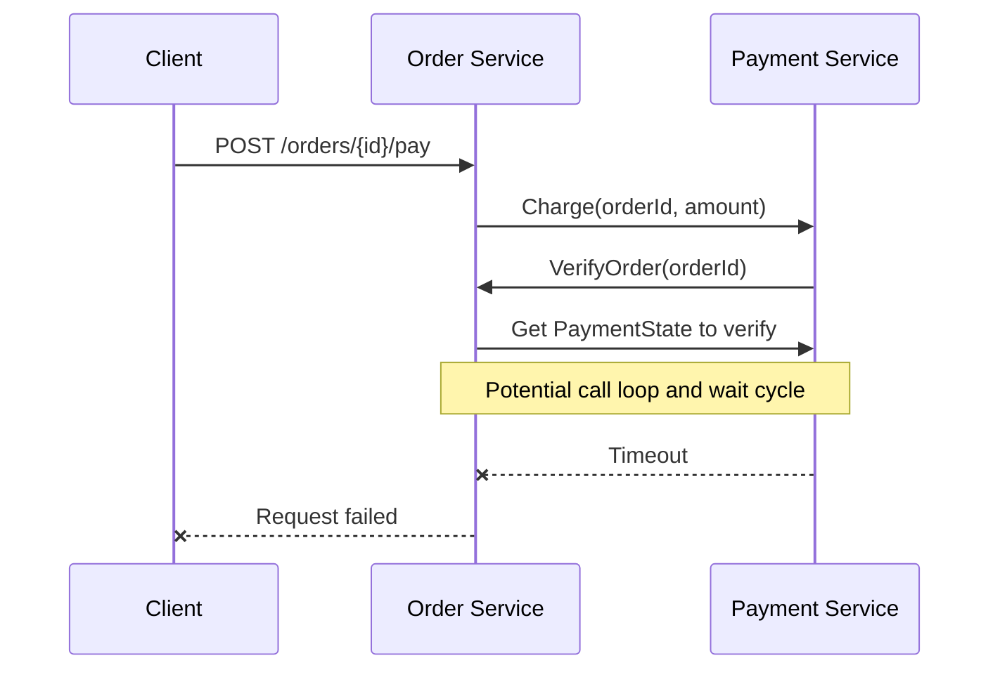
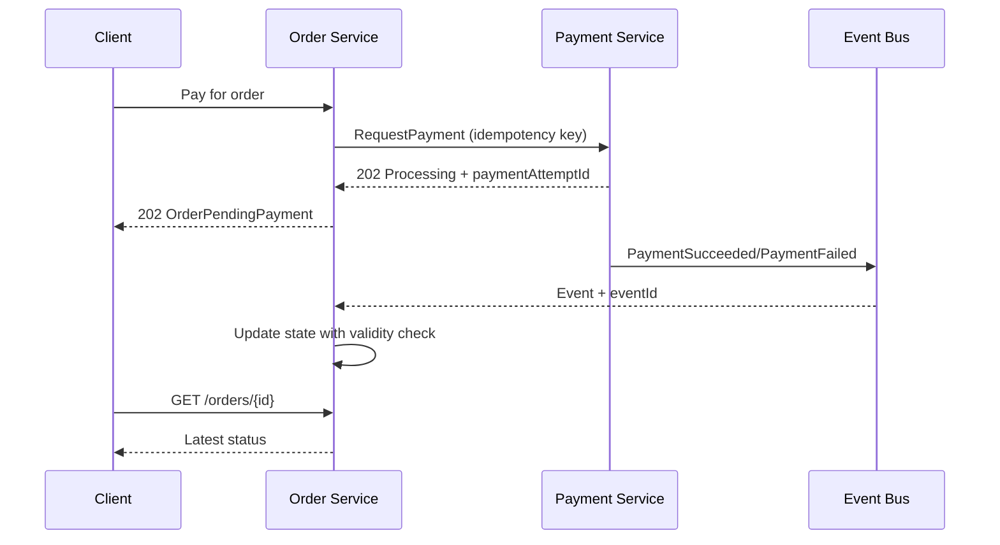
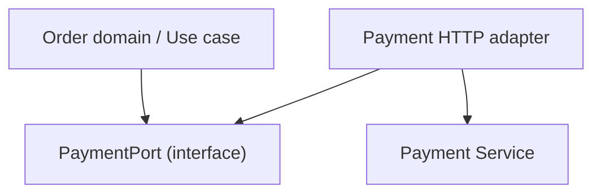

# Long synchronous call chains and circular dependencies

> **Module:** CLOUD_ARCHITECTURE — learn how to design cloud application architectures from business requirements to networking, compute, data, and deployment choices; balancing reliability, security, scalability, cost, operations, and Well-Architected evaluation.  
> **Chapter:** Architecture Antipatterns (*architecture antipatterns*).  
> **Scope:** Identify, measure, and remediate overly long synchronous call chains (*long synchronous call chain*) and circular dependencies (*circular dependency*) across services, modules, or infrastructure resources.

## 1. Why is this an architectural antipattern?

In cloud systems, it is normal for one service to call another. Risk arises when **a single user request must pass sequentially through too many services**, or when **components depend back on each other**. When that happens, a seemingly simple operation ends up depending on the response time, access permissions, state, and availability of many other systems.

For example, viewing an order looks like a simple read, yet it ends up calling customer, catalog, pricing, promotion, and inventory services in sequence. If each hop slows down slightly, the user waits for the entire chain. One failing service can cause the whole journey to fail even when all other services are healthy.

Circular dependencies create a different class of problems: service A needs B to start or return data, while B also needs A. In the worst case, both sides wait on each other, trigger infinite recursion, or cannot be deployed independently.

**Lesson objectives:** after completing this lesson, you can:

1. Distinguish long synchronous chains, fan-out, and circular dependencies across code, service, data, and deployment layers.
2. Explain their impact on latency, throughput, availability, and blast radius (*blast radius*).
3. Use dependency graphs and distributed tracing to identify bottlenecks, loops, and retry amplification.
4. Redesign with sound domain boundaries, controlled parallel calls, read models, events, and asynchronous workflows.
5. Configure timeouts, deadlines, circuit breakers, bulkheads, idempotency, observability, and Well-Architected selection criteria.

## 2. Identifying the two antipatterns accurately

### 2.1. Long synchronous call chain (*long synchronous chain*)

In a synchronous call, the caller **waits for a response** from the callee before continuing its work. If calls sit sequentially on a request's path, latency accumulates and failures deep in the chain can propagate back to the front.



*This diagram illustrates a sequential call path; the return arrows represent the request response, not a circular dependency by themselves.*

Common symptoms:

- A trace of a simple operation has many nested RPC/HTTP layers; the number of services on the critical path keeps growing.
- End-to-end p95/p99 spikes while CPU on the entry service stays low because workers are blocked waiting on I/O.
- Slowness in a deep downstream component slows down or breaks multiple top-level endpoints.
- Simple business rules are scattered across multiple “pass-through” services that perform little real logic.
- Each service configures its own retries and timeouts without a shared deadline budget.
- Multiple teams must deploy together or coordinate contract changes to ship a minor feature.

**There is no rule that “more than N hops is wrong.”** Even a short chain can be dangerous if one hop sits outside your control, enforces rate limits, or lacks a timeout. Evaluate based on SLOs, critical-path latency, dependency availability, fault isolation, and whether each hop is genuinely necessary.

### 2.2. Circular dependency (*circular dependency*)

A circular dependency exists when there is a directed path from a component back to itself in the **dependency graph**:



At the graph level, a cycle can involve many nodes: `A → B → C → A`. However, distinguish the layers:

| Layer | Manifestation | Potential consequences |
|---|---|---|
| **Code/module** | Package A imports B and B imports A; dependency injection needs A before B and vice versa | Difficult compilation, startup, or testing; blurred code boundaries |
| **Runtime/service** | Within one or more business flows, A calls B and B calls back into A | Tightly coupled availability, risk of recursive call loops, cascading timeouts |
| **Data/ownership** | Service A reads B's database directly while B depends on A's schema or data | Hard schema evolution, difficult access control and independent deployment |
| **Infrastructure/deployment** | Resource A can only be provisioned after B exists, while B references A's outputs | IaC dependency graph errors, bootstrap deadlocks, unclear deploy order |
| **Workflow/event** | A emits an event that triggers B to emit an event, which unconditionally triggers A again | Event loops, duplicate processing, growing queue depth and cost |

A **normal request–response** where A calls B and B replies to A is a logical edge of A depending on B, not a bidirectional dependency. B truly depends on A only if B **actively needs to call back** or relies on A's contract/availability to complete its work. Similarly, A calling B in use case X while B calls A in use case Y creates two-way operational coupling, though not necessarily recursion within a single request; deployability and blast radius still need evaluation.

## 3. How they cause slowness, lower availability, and higher cost

### 3.1. Cumulative latency on the critical path

For a **sequential** chain, response time is approximately:

\[
T_{\text{request}} \approx T_{\text{ingress}} + \sum_{i=1}^{n} (T_{\text{network},i} + T_{\text{service},i} + T_{\text{queue},i}) + T_{\text{egress}}
\]

Suppose a request traverses 5 downstream services, each hop adding roughly 40 ms of processing and network time under normal conditions. That alone adds around 200 ms before counting client–gateway transit, queuing, TLS, serialization, and tail spikes. If the final hop occasionally takes 1.5 seconds, users experience almost all of that delay.

Percentiles do not add arbitrarily: **the p99 of a sum does not necessarily equal the sum of each service's p99**. Accurate assessment requires measuring the end-to-end distribution and critical path in real traces. With **parallel** calls, latency approaches the slowest branch plus overhead rather than the sum of branches, though parallelism can raise burst load and the count of mandatory dependencies.

### 3.2. Availability bounded by mandatory dependencies

If every service in the chain must succeed, end-to-end success probability cannot exceed the constraints of its required nodes. Under an **independence** assumption, a simple estimate is:

\[
A_{\text{end-to-end}} \approx \prod_{i=1}^{n} A_i
\]

For example, six mandatory dependencies each at 99.9% availability over the same measurement window yield `0.999^6 ≈ 99.4%`. This is purely mathematical: real-world failures are **correlated** (shared network, DNS, cloud region, IAM, deployments, providers). Journey availability also depends on failover, caching, fallbacks, and whether the request truly needs all six services.

For SLOs, measure the **proportion of requests that fulfill the business requirement** rather than multiplying uptime percentages and treating that as a real guarantee.

### 3.3. Retry amplification and queuing

Suppose three consecutive layers each allow up to **3 attempts** on the same operation. In the worst case, up to `3 × 3 × 3 = 27` attempts can hit the deepest layer for a single user action. If many clients retry concurrently while a dependency is overloaded, load surges precisely when load needs to drop.



Timeouts can also **exceed the request's maximum allowed duration** if each hop independently sets 2 seconds and retries do not share a deadline. Moreover, a request that already timed out at the head of the chain may keep running downstream if cancellation is not propagated, wasting resources.

### 3.4. Circular dependencies erode independence

In an A–B dependency cycle:

- An outage or deployment of A can make B unavailable even if B only needs a minor capability from A.
- Team contracts and release schedules struggle to stay independent.
- In a re-entrant synchronous call loop within the same journey, wait times or call counts can escalate until timeouts or thread/connection exhaustion hit.
- In systems managing locks and distributed transactions, two sides holding resources while waiting on each other can deadlock.
- When events trigger each other in a loop, queues and costs grow continuously unless a stopping condition exists.

Not all two-way interactions are forbidden. The issue is a **mandatory dependency cycle required to complete execution or startup**, unclear ownership, and overlapping failure boundaries.

## 4. Finding the antipatterns in a running system

### 4.1. Draw two different graphs

1. **Service dependency graph:** nodes are services; edge A → B means A requires B's contract or availability. Label by endpoint, sync/async, *required/optional*, business purpose, and owner.
2. **Request/trace graph:** represents **actual execution order**, parent–child spans, wait times, retries, and parallel calls. A dependency may exist in the overall graph without appearing on a specific request path.

Looking only at a component diagram can hide latency risks; looking only at a single trace can miss circular dependencies exercised by other requests. You need both.

**Inspection workflow:**

- Pick 3–5 critical business journeys: login, search, order placement, payment, profile update.
- Enable/verify distributed tracing and propagate trace context over HTTP/RPC/messages with an appropriate sampling policy.
- Use slow-request traces to locate the **critical path**; separate processing time, queuing, retries, and repeated calls.
- Label mandatory vs. optional dependencies; mark external dependencies and shared infrastructure.
- Detect cycles in the directed graph via graph traversal or **strongly connected components (SCC)** algorithms; then inspect the semantics of each edge instead of concluding from the diagram alone.
- Cross-check endpoints that frequently fail together, timeout logs, waiting connections/threads, queue depth, and deployed versions.

### 4.2. Quantitative signals

| Signal | Suspected issue | What to verify |
|---|---|---|
| Endpoint p95/p99 grows with service depth | Many synchronous hops on the critical path | Is any hop purely forwarding data? Can it be removed or called in parallel? |
| Large “client RPC” spans with low CPU | Waiting on network, dependencies, or queues | Timeouts, connection pools, and downstream latency |
| Retry rate rises alongside 5xx and queue depth | Retry storm / request amplification | Which layers are retrying? Are backoff/jitter configured? |
| One outage causes multiple services to fail together | High coupling and large blast radius | Which services are mandatory? Are valid fallbacks possible? |
| Deployments often require simultaneous changes to A and B | Coupled contracts or data | Domain ownership and backward-compatibility strategy |
| Pair A↔B appears in the dependency graph | Structural cycle exists | Is there an actual wait loop or independent interactions in two separate use cases? |
| IaC tasks report cycles or services wait on each other at startup | Provisioning circular dependency | Can bootstrap steps be split or switched to lazy references? |

Avoid using fixed hop count as a standalone KPI. A call to a payment provider may require far higher reliability than multiple intra-region cache hits. Measure **critical path, SLOs, dependency failure contribution, and cost** together.

## 5. Example 1 — Overly long synchronous chain in checkout

### 5.1. Initial design

The user selects “View order summary”:


Notable issues:

- To compute the total, each service **pulls in extra dependencies** that do not belong to its ownership.
- Checking stock requires calling an external supplier on the **synchronous path** even though the UI only needs an indicative status.
- Every hop has retries; if the supplier slows down, the entire checkout slows down.
- A single deployment of Pricing can unpredictably impact order summary, promotions, and inventory.

### 5.2. Clarify business requirements before fixing

Separate:

- **Mandatory at view time:** product info, current unit prices, active promotions, and total calculation.
- **Required at order placement/commit:** stock reservation check and payment conditions per transaction policy.
- **Can update later:** product recommendations, indicative shipping info, promotion analytics.
- **Cannot share cache globally:** customer-specific pricing or sensitive data where policy forbids it.

This separation guides the right model; never alter business promises around pricing or inventory solely to optimize latency.

### 5.3. Proposed design: shorter paths and controlled fan-out



Goals:

1. BFF/Checkout coordinates **independent calls** that can run in parallel and aggregates data; do not turn the BFF into a service owning all business logic.
2. Pricing owns price calculation; it reads its own data or a read model populated via a clear contract.
3. Inventory provides *availability* with a published freshness level; reserving/committing stock at order placement runs separately under consistency rules.
4. If fields like recommendations or suggested addresses are optional, the API can return mandatory parts first and load optional parts afterward.
5. Requests do not wait on third-party suppliers unless the business decision truly requires that synchronous result.

**Be careful with fan-out:** parallel calls can shorten the *critical-path latency*, yet if 1 request triggers 10 mandatory calls, it still increases total load and multiplies failure points. Enforce concurrency limits, timeouts, admission control, and capacity planning for every dependency.

### 5.4. Deadline-aware orchestration pseudocode

```text
deadline = now + 1200ms       // budget for the entire request from ingress
priceFuture    = requestPricing(deadline, retries=0)
customerFuture = requestCustomer(deadline, retries=0)
stockFuture    = requestAvailability(deadline, retries=0)

price    = await priceFuture
customer = await customerFuture
stock    = await stockFuture

if price.failed:
    return error("Unable to determine price")
if customer.failed:
    return error("Unable to verify purchase eligibility")
if stock.failed:
    return responseWithStatus("Stock unconfirmed") // only if UX allows

return checkoutSummary(price, customer, stock)
```

This is **illustrative pseudocode**; real implementations need cancellable futures, deadline propagation downstream, concurrency caps on parallel calls, explicit error handling, and business rules defining what may be omitted. Never return “in stock” by default if inventory was not confirmed.

## 6. Example 2 — Circular dependency between Order and Payment

### 6.1. Current state



In this example, Payment cannot finish Charge without calling Order, while Order is waiting on Payment before responding. If VerifyOrder in turn queries PaymentState, a cycle occurs within the very same request. Even without live recursion, two-way coupling makes deployment, recovery, and ownership separation hard.

### 6.2. Separating responsibilities and flow options

- **Order Service** owns the order and ordering status.
- **Payment Service** owns payment transactions, idempotency keys, and processing state with payment providers.
- Payment request contracts carry the validated information required (e.g., orderId, amount, currency, paymentAttemptId). Payment must not blindly trust client-supplied amounts.
- If an immediate decision is required, an orchestrator that already holds full context makes a **one-way** call with a deadline; Payment returns the result or a processing state.
- If processing takes time, Payment emits an outcome event and Order updates via a consumer, avoiding synchronous callbacks from Payment to Order.



*202 is an example for business flows that accept asynchronous processing; it does not mean payment has succeeded. Events can arrive late, arrive twice, or be temporarily lost; the workflow must include recovery mechanisms.*

### 6.3. Ensuring correctness when replacing calls with events

Event-driven design removes synchronous waiting, at the cost of **eventual consistency** and data-handling obligations:

1. **Transactional outbox:** in the same transaction that persists Payment status, write the outbound event record; a worker relays records from the outbox to the broker. This avoids updating data while failing to publish the event.
2. **At-least-once + idempotent consumer:** assume events can be delivered multiple times. Order tracks `eventId` or uses business keys and state transitions to ignore duplicates.
3. **Ordering/versioning:** if a payment moves from Processing → Succeeded/Failed, the consumer must reject invalid backward transitions; use versions or state-transition rules.
4. **Reconciliation:** a job checks payments still lacking a final outcome, reconciles with the provider, and raises alerts or safely recovers.
5. **Compensation:** for multi-step workflows that cannot execute inside a cross-service ACID transaction, design a **Saga** and matching compensating actions. Compensation cannot always undo every side effect; define it in business terms.
6. **Access control and data minimization:** events include only necessary data; apply topic-level IAM, appropriate encryption, and schema versioning.

Do not turn every query into an event. For small operations needing an immediate answer against a dependency with a strong SLO, a **one-way synchronous call** remains the right choice.

## 7. Breaking dependency cycles: four core techniques

### 7.1. Establish clear domain ownership

Ask who is the *source of truth* for each concept. Two services jointly owning Order status signals a boundary flaw. Rules and data belong in the owning service, exposed via contracted APIs or events.

Inside a monolith, moving shared logic into the right layer or domain module can eliminate import cycles. Do not create an oversized “shared” library merely to silence build errors while runtime coupling remains.

### 7.2. Invert dependencies at the code/contract level

The business layer depends only on an interface/port it owns; the adapter depends on that interface and handles external calls.



Note: Dependency Inversion removes **code-level** cycles, but does not eliminate **service-call** cycles if Payment Service still calls back into Order. Runtime contracts must also be fixed when a cycle exists.

### 7.3. Business events and controlled replicated read data

Instead of B calling A to fetch a field on every request, A can publish state-change events; B maintains a read model with enough information to decide within allowed consistency bounds. This reduces runtime coupling while introducing sync lag and backfill/rebuild procedures.

For example, Inventory emits `StockChanged`; Checkout reads a timestamped snapshot. If overselling is unacceptable, the **commit/reserve** step must still check and write consistently in the Inventory-owning service rather than trusting the snapshot.

### 7.4. Orchestrator/Saga for cross-service workflows

A coordinator component can own **workflow sequence**, while each service owns its own business logic and data. Avoid turning the orchestrator into a dumping ground for all domain rules. Use a queue or workflow engine if steps are long-running, require durable retries, wait states, or recovery after restarts.

Do not create new event loops like `OrderCreated → PaymentRequested → OrderUpdated → PaymentRequested`. Every event handler must have clear input-state preconditions, purpose, and terminal states.

## 8. Mandatory safeguards when synchronous dependencies remain

You cannot and do not need to eliminate every synchronous call. What matters is **containing failure impact**.

### 8.1. Shared-budget deadlines and timeouts

Design around an **end-to-end deadline** rather than summing independent timeouts. For example, an API has a 1,200 ms budget from ingress, covering routing, queuing, serialization/encryption, backend work, and response buffer.

```text
Client request  --(1200ms deadline left)--> Gateway
Gateway         --(1100ms deadline left)--> Order
Order           --(850ms deadline left) --> Pricing
Pricing         --(650ms deadline left) --> Dependency
... timeout at each layer must be <= remaining budget
```

These numbers illustrate **remaining time**, not additive timeouts. Receivers should stop processing once the deadline expires and propagate cancellation where libraries/runtimes support it. Set network connect, response, and queue timeouts aligned with the deadline.

### 8.2. Selective retries, backoff, and jitter

- Retry only when the error is likely transient, the operation is safe to retry, and both deadline and retry budget remain.
- Use exponential backoff with **jitter** to prevent synchronized request spikes.
- Cap total attempts across the **entire journey**, avoiding nested multi-layer retries. Consider placing retries at one appropriate layer.
- Payment POSTs or order creation require an **idempotency key** and backend idempotency checks; never assume safety just because the client resends the same payload.
- Honor `Retry-After` when appropriate. Never retry deterministic business errors that cannot succeed by trying again.

### 8.3. Circuit breakers, bulkheads, and load shedding

| Mechanism | Role | Caveat when applying |
|---|---|---|
| **Circuit breaker** | Temporarily stops sending traffic to a failing dependency; allows controlled probes | Overly sensitive thresholds can block valid traffic |
| **Bulkhead** | Isolates connection pools, thread pools, or concurrency quotas per dependency | Requires capacity planning; isolation does not mean infinite total capacity |
| **Rate limit / admission control** | Keeps traffic within capacity; rejects early when overloaded | Return meaningful errors and define priority/fairness policies |
| **Graceful degradation** | Drops non-essential features during incidents | Never bypass authentication, authorization, billing, or safety checks |
| **Cache/read model** | Cuts call volume for data with tolerable staleness | Choose TTLs, invalidation, per-user scoping, and consistency policy carefully |

Preventing cascading failures also requires configuring pool sizes, connection lifetimes, queue bounds, DNS/service discovery, TLS, and IAM permissions properly. Application-level safeguards cannot save a system if a shared database, message broker, or network is a shared point of failure with no recovery plan.

## 9. Synchronous, parallel, and asynchronous models: choose by requirement

| Criterion | Sequential synchronous | Parallel synchronous | Asynchronous via queue/event |
|---|---|---|---|
| Result at HTTP response | Immediate if all steps succeed | Immediate after slowest branch completes | Usually returns jobId/processing state; final result arrives later |
| Critical-path latency | Sum of sequential hops | Near slowest branch + overhead | Short at ingestion; total workflow completion may take longer |
| Runtime availability coupling | High if all hops are mandatory | Still high if all branches are mandatory | Lowers runtime coupling; depends on broker and workers later |
| Consistency | Easier immediate consistency if scoped to one service | Must aggregate and control state across branches | Requires eventual consistency, idempotency, replay |
| Operational complexity | Traces and timeouts are fairly familiar | Adds concurrency limits and partial error aggregation | Adds queues, DLQs, outbox, lag monitoring, versioning, reconciliation |
| Best suited for | Small, mandatory calls needing immediate answers | Independent data for aggregation pages | Sending email, batch jobs, slow payment confirmations, multi-step workflows |

**Selection rule:** start from requirements for **correctness, freshness, user feedback, and SLOs**. If you cannot respond without a dependency, coupling remains even in parallel. If real-time transaction confirmation is required, keep a short synchronous segment with tight timeouts and move post-processing to asynchronous execution.

## 10. Safe phased refactoring practice

Avoid “tearing down and rewriting” the service graph in one shot. A verifiable plan:

### Phase 1 — Capture the baseline

- Publish the list of critical journeys with latency/availability SLOs and per-endpoint error rates.
- Pull request and error traces to map the graph, critical path, retry amplification, and bottlenecks.
- Find SCCs in the dependency graph; verify which edges form real runtime or deployment cycles.
- Assign ownership for every dataset, interface, and business flow.

### Phase 2 — Reduce immediate risk

- Enforce request deadlines, cascading timeouts, retry budgets, and jitter.
- Bound concurrency and queues; add circuit breakers for overload-prone dependencies.
- Classify mandatory vs. optional dependencies; apply fallbacks only where business rules permit.
- Add alerts and runbooks before changing flows; never strip security controls to shave latency.

### Phase 3 — Shorten the critical path

- Remove “pass-through services” or move minor logic back to the proper domain owner.
- Consolidate read data into read models or denormalized views if eventual consistency is acceptable.
- Parallelize independent branches with concurrency caps.
- Extract background work out of request/response; use queues or workflows where durability is needed.

### Phase 4 — Break cycles safely

- Define unidirectional dependencies and versioned contracts/APIs/events.
- For multi-step workflows, designate an orchestrator or business events with terminal states.
- Implement outbox, idempotent consumers, replay/reconciliation, DLQ policies, and access controls.
- Use the **strangler pattern** or canary/percentage rollouts to migrate one endpoint at a time, watching both business correctness and latency.
- Remove old code and call paths only after proving no traffic still depends on them.

### Phase 5 — Verify outcomes

Compare before and after under equivalent load: p50/p95/p99 latency, end-to-end success rate, hops on critical path, mandatory dependency count, deep-tier load, retry rate, saturation, request/egress/queue cost, independent deploy time, and cascading incident count. Run deliberate fault tests (*fault injection*) in an appropriate environment to verify circuit breakers, timeouts, cancellation, and duplicate-event handling.

## 11. Operational example: one slow service triggers a wide outage

**Context:** the order-placement endpoint has a 2-second response budget. `Order API` synchronously calls `Customer → Pricing → Inventory → Shipping Rate API`. The external shipping rate provider slows from 100 ms to 4 seconds. Each layer retries 3 times, exhausting the Order and Pricing connection pools.

**Symptoms:** checkout p99 spikes, new requests queue up, and unrelated features sharing the same worker/pool begin failing. CPU monitoring may remain low because most time is spent waiting on I/O.

**Incident response:**

1. Identify which requests are blocked on Shipping Rate via traces and connection-pool metrics; temporarily reduce nested retries and shed excess load with existing controls.
2. If business rules allow, return “shipping quote unavailable” and let the user fetch shipping before finalizing the order; never silently set shipping to 0.
3. Protect other APIs using bulkheads and capacity limits; keep authentication and payment checks intact.
4. Watch downstream errors, queue depth, deadline-exceeded counts, and successful checkout rate until recovery.

**Long-term fix:** show Shipping Rate as an independent call on the preview page or compute it asynchronously before payment confirmation, depending on final pricing rules. Add deadlines and rate-table caching if carrier rules allow; use fallbacks only under explicit rules and clearly display missing-data states.

**New risks after refactoring:** shipping rate snapshots can go stale; async workflows must handle late events, payment captured before order update, and queue/logging costs. Therefore, every latency optimization proposal must explicitly state its impact on **correctness, UX, and reliability**.

## 12. Well-Architected evaluation

| Pillar | Antipattern impact | Architectural decision / control |
|---|---|---|
| **Operational Excellence** | Hard debugging, cross-team release coupling, slow recovery | Distributed tracing, dependency catalog, runbooks, contract versioning, independent deploys |
| **Security** | Data and permissions sprawl across too many services; tokens logged/passed across hops | Least-privilege IAM, mTLS or service-to-service auth as needed, domain-scoped authz, auditing, data minimization |
| **Reliability** | Single downstream fault cascades, retry storms, wait loops, large blast radius | Deadlines, retry budgets, breakers, bulkheads, idempotency, durable workflows, fault testing |
| **Performance Efficiency** | Cumulative sequential latency, queuing, threads/connections held while waiting | Shorter critical path, bounded fan-out, read models, caching, optimized access patterns |
| **Cost Optimization** | Excess RPCs, requests, network egress, compute, and queues/logs from retries | Reduce round trips, drop unnecessary calls, track cost per successful operation, prevent retry amplification |
| **Sustainability** | Repeated requests and non-value-adding work burning compute and network | Trim redundant calls and payloads, match freshness to need, batch events appropriately |

**Trade-offs that must be recorded:**

- Synchronous calls are short, easy to follow, and sometimes required for immediate consistency; removing them can introduce temporary data inconsistency.
- Parallel calls reduce latency, yet increase fan-out and peak load.
- Events/queues decouple runtime availability, yet require brokers, consumers, outbox, idempotency, and state tracking.
- Caches/read models boost resilience and performance, yet introduce staleness risk and permission management.
- Bulkheads and circuit breakers enforce fault boundaries, yet can reject valid requests if tuned too aggressively.

The crux of the evaluation is not microservice count or whether a message broker is used, but whether **the business journey meets its latency, correctness, reliability, and cost targets at an acceptable operational complexity**.

## 13. Design review checklist

- [ ] A directed service dependency map exists with mandatory/optional edges labeled.
- [ ] A critical-path map from distributed traces exists for key business journeys.
- [ ] Each service has clear data ownership and contracts; no arbitrary cross-database reads/writes.
- [ ] No unbounded recursive call loops or wait cycles exist; SCCs have been analyzed.
- [ ] Every request carries an end-to-end deadline, remaining timeout budget, and cancellation where supported.
- [ ] Retries have budgets, backoff/jitter, layer-appropriate placement, and idempotency for writes.
- [ ] Concurrency, connection pools, and queues are bounded; one failing dependency cannot exhaust shared resources.
- [ ] Fallbacks/degradation apply only to data and business steps permitted to be missing.
- [ ] Event paths have outbox/idempotency or equivalent guarantees, terminal states, DLQs, and reconciliation.
- [ ] Private data is authorized by the owning service and not indiscriminately cached or broadcast in events.
- [ ] SLOs, dashboards, alerts, runbooks, fault tests, and before/after comparisons are in place.
- [ ] Every optimization explicitly documents impacts on consistency, security, cost, and operability.

## 14. Practice scenarios

### Scenario A — Fixing a call chain

An account-overview endpoint has the chain `Gateway → Profile → Loyalty → Recommendation → Ads`. Users only need their loyalty points to proceed; ads and recommendations are supplemental. Tasks:

1. Identify which hops sit on the critical path and which should be separated.
2. Propose an architecture that returns loyalty points on time with independent timeouts for optional parts.
3. Explain why calling all services in parallel does not automatically improve availability.
4. Define metrics to prove the change meets its SLO.

### Scenario B — Finding a cycle

Order-managing Service A calls B to process payment; B calls C to check fraud; C calls A to fetch customer details. Tasks:

1. Draw the directed graph and identify the cycle.
2. Contrast C reading from A within the **same request** vs. C depending on A in a separate business flow.
3. Propose data contracts and an appropriate event/read-model or orchestrator design.
4. State state-update rules to prevent event loops and duplicate processing.

### Scenario C — Retry storm

A request traverses three boundaries, each configured with three attempts. The deepest dependency frequently times out. Tasks:

1. Compute the theoretical maximum attempts hitting the deepest dependency under worst-case nested retries.
2. Propose an end-to-end retry budget and jittered backoff.
3. Distinguish retryable errors from deterministic business errors or non-idempotent writes.
4. Define metrics to detect retry amplification.

### Scenario D — Architecture and SLOs

A report-generation task takes several minutes, while the web UI must respond within one second. Choose between one HTTP request waiting until completion and a job-submission API returning processing status backed by a background worker. Describe status polling, preventing duplicate job execution, recovery after worker restarts, and UX trade-offs.

## 15. Takeaways

**Long synchronous call chains** create critical-path dependencies where latency and failure risks compound; **circular dependencies** prevent components from being deployed, tested, and recovered independently, and can trigger wait or event loops. Remediation starts by clarifying real business requirements, ownership boundaries, and actual call paths, then combining short deadline-bounded calls, controlled parallelism, caches/read models, or asynchronous workflows where appropriate.

Sound architecture must be verified through **end-to-end latency, business success rate, blast radius, cost, and operability**, while explicitly evaluating consistency, security, and failure handling against Well-Architected principles.
