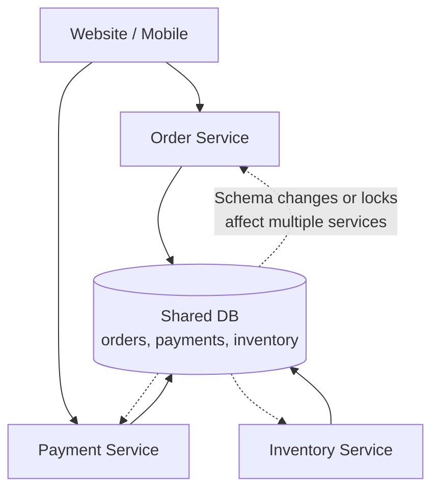
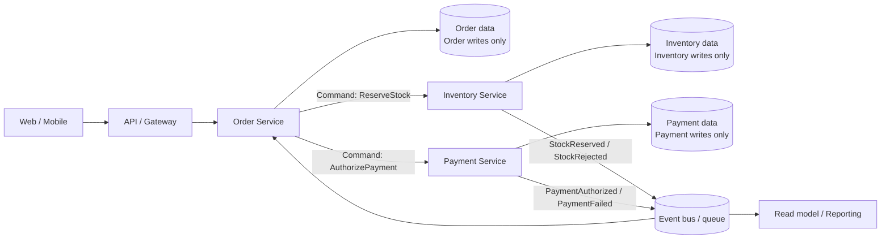
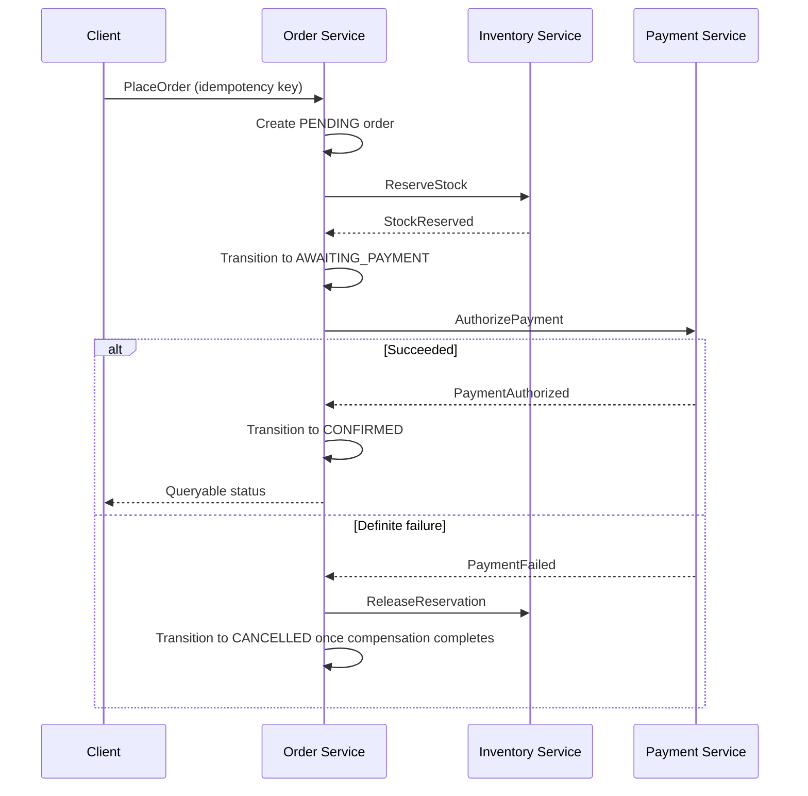

# Multiple services writing to the same database without clear ownership

## 1. Context and objectives

When designing cloud application architectures, engineering teams often split a system into multiple services to enable independent deployment, load-based scaling, and team-level ownership. However, if services still **arbitrarily write directly to the same tables or fields** without defining who owns them, they can end up tightly coupled through the database (DB).

This is the **architecture antipattern** (*architecture antipattern*) addressed in this lesson: **multiple services writing to the same DB without clear ownership**. The core issue is not the number of databases or sharing a DB server, but that **authority to mutate business state is fragmented, uncontracted, and lacks a single accountable owner**.

This lesson belongs to the **Architecture Antipatterns** section of `CLOUD_ARCHITECTURE`: learning how to translate business requirements into cloud networking, compute, data, and deployment designs; identifying trade-offs across reliability, security, scalability, cost, and operations; and evaluating against Well-Architected principles.

After this lesson, you should be able to:

- Distinguish **sharing DB infrastructure** from **sharing write authority over business data**.
- Explain concurrency bugs, schema-change friction, broken security boundaries, and operational incidents caused when multiple services own the same record.
- Identify the **source of truth** (*source of truth*), **data ownership** (*data ownership*), and where **business invariants** (*business invariants*) are enforced.
- Compare synchronous API calls, event exchange, read-only data replicas, and multi-service workflow coordination.
- Propose a migration path for a running system without having to replace the entire DB at once.

## 2. When does this become an antipattern?

Suppose a retail system has three services:

| Service | Intended responsibility | What is actually happening |
| --- | --- | --- |
| Order Service | Create orders, manage order status | Writes `orders.status`, `orders.total_amount` |
| Inventory Service | Manage stock, reserve items | Writes `inventory.available_qty` **and** updates `orders.status` |
| Payment Service | Process payment outcomes | Writes `payments.status` **and** updates `orders.status`, `orders.total_amount` |

The three services may run on independent compute platforms: managed containers, PaaS, or serverless. Yet if all three use DB accounts with broad `UPDATE` privileges on the `orders` table, they depend on each other's schemas and write logic. When a bug occurs, which team investigates, fixes the data, and decides the authoritative state?

For example, Inventory Service sets `orders.status = 'RESERVED'` while Payment Service sets `orders.status = 'PAID'`. Both updates can succeed sequentially, leaving whichever ran last as the final value. Without state-transition rules, a paid order can appear to revert to reserved.

### Distinguishing three situations

| Situation | Assessment |
| --- | --- |
| Multiple services share **one physical DB cluster**, but each business domain has its own schema, account, and write permissions | Can be acceptable; still evaluate resource isolation and access controls |
| Multiple services **read** data through APIs, events, or governed read models | Can be valid integration; define freshness lag and data policies |
| Multiple services **mutate the same tables/columns** of one business domain without an owner, state-transition rules, or coordination | Antipattern that should be prioritized for remediation |

**Data ownership does not necessarily mean owning a DB server.** A team can own a set of tables and their invariants even when DB infrastructure is shared for budget reasons. Conversely, splitting into two physical DB servers while still allowing services to cross-write freely over DB links fails to fix the root cause.

## 3. Antipattern diagram: write paths bypassing the owner



The danger is that **everyone has a write path** to data others can also mutate. In code, a common telltale sign is:

```sql
-- Inventory Service mutates order status on its own
UPDATE orders
SET status = 'RESERVED'
WHERE order_id = :order_id;

-- Payment Service also mutates order status on its own
UPDATE orders
SET status = 'PAID'
WHERE order_id = :order_id;
```

The statements above only illustrate how bugs occur. In real systems, queries must be parameterized using driver/ORM mechanisms; never concatenate user input directly. Even if each `UPDATE` is a valid transaction, together they can violate **the domain semantics of order state**.

### Why “having ACID transactions” is still not enough

ACID protects database-transaction properties: atomicity, consistency with enforced constraints, isolation, and durability. However, the database does not inherently know business rules such as:

> “A paid order must never revert to awaiting stock reservation; only Order Service decides the order lifecycle based on outcomes from Inventory and Payment.”

If this rule is not encoded in a single place enforcing state transitions and write authority, valid transactions can still produce invalid business state. Locking, stricter isolation levels, or optimistic locking reduce certain race conditions; they **cannot decide on behalf of the organization** which service holds decision authority.

## 4. Common failure modes

| Symptom | Root cause tied to shared writes | Consequence |
| --- | --- | --- |
| **Lost updates / overwritten state** | Services update the same field with independent logic | Wrong order status, skipped downstream actions |
| **Divergent business rules** | Each service checks preconditions independently before writing | Invariants are not enforced consistently |
| **Schema coupling** | Multiple codebases depend directly on table/column names and types | Schema changes require coordinated multi-service releases |
| **Locking and contention** | One service's transaction holds row locks or runs heavy queries | Latency and timeouts spill into other services |
| **Overly broad permissions** | Shared DB credentials or schema-wide `UPDATE` privileges | A misconfiguration can corrupt data outside a service's scope |
| **Hard auditing and accountability** | Multiple write paths, scarce correlation IDs and audit logs | Difficult to answer who changed what, when, and for which request |
| **Hard to scale** | Every service pushes write load to the same DB/primary | Scaling compute does not relieve DB limits |
| **Hard selective backup/restore** | Multi-domain data mixed together with shared transaction dependencies | Restoring one domain can break consistency with others |
| **Independent deployment in name only** | Separate app codebases share schemas and update ordering | A minor migration can cause widespread downtime |

### Concrete race condition scenario

Consider steps happening nearly simultaneously:

1. Payment Service reads `orders.status = 'PENDING'`.
2. Inventory Service also reads `orders.status = 'PENDING'`.
3. Payment Service writes `PAID`.
4. Inventory Service writes `RESERVED`, even though payment already succeeded.
5. The UI reads `RESERVED`; reporting and refund logic misinterpret the order state.

A `version` column with `WHERE version = :old_version` helps detect write conflicts and force retries or errors. Still, if two services both claim authority to set `status` using different logic, they can still write the wrong state after retrying. **Concurrency control** and **business ownership** are related but distinct problems.

## 5. Defining ownership boundaries: who holds the source of truth?

Good design starts from **business capabilities** and data invariants, not from splitting tables by name or dividing table counts evenly across teams.

For the retail system:

| Business domain | Suggested owner | Authoritative data | What other services may do |
| --- | --- | --- | --- |
| Ordering | Order Service | `orders`, `order_items`, order lifecycle | Send supported business commands; subscribe to events; read via API/read model |
| Inventory | Inventory Service | `stock`, `reservations` | Request stock reservation/release through business contracts |
| Payment | Payment Service | `payment_attempts`, `payment_transactions` | Request payment, receive outcomes; never write order status directly |
| Notifications | Notification Service | Delivery status, retries, authorized channels | Consume events; never edit orders directly |

A service owning data means that service:

- Is responsible for defining the schema, constraints, and lifecycle of data within its scope.
- Is the **official write authority** for business mutations; can reject invalid commands.
- Publishes how others integrate: APIs/commands, events, or read-only replicas with usage terms.
- Owns error handling, retries, monitoring, retention, and recovery rules for that data.
- Maintains compatible contracts across version upgrades.

Business entities can relate to one another while each fact still has one clear source of truth. For example, authoritative payment status belongs to Payment Service; Order Service may store a **synced payment status used to drive order lifecycle decisions**, without claiming authority to edit the payment transaction ledger. Any copy built for display must be explicitly treated as a **projection/read model** with a defined refresh policy.

### Transaction boundaries and invariants

Invariants that must hold atomically should live inside one transaction boundary whenever possible. For instance, “never reserve more than available stock” must be enforced by Inventory Service using a transaction, conditional update, or suitable concurrency control on data it owns. Order Service must not check inventory and then `UPDATE inventory` itself because the gap between check and write can cause overselling.

If a business operation spans multiple owners, design **cross-service coordination** with intermediate states, messages, and compensating actions. Do not try to hide distribution behind cross-domain SQL writes.

## 6. Target diagram: writing through the owner



This diagram illustrates logical ownership, **not a requirement for three separate physical DBs**. These data stores can run on the same managed DB platform with separate schemas/accounts initially, or move to separate instances/clusters when performance, security, or recovery isolation requires it.

Accompanying operational principles:

1. Each business domain has one **authorized writer** and explicit data constraints.
2. Services needing changes outside their domain send **business commands** rather than directly editing tables.
3. The owning service publishes **events that have occurred** so other parties can update their read models or workflows.
4. Every significant change is traceable via request ID, trace ID, event ID, and audit logs.
5. IAM and DB permissions must enforce logical boundaries—do not rely solely on “conventions” in documentation.

### How do APIs, commands, and events differ?

| Mechanism | Meaning | Best suited when | Watch-outs |
| --- | --- | --- | --- |
| **Synchronous API** | Query/command to an online service with an immediate response | Client needs immediate feedback; lookup needs the freshest data | Timeouts, circuit breakers, availability coupling, rate limits |
| **Asynchronous command** | Ask an owner to perform an action | Work can wait; need to absorb traffic spikes | Acknowledgment of receipt does not mean execution succeeded |
| **Domain event** | Announce a business fact that **has already happened** | Syncing projections, notifications, multi-consumer integration | May be delayed/duplicated/out of order; needs versioning and idempotency |
| **Read model / projection** | Query-optimized copy of data | Dashboards, cross-domain aggregations | Has lag; not an authoritative source for write decisions |

Event names should describe committed facts, such as `InventoryReserved`, rather than vague imperatives like `UpdateOrder`. A command can be rejected; an event should not be misused as an instruction for other services to mutate source data directly.

## 7. Implementation example for contracts and write rules

### 7.1. Stock reservation owned by Inventory Service

Order Service needs to reserve 2 units before confirming an order. Instead of running SQL against the `inventory` table, it sends a structured command such as:

```json
{
  "command_id": "cmd-8371",
  "order_id": "ord-205",
  "action": "ReserveStock",
  "items": [
    { "sku": "SKU-27", "quantity": 2 }
  ]
}
```

Inventory Service validates the data and runs a transaction inside its own store. Illustrative SQL for a single SKU:

```sql
BEGIN;

-- Deduct stock only if enough quantity remains.
UPDATE inventory
SET available_qty = available_qty - :quantity,
    reserved_qty  = reserved_qty + :quantity
WHERE sku = :sku
  AND available_qty >= :quantity;

-- If affected rows = 0: ROLLBACK and return StockRejected.
-- If succeeded: insert reservation with UNIQUE(order_id, sku)
-- and write the outbox event in the same transaction.
COMMIT;
```

This illustrative snippet is not a complete multi-SKU solution: you must handle lock ordering, partial out-of-stock scenarios, consistency across all line items, uniqueness, retries, and reservation expiration. In particular, to prevent duplicate requests from deducting stock twice, Inventory Service must check an **idempotency key** or uniqueness constraint inside the same transaction; merely adding `UNIQUE(order_id, sku)` after deducting stock without proper error handling and rollback is insufficient.

### 7.2. Order Service owns the order lifecycle

Order Service is the sole authority deciding order state transitions. Example simplified model:

```text
PENDING
  |-- InventoryReserved --> AWAITING_PAYMENT
  |-- StockRejected -----> REJECTED

AWAITING_PAYMENT
  |-- PaymentAuthorized -> CONFIRMED
  |-- PaymentFailed -----> CANCELLED (+ ReleaseReservation)

CONFIRMED
  |-- CancelRequested ---> CANCELLING -> CANCELLED
                         (depending on business policy)
```

These states are only an **example**, not a universal diagram for every business. Payments may require capture after shipment, reservations may expire, and cancelling a paid order may require a refund. The key point is that Order Service validates **state-transition preconditions** before updating and does not accept events on a “last event wins” basis.

A version-checked update can look like:

```sql
UPDATE orders
SET status = 'CONFIRMED',
    version = version + 1
WHERE order_id = :order_id
  AND status = 'AWAITING_PAYMENT'
  AND version = :expected_version;
```

If zero rows are updated, Order Service must determine whether the state already changed, the event was duplicated or out of order, or another error occurred. Do not retry blindly forever or ignore silently.

### 7.3. Avoiding lost events after DB writes

An error-prone implementation:

```text
1. COMMIT order in DB
2. Publish OrderCreated to broker
```

If the process crashes between the two steps, the order exists in the DB while the event was never published. **Transactional outbox** is one option: persist the state change and the outbound event record in the same transaction inside the owner's DB; a separate relay reads the outbox and publishes to the broker. This reduces the risk of losing events between DB and broker, though retries can re-publish events. Consumers must still be **idempotent**, for example by recording processed `event_id`s or enforcing conditional updates.

An outbox alone does not create end-to-end “exactly once” semantics from the DB to external side effects. Sending emails or calling payment gateways still requires deduplication policies; a broker advertising “exactly once” does not guarantee external side effects happen only once.

## 8. Multi-service workflows and eventual consistency

Once ownership is separated, a single ACID transaction usually no longer spans Order, Inventory, and Payment if data lives in separate stores. The architecture must embrace **eventual consistency** (*eventual consistency*) at appropriate boundaries and design intermediate state tracking.

### Illustrative Saga



In practice, commands/events may travel through queues, experience delayed responses, or drop connections; the diagram captures business semantics, not guaranteed network ordering. If a payment call times out, it is **unknown** whether the payment succeeded or failed. Do not automatically treat timeouts as failures and compensate blindly; use idempotency keys, status queries, or Payment Service reconciliation.

A **Saga** is a sequence of local transactions with compensating steps when needed; compensation is not always an exact “undo” like a DB rollback. For instance, issuing a refund is different from a payment never having happened; every event must be recorded for auditing. Two common coordination styles exist:

- **Orchestration:** a coordinator holds workflow state and issues commands; easy to follow end-to-end, though the coordinator must be reliable and can become a central dependency.
- **Choreography:** services react to domain events; avoids central coordination, though long flows are harder to trace and risk dependency loops.

Do not mechanically force every shared-DB case into a saga. If one team owns the whole workflow and invariants require atomic commits, a **modular monolith** with clear module boundaries can be simpler and safer than splitting services prematurely.

### Mandatory rules for messages and background tasks

1. Every command/event has an identifier and contract version; include `occurred_at` and producer identity where needed.
2. Consumers handle redeliveries safely; use data constraints or a processed-events table within the appropriate transaction.
3. Implement bounded retries, exponential backoff with jitter, dead-letter queues, and accountable owners for failed messages.
4. Never assume global ordering across partitions, producers, or services; use per-entity versions/sequences when required.
5. Define business timeouts, waiting states, and reconciliation jobs for stuck transactions.
6. Specify which data requires **read-your-writes**: query the owner directly rather than a potentially lagging projection.

## 9. Reading cross-domain data without cross-writing

A report needs to combine orders, inventory, and payment status. If every reporting page joins tables across domains and carries broad write privileges, changes in one domain ripple unpredictably.

Available options:

| Option | Best fit | Trade-offs |
| --- | --- | --- |
| API composition | Small number of domains and small data volume needing fresh data | Adds network latency; risks fan-out and partial failures |
| Event-driven read model | Search dashboards and heavy query analytics | Data has lag; requires rebuild tooling and event schema governance |
| CDC (change data capture) | Forwarding DB changes to other systems without rewriting every publisher right away | Coupled to source schema; must manage replay, ordering, read access, and sensitive fields |
| ETL/ELT into an analytics warehouse | Batch reporting, BI, and historical analysis | Minute/hour latency, pipeline and storage cost |
| Controlled read-only views/read replicas | Transition period under legacy constraints | Still coupled to schema, replica lag, and read load; does not replace ownership |

**Data used for write decisions must have an explicit consistency policy.** For example, a search screen can tolerate inventory figures delayed by a few seconds, whereas stock reservation must be checked by Inventory Service against authoritative data. Never treat quantities displayed from a read model as proof that stock is still sellable.

To govern data contracts:

- Define exposed fields, semantics, versions, and compatibility windows.
- Never publish events containing full records with unnecessary personal data.
- Evolve schemas in a forward-compatible way; plan deprecation of legacy fields.
- Provide replay and read-model rebuild tooling; monitor consumer lag.

## 10. Valid exceptions and decision boundaries

This antipattern is easily over-generalized into the slogan “every microservice must have its own dedicated DB.” That rule does not fit every system.

| Architecture under review | Acceptable when | When it becomes a risk |
| --- | --- | --- |
| **Modular monolith, shared DB** | Single deployment unit; modules have internal APIs, clear table owners, and clear transactions | Every module writes freely to any table; business rules are scattered |
| **Multiple services, shared DB instance** | Separate schemas/roles enforced, owner-only writes; capacity/backup plan exists | Shared credentials, cross-schema writes, and cascading migration failures |
| **Multiple services, separate DBs** | Each owner is independent and integrates through clear contracts | Services still cross-connect and write directly into each other's DBs |
| **Batch migration or admin tooling** | Approved temporary permissions, migration process, auditing, scoped blast radius | Unowned scripts routinely write outside contracts |
| **Shared reporting queries** | Read-only via read replicas/warehouse and governed data contracts | Reports cause locks/heavy load on primary and unmanaged schema coupling |

The goal is **accountability boundaries clear enough for safe change and operations**, not maximizing service or DB cluster count. Small systems may choose a single managed DB with isolated schemas to keep costs down; when load, access, or recovery targets diverge, DBs can be separated later.

## 11. Remediation roadmap for a running system

Replacing every SQL query with APIs in one big bang carries high risk. An incremental, domain-by-domain roadmap lets you observe and control impact.

### Step 1 — Inventory writers and invariants

List all tables/columns, services, and jobs holding INSERT/UPDATE/DELETE privileges; cross-check DB logs, connection strings, code, and batch schedules where permitted. Identify the source of truth per field, owning team, invariants that must never break, and incident processes. Remember writes can come from ORMs, triggers, stored procedures, and external jobs.

Example inventory table:

| Resource | Current writers | Target owner | Key invariant | Priority |
| --- | --- | --- | --- | --- |
| `orders.status` | Order, Inventory, Payment | Order | Valid transitions; no illegal backward transitions | High |
| `inventory.available_qty` | Order, Inventory | Inventory | Non-negative; no duplicate reservations | High |
| `payment_transactions` | Payment, reconciliation batch | Payment | No double posting; full audit trail | Very high |
| `order_report` | Reporting | Reporting (projection) | Rebuildable from authoritative sources | Medium |

### Step 2 — Lock down contracts and ownership in design

Agree on APIs/commands for common mutations and corresponding domain events. Write an ADR (*Architecture Decision Record*) stating the boundary rationale, invariants, eventual consistency scope, latency bounds, owners, and recovery plans. Specify failure, duplicate, and invalid-transition cases too.

### Step 3 — Build the new write path, migrate callers one by one

Implement commands/APIs in the owning service; write outbox events if reliable publishing is needed. Migrate each caller performing direct `UPDATE`s to the contracted command. For each migrated caller, monitor error rates, latency, version conflicts, delayed events, and data drift. You can use **shadow reads**, result comparisons, and canary traffic to reduce risk, but never allow two independent paths to mutate authoritative data concurrently without proven conflict control.

### Step 4 — Tighten DB permissions and separate schemas

Once all writers for a table/column have migrated, progressively revoke `INSERT/UPDATE/DELETE` from non-owner accounts. Separate credentials per workload, scope roles by schema/table, and enable appropriate auditing. Check apps, batch jobs, and ops tools so you do not break legitimate workflows; validate in staging before production.

### Step 5 — Separate storage when benefits are clear

When higher isolation is needed, migrate owner data to a separate DB/schema using a verified migration plan: snapshot/baseline, change sync, data comparison, controlled cutover, halting legacy writes, and post-cutover monitoring. For large datasets, CDC or migration tools can help; understand ordering and replication lag. **Never claim two DBs are strictly consistent** under async replication unless guaranteed.

### Step 6 — Remove legacy paths and rehearse recovery

Delete obsolete cross-write queries, roles, triggers, or update paths once proven unused. Update runbooks, dashboards, alerts, and on-call ownership. Practice recovery drills: how does the system behave if the owner service goes down, queues build a backlog, an event replays, or a cutover fails?

### Rollback and compatibility

At every phase, document the **safe rollback point**. Rolling back code is easier than rolling back migrated data. Use the **expand–migrate–contract** pattern for schema changes: add compatible structures, migrate callers/data, and only then drop old columns or tables. When two versions coexist, both must stay compatible with the data contract during the transition window.

## 12. Trade-offs against business requirements and Well-Architected

When fixing this antipattern, greater independence can bring more network calls and operational components. Evaluate against confirmed goals rather than choosing an option merely because it looks “pure microservices.”

| Well-Architected pillar | Impact of unowned shared writes | Questions to evaluate the remediation |
| --- | --- | --- |
| **Operational excellence** | Multiple teams edit the same schema; unclear accountability | Are ADRs, migration plans, rollbacks, runbooks, and on-call owners in place? |
| **Security** | Over-privileged credentials, weak personal-data boundaries | Are least privilege, per-workload identities, audit logs, and secret management enforced? |
| **Reliability** | One lock, migration, or DB incident hits every service | Have cascading failures, retries, idempotency, DB recovery, and backlogs been measured? |
| **Performance efficiency** | All services hammer the primary DB and couple queries to its schema | Are queries, connections, p95, throughput, pool limits, and replication lag measured? |
| **Cost optimization** | Shared DB looks cheap upfront but drives incident and coordination costs | Does splitting DBs/APIs/event buses yield measurable value or needless spend? |
| **Sustainability** | Overprovisioning DBs for mixed load and redundant queries | Are queries tuned, unnecessary copies removed, and capacity rightsized to real load? |

### Reliability

Replacing direct writes with synchronous multi-service call chains increases failure points. Choose synchronous paths only when immediate feedback is required, backed by proper timeouts and retries. For workflows that can tolerate delay, queues, state machines, and orchestrators reduce availability coupling. Remember that event buses, outbox processors, and read models also require monitoring.

A managed DB with HA reduces infrastructure risk, yet does not protect against buggy shared-write logic. Backups and point-in-time restore recover data, while restoring linked domains across separate DBs requires business-level consistency and reconciliation plans. Define RPO/RTO per scenario and **measure them via drills**, rather than assuming a managed service guarantees them automatically.

### Security

Network segmentation, private endpoints, and TLS protect the transport layer, yet **are insufficient** if every service shares one superuser DB account. Even before physically splitting DBs, you can sharply reduce risk using separate workload identities, owner-only write roles per schema, secret management, and audit logging.

### Performance and scalability

Separating owners enables tailored optimization: Inventory needs accurate concurrent updates, Order needs user-scoped queries, Reporting needs aggregations. However, making too many API calls per page raises latency and network spend; consider bounded fan-out API composition, read models, or appropriate pre-aggregations.

### Cost and operations

Not every system needs three HA managed DBs, three queues, and multiple orchestration layers on day one. Compare **total cost of ownership**: compute/DB/broker/bandwidth/log/backup bills, engineering effort, on-call burden, and deployment blast radius. Most of the antipattern can be resolved with **one DB, well-scoped schemas/roles, and official APIs**, splitting infrastructure later when load, access controls, or recovery targets demand it.

## 13. Practical exercise: fixing a retail system deployed on the cloud

The product team presents a hypothetical scenario:

- An online ordering system has Order, Inventory, and Payment Services.
- All three currently hold full DB privileges and can update `orders.status`.
- After a Payment Service release, several paid orders display `PENDING` or `RESERVED`.
- Goals: eliminate status corruption, keep teams releasing independently, and avoid transaction downtime.
- Business assumption: an order is marked `CONFIRMED` only after stock is reserved and a valid payment result exists. Details on capture/refund, final inventory deduction, and confirmation timing require product-owner clarification.

### Task 1: assign ownership

Propose and justify the following ownership table:

| Data / action | Owner | Access from other services |
| --- | --- | --- |
| `orders.status` and order transitions | Order Service | Commands/events/APIs; direct `UPDATE` forbidden |
| `inventory.available_qty`, `reservations` | Inventory Service | `ReserveStock`, `ReleaseReservation`; outcome events |
| Payment authorization result, transaction ID | Payment Service | `AuthorizePayment`, status query, `PaymentAuthorized/Failed` |
| Combined order and payment dashboard | Reporting/read model | Subscribe to events or governed pipeline, read-only |

### Task 2: design error handling

Tabulate at least five cases:

| Scenario | Expected behavior |
| --- | --- |
| Two stock reservation commands with the same `command_id` | Do not deduct stock twice; return the previously processed outcome |
| Payment times out while the charge actually succeeded | Move to `PAYMENT_PENDING_RECONCILIATION` or equivalent; query/reconcile; never assume failure |
| `PaymentAuthorized` event arrives twice | Order Service applies it once via event ID and state-transition guard |
| Order Service receives payment event before `StockReserved` | Maintain valid/awaiting state; handle out-of-order events via versions or state machine |
| Inventory Service is down for 5 minutes | Monitor queued/backlogged commands; apply business timeouts, alerts, and controlled failure handling |
| A migration renames a column | Roll out backward-compatible versions; never drop the old column before callers migrate |

### Task 3: define a minimal migration plan

A practical plan:

1. Inventory and measure queries writing to `orders.status`, build an owner matrix, and document invariants.
2. Add official APIs/commands to Order Service with idempotency checks.
3. Switch Inventory Service to emit `StockReserved`/`StockRejected` instead of updating orders directly; switch Payment Service to emit identified payment outcomes.
4. Test concurrent runs and failure scenarios, comparing before/after states.
5. Revoke `UPDATE orders` privileges from Inventory/Payment accounts once every caller has migrated.
6. Verify zero remaining cross-write paths; update operational dashboards and runbooks.

### Task 4: propose verification

Design observable tests and metrics:

| Metric / test | What it proves |
| --- | --- |
| Concurrent stress test of order creation, reservation, and payment | No invalid states, no overselling, no duplicate payments or reservations |
| Duplicate, delayed, and out-of-order event tests | Idempotent consumers, working state machine, reconciliation active |
| Payment/Inventory 5-minute outage and recovery test | No lost requests; timeouts and backlogs handled cleanly |
| DB audit/privilege test | Inventory/Payment are denied when attempting `UPDATE orders` |
| Schema/API contract tests | Live versions continue working seamlessly during transition |
| Dashboards & alerts | Visibility into stuck transactions, queue age, DLQ, p95, DB locks, and per-service errors |
| Restore drill | Restored DB data has a reconciliation procedure against emitted events/transactions |

Acceptance gates must tie to organization-defined SLOs, RPO/RTO, and budgets. For example, “zero duplicate orders for the same idempotency key under concurrency testing” is a concrete verification criterion, whereas “the system is now reliable” is too vague.

## 14. Self-check questions

1. Why is three services sharing one DB instance insufficient to conclude the architecture has an antipattern?
2. What is the difference between **data write authority** and **DB infrastructure deployment ownership**?
3. Why does adding transactions and `SERIALIZABLE` isolation not automatically fix two services defining order status differently?
4. If Order Service needs to know stock reservation succeeded, should it query via API, consume an event, or query Inventory's DB? Under what conditions do you choose each?
5. When messages arrive duplicated or out of order, what mechanisms prevent duplicate business side effects?
6. When Payment Service times out, why should you not automatically assume payment failed?
7. Can Order and Inventory share one managed database while keeping clear ownership boundaries? What controls are needed?
8. When building cross-domain reports, what are the trade-offs between API composition, read models, and CDC?
9. When migrating a live system, why should write privileges be revoked **after** callers have migrated and been verified?
10. What evidence would you use to evaluate the new design for security, reliability, performance, cost, and operations under Well-Architected?

**Key takeaway:** services independent in code and deployment are not automatically independent in data. The antipattern arises when multiple services can mutate the same business state without a unified owner and contract. Establish the source of truth, route mutations through the owning service, enforce DB privileges, design consistency and error handling, and choose infrastructure separation matched to measured and verified requirements.
