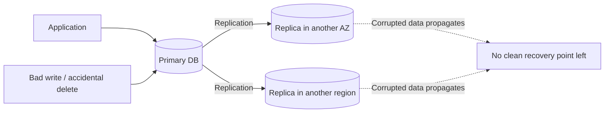
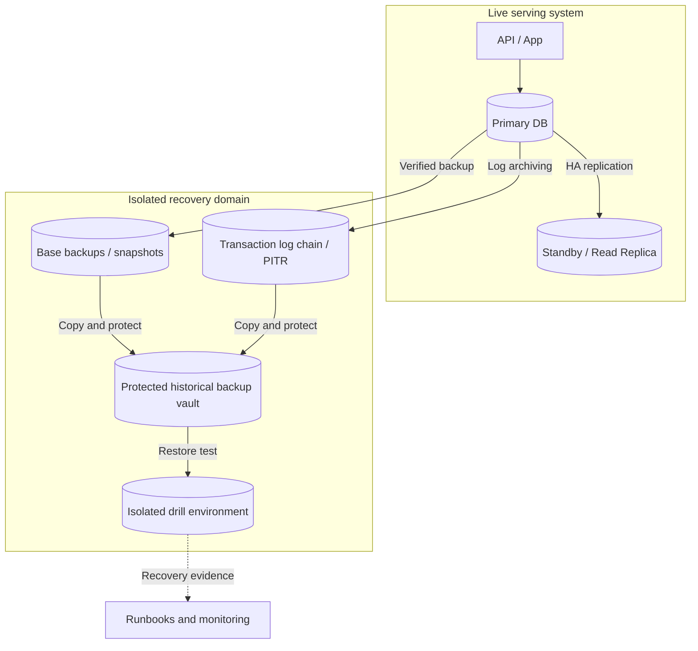

# Treating replicas as backups and skipping recovery drills

In cloud architecture, a **replica (a copy serving availability or read scaling)** and a **backup (a copy serving data recovery)** solve two different classes of failure. Replicas typically keep the service running when a node fails, reduce read latency, or support role failover. Backups create a sufficiently independent recovery point to return to a known-good data state after the primary system suffers corruption, accidental deletion, or an attack.

The antipattern appears when a design team concludes: “The database already runs multi-AZ and has a cross-region replica, so we don't need backups”; or “The platform runs automatic backups, so recovery is guaranteed.” Both conclusions miss the critical question: **after a specific data incident, can we restore a valid state within the timeframe the business allows?**

This is an **architecture antipattern** to catch when designing cloud applications from business requirements through networking, compute, data, and deployment. It connects directly to reliability, security, scalability, cost, operations, and evaluation against Well-Architected principles.

## 1. Real-world scenario: the system is up, but the data is wrong

An e-commerce system has:

- A primary orders database and a standby replica eligible for promotion to primary.
- A read replica placed in another geographic region to reduce latency.
- Multi-instance apps and APIs with health checks and automatic routing away from failed instances.
- An operations team that has never tested restoring from backups in an isolated environment.

At 10:00, a migration accidentally runs a statement deleting unpaid orders far more broadly than intended. The change commits on the primary and replicates to all replicas. At 10:18, users and customer support discover that many orders have vanished.

In this situation, **replicas that are healthy at the infrastructure layer still hold invalid business data**. Failing over to a replica does not fix the data. Even with backups, the team must know which recovery point is still clean, the restore procedure, how to verify integrity, and how to handle valid orders placed after 10:00. Without prior drills, figuring out those steps mid-incident can cause recovery targets to fail.

## 2. Distinguish mechanisms before choosing an architecture

| Mechanism | Primary objective | Strengths | Key limitations |
|---|---|---|---|
| **Synchronous/asynchronous replication between primary and replica** | Availability, read scaling, or regional failover | Copy stays near current state; supports fast failover | Accidental deletes, bad writes, malware, or schema changes replicate too; async replicas also carry lag. |
| **Multi-node / multi-AZ High Availability (HA)** | Minimize downtime when a node or AZ fails | Automatic role failover and continuity of serving | Does not return data to a valid past state. |
| **Periodic snapshots/backups** | Preserve a state usable for recovery | Provides a recovery point decoupled from current live state | Data gap exists between snapshots; must verify consistency, decryptability, and restorability. |
| **Point-in-time recovery (PITR)** | Restore to a specific timestamp within a retention window | Can roll back just before the corrupting operation if logs and base backups are intact | Depends on log/backup chain continuity, retention, tooling, and identifying the exact cutoff time. |
| **Immutable and isolated backups** | Prevent backup deletion/tampering from operator error or compromised accounts | Reduces risk of an incident spreading to the recovery store | Still must protect encryption keys, access paths, retention settings, and test restores. |
| **Disaster recovery (DR) with regional failover** | Restore service when the primary region goes down | Can shorten service outage duration | A copy in another region does not automatically protect against replicated logical errors. |

**Replication is a state-transport mechanism; backup is the ability to return to a verified recovery point.** A managed service may bundle HA, snapshots, PITR, and cross-region backups in one product, yet each capability must be enabled, configured, and evaluated separately.

### 2.1. Synchronous vs. asynchronous does not change the nature of logical errors

With **synchronous** replication, a transaction may commit only after meeting durability rules across designed nodes. This improves node fault tolerance while also synchronously replicating **bad operations**. With **asynchronous** replication, a replica lags behind and loses unshipped transactions on failover; that lag occasionally happens to preserve pre-corruption state, yet **it is never a backup policy you can rely on**. Never assume a replica will lag long enough before corruption arrives.

Running scheduled exports from a read replica is also insufficient if exports live in the same account, share delete permissions, and go untested. The goal is preserving historical recovery points inside an independent security boundary.

### 2.2. Snapshots do not guarantee business-consistent state

A disk snapshot may only be **crash-consistent**: upon restore, the filesystem and database must run transaction-log recovery. In multi-database or multi-service applications, snapshotting each store at slightly different times can yield inconsistent business state—for example, Order recorded an order while Payment did not record payment state.

Depending on system traits, you need database-aware snapshots, coordinated quiescing, transaction-log backups, checkpoints, or cross-component consistent recovery strategies. Even **application-consistent** backups require running a complete restore test to verify business constraints.

### 2.3. Object replication and versioning also have limits

In object storage, automatic replication to another bucket can replicate deletions or unwanted versions depending on configuration. Versioning retains historical versions in many cases, yet cannot fully replace backups if version-delete permissions, lifecycle rules, or admin credentials can still destroy history. To use them in a recovery strategy, verify replication rules, version retention, immutability locks, privilege separation, and restore procedures.

## 3. Why does the antipattern happen?

Flawed assumptions often creep in while optimizing availability or cost:

1. **Confusing failover with restore:** seeing a DB automatically promote a standby when one node fails and assuming the system can roll back bad writes.
2. **Confusing “backup job succeeded” with recoverability:** a job can finish while the copy is corrupt, missing keys, missing logs, misconfigured for retention, or taking longer than RTO to restore.
3. **Planning only for hardware failures:** designing multi-AZ and multi-region while ignoring human error, bad migrations, abused privileges, ransomware, and silent gradual data corruption.
4. **No DR owner:** the database team assumes infrastructure handles restores; infrastructure waits for the app team to decide which timestamp to restore to.
5. **Omitting recovery costs:** budgeting for HA while treating backup storage, log retrieval, drill environments, and recovery staffing as cuttable extras.
6. **Fearing production impact during drills:** lacking an isolated environment and safe process, teams postpone restore tests until a real incident strikes.

Clear warning signs: replication diagrams exist with no restore-test history; dashboards track replica lag but not recovery-point age; backups share admin privileges with production; nobody knows when PITR is needed or who authorizes cutover.

## 4. Antipattern diagram and revised architecture

### 4.1. Antipattern: every copy receives the latest state



Replicas reduce downtime from infrastructure failures, yet **share the same logical failure domain**: a technically valid but business-wrong operation flows over replication to every copy.

### 4.2. Design with HA and an independent recovery path



This diagram shows **logical intent**; actual copies may reside in a managed backup service, immutable object store, or dedicated vault. For multi-service apps, also account for copies of configuration, secrets, encryption keys, infrastructure as code, object data, and dependencies required to bring the system back online.

The recovery path should have these properties:

- **Failure-domain isolation:** when the primary region, account, or workload permissions are compromised, at least one recovery path remains that the actor cannot easily alter or delete.
- **Sufficient history:** periodic backups, transaction logs, and retention cover the detection delay of silent data corruption.
- **Tamper/delete protection:** immutable retention, versioning, vault lock, or WORM per platform, paired with least privilege and accidental-delete protection.
- **Complete restore prerequisites:** data, metadata, schemas, configs, migration history, decryption keys, and key-usage permissions remain available.
- **Safely testable:** restore into an isolated environment, blocking egress to payment gateways, email providers, and external systems so no side effects escape.

Note: backups stored in another account that share the same superuser identity or easily deleted encryption key still fail risk isolation.

## 5. Translating business requirements into RPO, RTO, and retention policies

Distinguish two metrics:

- **RPO (Recovery Point Objective):** maximum acceptable amount or time window of data loss under agreed business commitments for a defined incident scenario. A 5-minute RPO means the organization accepts losing roughly up to 5 minutes of data under that scenario—not a guarantee against every failure mode.
- **RTO (Recovery Time Objective):** maximum allowed duration to return a capability to a defined service level, measured from the agreed incident timestamp. RTO must include detection, decision, provisioning, restore, verification, and traffic cutover—not just running the restore command.

**Retention (how long recovery points are kept)** is a separate decision. A 5-minute RPO does not dictate whether backups stay for 7, 30, or 90 days. Silent data corruption may surface days later; you need a window long enough for that failure mode while balancing legal, privacy, and cost constraints.

### 5.1. Classification by business impact

| Data / system | Example requirement | Starting strategy | What must be proven |
|---|---|---|---|
| Payments and orders | RPO 5 min, RTO 60 min | HA + base backups + continuous logs/PITR + reconciliation records | No duplicate payment posting; order–transaction relationships restored cleanly. |
| Unpaid shopping carts | RPO 30 min, RTO 2 hr | Backups and recovery aligned to data characteristics | Customers never see corrupted carts or someone else's cart. |
| Catalog sourced from another master | RPO a few hours, RTO 4 hr | Tested snapshots, exports, or regeneration | Indexes rebuild cleanly and record totals match. |
| Recomputable analytics | RPO 24 hr, RTO 24 hr | Preserve source data, reprocessing workflows, and metadata | Pipelines actually rerun within acceptable bounds. |

All durations above are **illustrative discussion assumptions**; real SLAs/SLOs must be agreed with the business and verified via drills.

### 5.2. Measure RTO across the entire recovery journey

Suppose the order service has a 60-minute target RTO. During a drill:

```text
Detect and confirm incident         8 min
Select recovery point, approve     7 min
Provision infra, network, IAM     15 min
Restore data + replay logs        25 min
Verify data and functionality     12 min
Cut over traffic / reopen         10 min
---------------------------------------
Measured RTO                      77 min
```

The result **77 minutes > 60 minutes** shows the design and runbook miss the target even though the “database restore” task itself took only 25 minutes. Identify which steps consume the most time: pre-stage infrastructure, automate repetitive actions, speed up restores, or renegotiate targets.

When reporting durations, state start timestamp, end timestamp, and the “recovered” definition (e.g., order-creation API works, data verified, serving real traffic). Do not declare success when the DB boots while the app cannot read or write.

### 5.3. The RPO trap during logical data corruption

A system archiving logs every minute can restore to 09:59:59, right before a bad migration ran at 10:00. However, the bug was only detected at 10:18; valid transactions written to the primary between 10:00 and 10:18 are missing from a restore back to 09:59:59.

Therefore, **a 1-minute log-archiving interval does not guarantee a 1-minute actual RPO when logical corruption is detected late**. To meet business goals, you may need to spin up a parallel restore, extract lost records, selectively replay clean transactions, reconcile against payment/event logs, or accept bounded loss after impact assessment. Any merge must handle duplicate IDs, event ordering, integrity, and access permissions.

## 6. Designing a backup policy: depth, scope, and isolation

A policy can start from the principle of **multiple copies across distinct failure domains, with at least one copy sufficiently isolated**. The “3-2-1” rule (three copies, two media types, one off-site) is a helpful traditional heuristic, yet in the cloud it must be interpreted across accounts, regions, admin boundaries, storage tiers, and restore paths rather than merely counting replicas.

Decisions to document:

| Attribute | Design question |
|---|---|
| **Scope** | Which databases, buckets, volumes, queue states, secrets, configs, keys, and metadata must be protected? |
| **History** | Use base backups, incremental backups, log/WAL archiving, snapshots, or consistent exports? |
| **Frequency** | What is the maximum gap between durable, measurable recovery points? |
| **Retention** | How long is needed to catch silent corruption? Are there legal/privacy hold or deletion mandates? |
| **Location** | Do you need copies across AZs, regions, accounts, or separate control planes? |
| **Permissions** | Who can create, view, restore, shorten retention, delete backups, and manage encryption keys? |
| **Immutability** | Does retention locking resist deletion even by a compromised admin identity? Are there special admin modes? |
| **Encryption & keys** | Who controls KMS keys? If the primary account/region is down, can backups still be decrypted? |
| **Testing** | Restore test cadence, accountable owner, pass criteria, and where evidence is stored? |
| **Cost** | Growth from data churn, cross-region transfer fees, restore requests, DR environments, and drills? |

A **descriptive policy example** (not direct configuration for any specific vendor):

```yaml
workload: order-service
data_classification: confidential
recovery_objectives:
  rpo_minutes: 5
  rto_minutes: 60
backup_policy:
  consistent_base_backup: daily
  transaction_log_archiving: continuous
  pitr_retention_days: 14
  longer_term_retention_days: 35
  isolated_copy: separate_security_boundary
  immutability: enabled_with_approved_retention
  encryption: enabled_with_tested_key_access
  restore_test: monthly_plus_after_major_changes
ownership:
  data_owner: order-service-team
  recovery_operator: platform-oncall
  incident_decision_owner: incident-commander
```

This illustrative policy **does not prove RPO/RTO compliance by itself**. Measure log shipping lag, backup availability, restore throughput at real data size, and automation coverage. Short/long retention tiers must reflect data classification, detection lag, and organizational rules.

### 6.1. Backing up multiple resources participating in one business transaction

An order may reference inventory, payments, invoices, and attached objects. Restoring one database independently can leave systems out of sync. Therefore:

1. Identify the **source of truth** for each data domain and minimum compatible recovery points.
2. Record transaction IDs, event IDs, versions, or audit logs to aid reconciliation during reconstruction.
3. Define restore sequencing and the order for re-enabling consumers/queues so side effects do not replay blindly.
4. For event-driven workflows, require idempotent event handlers plus replay or compensation procedures.
5. Ensure backups never trigger live business side effects when restored in a drill environment.

Never assume a single shared snapshot suffices for an entire distributed application. Consistency strategies must match each business boundary.

## 7. Matching incident types to recovery responses

| Scenario | How replicas help | What backups/DR must do |
|---|---|---|
| One DB node suffers hardware failure | Fail over to a healthy node; brief disruption possible. | Track failover RPO/RTO; backups continue preserving history. |
| One availability zone loses connectivity | Replicas in another AZ/region can keep serving if configured. | Verify dependencies, network, DNS, and keys for restores if failover is insufficient. |
| Table dropped or bad migration executed | Replicas usually receive the bad delete/edit too. | PITR to before the error, then reconcile and recover clean post-cutoff transactions. |
| Data silently corrupted over multiple days | Primary and replicas may both be corrupted. | Keep a long enough history window, audit correctness, and pick a clean recovery point. |
| Ransomware / compromised admin account | Copies sharing credentials may be wiped or encrypted. | Immutable backup vault, independent permissions, accessible keys, clean-room restore runbook. |
| Entire primary region unavailable | Cross-region replicas can help if control plane and other-region dependencies are ready. | Recover into an alternate region with tested networking, compute, identity, and data. |
| Encryption key accidentally deleted | Encrypted replicas or backups may become unreadable. | Protect key lifecycle, test decryption in standby environments, maintain emergency key procedures. |
| Backups missing transaction logs or corrupt | No immediate impact on live traffic. | Continuously verify backup/log chain integrity, alert, and test restores from independent copies. |

**Never use failover to fix logically corrupted data.** When ongoing logical corruption is suspected, the incident team should consider containing writes, preserving evidence, scoping damage, and protecting clean recovery points before switching roles.

## 8. Recovery drills: capability tests, not paperwork

Regular drills turn a paper design into measurable resilience. Do not merely check that a backup file downloads or a DB process starts; the requirement is **bringing the application back to serving accurately and safely**.

### 8.1. Drill scope and depth

| Level | Activities | Outcomes to verify |
|---|---|---|
| Automated daily checks | Backup jobs, log chains, recovery-point lag, checksums if supported, retention/quota alerts. | Early detection of broken recovery points; never replaces restore testing. |
| Isolated restore test | Provision fresh resources from backup/PITR; verify data and app connectivity. | Decryption keys work, data is consistent, runbook executes cleanly. |
| Logical-error game day | Corrupt test data intentionally, detect it, select PITR point, reconcile clean transactions. | Measure actual RPO, data loss exposure, and team decision speed. |
| AZ/region-loss game day | Simulate failover and/or alternate-region restore; verify network/identity dependencies. | Measure end-to-end RTO until business operations resume. |
| Cross-team drill after major changes | Run with developers, SREs, security, support, and business representatives. | Validate ownership, communications, cutover, rollback, failback, and post-checks. |

Cadence should match criticality and rate of change: critical services may test monthly or after major architectural shifts; lower-tier services on another schedule. Frequency alone is not enough: restoring a tiny backup into the same familiar sandbox every month still leaves you blind to whether real production scale recovers during a regional loss.

### 8.2. Sample drill runbook: PITR for Order Service

**Preconditions:** representative test dataset, isolated recovery environment, appropriate read-only backup access, verified encryption keys, baseline row counts, and sample business transactions. Never run destructive drills against production; when real failover tests are needed, require an approved change plan and rollback path under organizational governance.

1. **Declare simulated incident:** e.g., bad migration at 10:00 accidentally deletes unpaid orders; pinpoint the timestamp via logs, traces, audit trails, and DB metadata.
2. **Contain the fault:** halt the offending actor, restrict affected write paths, preserve logs and evidence. Assess impact on event consumers and external services.
3. **Select recovery point:** verify a clean base backup, continuous transaction logs, exact timestamp before the bad transaction, and key availability.
4. **Provision isolated environment:** stand up the DB and related resources in an isolated network; use a least-privilege restore identity, block real emails/payments, and avoid production endpoints.
5. **Execute restore:** follow the DB/backup provider's official procedure to restore the base backup and replay logs to the target point; log every timestamp and error.
6. **Technical verification:** check DB health, schema, constraints, indexes, row counts, transaction-log position, and application connectivity.
7. **Business verification:** spot-check known pre-10:00 orders; check tenant scoping, payment status, and inventory state; cross-check against audit/event records.
8. **Post-cutoff reconciliation:** collect valid transactions from 10:00 until containment, propose safe ordered replay, enforce idempotency against duplicates, and document unrecoverable gaps.
9. **Application verification:** deploy/point the API to the restored environment, test reads, safe writes, auth, secrets, and network restrictions; shift traffic only when acceptance gates pass.
10. **Record results:** detection, decision, provisioning, restore, verification, and cutover durations; actual data loss, manual friction, and follow-up action items.

During real post-incident cutover, guard against **split-brain**: never leave two primaries accepting independent writes. When shifting traffic via DNS or service discovery, account for TTLs, connection pooling, and clients holding stale connections. When failing back to the primary region, execute a state-sync plan so the recovered region does not overwrite newer data.

### 8.3. Sample data validation queries

The queries below only illustrate checks inside an **isolated recovery environment**; adapt table names and predicates to your actual schema.

```sql
-- Check order counts grouped by status.
SELECT status, COUNT(*) AS total
FROM orders
GROUP BY status
ORDER BY status;

-- Verify a known set of orders from before the incident timestamp.
SELECT order_id, customer_id, status, total_amount
FROM orders
WHERE order_id IN ('ORD-1001', 'ORD-1002', 'ORD-1003');
```

Row counts alone do not prove correctness. Other vital checks: monetary totals/currencies, foreign-key integrity, payment transaction uniqueness, tenant isolation, event-processing states, and object-storage accessibility. Derive baseline expectations from independent evidence rather than comparing two potentially corrupted sources.

### 8.4. Pass criteria and evidence

A drill should produce an **auditable scorecard**:

| Criterion | Example measurement |
|---|---|
| Recovery point | Last restored timestamp/LSN; recovery-point age; backup/log continuity. |
| Actual data loss | Count of valid transactions lost or needing compensation; unprotected time window. |
| RTO | Elapsed time from agreed incident start until the API processes transactions accurately and safely accepts traffic. |
| Data integrity | Constraint checks, order/payment reconciliation, business invariants. |
| Safety and permissions | Proof decryption keys work across the standby boundary; restored environment emits zero external side effects. |
| Repeatability | Versioned runbook, config versions, operator names, archived commands/logs, errors encountered and resolutions. |

If any criterion fails, record root cause, risk level, and an owner for remediation. Never mark a “DR test passed” if only the database restored while the API stayed broken or business data went unverified.

## 9. Securing backups and recovery paths

Backups contain data nearly as sensitive as production and become prime targets when attackers gain admin access. Design defense in depth:

- **Separated permissions:** production service accounts cannot delete or shorten retention on protected recovery copies; sensitive actions require separate identities and approval workflows.
- **Immutable vaults:** lock backups for the chosen retention period; understand governance vs. compliance modes, admin overrides, and service caveats.
- **Encryption keys:** plan key availability in backup regions/accounts; test decryption; protect KMS key lifecycles so you never lock yourself out of restores.
- **Recovery network:** place restore environments inside controlled networks without public DB ports; issue short-lived secrets, log actions, and revoke access afterward.
- **Test-data hygiene:** if drills use real data, enforce access controls, masking/anonymization where feasible, retention limits, and secure deletion post-drill.
- **Suspicious-activity alerts:** alert when retention policies change, backup jobs are disabled, delete permissions are granted, or encryption keys are disabled.

Immutable backups cannot fix everything if data was silently corrupted long before backup or if decryption keys are gone. Combine historical protection, anomaly detection, integrity checks, and drills selecting clean recovery points.

## 10. Cost and practical trade-offs

Backup cost optimization must weigh **the cost of failing to recover**, not storage bills alone.

```text
Total recovery cost ≈ backup and log storage
                    + cross-region replication / data transfer
                    + encryption, monitoring, integrity checks
                    + restore/DR environment compute
                    + engineering time and drill execution
                    + maintaining traffic-failover readiness
```

Incremental backups, storage tiering, classification-based retention, and ephemeral drill environments can save substantially. Yet always verify whether lowering frequency, shortening retention, or moving backups to cold storage pushes RPO, RTO, or incident retrieval delays past business limits.

**Trade-off example:** a large dataset kept in cheap cold backup storage takes hours to rehydrate, while the business requires a 60-minute RTO. That tier fits long-term compliance archiving, not as the sole operational recovery point. Consider pairing a fast-restore tier with a cheaper long-term archive tier.

For multi-region architectures, factor in replication charges, network egress, dependencies on identity/key services, and recoverability if the primary region's control plane is offline. **Cross-region replicas** aid DR recovery speed; **independent cross-region backups** preserve clean recovery options when logical errors or accidental deletes replicate.

## 11. Well-Architected evaluation

| Pillar | Questions to review | Evidence required |
|---|---|---|
| **Operational Excellence** | Who triggers DR, who approves the recovery point, and who signs off on recovery? | Versioned runbooks, drill schedule and reports, on-call roles. |
| **Security** | Could someone with production access delete every backup or disable decryption keys? | IAM reviews, backup immutability, restore tests from an isolated security boundary. |
| **Reliability** | Do node loss, logical corruption, and regional loss each have dedicated recovery paths? | Per-scenario RPO/RTO, failover and restore test results, broken-recovery-point alerts. |
| **Performance Efficiency** | Can large-scale data restores finish inside RTO? | Measured restore throughput, cache warm-up, post-cutover API latency. |
| **Cost Optimization** | Do retention and storage tiers match business impact? | Backup/restore cost breakdown compared against data-loss and downtime risk. |
| **Sustainability** | Are copies retained only as long as needed and drill environments cleaned up afterward? | Appropriate lifecycle policies, storage tracking, automated environment teardown. |

A sound review separates “we have replicas” from “we successfully restored from an isolated backup and measured actual data-loss bounds.” High HA uptime targets do not prove data recoverability.

## 12. Design exercise: rescuing data after a bad migration

### Prompt

A scheduling application has a 2 TB primary database, an in-region standby, and a cross-region read replica. Bookings arrive continuously all day. At 14:05, a migration corrupts 80,000 appointments; the mistake is noticed at 14:42. The business requires a max RPO of 10 minutes, max RTO of 90 minutes for data incidents, and 30 days of history. Currently the system only takes nightly snapshots, has no PITR, and stores all snapshots inside the app's own cloud account.

Answer and explain:

1. Does the cross-region replica let you roll back before 14:05? Is there sufficient evidence to assume so?
2. If the latest snapshot was at 02:00, how much valid data could be lost by restoring straight from the snapshot? Is the 10-minute RPO met?
3. How must backup/log archiving, retention, permission boundaries, and encryption change?
4. What workflow is needed to preserve or reapply valid bookings created between 14:05 and 14:42?
5. Draft a runbook with a timeline, integrity checks, cutover gates, and how RTO is measured.

### Analysis guide

- **Question 1:** No guarantee. Replication typically forwards bad updates too, so the read replica was likely corrupted alongside the primary. You must inspect its real state and replication lag before treating it even as a temporary extraction source.
- **Question 2:** A 02:00 snapshot risks losing transactions from after 02:00 up to restore time; up to 14:05 alone is already **12 hours and 5 minutes**, far beyond 10 minutes. Actual loss depends on subsequent write traffic and reconciliation capability. This represents the potential time-gap exposure, not a fixed record count.
- **Question 3:** Design consistent DB backups, continuous log archiving/PITR with sufficient window, cross-account immutable copies, key/encryption policies, and independent restore tests. Never promise an RPO without measuring recovery-point durability.
- **Question 4:** PITR to before 14:05 removes the bad edits alongside valid updates after that cutoff. Preserve audit/event logs, classify good vs. bad changes, safely replay or merge clean bookings, and reconcile with downstream systems. Data recovery is rarely just “run PITR.”
- **Question 5:** Time the whole loop: detection, decision, provisioning, restore, booking validation, valid-transaction recovery, and cutover. If elapsed time from 14:05 to 14:42 counts toward RTO per agreement, 37 minutes of the 90-minute budget are already gone before restore even starts.

Try iterating the plan against two variants: **(a)** backups/PITR exist, but silent deletion is discovered 20 days later; **(b)** the backup vault in the main account is wiped during an account compromise. Both scenarios show why retention and credential independence matter just as much as backup frequency.

## 13. Architecture review checklist and definition of done

- [ ] Critical data assets are inventoried and classified by acceptable business data loss and downtime.
- [ ] RPO, RTO, retention, and “service recovered” criteria are defined per failure mode, including logical corruption and regional loss.
- [ ] Architecture diagrams distinguish **HA/replication** and **backup/PITR** as separate protection paths.
- [ ] Base backups are consistent; transaction logs/PITR are continuous; alerts watch recovery-point age and broken log chains.
- [ ] Recovery copies are protected against regional/account compromise, accidental deletion, malware, and lost decryption keys.
- [ ] Runbooks cover selecting a recovery point, building an isolated environment, validating data, reconciling events, and safe cutover.
- [ ] Restore drills have run on representative data/size; actual RPO/RTO are measured and pass/fail evidence is archived.
- [ ] Execution owners, business decision-makers, re-test cadence, and remediation deadlines are assigned.
- [ ] Storage, retrieval, testing, and SLA/SLO capability costs are weighed rather than optimizing storage capacity alone.
- [ ] Cutover/failback, network, compute, secrets, IAM, DNS, and cross-service consistency dependencies are verified.

**Key takeaway:** replicas protect the serving path against certain infrastructure faults; backups and change history restore valid data when logical errors strike. Only **a rehearsed recovery process with measured RPO/RTO and proven business integrity** demonstrates that a data protection strategy actually works under real conditions.
