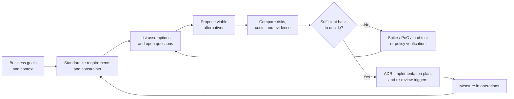
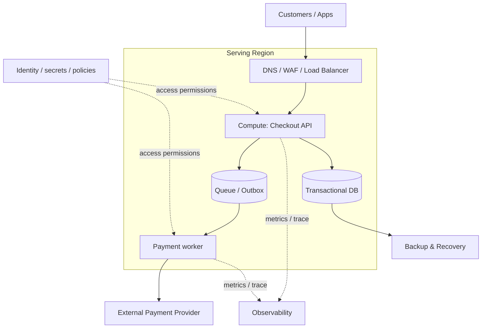

# Reviewing Requirements, Assumptions, and Alternatives

> **Chapter:** Architecture Assessment  
> **Module:** `CLOUD_ARCHITECTURE` — learn how to design cloud application architectures from business requirements through networking, compute, data, and deployment model choices; analyze trade-offs across reliability, security, scalability, cost, and operations following Well-Architected principles.

An architecture diagram can look reasonable yet still solve the wrong problem: a system might be designed for one million concurrent users when actual demand is a few thousand, or a very fast database might be chosen that fails data residency requirements. Before locking in a cloud solution, the designer needs to **review requirements**, **surface assumptions**, and **compare viable alternatives based on evidence**.

This activity takes place before building the system, during major changes, and after new operational data arrives. The goal is not to pick the "best" technology in the abstract; the goal is to find an option that **meets mandatory requirements, keeps residual risk acceptable, and fits organizational capabilities**.

## Learning Objectives

After this lesson, you will be able to:

1. Distinguish business goals, functional requirements, quality attributes, constraints, assumptions, risks, and architectural decisions.
2. Translate vague goals into requirements with measurable and verifiable criteria.
3. Run reviews with the right stakeholders and trace requirements to design choices, testing, and operational ownership.
4. Build an assumption register and prioritize validating assumptions that could alter the decision.
5. Propose viable alternatives and compare them using exclusion criteria, trade-off tables, sensitivity analysis, and experimental evidence.
6. Document decisions using an Architecture Decision Record (ADR), identifying residual risks and conditions for re-evaluation.

## 1. Architecture Assessment Starts from the Problem, Not the Diagram

A requirement stating "the system must scale well" can lead to many solutions: vertical server scaling, stateless application autoscaling, queues for asynchronous work, query optimization, or data partitioning. You cannot choose before knowing **which load grows, by how much, for how long, and which business outcomes must be protected**.

A structured architecture assessment cycle typically proceeds as follows:



This is an **iterative loop**: an assumption proven false can make a previously winning option unsuitable.

### Seven Types of Information to Distinguish

| Type | Question | Ordering Application Example | Output Artifact |
| --- | --- | --- | --- |
| **Business Goal** | Why is the system needed? | Reduce abandoned orders and expand into new markets. | Objectives, KPIs, beneficiaries. |
| **Functional Requirement** | What must the system do? | Create orders, process payments, issue refunds, look up status. | Business flows, acceptance criteria. |
| **Quality Attribute (NFR)** | How well must it perform? | 99.9% of valid checkout requests succeed per month. | SLIs/SLOs, quality scenarios, and measurements. |
| **Constraint** | What must not be violated? | Personal data for a customer segment must stay within approved regions. | Exclusion or mandatory conditions. |
| **Assumption** | What is temporarily taken as true? | Peak traffic is only four times the average. | Assumption register, verification plan. |
| **Risk** | What could happen and what is the impact? | Database overloads when a sales campaign starts. | Risk register, owner, mitigation measures. |
| **Decision** | Which approach is chosen, based on what evidence? | Use a managed relational database and compute autoscaling. | ADR, updated architecture, re-review conditions. |

**Assumption** does not mean **requirement**. "Traffic will probably only hit 3,000 requests/sec" is an assumption until measured or agreed upon as a load limit to support. "Must handle 3,000 requests/sec at peak with p95 under 300 ms" can become a requirement once approved by the product owner and engineering team.

## 2. Engaging the Right Stakeholders and Context

An architecture can satisfy the development team's needs yet fail in deployment by overlooking legal, security, operations, or enterprise customers. You must identify who **sets requirements**, who **bears consequences when requirements are missed**, and who **verifies results**.

| Stakeholder Group | What to Clarify | Useful Evidence |
| --- | --- | --- |
| Product / Business Owners | Revenue-generating flows, deadlines, markets, downtime tolerance. | KPIs, business processes, conversion data. |
| Users / Customer Support | Acceptable wait times, failure impact, critical journeys. | User journeys, feedback, abandonment rates. |
| Developers / Architects | System dependencies, API contracts, change lifecycle, data. | Actual diagrams, repositories, past bugs, prototypes. |
| SRE / Operations | SLOs, on-call, capacity limits, recovery, observability. | Telemetry, incident history, drill results. |
| Security / Privacy / Compliance | Identity, secrets, data segmentation, residency, audit, retention. | Approved policies, threat models, data inventory. |
| Finance / Procurement | Budgets, limits, vendor commitments, operating costs. | Cost baselines, pricing sheets, and cost reports. |
| Partners / External Dependencies | Rate limits, SLAs, timeouts, supported regions, integration limits. | Contracts, technical docs, test data. |

Effective questions are **scenario-specific questions**:

- What happens if payment succeeds but the user loses connectivity before receiving confirmation?
- When a sales campaign multiplies load by 5x, which features must stay up and which can temporarily degrade?
- If a region becomes unavailable, what is the required recovery time? How much data loss on confirmed transactions is tolerable?
- If the payment provider stalls for 30 seconds, is the system allowed to accept orders in a "pending" state?
- Which data types are restricted in storage and processing locations? Who has authority to confirm?

Avoid asking merely "do we need security/scalability?" because the answer is almost always "yes" yet provides no basis for decisions.

## 3. Standardizing Requirements into Verifiable Conditions

A requirement can be structured as:

> **Under [context and load], [component/journey] must achieve [measurable outcome] over [observation window], otherwise [impact]; [owner] verifies via [method].**

Example:

- Too vague: "The payment API must be fast."
- Verifiable: "At a steady load of 800 requests/sec with the defined request mix, **p95 latency from API receipt to response** must not exceed 400 ms, excluding customer time in external authentication steps; measured via load tests and production traces, approved by the payment service owner."

A **quality attribute scenario** should include: stimulus source, stimulus, environment, artifact affected, expected response, and response measure. Example: *Region A becomes unavailable* (stimulus) *during peak hours* (environment); *the router and cluster B* (artifact) must *absorb new transactions in a controlled manner* (response) *within 30 minutes* (measure).

### From Broad Goals to Metrics

| Broad Goal | What to Clarify | Example Verifiable Criterion |
| --- | --- | --- |
| "Always available" | Which journey? What time window? Any maintenance exceptions? | Checkout availability SLO 99.9%/30 days, calculated over defined valid requests. |
| "Fast" | p50, p95, or p99? Measured at client, API, or database? At what load? | End-to-end checkout p95 under 2 seconds at target traffic. |
| "Scalable" | Average/peak load, read/write ratio, how fast does data grow? | Handle 3,000 requests/sec peak for 20 minutes with errors below threshold. |
| "Zero data loss" | Which data types, after confirmation at which step? | Confirmed transactions must not be lost per business contract; requires matching write and reconciliation mechanisms. |
| "Secure" | Who gets access, which sensitive assets, which threats? | Only the payment service can read encrypted tokens; all access must be auditable. |
| "Low cost" | Optimizing peak price or full-year TCO? Including staffing? | Monthly cost across three load tiers within approved budget; cost/unit tracked. |
| "Easy to deploy" | How large is the ops team? Release frequency? | Zero-downtime deployment on the critical path, zonal rollback, and test evidence. |

SLOs should tie to **meaningful user experience**, not just server health. A system returning HTTP 200 for an order creation request while failing to persist the order is a business failure.

### SLI, SLO, and Error Budget

- **SLI** is the actual measurement, e.g., the ratio of valid payment requests that succeed.
- **SLO** is the target for the SLI over a defined window, e.g., 99.9% over 30 days.
- **Error budget** is the allowed margin of missed targets during that window; if request-based, a 0.1% budget equals 1,000 failed requests per million valid requests.

Do not confuse this with a contractual SLA. A 99.9% availability SLO corresponds to at most roughly **43.2 minutes** of unavailability in a 30-day month **only when** defined by time ratio and complete outage. For request-based SLOs, it cannot be directly converted into minutes when traffic fluctuates.

### Recovery Capability: Distinguishing RTO and RPO

- **RTO (Recovery Time Objective):** target maximum time to restore functionality after an incident.
- **RPO (Recovery Point Objective):** acceptable data loss or rollback point in time during recovery.

For example, a reporting system might tolerate an RPO of 15 minutes; a confirmed financial transaction ledger might require **zero loss of committed records**. That does not mean writing RPO = 0 on paper suffices: you must prove that commit mechanics, replication, durable logs, retries, and reconciliation actually meet the requirement.

## 4. Prioritizing, Mapping Dependencies, and Constraints

Not all requirements carry the same mandatory weight. One classification approach:

1. **Hard constraints / must-have:** violating these disqualifies an option even if performance or cost scores are excellent.
2. **Threshold quality goals:** must be verified; exceptions may be granted by the risk owner if governance allows.
3. **Optimization priorities:** higher performance, lower cost, less operational overhead once mandatory levels are met.
4. **Future aspirations:** may influence design extensibility without needing immediate implementation.

For instance, "do not store PII outside approved regions" is a constraint if backed by verified policy; "use Kubernetes" might simply be a **proposed solution choice**, not a business requirement. Ask for the **underlying driver**: is it cross-environment portability, a shared operational standard, or team familiarity with the tooling?

### Requirements Traceability Matrix

| ID | Requirement | Related Components / Decisions | Proof Method | Owner | Status |
| --- | --- | --- | --- | --- | --- |
| REQ-01 | Checkout API p95 under 2 seconds at selected peak load. | Compute autoscaling, cache, database/indexes. | Load tests; route-level p95 tracing. | Tech lead | Needs measurement. |
| REQ-02 | Never create two charges for one payment key. | Payment adapter, idempotency store, webhook consumer. | Retry/timeout tests, ledger reconciliation. | Payment owner | In design. |
| REQ-03 | Personal data must stay in approved locations. | Region placement, backups, logging, analytics. | Data flow review and compliance sign-off. | Security/privacy | Unconfirmed. |
| REQ-04 | Restore checkout within 30 minutes upon primary region loss. | Failover, routing, capacity, and database. | Region-loss drill, RTO/RPO measurement. | SRE | Unverified. |
| REQ-05 | Operable by the current team size. | Managed services, IaC, on-call. | Trial deployment, incident drills, runbook estimates. | Engineering manager | Needs quantification. |

Statuses in the table are illustrative. Each requirement needs a **stable ID**, source, priority, approver, and verification date; when changed, update related designs, tests, and ADRs.

## 5. Reviewing Assumptions: What Is Being Taken for Granted?

An **assumption** is an inadequately proven premise that a decision relies on. Assumptions are not bad; **unspoken assumptions, assumptions without an owner to verify them, or assumptions without a deadline** are what create danger.

An assumption register should include at minimum:

| Field | Meaning |
| --- | --- |
| ID / Statement | Expresses what is temporarily believed true; specific enough to be falsifiable. |
| Source and Owner | Who provided the information; who is responsible for verifying it. |
| Confidence Level | Low, medium, high; based on measured data, experience, or opinion. |
| Impact if False | Which architectural decisions, SLOs, costs, or compliance areas are affected. |
| Verification Method | Traffic measurement, PoC, vendor contract, policy check, interviews, etc. |
| Due Date and Status | Before decision, before go-live, or post-production monitoring. |
| Contingency Plan | Which alternative to switch to, release limits, or feature reductions if false. |

Example:

| ID | Assumption to Verify | Risk if False | Evidence / Check | Owner and Due Date |
| --- | --- | --- | --- | --- |
| A-01 | Peak traffic in the first 12 months will not exceed 3,000 req/s. | Compute, DB, and network overload. | Current telemetry, campaign forecasts, 1×–2× forecast load tests. | SRE, before locking capacity. |
| A-02 | 95% of read requests can tolerate up to 30 seconds of caching. | Stale or inconsistent figures displayed. | Screen classification, product alignment, and journey tests. | Product, before cache design. |
| A-03 | Operations team can support a container platform 24/7. | Higher MTTR, release risks, and on-call burnout. | Roster, experience, incident drills, and skill evaluation. | Engineering manager, before platform choice. |
| A-04 | Managed database supports required failover mode in approved regions. | Missing RTO/RPO or violating data residency. | Verify actual service/region/quotas and run drills. | Platform, before ADR. |
| A-05 | Cross-region egress costs stay under 10% of total data cost. | Budget overrun despite cheap compute. | Directional traffic estimates, pricing quotes, and trial measurements. | FinOps, before TCO approval. |

### Distinguishing Assumptions, Open Questions, and Risks

- **Assumption:** "Customers can wait up to 30 seconds for asynchronous payment results."
- **Open Question:** "How will customer support handle orders stuck in pending state?"
- **Risk:** "If the payment provider takes longer than 30 seconds, customers may resubmit and create duplicate requests."
- **Mitigation:** "Use a payment ID/idempotency key, durable transaction state, and completion notifications."

One assumption can spawn multiple risks; one risk can stem from multiple assumptions. Link records by ID rather than merging them into an ambiguous list.

### Prioritizing Verification by Decision Impact

Not every assumption warrants equal verification effort. Prioritize assumptions with **high impact if false**, **low confidence**, and **potential to reverse architectural choices**. For example, "must data reside in-country?" usually outweighs initial cache sizing, because it dictates deployment regions and backup strategies.

You can use impact × likelihood of being wrong for **relative ranking**, but do not treat the product of two subjective scores as an exact probability of loss. For legal or severe data-loss risks, a moderate-low score is still unacceptable.

## 6. Reviewing Current State and Defining System Boundaries

You cannot evaluate alternatives without knowing what **already exists**, what **must integrate**, and where failures can propagate.

Perspectives to review:

- **Context:** users, partners, payment systems, identity, CRM, analytics; data and trust levels at each interface.
- **Compute:** session state, horizontal scalability, startup time, runtime, request deadlines, and batch jobs.
- **Network:** ingress, egress, private/internet connectivity, DNS/load balancers, inter-zone latency, rate limits, and single points of failure.
- **Data:** authoritative system of record, transactions, schemas, backups, replication, sensitive data, retention, and deletion flows.
- **Security:** trust boundaries, service-to-service permissions, encryption, auditing, tenant isolation, and third-party components.
- **Operations:** CI/CD, IaC, observability, alerting, on-call, rollback, restore, quotas, and incident response capacity.
- **Cost:** baseline resources, load-variable costs, storage, egress, licensing, staffing, and migration costs.



This diagram is merely an example for asking questions: if the queue fills up, can checkout continue; if the payment provider times out, are requests held too long; if the region fails, how do the database and workers recover; do logs/backups contain location-restricted data?

Include both **data crossing trust boundaries** and **failure domains**. Diagrams omitting database write paths, event flows, or shared services easily create a false sense of fault tolerance.

## 7. Developing Genuinely Viable Alternatives

Propose at least two options capable of meeting the goals; if every option violates a mandatory constraint, that signals **a need to revise requirements or scope**, not a reason to pick the "least wrong" option.

Example for an ordering API with variable traffic requiring relational transactions:

| Option | Core Model | Potential Strengths | Areas to Verify |
| --- | --- | --- | --- |
| **A — Managed containers + managed relational DB** | Stateless API in a managed container platform; async workers; DB with backup/failover. | Control over runtime and networking; predictable scaling config; fits container-savvy teams. | Baseline cost, cold capacity, deployment ops, autoscaling, and DB capacity. |
| **B — Serverless compute + managed relational DB** | Function/serverless handlers, queue workers, managed DB; throttled DB connections. | Compute scales automatically with spikes; minimal server management; suits uneven workloads. | Concurrency/duration limits, cold starts, connection pressure, observability, and cost at sustained load. |
| **C — VMs + managed relational DB** | Autoscaling VM groups, load balancer, and deployment mechanism. | OS/runtime flexibility, easier migration for some legacy apps. | Patching overhead, image management, scaling speed, standby capacity, and higher ops burden. |

These are **architectural** options to evaluate, not claims that one technology is universally faster, cheaper, or safer. Options A, B, and C can all use a managed database; the main differences lie in compute, release mechanics, and operational burden.

Do not set up strawman competitors, such as comparing a finely tuned option against one with no autoscaling and no backups and declaring victory. Specify **the same SLOs, security, workload, and responsibility boundaries** for every alternative.

### Replacing the Whole System Is Not Always Necessary

An **alternative** can be smaller than replatforming:

- **Read cache** vs. query/index optimization to meet p95.
- **Async queue** vs. synchronous processing for tasks not needing instant responses.
- **Single writer** vs. multi-writer depending on consistency requirements.
- **Single-region multi-AZ** vs. **multi-region** given RTO/RPO and cost.
- **Managed service** vs. self-managed when the team lacks 24/7 operational specialists.

Avoid redesigning into microservices, event sourcing, or multi-region just because a dashboard or local performance bottleneck is needed. Complexity is a cost that requires business justification.

## 8. Comparing via Constraints, Evidence, and Trade-offs

An effective comparison process has three layers:

**Layer 1 — Mandatory Constraints.** Eliminate options that fail data, security, deployment location, licensing, or recovery constraints without a viable remediation plan. If unverified, mark **unknown** and keep the decision conditional.

**Layer 2 — Verifiable Criteria.** Compare load test results, estimated costs, operability, time to deploy, failure behavior, stability, and integration effort. Attach assumptions and evidence quality.

**Layer 3 — Prioritizing Trade-offs.** Apply weighted scoring once options pass mandatory gates, run sensitivity checks, and explain why the organization accepts the chosen option's limitations.

### Illustrative Decision Matrix

Assume all three options **provisionally pass mandatory constraints**, yet still require a PoC. Scores 1–5 are **review-team estimates**, not confirmed measurements. Weights must be approved by requirement owners.

| Criterion | Weight | A: Managed containers | B: Serverless | C: VMs |
| --- | ---: | ---: | ---: | ---: |
| Reliability / Recovery | 30% | 4 | 4 | 4 |
| Security / Compliance | 20% | 4 | 4 | 3 |
| Performance at Required Load | 20% | 4 | 3 | 4 |
| Operations / Speed of Change | 15% | 4 | 5 | 2 |
| Projected TCO | 15% | 3 | 4 | 2 |
| **Weighted Total** | **100%** | **3.85** | **3.95** | **3.20** |

Formula:

\[
S_j = \sum_{i=1}^{n} w_i s_{ij},
\quad \sum_i w_i = 1
\]

For Option B: \(S_B = 0.30(4) + 0.20(4) + 0.20(3) + 0.15(5) + 0.15(4) = 3.95\).

**B leads A by only 0.10 points on a 5-point scale**, a margin smaller than the uncertainty in many ratings. This should not be treated as an objective win. Shifting **10 percentage points of weight** from "operations" to "performance" keeps A at **3.85** while dropping B to **3.75**; the ranking flips. This **sensitivity analysis** shows the decision depends on organizational priorities.

If B **cannot prove** payment-flow p95 at peak load or violates data residency rules, a score of 3.95 **cannot save it**. Scores facilitate discussion; they do not replace hard gates and evidence.

### Record Confidence Alongside Scores

| Assessment | Evidence Quality | Action |
| --- | --- | --- |
| A meets target p95 | Measured on a system with similar config and traffic mix. | Convert into linked evidence with test date. |
| B will be cheaper than A | Based on pricing sheets and average load estimates. | Model costs for peak, steady, and burst traffic. |
| C is safer due to full OS control | Opinion without an accompanying threat model. | Verify patching duties, IAM, audits, configs, and scans. |

Consider adding "high/medium/low" confidence per row; avoid summing scores as if every input is equally accurate.

## 9. Evaluating Lifecycle Cost and Modifiability

**TCO (Total Cost of Ownership)** includes far more than the compute bill:

\[
C_{\text{TCO}} =
C_{\text{compute}} +
C_{\text{database}} +
C_{\text{storage}} +
C_{\text{network}} +
C_{\text{observability}} +
C_{\text{security}} +
C_{\text{license}} +
C_{\text{operations}} +
C_{\text{migration}}
\]

For cloud architectures, inspect:

- **Baseline and peak load:** serverless can be attractive for uneven workloads; warm standby/provisioned capacity or long-running tasks shift the economics.
- **Data and egress:** multi-region replication, analytics queries, and cross-service chatter can sharply raise costs.
- **Storage and copies:** backups, archives, logs, indexes, retention, and staging environments are not free.
- **Staffing:** operating control planes, on-call rotations, OS patching, secrets management, DB upgrades, and audits.
- **Cost of change:** one-off migrations, training, productivity dips during replatforming, lock-in exposure, and exit plans.
- **Cost of reliability:** extra redundancy, AZ/region replication, capacity headroom, recovery drills, and the value of avoided outages.

Absolute precision is unnecessary to decide, but **assumptions must be published**: 12-month model, monthly traffic trajectory, data growth, deployment locations, reference pricing, and estimation date.

### Testing Three Scenarios

| Scenario | Inputs to Vary | Decision Question |
| --- | --- | --- |
| **Low** | 50% projected traffic, slow data growth. | Do fixed costs outweigh the option's benefits? |
| **Baseline** | Load and request model agreed upon by owners. | Are SLOs met within the projected budget? |
| **High / Stress** | 200–300% projected load, extended campaigns, one AZ impaired. | Does it degrade gracefully, autoscale, and stay within budget? |

The 50% and 200–300% levels are analytical examples, not universal multipliers for every system. Distinguish **cost per successful request/order** from total monthly spend: low cost with a high failure rate is not optimization.

## 10. Using Experiments to Reduce Uncertainty Before Deciding

When two options score closely, **a well-designed experiment is usually worth more than further debate over technology preferences**.

### Targeted Verification

| Uncertain Question | Verification Method | Completion Criteria |
| --- | --- | --- |
| Does serverless hit concurrency limits or spike latency during bursts? | PoC with matching traffic mix, cold/warm starts, DB connection limits, and retries. | p95/p99, error rate, and cost within thresholds. |
| Does the multi-AZ database meet failover needs? | Instance/AZ loss drill within allowed environment and permissions. | Measured recovery time, actual data loss, connection errors, and recovery steps. |
| Does data partitioning reduce hotspots? | Benchmark with skewed production-like data distribution. | Acceptable error/latency rates and partition utilization at peak. |
| Can it be operated safely? | Test release, rollback, secret rotation, backup restore, and alert handling. | On-call staff execute runbooks within target times. |
| Does data comply with residency policy? | Data-flow mapping, region config checks, backup/log inspection, and security review. | Compliance owner approves the evidence. |

### Sample Experiment Charter

```yaml
experiment_id: POC-CHECKOUT-01
question: "Does Option B meet checkout p95 at peak?"
alternatives: ["A", "B"]
traffic_profile:
  steady_rps: 800
  burst_rps: 3000
  burst_duration_minutes: 20
  read_write_mix: "Use distribution measured from actual journeys"
environment: "Representative config and data; list differences from production"
measure:
  - client_to_api_p95_ms
  - client_to_api_p99_ms
  - checkout_success_rate
  - db_connection_pressure
  - cost_per_successful_checkout
pass_conditions:
  - "Meets approved SLO under representative load"
  - "No duplicate payments after timeout/retry"
  - "Retains recovery capability when one component fails"
owner: "Platform + Payment + SRE"
evidence: "Links to dashboards, raw test results, configs, and run date"
```

This is an **illustrative experiment template**, not a configuration for a specific load-testing tool. If an experiment has not run, the result must remain **no evidence**; do not infer achieved SLOs from advertised platform features.

A good PoC explicitly states its limitations: results on 1 GB of data say nothing about a database that will hold 2 TB; off-peak testing does not represent peak traffic; single-region results do not prove cross-region failover.

## 11. Assessing Against Well-Architected Pillars

Well-Architected frameworks differ in detail, yet all encourage structured multi-dimensional system reviews. Use the questions below as an **evaluation lens**, without mistaking a checklist for a compliance certification:

| Perspective | Practical Review Questions | Evidence |
| --- | --- | --- |
| **Operational excellence** | Who receives alerts? Are deploy/rollback, runbooks, audits, and post-incident learning in place? | Drills, pipelines, alerts, and change logs. |
| **Security** | Are data, identities, least privilege, encryption, network segmentation, and threat models clear? | Data flows, IAM reviews, scans, audits, and policy checks. |
| **Reliability** | Which components can fail, what is the blast radius, and how do recovery and data loss behave? | Failure-mode reviews, RTO/RPO tests, backup restores. |
| **Performance efficiency** | Are critical paths, peak load, p95/p99, hotspots, and autoscaling measured? | Load tests, traces, query plans, capacity models. |
| **Cost optimization** | Are cost drivers, load tiers, redundancy costs, and unit costs understood? | TCO forecasts, tagging, usage reports, scenario models. |
| **Sustainability (where applicable)** | Can idle resources, retention, and redundant processing be reduced? | Utilization, autoscaling, storage, and job history. |

**Cross-pillar trade-offs** must be stated directly. For example:

- Adding a standby region improves geographic fault tolerance but increases cost, replication, and operational complexity.
- Caching lowers latency/DB load but introduces stale-data risk and widens the surface requiring protection.
- Choosing a managed database offloads certain infrastructure admin layers, yet the organization remains responsible for schemas, permissions, logical backups, and business recovery.
- Splitting into microservices enables independent scaling but increases network calls, distributed transactions, tracing needs, and on-call overhead.

Do not score each pillar in isolation while forgetting business constraints. For example, switching to eventual consistency may boost availability yet be unsuitable for a business that cannot allow double-spending inventory.

## 12. Documenting Decisions with Architecture Decision Records

An architectural decision must still be explainable **six months later**, after the proposer has moved to another project or requirements shift. An ADR concisely captures context, alternatives, evidence, trade-offs, and outcome.

### Practical ADR Template

```markdown
# ADR-012 — Selecting the Compute Platform for the Checkout API

Status: PROPOSED
Date: YYYY-MM-DD
Decision owner: Tech lead / Engineering manager
Stakeholders: Product, SRE, Security, Finance

## Context
- Normal traffic, peak traffic, growth rate, and relevant data.
- Requirements REQ-01, REQ-02, REQ-03, REQ-04, and other constraints.
- Issues with the current design.

## Alternatives
A. Managed containers + managed relational DB.
B. Serverless compute + managed relational DB.
C. Autoscaled VMs + managed relational DB.

## Criteria and Evidence
- Verified hard constraints.
- Load-test/PoC results; multi-scenario costs; operational capacity.
- Open assumptions: A-01, A-03, A-04.

## Decision
- Chosen option, scope of applicability, and effective date.
- Why it satisfies critical requirements better than alternatives.

## Consequences and Residual Risks
- Expected benefits; limitations to manage.
- Alerting, on-call ownership, rollback plan.
- Re-review conditions if load/SLO/policies change.
```

The template above is illustrative Markdown. An **ACCEPTED** ADR should link supporting evidence, avoiding context-free claims like "technology X is best." When conditions change, write a superseding ADR or update status with history rather than erasing the old decision trail.

### Conditional Decisions

Reviews do not always have enough data for a final "locked-in" answer. Conclusion statuses can include:

- **Accepted:** mandatory conditions met; evidence exists; residual risks approved by owners.
- **Conditionally Accepted:** specific tests or verifications must finish before production release.
- **Needs More Evidence:** outcome hinges on unverified high-impact assumptions.
- **Rejected:** violates non-negotiable constraints or lacks viable mitigations.

For legally regulated data, do not use "conditionally accepted" as a loophole to launch into production before compliance verification.

## 13. End-to-End Case Study: Assessing a Cloud Checkout System

**Context:** a retail platform plans to expand from one market to three. The checkout API currently runs on fixed VMs; the database is the order system of record; the payment partner occasionally times out. The team wants to cut operational toil and prepare for major sales campaigns.

### Step 1 — Normalize the Problem Statement

| Code | Provided Information | Nature | Needs Verification |
| --- | --- | --- | --- |
| BR-01 | Complete payments reliably and reduce abandoned carts. | Business goal. | Current completion rate and target uplift. |
| FR-01 | Supports `PENDING`, `PAID`, `FAILED` states and webhook retries. | Functional. | State machine and authoritative system of record. |
| NFR-01 | 99.9% of valid checkout requests succeed over 30 days. | Illustrative SLO. | Definition of valid request and official measurement. |
| NFR-02 | API response p95 under 400 ms at 800 steady RPS. | Illustrative performance SLO. | Does the API wait on the payment provider? |
| NFR-03 | Absorb 3,000 RPS peak for 20 minutes. | Illustrative capacity goal. | Transaction mix and DB write growth rate. |
| NFR-04 | 30-minute RTO on region failure; confirmed payment data preserved. | Recovery requirement. | Commit point, durability mechanism, failover scenario, and reconciliation. |
| CON-01 | Personal data has per-market location limits. | Potential constraint. | Exact approved regions per signed policy. |
| OPS-01 | Small on-call team; prefers not patching servers weekly. | Resource constraint. | Skills, on-call capacity, organizational changes. |

Numbers in this case study are **exercise assumptions**, not universal specs for every e-commerce system.

### Step 2 — Ask Hard Questions Before Comparing

1. **Success semantics:** when the PSP times out after actually capturing funds, can we immediately return `FAILED`? Design pending states, idempotency, and reconciliation.
2. **Write path:** can every confirmed transaction be reconciled from the ledger/outbox? If the primary database fails, is there a proven procedure ensuring committed records are not lost?
3. **Latency:** does 400 ms cover API request acknowledgment or the entire payment flow including 3-D Secure? Those two criteria lead to different designs.
4. **Regional constraints:** can PII travel to a standby region or centralized logs? Which exact regions are legally approved?
5. **Load:** how many writes are in 3,000 RPS? Are there hot tenants or rate-limited partner endpoints?

### Step 3 — Select Options to Test

The team proposes A (managed containers), B (serverless), and C (VM autoscaling). Option B scores slightly higher initially, but the team spots **unverified assumptions regarding burst latency and database connection pressure**. The team runs PoCs for A and B using the exact same business path, DB schema, dataset, and traffic mix. Do not declare B the winner before results arrive.

In parallel, security verifies permitted regions for PII; SRE rehearses restore/failover and measures RTO/RPO. If policy restricts processing to one region, multi-region designs must be reconsidered rather than moving data where prohibited.

### Step 4 — Defensible Conclusion

Suppose **illustrative** test results show:

- A meets p95 and error-rate SLOs at peak, with tested deploy/rollback paths; higher baseline cost, yet within budget.
- B also meets SLOs after tuning concurrency and connection pooling, but TCO during sustained peaks exceeds projections.
- C carries higher operational risk for the current on-call team, even though it technically handles the load.
- Region-loss RTO still lacks evidence because the drill is incomplete.

A sound conclusion could be **conditional preference for A**, limiting production scope to what has been verified; claiming multi-region recovery depends on drill completion and data processing approval. If a PoC measures different numbers, the conclusion must follow the evidence. Results must never be massaged to fit a preferred technology choice.

### Step 5 — Residual Risks and Re-Review Conditions

| Residual Risk | Owner | Mitigation Plan | Decision Re-Review Trigger |
| --- | --- | --- | --- |
| DB writes become a bottleneck. | Data/platform owner. | Write-heavy load tests, index reviews, connection limits, capacity alerts. | DB p95 breaches guardrail or data grows faster than forecast. |
| Rising network and standby-region storage costs. | FinOps/platform. | Per-tenant cost and egress modeling; data lifecycle policies. | Actual cost per order exceeds budget. |
| Missing RTO upon primary region failure. | SRE. | Failover drills, runbooks, and target-region capacity checks. | Drill fails or RTO target changes. |
| Duplicate charges on PSP timeout. | Payment owner. | Durable idempotency, webhook deduplication, reconciliation. | Any confirmed duplicate charge occurs. |

The complete review package will contain **requirements + traceability, assumption register, alternatives and trade-off matrix, PoC evidence, risk register, ADR, and post-review actions**.

## 14. How to Run an Effective Review Session

A meeting spent merely presenting slides rarely ends with a decision. Structure the cadence as follows:

1. **Pre-read:** send context, prioritized requirements, diagrams, and options ahead of time; flag decisions needed and missing data.
2. **Confirm requirements and constraints:** each owner responds on their domain; record conflicts rather than glossing over them.
3. **Walk through failure scenarios:** database loss, AZ/region outage, identity failure, PSP outage, traffic spike, bad deployment, late or corrupted data.
4. **Compare alternatives:** highlight only differences relevant to requirements; separate measured evidence from missing evidence.
5. **Debate high-impact assumptions:** pick a few questions whose answers could flip the decision; assign owners and deadlines.
6. **Lock status:** accept, conditionally accept, require further verification, or reject; record ADRs and actions.
7. **Post-review follow-up:** feed actions into the backlog; measure in live environments; reopen ADRs when conditions shift.

A quality assessment does not mean everyone agrees immediately. What matters is that **disagreements turn into testable criteria and experiments**, with accountable decision-makers.

### Review Exit Criteria

Do not drag analysis out indefinitely. Stop when:

- Mandatory constraints are verified or gated by a deployment block until verified.
- Assumptions capable of flipping the decision have been tested or converted into risks formally accepted by owners.
- The selected option meets requirements with evidence proportional to risk.
- Remaining open items have clear owners, due dates, and go/no-go gates.
- The cost of further analysis exceeds the expected value of new information, provided no mandatory controls are skipped.

**Reversibility** also matters: autoscaling configs are easier to change than a schema/partition key choice requiring terabytes of data migration. For hard-to-reverse decisions, demand stronger evidence and an early migration plan.

## 15. Common Mistakes

| Mistake | Consequence | How to Improve |
| --- | --- | --- |
| Accepting "needs to be fast and stable" as a complete requirement. | No basis for selecting or testing options. | Write SLIs/SLOs tied to journeys, load, and measurement windows. |
| Confusing business needs with technology choices ("must use microservices"). | Locks design direction prematurely. | Ask for the underlying goals and constraints driving the choice. |
| Assumptions without owners or verification deadlines. | Architecture relies on potentially false premises for months. | Use an assumption register; measure or test on schedule. |
| Comparing compute prices alone. | Misses DB, egress, security, operations, and migration costs. | Multi-scenario TCO and cost/unit analysis. |
| Weighted scoring without checking mandatory constraints. | Forbidden options can win on points. | Apply hard gates first; score only after passing exclusion checks. |
| Omitting evidence quality. | Subjective opinions look like benchmark results. | Attach test links, sources, dates, environments, and confidence. |
| Reviewing only the happy path. | Unknown system reaction when region/DB/PSP fails. | Review failure modes, restores, failovers, and bad data. |
| Picking a favorite tech first and building a matrix to justify it. | Biased evaluation; valuable options overlooked. | Define criteria before scoring; involve cross-functional owners. |
| Ignoring weight sensitivity. | A tiny margin is treated as a decisive conclusion. | Vary weights, load/cost assumptions, and measure key variables. |
| Closing an ADR with no reopen triggers. | Architecture goes stale as needs evolve. | Document KPIs, re-review triggers, and inspection schedules. |

## 16. Pre-Approval Checklist for an Option

- [ ] Business goals and critical user journeys confirmed by owners.
- [ ] Functional requirements, NFRs, hard constraints, assumptions, and risks separated.
- [ ] SLIs/SLOs specify **what is measured, where, under what load, and for how long**, with a verification method.
- [ ] RTO/RPO defined for each critical data class and function.
- [ ] Data flows, trust boundaries, networking, compute, databases, dependencies, and failure domains reviewed.
- [ ] Traceability matrix links requirements → components/ADRs → evidence/tests → owners.
- [ ] Critical assumptions list confidence, impact, verifier, deadline, and fallback.
- [ ] At least two genuinely viable options evaluated, or rationale recorded if only one exists.
- [ ] Hard constraints applied before quality-attribute scoring.
- [ ] TCO covers low/baseline/high load, including deployment, operations, data, and change costs.
- [ ] Tests/PoCs/threat reviews/failover drills match risk levels, with evidence limits noted.
- [ ] Reviewed across operational excellence, security, reliability, performance, cost, and sustainability where applicable.
- [ ] ADR records the decision, rejected options, rationale, limits, and consequences.
- [ ] Residual risks accepted by owners, with mitigation plans and re-review triggers.
- [ ] Go/no-go conclusion issued for deployment scope along with stop conditions if evidence is lacking.

### Practice Exercise

You are the architect of a ticket-booking platform migrating from on-premises infrastructure to the cloud. The business demands "**handling 10x transaction volume**" during peak seasons; support demands "**never letting two people hold the same seat**"; operations has three engineers rotating on-call; some enterprise customers require data processing only in approved regions.

Complete the following:

1. Write **five verifiable requirements** covering throughput, p95, seat-hold consistency, recovery, and data residency. Identify missing information needed to quantify each.
2. List **at least five assumptions** and pick the two most likely to completely flip database/compute choices to verify first.
3. Draw a context diagram and failure/trust boundaries for one cloud option.
4. Propose **two or three options** addressing seat holds, compute autoscaling, and data; compare across reliability, security, performance, cost, and operations.
5. Build **hard gates**, a weighted matrix, a sensitivity analysis, and a PoC with clear pass/fail criteria.
6. Write a short ADR stating a **conditional decision**, verification duties, and re-review triggers.

**Thinking hint:** "10x" only makes sense when you know the baseline, burst duration, and read/write mix. Preventing duplicate seat holds may require unique constraints, transactions, or timed reservations in an authoritative data store; caches and message queues do not guarantee uniqueness by themselves. Meeting an SLO during normal hours does not prove the system survives peak season.

The quality of an architecture assessment shows in **clear requirements, testable assumptions, fairly compared alternatives, and evidence-backed decisions**. The best outcome is not necessarily the most complex diagram, but a design that can explain why it fits the need well enough and knows how to signal when it must change.
