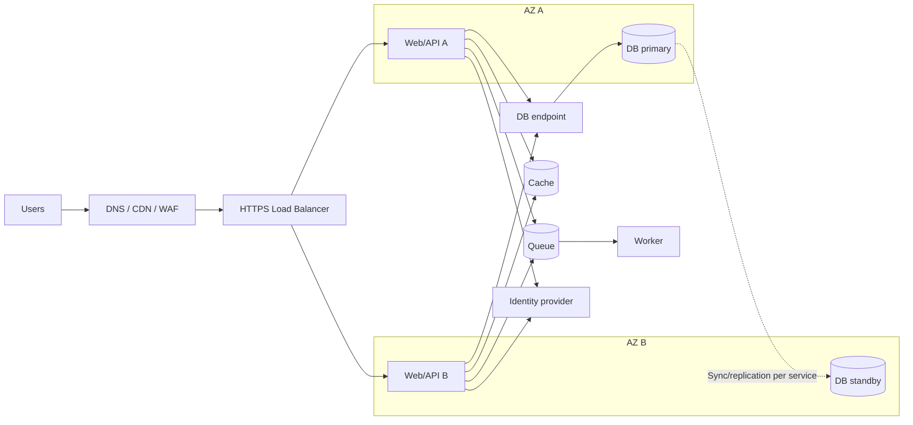
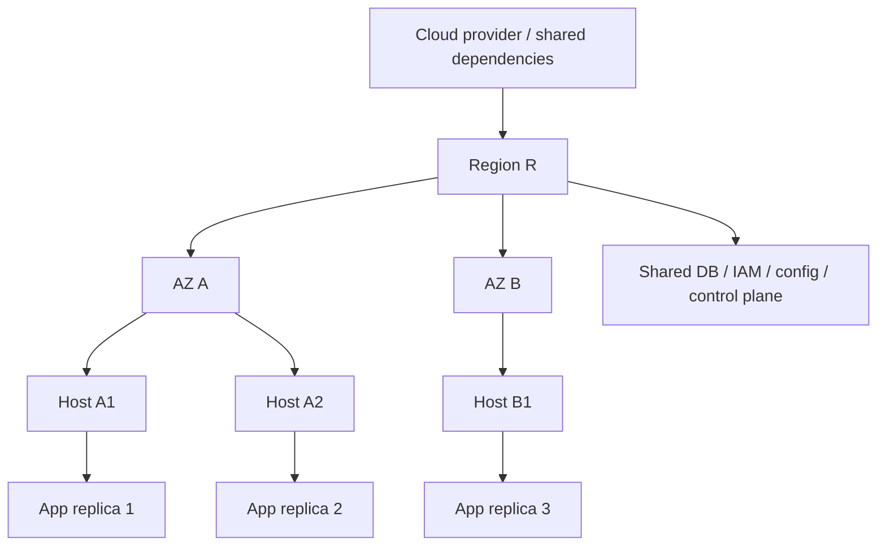
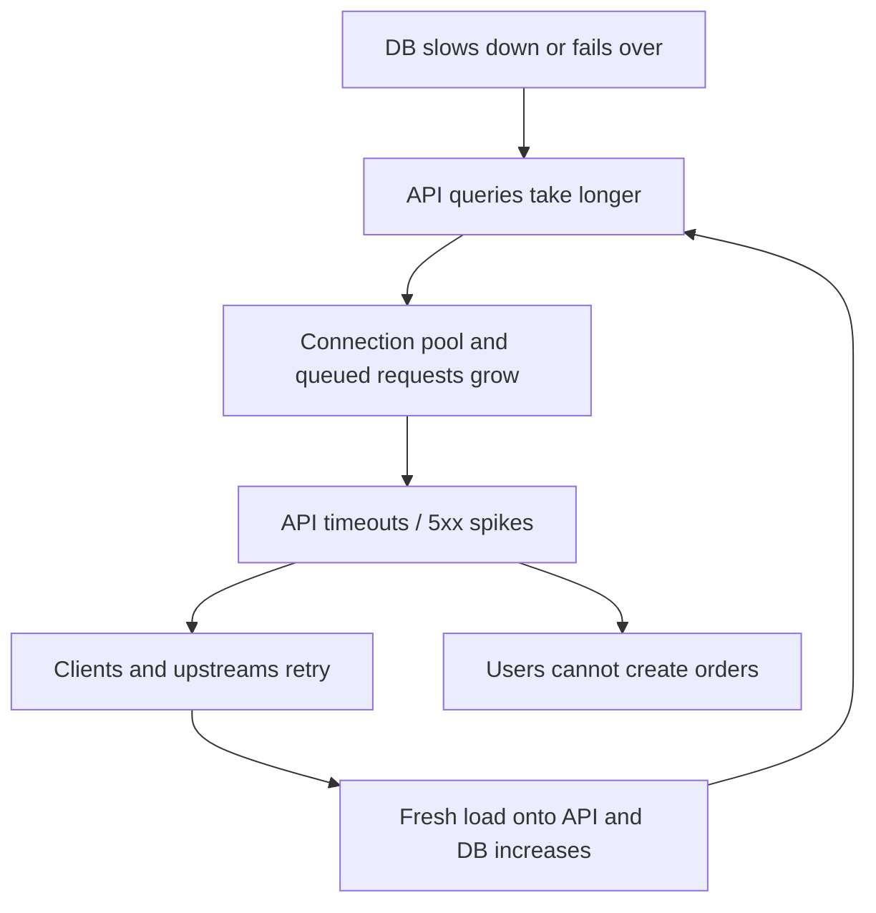
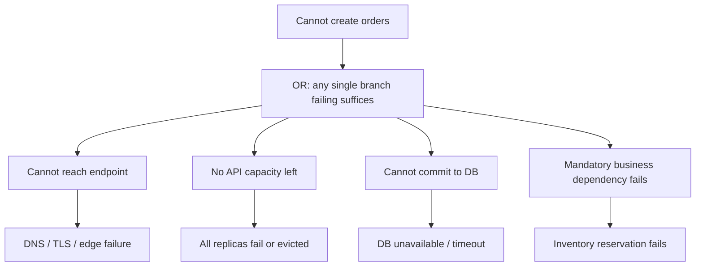

# Analyzing Single Points of Failure, Fault Domains, and Failure Flows

## 1. Why Analyze Failures During Architecture Assessment?

A cloud architecture diagram usually depicts the state **when every component is healthy**: users enter via CDN, requests hit the API, the API reads the database, and workers process events. Yet the more important question when assessing reliability is: **if a component fails, what happens next, how many users are affected, and how does the system recover?**

This lesson belongs to the **Architecture Assessment** section of the `CLOUD_ARCHITECTURE` module: translating business requirements into networking, compute, data, and deployment model choices while balancing reliability, security, scalability, cost, and operations using a Well-Architected approach.

Three complementary perspectives:

1. **Single Point of Failure (*SPOF*):** a component or dependency whose failure alone is enough to halt a critical capability, even while other components remain healthy.
2. **Fault domain:** the boundary of resources that can fail together from a single shared cause, such as the same host, availability zone, region, authentication system, or deployment configuration.
3. **Failure flow / propagation:** the chain of events from an initial fault across dependencies to user-facing symptoms and recovery, including *cascading failures*.

Learning objectives:

- Identify SPOFs relative to **a specific business capability and failure scenario**, rather than just counting servers.
- Map fault domain boundaries to spot seemingly independent replicas that share a common failure cause.
- Build dependency maps and describe failure propagation from root cause to impact.
- Evaluate continuity of service, graceful degradation, recovery, and incident detection using evidence.
- Propose risk mitigations considering cost, performance, operations, and security.

## 2. Standardizing Concepts Before Assessment

| Term | Explanation | Web Application Example |
| --- | --- | --- |
| **Fault** | Root cause or abnormal condition in a component | A host loses power; misconfigured firewall rule |
| **Error** | Internal state deviating from expectations due to a fault | DB connection pool exhausted; hung transaction |
| **Failure** | Observable service behavior failing to meet its contract | Order creation API returns 5xx or times out |
| **SPOF** | A component/dependency that can break a target capability | A single primary DB with no sufficiently fast recovery path |
| **Fault domain** | Group of resources exposed to a common risk source | Two VMs in the same AZ; two services sharing one DB |
| **Blast radius** | Scope of impact from an incident | One tenant, one API, one AZ, or all customers |
| **Redundancy** | Having multiple alternative serving components/paths | Multiple API replicas behind a load balancer |
| **Failover** | Shifting service to a standby component when the primary fails | Managed DB promoting standby to primary |
| **Graceful degradation** | Preserving core functions while temporarily shedding secondary features when dependencies fail | Allowing checkout even when the product recommendation service is down |
| **Recovery** | Restoring capacity or data to meet defined targets | Bringing the API back within SLO; restoring data from backup |

These terms are related but distinct. A **redundant** component can still be a SPOF if failover does not work or all replicas rely on a single fragile service. Two containers running side by side on the same host provide no host fault tolerance. Two regions sharing an encryption key or receiving a simultaneously pushed bad config still face correlated failure risk.

A SPOF is always tied to **functional scope**. If the product recommendation engine runs on a single instance, losing that instance is a SPOF for recommendations—but not necessarily a SPOF for checkout if checkout has no hard dependency on recommendations.

## 3. End-to-End Case Study: A Cloud Ordering Application

Assume an enterprise operates an ordering system with the following components:

- DNS, CDN/WAF, and load balancer for HTTPS access.
- Web/API running as containers or PaaS with two replicas across two availability zones (AZs).
- A managed relational database configured with cross-AZ primary and standby.
- Cache for product info; queue and workers sending post-transaction notifications.
- Identity provider for user authentication; secrets/key management for service connections.
- Monitoring, logging, tracing, CI/CD, and Infrastructure as Code for operations.

These are **illustrative assumptions**, not default configurations for every provider. Actual configurations must be verified against service documentation and testing.

### Sample Business Requirements

| Requirement | Example Target | Verification Question |
| --- | --- | --- |
| Order API availability | 99.9% monthly SLO | How are successful requests, measurement scope, and exclusions defined? |
| Latency | p95 under 500 ms at confirmed peak load | Does this include time spent in identity, DB, and downstream services? |
| Throughput | Up to 400 requests/sec during promotions | What are the read/write ratio, transactions/sec, and burst profile? |
| Fault tolerance | Survive loss of one instance or one AZ | Does the surviving AZ have sufficient capacity and data? |
| Data recovery | Maximum 15-minute RPO for agreed DR scenario | Which point in time can data be restored to? |
| Service recovery | Maximum 60-minute RTO for that DR scenario | Who triggers it, which dependencies recover, and has it been rehearsed? |
| Data protection | Access control on personal and transaction data | Can failure modes leak data or bypass authentication? |

**RPO** is the maximum acceptable data loss expressed as a time interval prior to the incident; **RTO** is the maximum target time to restore capability under a defined scenario. **SLO** states the service target over a measurement window. These are distinct goals; a "multi-AZ" DB alone does not guarantee overall system RTO/RPO.

### Primary and Secondary Path Diagram



This diagram is **not proof that the system is fault-tolerant**. Verify: can the DB endpoint actually switch to standby, how fast does the load balancer eject unhealthy instances, does a cache outage block the API, is the identity provider on the critical path of every request, and can the queue still accept events while the DB fails over?

## 4. Finding SPOFs by Business Capability

Do not just scan a diagram and circle icons that appear once. Start from the execution path required to complete a **meaningful user task**.

For example, an "order confirmation" request might require:

1. Resolvable hostname and reachable HTTPS endpoint.
2. API ready to accept requests.
3. Valid authentication and authorization checks.
4. DB able to commit the transaction.
5. Mandatory dependencies for inventory reservation/payment operating per contract.
6. API returning a clear outcome or status without creating duplicate orders.

If an element on the mandatory path stops and **has no valid replacement within the acceptable timeframe**, that element is a SPOF candidate for order confirmation. Secondary components like sending email generally should not sit on the synchronous critical path if the business tolerates delayed email delivery.

### SPOF Inspection Checklist

| Layer | SPOF Candidate | Why Suspect? | Evidence to Gather |
| --- | --- | --- | --- |
| Edge/network | Single LB, single network route, single shared NAT gateway | Loss of ingress/egress or connection timeouts | Topology, service SLA, AZ mapping, routing and failover tests |
| Compute | Single instance, all replicas on same host/AZ, or shared broken autoscaling policy | Loss of one host/AZ halts the entire API | Placement, health checks, post-failure capacity |
| Data | Primary DB without failover; single storage volume; single durable data source | Cannot read/write core data | DB HA, replication, backup/restore, failover testing |
| Cache | API requires cache to function yet cache is a single node | Cache failure breaks the entire read path | Fallback/timeouts, cache failover, retry behavior |
| Messaging | Single queue/broker without adequate recovery path | Critical tasks fail to enqueue or process | Durability, ACKs, backlog, DLQ, replay |
| Identity/secrets | Single IdP/secret/key endpoint called synchronously on every request | All services stall even while apps and DB are healthy | Token validation strategy, policy caching, runtime dependencies |
| Deploy/configuration | Faulty pipeline/secret/config pushed simultaneously to all replicas | Correlated system failure from a shared change | Staged rollouts, deploy permissions, rollback capability |
| DNS/certificate | Misconfigured DNS zone, expired certificate, simultaneous update | Unreachable even when backend is healthy | TTL management, expiry alerts, change verification |
| People/operations | Only one person holds rescue credentials, missing runbooks, untested backups | Cannot recover within RTO if that person is unavailable | On-call rotation, break-glass, restore drills |

Note: a managed service may run internally across multiple hosts yet remain a **shared logical dependency** for your application. Inspect actual failure modes and service guarantees rather than assuming safety from the word "managed."

### Three Questions to Uncover Hidden SPOFs

- **If I intentionally shut down this component for 10 minutes, which business capabilities fail?** This defines impact scope.
- **If standby copies still rely on the same DB, network, secret, or permissions, how independent are they?** This uncovers correlated risk.
- **If a backup component exists on standby but is not activated, does switching over meet recovery targets?** This separates paper redundancy from real failover.

## 5. Fault Domain Analysis: Independent at What Level?

Fault domains identify **boundaries of failures sharing a common cause**. A single resource can simultaneously belong to multiple nested fault domains.



In the diagram, distributing replicas across different hosts and AZs mitigates host or single-AZ failures. However, they may still share a region or shared components like the DB, identity, encryption keys, or deployment pipeline. Administrative boundaries such as cloud accounts, tenants, clusters, namespaces, and repositories can also create **configuration or permission fault domains**.

### Fault Domain and Blast Radius Matrix

| Fault Domain | Typical Causes | How to Limit Blast Radius | Residual Limitations |
| --- | --- | --- | --- |
| Process/container | Crash, OOM, runtime bug | Multiple replicas, health checks, restarts | Same bug can crash every replica |
| Host/node | Power loss, kernel panic, NIC failure | Anti-affinity/placement across hosts | Replicas in same AZ remain exposed to AZ failure |
| Rack/power/network segment | Shared equipment failure | Topology spread supported by platform | Not all clouds expose fine-grained rack control |
| Availability zone | Outage of one infrastructure zone in a region | Cross-AZ replicas and HA data, sufficient headroom | Regional services, quotas, and dependencies can still be impacted |
| Region | Widespread infrastructure/network outage | Multi-region DR, replicated data, routing, and runbooks | Cost, replication lag, and shared-provider risk |
| Shared service | Shared DB, cache, IdP, KMS, queue | Dedicated HA, strict dependency bounds, valid fallbacks | Can become a correlated risk across AZs/regions |
| Deployment/config | Bug, schema migration, botched secret rotation | Canary, batched blast radius, feature flags, rollback | Too-fast rollouts can bypass all infrastructure domains |
| Identity/security domain | Locked/leaked account or role, bad policy | Least privilege, account separation, audited break-glass | Rescue procedures must not bypass security controls |
| Logical data | Accidental deletion, corrupt writes, bad data replicated | Backups, PITR, versioning, recovery, and reconciliation | HA replication also replicates logical errors |

**Multi-AZ is not equivalent to multi-region.** Likewise, **multi-region does not automatically guarantee independence** if both regions share a deployment pipeline, identity dependency, or improperly replicated critical data.

### Physical vs. Logical Fault Domains

Two services in different AZs can go down together due to a bad DNS change. Conversely, two modules sharing one DB but with separate write permissions and rollback rules may contain certain module-level logic errors. Therefore, map **both infrastructure topology and dependency topology**, and inspect their intersections.

Practical questions include: how many workloads does one IAM change affect? How many API versions break from a single schema migration error? If one tenant generates abnormal load, do other tenants suffer connection-pool or quota exhaustion?

## 6. Mapping Dependency Graphs and Failure Flows

A system can be modeled as a **directed graph**: vertices represent services/resources and edges represent dependencies. From a request perspective, edge `API → DB` means the API needs the DB. When the DB degrades, impact **propagates backward** to the API and users. When the API retries excessively, abnormal load **propagates forward** into the DB, creating an amplification loop.

When mapping dependencies, annotate clearly:

- **Required / optional:** does failure on this edge necessarily break the core function?
- **Synchronous / asynchronous:** must the caller wait immediately or can it proceed in a pending state?
- **Time bounds:** timeouts, deadlines, cache TTLs, and acceptable result deadlines.
- **Failure policy:** retries, backoff, fallback, circuit breaker, queue, manual intervention.
- **Permission boundary:** what privileges does the connection hold and can failures fall into an insecure state?
- **Observability points:** metrics, logs, traces, audit events, and alerts along each edge.

### Example: Slow DB Triggering a Cascading Failure



An initial DB glitch might last only 20 seconds, yet hung requests, exhausted connection pools, and synchronized retries can keep the system unstable for many minutes. This is a **cascading failure** and can escalate into a **retry storm**.

Controls that must work together:

1. Set an **end-to-end request deadline** and shorter timeouts per dependency.
2. **Bound retry counts**, using exponential backoff with jitter; retry only safe operations or those with an idempotency key.
3. Enforce **concurrency limits, connection pool limits, and bulkheads** so one failing path cannot exhaust shared resources.
4. Use **circuit breakers** or load shedding for failing dependencies, with clear open/close criteria and recovery mechanics.
5. For tasks not requiring instant responses, use bounded queues/buffers and monitor backlog.
6. Check **readiness** so load balancers stop sending new requests to unready instances.

Never call retries a "reliability mechanism" without measuring extra load and duplicate-execution correctness. Unbounded retries can turn a minor blip into a cluster-wide outage.

## 7. Typical Failure Flows to Rehearse

### 7.1. One API Instance Stops Operating

**Initiating fault:** process crash or container OOM in AZ A.

**Failure flow:** instance fails health checks → load balancer stops routing to the instance → in-flight requests may fail → surviving replicas absorb extra load → autoscaler adds capacity if quotas allow.

**Success conditions:** surviving replicas have capacity for current load; health checks are fast enough without flapping; write requests are idempotent so clients can retry safely. If sessions were stored locally on the dead instance, session loss can still occur.

### 7.2. Losing an Entire AZ

**Initiating fault:** AZ A loses networking/compute service.

**Failure flow:** all replicas in AZ A vanish → load balancer shifts traffic to AZ B → DB primary if in AZ A must fail over → API reconnects to DB endpoint → load concentrates on AZ B and DB pools.

**Success conditions:** AZ B has capacity or scales rapidly within limits; DB has cross-AZ HA; routing, quotas, subnets, and related dependencies still function. If two AZs each run at 50% max capacity, losing one AZ under steady load immediately pushes the remaining AZ to 100% before new pods spin up; **two AZs on a diagram do not guarantee headroom**.

### 7.3. Queue or Worker Stops Processing

**Initiating fault:** worker crashes or cannot reach downstream systems.

**Failure flow:** queue keeps accepting messages → backlog grows → oldest message age climbs → notifications/invoices delay → if retention expires or retry logic is flawed, tasks can fail permanently.

**Success conditions:** messages persist durably per service capability; workers are idempotent; bounded retries, DLQs, backlog caps, and alerts fire before business deadlines pass. If the order API requires email delivery before committing, the queue/worker becomes a checkout SPOF despite supposedly being secondary.

### 7.4. DNS, Certificate, or Authentication Failures

**Initiating fault:** expired certificate, bad DNS record edit, identity provider or token-signing key endpoint outage.

**Failure flow:** browsers fail HTTPS handshakes or APIs cannot validate requests → 4xx/5xx surge even though compute, DB, and internal networks are healthy.

**Success conditions:** certificate/DNS monitoring, change controls, config recovery paths; token verification caches valid public keys within safe bounds with a contingency plan if the IdP goes down. For sensitive actions, **never "fail open" by skipping authorization checks** to preserve availability.

### 7.5. Accidental Data Deletion or Incompatible Schema Rollout

**Initiating fault:** a migration drops a column still in use, or an admin action deletes data.

**Failure flow:** data/schema changes replicate → all APIs hit query errors or read wrong data → the system may appear "healthy" at HTTP level while business logic is broken.

**Success conditions:** staged rollouts and business validation; expand–migrate–contract schema migrations; backups/PITR, restore drills, integrity checks, and post-recovery reconciliation. **HA replicas typically replicate logical errors too**, so HA never replaces backups.

## 8. Fault Tree: Reasoning Backward from Impact to Cause

Alongside forward failure flows from root cause, you can construct a **fault tree** starting from an undesired top event: "Users cannot create orders."



This is a **simplified logical model**: OR gates indicate any single branch can trigger the top event; for functions requiring multiple conditions simultaneously, model dependencies with AND gates where appropriate. Do not confuse a fault tree with an infrastructure diagram. The event "all API replicas fail" may need further decomposition:

- A **common-cause fault** (bad release pushed to all replicas, shared dependency outage).
- **Or** independent faults eliminating all replicas without sufficient failover/capacity.

A fault tree aims to expose **minimal cut sets**: the smallest combinations of events sufficient to cause the top event under stated assumptions. A single-event branch signals a potential SPOF; a two-event cut set indicates failure occurs only when both happen together. Assumptions must be verified through architecture and testing.

## 9. Quantitative Assessment: Availability, Capacity, and Correlated Risk

Back-of-the-envelope calculations help ask better questions, though they do not replace real measurements or provider SLAs.

### 9.1. Availability and Error Budget

With a 30-day window and a 99.9% availability SLO, the unavailability budget is:

```text
30 days × 24 hours × 60 minutes × (1 - 0.999)
= 43.2 minutes / 30 days
```

If the SLI is measured by successful request ratio rather than uptime, calculate the **request-based error budget** and exact measurement method; do not blindly convert everything to downtime minutes. A 15-minute outage produces very different error percentages depending on traffic volume and affected users.

### 9.2. Series Components

Assume three components are **all mandatory**, each has an idealized independent availability of 99.95%, and the system succeeds only when all three succeed. A simple estimate:

```text
A_system ≈ A_1 × A_2 × A_3
         = 0.9995³
         ≈ 0.998501  (99.8501%)
```

Even fairly high-availability components lower overall availability when chained in series. However, this is **not a real-world SLA forecast**: correlated failures, failover times, differences between uptime and request success, and caching/fallbacks all complicate the model.

### 9.3. Parallel Replicas

If two replicas are **completely independent**, each has 99% availability, and only one healthy replica is needed to serve traffic, the ideal model is:

```text
A_parallel = 1 - (1 - A_1) × (1 - A_2)
           = 1 - 0.01 × 0.01
           = 0.9999  (99.99%)
```

This result **must not be treated as a guarantee** if both replicas share an AZ, DB, network path, or configuration error. It also assumes the load balancer detects faults, reroutes traffic, and the surviving replica has enough capacity without major disruption.

### 9.4. Capacity After Losing a Fault Domain

Suppose a system spans two AZs, each handling up to 250 requests/sec, with a total peak load of 400 requests/sec:

```text
Normal capacity = 250 + 250 = 500 req/s
Peak load       = 400 req/s
Loss of one AZ  = 250 req/s remaining
Capacity gap    = 400 - 250 = 150 req/s
```

The system can drop substantial traffic despite being "multi-AZ deployed." Solve this via sufficient pre-provisioned capacity, rapid scaling in the surviving AZ (if quotas and startup times allow), request prioritization, rate limiting, or shedding non-core features. When assessing, explicitly check **N-1 headroom**: after losing one chosen fault domain, does remaining capacity meet required load?

## 10. Scoring Risk with a Simple FMEA Table

One structured review technique is **Failure Modes and Effects Analysis (FMEA)**. For each failure mode, record consequences and detectability. Relative scores can be assigned for:

- **Severity (S):** impact seriousness, e.g., from 1 (minor) to 5 (catastrophic).
- **Occurrence (O):** likelihood based on data and assumptions, e.g., 1 to 5.
- **Detection (D):** difficulty detecting before impact occurs, e.g., 1 (easy) to 5 (hard).

A common screening metric is `RPN = S × O × D`. **RPN is a relative prioritization tool**, not a quantitative probability, and must not override dedicated review of severe consequences.

| Failure Mode | S | O | D | Illustrative RPN | Priority Controls |
| --- | ---: | ---: | ---: | ---: | --- |
| Primary DB fails, failover untested | 5 | 3 | 3 | 45 | Rehearse failover, fix timeouts/reconnects |
| API loses one AZ, surviving AZ lacks capacity | 4 | 3 | 2 | 24 | N-1 capacity test, quotas, and autoscaling |
| Edge certificate expires simultaneously | 5 | 2 | 4 | 40 | Automated renewal, external monitoring |
| Email worker stops | 2 | 3 | 2 | 12 | Queue age alert, retry/DLQ |
| Wrong IAM role deployed to all replicas | 5 | 3 | 4 | 60 | Canary, policy tests, rollback |

The scores above are **invented to illustrate the method**, not provider statistics. In real assessments, clearly define each rating level using incident history, test data, and risk owners. Extreme-severity scenarios must be addressed even if RPN is low.

### Distinguishing Detection from Prevention

A good alert does not eliminate a SPOF; it only shortens detection time (MTTD). Runbooks and failover reduce recovery time (actual MTTR/RTO), while redundancy and fault-domain separation lower outage likelihood within covered scenarios. Record **preventive controls**, **detection mechanisms**, and **recovery capability** separately.

## 11. Designing Mitigations Without Creating New SPOFs

| Confirmed Risk | Design Choice | What Must Be Verified | Trade-off |
| --- | --- | --- | --- |
| Single API replica fails | Multiple stateless replicas, LB health checks, autoscaling | In-flight requests, sessions, and capacity when one replica dies | Standby capacity cost |
| AZ outage | Cross-AZ compute/DB HA, N-1 capacity | DB failover, routing, quotas, and latency | HA fees, idle headroom, cross-AZ data transfer |
| Slow DB blocks API | Timeouts, pooling, bounded concurrency, backoff, idempotency | Load tests under degraded DB, retry storms | More complex error handling, potential request rejections |
| Cache unavailable | Cache as optimization, bounded fallback to source | When cache dies, does DB have enough capacity? | Higher latency, cache stampede risk |
| Product recommendation service fails | Isolate calls with timeouts/bulkheads, render default content | Does checkout still meet SLO? | Secondary feature degraded |
| Queue/worker fails | Durable queue, idempotent consumers, DLQ, replay | Message retention, age, duplicate handling | Broker cost, latency, and operations |
| Accidental data deletion | Backup/PITR, delete permissions, restore tests | RPO/RTO per scenario | Backup cost, reconciliation process |
| Bad deploy/config | Canary/blue-green, IaC reviews, policy-as-code, staged rollout | Halts rollout on error spike? Is rollback data-compatible? | More complex pipeline |
| Region outage | Multi-region DR when strictly required | Restore/replication, routing, keys, cross-region dependencies | High cost and data complexity |

### Avoiding "Fixes" That Backfire

- **Enabling unbounded retries:** amplifies overload and wait times.
- **Treating cache as sole source of truth:** cache failure becomes data/state loss.
- **Using fallbacks that skip authorization:** trades security for availability.
- **Scaling APIs without capping DB connections:** turns a traffic spike into DB connection exhaustion.
- **Auto-failing over to a lagging replica without knowing RPO:** risks losing recent updates.
- **Jumping to full multi-region immediately:** raises cost, config risk, and consistency headaches before business demand justifies it.

A good design specifies **acceptable degradation modes**. For instance, browsing continues when cache fails (possibly rate-limited); orders still succeed when email fails (retaining events for later delivery); payments are never auto-approved when fraud checks fail to respond if policy mandates verification.

## 12. Observing Failure Flows in Practice

Measuring CPU or "instance running" alone is insufficient. Signals from user and dependency perspectives are needed.

| Target | Observable Signals | Investigation Questions |
| --- | --- | --- |
| Ingress API | Request rate, 4xx/5xx, p50/p95/p99 latency, per-journey SLIs | Which user actions are failing, and since when? |
| Load balancer | Healthy backends, connection errors, resets, backend response times | Is only one AZ/instance left serving? |
| Compute | CPU, RAM, restarts, concurrency, queueing, autoscale lag | Is there enough headroom after losing an instance? |
| DB | Connection utilization, slow queries, lock waits, failover events, replication lag | Did the fault start in the DB or from app retries? |
| Queue | Backlog, oldest message age, retries, DLQ, consumer throughput | Are tasks missing business deadlines? |
| DNS/TLS/IdP | External synthetic probes, certificate expiry, auth failure rates | Are errors happening before requests reach the API? |
| Data integrity | Reconciliation, transaction counts, missing/duplicate orders, restore checks | Is business behavior correct even when HTTP succeeds? |
| Cloud resources | Quotas, network errors, egress, per-AZ resource counts, cost | Are quotas or network limits hit during scale/failover? |

### Using Traces to Reconstruct Causal Chains

Suppose an order request carries a `trace_id` with spans: `edge → API → inventory → DB`. When the DB slows down, traces pinpoint which span stretched; DB metrics show lock waits while API logs show timeouts. Combining them separates initial root causes from downstream symptoms. Never assume the first component logging an error is where the incident began.

**Synthetic monitoring** from external vantage points catches DNS, TLS, or edge failures invisible to in-cluster metrics. Never log or trace tokens, secrets, or sensitive personal data. Propagate correlation IDs across requests and events to connect synchronous paths with asynchronous jobs.

### Impact-Based Alerting

A good alert carries clear conditions and actionable routing:

```text
ALERT: Checkout error rate > 2% for 5 minutes
SCOPE: production, all AZs, POST /orders endpoint
CONTEXT: p95 rising, DB connection utilization 95%,
         a DB failover event just occurred
ACTION: investigate DB failover + app retries;
        throttle concurrency per runbook if needed
```

Thresholds are examples only. In production systems, tie alerts to SLOs/error budgets, suppress duplicates, define on-call ownership, and calibrate metrics against real operational data.

## 13. Step-by-Step Architecture Assessment Process

To avoid subjective debates, conduct reviews in this order:

1. **Identify critical capabilities:** e.g., login, order creation, payment, history lookup. Attach SLOs, RTO, RPO, and security requirements; confirm target failure scope.
2. **Map the happy path:** user → edge → API → mandatory dependencies → data stores. Include asynchronous jobs.
3. **Build inventory and dependency graph:** record region/AZ/cluster/instance, IAM roles, queues/DBs/secrets, and managed service dependencies per component.
4. **Delineate shared fault domains:** hosts, AZs, regions, accounts, data, permissions, DNS, pipelines, app versions, external partners.
5. **Enumerate failure modes:** process crashes, AZ loss, DB failover, network partitions, quotas, bad deploys, bad data, provider outages, operator errors.
6. **Trace failure flows:** how does each fault cause timeouts, retries, backlogs, saturation, data errors, or user failures? Are there amplification loops?
7. **Quantify impact and fault tolerance:** affected users, error rates, p95, N-1 capacity, RPO/RTO, MTTD/MTTR; separate measurements from assumptions.
8. **Prioritize controls:** weigh severity, likelihood, detectability, cost, and business constraints; capture Architecture Decision Records (ADRs).
9. **Verify:** load tests, fault injection, failover tests, restore drills, and security checks within approved scope.
10. **Monitor continuously:** update dependency maps whenever services, regions, features, IAM permissions, or pipelines change; feed incident learnings into the backlog.

### Sample Failure Scenario Record

```yaml
scenario_id: AZ-LOSS-01
business_capability: "Order Creation"
assumption: "AZ A lost, AZ B remains operational"
fault_domain: "AZ"
initiating_event: "Compute and primary DB in AZ A become unavailable"
expected_flow:
  - "LB removes backends in AZ A"
  - "Managed DB fails over to standby in AZ B"
  - "API reconnects to DB with timeout and backoff"
  - "Load shifts to AZ B, autoscaling if possible"
user_impact_to_measure:
  - "Failed request rate"
  - "p95 latency"
  - "Duplicate or lost orders"
  - "Time to return within SLO"
required_evidence:
  - "N-1 load test"
  - "DB failover logs"
  - "Traces and SLO dashboards"
owner: "Platform team + Application team"
status: "Unverified"
```

This template illustrates review documentation, not automation tooling config. In project records, append measured results, architecture version, and test date.

## 14. Controlled Failure Testing and Recovery Drills

### Recommended Tests

| Test | Preconditions | What to Prove |
| --- | --- | --- |
| Kill one API replica | LB with multiple replicas, baseline metrics | Failed requests remain bounded; traffic shifts without breaching SLO |
| Simulate losing an AZ | Production-like environment; abort plan | Surviving AZ replicas/DB retain capacity, routes, and data |
| Managed DB failover | Backups, DB monitoring, runbook | Reconnects, latency, timeouts, idempotency; total recovery time |
| Inject DB latency | Scoped fault injection | Retries/backoff, pool caps, and circuit breakers prevent cascading failures |
| Stop workers | Queue with retention and metrics | Zero lost tasks, bounded backlog growth, catches up on recovery |
| Break a staging config | Rollback and review controls | Canary halts blast radius; change history easily traceable |
| Restore from backup | Backup vault and test environment | Restores accurate data point, measures RPO/RTO, verifies consistency |
| Simulate IdP outage | Clear authentication policy | Authorization never bypassed; valid handling for active users |

Before injecting faults into customer-facing environments, define blast radius limits, schedule, incident commander, abort criteria, rollback plan, telemetry, and involved teams. Start in staging or low-risk canaries, expanding scope only with strong evidence.

A successful test **is not just "the system came back up."** Verify zero lost/duplicate data, how long SLOs were breached, completion of background jobs, alert delivery to the right responders, and whether others can execute the runbook.

### Sample Drill Timeline

```text
T+00:00  Start fault injection: API A stopped
T+00:06  LB stops routing requests to API A
T+00:08  Error rate drops, API B load increases
T+00:30  Autoscaler provisions replacement replica (if needed)
T+01:10  p95 returns within target threshold
T+05:00  Reconcile newly created orders; zero duplicates found
```

These timestamps illustrate **how to log observations**, not default timings or cloud guarantees. Record actual measurements in UTC and an agreed timezone alongside event IDs/logs/traces as evidence.

## 15. Well-Architected Assessment

| Pillar | Review Questions for SPOF/Fault Domain/Failure Flow | Expected Evidence |
| --- | --- | --- |
| **Reliability** | Are chosen failure modes isolated and recoverable within targets? | Dependency graph, N-1 tests, failover tests, RTO/RPO |
| **Security** | When a dependency fails, does the system still deny unauthorized access and protect secrets? | IAM, fail-closed tests, audit logs, secret rotation, break-glass plan |
| **Operational excellence** | Can ops detect, triage, respond to, and learn from failures? | SLO dashboards, alerts, runbooks, game days, postmortems |
| **Performance efficiency** | When traffic shifts onto surviving capacity, do latency and throughput remain acceptable? | Load tests, p95, saturation, quotas, connection pools |
| **Cost optimization** | Are redundancy and DR costs proportional to outage impact? | Cost breakdown, ADRs, N-1 capacity and recovery option comparisons |
| **Sustainability** | Are standby capacity, idle resources, and unnecessary data retention optimized? | Right-sizing, autoscaling, lifecycle policies, resource efficiency metrics |

You cannot mark "Well-Architected compliant" merely for enabling multi-AZ or backups. Review findings must tie to **documented failure scenarios, explicit assumptions, measured evidence, residual risks, and accountable owners**.

## 16. Practice Exercise: Assessing an Event Ticketing System

You are asked to review a ticketing system ahead of an on-sale event. Current design:

- Two API replicas running in **the same AZ A**, each handling up to 200 requests/sec.
- Load balancer accepts up to 300 requests/sec; peak business load is 300 requests/sec.
- One managed relational DB in **single AZ A**, backed up daily, restore never rehearsed.
- One Redis node located in AZ A; on Redis timeout, the API retries infinitely.
- Managed queue for sending emails; when workers stop, the queue still accepts messages and retains them for the configured retention period.
- Identity service called synchronously on every request; no timeout or valid cache configured.
- Ticket creation SLO: 99.9%/30 days; target RTO 30 minutes on single-AZ outage, RPO 5 minutes for purchase data.

### Task A — Identify SPOFs and Fault Domains

Complete the template:

| Component | SPOF for Ticket Creation? | Fault Domain | Rationale |
| --- | --- | --- | --- |
| Single API replica | Not necessarily | Host/process | Another replica exists; however, capacity must be checked |
| Both APIs in AZ A | Yes on AZ A loss | AZ | Both APIs go down together |
| Single-AZ A DB | Yes on DB/AZ loss | DB, AZ | Cannot write transactions; daily backup misses RPO |
| Single-node Redis + infinite retry | Practical SPOF risk | Cache, AZ, retries | Dependency fault triggers cascading failure |
| Email worker | Not necessarily | Worker | Provided ticket creation does not block on email and queue is durable |
| Synchronous IdP per request | High risk | External dependency | IdP outage breaks all authentication; no timeout configured |

### Task B — Map Two Failure Flows

**Flow 1: Redis Failure**

```text
Redis timeout -> API retries infinitely -> queued requests surge
-> connection/thread pools exhausted -> system-wide 5xx/timeouts
-> ticket buyers retry -> traffic rises -> outage worsens
```

Controls: timeouts/bounded retries, circuit breaker, cache fallback within DB capacity, load shedding, and load tests with cache unavailable.

**Flow 2: AZ A Failure**

```text
AZ A lost -> both APIs and single-AZ DB lost -> ticket creation stops
-> no standby failover ready -> must restore from backup
-> potential data loss up to the interval between backups
-> 30-min RTO / 5-min RPO unproven
```

Controls: distribute APIs across AZs, ensure N-1 capacity, choose cross-AZ HA managed DB with appropriate backup/PITR policies; then **rehearse**. Understand that HA does not replace backups and daily backups do not automatically achieve a 5-minute RPO.

### Task C — Validate N-1 Capacity

Two replicas, each rated at 200 req/s max, yield 400 req/s theoretical normal capacity. Losing one replica leaves 200 req/s against a 300 req/s peak:

```text
N-1 shortfall = 300 - 200 = 100 req/s
```

To survive one replica failing at peak, add capacity, shed/prioritize load, or ensure autoscaling responds fast enough to preserve the SLO. Moving two replicas into two AZs **only fixes fault placement**, not the capacity shortfall when one AZ fails.

### Task D — Propose Priority Order

A defensible sequence:

1. **Prevent cascading failures from Redis and IdP** using timeouts, retry/concurrency caps, security-preserving fallbacks, and dashboards.
2. **Eliminate AZ SPOFs** on the ticket creation path: multi-AZ APIs, HA DB, network routing, and N-1 capacity.
3. **Design data recovery** and run restore drills to verify 5-minute RPO and 30-minute RTO for defined scenarios.
4. **Run load and fault-injection tests** simulating loss of replica, cache, primary DB, and AZ within approved scope.
5. **Document residual risks** such as region outages, shared config errors, and external dependency limits; invest in multi-region DR only if business requirements mandate it.

Actual ordering should follow business impact and incident data rather than a rigid formula. For example, if surviving AZ loss is contractually required immediately, upgrading DB HA and splitting APIs may run in parallel with fixing infinite retries.

### Task E — Define Acceptance Criteria

A strong review defines verifiable criteria instead of writing "should have HA":

| Criterion | Proof Method |
| --- | --- |
| Losing one API replica sustains agreed peak load | Load test + actively killing a replica |
| Losing AZ A does not eliminate all APIs | Placement verification, fault injection, measuring error rate and capacity |
| DB failover neither duplicates nor loses tickets | Failover test, idempotency keys, transaction reconciliation |
| Redis failure causes no retry storm | Inject timeouts, measure retries/request, pool usage, and p95 |
| Backups meet RPO/RTO in agreed scenarios | Restore drill, timing logs, and data validation |
| When IdP fails, authorization is never bypassed | Fail-closed tests and valid token/key caching policy |
| Alerts reach the right responders with context | Game day, notification verification, and runbook check |

## 17. Misconceptions to Avoid

- **"Two replicas eliminate SPOFs."** Both replicas may share an AZ, DB, or deployment bug.
- **"Managed services are always HA."** Capabilities and guarantees vary by configuration, tier, and region; verify them.
- **"Multi-AZ means surviving region loss."** Multi-AZ covers only a subset of intra-region failures.
- **"A replica is a backup."** Replication propagates accidental deletions and data corruption.
- **"Circuit breakers guarantee zero errors."** They isolate and shed load when dependencies fail; requests may still fail or degrade.
- **"Retrying fixes transient errors automatically."** Excessive retries amplify load and can cause duplicate side effects without idempotency.
- **"Component SLAs equal application SLA."** Applications depend on multiple chains and custom measurements.
- **"Every failure requires multi-region DR."** Solutions must balance risk, cost, RTO/RPO, and business criticality.
- **"Checking `/health` endpoints is enough."** Verify end-to-end business journeys, data integrity, post-failover behavior, and async jobs.

## 18. Self-Check Questions

1. When does a single-node cache become a true SPOF for the checkout process?
2. Why can two API replicas in different AZs still go down simultaneously in a single incident?
3. Explain the differences between **fault**, **error**, **failure**, **SPOF**, and **blast radius**.
4. During DB failover, why might API errors persist even after the new DB is ready?
5. With 400 req/s peak load across two AZs each capped at 250 req/s, can the system survive losing one AZ at peak? What needs to change?
6. Why can the parallel availability formula overstate real-world availability for two replicas?
7. Trace a failure flow from an IdP outage to users unable to purchase; state what conditions mitigate impact without weakening authorization.
8. Are 24-hour backups sufficient basis to claim a 5-minute RPO? What must be measured?
9. How do a high-CPU alert and a rising order-failure-rate alert play different roles during incident response?
10. During a Well-Architected review, what evidence is needed to verify fault-domain independence and recovery capability?

**Key takeaway:** an architecture is fault-tolerant only when you know exactly which failures it must survive, how impacts propagate across dependencies, which resources share fault domains, and how the system recovers accurate data within agreed targets. Evaluating SPOFs, fault domains, and failure flows must start from **business journeys**, move through **dependencies and test evidence**, and only then finalize cloud choices, redundancy levels, and cost.
