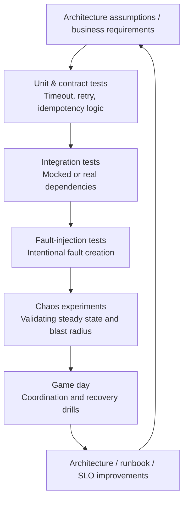
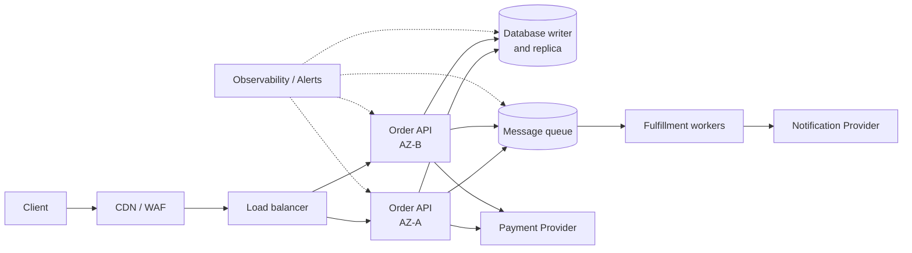
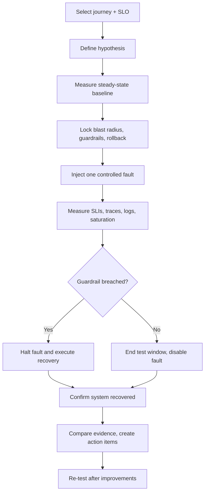
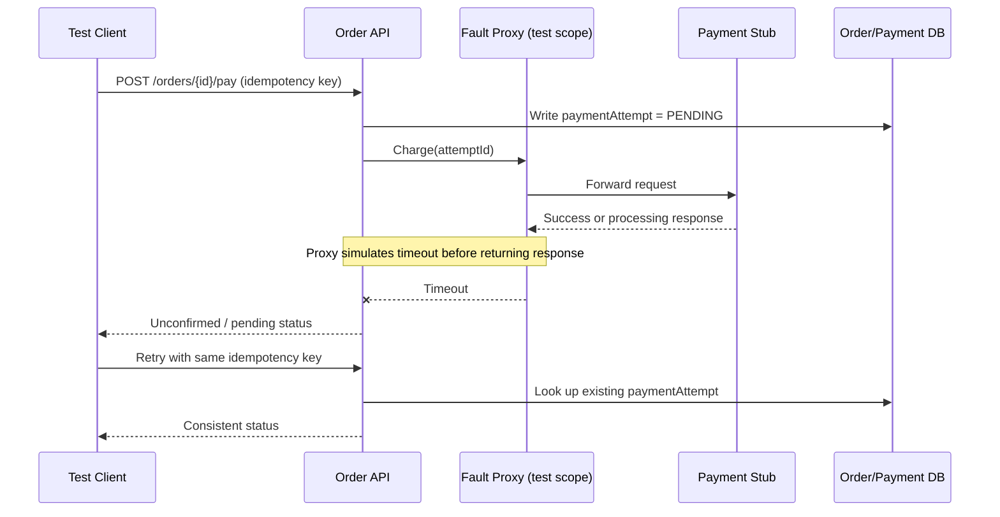

# Fault Testing, Chaos Engineering, and Game Days

> **Module:** CLOUD_ARCHITECTURE — designing cloud application architectures from business requirements through networking, compute, data, and deployment model choices.  
> **Chapter:** Architecture Assessment.  
> **Focus:** Validating fault tolerance with empirical evidence; weighing reliability, security, scalability, cost, and operations across Well-Architected pillars.

## 1. Why Proactively Test Failures?

A diagram with two Availability Zones (AZs), a load balancer, database replicas, and queues may **look** fault-tolerant. However, resilience is only truly proven when part of the system fails and the system still upholds its committed behavior.

In practice, assumptions that easily fail include:

- The load balancer will shift traffic to healthy instances within an acceptable time.
- The application will close stale connections and reconnect properly to the new database writer after failover.
- When downstream services time out, retries will help requests succeed without causing overload.
- Queues will hold all jobs until workers recover, without creating duplicate processing.
- On-call operators can detect, decide on rollback, and notify the right teams within minutes.
- Backup/restore docs are sufficient to rebuild the system when real resources are lost.

**Fault testing**, **chaos engineering**, and **game days** turn those assumptions into measurable hypotheses, generate evidence, and uncover weaknesses under controlled conditions. Their goal is to **learn how the system responds under failure** and then improve design and operations—not simply breaking things just to watch what happens.

After this lesson, you will be able to:

1. Distinguish scripted fault testing, chaos experiments, and game day exercises.
2. Formulate hypotheses, *steady state*, blast radius, and stop conditions for an experiment.
3. Map failure modes to cloud architecture, SLOs, RTO, RPO, and Well-Architected pillars.
4. Design experiments verifying timeouts, retries, circuit breakers, failovers, queues, storage, and external dependencies.
5. Run a game day with clear roles, timelines, recovery plans, and post-exercise reviews.
6. Translate test findings into prioritized architectural improvements with measurable proof.

## 2. Terminology and Scope

### 2.1. Fault, Error, and Failure

In reliability engineering, distinguish:

| Concept | Explanation | Example |
|---|---|---|
| **Fault** | Underlying condition or defect capable of causing incorrect behavior | A network path drops packets, node dies, certificate expires |
| **Error** | Internal state that has deviated from expectations | Connection to old writer still held in pool |
| **Failure** | Observable failure of a service to perform its contracted function at its boundary | Users cannot create orders or receive 5xx responses |
| **Incident** | Operational situation disrupting or threatening service objectives, requiring response | Successful checkout rate drops below SLO |
| **Recovery** | Returning the service to a state meeting defined targets | Traffic returns to healthy instances and errors drop to acceptable levels |

Not every fault causes a failure. For instance, terminating one pod may only reduce capacity while the system still meets its SLO. Conversely, a tiny config mismatch can cause every request to error out.

### 2.2. Three Related but Distinct Practices

| Practice | Core Question | Typical Approach | Expected Outcome |
|---|---|---|---|
| **Fault testing / fault injection** | When a specific fault occurs, does the system handle it right? | Inject timeouts, HTTP 500s, dropped connections, full disks, or process restarts in scripted checks | Confirm expected behavior or catch regressions |
| **Chaos engineering** | When real conditions are perturbed, does our hypothesis about system resilience still hold? | Form steady-state hypothesis, vary one condition under control, observe metrics and compare | Understand fault tolerance and uncover unknown weaknesses |
| **Game day** | Do people, tools, and processes coordinate to detect, respond, and recover on target? | Rehearse simulated scenarios or scoped fault injection with on-call teams and observers | Build response muscle; test runbooks, comms, and access permissions |

A **game day may use a chaos experiment** as its opening trigger; a fault test may run automatically in CI. Yet not every game day requires breaking live resources, and not every chaos experiment is an incident-response drill.

### 2.3. Testing Tiers in a Reliability Strategy



This is not a rigid ladder every feature must climb sequentially. A simple timeout check may suffice in integration tests; a cloud-region recovery objective requires game days and testing in environments closely matching production topology.

## 3. Starting with Business Requirements and Resilience Hypotheses

Before picking chaos tools, explicitly write down **what the system must protect**. For an ordering app, "the API is still up" is not enough if payments are double-charged or orders vanish.

### 3.1. Identifying Critical Journeys

Example e-commerce system:

1. Browse and search products.
2. Add items to cart.
3. Place order and receive order ID.
4. Process payment.
5. Track order status.

Not all journeys share the same priority. When product recommendations fail, catalog pages can still function. When payment verification fails, the system must never skip verification and return "success."

Assign each journey an **allowed degradation level**: full continuity, degraded mode, queued processing, or safe rejection with clear messaging.

### 3.2. SLI, SLO, SLA, and Error Budget

- **SLI (Service Level Indicator):** metric measuring actual user-experienced behavior, such as ratio of valid order requests succeeding or p95 latency.
- **SLO (Service Level Objective):** target for an SLI over a measurement window, e.g., at least 99.9% valid requests succeed over 30 days.
- **SLA (Service Level Agreement):** contractual service commitment, potentially carrying terms and penalties on breach—distinct from internal SLOs.
- **Error budget:** allowable errors/degradation permitted by the SLO within the window; guides how much operational risk is acceptable.

Example time-based 99.9% availability SLO over a 30-day window:

```text
30 days × 24 hours × 60 minutes = 43,200 minutes
Theoretical error budget = 43,200 × (1 - 0.999)
                         = 43.2 minutes
```

**Note:** this example uses downtime minutes; if the actual SLI measures successful request ratio, the error budget tracks missed **valid requests**, which may differ from downtime minutes. An experiment that degrades an SLI consumes error budget; never assume failed requests can be excluded from SLO reporting simply because it was "testing."

### 3.3. RTO and RPO

- **RTO (Recovery Time Objective):** target time to restore required functionality/service capability after disruption.
- **RPO (Recovery Point Objective):** maximum tolerable data loss, typically expressed as the time interval between restored data state and incident onset.

For example, "the ordering service must recover within 15 minutes, losing at most 1 minute of order data" is verifiable via a failover/restore game day. Clearly define **start and end timestamps** when measuring RTO: from fault onset or from detection, and what counts as "restored." RPO can differ by data class and cannot be inferred from RTO.

### 3.4. Turning Slogans into Measurable Hypotheses

Vague assumption:

> "If an AZ fails, the application keeps running."

Testable hypothesis:

> "When removing one AZ's instances from the load balancer within the test scope, at least 99.5% of valid read requests succeed; p95 does not exceed 800 ms during recovery; 5xx errors last no longer than 2 minutes; zero duplicate orders are written."

A hypothesis must specify **simulated impact**, **business journey**, **observed metrics**, **acceptance thresholds**, **measurement window**, **allowed degradation**, and **stop conditions**. Never simply note "failover succeeded" without specifying recovery duration and data accuracy.

## 4. Example Architecture Under Assessment

Suppose an ordering system runs on the cloud:



The engineering team believes:

- Two AZs let Order API survive losing one group of instances.
- The queue decouples fulfillment processing from order-creation response time.
- The database supports failover and the app reconnects properly.
- Payment Provider errors will not cause duplicate charges.
- Monitoring will detect degradation and ops can recover within RTO.

Each statement is a **separate hypothesis**. Test each hypothesis against one clear failure mode rather than simultaneously killing an AZ, breaking the database, and failing payments—leaving you unable to tell what caused what.

## 5. Designing a Controlled Chaos Experiment

A good experiment follows a repeatable, easy-to-explain structure.

### 5.1. Experiment Card

| Field | What to Record |
|---|---|
| **ID and Owner** | EXP-ORDER-01; Order/SRE team |
| **Hypothesis** | A dependency returning HTTP 500 does not push Order error rate above threshold |
| **Critical Journey** | GET /orders/{id}, POST /orders |
| **Steady State** | Request success rate, p95/p99, backlog, orders in valid states |
| **Injected Fault** | 20% of calls to the dependent service in the test cohort return 500 for 3 minutes |
| **Blast Radius** | A scoped canary/workload cohort and synthetic test traffic |
| **Control Group** | Uninjected cohort handling equivalent load and conditions where feasible |
| **Stop Conditions** | 5xx, latency, queue, saturation, or correctness violations exceeding guardrails |
| **Recovery** | Disable fault rule, restore routing, monitor queues and queued requests |
| **Evidence** | Traces, logs, metrics, deploy/config events, and injection timestamps |
| **Verdict** | Hypothesis supported / refuted / inconclusive; action items with owners |

**Write the hypothesis before executing.** If you merely inject faults and browse dashboards afterward, it is hard to separate true effects from traffic swings, concurrent deploys, or upstream changes.

### 5.2. Steady State: Measuring from the User Perspective

Steady state does not mean zero internal errors. It means **measurable normal service behavior** that users and the business care about.

Example:

```text
Business SLI: valid orders created successfully without duplicates
Traffic:      valid requests/min, segmented by region and client type
Latency:      end-to-end p50 / p95 / p99
Errors:       business 4xx errors separated from system 5xx errors
Saturation:   CPU, memory, pools, queue depth, DB connections
Recovery:     time from fault until SLIs return within acceptable bounds
```

Capture a **pre-test baseline**, measure **during injection**, and keep measuring **post-fault** until backlogs and data states stabilize. HTTP 200 alone does not prove an order persisted accurately; verify business invariants too.

### 5.3. Blast Radius and Containment Scope

**Blast radius** is the slice of systems/users affected as faults propagate. Shrink blast radius by selecting:

- A sufficiently production-like staging environment or an isolated canary slice in production.
- One workload, endpoint, synthetic request cohort, service account, or scoped AZ.
- Short durations, gradually stepped fault intensity, and instant kill switches.
- Never leaking sensitive production data into experiment logs, events, or reports.
- Pre-tested load limits and recovery procedures.

In production, experiments must follow organizational change-management and operational governance with system owners and active abort controls. Staging tests sometimes miss issues triggered only by live traffic, quotas, topologies, and real network paths; thus teams may graduate to production canaries once risk controls are strong enough.

### 5.4. Stop Conditions and Rollback

Distinguish three concepts:

- **Abort:** immediately halt fault injection if guardrails trip.
- **Rollback/remediation:** return configs, routing, workloads, or dependencies to a safe state.
- **Recovery verification:** confirm functionality, backlogs, business metrics, connection pools, and alerts have stabilized. Stopping injection does not automatically mean the system has recovered.

Example pre-defined stop criteria:

```text
Abort if ANY of the following occur:
- Test cohort ordering SLI drops below agreed threshold over a 1-minute window
- p99 exceeds safety limit for 2 consecutive minutes
- Queue backlog grows without bound
- Transaction data inconsistency or duplicate payment detected
- Operators lose observability or cannot disable the fault
```

These thresholds are **illustrative examples**, not universal product defaults. For irreversible data-corruption risks, abort on the very first credible signal rather than waiting.

## 6. End-to-End Experiment Workflow



1. **Select business scope:** identify services, user journeys, owners, and tolerable impact.
2. **Inspect architecture:** trace data across networking, compute, storage, databases, queues, IAM, and external dependencies.
3. **Pick one hypothesis:** e.g., "stopping one worker does not lose messages."
4. **Configure telemetry:** align trace/log/metric clocks; ensure suitable synthetic transactions.
5. **Verify clean baseline:** SLOs healthy, no active incidents, no conflicting deploys or migrations.
6. **Run small, brief injection:** stay strictly within scope; record exact start timestamps and configs.
7. **Observe and compare:** check not just "did errors happen" but degradation severity, correctness, and whether safeguards engaged.
8. **Stop fault and recover:** roll back if needed; watch trailing effects like retries, stuck data, or backlogs.
9. **Report verdict:** supported / refuted / inconclusive; document evidence, limits, and remediation work.
10. **Re-verify:** repeat an equivalent experiment after fixes to prove risk decreased.

Experiments require a **steady traffic source** to observe if live traffic is insufficient. Test traffic must never trigger real external transactions outside authorized scope, and evaluation records must remain separable from real user transactions.

## 7. Fault Injection Matrix by Cloud Component

| Component / Failure Mode | Conceptual Simulation | What to Verify |
|---|---|---|
| **Compute:** process/container dies | Controlled stop of one workload in test cohort | Health checks, auto-restart, load redistribution, in-flight requests |
| **AZ/node:** lose a group of instances | Drain canary group from traffic path | Headroom capacity, load balancing, autoscaling, and p99 impact |
| **Network:** latency/loss | Inject latency or drop rate on a scoped call path | Timeouts, cancellation, retry budgets, circuit breakers |
| **DNS/service discovery** | In test env, return unavailable endpoint or stale resolution | DNS caching, endpoint refresh time, and reconnect behavior |
| **Database writer failover** | Trigger failover via provider-supported test mechanism | Reconnects, in-flight transactions, stale connections, data integrity, and RTO/RPO |
| **Database pool** | Cap connection count in test workload | Backpressure, timeouts, and cascading overload behavior |
| **Message queue/broker** | Pause consumers or drop one test connection | Lag, duplicate handling, DLQ, idempotency, and replay capability |
| **Cache:** node loss / high miss rate | Disable cache for test cohort | DB load on misses, stampedes, fallback, and TTLs |
| **Storage:** read or write errors | Return access errors/timeouts via stub or test env | Safe retries, redundancy, artifact reload, alerts |
| **IAM/secrets/certificate** | Simulate denied permissions or invalid cert in sandbox | Alerts, rotation workflows, fail-closed behavior, zero secret leaks |
| **Third-party API** | Stub returning 429, 500, timeouts, or slow responses | Rate-limit handling, retries, fallbacks, graceful degradation |
| **Deployment/config** | Push rollback-ready bad config to canary | Early detection, traffic shift, rollback, and compatibility |

These examples are **failure modes for test design**, not instructions to destroy real infrastructure. Choose simulation methods suited to your environment and platform resilience; you do not have to sever real networks or delete data to test a hypothesis.

### 7.1. Testing Single-AZ Impact

A two-AZ system does not automatically have enough capacity if one AZ disappears. Suppose normal traffic uses 40% of **total cluster** compute evenly split across two AZs. When one AZ fails, the surviving AZ handles nearly double the traffic—yet if autoscaling, quotas, database connections, or downstream APIs fall short, service capacity can collapse.

Verify:

- Do surviving instances pass health checks and receive traffic properly?
- Do CPU, memory, network, connection pools, and DB capacity hold up?
- Can the autoscaler launch new instances in the surviving AZ, and what quotas constrain it?
- Are in-flight requests retried safely without creating duplicate writes?
- Are there **shared single-point dependencies** like a DB writer, NAT gateway, secrets service, or un-redundant DNS path?

Losing one AZ does not prove **full-region** recovery. Experiment scope and conclusion scope must match.

### 7.2. Testing Database Failover

A failover drill must measure both:

1. **Service recovery:** time to reconnect and resume valid transactions.
2. **Data correctness:** zero double charges, zero lost confirmed orders, never blindly re-committing a write whose prior commit status is unknown.

When a client sees a timeout after `COMMIT`, the database may have **already committed** while the response got lost. Blindly retrying a non-idempotent write creates duplicate records. Designs need idempotency keys, unique constraints, or status checks before repeating writes.

Database failover tests must also assess *replication lag* and consistency levels: read replicas may lag recent writes, so never infer RPO = 0 merely because the app reconnected.

### 7.3. Testing Queues and Workers

For asynchronous order processing, a hypothesis might be:

> "When a worker crashes mid-flight, unfinished messages are reprocessed and produce exactly one business side effect."

Test stopping the worker at distinct points: before DB write, after DB write but before ACK, and after invoking an external provider. Each point yields different outcomes.

Evidence to collect:

- Does the broker redeliver unacknowledged messages?
- Is the consumer idempotent by business key / event ID?
- How high does backlog climb, and how long does draining take?
- Can retry/DLQ loops permanently trap messages?
- Does delayed processing breach customer business deadlines?

Never assume a platform's "exactly-once delivery" guarantees **exactly-once business effect** across external DBs and APIs. End-to-end idempotency must span transaction boundaries.

## 8. Hands-On Example: Payment Provider Timeout

### 8.1. Problem Statement

The checkout payment endpoint calls an external Payment Provider. When the provider slows down, checkout requests risk timing out, and engineers worry customers could be charged twice.

Requirements:

- Never record a payment as succeeded without valid confirmation.
- Never create duplicate charges on client retries or delayed callbacks.
- When the provider is unavailable, return a clear status (`pending` or contract-defined retryable error) rather than falsely claiming "success."
- Users can still check order status; reconciliation runs in the background.

### 8.2. Experiment Design



In the test environment, use a **payment stub** tracking received charges. Inject a timeout **after the stub accepts the request** to reproduce the hardest ambiguity: the client does not know whether the charge succeeded.

**Hypothesis:** the same business key cannot create two independent payment attempts even when clients and backends retry; the final status updates via reconciliation once verified with the provider.

**Invariants to check:**

- At most one payment effect per idempotency key.
- No invalid transitions such as `FAILED → SUCCEEDED` or vice versa outside defined rules.
- No order marked `PAID` without corresponding payment proof.
- Retries during provider slowdowns do not push connection pools or queues past limits.

**Stop conditions:** signs of duplicate charges in test data, unbounded retry loops, state divergence, or service degradation past safety limits.

### 8.3. Results and Remediation Actions

Suppose the system prevents duplicate charges, yet updating status from `PENDING` to `PAID` takes 12 minutes against a 5-minute target. Then the "no duplicate charges" hypothesis holds within scope, while **completion time** fails. Appropriate fixes include tuning reconciliation, tracking callback/event lag, and alerting on overdue pending payments—never declaring the whole system "chaos-passed" from a single invariant.

## 9. Game Days: Exercising Both Systems and People

A **game day** is an incident-scenario drill with defined goals, participants, observers, and post-drill scoring. Teams may start with *tabletop* walkthroughs before graduating to live technical drills in staging/canary once ready.

### 9.1. Game Day Formats

| Format | Execution | Best Suited For |
|---|---|---|
| **Tabletop** | Facilitator introduces scenarios; team talks through responses without injecting faults | Clarifying roles, comms, access permissions, and runbooks |
| **Technical drill** | Practice one specific recovery action, e.g., backup restore or traffic shift | Validating single-component procedures and measuring RTO/RPO |
| **Full game day** | Multi-stage scenario using real telemetry and live on-call responders | End-to-end validation of people, processes, and technology |
| **Unannounced / limited notice** | Few people know timing/scenario beforehand within approved organizational bounds | Testing mature operational readiness; requires rock-solid abort controls |

### 9.2. Roles During a Drill

| Role | Responsibilities |
|---|---|
| **Facilitator / Game Master** | Prepares injections/injects plot twists, enforces scope, paces the drill |
| **Incident Commander** | Leads response, delegates tasks, sets priorities and incident severity |
| **Responders** | Observe, diagnose, execute runbooks/rollbacks/recovery within granted permissions |
| **Safety / Stop Authority** | Empowered to abort immediately if guardrails trip; typically separate from fault injector |
| **Scribe / Observer** | Logs timestamps, decisions, wrong assumptions, alerts, and missing runbook steps |
| **Stakeholder / Communications** | Practices status updates to internal teams and users in the simulated scenario |

One person can wear multiple hats in small teams, yet someone must explicitly hold **abort authority** and log evidence. Use clearly labeled drill channels so simulated notices are never mistaken for real incidents.

### 9.3. Sample Game Day Scenario: Losing an AZ

**Name:** GD-ORDER-AZ-01  
**Objective:** Confirm Order API maintains processing within allowed degradation limits and on-call recovers within 15-minute RTO.  
**Scope:** a canary/workload group representing AZ-A, with isolatable synthetic test requests.  
**Hypothesis:** when the AZ-A test group becomes unavailable, traffic shifts to AZ-B, zero confirmed order data is lost, and failed requests stay within approved error budget.

| Relative Time | Event | What to Observe |
|---|---|---|
| T−15 min | Confirm baseline, dashboards, comms channels, and abort authority | System and test data healthy; no overlapping changes |
| T+0 | Facilitator triggers scoped fault injection | Exact timestamp, injection ID, and scope logged |
| T+2 min | 5xx / latency alerts fire in the scenario | Does on-call detect, classify severity, and assign roles? |
| T+5 min | Team identifies single-AZ capacity loss | Are traces/metrics used to localize correctly? |
| T+8 min | Team executes traffic shift / capacity increase | Do latency and errors meet targets? Does DB load spike dangerously? |
| T+12 min | Disable injection and verify stability | Have backlogs, pools, order data, and alerts stabilized? |
| T+20 min | Quick debrief; lock follow-up fixes | Timestamps, runbooks, ownership, evidence, and actions |

Timestamps are an **illustrative drill schedule**, not a guarantee that the system will hit those numbers. If stop conditions trigger at any point, immediately shift to recovery rather than waiting for the next scheduled row.

### 9.4. Game Day Metrics

- **MTTD (Mean Time to Detect):** time from fault onset to detection, averaged across equivalently defined incidents/drills.
- **MTTA (Mean Time to Acknowledge):** time until an owner acknowledges and begins handling; naming varies by organization.
- **MTTR:** commonly mean time to restore/recover/repair; always state the exact definition used.
- **Recovery duration:** actual time from incident onset until recovery criteria pass, compared against RTO.
- **Data loss / divergence:** measured data loss and state inconsistencies, compared against RPO and business invariants.
- **Operational measures:** time to open dashboards, locate runbooks, obtain permissions, page the right team, and execute rollbacks.

Never declare "resolved in 5 minutes" a success if queues stay backed up for two hours afterward or duplicate records appear. Confirm **business recovery**, not just green infrastructure checks.

## 10. Runbook Structure and Experiment Records

A runbook must be concise enough to scan mid-incident yet specific enough for a newer on-call engineer to diagnose issues.

### 10.1. Runbook Skeleton

```text
RUNBOOK: ORDER-API-DEPENDENCY-FAILURE
When to use:
  - Checkout error rate rising, Payment/Inventory dependency timing out
Signals to check:
  - End-to-end SLIs, sample traces, error types, retry rates, pool saturation
Who is responsible:
  - IC, Order owner, dependency owner, communications
Diagnostic steps:
  1. Confirm blast radius and most recent changes
  2. Compare per-hop latency against baseline
  3. Check retry amplification and connection limits
Mitigation actions:
  - Execute traffic shift / rollback / circuit breaker per conditions
Stop conditions:
  - Data corruption, duplicate payments detected, loss of observability
Recovery verification:
  - SLIs within threshold, queues draining, data accurate, alerts cleared
Post-incident:
  - Timeline, decisions, runbook gaps, action items, and owners
```

Real runbooks must add links to dashboards, tools, exact service names, and commands **verified in the organization's environment**. Never copy untested production-mutating commands from tutorials straight into runbooks without testing permissions and side effects.

### 10.2. Sample Experiment Record

```yaml
experiment:
  id: "EXP-CHECKOUT-TIMEOUT-01"
  owner: "order-team"
  system: "checkout"
  user_journey: "payment"
  hypothesis: >
    Payment timeouts in the canary cohort do not create duplicate charges
    and the API returns a pending status within defined latency bounds.
  environment: "staging"
  fault:
    type: "upstream-timeout"
    target: "payment-stub"
    duration: "3m"
    scope: "synthetic-orders-only"
  steady_state:
    - "valid_order_success_ratio"
    - "checkout_p95_latency_ms"
    - "duplicate_payment_count"
  stop_conditions:
    - "duplicate_payment_count > 0"
    - "checkout_error_ratio > approved_guardrail"
  recovery:
    - "disable-fault-rule"
    - "verify-pending-state-reconciliation"
  evidence:
    - "synthetic-request-ids"
    - "trace-ids"
    - "dashboard-snapshot"
```

This is an **illustrative documentation schema**, not an execution config for a specific chaos tool; populate thresholds from real system SLOs and operational rules.

## 11. Reliable Observation and Result Interpretation

### 11.1. Detecting Faults and Measuring Consequences

Before running experiments, verify:

- **Metrics:** request rate, error rate, duration, saturation; breakable by service, endpoint, AZ, and canary/control.
- **Logs:** request/trace correlation IDs, reliable timestamps, error classifications, and retry/fallback decisions; avoid leaking sensitive data.
- **Distributed traces:** show which service is waiting, where timeouts hit, retry counts, DB/queue calls, and critical paths.
- **Business telemetry:** orders created, payment states, completed tasks, duplicate or missing records.
- **Change annotations:** mark deploys, fault start/stop, traffic shifts, and config edits.

Charts showing averages alone hide severely impacted user segments. When inspecting p95/p99, check **sample sizes**, segmented cohorts, and estimation error over short test windows.

### 11.2. Control and Treatment

When feasible, keep an uninjected **control group** with identical config and comparable load alongside the fault-injected cohort. This separates fault impact from traffic fluctuations or upstream noise.

However, not every experiment permits an independent control: a shared database writer, DNS zone, or cloud quota can affect both cohorts. Document such limits clearly and use baselines plus supplementary metrics to avoid overstating conclusions.

### 11.3. Classifying Conclusions

| Conclusion | When to Use | Action |
|---|---|---|
| **Hypothesis supported** | Metrics and invariants stay within thresholds inside test scope with full evidence | Archive evidence; schedule re-tests when architecture changes |
| **Hypothesis refuted** | One or more criteria fail with confirmed causal impact | Create action items, classify risk, propose architecture/runbook fixes |
| **Insufficient evidence** | Inadequate traffic, missing telemetry, fault misapplied, or unrepresentative env | Fix methodology and re-run within proper scope |
| **Stopped by guardrail** | Safety threshold breached or loss of control | Abort, recover, investigate, and re-test only after fixing root cause |

**A failed experiment is still a valid learning outcome** if it catches a false assumption before a real outage. The goal is not inflating pass rates, nor shifting thresholds post-hoc to rationalize results.

## 12. Common Pitfalls in Chaos and Game Day Rollouts

### 12.1. Injecting Faults Without a Hypothesis

Randomly killing nodes or networks just to see if things crash produces noisy alerts without answering architectural questions. Tie every test to a journey-linked hypothesis and measurable criteria.

### 12.2. Testing Only at Very Low Load

Retry storms or DB connection exhaustion may surface only under high load. Unrepresentative low-load tests create false confidence. Use observed traffic distributions and workload profiles, ramp load safely within limits, and note representativeness.

### 12.3. Checking Only HTTP 200 Codes

An API can return HTTP 200 while failing to persist orders, sending duplicate emails, or writing wrong payment statuses. Always verify business invariants, especially for writes and external side effects.

### 12.4. Equating Restarts with Recovery

A restarted pod or VM does not prove requests are succeeding. Stale sessions, lingering backlogs, unsynced data, or unpromoted writers may remain. Declare recovery only after end-to-end verification.

### 12.5. Infinite Retries for "Durability"

Unbounded retries amplify load during outages. Use deadlines, jittered exponential backoff, retry budgets, idempotency, and separation of transient vs. business errors.

### 12.6. Using Game Days to "Grade On-Call Staff"

Blame pressure pushes participants to hide gaps and kills learning. Postmortems should focus on processes, tooling, design, and organizational barriers backed by evidence and owned improvements.

### 12.7. Skipping Action Items and Re-Verification

A drill revealing missing dashboards, alerts, or access rights has little value without owners and deadlines. After fixes ship, re-run an equivalent test to prove the hypothesis holds.

### 12.8. Assuming Multi-AZ Covers Every Disaster

Multi-AZ, backups, replicas, and failovers have **different protection scopes**. Killing one instance does not prove resilience against regional outages, accidental deletes, broken IAM policies, bad DNS, or third-party outages.

## 13. Connecting to the Six Well-Architected Pillars

| Pillar | Questions When Designing Tests | Appropriate Practices |
|---|---|---|
| **Operational Excellence** | Can the team detect, coordinate, and recover per procedure? | Runbooks, game days, metrics, incident timelines, postmortems, owned actions |
| **Security** | When IAM, secrets, certs, or network policies fail, do security invariants hold? | Sandbox permission-fault tests, fail-closed, least privilege, protected logs/recovery paths |
| **Reliability** | When a component breaks, do user journeys still hit SLO/RTO/RPO? | Chaos hypotheses, AZ failover, backup restores, timeouts/retries, idempotency, data checks |
| **Performance Efficiency** | After losing capacity, do latency and throughput still meet targets? | p95/p99 measurement, autoscaling, queues, pool saturation, cache misses, load balancing |
| **Cost Optimization** | How do failover, retries, and standby capacity change costs? | Standby sizing, egress, testing spend, cost per successful transaction |
| **Sustainability** | Do recovery mechanics create prolonged redundant compute and traffic? | Retry limits, workload tuning, deduplicating jobs, tearing down test resources post-drill |

An architecture can be ultra-resilient yet prohibitively expensive from running double capacity, or cheap yet unable to survive losing an AZ. Sizing redundancy and test frequency must start from the business cost of downtime, SLOs, and acceptable budget.

### 13.1. From Test Results to Architectural Decisions

Suppose an AZ-loss experiment reveals:

- Zero data loss and automatic traffic shift, yet p99 climbs to 4 seconds for 7 minutes.
- SLO requires p99 under 1 second, though availability stays within the current error budget.
- Surviving instances hit CPU saturation; autoscaler takes 6 minutes to provision capacity.

**Trade-off options:**

1. **Increase baseline capacity** in surviving AZs: shrinks failover degradation window, raises steady-state spend.
2. **Tune autoscaler and warm capacity:** shortens scale-out time, may add complexity and baseline cost.
3. **Shed non-essential features:** reserve compute for checkout, requiring product sign-off on degradation.
4. **Optimize queries/cache/connection pools:** lowers required capacity, yet requires verifying data correctness and cache stampedes.

Choose by measuring **impact across SLOs, cost, and operations**, then re-testing the exact same failure mode. Never assume autoscaling alone keeps AZ loss invisible to users.

## 14. Building a Continuous Testing Program

Chaos engineering delivers maximum value through a continuous learning-and-revalidation cycle rather than a one-off demo.

### 14.1. Prioritizing Experiments by Risk

Score failure modes by:

- **Business impact:** revenue loss, data loss, security breach, or merely secondary feature loss?
- **Probability/history:** has the dependency suffered outages, timeouts, quota caps, or past incidents?
- **Uncertainty:** is there empirical test proof or only trust in architecture slides?
- **Controllability:** can it be simulated and safely rolled back at small scale?
- **Learning value:** does one test validate multiple critical assumptions or merely re-check unit-tested code?

Start with critical journeys and high-risk dependencies: databases, identity, queues, networks, external services, and shared SPOFs.

### 14.2. Embedding Learnings into the Release Lifecycle

- **In CI:** unit/contract/integration tests checking timeouts, error mapping, idempotency, and retry budgets against stubs.
- **Pre-release:** scripted fault injection in staging/canary for changes affecting resilience.
- **Periodic:** game days exercising recovery, backup/restore, and coordination proportional to risk.
- **Post-incident:** convert root causes and contributing conditions into regression tests / chaos experiments.
- **Post-architecture change:** re-validate hypotheses invalidated by new dependencies, region shifts, or scaling edits.

Cadence should not be driven by arbitrary experiment quotas. One well-evidenced data-recovery test outweighs dozens of pod kills that never measure business SLIs.

### 14.3. Results Tracking Table

| Experiment | Scope | Criteria | Example Result | Action Required |
|---|---|---|---|---|
| EXP-01: stop one instance | Order canary | Zero lost orders, SLIs pass | Pass | Add to regression suite |
| EXP-02: payment timeout | Payment stub | No duplicate charges; pending resolves within 5 min | Failed on timing | Improve reconciliation and alerts |
| EXP-03: AZ-A loss | Test workload cohort | RTO ≤ 15 min; p99 within limits | Temporary p99 breach | Boost standby headroom / tune autoscaling |
| EXP-04: worker dies post-DB commit | Test queue and worker | Single business effect | Duplicate processing found | Add idempotency and re-test |
| EXP-05: backup restore | Staging recovery | Committed RTO/RPO | Insufficient evidence | Add timestamps and data verification |

Table results are **illustrative**, not real system measurements. Real logs should attach trace links, dashboards, fault configs, timestamps, owners, and fix tickets.

## 15. Practice Scenarios and Self-Assessment Questions

### Scenario A — Cache Failure Overloading the Database

An app handles 10,000 requests/minute, mostly served from cache. When the cache becomes unavailable, all traffic falls back to the database; p99 spikes and connection pools fill up.

Do the following:

1. Write a fault-tolerance hypothesis for cache unavailability.
2. Choose steady-state SLIs, saturation metrics, and guardrails.
3. Propose a canary-scoped fault injection.
4. Compare cache fallback, stale data, rate limiting, circuit breakers, and DB sizing on data correctness and cost.
5. List evidence required before declaring cache stampedes solved.

### Scenario B — Backups Exist but Were Never Restored

A service writing customer data takes daily snapshots; the team claims a 15-minute RPO and 1-hour RTO.

Do the following:

1. Analyze the mismatch between snapshot frequency and desired RPO.
2. Design a technical restore drill into an **isolated environment**.
3. Define RTO timestamps, how to calculate RPO from restored data, and data-correctness checks.
4. State the risk of trusting a "restore completed" message alone.
5. Propose backup/log-replication mechanics aligned with tolerable data loss, noting cost and operational trade-offs.

### Scenario C — Region Failover Yet the System Still Fails

Frontend and API run multi-region, yet when the primary region fails, users still cannot place orders because the identity provider, database writer, or DNS depends on the failed region.

Do the following:

1. List **shared single-point dependencies** that may sit outside the API diagram.
2. Distinguish AZ failover from region failover.
3. Design a step-by-step experiment to pinpoint which service blocks the user journey.
4. Define data consistency checks and split-brain risks if multiple writers exist.
5. Propose a game day and runbook capable of proving RTO/RPO within appropriate scope.

### Scenario D — Failure Not Detected in Time

During a game day, technical failover takes only 3 minutes, yet on-call takes 20 minutes to realize the payment service is failing; customers file tickets before alerts fire.

Do the following:

1. Separate detection, acknowledgment, mitigation, and recovery times.
2. Explain why watching pod health checks is insufficient.
3. Propose SLIs/alerts grounded in real payment transactions and synthetic monitors.
4. Improve runbooks, access permissions, and notification channels.
5. Define how to re-verify alerting effectiveness after changes.

## 16. Pre-, Mid-, and Post-Exercise Checklist

### Before Starting

- [ ] Clear hypothesis tied to a business journey and allowed degradation level.
- [ ] SLIs/SLOs, RTO/RPO, and data invariants scoped properly.
- [ ] Baselines, test traffic, dashboards, tracing, and synchronized timestamps ready.
- [ ] Targets, blast radius, canary/control cohorts, and injection duration locked.
- [ ] Owners, abort authority, rollback plans, and stop conditions agreed upon.
- [ ] Suitable environment chosen; test data and access permissions controlled.
- [ ] Concurrent changes that could skew results documented or avoided where possible.

### During the Exercise

- [ ] Log exact start time and actual fault scope.
- [ ] Watch business SLIs alongside system metrics, logs, traces, and alerts.
- [ ] Record operational decisions plus detection, acknowledgment, and recovery times.
- [ ] Abort immediately if guardrails trip or control is lost.
- [ ] Never expand fault scope mid-run simply because initial results look unclear.

### After Completion

- [ ] Fault injection disabled and end-to-end recovery verified.
- [ ] Data, transaction states, queue backlogs, and business side effects reconciled.
- [ ] Verdict recorded (supported / refuted / inconclusive) with limits noted.
- [ ] Action items created with priorities, owners, and fix-verification criteria.
- [ ] Runbooks, dashboards/alerts, and architectural assumptions updated as needed.
- [ ] Follow-up re-verification planned after improvements land.

## 17. Takeaways

**Fault testing** verifies how the system reacts to known failure modes. **Chaos engineering** tests steady-state hypotheses by perturbing conditions under control to uncover real behavior. **Game days** test coordination across people, processes, and technology when detecting, mitigating, and recovering from incidents.

An architecture is genuinely fault-tolerant within its **verified scope** only when measured evidence proves critical journeys hit correctness, availability, latency, RTO/RPO, and safety targets. Experiment findings must drive re-measurable design or operational improvements while balancing security, scalability, cost, and the six Well-Architected pillars.
