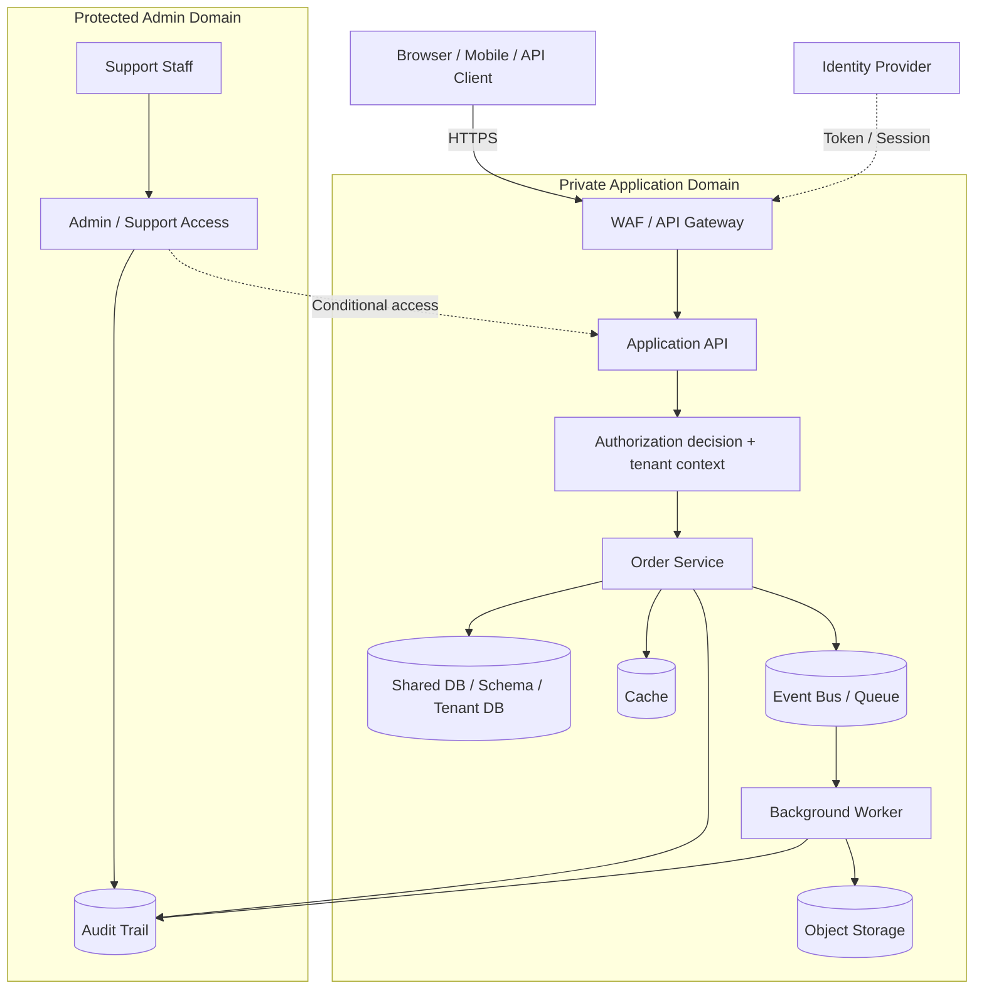
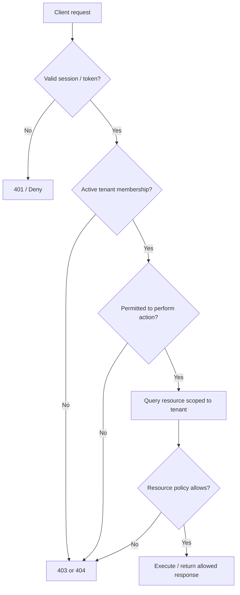

# Validating Security, Authorization, and Tenant Boundaries

A cloud application architecture may be deployed multi-region, encrypt data, and run inside private networks yet still suffer **cross-tenant data leaks** if a single API call lets a user from customer A access customer B's resources. Therefore, an architectural security assessment must answer with **verifiable evidence**: who can perform which action, on which data, within which tenant context, across which trust boundaries, and how the system responds when those assumptions are violated.

This lesson belongs to the **Architecture Assessment** chapter of the **CLOUD_ARCHITECTURE** scope. The goal is to turn business requirements into testable identity, authorization, and data-isolation models; evaluate trade-offs across reliability, security, scalability, cost, and operations; and document decisions using Well-Architected thinking. An architecture passes only when critical controls behave properly under both valid requests and deliberate misuse—not merely because a diagram displays WAF, IAM, or VPC icons.

## 1. Identifying Assets to Protect and Assessment Criteria

Suppose you are building a multi-enterprise order-management SaaS platform. Each enterprise is a **tenant**. **An Phát** uses tenant **A** and **Bình Minh** uses tenant **B**. Both share the UI, APIs, and parts of the infrastructure, yet each party's orders, customers, reports, and integration keys must be governed strictly within contractual boundaries.

Principals that can access the system:

- **End users:** sales staff, tenant admins, read-only report viewers; one person may belong to multiple tenants with different roles.
- **Internal services:** Order, Billing, Reporting, Job Workers, and sync jobs; each carries its own workload identity and does not automatically hold cross-tenant privileges.
- **SaaS provider operations staff:** customer support, SREs, security, and cloud account admins; certain tasks may require logged emergency access.
- **External systems:** identity providers, payment gateways, partner webhooks, and per-tenant data export targets.

Assets requiring protection go beyond database rows: attached objects, cache entries, search indexes, queues, logs, backups, scheduled reports, encryption keys, configurations, and AI/search outputs (if any) can also carry tenant information.

### 1.1. Security Invariants to Prove

Define invariants before choosing technologies:

1. **Every action has a verified identity:** requests authenticate via an appropriate protocol; workload identities cannot be spoofed via public headers.
2. **Every operation is properly authorized:** the actor holds permission for both the exact action and the target object; successful authentication alone never grants authorization.
3. **Data always belongs to the right tenant:** reads, writes, updates, searches, exports, and restores never leak or mix data across tenants.
4. **Permissions are enforced where resources are owned:** never rely solely on the gateway having validated a token.
5. **Every code path is covered:** HTTP APIs, background jobs, admin consoles, integrations, bulk imports/exports, maintenance scripts, and direct queries all enforce appropriate controls.
6. **Violations are denied and detected:** default deny, sensitive actions audited, with tests and alerts for permission changes or boundary crossings.

An example acceptance criterion:

> A user in tenant A with order-view permission receives only authorized data within A, even if they tamper with order IDs, tenant IDs in the URL, search filters, or export parameters. Asynchronous jobs they trigger preserve those exact same constraints once enqueued.

## 2. Distinguishing Authentication, Authorization, and Tenant Isolation

| Concept | Question | Example | Misconception to Avoid |
|---|---|---|---|
| **Authentication** | Who is this user or workload? | Authenticated via OIDC; workloads receive platform-issued identities. | A valid token does not prove permission to read an arbitrary order. |
| **Authorization** | What can this principal do to this resource? | Staff can view orders in tenant A; only managers can export reports. | An "admin" role does not automatically span every tenant. |
| **Tenant isolation** | Are data, resources, and operational blast radius separated per tenant? | Queries, caches, objects, logs, and queues stay scoped to the right tenant. | A shared database does not automatically leak if controlled; separate databases are not automatically safe if permissions are mismanaged. |
| **Network isolation** | Which components can talk to each other? | Database exposed only on private subnets; security groups restrict traffic. | Private networking never replaces record-level authorization. |
| **Encryption** | Where is data protected in transit and at rest? | TLS, disk/object encryption, KMS. | Encryption at rest does not stop an authorized API from reading the wrong tenant. |
| **Auditing** | Can data access and permission changes be traced? | Who exported data, in which tenant, when, and with what outcome. | Having logs does not mean unauthorized access was blocked. |

A strong assessment breaks these questions into **testable conditions**, then evaluates how they reinforce each other in depth.

## 3. Data Flow Diagrams and Trust Boundaries



This diagram shows the **logical architecture**: every arrow crossing a boundary must be assessed individually. Also diagram paths that bypass the API Gateway—such as database-privileged batch jobs, ops consoles, migration scripts, analytics pipelines, object storage, and webhook providers.

### 3.1. Trust Boundary Table

| Boundary | Data / Claims Crossing | Controls to Inspect | Verification Method |
|---|---|---|---|
| Client → Gateway | Tokens, cookies, routes, headers, resource IDs, chosen tenant | TLS, token/session validation, request size caps, rate limiting, header-spoofing defense | Invalid signature/audience/expired tokens rejected; client-sent internal headers ignored. |
| Gateway → API | Identity, scopes/roles, routing info | Secure internal channel, source identity, verifying or reliably propagating context | Bypassing the gateway cannot call the API with a forged identity. |
| API → Domain Service | Actor, action, tenant, resource ID | Resource-level permission checks, explicit contracts, timeouts | Swapping resource ID to another tenant returns proper error; zero data leaked. |
| Service → Database | Queries and tenant context | Tenant predicate/RLS/schema or dedicated DB; least-privilege DB roles | Query omitting tenant filter never returns another tenant's rows. |
| Service → Cache/Search/Object | Keys, indexes, metadata, buckets/keys | Namespacing and permission checks consistent with source data | Guessable keys, empty queries, or old URLs never open another tenant's data. |
| Service → Queue → Worker | Tenant, actor, event type, targets | Trusted envelope, authorization checks at execution, queue/topic scoping | Tenant-spoofed or replayed jobs cannot write/export across boundaries. |
| Admin/Support → Tenant data | Ticket, approver, purpose, temporary grant | JIT access workflow, MFA, auditing, scope and expiry | Trace a support session and prove permissions auto-revoke. |
| Backup/Analytics/Export → Recipient | Datasets, decryption keys, tenant IDs | Access control, encryption, tenant filtering, retention and sharing policies | Export/restore artifacts for A contain zero records from B. |

Every "controls to inspect" cell must map to a **control owner and evidence**; noting "security group enabled" proves network connectivity, not data authorization.

## 4. Defining Multi-Tenant Models and Isolation Trade-offs

Common models:

| Model | Organization | Benefits | Risks and Verification Costs |
|---|---|---|---|
| **Silo** | Each tenant gets a dedicated DB/stack/cloud account depending on depth | Minimizes shared resources; supports strict isolation mandates | Higher provisioning, versioning, deployment, and backup costs; shared admin roles can still cross tenants. |
| **Pool** | Tenants share services, databases, or tables, typically keyed by tenant | Efficient resource utilization; uniform deployments | Heavily dependent on tenant controls across every access path, RLS, caches, search, and analytics. |
| **Bridge** | Some layers shared while sensitive data or special tenants get dedicated stacks | Flexible across service tiers and compliance mandates | Increases routing, tenant-migration, schema migration, and cross-boundary verification complexity. |

No model is automatically secure. The architecture must define the **isolation unit** at each layer: tenant, workspace, sub-project, user, tenant DB, or cloud account. For example, isolating databases per tenant yet dumping all logs into one open index readable by all support staff undermines data isolation.

### 4.1. Distinguishing Three Isolation Dimensions

- **Confidentiality and integrity isolation:** A cannot read or modify B's data. This is mandatory for cross-tenant authorization.
- **Resource and performance isolation:** A generating heavy traffic must not starve B's quotas or break B's SLOs; apply per-tenant quotas, queues, autoscaling, and fairness controls.
- **Administrative and operational isolation:** people/apps authorized for A cannot pivot into B; platform privileges must be scoped, monitored, and exception-controlled.

Before assessing, the design team must clarify which isolation dimensions are legal/contractual mandates versus cost, latency, or operational optimizations.

## 5. Evidence-Based Architecture Assessment Methodology

A practical workflow from requirements to testing:

1. **Gather context:** identify sensitive data, customer tiers, data residency mandates, tenant lists, workloads, trust flows, and third-party providers.
2. **Map actual architecture:** document entry points, control plane, data plane, IAM roles, network zones, data stores, events, and admin/emergency paths; avoid relying solely on high-level boxes.
3. **Build subject–action–resource matrix:** map permissions for users, groups, services, tenant admins, platform admins, and support, noting conditions and exceptions.
4. **Build a threat model:** assume an attacker holds a valid token for tenant A and test which IDs, URLs, payloads, webhooks, or jobs they can manipulate; list assumptions to verify.
5. **Collect design evidence:** policies/IaC, IAM configs, routing rules, DB schemas, RLS policies, protocol/claim docs, key-management policies, sequence diagrams, and runbooks.
6. **Execute targeted tests:** positive/negative permission tests across APIs, DBs, caches, object storage, queues, reports, and admin tasks; run in authorized environments with test tenants and synthetic data.
7. **Log and prioritize risks:** record attack path, affected assets, impact, likelihood, existing controls, owner, and remediation criteria.
8. **Re-verify after fixes:** archive test logs/evidence, CI regression tests, alerts, and triggers to re-assess when architecture or permission contracts change.

A "PASS" verdict should appear only with fresh evidence covering the exact path under review. If the system cannot yet be accessed for testing, mark **NOT VERIFIED** and document missing proof instead of assuming safety from diagrams.

## 6. Validating Identity and Access Sessions

**User authentication:** web/mobile apps may use OpenID Connect (OIDC) over OAuth 2.0; native/mobile apps typically use Authorization Code + PKCE, while web apps may consider a BFF managing secure cookie sessions. For cookie-based web apps, inspect `SameSite`, `Secure`, `HttpOnly`, and CSRF defenses on state-changing calls. CORS governs which browser origins may read responses—**it is neither authentication nor authorization**.

**API bearer token validation:** when gateways or APIs verify JWTs, check allowed signing algorithms, cryptographic signature against trusted keys, issuer (`iss`), audience (`aud`), timestamps (`exp`, `nbf`), scopes, and session/revocation policies as needed. Never trust a JWT just because its payload decodes; anyone can craft an unsigned or forged payload.

**Service identities:** workloads should use IAM roles / service accounts / workload identity or cloud-native equivalents, paired with mTLS and service-to-service auth where needed. Avoid sharing a system-wide static API key when short-lived, scoped, rotatable credentials are possible. Internal networks do not automatically make `X-User-ID` or `X-Tenant-ID` headers trustworthy.

### 6.1. Mandatory Test Cases

| Case | Expected Acceptance Outcome |
|---|---|
| Expired token, tampered signature, or untrusted issuer | Authentication rejected, zero data returned; forged claims never forwarded to backends. |
| Token issued for a different API (wrong audience) | Rejected, even with a valid signature. |
| User removed from tenant A while session is active | Membership revocation/refresh policy enforces clear bounded window matching risk; zero access granted past deadline. |
| Session cookie sent on cross-site request | CSRF protections and cookie policies block unintended state changes per web threat model. |
| Client injects `X-Tenant-ID: B` or `X-User-ID` | Headers never become authorization context unless verified and bound to the session. |
| Service lacking valid workload identity calls internal API directly | Rejected at ingress or corresponding network/identity boundary. |
| Revoked refresh token/session | Cannot be reused per published and enforced revocation policy. |

Assess both the **control plane** (cloud resource admins, policy edits, deployments) and the **data plane** (API calls, data reads, jobs). A service account permitted to edit IAM policies can bypass app controls; overly broad cloud permissions remain an architectural flaw even when API code is spotless.

## 7. Validating Resource-Level Authorization

Common authorization models are often combined:

- **RBAC (Role-Based Access Control):** permissions tied to roles like Viewer, Editor, TenantAdmin. Easy to grasp, though roles proliferate when data conditions multiply.
- **ABAC (Attribute-Based Access Control):** decisions evaluate attributes of actor, resource, and context—such as tenant, order status, data sensitivity, device, or time.
- **ReBAC (Relationship-Based Access Control):** permissions derived from relationships, such as belonging to a project's owner group or creating the record.

Tenant membership is typically a **mandatory constraint** alongside roles. Avoid global expressions like `role = admin` when an admin belongs strictly to one tenant.

### 7.1. Sample Authorization Matrix

| Principal | View Orders in Own Tenant | Edit Orders in Own Tenant | View Other Tenants' Orders | Manage Tenant Members |
|---|---|---|---|---|
| Tenant Viewer | Yes | No | No | No |
| Tenant Editor | Yes | Yes if state permits | No | No |
| Tenant Admin | Yes | Per business policy | No | Yes within own tenant |
| Platform Support | No by default | No by default | Only via approved scoped/expiring/audited support access | No by default |
| Background Worker | Only data required via valid job context | Only granted actions within workload scope | Never outside granted scope | No |

These are **illustrative permissions** to tailor to business and contractual rules. Real products may also factor in record ownership, workflow state, four-eyes policies, and separation of duties.

### 7.2. Authorization Decision Rules

Example pseudocode policy:

```text
allow(actor, action, order) =
    actor.isAuthenticated
    AND isActiveMember(actor.id, order.tenantId)
    AND hasPermission(actor.id, action, order.tenantId)
    AND resourcePolicyAllows(actor, action, order)
    AND NOT hasExplicitDeny(actor, action, order)
```

For creation requests, verify the chosen tenant **belongs to an active membership** and assign `tenant_id` from verified context. Never trust a `tenant_id` inside client-submitted JSON as source of truth. For read/update requests, authorize against the **resolved target object**, not merely the route name.

```text
GET /tenants/A/orders/ord-42
Actor = employee in tenant B
=> 403 Forbidden or 404 Not Found per anti-enumeration policy
=> Return zero metadata about tenant A's order

POST /tenants/A/orders
Actor = employee in tenant B
Body = { "tenantId": "A", "total": 100000 }
=> Denied; zero records created in A
```

If returning 404 to prevent resource enumeration, verify that response bodies, error messages, public telemetry, and behavior timing do not accidentally leak sensitive hints. Neither 403 nor 404 is universally mandated—**agree on the contract and test accordingly**.

### 7.3. Enforcement Sequence in the Application



In implementation, steps may be optimized or folded into a single query. The **non-negotiable invariant** remains: never return or mutate data before every required permission check passes; every execution path must pass through the same testable policy.

## 8. Tenant Isolation at the Data Layer and Supporting Resources

### 8.1. Shared Databases and Defense in Depth

A classic bug is querying by `order_id` while forgetting `tenant_id`:

```sql
-- Dangerous if order_id is guessable or leaked from another source:
SELECT * FROM orders WHERE order_id = :order_id;

-- Application-layer restriction using verified tenant:
SELECT * FROM orders
WHERE tenant_id = :verified_tenant_id AND order_id = :order_id;
```

In PostgreSQL, **Row-Level Security (RLS)** adds another layer, provided connection identities and bypass cases are thoroughly understood:

```sql
-- Illustrative example, not a complete production migration.
CREATE TABLE orders (
    tenant_id uuid NOT NULL,
    order_id uuid NOT NULL,
    customer_id uuid NOT NULL,
    total_amount bigint NOT NULL,
    PRIMARY KEY (tenant_id, order_id)
);

ALTER TABLE orders ENABLE ROW LEVEL SECURITY;
ALTER TABLE orders FORCE ROW LEVEL SECURITY;

CREATE POLICY orders_tenant_policy ON orders
  USING (
    tenant_id = NULLIF(current_setting('app.tenant_id', true), '')::uuid
  )
  WITH CHECK (
    tenant_id = NULLIF(current_setting('app.tenant_id', true), '')::uuid
  );
```

The application must verify membership first, then set a **trusted** tenant context on the connection inside a transaction:

```sql
BEGIN;
-- :verified_tenant_id comes from verified session and membership.
-- Use true parameterization; never concatenate SQL strings from client input.
SELECT set_config('app.tenant_id', :verified_tenant_id, true);
SELECT order_id, total_amount FROM orders
WHERE order_id = :requested_order_id;
COMMIT;
```

Critical caveats:

- `set_config(..., true)` scopes the setting to the local transaction; if connection pools reuse sessions with mis-scoped state, tenant context can bleed between requests. Design pool/transaction management carefully and test under concurrency.
- PostgreSQL superusers and roles with `BYPASSRLS` ignore RLS; table owners can also bypass it unless `FORCE ROW LEVEL SECURITY` is set. Never run apps with privileged roles or leave privileged query paths as unguarded shortcuts.
- Session variables can be overwritten if an attacker can execute arbitrary SQL under the same role; **context-variable RLS never replaces SQL injection defenses and SQL execution controls**. Enforce prepared statements, query controls, and least-privilege DB roles.
- Test read (`USING`) and write (`WITH CHECK`) policies independently across `INSERT`, `UPDATE`, `DELETE`, bulk operations, and migrations.
- Composite keys and foreign keys should include tenant IDs or equivalent constraints so tenant A's row can never reference tenant B's row. For instance, primary key `(tenant_id, order_id)` supports tenant-scoped foreign keys.

RLS is a helpful **defense-in-depth** layer for pooled databases; for silo databases, verify tenant → database routing, connection credentials, backups, and centralized governance instead. Never trust a single control in isolation.

### 8.2. Caches, Search, Object Storage, and Analytics

| Component | Common Bug | Verification Criteria |
|---|---|---|
| Redis/cache | Key `order:42` lacks tenant namespace, or cache key ignores roles | Cache keys include tenant scope and required permission tier; cached data never served to differently privileged actors. |
| CDN | Caching private responses like invoices on shared URLs | `Cache-Control` policies, cache keys, and content classification; sensitive responses never mis-cached publicly. |
| Search/vector index | Query filters by keyword without tenant/ACL filter | Tenant and permission filters enforced before returning hits; indexing/rebuilds never mix data. |
| Object storage | Guessable URLs or bucket policies allowing cross-tenant listing | Object keys are not authorization; APIs check ACLs and signed URLs carry tight scope and expiry. |
| Reporting/export | Aggregation query drops tenant filter, writes to shared bucket, or sends wrong link | End-to-end tenant filtering across pipelines; verified download permissions; timely retention/deletion. |
| Backup/restore | Restoring tenant B's backup into A's env, or support restoring any tenant | Restore permissions, tenant tags, source verification, encryption keys, and isolated restore environments. |
| Observability | Logs/traces contain PII or payloads; dashboards open cross-tenant | Redaction, log access controls, retention windows, and audited lookup actions. |
| Feature flags/config | Tenant A's config leaks onto tenant B due to missing scope | Config keys carry tenant identifiers with explicit fallback policies. |

**Never treat a tenant ID inside a key name as sufficient security.** Naming aids organization; APIs and services must still authorize caller access to that tenant and resource before reading or writing.

### 8.3. Queues and Asynchronous Workers

When a request enters a queue, the user's token may expire before a worker processes the message. Explicitly decide between two policies:

- **Authorization at job creation:** the system verifies and records authorization for the job along with tenant scope, action, actor, TTL, and request ID; the worker executes strictly within the granted envelope. Fits jobs that must finish after the user logs out, provided duration/volume are bounded and revocation is supported where needed.
- **Authorization at job execution:** the worker re-checks membership/policies at runtime; fits sensitive operations where access can be revoked mid-flight. Define clearly how queued jobs behave when permissions change.

Example internal envelope after API verification:

```json
{
  "eventType": "report.export.requested",
  "jobId": "job-123",
  "tenantId": "tenant-A",
  "actorId": "user-9",
  "authorizedAction": "report:export",
  "reportId": "report-77",
  "requestedAt": "2026-11-18T09:00:00Z"
}
```

This is an **illustrative payload**—JSON itself is not proof of authorization. Workers must accept messages only from authenticated/authorized producers, verify scope, enforce idempotency/replay protection, and reject self-asserted permissions from external events. If a platform-level job spans multiple tenants, bound its scope and emit auditable administrative records.

## 9. Validating Cloud Permissions, Networking, and Admin Paths

Application security can be bypassed via overly broad infrastructure permissions:

- **IAM and workload roles:** Order Service roles need access only to Order resources; Reporting Worker should read only necessary data and write to tenant-scoped targets. Audit wildcard actions/resources and privilege-escalation paths (e.g., attaching roles, editing policies, reading secrets).
- **Control plane:** CI/CD, cluster management, route/WAF edits, DB snapshots, IAM, KMS, and backups hold distinct power. An admin could read data via snapshots even if the API blocks everything.
- **Networking:** place DBs/caches in private subnets or equivalent boundaries with explicit ingress/egress rules; network policies and security groups shrink attack surface without replacing RBAC/ABAC.
- **Secrets and keys:** use secret managers/KMS; keep credentials out of images, logged env vars, and repos; scope key usage by workload/tenant when high protection is required.
- **Emergency break-glass access:** time-bound, purpose-linked, MFA/approval-gated, tamper-resistant audit logs, real-time alerts, and revocation upon completion.
- **External integrations:** sign/verify webhook sources, guard against replays, prevent SSRF into internal endpoints; integration tenants may access only their own data.

### 9.1. Evidence to Request During Review

| Evidence Group | Examples |
|---|---|
| Identity | OIDC configurations, session/token policies, workload identities, credential lifecycles. |
| Authorization | Policy/role definitions, permission matrices, tenant/resource enforcement code, denial test results. |
| Cloud resources | IaC/IAM policies, network diagrams, KMS key policies, bucket/database access policies. |
| Data | Schemas, RLS policies, tenant→database mapping tables, backup and export policies. |
| Async flows | Queue/topic configs, producer/consumer IAM, event schemas, retry/idempotency mechanics. |
| Operations | Protected audit logs, dashboard access controls, break-glass runbooks, review history. |
| Testing | Test reports, execution logs, sanitized request/response evidence, CI jobs, and run timestamps. |

All evidence must match the **deployed architecture version**; outdated diagrams or mock-only tests cannot certify production safety.

## 10. Threat Modeling with Abuse Scenarios

STRIDE thinking helps avoid missing spoofing, tampering, repudiation, information disclosure, denial of service, and elevation of privilege. Yet for tenant assessments, translate threats into **concrete test scenarios**:

| Actor and Action | Asset / Boundary | Threat | Expected Test |
|---|---|---|---|
| User A swaps `orderId` in URL with B's ID | API → Order DB | BOLA/IDOR: cross-tenant read | A receives 403/404 per contract; zero B body/metadata leaked. |
| User A sends header/JSON `tenantId=B` | Client → API | Tenant context spoofing | Rejected if A is not in B; zero data written to B. |
| Tenant Admin A calls member-admin API for B | Business IAM | Cross-scope privilege escalation | Policy validates both role and membership in B. |
| Search omits tenant filter | Search index | Leaks B's hits or counts | A's queries return zero hits, facets/counts, or previews from B. |
| Cache key shared between A and B | Cache | Leaks cached data from prior call | Sequential/concurrent multi-tenant calls never cross-contaminate. |
| Worker receives forged external message | Queue → Worker | Cross-tenant write/export | Blocked by producer auth, message verification, and worker policy. |
| Support staff holds standing admin privileges | Support → Data plane | Over-scoped, hard-to-detect access | Per-session/ticket JIT access, auto-expiry, audited and alerted. |
| Compromised workload holds `*` permissions | Cloud control plane | Blast radius expands to all tenants | IAM policy restricts actions and resources; test policy analyzer in authorized env. |
| Tenant A drives excessive load | Compute/DB/Queue | Noisy neighbor breaching B's SLO | Per-tenant rate limits, quotas, concurrency caps, and monitoring. |
| Backup/export routed to wrong destination | Data pipeline → Object/Partner | Bulk data leak | Destination access controls, tenant validation, and audit before sharing. |

Always test both **positive cases** (user B can read B's data) and **negative cases** (user A cannot read B's data). A broken system that rejects every request passes negative tests while failing business functionality.

## 11. Empirical Test Suite for Tenant Isolation

### 11.1. Preparing Fixtures

Create at least two test tenants A and B, each with:

- Two accounts: Viewer and Editor/Tenant Admin with defined roles.
- Orders, invoices, attached objects, search records, cache entries, and reports containing distinct canary strings.
- One account belonging to **both A and B with different roles** in each tenant, catching global role-assignment bugs.
- One workload/job for async processing with enough data to verify report exports and event outcomes.

Use clearly distinguishable IDs alongside a few known IDs shared across tenants—security must never rely on UUIDs being hard to guess. Capture response statuses, sanitized response bodies, DB state, and audit events. Never run intrusion tests against real tenants without authorization.

### 11.2. Minimum Test Matrix

| Code | Requirement / Condition | Expected Result |
|---|---|---|
| **AUTH-01** | Forged signature, wrong issuer/audience, or expired token | Rejected; never enters business logic. |
| **AUTH-02** | Client adds spoofed `X-User-ID` or `X-Tenant-ID` headers | Zero privileges derived from untrusted public headers. |
| **TEN-01** | Viewer A `GET`s an authorized order in A | Succeeds; data and audit belong strictly to A. |
| **TEN-02** | Viewer A `GET`s an order in B using a known ID | Denied; zero data from B leaked. |
| **TEN-03** | Editor A `PATCH`es an order in B | Denied; database state for B unchanged. |
| **TEN-04** | A `POST`s an order with body specifying tenant B | Denied; zero records created in B. |
| **TEN-05** | Multi-tenant user: Viewer in B, Editor in A | Cannot leverage A's Editor role to modify B's orders. |
| **TEN-06** | Account removed from A right before API call | Denied per defined revocation/membership policy. |
| **DAT-01** | Execute query omitting tenant filter via service DB connection | DB guardrail/RLS returns zero rows from other tenants. |
| **DAT-02** | Insert/update foreign key pointing to another tenant's record | Schema/policy rejects or business validation blocks write. |
| **CACHE-01** | A and B query identical path/key after cache warms | Neither receives other tenant's payload; cache hits respect permissions. |
| **OBJ-01** | A uses B's object key or signed URL | Denied or invalid URL; B's file cannot be downloaded. |
| **SRCH-01** | A runs wildcard search, empty filter, or pagination | Zero records, total counts, or previews from B. |
| **JOB-01** | Job A executes slowly after user's role changes | Enforces chosen job-auth policy; never exports B. |
| **JOB-02** | Tenant-spoofed message or event replay | Rejected or deduplicated properly; zero harmful duplicate writes. |
| **OPS-01** | Support accesses without active ticket or past expiry | Access blocked; audit logs the attempt. |
| **OPS-02** | Order-only IAM role attempts to read Billing secrets/buckets | Cloud IAM denies; no bypass via admin scripts. |
| **EXP-01** | Export tenant A data and inspect file/link | Contains only A's data; download scope and retention match policy. |
| **PERF-01** | A generates heavy load within test limits | B maintains SLOs within agreed criteria; quotas/isolation hold. |

In automation, record **test ID, architecture/version, tenant fixtures, inputs, actor, expected permission, actual result, and evidence path**. Tests checking database mutations must verify persisted state afterward, not just HTTP status codes.

### 11.3. Technology-Agnostic Test Specification Example

```text
Given:
    tenant A has order A-100
    tenant B has order B-200
    userAlice belongs to A with permission "order:read"
When:
    Alice calls GET /orders/B-200 with a valid token
Then:
    API returns error per resource-hiding policy (403 or 404)
    Response contains zero data/metadata of B-200
    Database and audit confirm zero unauthorized mutations

Given:
    userBob is Editor in A, Viewer in B
When:
    Bob selects tenant B and calls PATCH /orders/B-200
Then:
    Denied because role in B lacks "order:write"
    Order B-200 remains unchanged
```

Test variants across every entry point serving the same capability: REST/GraphQL (if used), legacy API versions, batch endpoints, websockets, report exports, and internal jobs. If one resource has multiple retrieval paths, **every path must enforce authorization**.

## 12. Operational Assessment and Change Control

A sound design today can still lose tenant isolation after a schema, policy, or routing update. To sustain assessment results:

1. **Policy as code / IaC review:** edits to IAM, buckets, DB roles, API policies, and networking must pass automated checks plus deliberate peer review.
2. **Contract/authorization tests in CI:** every new endpoint, role, worker, and schema change requires matching positive and negative tests.
3. **Drift detection:** compare production state against approved policies to catch unintended privilege creep or public resources.
4. **Per-tenant monitoring:** track 401/403 denial rates, repeated unauthorized probes, admin/export actions, query spikes, and cache/search anomalies. Avoid exposing tenant/user IDs as high-cardinality metric labels or in public logs.
5. **Periodic access reviews:** audit departing employees' roles/service accounts, expired support grants, backup access, and third-party integrations.
6. **Data-leak incident drills:** practice containment, token/role revocation, evidence preservation, affected-tenant scoping, compliant notifications, and recurrence prevention.

Also measure **operational and reliability impact** of authorization controls: does a slow or unavailable external membership service hang requests? Designs should enforce timeouts and **fail-closed** behavior when permissions cannot be verified, backed by safe policy caching, revocation strategies, and SLO resilience plans. Never open access merely because an authorization service is degraded.

## 13. Documenting Findings, Risk Levels, and Architectural Decisions

Assessment outcomes must let others understand the exact reasoning behind ratings—never just write "security: good / medium / weak."

### 13.1. Sample Finding Record

```yaml
finding_id: SEC-TEN-004
title: "Export endpoint missing tenant filter"
affected_component: "Reporting Worker"
asset: "Orders and customer information"
scenario: "Export job triggered by tenant A can pull tenant B records"
expected_invariant: "Exports contain strictly authorized tenant data"
evidence:
  - "Test EXP-01 shows output file includes tenant B records"
  - "Job query lacks tenant predicate"
impact: "Cross-tenant customer data exposure"
likelihood_context: "Any valid user with export permission can trigger"
risk_level: CRITICAL
owner: "Reporting team"
remediation:
  - "Bind tenant from trusted job context"
  - "Filter and verify tenant inside data queries"
  - "Add cross-tenant tests in CI"
verification: "EXP-01 plus API + worker + output file inspection"
status: OPEN
```

**CRITICAL** here is a **scenario-specific illustrative rating**; organizations must use a consistent severity rubric factoring in impact, exploitability, data sensitivity, affected tenant count, and access scope. Never invent CVSS scores from illustrative labels.

### 13.2. Decision Matrix

| Situation | Suggested Decision |
|---|---|
| Evidence of cross-tenant leak or cloud roles able to read full out-of-scope datasets | Block release of affected features or isolate the access path; handle via urgent risk process. |
| Missing test evidence for critical admin, batch, or export paths | Mark **NOT VERIFIED**; complete verification or obtain time-bound risk acceptance sign-off. |
| Positive/negative tests across API, worker, DB, and auxiliary stores pass; policies/versions match production | Mark **PASS for tested scope**, recording date, version, and boundaries. |
| Mitigations deployed without fixing root cause | Evaluate residual risk, assign owner, remediation deadline, and detection controls. |

The final review package should include at least **scope, system/version, invariants, trust boundary diagram, test matrix, findings, risk levels, evidence, decision, and re-test date**. Never treat "WAF enabled" or "passed one pentest" as permanent proof covering all future data paths.

## 14. Well-Architected Alignment and Trade-offs

| Pillar | Tenant-Related Assessment Questions | Expected Evidence / Trade-offs |
|---|---|---|
| **Security** | Who reads/modifies which tenant's resources? Do policies enforce deny-by-default, least privilege, and auditing? | Negative tests, IAM reviews, threat models, RLS/DB isolation, support access logs. |
| **Operational Excellence** | How do responders contain cross-tenant incidents and roll back policy mistakes? | Runbooks, policy as code, drift detection, owners, and review cadence. |
| **Reliability** | Does an authorization service outage fail open or break the whole system? | Fail-closed tests, caching/timeouts, backups, and incident-isolation drills. |
| **Performance Efficiency** | How do permission checks impact latency and throughput as tenant counts grow? | End-to-end p95, policy cache hit rates, per-tenant query cost, partition/index efficiency. |
| **Cost Optimization** | Should we pick silo, pool, or bridge to meet contractual isolation? | Compute/DB TCO, policy ops, backups, logs, audit and incident costs. |
| **Sustainability** | Are we duplicating entire stacks for tenants unnecessarily? | Compute utilization, lifetime of dedicated environments, shared capacity efficiency. |

Trade-off example: pooled databases are usually cheaper and easier to deploy uniformly, yet demand rigorous tenant-isolation testing across queries, caches, and pipelines. Dedicated databases reduce certain data-mixing risks, yet increase spend and the number of IAM/backup configs to maintain. Well-Architected evaluations must rest on **business requirements and real evidence**, never equating higher cost with stronger security.

## 15. Practice Architecture Assessment Exercise

### Prompt

An e-commerce SaaS platform serves 3 tenants:

- **A:** small shop sharing common services and database.
- **B:** large enterprise requiring separate schemas and approval-gated exports.
- **C:** strictly regulated customer using a dedicated database while still sharing the Reporting Worker.

The current architecture validates JWTs at the API Gateway; all services connect with one database admin role; cache keys use `report:{reportId}`; workers accept messages containing `tenantId` passed from clients via the API; support accounts can open any report without a ticket. Infrastructure dashboards are green, and no cross-tenant negative tests exist yet.

**Task:** acting as an independent architecture reviewer, complete the following:

1. Redraw the trust boundary diagram and mark where tenant context enters from clients, tokens, queues, and databases.
2. Classify findings against the invariants above; highlight risks even for tenant C's dedicated database.
3. Build a minimal role–action–resource matrix for Viewer, Editor, Tenant Admin, Support, and Reporting Worker.
4. Propose controls across gateway, API/domain services, databases, caches, queues/workers, IAM, exports, and auditing.
5. Write at least 8 positive/negative test cases with test data and expected pass criteria.
6. Prioritize fixes, specify post-fix evidence to collect, and state whether release should proceed.

### Solution Hints

| Finding | Impact | Minimum Verification and Remediation |
|---|---|---|
| Services use DB admin role | Can bypass RLS and access out-of-scope data | Grant least-privilege app roles, enforce per-store connections; add DB denial tests. |
| Cache key lacks tenant/role scope | Can return B's report to A on ID collision or shared paths | Namespace by tenant and permission tier; test warm cross-tenant cache hits. |
| Worker trusts client-originated `tenantId` in messages | Risks exporting/writing wrong tenant's data | Derive job context from verified auth, authenticate producers, enforce policy in workers, test replay/forgery. |
| Support reads any report unconditionally | Wide blast radius, poor accountability | Ticket-tied JIT workflow, expiry, tamper-evident audit logs, test unauthorized access. |
| Only gateway checks JWT | No resource- or tenant-level authorization | Check membership, action, and resource/tenant inside services and data stores. |
| Tenant C has dedicated DB but shares Reporting Worker | Reporting pipeline can still mix C's data with A/B | Map tenant → data source strictly, enforce least-privilege workload roles, and test per-tenant exports. |

Never declare a product compliant merely because one endpoint's code was patched. Execute tests across both the data plane and administrative paths, archiving evidence tied to the tested version.

## 16. Pre-Approval Architecture Checklist

- [ ] Per-tenant scope and data assets, silo/pool/bridge model, and contractual mandates defined.
- [ ] Data-flow and trust-boundary diagrams cover APIs, services, DBs, caches, search, queues, objects, analytics, backups, and control plane.
- [ ] Authentication verifies signatures/tokens/sessions; workload identities, secrets, and cloud roles are tightly scoped.
- [ ] Roles, memberships, actions, and resource conditions defined; cross-tenant access denied by default.
- [ ] Tenant context derives from verified identity/authorization; client-controlled headers, routes, queries, JSON, and messages are never trusted blindly.
- [ ] Data-layer isolation controls (tenant predicates/RLS/schemas/DBs) implemented and tested for privileged roles/bypasses.
- [ ] Caches, CDNs, search, object storage, exports, backups, logs, admin/support flows, and async jobs tested for cross-tenant isolation.
- [ ] Positive and negative tests cover at least two tenants, two roles, multi-tenant users, and known resource IDs.
- [ ] Tests verify both API responses **and** post-operation DB/audit state—not HTTP status codes alone.
- [ ] IAM/IaC, CI authorization tests, drift detection, monitoring, runbooks, and revocation/break-glass mechanisms reviewed.
- [ ] Residual risks have explicit severity, evidence, owner, deadline, and acceptance/remediation decisions.
- [ ] Security, reliability, performance, cost, and operational trade-offs evaluated under Well-Architected principles.

**Key takeaway:** validating multi-tenant security means validating **permissions on the right resource across every data path**. A valid token, private network, or separate database alone never proves safety. Architectural conclusions must rest on invariants, threat models, practical testing, and reproducible evidence.
