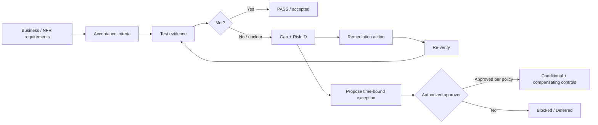
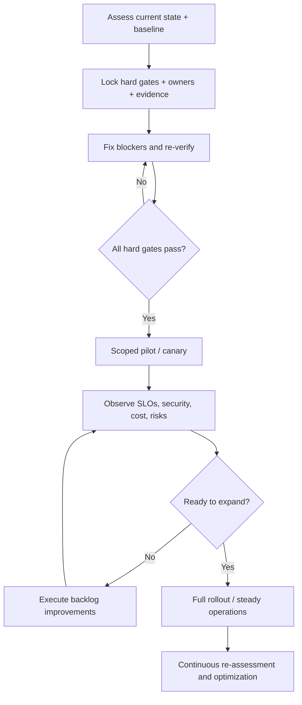
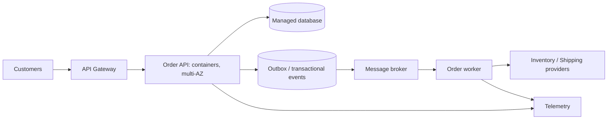

# Locking Acceptance Criteria and Architecture Improvement Plans

## 1. Why Must an Architecture Assessment End with a Decision?

An **architecture assessment** can uncover many issues: a database lacking a recovery plan, a system unable to sustain peak load, costs exceeding budget, overly broad permissions, or an inability to trace transactions. Yet if the output is merely a list of remarks like "should improve security" and "needs performance testing," the delivery team struggles to know when the design **is accepted**, who needs to do what, and by when.

The **locking acceptance criteria and improvement plans** phase turns findings into an accountable decision:

1. **Confirm business scope and constraints:** which system, load, data, environment, and deployment milestone is under evaluation?
2. **Establish measurable acceptance criteria:** what outcomes must pass before approving the design or launching into operations?
3. **Collect evidence:** which docs, measurements, test runs, or drill results prove criteria are met?
4. **Classify gaps and risks:** which shortfalls must be fixed immediately versus conditionally accepted?
5. **Build an improvement plan:** each action has an accountable owner, priority, dependencies, deadline, and definition of done.
6. **Make a traceable decision:** accept, conditionally accept, defer, or reject—recording residual risks and re-assessment triggers.

In the **CLOUD_ARCHITECTURE** module, this decision must connect business requirements to networking, compute, data, and cloud deployment choices while explaining **trade-offs across reliability, security, scalability, cost, and operations** following Well-Architected principles.

### Learning Outcomes

After this lesson, you should be able to:

- Distinguish **assessment criteria**, **acceptance criteria**, **evidence**, and **remediation actions**.
- Write acceptance criteria with clear scope, measurable thresholds, verification methods, approvers, and stop conditions.
- Use Well-Architected pillar results to make conditional decisions and manage exceptions.
- Prioritize remediation work by risk level, dependencies, business value, cost, and execution capacity.
- Build a phased improvement plan tying tasks to measurable results and post-change re-verification.

## 2. Four Easily Confused Concepts

| Concept | Question Answered | Ordering Application Example |
|---|---|---|
| **Assessment criterion** | Which aspect should be evaluated? | "Database recoverability after an outage." |
| **Acceptance criterion** | What verifiable condition must pass? | "Complete recovery drill achieving RTO ≤ 60 minutes and RPO ≤ 5 minutes under the defined AZ-loss scenario." |
| **Evidence** | On what basis do we confirm pass/fail? | Drill report with actual timestamps, restore logs, config version, and owner sign-off. |
| **Remediation action** | If failing, who does what to pass? | Add replication, automate restore checks, and re-run the drill before approval date. |

For example, "the architecture has high availability" is a **goal**, not an acceptance criterion. "Use three Availability Zones" is a **design choice**, not proof that recovery targets or end-to-end SLOs are met. A good criterion specifies **desired behavior and verification method**, whereas technical choices are the means to achieve it.

Evidence types are also not interchangeable:

- **Design reviews** prove scenarios, diagrams, and assumptions were examined.
- **Configuration checks** show infrastructure is declared or configured per policy.
- **Integration/load/security tests** measure behavior under stated test conditions.
- **Failure and recovery drills** provide evidence of fault tolerance under tested outages.
- **Production telemetry** reveals behavior under live operations and catches scenarios tests missed.

Never claim "meets recovery requirements" merely because backups are turned on. Valid evidence must include **successful restoration and data verification**.

## 3. Locking Assessment Scope Before Finalizing Criteria

Test results without scope easily lead to false conclusions. For instance, "API achieves p95 of 300 ms" means little if tested at 2 requests/sec while projected peak load is 800 requests/sec.

Lock down the following scope details first:

| Scope Dimension | What to Record |
|---|---|
| **Architecture and version** | Deployment diagram, environment, design/ADR version, commit or IaC revision under assessment |
| **Business journeys** | Critical capabilities: login, order placement, payment, lookup, reporting? |
| **Data** | Data types, sensitivity classification, stores, flows, residency mandates, retention |
| **Traffic and forecasts** | RPS/QPS, concurrent users, payload sizes, peak hours, projected growth |
| **Dependencies** | Networking, IAM, DNS, databases, message brokers, third-party providers, batches, and legacy systems |
| **Deployment model** | Single-/multi-region, AZs, serverless, containers, VMs, managed services, or hybrid |
| **Decision boundary** | Approving a design option, authorizing a pilot, or granting production go-live? |
| **Decision stakeholders** | Business owner, security, SRE/operations, data owner, architect, and final approver |

**Keep two decision gates separate**:

- **Design acceptance**: the design has a sound basis to proceed into implementation, with key assumptions/risks identified and a verification plan in place.
- **Production readiness / go-live acceptance**: the deployed system has passed all mandatory tests, controls, and drills.

Design acceptance may be granted before runtime evidence exists, yet it must **explicitly log incomplete conditions and mandatory verification deadlines**. Never use design sign-off as proof that the system is safe for production.

## 4. Turning Business Requirements into Measurable Criteria

A quality acceptance criterion typically follows this structure:

> **Under [scope/load conditions and scenario], [target] must achieve [threshold or behavior], verified by [method/evidence], confirmed by [owner] before [decision gate].**

Example:

- **Too vague**: "The system is fast and stable."
- **Verifiable**: "Under a mixed 70% read / 30% write workload at 800 RPS for 30 minutes, ordering API p95 ≤ 500 ms, 5xx error rate < 0.5%, and zero lost orders; evidenced by the release-candidate load test report, confirmed by SRE and product owner before go-live."

Numbers in this example are **educational assumptions**; organizations must set thresholds from actual load, business value, baselines, and risk appetite. Never apply one blanket latency threshold across every API: payment execution and aggregate reporting behave very differently.

### What Should a Complete Criterion Record?

| Field | Meaning | Example |
|---|---|---|
| **ID** | Unique reference | `ACC-PERF-01` |
| **Target and scope** | Component/journey under evaluation | `POST /orders` API, release candidate v2 |
| **Assumptions / scenario** | Workload, infra, data class, failure conditions | 800 RPS, 70/30 read/write, two AZs |
| **Metric / threshold** | Behavior to achieve or limit not to breach | p95 ≤ 500 ms, 5xx rate < 0.5% |
| **Method** | How tested, measurement point, and window | 30-min load test, measured at client/gateway |
| **Evidence** | Reports, snapshots, pipelines, logs | `load-test-run-128`, timestamped dashboard |
| **Owner** | Who executes and who verifies | Performance engineer; verified by SRE |
| **Decision gate** | When it must be satisfied | Before production go-live |
| **Result** | Pass, Fail, unverified, exception | `PASS` |
| **Risk link** | If unmet, link to impact assessment | `RISK-017` |

Crucially, **"no evidence yet" must never be recorded as PASS**. Use `NOT_VERIFIED` or `BLOCKED` to prevent misunderstandings.

## 5. Well-Architected Reference Criteria Set

The Well-Architected framework views architecture through six pillars. These questions serve as a starting point; adapt them into criteria fitting your product context.

| Pillar | Suggested Acceptance Criteria | Appropriate Evidence |
|---|---|---|
| **Operational Excellence** | Telemetry on critical journeys, on-call ownership, runbooks, rehearsed deploy/rollback | Dashboards, alert tests, runbooks, deployment drill minutes |
| **Security** | Least-privilege access; data classified and encrypted; zero unresolved critical vulnerabilities inside forbidden boundaries | IAM reviews, threat models, authorization tests, scans, remediation logs |
| **Reliability** | Appropriate SLOs; self-healing or recovery within RTO/RPO; zero transaction loss under defined scenarios | SLO reports, chaos/failover tests, restore drills, data integrity checks |
| **Performance Efficiency** | Meets p95/p99 and realistic peak capacity, with resource caps and scaling policies | Load/stress/soak tests, traces, saturation, autoscaling metrics |
| **Cost Optimization** | Cost forecasted and measured per environment/service/business unit, with budgets and alerts | Cost models, usage reports, tagging coverage, budget alerts |
| **Sustainability** | Infra sized to load, idle resources cleaned up, storage/data lifecycles enforced | Utilization, off-hours shutdown schedules, capacity reports, retention policies |

### Add Cross-Pillar Criteria

**Data and consistency:** identify the system of record, backups, recovery, lost/duplicate record checks, read-after-write needs, sync lag, message error handling, and storage permissions.

**Compliance and privacy:** where data resides, retention duration, who accesses it, personal-data deletion/retrieval mechanics, and auditing. Exact rules depend on applicable laws and contracts; never treat a generic legal checklist as compliance certification.

**Scalability:** account for projected load, cloud service quotas, scaling speed, DB bottlenecks, connection caps, message backlogs, and acceptable graceful degradation.

**Change management:** artifact versioning, IaC reviews, secrets control, rollback-capable deployments, data migration recovery plans, and external dependency impact reviews.

## 6. Criterion Priority: Mandatory vs. Conditional

Not every criterion carries equal weight. Missing telemetry on a minor background job can wait for later; skipping authorization on a payment path blocks go-live immediately.

Suggested classification:

| Tier | Meaning | Handling When Unmet |
|---|---|---|
| **Hard gate / must-have** | Mandatory condition before a specific gate | Cannot approve that gate until passed; if policy permits exceptions, formal executive sign-off is required |
| **Conditional gate** | Temporarily allowed to proceed with compensating controls, owner, and deadline | Record exception/risk, expiry date, operating constraints, and re-review schedule |
| **Improvement target** | Optimization or quality uplift post-milestone | Track in prioritized backlog with completion criteria and follow-up schedule |

For example, **never let "conditional" become a loophole to skip mandatory controls**. When internal policy, contracts, or regulations forbid launching without a control, reviewers must record **FAIL/BLOCKED** rather than accepting risk on behalf of the proper authority.

### Minimum Verification Rules for Hard Gates

A hard-gate criterion passes only when all hold simultaneously:

1. Measured/tested result meets threshold within approved scope.
2. Evidence belongs to the exact **architecture version and environment** under review.
3. No significant unverified changes occurred after evidence collection.
4. Authorized owner has confirmed.
5. No high-priority blocking findings remain tied to the criterion.

If evidence is stale or unrepresentative of deployment configs, re-verify; never reuse PASS verdicts indefinitely.

## 7. Building an Auditable Acceptance Matrix

An **acceptance matrix** drives decisions and tracks evidence. Separate criteria, verification status, criticality, and linked remediation actions.

Hypothetical example for an ordering service deployed across two Availability Zones:

| ID | Pre-Go-Live Criterion | Illustrative Threshold / Expectation | Current Result | Evidence | Decision |
|---|---|---|---|---|---|
| `ACC-SEC-01` | Order API enforces tenant-scoped permissions | 0 cross-tenant accesses in defined test suite | PASS | Integration security suite 42 | Passed |
| `ACC-REL-01` | Database recovery | RTO ≤ 60 min; RPO ≤ 5 min in drill scenario | FAIL | Restore drill 17: RTO 82 min | Hard gate unmet |
| `ACC-PERF-01` | Peak load handling | 800 RPS for 30 min, p95 ≤ 500 ms | PASS | Load test 128: p95 420 ms | Passed within test scope |
| `ACC-OPS-01` | Alerting and runbooks | Simulated service fault delivers alert to designated on-call channel | NOT_VERIFIED | Alert drill not run | Evidence required |
| `ACC-COST-01` | Monthly cost | Estimate within approved budget | CONDITIONAL | Cost model v3; lacks live load data | Verify post-pilot |

Values, versions, and numbers in the table are **illustrative data only**. Main takeaway: **not ready for go-live** because hard gate `ACC-REL-01` fails; three passed/conditional items cannot offset a mandatory blocker. Never average PASS percentages to mask blocking failures.

### Sample Criterion Record for Technical Documentation

```yaml
id: ACC-REL-01
title: "Order database recovery"
scope:
  application: "order-service"
  environment: "production-like"
  scenario: "loss of primary database in active zone"
criterion:
  rto_max_minutes: 60
  rpo_max_minutes: 5
  data_integrity: "no lost or duplicate transactions beyond approved threshold"
measurement:
  method: "restore/failover drill"
  observation_point: "end-to-end order workflow"
evidence:
  link: "restore-drill-17"
  executed_at: "2026-11-10"
result: FAIL
severity: HARD_GATE
owner: "SRE lead"
linked_risk: RISK-017
next_action: "ACT-021"
approval_status: PENDING
```

This is a **reference record template**, not a mandatory schema for any specific tool. In practice, store evidence links with proper access controls and traceability to the deployed release.

## 8. SLO, SLA, SLI, and Error Budget in Acceptance Decisions

Easily confused terms:

- **SLI (Service Level Indicator)**: the measurement, e.g., successful request ratio or p95 latency.
- **SLO (Service Level Objective)**: internal target on an SLI with a clear measurement window.
- **SLA (Service Level Agreement)**: contractual customer commitment, potentially carrying penalties upon breach.
- **Error budget**: allowable SLO misses within the calculation window; guides release velocity and risk tolerance.

For illustration, if the availability target is **99.9% over 30 continuous days**, the unavailability budget equals **0.1% × 30 × 24 × 60 = 43.2 minutes**. This time calculation holds only when the SLI is defined in matching time units. If the SLI tracks **successful request ratio**, the error budget counts eligible requests meeting measurement rules; never convert directly into exact downtime minutes when traffic fluctuates.

A complete SLO definition must specify:

- Which requests count and which errors are excluded or counted as failures.
- Measurement window (rolling 7 days, 30 days, or calendar month).
- Measurement point (client, edge, service) and handling of timeouts, retries, and dependency failures.
- Grouping by business journey and criticality.
- Evaluation rules when telemetry is missing or traffic is low.

**SLOs are not comprehensive go-live criteria.** A system can hit availability SLOs while leaking authorization data. Security and business-correctness criteria need independent acceptance gates.

## 9. Evidence: Validity Matters More Than Volume

Good evidence must be **version-accurate, condition-accurate, reproducible, and interpreted within its true limits**.

### Five Questions to Validate Evidence

1. **Source**: did evidence come from telemetry, test pipelines, reviews, or verbal claims? Is it trustworthy and verifiable?
2. **Scope**: do environment, workload, assumptions, data scale, and configs represent production?
3. **Timestamp and version**: was evidence produced before or after the latest architecture/deployment change?
4. **Integrity**: are raw outputs, logs, traces, operator names, timestamps, and reproduction steps preserved?
5. **Interpretation**: what does this result actually prove, and what does it leave unproven?

Example: an 800 RPS load test proves capacity **only for the tested workload and duration**—not AZ-loss survival. A pentest covering public endpoints does not prove internal services lack authorization bugs. An approved failover design does not prove real-world RTO.

### Evidence by Criterion Category

| Criterion | Strong Evidence | Insufficient Alone |
|---|---|---|
| Recovery | Restore/failover drills, logs and data reconciliation, measured RTO/RPO | "Snapshots enabled" |
| Performance | Profile-matched load tests, client p95/p99, saturation metrics, DB metrics | "CPU stayed at 50% for a few requests" |
| Security | Threat models, IAM reviews, tenant-isolation tests, and config checks | "Service uses HTTPS" |
| Cost | Assumption-backed cost models, observed telemetry or benchmarks, budget alerts | "Serverless will be cheap" |
| Operations | Alert drills, runbooks, traces/logs, on-call ownership, and rollback simulations | "Monitoring agent installed" |
| Data | Record reconciliation, recovery tests, consistency checks under failure | "Database replica exists" |

## 10. Gap Analysis: From Findings to Owned Risks

When a criterion fails, log **gap** and **risk** separately:

- **Gap**: measured shortfall against the requirement—e.g., actual RTO of 82 minutes vs. 60-minute cap.
- **Risk**: what could happen and who suffers—e.g., prolonged DB outage blocks order creation, breaching recovery commitments.
- **Cause / hypothesis**: restore requires manual data reload, missing guidance, or insufficient storage throughput.
- **Action**: automate restore steps, change replication mechanics, or build proper failover procedures.
- **Residual**: even after improvements, some probability of missing targets remains; measure and document it.

### Explained Risk Scoring

A simple method scores **Likelihood** and **Impact** on a 1–5 scale using a matrix:

| Impact \ Likelihood | 1: Rare | 2: Unlikely | 3: Possible | 4: Likely | 5: Very Likely |
|---|---:|---:|---:|---:|---:|
| 5: Critical | 5 | 10 | 15 | 20 | 25 |
| 4: High | 4 | 8 | 12 | 16 | 20 |
| 3: Medium | 3 | 6 | 9 | 12 | 15 |
| 2: Low | 2 | 4 | 6 | 8 | 10 |
| 1: Minor | 1 | 2 | 3 | 4 | 5 |

`Likelihood × Impact` provides **relative ranking** when tiers are consistently defined; this is an **ordinal scale**, not quantitative probability or expected dollar loss. Never use scores to waive hard gates or mandatory rules.

Example:

- `RISK-017`: RTO unmet; impact 5, likelihood 3 → reference score 15; must remediate before go-live.
- `RISK-019`: test resources running off-hours; impact 2, likelihood 4 → score 8; optimize in a later phase.
- `RISK-023`: one account holds over-scoped admin rights; even if exploit frequency is unknown, violating security policy can still act as a **blocking gate**.

### Traceability Matrix



The point of traceability is that **every decision can be explained via requirements, evidence, and accountable owners**; every fix maps back to a specific criterion rather than creating a vague backlog.

## 11. Decision Statuses and Exceptions

Use a simple status vocabulary without ambiguous terms:

| Status | Meaning | Recording Conditions |
|---|---|---|
| **ACCEPTED** | Ready for the gate under review | All hard gates PASS; other items handled per policy |
| **ACCEPTED_WITH_CONDITIONS** | Permitted to proceed within limited scope/time | Valid exception, compensating controls, owner, deadline, approver, and re-check date; violates zero non-waivable hard gates |
| **DEFERRED / BLOCKED** | Insufficient evidence or unresolved blockers before gate | State exact missing criteria, required tasks, and reopen conditions |
| **REJECTED** | Current option unsuitable or risk exceeds tolerance | Rationale and required redesign/scope-change direction |

**"Risk accepted" is not the same as "risk eliminated."** Risk acceptance requires proper authority, business rationale, scope, expiry date, compensating controls, revocation triggers, and a monitoring plan.

### Sample Controlled Exception Record

```text
Exception ID: EXC-008
Criteria: ACC-COST-01
Scope: Pilot phase, max 2 weeks, internal traffic
Gap: Lacks cost metrics under live production load
Risk: Monthly budget could exceed forecast
Compensating controls: Budget alerts + quotas + tenant limits
Owner: FinOps lead
Approver: Product owner with budget authority
Expiry: Approved pilot end date
Re-assessment: Before expanding to real customers
Stop condition: Halt expansion if actual spend crosses approved threshold
```

This is a **conditionally acceptable** example if policy allows. Never use exceptions to skip authorization bugs, compliance gaps, or recovery hard gates blocking go-live.

## 12. Prioritizing Improvements: Fix Risk First, Then Optimize Value

Post-assessment backlogs usually outstrip team capacity. Rank items by risk and impact rather than picking easy or flashy tasks first.

### Pragmatic Prioritization Framework

**Step 1 — Separate mandatory blockers:** compliance, security, or go-live blockers follow gate urgency and deadlines—never deprioritized for low effort-estimate scores.

**Step 2 — Evaluate operational risk:** outage consequences, likelihood and blast radius, dependent systems, data loss, and recovery time.

**Step 3 — Weigh value vs. effort:** measurable improvement, affected frequency, implementation cost, team skills, and optimization upside.

**Step 4 — Factor dependencies and timing:** foundational items like tracing, test harnesses, or IAM boundaries often unlock many downstream tasks.

**Step 5 — Prioritize verifiability:** favor actions producing evidence for key decisions; avoid complex builds before proving the underlying problem.

For instance, **fixing database recovery failures** must precede **trimming log sizes** when recovery blocks go-live. Once hard gates pass, a small monthly cost win may outrank a full architecture rewrite if its benefit-to-risk ratio is superior.

### Using Priority Scores Properly

For **non-hard-gate** work, a simple model can assist:

\[
P = \frac{\text{Expected value} \times \text{Confidence in estimate}}{\text{Estimated effort}}
\]

Compare items only when the team shares consistent scoring definitions and scales. Scores aid discussion; they never override engineering judgment, legal/policy mandates, or real task dependencies. Larger projects may adopt WSJF, RICE, or risk–effort matrices if conventions are standardized.

## 13. Building an Actionable Improvement Plan

A backlog ticket reading "improve reliability" is unactionable. Each item needs:

| Field | Purpose | Example |
|---|---|---|
| **Action ID / Risk ID** | Links to criterion and risk | `ACT-021` / `RISK-017` |
| **Target outcome** | Threshold/behavior to achieve | RTO ≤ 60 min, RPO ≤ 5 min in approved scenario |
| **Technical scope** | Proposed change | Automate restore and verify dependency startup order |
| **Owner & verifier** | Execution vs. acceptance accountability | SRE lead; architect and data owner verify |
| **Priority & blocker status** | Whether on critical path | P0 — blocks go-live |
| **Dependencies** | Prerequisites to start/finish | Drill environment and restore permissions available |
| **Deadline / milestone** | When due | Before production readiness gate |
| **Effort / cost** | Expected capacity and budget | 5 eng-days + drill time (estimate only) |
| **Verification method** | Specific test and evidence | Restore drill + data reconciliation + RTO/RPO report |
| **Change rollback plan** | Handling if improvement introduces errors | Roll back config and re-run failover test |

### Sample Improvement Backlog

| ID | Action | Priority | Owner | Definition of Done | Milestone |
|---|---|---|---|---|---|
| `ACT-021` | Automate DB restore runbook and re-drill | P0 | SRE | `ACC-REL-01` PASS; logs and reconciliation archived | Pre-go-live |
| `ACT-022` | Run alerting and on-call drill | P0 | Operations | `ACC-OPS-01` PASS; alert channels verified | Pre-go-live |
| `ACT-023` | Configure budget alerts and standard tagging | P1 | FinOps / Platform | Per-service cost reports and active alert thresholds | Pilot phase |
| `ACT-024` | Tune autoscaling from saturation signals | P1 | Platform | New load test meets SLOs at forecast load | Post-pilot, pre-scale |
| `ACT-025` | Enforce lifecycle policies for logs and snapshots | P2 | Platform / Security | Policy-compliant retention, lower wasted storage | Periodic uplift |

Link each row to tickets, evidence, and relevant ADRs or risk registers in your work-tracking tool.

## 14. Phasing the Improvement Roadmap

A strong roadmap defines **stage-exit conditions**, not just calendar dates.



### Phase 0 — Lock Decisions and Baseline

- Confirm business owners, acceptance criteria, system boundaries, and review timing.
- Capture baselines for errors, latency, recovery, cost, and security.
- Link requirements → criteria → evidence; separate PASS from NOT_VERIFIED.
- Log unverified assumptions and who owns clarifying them.

**Exit criteria:** the review board knows exact hard-gate criteria and missing evidence.

### Phase 1 — Clear Blocking Issues

- Resolve authorization flaws, failing backup/restore, missing rollback mechanics, service-crashing resource caps, or compliance gaps.
- Run targeted fix tests plus regression tests wherever changes risk side effects.
- Update the acceptance matrix with new results while preserving historical runs.

**Exit criteria:** every hard gate for the next stage passes; zero unverified items mislabeled as passed.

### Phase 2 — Pilot or Canary

- Open scoped traffic to an appropriate user/tenant cohort.
- Monitor errors, latency, data quality, costs, and live incidents.
- Maintain abort caps, rollback paths, and active on-call responders.
- Validate assumptions untestable pre-deploy, such as live-load cost behavior.

**Exit criteria:** pilot metrics meet thresholds and expiring exceptions are resolved.

### Phase 3 — Scale and Optimize

- Mature scaling policies, cost controls, observability, operations, and automation.
- Pay down high-impact tech debt; strip temporary configs, excess permissions, and idle assets.
- Re-measure SLOs, cost per transaction, resource sustainability, and the risk backlog.

**Exit criteria:** architecture meets approved growth targets within operational cost bounds.

Phases need not run strictly sequentially; some streams run in parallel. Yet **acceptance gates must never be skipped** simply because another stream moved ahead.

## 15. End-to-End Example: Cloud Ordering System

### 15.1 Hypothetical Requirements

A retail enterprise is migrating its ordering platform to the cloud. Core flow:



Illustrative business requirements:

- Projected peak traffic of 800 requests/sec with 70% reads / 30% writes.
- New orders recorded once and remain accurate through temporary queue or worker faults.
- Recovery targets: max 60-minute RTO and max 5-minute RPO for primary database loss.
- Ordering flow p95 under 500 ms at the agreed test workload.
- Zero cross-tenant order data access.
- Operating spend within budget approved by product owner and FinOps.

Numbers represent **hypothetical context**, not universal benchmarks.

### 15.2 Initial Review Results

| Area | Finding | Assessment |
|---|---|---|
| Security | Tenant authorization tested and passed | PASS |
| Reliability | Restore drill took 82 min, missing 60-min RTO | FAIL — hard gate |
| Performance | p95 420 ms at 800 RPS for 30 min | PASS within test scope |
| Operations | Alerts configured, but alert delivery/handling never drilled | NOT_VERIFIED |
| Cost | Forecast fits budget; lacks live traffic data | CONDITIONAL for pilot per policy |
| Data | Consumer idempotency under duplicate events not fully proven | NOT_VERIFIED; evaluate blocker severity per data rules |

**Preliminary decision:** **DEFERRED / BLOCKED for production go-live**, because `ACC-REL-01` failed and operational/data-correctness checks remain incomplete. An **isolated, scoped pilot handling zero real transactions** may still proceed if it satisfies dedicated pilot gates, without changing production go-live status.

### 15.3 Action Plan

**Item 1 — Database recovery:** SRE forms hypotheses for the delay, optimizes restore/failover paths, and re-drills in a representative environment. Data owner verifies integrity; report records RTO/RPO. Passes only when targets are physically met.

**Item 2 — Event idempotency:** application team proves consumers handle duplicate or out-of-order messages without creating unintended orders or dispatches. Tests include broker fault injection, worker restarts, and retries.

**Item 3 — Alert drill:** Operations simulates API errors, queue backlogs, and DB failover, verifying alerts reach on-call staff alongside actionable runbooks.

**Item 4 — Cost visibility:** FinOps sets up cost allocation tags, dashboards, and budget alerts before pilot; updates forecasts afterward using real RPS, network, DB, and queue throughput data.

**Item 5 — Scale and performance:** only after write paths and reliability pass criteria, tune autoscaling, connection pools, and queue concurrency, testing growth against appropriate load profiles.

### 15.4 Post-Improvement Decision

Suppose the next drill measures 44-minute RTO and 2-minute RPO; idempotency tests pass, the alert drill passes, and performance regression tests hold. Then the review board re-evaluates the **current version** and all conditions beyond those four items. If all mandatory hard gates pass, status can move from `BLOCKED` to `ACCEPTED` or `ACCEPTED_WITH_CONDITIONS` depending on remaining items and exception policy.

Never infer the new status from hypothetical projections: cross-check the full acceptance matrix and require authorized sign-off.

## 16. Coordinating Ownership and Approval Mechanics

One common reason improvement plans fail is "the whole team owns it," leaving nobody truly accountable. Clarify roles using RACI or an equivalent model.

| Activity | Accountable / Decides | Responsible / Executes | Consulted |
|---|---|---|---|
| Confirm business goals, SLAs | Product / Business owner | Product manager | SRE, Security, Architect |
| Lock architecture & ADRs | Architect or architecture board per governance | Solution architect | Platform, Development, Security |
| Security assessment | Security owner | Security engineers, Development | Data owner, Architect |
| SLOs & recoverability | Service owner / SRE owner | SRE / Platform | Business, Data owner |
| Cost forecast & control | Budget owner / FinOps owner | FinOps / Platform | Product, Engineering |
| Execute remediation | Engineering manager / service owner | Ticket-assigned team | SRE, Security, Data owner |
| Go-live approval | Release authority per org governance | Release manager compiling evidence | Business, SRE, Security, Architect |

Actual titles vary by organization size; this table is illustrative. **Assessors may recommend**, yet risk acceptance and go-live approval belong strictly to authorized decision makers under organizational governance.

### What Must the Closing Meeting Decide?

A brief, effective decision meeting should output:

1. Exact design version and scope reviewed.
2. List of hard-gate criteria and each one's result/evidence.
3. Unmet criteria, associated risks, and priorities.
4. Proposed exceptions, approving authority, expiry dates, and compensating controls.
5. Verdict for the **current gate** plus conditions to unlock the next gate.
6. Action list with owners, milestones, and re-review date.
7. Timestamped decision record listing participants and approvers.

## 17. Tying Acceptance Criteria to CI/CD and Operations

The more criteria checked automatically, the earlier teams catch regressions. Still, **not every criterion boils down to one automated command**.

### Control Layers

| Layer | Automatable Checks | Areas Needing Supplemental Review |
|---|---|---|
| **Pull request / IaC** | Policy-as-code, secret scanning, linting, unit tests, SG/IAM diffs | Business intent, valid exceptions, real network conditions |
| **Staging build & deploy** | SAST/SCA, contract tests, integration tests, DB migration checks | Dependency version risk, staging-vs-prod config drift |
| **Pre-production gate** | Load tests, security tests, smoke tests, restore/failover drills if supported | Unsimulated scenarios, multi-system interactions, risk sign-offs |
| **Canary / rollout** | Error rates, p95/p99, saturation, budget alerts, rollback thresholds | Business quality, data consistency, customer impact |
| **Production operations** | SLO alerts, logs/traces, backup status, drift detection, cost anomalies | On-call drills, audits, rare outages, periodic reviews |

Example control flow:

```text
Design review
    |
    v
Acceptance matrix: all hard gates reviewed?
    |-- no --> Defer decision / assign evidence owners
    |
    v
Build + IaC policy checks + security/contract tests
    |-- fail --> Block promotion
    |
    v
Performance + recovery drill + data-integrity tests
    |-- fail --> Remediate and retest
    |
    v
Authorized release decision
    |-- not approved --> Keep release blocked
    |
    v
Canary with SLO / security / cost monitoring
    |-- breach --> Stop or rollback using runbook
    |
    v
Broader rollout + post-release assessment
```

**Passing Git checks** or green pipelines only proves the configured test suite ran cleanly; it does not prove all architectural, data, or compliance requirements were evaluated. Explicitly document what pipelines actually verify.

## 18. Handling Trade-offs and Architecture Decisions (ADR)

Many requirements cannot be optimized simultaneously. For example:

- **Multi-region active-active** improves regional fault tolerance while raising cost, data consistency complexity, latency, and operational overhead.
- **Caching** cuts latency and read costs while raising stale-data risk—especially for inventory or pricing.
- **Managed services** reduce infrastructure toil while requiring scrutiny of quotas, config control, lock-in, and data policies.
- **Cost-saving autoscaling** can lengthen readiness time under sudden traffic bursts.
- **Fine-grained microservices** allow independent deploys while adding network hops, distributed tracing, and cross-service transactions.

Never conclude vaguely that "Option A is better." An **ADR** should capture:

```text
ADR-024: Choose multi-AZ single-region managed database for Phase 1

Context:
- Targets: RTO <= 60 min, RPO <= 5 min for approved scenario
- Load forecast and budget cap per business-approved docs
- No mandate yet for app writes to continue if entire region is unavailable

Options:
A. Single AZ
B. Multi-AZ managed database in one region
C. Active-active across two regions

Decision:
- Choose B for Phase 1, paired with automated backups and restore drills

Consequences:
- Higher cost than single AZ, simpler operations than C
- Does not fully protect against complete region-loss scenarios
- Must rehearse RTO/RPO and revisit if multi-region becomes required

Acceptance / revisit:
- ACC-REL-01 PASS prior to go-live
- Re-evaluate if RTO/RPO, data residency, or load scale changes
```

An ADR clarifies decision scope and assumptions; **it never replaces empirical tests**. When constraints shift, re-evaluate the decision and update criteria.

## 19. Common Mistakes

| Mistake | Consequence | How to Fix |
|---|---|---|
| Criteria state solutions ("must use Kubernetes") | Tests wrong goal; locks in tech prematurely | Measure business/NFR outcomes; tech is just an option |
| Declaring "90% checklist passed" while blockers remain | False sense of safety | Hard gates decide first; totals only show trends |
| Accepting risks without owners or deadlines | Exceptions linger forever | Log risk owner, approver, compensating controls, expiry, and re-assessment |
| Confusing design acceptance with go-live | System ships to production with zero runtime proof | Separate gates and enforce runtime evidence |
| Benchmarks with mismatched load or environment | Capacity fails in real rollout | Measure representative workloads and log assumptions |
| Treating ordinal risk scores as exact math | Distorted prioritization | Describe impact, likelihood, confidence, and hard gates |
| Vague actions lacking a Definition of Done | Backlog items stay stuck open | Link actions to criteria, evidence, and owners |
| Assessing once and forgetting | Architecture drifts; criteria go stale | Re-review after major changes, incidents, traffic growth, and on schedule |
| Measuring infra alone, ignoring business journeys | Healthy CPU while users hit errors | Track end-to-end transactions and data correctness |
| Fixing gaps by adding complex components | Higher cost and ops toil without solving root cause | Pick minimal changes proven to close the gap |
| Deleting FAIL test records after fixing | Loses history and auditability | Preserve versions, timestamps, and status transition rationales |

## 20. Practice Exercise: Making Decisions and Building a Roadmap

### Prompt

You are assessing a pilot cloud payment application. Hypothetical findings:

- Application runs across two AZs, yet the database still runs on a single instance with no recovery drill.
- API hits 360 ms p95 at 200 RPS test load; peak forecast is 1,000 RPS.
- One service account holds broader read/write permissions than required.
- Daily backups exist; target RPO is 15 minutes, unproven.
- CPU/memory metrics exist, lacking distributed tracing across gateway → payment service → database.
- Cost estimates fit pilot budget; budget alerts are not yet configured.

**Learner tasks:**

1. Write at least 6 acceptance criteria covering RTO/RPO, IAM, performance, observability, and cost.
2. Classify hard gates, conditional gates, and improvement targets, explaining why.
3. Separate existing evidence from missing evidence that must be gathered.
4. Build a list of 5 improvement items with owners, priorities, dependencies, definitions of done, and target gates.
5. Issue separate decisions for **design acceptance** and **production readiness**.
6. Explain one trade-off among multi-AZ managed DB, multi-region active-active, and simpler alternatives.

### Reference Solution Guide

- `ACC-SEC-01`: scope service account to least privilege and confirm features still work; hard gate if mandated by security policy.
- `ACC-REL-01`: define failure scenarios and matching RTO/RPO; run restore/failover drills, measure timing, and verify integrity; cannot PASS without evidence.
- `ACC-PERF-01`: test representative workload at 1,000 RPS (plus agreed headroom) before certifying capacity; 200 RPS is insufficient.
- `ACC-OPS-01`: add trace IDs and payment-flow alerts; verify ability to diagnose a failed transaction.
- `ACC-COST-01`: enable budget alerts and check cost allocation before pilot; compare post-pilot spend against assumptions.
- `ACC-DATA-01`: verify zero duplicate/lost transactions under retries, timeouts, or worker restarts if async components exist.

**Production readiness: BLOCKED** until security, recovery, load, and correctness hard gates pass. **Design acceptance** may permit conditional continuation once gaps and verification plans are documented, provided organizational policy allows.

### Exercise Evaluation Criteria

A strong solution demonstrates that:

- Criteria specify **verifiable** scope and thresholds rather than saying "ensure safety."
- **Missing evidence** is separated from **verified failures**.
- Passing item counts never override hard gates.
- Work is prioritized by impact and dependencies with owners and completion criteria.
- Every exception carries an authorized approver, deadline, and re-assessment trigger.
- Tech trade-offs are framed via impacts on reliability, security, performance, cost, and operations.

## 21. Architecture Sign-Off Checklist

- [ ] System scope, version, and **assessment gate type** (design, pilot, or go-live) agreed upon.
- [ ] Business/NFR requirements linked to criteria with clear IDs, thresholds, and measurement conditions.
- [ ] Hard gates and exception-approval authorities clearly marked where allowed.
- [ ] Every criterion holds an explicit status: PASS, FAIL, NOT_VERIFIED, or valid exception.
- [ ] Evidence carries timestamps, versions, test conditions, and verifiers.
- [ ] Risks describe impact, owners, priorities, and linked criteria.
- [ ] Improvement plan lists action IDs, concrete tasks, owners, dependencies, deadlines, and definitions of done.
- [ ] Feasibility and cost of each improvement assessed, with rollback plans if changes break things.
- [ ] Conditions set for opening pilot/canary, halting rollout, rolling back, and post-release monitoring.
- [ ] Major trade-offs recorded in ADRs with scheduled review triggers.
- [ ] Re-verification scheduled post-fix, post-incident, or after major load/infra shifts.
- [ ] Final decision includes approver, applicability scope, conditions, and expiry date if applicable.

## 22. Core Takeaway

**Architecture assessment creates value only when it turns findings into accountable decisions and verifiable changes.** Outcomes require **concrete acceptance criteria**, **credible evidence**, **managed risks**, **owned improvement plans**, and **explicit approval gates**.

In the Well-Architected spirit, accepting an architecture never means finding perfection across every pillar. It means confirming **trade-offs are understood and controlled**, mandatory requirements are met, and remaining improvements have concrete plans and re-assessment conditions. That bridges paper designs with accountable operations in the cloud.
