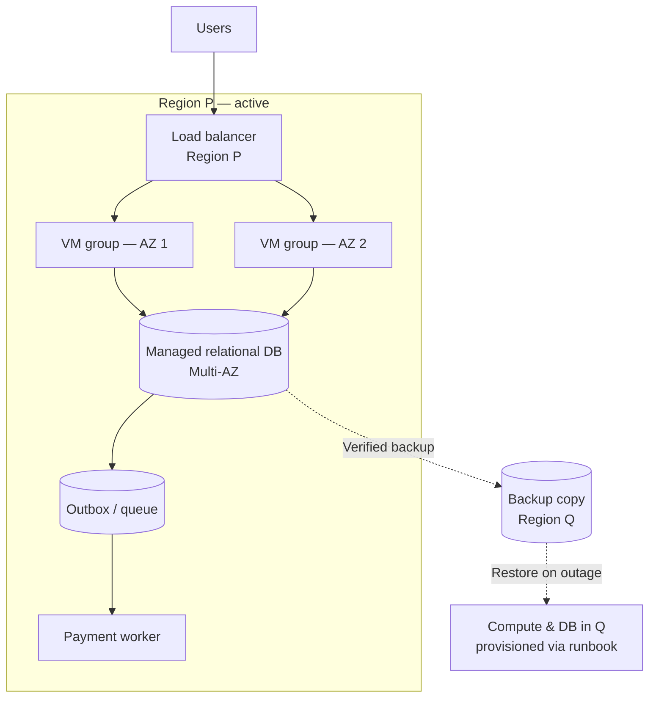
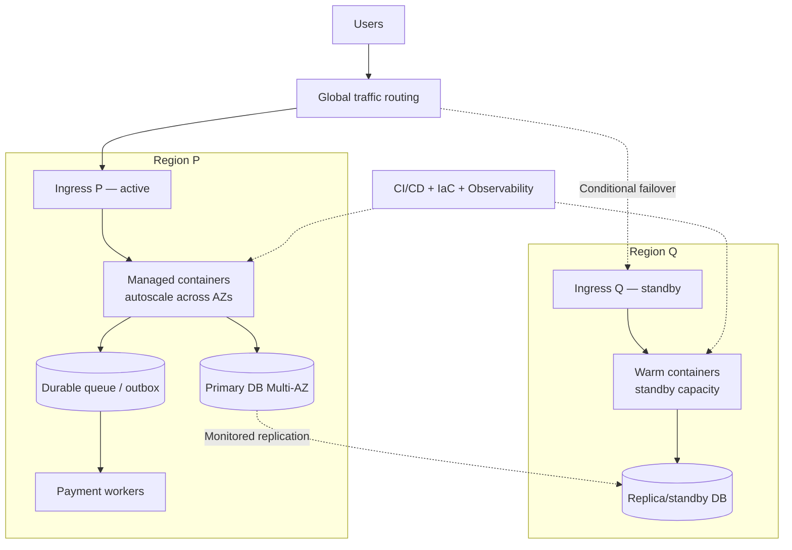
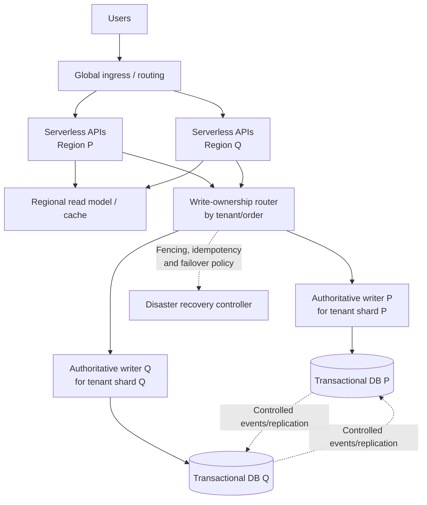

# Comparing Three Options on Reliability, Performance, Cost, and Operations

> **Chapter:** Design Exercises  
> **Module:** `CLOUD_ARCHITECTURE` — designing cloud application architectures from business requirements through networking, compute, data, and deployment model choices; evaluating trade-offs among reliability, security, scalability, cost, and operations using Well-Architected thinking.

When handed a cloud architecture problem, drawing three different diagrams is relatively easy; proving **which option meets requirements, which fails, and what the organization must trade off** is much harder. This exercise builds a repeatable evaluation workflow: normalize requirements, place all options on the same baseline assumptions, check mandatory constraints, measure against identical scenarios, compare across four primary axes, and record the decision.

This lesson uses a **hypothetical scenario** of a multi-market ordering system. Regions, traffic levels, costs, and measurement results are presented to teach decision-making; **they are not real benchmarks or quotes from any specific cloud provider**. In a real project, replace assumed figures with actual telemetry, load tests, vendor quotes, and operational evidence.

## 1. Expected Outcomes and Deliverables

After this lesson, you will be able to:

1. Convert business descriptions into measurable requirements for reliability, performance, cost, operations, and security/data constraints.
2. Construct three deployment options differing in **compute, data, networking, redundancy model, and operations**, while surfacing shared dependencies.
3. Separate **hard gates** (non-negotiable constraints) from **tradeable criteria**.
4. Estimate peak traffic, error budgets, spare capacity, monthly cost, and unit cost.
5. Design verification methods for RTO/RPO, p95/p99 latency, throughput, transaction correctness, and rollout/rollback capability.
6. Build a weighted scoring matrix, run sensitivity analysis, and explain what conditions flip the choice.
7. Write an architecture recommendation with residual risks, required additional evidence, and revisit triggers.

**End-of-lesson deliverables:** one requirements table; three option diagrams; a hard-gate table; a four-axis comparison matrix; a three-scenario cost model; one verification experiment; a scoring and sensitivity sheet; and a concise **Architecture Decision Record (ADR)**. The lesson provides a **reference solution** to illustrate the method rather than imposing one fixed answer for every situation.

## 2. Problem Statement: A Cloud Ordering Platform

A multi-market e-commerce platform wants to redesign its ordering backend. Currently the backend runs on virtual machines and a relational database in a single region, with recovery still dependent on manual steps. The product owner wants to scale major campaigns without checkout failures; operations wants lower maintenance overhead; security mandates strict control over customer data.

### Input Specifications for the Exercise

| Category | Assumed information / requirement |
| --- | --- |
| Critical journey | View cart → create order → request payment → receive status; must handle client retries caused by timeouts. |
| Average traffic | **180 requests/second** across the API, averaged over 24 hours/day. |
| Peak traffic | **1,800 requests/second** sustained for **15 minutes** during campaigns. |
| Peak request mix | 70% reads, 30% writes/updates; load on the database and payment service depends on business logic. |
| Performance | Checkout API p95 latency **at most 450 ms** at peak load, with an agreed measurement boundary; technical error rate under test **at most 0.1%**. |
| Availability | **99.9%** SLO for valid checkout requests over each 30-day window, measured at an agreed point. |
| Recovery | If the primary region becomes unavailable, **target RTO is 30 minutes** for new order creation. Transaction data correctness and reconciliation must be analyzed separately. |
| Data | Processing/backing up personal data permitted only in **Region P and Region Q**, as approved by legal in this hypothetical scenario. |
| Correctness | Never create **two charges** for the same idempotency key. Confirmed transactions must have reliable audit trails and recovery/reconciliation paths. |
| Operability | Small platform team; requires controlled rollouts, version-aware observability, and rollback capability. |
| Budget | Cap of **35,000 USD/month** for baseline cloud spend; staffing and one-time migration costs are tracked separately in TCO. |

**Point to clarify:** one API request does not equal one payment transaction; 30% write requests does not mean 30% charge requests. You cannot derive transaction throughput or DB connection counts directly from RPS without defining the traffic mix and per-endpoint behavior.

In this scenario, the two permitted regions are named **P** and **Q** to avoid tying to a real provider or geography. **Whether both regions support the exact services, features, quotas, and data policies must be verified in a real project**.

### Four Evaluation Axes

| Axis | Purpose | What must be proven |
| --- | --- | --- |
| **Reliability** | Service continues or recovers accurately when components fail. | Availability SLO, RTO/RPO, blast radius, duplicate-payment prevention, backup/restore, and failover. |
| **Performance efficiency** | Maintain latency and throughput as load rises. | p95/p99 latency, peak error rate, autoscaling, DB connections, single-AZ degradation performance, burst headroom. |
| **Cost optimization** | Control TCO across multiple load levels. | Compute, database, network/egress, standby, backups, observability, licenses, spare capacity, and operating effort. |
| **Operational excellence** | Team can deploy, monitor, debug, and recover safely. | CI/CD complexity, IaC, on-call burden, rollback steps, number of systems to manage, drillability, specialist dependence. |

**Security, privacy, and data governance** are always enforced as cross-cutting constraints. Never choose a high-scoring option if it violates data residency, least privilege, or transaction correctness.

## 3. Normalizing Requirements Before Picking Technology

A common flaw in option comparisons is putting three technology stacks on the table before agreeing on what "fast", "safe", and "cheap" mean. Convert the prompt into verifiable scenarios.

| ID | Normalized requirement | Verification method | Level |
| --- | --- | --- | --- |
| REQ-01 | Checkout API p95 ≤ 450 ms at 1,800 RPS for 15 minutes, using consistent traffic mix. | Load test tracing client/API, DB, and external dependencies. | Pre-go-live hard gate. |
| REQ-02 | Technical errors ≤ 0.1% in load test with valid request classes clearly defined. | Count 5xx/timeouts and business failures, excluding intentional invalid-input rejections. | Hard gate. |
| REQ-03 | 99.9% valid checkout SLO over 30 days. | Production SLIs and error-budget policy. | Long-term hard gate. |
| REQ-04 | New order creation recovers in ≤ 30 minutes upon complete loss of P. | Simulate loss of P in representative environment; measure from outage start until journey serves again. | Hard gate, evidence required. |
| REQ-05 | One idempotency key produces at most one valid charge. | Test retries, timeouts, duplicate webhooks, failover, and payment-ledger reconciliation. | Hard gate. |
| REQ-06 | Personal data and valid copies stay strictly in P/Q. | Data flows, backups/logs, IAM/region config, policy sign-off. | Hard gate. |
| REQ-07 | Baseline cloud spend ≤ 35,000 USD/month. | Pricing model listing components, assumptions, caps, and buffers. | Exercise financial hard gate. |
| REQ-08 | Releases support canarying, per-version monitoring, and rollback. | Rehearse deploying a controlled faulty release; review runbook. | Operational acceptance criterion. |

**RPO must be separated by data class.** The prompt has not yet specified how many order changes may be lost if P fails. "No duplicate payments" does not automatically imply RPO = 0 across the whole system, and a 30-minute RTO does not prove data recovered accurately. The team must:

1. Identify the **order/payment confirmation point**, the authoritative ledger, and which data must be preserved.
2. Propose **separate RPOs** for orders vs. analytics/logs and get business-owner sign-off.
3. Test failure windows: DB committed but response dropped, PSP charged but webhook delayed, outbox replayed, region writer handoff.
4. If confirmed transactions require **RPO = 0**, do not treat asynchronous replication alone as the answer—use commit protocols, write architectures, and recovery procedures strong enough to prove it.

Missing details are **assumptions to resolve** in the exercise, not an excuse to silently pick weaker data guarantees.

### Initial Assumption Register

| ID | Working assumption | What if wrong? | How to verify |
| --- | --- | --- | --- |
| A-01 | Peak lasts only 15 minutes at 10x average load. | Under-provisioned capacity/cost; degradation if campaigns run longer. | Historical telemetry, marketing plans, 30–60 min stress test. |
| A-02 | Both P and Q offer matching managed services and sufficient quotas. | Standby/failover topology cannot be built as designed. | Check regional catalogs, quotas, and per-service limits. |
| A-03 | Payment processor supports idempotency and reconciliation lookup. | Retries or region failover could double-charge. | API contract, webhook/timeout tests, provider agreement. |
| A-04 | 70% read requests can stay off the critical write path. | Cache or read replicas serve stale state, causing wrong business decisions. | Classify endpoints and consistency needs per journey. |
| A-05 | Team has the skills to maintain multi-region and run regular drills. | Looks great on paper, but actual recovery blows past RTO. | On-call roster, runbooks, drills, staffing cost review. |

## 4. Three Architectural Options to Compare

All three options implement **the same business scope**, same traffic assumptions, same security goals, and same data rules. They differ primarily in compute and multi-region strategy.

### Option A — Autoscaling VMs, Multi-AZ, Cold Regional Recovery



**Concept:** stick with VMs while managing golden images, autoscaling, load balancing, Multi-AZ DB, IaC, and backups. Region Q holds verified backups; serving capacity is provisioned only when P fails.

- **Pros:** low baseline idle cost in Q; easy to host apps with custom OS/runtime needs; improves instance/AZ fault tolerance over single-AZ setups.
- **Cons:** regional RTO risks running long due to DB restore, compute boot, routing updates, and consistency checks. Team still owns OS/image patching, capacity tuning, and heavier operational toil.
- **Dependencies to inspect:** backup restorability, DB size, IAM/secrets in Q, instance provisioning quotas, networking, and DNS failover.
- **Pitfall to avoid:** seeing "Multi-AZ" database and assuming it survives a full region outage. Multi-AZ and multi-region address different failure domains.

### Option B — Managed Containers, Multi-AZ, Warm Standby Region



**Concept:** stateless apps run on multi-AZ managed containers in P. Q maintains baseline warm compute and replicated data, scaling up when traffic shifts. The platform uses per-region CI/CD, business-level health checks, and an outbox/queue for async work.

- **Pros:** lowers VM management toil, simplifies cell/region releases, avoids cold-rebuilding Q from backups, and can achieve shorter RTO than A when rehearsed.
- **Cons:** still requires managing DB state and failover, replication lag, quotas, cross-region networking, data reconciliation, and ongoing standby spend.
- **Dependencies to inspect:** is Q's replica fresh enough, does Q's app point to the right writer, is P's writer fenced on Q promotion, and are workers idempotent?
- **Pitfall to avoid:** marketing warm standby as guaranteed RPO = 0 or fully automatic region failover. Data paths and business verification still require proof.

### Option C — Multi-Region Serverless Compute, Active-Active Reads, Region-Owned Writes



**Concept:** stateless APIs accept requests in P/Q and scale on demand. Each tenant or business shard has **one authoritative write region** at any time; the other region serves reads and takes over writes via a verified handoff procedure. Event/replication streams carry only replicable data.

- **Pros:** strong geographic availability and API elasticity in suitable workloads; offloads server runtime management.
- **Cons:** owner-based write routing, data consistency, permissions, and failover grow complex; serverless faces concurrency limits, execution caps, cold starts, and DB connection pressure; costs fluctuate sharply with traffic.
- **Dependencies to inspect:** cross-region write latency, split-brain prevention on ownership transfer, event replay, payment transactions, secrets, and multi-region observability.
- **Pitfall to avoid:** treating "active-active" as letting two databases freely write the same order concurrently. Without write-ownership rules and conflict resolution, failover corrupts data.

These three diagrams show **logical scope**, not a guarantee that specific managed products or networks exist identically in P/Q. All three must still enforce authentication, authorization, encryption, WAF/rate limiting, and auditing.

## 5. Checking Hard Gates Before Scoring

You cannot "offset a security flaw with high reliability points" or "excuse double-charging because it's cheap." Separate **hard gates** from the weighted scorecard.

| Gate | Pass criteria | How to verify | Consequence if unmet |
| --- | --- | --- | --- |
| G1 — Data governance | Sensitive data/backups/logs stay in approved regions; access follows policy. | Data-flow review, IAM policies, region and backup configs. | Block deployment until fixed. |
| G2 — Payment correctness | Retries, duplicate webhooks, and failover never create extra charges for one key. | End-to-end tests and ledger reconciliation. | Disqualify risky config; redesign first. |
| G3 — Performance | p95 ≤ 450 ms and technical errors ≤ 0.1% at agreed traffic profile. | Load test with identical scenario and endpoint mix. | Optimize, scale capacity, or reject if infeasible. |
| G4 — Recovery | Regional RTO ≤ 30 minutes; per-data-class RPO approved by business owner. | Game day observing promotion, restore, and data checks. | Cannot claim the option meets DR targets. |
| G5 — Budget | Baseline cloud bill ≤ 35,000 USD/month with no hidden major items. | Reviewed cost model with forecast-variance plan. | Optimize or re-approve budget. |
| G6 — Baseline ops | Named owners, monitoring, runbooks, rollback, backups, and restore practice. | Deploy/rollback/restore demo with real on-call staff. | Not production-ready. |

**Failed** differs from **unverified**. Before a regional failover drill has run, status must be *UNKNOWN/PENDING*, never marked *PASS*. Test evidence must record dates, configurations, sample datasets, operators, and differences from production.

### Hypothetical Workshop Results Table

Suppose the team simulated benchmarks and drills under the same traffic model; these figures are for **practicing decisions**, not real measurements:

| Hypothetical result | A — VMs + cold DR | B — Containers + warm DR | C — Multi-region serverless |
| --- | ---: | ---: | ---: |
| Peak checkout API p95 | 275 ms | 330 ms | 420 ms |
| Peak technical error rate | 0.06% | 0.07% | 0.08% |
| RTO when P goes down | **74 minutes** | **21 minutes** | **9 minutes** |
| **Analytics data** RPO in test | 4 minutes | 2 minutes | 2 minutes |
| Baseline cloud cost / month | **15,800 USD** | **23,400 USD** | **32,800 USD** |
| Ongoing ops effort / month | 40 hours | 20 hours | 37 hours |
| Data restricted to P/Q | Assumed PASS | Assumed PASS | Assumed PASS |
| Checkout idempotency in test | Assumed PASS | Assumed PASS | Assumed PASS |
| Proof all confirmed orders survive | **Needs verification** | **Needs verification** | **Needs verification** |

**Interpretation:** A meets p95, error rate, and budget, yet **fails G4** because 74 minutes exceeds the 30-minute RTO. B and C meet the measured thresholds in the table, yet **are not fully cleared** because they lack proof of RPO/integrity for confirmed transactions. Substituting a 2-minute analytics RPO for a claim of "2-minute order RPO" is a classic data-class mistake.

For A, you could add warm standby, upgrade backup readiness, or change failover mechanics and **re-measure**; at that point, cost and ops effort are no longer the original Option A. Never use the old Option A price tag to justify a heavily augmented design.

## 6. Quantifying Capacity, Error Budgets, and Costs

### 6.1 Traffic and Required Serving Capacity

Given average load \(180\) req/s and peak \(1,800\) req/s for \(15\) minutes:

\[
\text{PeakMultiplier} = \frac{1,800}{180} = 10
\]

\[
\text{PeakRequests} = 1,800 \times (15 \times 60) = 1,620,000
\]

If 30% of requests are writes, peak equals **540 write requests/second**, or **486,000 write requests** over 15 minutes. That is API request volume, not necessarily 486,000 isolated DB transactions—one request can trigger multiple writes, events, and queue updates.

At peak, a 0.1% technical error cap over a 1,620,000-request test equals **1,620 failed requests** if fully sampled with no exclusions under request-ratio measurement. Track business errors such as duplicate charges or corrupted state separately; those **cannot be dismissed as "within the 0.1% budget."**

In multi-region designs, if P handles all 1,800 req/s before failover, Q must absorb equivalent load after P fails, accounting for DB, cache, queue, rate-limit, and network caps together. **A region with plenty of compute whose DB stalls at 540 write req/s still fails.**

### 6.2 Error Budgets Do Not Replace RTO

For a **time-based** 99.9% SLO over 30 days, the theoretical outage budget is:

\[
T_{\text{budget}} = (1-0.999)\times 30\times 24\times 60
= 43.2\;\text{minutes}
\]

However, the requirement uses **valid request ratio**, so **never rigidly convert 99.9% into 43.2 minutes** when traffic varies by hour. Assuming steady 180 req/s across 30 days, total requests approximate:

\[
N_{\text{month}} = 180\times 86,400\times30=466,560,000
\]

The 0.1% budget in that request model is **466,560 failed requests**. A 10-minute outage at peak burns far more error budget than 10 minutes overnight. Therefore, **RTO bounds per-incident recovery**, while **SLO/error budget** tracks cumulative impact; evaluate both.

### 6.3 Fair Cost Modeling

Comparing per-VM pricing to per-invocation pricing is misleading. Break down cloud spend:

\[
C_{\text{cloud}} = C_{\text{compute}} + C_{\text{DB}} + C_{\text{network}} +
C_{\text{storage/backup}} + C_{\text{observability}} + C_{\text{security}} +
C_{\text{standby}} + C_{\text{other}}
\]

And **TCO** adds operations, migration, training, and change costs:

\[
C_{\text{TCO}} = C_{\text{cloud}} +
C_{\text{personnel}} + C_{\text{migration}} + C_{\text{licenses}} +
C_{\text{risk/other}}
\]

Avoid double-counting items already bundled in cloud bills or managed services. Explicitly list unquantified items—especially cross-region replication/read egress, long-term backups, high-cardinality logs/traces, and unused standby headroom.

In the example table, **B costs 7,600 USD/month more than A** at baseline; **C costs 9,400 USD/month more than B**. In return, hypothetical RTO for B and C drops sharply. Price differences alone do not prove better ROI: estimate the business cost of downtime and engineering toil.

Cost per million requests at assumed average load:

\[
C_{\text{per million requests}} =
\frac{C_{\text{cloud/month}}}{N_{\text{month}}/1,000,000}
\]

| Option | Hypothetical cloud bill | Approx. cost / million requests |
| --- | ---: | ---: |
| A | 15,800 USD | 33.87 USD |
| B | 23,400 USD | 50.15 USD |
| C | 32,800 USD | 70.30 USD |

This allocates **total cloud spend across all API requests**, not marginal cost per request or cost per **successful order**. When workload mix shifts, the denominator and cost components move differently.

### 6.4 Testing Three Cost Scenarios

Evaluate all three load levels below for **each option**, not just the rosier baseline:

| Scenario | Minimum assumption | Questions to ask |
| --- | --- | --- |
| **Low** | Traffic at 50% forecast; slow data growth. | How large is fixed standby/cluster overhead? |
| **Baseline** | 180 req/s average, 1,800 req/s peak, projected data growth. | Within budget and meeting SLOs? |
| **High / stress** | Peak lasts 4x longer, rapid data growth, one AZ degraded. | Enough quotas/capacity, spike cost, and graceful degradation? |

Do not double every line item when traffic doubles: databases, licenses, memory, replicas, networking, and staffing follow fixed and step-function tiers. Model actual resource tiers and test sensitivity.

## 7. Evaluating Reliability with Failure Scenarios

Evaluating reliability by saying "two regions" or "multiple replicas" is inadequate. Specify the failure, blast radius, authoritative data source, detection, and recovery actions.

| Failure / question | A | B | C |
| --- | --- | --- | --- |
| **Single instance loss** | LB drops failed VM, ASG replaces; needs business health check. | Container orchestrator replaces task/pod; check warm-up and sessions. | Platform handles instance lifecycle partly; still handle downstream faults. |
| **Single AZ loss in P** | Multi-AZ app/DB can shift; verify surviving capacity. | Containers/DB shift to surviving AZs; need headroom and queue checks. | Managed multi-AZ depends on config/provider; state store remains key. |
| **Total loss of P** | Cold restore from backup in Q; RTO likely breaches target. | Promote Q DB/config, scale warm compute, reroute traffic. | Router reassigns write ownership, fences old writer, recovers state in Q. |
| **DB bottleneck at peak** | Autoscaling VMs does not scale DB throughput. | Queues/async relieve pressure, yet write path remains bounded. | Higher serverless concurrency can exhaust DB connections faster. |
| **Payment provider timeout** | All need idempotency/ledger/reconciliation. | All need idempotency/ledger/reconciliation. | All need idempotency/ledger/reconciliation. |
| **Buggy code release** | Rolling/canary VM images and rollback. | Regional/cell canary, image/flag rollback. | Function alias/version traffic shifting; preserve schema and routing compatibility. |
| **Global IAM/secret misconfig** | Can impact multiple AZs. | Can hit both P and Q if control/config is shared. | Can impact multiple regions despite distributed compute. |

Self-healing mechanisms never excuse skipping **time-to-detect** and **end-to-end recovery** measurements. If the load balancer health check stays green while checkout fails to commit to the DB, the service is still down for users.

### What the Region-Loss Runbook Must Answer

1. Who declares failover? Which signals trigger automatically vs. requiring human sign-off?
2. Does region Q have enough **compute + DB capacity + quotas + networking + secrets** for full load?
3. What data replicates and how far does it lag? How are un-replicated writes handled?
4. How is the **old writer fenced** to prevent concurrent writes in two regions?
5. On a timeout between payment provider and DB, how do you prevent double charges while recovering valid captures?
6. Once P recovers, how do **failback** and reconciliation run?
7. From which timestamp to which timestamp is RTO measured; does testing include DNS/caches/sessions/persistent clients?

An option that hits RTO yet corrupts confirmed orders **does not meet business requirements**.

## 8. Evaluating Performance Under One Shared Traffic Model

Three architectures can hit the same p95 via different mechanics. Standardize measurement:

- **Measurement boundary:** from API gateway/edge arrival to API response; isolate third-party payment duration if excluded by the SLO.
- **Request profile:** identical endpoint distribution, read/write ratio, payload size, tenant distribution, connection counts, and cache state.
- **Data state:** database with representative size/indexes, hot keys, and realistic cache hit ratios.
- **Test duration:** warm-up, 15-minute peak, longer soak test, autoscaling ramp, and single-AZ failure.
- **Metrics:** p50/p95/p99, errors/timeouts, DB CPU/IOPS/connections, queue depth, throttling, cold starts, and **successful orders/second**.
- **External boundaries:** mock the PSP only for targeted load runs; end-to-end reliability still needs realistic partner/sandbox testing.

If B shows 330 ms p95 and C shows 420 ms, you still cannot declare B superior on all dimensions: p99, warm-up lag, 5x peak resilience, cross-region latency, and failover behavior can reorder them. **Never treat one p95 number as proof of overall performance.**

### Graceful Degradation Behavior

When load exceeds capacity, keep order creation safe by temporarily slowing analytics, recommendations, emails, or non-blocking tasks. Degradable features must be pre-approved by the product owner; never "optimize performance" by skipping fraud checks or mandatory transaction confirmations.

A queue cushions async work, but if queue backlogs prevent orders from confirming within SLO, the problem has merely moved. Track **end-to-end completion latency** and correctness alongside API speed.

## 9. Evaluating the Team's Operational Capability

For a small platform team, operations represent real cost and risk. Higher automation does not automatically mean easier maintenance: multiple regions, write-routing layers, distributed observability, and rare edge-case outages can increase total complexity.

| Operational task | A — VMs | B — Containers | C — Multi-region serverless |
| --- | --- | --- | --- |
| OS/image patching | Team manages multiple OS/image layers. | Platform manages host layer partly; team still owns base images and apps. | Platform abstracts hosts; team still owns runtimes and dependencies. |
| Release/rollback | Rolling VM images, draining, ASG controls. | Version/region rollouts, traffic shifting, image rollbacks. | Alias/version traffic shifting; manage multi-region and ownership routing. |
| Autoscaling | Tune capacity/min/max and health checks. | Tune CPU/queue/concurrency and DB pressure. | Service scales compute automatically; cap concurrency and protect downstreams. |
| DR | Restore Q and rebuild stack; long runbook. | Promote data and scale warm Q; still requires drills. | Complex write-authority/routing failover; split-brain risks. |
| Observability | VMs/OS + app + DB + queue. | Containers + ingress + app + DB + queue. | Distributed traces across P/Q, function concurrency, event flows, data ownership. |
| Skill risks | Patching, sizing, manual region recovery. | Containers/clusters, replication, standby ops. | Concurrency, multi-region distributed systems, consistency, debugging. |

Never assume the **ops hours** in the example table apply universally. A team deeply experienced in serverless and new to containers could flip the ranking; a legacy app with custom OS dependencies might make VMs more practical. **Score operations against the actual on-call team**, including training and after-hours support.

Mandatory pre-go-live question: can an on-call engineer who was not part of the original design team follow the runbook to diagnose failures, roll back a release, and recover within target RTO?

## 10. Weighted Scoring: A Decision-Support Tool

After hard gates, score options **1–5** (1 = very poor fit, 5 = strong fit). Assign scores only where definitions and evidence are clear. Weights below prioritize reliability because checkout drives core revenue.

| Axis | Weight | A | B | C |
| --- | ---: | ---: | ---: | ---: |
| Reliability | **35%** | 2 | 4 | 5 |
| Performance | **25%** | 4 | 4 | 3 |
| Cost | **20%** | 5 | 4 | 2 |
| Operations | **20%** | 2 | 4 | 2 |
| **Weighted total** | **100%** | **3.10** | **4.00** | **3.30** |
| **Hard-gate status** | — | **FAIL G4** | **PENDING data proof** | **PENDING data proof** |

Formula:

\[
S_j = \sum_{i=1}^{4} w_i \cdot s_{ij}
\quad\text{where}\quad \sum_i w_i=1
\]

For B:

\[
S_B=0.35(4)+0.25(4)+0.20(4)+0.20(4)=4.00
\]

**Why does A get scored yet still get disqualified?** Scoring illuminates trade-offs; failing the 30-minute RTO is a hard constraint violation under current requirements, not a weakness compensated by low cost. For B/C, missing data-integrity proof makes the result a **conditional recommendation**, not a go-live sign-off.

### Sensitivity Analysis on Weights

Suppose the product owner declares cutting recovery time far more important and shifts weights to **70% reliability, 10% performance, 10% cost, 10% operations**:

| Option | Before | After | Interpretation |
| --- | ---: | ---: | --- |
| A | 3.10 | 2.50 | Still FAILS G4. |
| B | 4.00 | 4.00 | Balanced across criteria. |
| C | 3.30 | **4.20** | Passes B under new weights, though data risks still need proof. |

The B/C rank flip reflects **shifted trade-off priorities**, not new performance facts. Scoring unverified criteria creates false precision. Also run sensitivity checks across:

- **Weights:** do ops, finance, SRE, and product prioritize differently?
- **Cost assumptions:** if peaks last longer or another standby region is mandated, which option shifts most?
- **Traffic assumptions:** if volume triples in year two, which DB or egress link bottlenecks first?
- **Evidence confidence:** if C's RTO is an unrehearsed estimate, what happens if reality takes 3x longer?

Pick the winning option **within current evidence**, stating explicitly what conditions would change the choice.

## 11. Step-by-Step Workshop: From Data to Decision

Run six rounds individually or in teams with roles for architect, SRE, security, product, and FinOps.

### Round 1 — Normalize the Brief (15 minutes)

Rewrite REQ-01…REQ-08. Add **underspecified details**: order commit point, per-data-class RPO, which failed requests count toward SLO, PSP dependencies, and data-residency boundaries. Assign an owner to every question.

**Deliverable:** requirements matrix and at least five impactful assumptions.

### Round 2 — Map Failure and Data Boundaries (20 minutes)

Redraw A, B, and C adding commonly forgotten paths: ingress/global DNS, IAM/secrets, DB writer/replicas, queues, outbox, PSP, backups, logs, metrics, and deployment pipelines.

Use colors/annotations or a table to separate **request paths**, **authoritative write paths**, and **recovery paths**. Answer: could a global IAM change break both regions? Could an outbox event be consumed twice? Who authorizes DB promotion?

**Deliverable:** three diagrams showing failure domains and data flows.

### Round 3 — Apply Hard Gates (15 minutes)

Mark PASS/FAIL/PENDING per option against G1…G6 and link evidence. Given the inputs, **A fails RTO**. For unverified data gates, assign concrete pre-go-live verification tasks.

**Deliverable:** gate status table with owners and due dates for every PENDING item.

### Round 4 — Compare Four Axes (20 minutes)

Use the sample numbers to compute peak requests, SLO/error budget, and cost per million requests. Build the 1–5 scorecard across all four axes with **at least one quantitative justification per score**. Reliability scores should separate AZ recovery, regional recovery, and multi-region software bugs.

**Deliverable:** comparison matrix, formulas, low/baseline/high cost models, and assumptions.

### Round 5 — Sensitivity & Experiment Design (20 minutes)

Shift reliability weight to 70%, record the outcome, and explain it. Then design **one decisive verification experiment**: region failover, DB write-bottleneck check, or duplicate-retry/webhook payment test.

**Deliverable:** sensitivity table and PoC plan with pass/fail criteria, owner, environment, test dataset, and evidence limits.

### Round 6 — Write ADR & Defend Choice (15 minutes)

Pick the leading option, state disqualification triggers, residual risks, and go/no-go gates. If picking B, explain why not C despite shorter RTO; if picking C, prove reliability gains outweigh cost and complexity; if picking A, **modify the design and re-test RTO** before claiming compliance.

**Deliverable:** ADR and a one-page executive summary for approvers.

## 12. Sample Verification Plan to Differentiate Options

A good experiment targets the **riskiest assumption**, not just whether a sample app deploys cleanly.

```yaml
# Illustrative template, not syntax for any specific cloud service.
experiment_id: EXP-REGION-FAILOVER-01
question: "Can B and C recover checkout within 30 minutes without duplicate charges?"
scope:
  alternatives: [B, C]
  region_failure: "Simulate unavailability of region P"
  peak_rps: 1800
  duration_minutes: 15
  read_ratio: 0.70
  write_ratio: 0.30
  data:
    - "Committed orders"
    - "Transactions awaiting PSP response"
    - "Replayed webhooks"
    - "Unprocessed outbox/queue events"
measure:
  - checkout_recovery_time
  - success_rate_by_region
  - p95_and_p99_api_latency
  - confirmed_order_reconciliation
  - duplicate_valid_charges
  - replication_lag_and_data_loss
  - receiving_region_db_capacity
pass_criteria:
  - "RTO <= 30 minutes"
  - "Zero duplicate valid charges for the same idempotency key"
  - "RPO/data preservation meets approved business requirements"
  - "Post-failover checkout flow meets SLO under test load"
owner: "SRE + Payment owner + Data owner"
evidence: "Logs, traces, metrics, event timestamps, reconciliation records"
```

**Test procedure:** snapshot baseline P/Q state; generate load and open in-flight payment requests; simulate P failure within approved boundaries; verify detection, writer fencing/promotion, traffic switch, and Q serving; audit confirmed transactions under retries/webhooks; then rehearse **failback** and reconcile.

In real environments, never trigger live financial charges outside authorized sandboxes. Test results apply **only to the tested config, quotas, data size, and load**. If P/Q lack services assumed by the diagram, update assumptions and design before concluding.

### Additional Verification by Axis

| Axis | Tests / evidence | Pass/fail to lock |
| --- | --- | --- |
| Reliability | AZ disruption, region failover, backup restore, duplicate PSP callbacks, bad-release rollback. | RTO/RPO, zero corrupted transactions, minimum service level. |
| Performance | Burst and soak tests, hot tenants, cold starts, DB connection pressure, degraded mode. | p95/p99, error rate, throughput, AZ-loss headroom. |
| Cost | Usage-based cost forecast, extended peak simulation, egress, replicas, logging, storage growth. | Cost caps per scenario, unit cost, budget alerts. |
| Operations | Canary & rollback, secret rotation, on-call game day, IaC rebuild, end-to-end observability. | Runbooked actions, owners, audit trails, deploy/recover times. |

## 13. Reference Solution: Arguing Conditionally for Option B

This solution uses **the exact assumptions and simulated outcomes** from the tables above. It demonstrates how to defend a choice; in real projects, never copy a decision without matching evidence.

**Elimination step:** A fails the RTO target because 74 minutes exceeds 30 minutes. Despite having the lowest cloud bill and strong p95, A cannot be approved as-is. B and C provisionally meet measured performance, recovery, budget, and hypothetical data-residency bounds.

**Comparison step:** B's cloud bill is 9,400 USD/month lower than C with less operational effort in this context; p95 is 330 ms vs. 420 ms. C offers shorter RTO than B (9 vs. 21 minutes) at the cost of much trickier per-tenant data routing and writer failover. At weights of 35% reliability, 25% performance, 20% cost, and 20% operations, B scores 4.00 vs. C's 3.30.

**Boundary on the conclusion:** confirmed transactions are not yet proven fully preserved if P fails mid-PSP timeout; therefore B is recommended **for pilot implementation**, while **multi-region go-live** stays gated on data integrity, RPO, and reconciliation verification. If the review board shifts reliability to 70% and C proves its data-recovery protocol, C could become the stronger choice.

**Residual risks for B:**

| Risk | Mitigation | Owner | Go-live blocker |
| --- | --- | --- | --- |
| Q replica lags, leaving incomplete transactions post-promotion. | Define RPO, transaction boundaries, replay from authoritative sources, reconcile with PSP. | Data + Payment | Unproven preservation of confirmed charges. |
| Failover traffic overloads DB in Q. | Capacity tests, quota checks, warm headroom, concurrency caps, degrade secondary features. | Platform/SRE | Q fails to sustain target post-failover traffic. |
| CI/CD pushes a broken change to both regions. | Wave releases, canaries, halt rollout on gate breach, verified rollback. | Release owner | Untested halt and rollback procedures. |
| Shared secrets/IAM or config breaks both P and Q. | Separate failure domains sensibly, audit permissions, config recovery, run game days. | Security/SRE | Checkout depends on an unmitigated single point of failure. |
| Warm standby and egress costs jump as traffic shifts. | Track cost/transaction, tune retention, stress budgets, set alerts. | FinOps | Forecast breaches approved cap without a mitigation plan. |

### Concise ADR Example

```markdown
# ADR-007 — Selecting Checkout Backend Architecture

Status: PROPOSED / CONDITIONAL
Context:
- 180 RPS average; 1,800 RPS peak for 15 minutes.
- Checkout p95 <= 450 ms, regional outage RTO <= 30 minutes.
- Sensitive data confined to approved regions; 35,000 USD/month cloud cap.
- Idempotency and transaction preservation are mandatory.

Decision:
- Favor B: multi-AZ managed containers in P, warm standby in Q,
  managed relational DB, and idempotent outbox/queue.
- Reject A as-is because simulated DR yields 74-minute RTO.
- Defer C due to added cost and regional write-ownership complexity
  relative to RTO gains under current priorities.

Evidence:
- B p95 330 ms, errors 0.07%, RTO 21 min, cloud bill 23,400 USD/month
  (all exercise-only figures).
- Scoring: B 4.00; C 3.30 under agreed weights.

Unresolved:
- Prove confirmed-transaction preservation, actual RPO,
  PSP reconciliation, failback, and valid data residency.

Go-live gate:
- End-to-end test results signed off by business owner, SRE, and
  security; verified rollback and rehearsed runbooks.

Revisit when:
- RTO target drops below 10 minutes; workload/cost shifts sharply;
  regional policy changes; per-market active-active becomes mandatory.
```

**Note:** The ADR above illustrates documenting a **conditional decision**. Real records must link metric sources, test dates, requirement docs, approvers, and deployment scope. Never flip `Status: PROPOSED` to `ACCEPTED` while hard gates remain PENDING.

## 14. Variants to Practice Analysis Without Relying on One Answer

After completing the baseline option, vary **one factor at a time** to see if the decision flips:

| Variant | Prompt change | Question to solve |
| --- | --- | --- |
| **V1 — Tighter RTO** | RTO shrinks from 30 to 5 minutes. | Does any current option qualify? How must recovery architecture change? |
| **V2 — Cost crunch** | Cloud cap drops from 35,000 to 20,000 USD/month. | Can any option meet both RTO and budget? Which requirements must be renegotiated? |
| **V3 — Sustained peak** | 1,800 req/s peak lasts 6 hours daily. | Which cost model and autoscaling/serverless economics shift most? |
| **V4 — No cross-region copy** | One PII class may reside only in P. | Is failover to Q still legal? Which data/journeys must be split? |
| **V5 — Thin multi-region skills** | No on-call staff trained for safe overnight promotion/failback. | Switch mechanisms, buy higher managed support, or simplify topology? |
| **V6 — RPO = 0 mandate** | Confirmed orders must never be lost under any defined region failure. | Can current commit/replication/ledger designs prove this? What is the latency penalty? |

For V2, do not pick A simply because it sits under 20,000 USD: A **still breaches RTO**. The honest conclusion may be **no current option satisfies all constraints simultaneously**, requiring redesign or renegotiation of targets/budget with the right owners.

For V1, both B (21 minutes) and C (9 minutes) in the hypothetical table miss 5 minutes. Tightening the target does not magically make prior test results better.

## 15. Self-Assessment Rubric for the Exercise

| Criterion | Learning weight | Passing signs |
| --- | ---: | --- |
| Normalized requirements & hard gates | 20% | Measurable criteria/owners; separates hard gates from trade-offs and open data questions. |
| Three architectures with fault/data boundaries | 20% | Diagrams show compute, networking, DB/queues/replicas, and recovery; never conflates multi-AZ with multi-region. |
| Quantified reliability, performance, & cost | 20% | Accurate peak/error-budget math; includes RTO/RPO tests and TCO model with assumptions. |
| Fair comparison matrix | 15% | Evaluates all four axes on equal load/conditions, backed by evidence, gated before scoring. |
| Sensitivity analysis & experiment design | 15% | Shows what flips rankings; defines pass/fail tests and evidence limits. |
| ADR, risks, & operations plan | 10% | Conditional decision, owners, go-live gates, rollback/failback, revisit triggers. |
| **Total** | **100%** | Defensible before product, security, SRE, and finance. |

### Disqualifying Mistakes

- Picking the "highest score" while violating a hard gate.
- Presenting exercise p95, cost, or RTO numbers **as real cloud provider benchmarks**.
- Claiming "Multi-AZ equals high availability" while ignoring region loss, data integrity, and PSP failures.
- Calling async replication lossless across all incidents.
- Skipping idempotency verification under retries, failover, or duplicate webhooks.
- Comparing compute prices while omitting data, egress, DR, observability, and staffing.
- Confusing planned tests with executed tests, or flipping PENDING to PASS without proof.
- Ignoring whether real on-call humans can execute recovery within the promised RTO.

## 16. Design Handover Checklist

- [ ] Business goals, traffic mix, SLIs/SLOs, and quantitative test conditions are defined.
- [ ] RTO/RPO are defined per data class, with confirmed-transaction preservation criteria.
- [ ] Three options share identical scope and assumptions, with failure-domain diagrams.
- [ ] Authentication, authorization, encryption, regional data bounds, and external dependencies are addressed.
- [ ] Hard gates show clear PASS/FAIL/PENDING status with evidence and owners.
- [ ] P/Q capacity, p95/p99, DB bottlenecks, cross-region latency, and overload behavior are analyzed.
- [ ] Cloud cost and TCO cover three load scenarios plus meaningful unit economics.
- [ ] Four-axis scores use approved weights, sensitivity checks, and acknowledge scoring limits.
- [ ] At least one PoC or game day tests the assumption most likely to flip the choice.
- [ ] Phased rollout, rollback, failover/failback, data handling, and observability plans exist.
- [ ] ADR states context, rejected options, evidence, go-live gates, and residual risks.
- [ ] Final recommendation assigns an accountable owner and revisit triggers when inputs change.

**The core takeaway of this exercise** is being able to explain why one option fits better than alternatives **in a specific context**, backed by measurable requirements, respected constraints, and verifiable evidence. Good architecture does not merely run smoothly when everything goes right; it provides clear operational and recovery paths when assumptions are tested.
