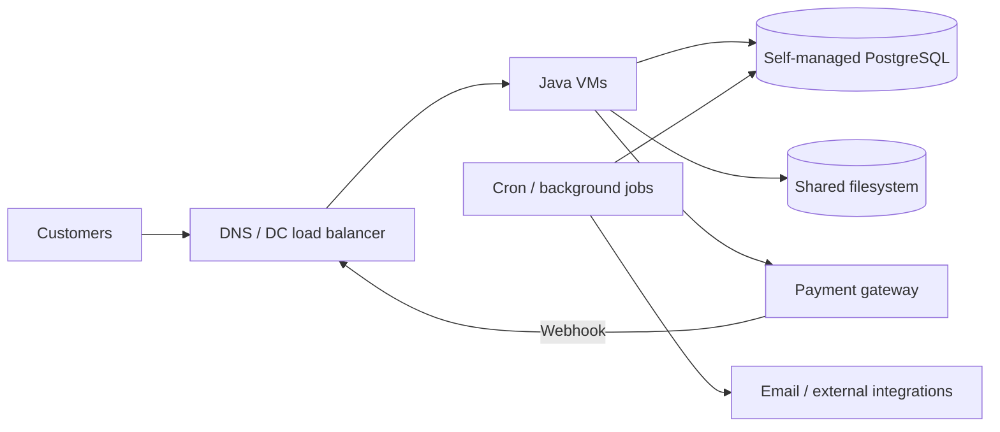
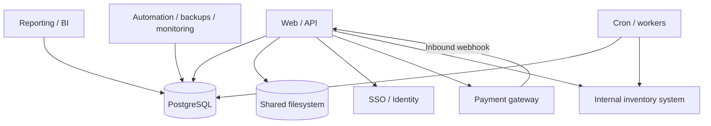
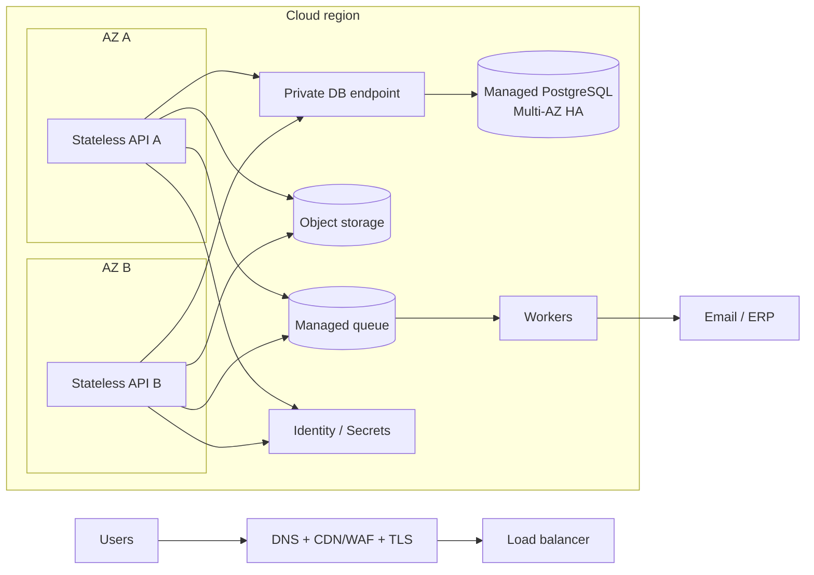
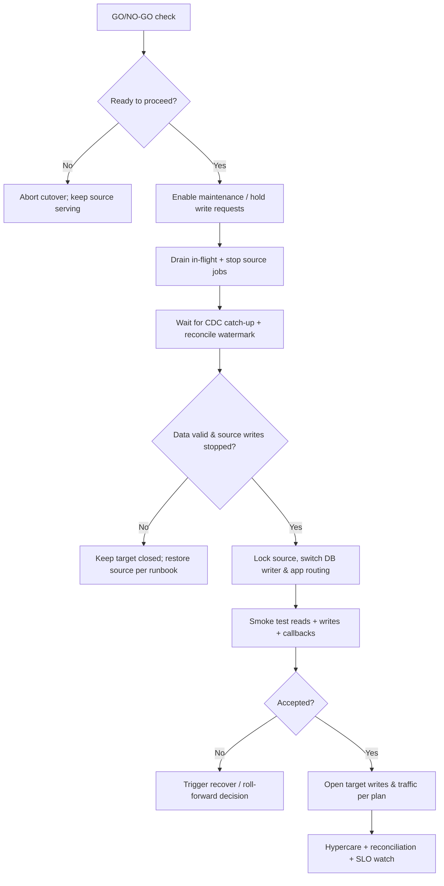

# Building a Migration Plan for a Live Production System

## 1. Exercise Objectives

Migrating a live user-facing application to the cloud is never as simple as copying source code, virtual machines, and databases. When transactions continue arriving, every change to networking, compute, storage, or deployment model can impact **data correctness, customer experience, and recoverability**. A solid migration plan defines when traffic can shift, who holds decision authority, what evidence proves cutover succeeded, and what to do if errors emerge.

This lesson belongs to the **Design Exercises** chapter of the `CLOUD_ARCHITECTURE` module. Learners use business requirements to select networking, compute, data, and deployment models, evaluating trade-offs among reliability, security, scalability, cost, and operations through **Well-Architected** thinking.

After this lesson, you will be able to:

1. Survey an existing system and build a dependency map before migrating.
2. Turn business requirements into verifiable migration criteria, including acceptable downtime, data integrity, SLOs, and RPO/RTO.
3. Compare application, data, and traffic migration strategies and pick one suited to real constraints.
4. Partition work into migration waves, build cutover runbooks, define GO/NO-GO gates, and plan recovery paths.
5. Perform initial estimates for data transfer time, capacity, risks, and costs, and organize pre-production testing.
6. Write an Architecture Decision Record (ADR) and evaluate the design against Well-Architected principles.

**Exercise deliverables:** system inventory, current- and target-state diagrams, solution decision matrix, data migration plan, wave schedule, cutover/rollback runbook, risk register, and acceptance evidence.

## 2. Running Scenario: A Live Customer Ordering System

Suppose an enterprise operates an ordering application inside an on-premises data center. Users access a website and API; order data lives in self-managed PostgreSQL; product files live on shared storage; notification tasks run in background processes.

### Assumed Current State

| Component | Current state | Challenges to address |
| --- | --- | --- |
| Website and API | 3 VMs running a Java app behind an internal load balancer | Manual deployments; scaling machines up/down is slow |
| Database | PostgreSQL primary on a VM, one standby replica, scheduled backups | Patching, failover monitoring, and restores require heavy effort |
| Login sessions | Some state kept in app-server memory | Shifting traffic can log users out |
| Images and receipts | Shared filesystem / NFS | Hard to scale and keep synced consistently with metadata |
| Background jobs | Internal cron/jobs sending emails and syncing stock | Jobs can run twice if both environments are active |
| Payments | Calls external payment gateway; receives webhooks | Risk of replaying transactions or misrouting webhooks when endpoints move |
| Security | Network rules and config secrets managed piecemeal | Need inventory of permissions, encryption, and access logs |
| Operations | Logs on VMs; dashboards lack order-journey SLOs | Hard to spot regressions quickly during traffic shifts |

Logical diagram:



### Illustrative Business Requirements

| Code | Requirement | Acceptance metric or rule |
| --- | --- | --- |
| BR-01 | Website and API stay available during migration | Planned **order-write freeze window must not exceed 10 minutes** |
| BR-02 | Zero lost or duplicated confirmed orders during cutover | All orders paid before write freeze reconcile on target; zero duplicate payment captures |
| BR-03 | Peak load performance | 450 requests/second, ordering API p95 under 700 ms in agreed load tests |
| BR-04 | Post-migration availability target | 99.9% monthly SLO for the order-creation journey |
| BR-05 | Infrastructure fault tolerance | Survives loss of one instance and one Availability Zone (AZ) within HA scope |
| BR-06 | Disaster recovery within defined scope | RTO 60 minutes; RPO 15 minutes **for business-approved DR scenarios** |
| BR-07 | Security | Personal data protected by RBAC, encryption, auditing, and data residency controls |
| BR-08 | Finance and operations | Monthly spend has forecast budget and alerts; runbooks and on-call are in place |

These figures are **for exercise practice only**. In a real project, measure hourly/daily traffic, agree on SLO formulas, and confirm exact DR scenarios for RTO/RPO. "Zero lost confirmed orders during cutover" is a transactional integrity gate for the switchover, **distinct** from disaster RPO. Asynchronous replication by itself never proves zero data loss.

## 3. Distinguishing Migration Strategies

Cloud migration involves choices that can vary per component:

| Approach | Meaning | Suitable example | Trade-off |
| --- | --- | --- | --- |
| **Rehost** | Move workloads largely as-is | Move an app VM to a cloud VM | Faster, yet preserves technical and operational debt |
| **Replatform** | Upgrade parts of the platform with minimal business-logic edits | Run Java app on PaaS/managed containers; move PostgreSQL to managed DB | Reduces ops toil; requires checking compatibility and connectivity |
| **Refactor / rearchitect** | Redesign application and service boundaries | Extract background jobs, externalize sessions, event-enable transactions | More flexible, yet complex and hard to finish in one wave |
| **Repurchase** | Replace application with SaaS or another product | Adopt a SaaS CRM instead of an internal tool | Changes business processes; requires data and integration migration |
| **Retain** | Keep on-premises for a phase | Systems incompatible with cloud or tied to specialized hardware | Requires hybrid links and operating two environments |
| **Retire** | Decommission unneeded components | Legacy batch jobs or unused services | Must verify no hidden dependencies remain |
| **Relocate** | Move compatible virtualization stack with minimal OS changes | Shift workloads on matching virtualization tech where supported | Platform-dependent; gains fewer managed-service benefits |

These are **strategy categories**, not a mandatory sequence. In this example, you might **replatform the web/API and PostgreSQL**, apply a **targeted refactor** to pull sessions/jobs off VMs, **retain** an internal integration initially, and defer deep optimization until production stabilizes.

### Avoid Packing Too Many Changes Into One Wave

If you simultaneously migrate the DB, split a monolith into 12 microservices, redesign APIs, and swap payment gateways, the number of variables explodes. Separate changes into:

- **Essential for safe cutover:** endpoints, credentials, network paths, session state, storage, background jobs, compatibility tests.
- **Pre-migration risk reducers:** adding observability, backup/restore, idempotency, IaC, and job kill switches.
- **Deferrable changes:** domain decomposition, major architectural rewrites, and non-essential tech swaps.

## 4. Surveying the System Before Designing the Target

The first step is not drawing a pretty cloud diagram, but capturing **ground-truth operations**.

### 4.1. Inventory Matrix

| Area to inventory | Data to collect | Why it matters |
| --- | --- | --- |
| Workloads | Apps, versions, runtimes, OS, containers/VMs, startup configs | Determines compatibility and packaging |
| Live load | Request rates, peaks, concurrency, CPU/RAM, I/O, batch windows | Target sizing and capacity tests |
| Databases | Engine/version, extensions, schemas, large tables, TPS, WAL/binlogs, indexes, stored procedures | Selects managed service and replication method |
| Unstructured data | Total file size, object count, rename patterns, checksums, owners | Plans object storage and sync |
| Dependencies | DNS, IdP, payment gateway, email, ERP, internal tools, firewalls, VPNs, IP allowlists | Prevents post-cutover connectivity outages |
| State and jobs | Sessions, crons, schedulers, queues, temp files, caches, webhooks | Prevents lost sessions, duplicate jobs, or missed work |
| Security | Sensitive data, accounts/roles, certificates, secrets, encryption keys, audits | Designs permissions and compliance |
| Operations | Backups, restore duration, deploys, incidents, on-call, dashboards, alerts, runbooks | Identifies recovery dependencies |
| Licensing / cost | Licenses, contracts, egress, storage, bandwidth, parallel-run duration | Estimates budget |

Check **reverse dependencies** too: not just what the app calls, but what calls the app. For example, a payment gateway sends webhooks to an old IP; a warehouse system queries the internal DB directly; a reporting cron reads files straight off NFS; or ops staff run ad-hoc scripts against undocumented schemas.

### 4.2. Mapping Dependencies



Every edge should record: **source, destination, direction, port/protocol, identity, latency tolerance, retries, owner, environment, and failure impact**. Any unverified dependency is a risk to investigate before cutover.

### 4.3. Baseline Measurements

Collect at least 1–2 meaningful business cycles covering peak hours, daily batch jobs, and promotional spikes if any. Record request rate, p50/p95/p99 latency, error rate, DB transactions/second, connection counts, slow queries, replication lag, resource usage, throughput, and order-journey success rate. Mark missing measurements as **assumptions** and schedule instrumentation.

## 5. Designing the Cloud Target Architecture

One target option for the example:



This diagram shows logical relationships—it **does not claim** every managed service sits inside the app's subnet. Private endpoints, regional service access, outbound routing, NAT, and firewall policies must match the actual provider's capabilities.

### Decisions to Document Explicitly

| Domain | Initial choice | Pre-lock checks |
| --- | --- | --- |
| Networking | Segmented subnets; public LB only, API and DB blocked from direct Internet access | CIDR overlaps, hybrid DNS, outbound egress, TLS, private endpoints |
| Compute | Managed containers/PaaS across ≥ 2 AZs with N-1 capacity | Boot time, autoscaling, quotas, health checks, cold starts if serverless |
| Data | Managed PostgreSQL with appropriate HA and backup/PITR | Compatibility, extensions, schemas, failover, connection caps, restore tests |
| Files | Object storage with controlled URLs/ACLs | Checksums, MIME types, public/private ACLs, lifecycle policies |
| Sessions | Shared session store or protected stateless tokens | Zero dependence on single-instance memory |
| Background jobs | Queue + workers or leased/locked schedulers | Never let two workers execute non-idempotent transactions concurrently |
| Identity | Workload IAM, secret manager, least privilege | Scoped DB and API credentials |
| Observability | Metrics, logs, traces, synthetics, SLO-based alerts | Ability to compare source vs. target errors during cutover |
| Deployment | IaC and CI/CD with app rollback | Backward-compatible schema migrations, production RBAC |

**Multi-AZ is part of reliability, not a substitute for DR.** If requirements cover losing an entire region, separately analyze backup locations, cross-region restore capability, encryption keys, DNS, data replication, and empirical RPO/RTO. Never claim compliance just by toggling "managed" or "HA."

## 6. Choosing the Right Migration Pattern

Three common cutover approaches:

| Pattern | Execution | Pros | Cons |
| --- | --- | --- | --- |
| **Big bang** | Stop source, move app/data, turn on target all at once | Minimal intermediate states | Long downtime risk; hard to roll back once new writes arrive |
| **Parallel run / blue–green** | Build target alongside source, verify, then flip traffic at a set window | Thorough testing; short cutover if replication keeps up | Parallel-run cost; strict writer management needed |
| **Phased / strangler** | Migrate components or journeys gradually | Smaller blast radius; learn from early waves | Complex routing, data compatibility, and hybrid operations |

For the ordering example, pick **parallel target build** paired with **controlled phased waves**. Start with read-only or low-risk batch paths; switch the single-writer order API/DB in one rehearsed cutover. While the target DB replicates from the source DB, maintain **a single authoritative data source at any moment** unless a proven multi-writer design exists.

### Single-Writer Discipline

While source data replicates to target:

```text
BEFORE CUTOVER:
  Production app -> Source DB (writer)
  Source DB -> snapshot + CDC -> Target DB (read-only/shadow)

AT CUTOVER:
  Block/hold new write requests
  Drain in-flight requests and wait for sync catch-up
  Lock/fence source writer per runbook
  Verify target data and duplicate protections
  Enable target writer only after all gates pass

AFTER CUTOVER:
  Production app -> Target DB (writer)
  Source DB -> retained as reference only, never accepts writes
```

**Direct application dual-writes** to both DBs risk succeeding on one and failing on the other; ordering, transactions, and conflicts become very hard to guarantee. Use dual-writes only with explicitly engineered and tested coordination and reconciliation protocols. If the business cannot tolerate any write freeze at all, adopt a specialized consistency architecture with proof rather than assuming CDC delivers zero-downtime cutovers by magic.

## 7. Data Migration Planning: Where Correctness Lives

### 7.1. Choosing a Replication Method

| Method | Characteristics | Best fit |
| --- | --- | --- |
| Backup/restore or dump/import | Transfers a consistent snapshot at a fixed timestamp | Small datasets or generous downtime windows |
| Initial snapshot + CDC | Loads baseline data, then streams transaction-log changes | Continuously written systems needing a brief cutover |
| Engine-native physical/logical replication | Keeps a compatible replica with catch-up stream | Matching engines/versions meeting replication rules |
| Domain/table-by-table migration | Moves data and features in cohorts | Clear ownership boundaries and few cross-domain transactions |
| Offline seed + incremental sync | Massive datasets exceeding network bandwidth | Secure physical transport plus delta catch-up |

When moving to managed PostgreSQL, check **engine version, extensions, encoding/collation, sequences, roles/permissions, stored procedures, triggers, indexes, DDL, WAL retention, replication support, and target-tool limits**. CDC does not always replicate DDL, sequences, or non-table objects automatically; maintain a dedicated checklist to migrate and verify them.

### 7.2. Step-by-Step Data Pipeline

1. **Classify data:** core transactional data, files, rebuildable caches, historical archives, sensitive data, and legally retained records.
2. **Back up the source** before touching anything; test restoring the backup.
3. **Prepare compatible target schemas;** configure least-privilege roles, encryption keys, private links, and migration scripts.
4. **Load baseline** from a consistent snapshot/dump and record the transaction-log high-watermark.
5. **Start CDC/replication** from the matching checkpoint, ensuring zero change gap between snapshot and stream.
6. **Monitor lag and log health;** ensure a slow target does not fill source WAL/disks.
7. **Reconcile in batches** at matching synchronized checkpoints, checking counts, monetary totals, primary keys, relations, and sampled records.
8. **Cut over writer** during the locked window: stop source writes, drain in-flight work, catch up logs, fence source, run final checks, enable target writes.
9. **Post-cutover verification:** reconcile new records, payment captures, webhooks, batches, and downstream feeds.

For NFS files, copy the baseline, run delta syncs for changing files, and verify checksums/metadata at cutover. Migrating DB metadata without its files leaves orders pointing to missing receipts.

### 7.3. Verifying Data Integrity

**Comparing row counts alone is insufficient.** Two tables with equal counts can hold different contents. Layer your checks:

| Check layer | Example | Caveat |
| --- | --- | --- |
| Volume | Counts by day, tenant, or partition | Compare at the **exact same transaction checkpoint** |
| Business values | Order revenue totals, counts per status, stock sums | Check currency units and rounding |
| Keys & integrity | Primary/foreign keys, orphan rows, sequences | Sequences often need explicit advancement |
| Sampled records | Stratified ID comparisons and normalized content checksums | Keep PII out of reconciliation reports |
| Files | File counts, byte sizes, checksums, permissions | ETags are not always reliable content checksums |
| External effects | Payments, emails, webhooks, inventory | Reconcile against partner ledgers and event IDs |

Illustrative PostgreSQL query for daily reconciliation:

```sql
SELECT
    created_at::date AS order_day,
    COUNT(*) AS order_count,
    SUM(total_minor_units) AS total_amount_minor_units,
    COUNT(*) FILTER (WHERE status = 'CONFIRMED') AS confirmed_count
FROM orders
WHERE created_at < :cutoff_timestamp
GROUP BY created_at::date
ORDER BY order_day;
```

`:cutoff_timestamp` must represent a consistent point processed by both sides. Never compare the source at 10:00 against a target lagging at 09:59 and declare data loss. For strict accuracy, use consistent snapshots, transaction log positions/LSNs, and commit-boundary checks supported by your tools/engine.

### 7.4. Controlling In-Flight and Changing Data

Test these scenarios specifically:

- An order commits, but the client response times out and the client retries.
- A payment callback arrives mid-ingress or webhook endpoint switch.
- A background job runs on both source and target, double-sending emails or double-deducting stock.
- Target sequences lag behind max IDs, causing primary-key collisions on the first new writes.
- A newly uploaded source file has not yet synced to object storage.
- A large transaction has not replayed yet even though average replication lag looks tiny.

Use **idempotency keys** on order/payment operations, matching unique constraints, audit trails, and bounded retries. Stopping source jobs and starting target jobs must be explicit, owned steps in the runbook.

## 8. Safely Migrating Applications and Traffic

### 8.1. Preparing Applications Before Cutover

- Ensure APIs hold **no critical state in instance memory**; move persistent sessions to a shared store or compatible token scheme.
- Separate config per environment; manage secrets via a dedicated vault and workload identities, never baked into images or source.
- Expose health/readiness endpoints reflecting true readiness to serve; keep unready instances out of the pool.
- Add timeouts, bounded retries, connection pooling, and idempotency to write requests and workers.
- Use **expand–migrate–contract** schema migrations so source and target versions coexist cleanly during transition.
- Confirm external partners accept new IPs, DNS names, TLS certificates, and callback URLs; verify allowlists on both ends.
- Place feature flags or reversible routing rules to control blast radius during validation.

### 8.2. Shadow Traffic, Canary, and Blue–Green

**Shadow traffic** mirrors copies of live requests to the target to measure latency/responses, but must strip or mock every side effect: never create real orders, send emails, trigger charges, or mutate live data from mirrored requests. Mask or restrict sensitive payloads per policy.

**Canarying** shifts a small fraction of real traffic to the new release while watching errors. When **changing DB writers**, write canaries require both app paths to share one authoritative DB or enforce strict tenant/traffic partitioning. Never send 5% of writes to a target DB while 95% still go to an independent source DB.

**Blue–green** works well with two complete app stacks and fast ingress switching. Remember that rolling back the app tier does not roll back DB writes once the target has accepted new transactions.

### 8.3. DNS, Persistent Connections, and User Sessions

Lowering DNS TTL before cutover speeds up some resolvers, but **never guarantees every client switches immediately** due to caches, keep-alive connections, and browsers. Where supported, shifting routes inside a load balancer/gateway behind a stable endpoint is easier to control than DNS flips. Either way, test open connections and partner webhooks.

Verify cookies, sessions, CORS, redirect URIs, callbacks, and new hostnames/TLS certificates. Changing domains or identity issuers can force users to re-authenticate; factor that UX impact into customer communications.

## 9. Partitioning Migration Into Waves

A sound plan does not force everything to cut over together:

| Wave | Components / scope | Exit criteria | Dependencies |
| --- | --- | --- | --- |
| Wave 0 | Landing zone: network, IAM, logs, CI/CD, IaC, budgets | Target infra is reproducible, monitored, and audited | Cloud permissions, connectivity |
| Wave 1 | Object storage, static files, CDN, and access checks | Files/checksums match; permissions and caching verified | Wave 0 |
| Wave 2 | Read-only services, reporting, or staging environments | Performance baseline verified; zero unintended side effects | Wave 0, test data |
| Wave 3 | Cloud test runs for API/workers; managed DB & CDC staged | Schema compatibility, data checks, load/failover tests pass | Waves 0–2 |
| Wave 4 | Core transactional cutover: close source writer, open target writer | Passes GO/NO-GO gates, reconciliation, and monitoring | Wave 3 |
| Wave 5 | Hypercare, optimization, revoke legacy links/access, retire source on schedule | Stable SLOs, verified backups/restores, project sign-off | Wave 4 |

Each wave builds **evidence and confidence** for the next. Moving easy modules first is not enough if the order-write path still carries unmitigated risk; rehearse critical cutovers under production-like conditions. Also avoid shutting down the source too early—keep it around for reconciliation, archiving, forensics, and safe decommissioning.

## 10. Estimating Duration, Capacity, and Cost

### 10.1. Data Transfer Time

Suppose we must copy **500 GB** of baseline data over a 200 Mb/s link achieving 70% effective throughput:

```text
Effective throughput = 200 Mb/s × 0.70 = 140 Mb/s
Data volume          = 500 GB × 8 = 4,000 Gb (decimal GB)
Ideal transfer time  = 4,000 Gb / 0.14 Gb/s
                     ≈ 28,571 seconds ≈ 7.94 hours
```

This is an **idealized wire-transfer estimate**, ignoring disk reads, compression, app overhead, retries, encryption, DB load, verification, and ongoing changes during the copy. For a 500 GB DB, test empirically and include **CDC apply time, index builds, and verification**. Build generous buffers; never schedule a cutover window solely by dividing GB by bandwidth.

If the source generates writes at 30 MB/s while CDC applies only 20 MB/s, backlog grows by **10 MB/s**, meaning CDC will never catch up even after the snapshot completes. Measure both write generation rate and apply rate, plus WAL/binlog retention limits.

### 10.2. Capacity When One AZ Fails

Suppose each AZ handles at most 300 requests/second while confirmed peak load is 450 requests/second:

```text
Normal two-AZ capacity  = 300 + 300 = 600 req/s
After losing one AZ     = 300 req/s
Shortfall at peak       = 450 - 300 = 150 req/s
```

The system runs multi-AZ yet **lacks N-1 capacity** at peak. Size replicas and load controls around measured limits: keep ample headroom, fast autoscaling, rate limiting, checkout prioritization, and non-core degradation. Check DB connections, pools, quotas, and network bandwidth under failover concentration too.

### 10.3. Budget

Migration costs include both one-time and recurring spend:

| Category | Items to estimate |
| --- | --- |
| Prep & testing | Staging environments, load testing, migration engineering, DR drills |
| Parallel run | Source VMs/DB plus target cloud, CDC, hybrid links, dual logging |
| Data | Storage, backups, snapshots, PITR, sync, requests, cross-AZ/region transfer |
| Networking | VPN/direct links, NAT, private endpoints, internet egress, CDN |
| Compute & DB | AZ headroom, managed DB HA, workers, queues, caches |
| Security / ops | Key/secret management, audit logs, observability, incident response |
| Post-cutover | Policy-driven source retention, remaining licenses, decommissioning, rightsizing |

Compare **total cost of ownership** across at least two options, including ops toil and outage risk. Use live pricing for the target region at execution time. Enforce budgets and alerts tagged by environment/project so costly test resources are never left orphaned.

## 11. Pre-Cutover Security, Data, and Operations

### Minimum Safety Controls

1. **Networking:** expose only strictly necessary endpoints; private DB access; restrict east–west and outbound traffic.
2. **Identity:** separate accounts per workload and environment, least privilege, MFA for admins, monitored break-glass accounts.
3. **Encryption:** TLS in transit; encrypt data, backups, and object storage per policy; documented key recovery.
4. **Secrets:** store in a secret manager with controlled rotation; never in repos, shared configs, or logs.
5. **Data governance:** verify residency, retention limits, deletion/access rights, audit logs, and PII protections.
6. **Supply chain:** versioned builds, image/dependency scans, CI/CD RBAC, and IaC reviews.
7. **Backups & DR:** restorable, monitored backups aligned with agreed scenario RPO/RTO.

During an incident, never bypass authentication or grant broad DB privileges just to "keep things running." Recovery procedures must preserve critical security controls and log all emergency actions.

### Operational Coordination

Confirm the cutover commander plus leads for DB, application, network/DNS, security, integrations, and business representation. Every role needs a backup, verified communication channel, shift coverage, and pre-tested access. Log decisions in tickets/ADRs—never leave GO/NO-GO calls unrecorded in verbal meetings.

## 12. Test Plan and Acceptance Criteria

| Test category | Scenarios | Evidence to retain |
| --- | --- | --- |
| Functional | Login, catalog, order creation, payment, refund/cancel, webhooks, search | Test results, traces, synthetic order IDs |
| Data compatibility | PostgreSQL version/extensions/schemas, sequences, types, timezones, collations | Reconciliation scripts and diff reports |
| Performance | Normal load, 450 req/s peak, bursts, concurrent batches | p95/p99, error rates, DB utilization, throughput |
| Reliability | Kill instance, DB failover, simulated AZ loss, injected network latency | Recovery times, user errors, logs/traces |
| Replication | Snapshot, CDC lag, large transactions, mid-stream network drop, resume | High-watermarks, lag charts, checksums |
| Business integrity | Client retries, duplicate callbacks, worker replays, anti-oversell/double-charge | Idempotency outputs, audit ledgers, reconciliation |
| Security | Least-privilege IAM, private DB, TLS, secret rotation, auditing | Permission and config test outputs |
| Cutover rehearsal | Full runbook dry run on representative dataset copy | Per-step timestamps, approvers, open issues |
| Restore / DR | Backup restore and targeted failover drills | Measured RPO/RTO and data verification |
| Cost | Load tests, target-environment spend tracking | Daily/monthly cost estimates and alerts |

During rehearsals, use **isolated environments and synthetic or policy-sanitized data**, avoiding accidental real payments or customer emails. Production fault injection requires explicit scope, abort triggers, and owners.

### Example Pre-GO Acceptance Criteria

These thresholds are **exercise proposals** and must be approved by the business and tuned to real baselines:

- All mandatory order/payment functional tests **PASS**.
- Load test at **450 req/s** holds checkout API p95 **under 700 ms** with errors within agreed SLO.
- Rehearsal achieves a write-freeze window **no longer than 10 minutes**.
- Records committed before freeze reconcile cleanly on target with zero unexplained invariant discrepancies.
- CDC catches up to final watermark; DB/sequences, files, webhooks, and queues pass verification.
- Restore drill meets agreed targets within **the tested scenario**.
- Owners, on-call schedules, and rehearsed recovery exist; zero unresolved critical security findings.

## 13. Cutover Runbook: Step-by-Step Production Switch

A runbook is a **conditional execution script** naming owners, confirmation signals, and fallback actions if a step fails. Below is an illustrative runbook; real timings must come from rehearsals.

### Before the Cutover Window

| Relative time | Task | Owner | Evidence / gate |
| --- | --- | --- | --- |
| T−14 to T−7 days | Finalize IaC, APIs, networking, staging, observability | Platform + App | Resource and dashboard checklist |
| T−7 to T−2 days | Load baseline, start CDC, sync files, run reconciliation and load tests | DBA + Data | Lag charts, data reports |
| T−48 hours | Rehearse full runbook; verify write-freeze duration and failover | Incident commander | Drill report and closed issues |
| T−24 hours | Confirm external partners, IP allowlists, webhooks, cert expiry, customer notice | App + Partner + Ops | Contact sheet and ACKs |
| T−4 hours | Check backups, replication, quotas, spend, secrets, on-call | DBA + Security + Ops | Go/No-Go checklist |
| T−30 minutes | Freeze unrelated deploys, snapshot metrics/LSN, confirm rollback boundary | Incident commander | Start log |

### During the Cutover Window



Step-by-step execution:

1. **T−00:10 — Confirm GO:** commander rolls call across owners; verifies backups, CDC lag, current production errors, capacity, secrets, and comms.
2. **T+00:00 — Freeze new writes:** API returns controlled maintenance status or queues safely per pre-designed contract. Reads may stay open if they do not mislead users or mask critical errors.
3. **T+00:01 — Drain:** complete or finalize in-flight requests/transactions, halt schedulers and duplicate webhook side effects; verify zero rogue write paths remain.
4. **T+00:03 — Final sync:** wait for CDC to reach the exact commit watermark; reconcile DB, sequences, files, and transactions; confirm source DB accepts zero writes.
5. **T+00:05 — Switch writer and ingress:** apply pre-tested config; only one DB is authoritative writer. Log every action with timestamp and operator.
6. **T+00:06 — Smoke tests:** sign in, read existing orders, create a synthetic test order with idempotency key, verify safe callbacks, check logs/traces, DB pools, queues, and background jobs.
7. **T+00:08 — Sign-off:** business rep and tech lead confirm zero material discrepancies; open live production writes on target if passed.
8. **T+00:10 onward — Hypercare:** keep on-call engaged, watch SLOs, reconcile orders, payments, files, and jobs; ramp traffic per validated plan.

These minute marks are **not guarantees**; they illustrate designing a 10-minute window. If any step fails, lag stalls, or tests fail, **halt per runbook** instead of forcing the clock. Specifically, if you cannot stop every writer—crons, batches, webhooks, DBA scripts—you cannot claim single-writer safety.

### Decision Authority at Each Gate

| Gate | Proposer | Approver | Required condition |
| --- | --- | --- | --- |
| Begin write freeze | DBA, App, Ops | Incident commander + business rep | All pre-cutover checklists PASS |
| Promote target DB to writer | DBA + data owner | Incident commander per authority | Watermark/consistency PASS; source writes fenced |
| Open live write traffic | App + QA + Ops | Incident commander + business rep | Smoke tests, monitoring, zero blockers |
| Declare cutover complete | Ops + business | Service owner | Post-cutover reconciliation and stable SLOs |

## 14. Rollback, Roll Forward, and the Point of No Simple Return

**Application rollback** reverts code or config. **Data rollback** reverts data state to an earlier checkpoint. The two are not equivalent.

### Before the Target Accepts New Transactions

If the source remains the sole writer, target writes are not yet open, and errors appear during sync/reconciliation, you can:

1. Abort cutover and keep the source DB authoritative.
2. Re-enable source writes per rehearsed procedure.
3. Point ingress back to source; verify login, order creation, payments, and webhooks.
4. Inspect queued/pending requests and reprocess safely via idempotency.
5. File incident/change logs and reschedule after fixing root cause.

### After the Target Accepts New Transactions

A harder situation: the source DB is now **stale**. Simply flipping DNS back to source risks erasing orders and payments already committed on target. Options:

- **Roll forward:** keep target as authoritative, fix app/config defects in place, and mitigate impact. Often far safer when reliable reverse replication is absent.
- **Controlled return to source:** permissible only with a proven method to replay all valid target changes back to source, resolve conflicts, and reconcile external side effects (payments/webhooks/queues). Likely requires another brief write freeze.
- **Degraded mode:** temporarily disable risky mutations while keeping safe reads/lookups online during investigation and reconciliation.

The **write authority transfer point** must be called out explicitly in the runbook. Past that line, "point DNS back to old stack" is no longer a simple rollback. Design the post-transfer recovery path, decision owner, and realistic recovery duration from drills upfront.

### Incident Decision Matrix

| Timing / incident | Priority action | Condition |
| --- | --- | --- |
| High CDC lag before locking source | Postpone cutover | Keep source serving; fix replication |
| Data reconciliation fails before opening target writer | NO-GO | Investigate discrepancies; never ignore critical transactions |
| New routing fails before any target writes | Route back to source | Confirm source remains writer; check in-flight work |
| Target API fails after new orders committed | Patch/roll back code on target or degrade features | Never drop data committed on target |
| Target DB unusable after accepting writes | Execute DR/restore and reconcile per runbook | Quantify actual RPO/RTO; handle external side effects |
| Payment gateway charged, order un-updated | Reconcile and recover transaction state | Never re-charge on retry; use idempotency key / transaction ID |

A valid backup restores past state, yet does not replay transactions committed afterward. Never promise zero RPO when recovery relies solely on an older snapshot.

## 15. Hypercare and Project Closure

Right after cutover, focus on **business journeys and fresh data**, not just VM health:

| Area | Metrics / reconciliation | Intervention signal |
| --- | --- | --- |
| Customers | Error rates, p95/p99 latency, logins, checkout success | SLO burn, broad errors, lost sessions |
| Database | Query latency, pools, CPU/I/O, locks, failover events | Exhausted connections, hung transactions, baseline drift |
| Orders | Hourly order totals, statuses, duplicate/orphan counts | Unexplained variance |
| Payments | Amounts/transaction IDs, webhook lag, partner reconciliation | Charges missing orders or duplicate captures |
| Files | URLs, access permissions, new uploads, sample checksums | 404s, permission errors, missing receipts |
| Queues / jobs | Message age, backlog, retries, DLQ, duplicate side effects | Stuck jobs, double sends, dropped tasks |
| Security | Auth errors, role denials, audit events, secret failures | Broken least privilege or overly broad grants |
| Cost | Compute, managed DB, storage, egress, logs | Unexpected spend variance vs. forecast |

**Hypercare** is an intensified monitoring phase with dedicated responders and clear thresholds. Exercises might set checkpoints at 24 hours, 72 hours, and 7 days; real durations depend on business cycles. Only after daily/weekly batch reconciliations pass, dashboards stabilize, runbooks update, and ops owners accept handover should you schedule source decommissioning.

When retiring the source environment, verify:

- Zero clients, jobs, reports, or webhooks still rely on legacy IPs or databases.
- Retained archive copies comply with policy, with tested restores and scheduled expiry.
- Legacy credentials/secrets, VPNs, and firewall rules are revoked on schedule with no dangling access paths.
- Data slated for deletion is purged per retention workflows with proper sign-off.
- ADRs, diagrams, runbooks, owner rosters, and cost forecasts are updated.

## 16. Migration Risk Register

A risk register needs **likelihood, impact, detection signals, mitigations, owners, and residual risk**, not vague notes saying "there is a risk."

| ID | Risk | Impact | Signal / verification | Mitigation | Owner |
| --- | --- | --- | --- | --- | --- |
| R-01 | CDC fails to catch up before window | Extended cutover or missing data | Lag, retained logs, apply throughput | Benchmark, monitor, scale capacity, NO-GO if unsynced | DBA |
| R-02 | Sequence/schema/extension mismatch | Target transactions fail | Contract + compatibility tests | Trial migrations, schema fixes, sequence sync | App + DBA |
| R-03 | Webhooks/jobs run in both environments | Double charges, stock, or emails | External transaction IDs, event IDs, audits | Single active owner, idempotency, stop source jobs | App |
| R-04 | Surviving AZ lacks capacity | p95/5xx spike on failover | N-1 tests, saturation, quotas | Headroom provisioning, autoscaling, load shedding | Platform |
| R-05 | File metadata arrives before payload | 404s, missing receipts | Checksums, counts, synthetic downloads | Delta sync, validation gates | Data |
| R-06 | External partners reject new IP/TLS | Payment/ERP outages | End-to-end connectivity tests | Update allowlists, contracts, rehearse | Integration |
| R-07 | IAM/secret error or overly broad access | Outage or data leak | Policy tests, auth logs, security review | Least privilege, vault, staged rollout | Security |
| R-08 | Fallback ignores target writes | Lost orders if routed back to source | Tabletop exercises, cutover rehearsals | Explicit write boundary, roll-forward, reverse reconciliation if needed | Incident commander |
| R-09 | Parallel-run spend exceeds budget | Budget overrun | Daily cost reports, tags | Budget alerts, lifecycles, decommission dates | FinOps |
| R-10 | Missing owners/on-call during cutover | Slow response, breached RTO | Attendance and permission drills | Runbooks, backups, early access checks | Ops |

Priority scores can use an internal `Impact × Likelihood` matrix, provided scales are explicit and never mistaken for absolute probabilities. Risks involving data loss or sensitive data exposure warrant dedicated scrutiny even at low frequency.

## 17. Reviewing the Plan with Well-Architected

| Pillar | Self-review questions | Design and operational evidence |
| --- | --- | --- |
| **Operational excellence** | Is every step owned, measurable, and repeatable? | IaC, runbooks, rehearsals, ADRs, on-call, change logs |
| **Security** | Are data, keys, permissions, and links protected across both environments? | Data classification, IAM, TLS, audits, secrets, access tests |
| **Reliability** | Can we transfer writes and recover without losing or duplicating core business records? | CDC checks, idempotency tests, failover/restore drills, RPO/RTO |
| **Performance efficiency** | Does target sustain peak load and single-AZ loss? | Load tests, N-1 capacity, p95, DB pools, quotas |
| **Cost optimization** | Are temporary and ongoing costs managed with a source-retirement date? | Budgets, cost breakdowns, alerts, decommission plan |
| **Sustainability** | Do we minimize prolonged parallel runs, redundant storage, and idle capacity? | Right-sizing, autoscaling, storage lifecycles, shutdown dates |

A new architecture does not automatically "pass Well-Architected" just by using a managed database and multiple AZs. It passes only when **requirements, failure modes, choices, evidence, and residual risks** are thoroughly documented.

## 18. Capstone Exercise: Compiling a Migration Package for Review

Assume you are the architect for the system in Section 2, preparing to present your plan to the product owner, DBA, security, and operations. Produce these seven deliverables:

1. **As-is / to-be diagrams:** show ingress, apps, DB, files, jobs, payments, dependencies, and network boundaries; highlight the single writer.
2. **Requirement matrix:** lock functional and non-functional requirements, measurement methods, and approvers.
3. **Migration decision record:** state strategies for compute, data, files, and jobs; compare at least two options.
4. **Wave plan:** sequence waves, dependencies, exit gates, and owners.
5. **Data migration plan:** detail snapshots, CDC, watermarks, data comparisons, and network-drop recovery.
6. **Cutover + recovery runbook:** step-by-step actions, owners, GO/NO-GO gates, write-transfer point, and before/after fallback steps.
7. **Validation + risk register:** load tests, fault injection, restore drills, security, cost, and at least five prioritized risks.

### Sample Architecture Decision Record (ADR)

```text
ADR-001: Migrate Ordering Application to Managed Containers
Status: Proposed
Context:
  - 450 req/s peak; planned write freeze <= 10 minutes
  - Java app currently on VMs; self-managed PostgreSQL DB
  - Limited ops headcount; need to reduce OS management toil
Decision:
  - Replatform Java app onto multi-AZ managed containers
  - Managed PostgreSQL with appropriate HA and backup/PITR
  - Snapshot + CDC with a single DB writer at all times
  - Object storage for files; owned schedulers/workers
Options considered:
  - Pure VM/DB rehost
  - Full refactor into microservices prior to migration
Trade-offs:
  - Managed-service fees and parallel-run spend
  - Runtime, schema, network, and partner integration compatibility
Verification criteria:
  - Cutover rehearsal, data reconciliation, N-1 tests, restore drills
  - Prove payment journeys generate zero duplicate charges
Owners: Platform + App + DBA; business approves cutover
```

### Sample Conditional Milestone Gate Table

| Milestone | Mandatory exit gate | Outcome if missed |
| --- | --- | --- |
| Design freeze | Diagrams, inventory, targets, and risk register approved | Continue discovery; withhold production dates |
| Data rehearsal | Snapshot + CDC complete; critical reconciliations pass | Fix migration tools/schemas and retest |
| Cutover rehearsal | Fits time window, recoverable, business tests pass | NO-GO for production |
| Production cutover | Safe write freeze, data checks PASS, smoke tests PASS | Halt at matching recovery boundary |
| Hypercare exit | SLOs, batch reconciliations, cost/security, and ops handover met | Continue monitoring; keep source intact |

### Tips for Defending the Plan Before Review

Reviewers may ask: "Why not move everything in one night?", "Why need CDC if we already have backups?", "Running 2 AZs yet still short on capacity?", "If the target DB takes 100 orders and then fails, can we flip DNS back to source?", or "What if payment succeeded and the event replays?". Strong answers cite **data, assumptions, tested alternatives, and decision gates**—never just cloud product names.

### Exercise Grading Rubric (100 Points)

| Criterion | Max points | Evidence |
| --- | ---: | --- |
| Survey and dependency mapping | 15 | Inventory, as-is diagram, hidden dependencies |
| Target cloud design and trade-offs | 15 | To-be diagram, network/compute/data, ADR |
| Data migration and consistency | 20 | CDC, single writer, watermarks, reconciliation, idempotency |
| Cutover, rollback / roll forward | 20 | Runbook, gates, write boundary, recovery |
| Testing and acceptance evidence | 15 | Load, failover, restore, SLOs, data checks |
| Security, cost, operations | 10 | IAM, secrets, budgets, on-call, decommissioning |
| Clarity and executability | 5 | Owners, timeline, decision records |

## 19. Self-Check Questions

1. Why must migrating a live order-taking app care far more about **commit boundaries** and **writer authority** than a static DB copy?
2. When should you pick rehost vs. replatform, and when should major refactoring wait until after cutover?
3. Why is lowering DNS TTL not enough to make every client switch endpoints immediately?
4. With 500 GB of data, 200 Mb/s bandwidth, and 70% efficiency, what is the ideal transfer time—and which real-world factors are still missing?
5. If CDC lag keeps growing, should you start cutover merely because the initial snapshot finished loading?
6. How do you prove files, DB records, and payment transactions moved consistently?
7. Why is comparing `COUNT(*)` across two tables insufficient to prove data parity?
8. What is the difference between an application canary and a DB-writer cutover canary?
9. Once new orders commit on the target DB, why can flipping routing back to the source DB cause business data loss?
10. What must a multi-AZ architecture measure to know whether surviving capacity handles a single-AZ failure?
11. How should a runbook assign authority for NO-GO calls, write freezes, and promoting the target writer?
12. In a Well-Architected review, what evidence would you present for security, reliability, performance, cost, and operations of a migration plan?

**Key takeaway:** a live-system migration plan is **a plan for controlling business state transitions** onto new infrastructure. Start from real requirements and dependencies, enforce one authoritative data source, rehearse sync and cutover, set clear acceptance gates, define recovery after target writes begin, and use measured results to drive GO/NO-GO calls. Success means the service keeps running with **accurate data, solid security, and met targets**—not merely that cloud servers booted up.
