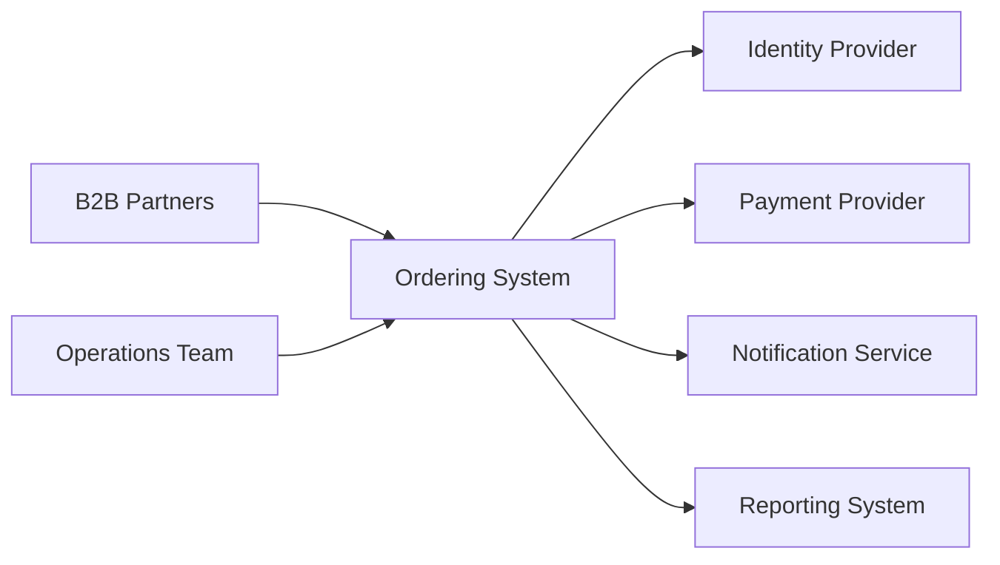
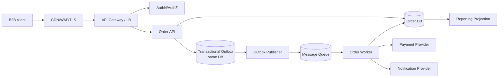
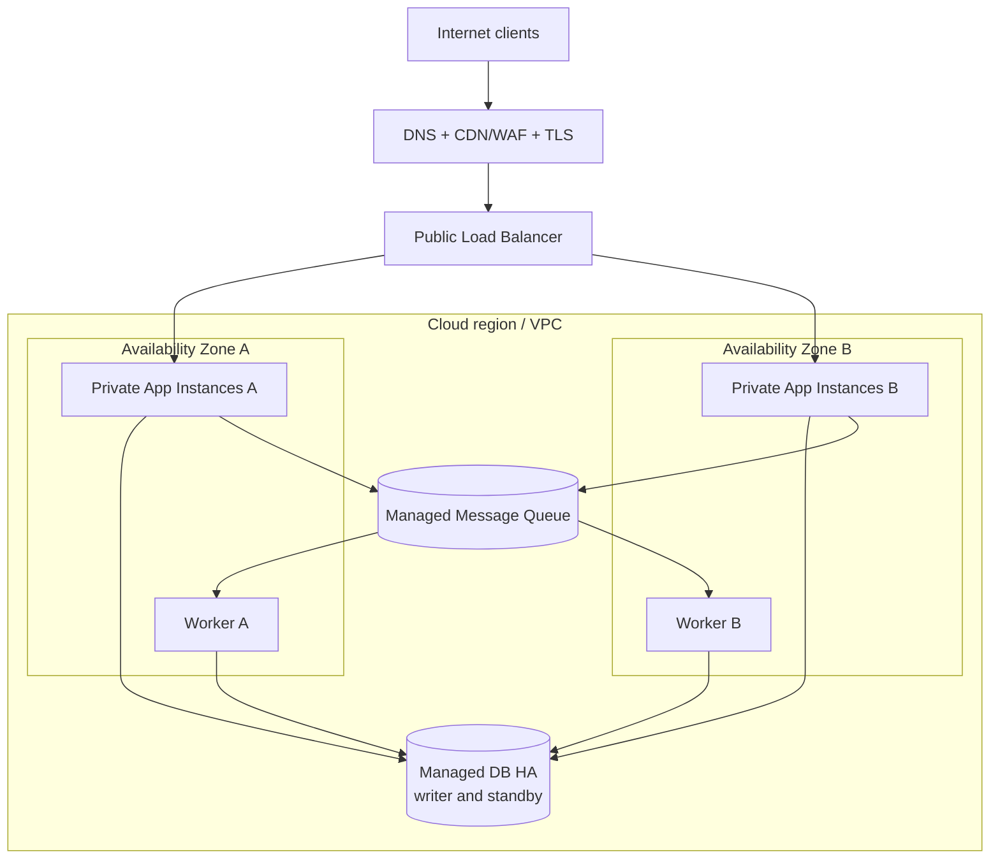
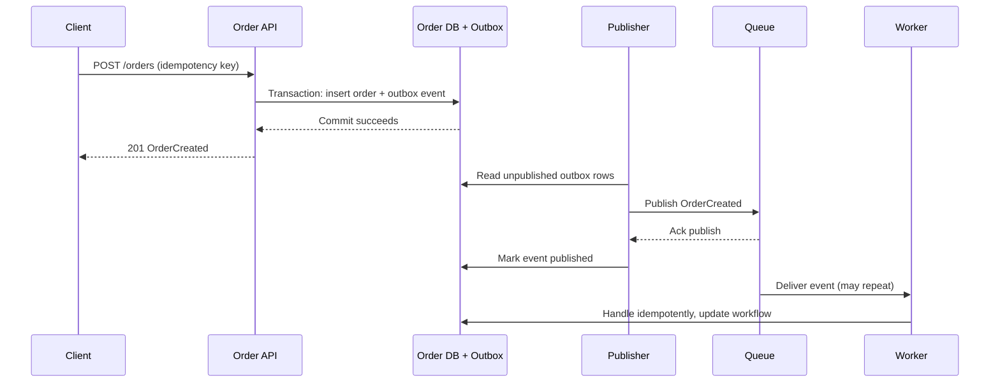
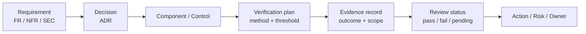

# Finalizing Architecture Documentation, ADRs, and Verification Evidence

> **Module:** CLOUD_ARCHITECTURE — designing cloud application architectures from business requirements through networking, compute, data, and deployment model choices.  
> **Chapter:** Design Exercises.  
> **Objective:** Finalize a handover- and review-ready documentation package: architecture description, Architecture Decision Records (ADRs), requirements traceability matrix, and verification evidence; while articulating trade-offs across reliability, security, scalability, cost, and operations under Well-Architected principles.

## 1. The Problem: Is a "Correct" Design Diagram Enough to Ship?

A cloud diagram showing a load balancer, two availability zones, a managed database, and a queue may look reasonable. Yet before sign-off, the implementation team still needs answers to:

- Why was this option chosen over alternatives? What conditions would invalidate the decision?
- Which business requirements, latency bounds, data-correctness invariants, and cost caps must the system meet?
- Which component owns which data, who holds access, and where do common failure points hide?
- Are availability, recovery time, scaling capacity, and security controls **measured**, or still only **assumed**?
- If the data model, cloud region, or provider changes, where do operators find the underlying assumptions, decisions, and recovery steps?

**Architecture documentation** is the package of artifacts and evidence that lets someone outside the original design team understand the system's scope, choices, rationale, limits, and verification methods. Documentation earns its keep when it answers practical questions from reviewers, builders, and on-call operators.

An **ADR (Architecture Decision Record)** captures one **architecturally significant decision**, its context, considered options, rationale, and consequences. An ADR does not replace diagrams or tests; it explains **why** the architecture took its shape.

**Verification evidence** is a result with clear provenance, methodology, timestamp, and acceptance criteria sufficient to substantiate a claim: test reports, dashboards, traces, restore/failover outputs, threat modeling results, audited configs, or cost estimates with transparent assumptions.

After this lesson, you will be able to:

1. Assemble a lean architecture package complete enough for review, build, and operations.
2. Write ADRs containing concrete decisions, alternatives, and real consequences—not merely naming chosen technologies.
3. Link **requirements → decisions → components → verification methods → evidence → status**.
4. Distinguish assumptions, simulation outputs, test results, and live production evidence.
5. Classify findings, open risks, conditional approvals, and pre-production blockers.
6. Run an evidence-based Well-Architected review grounded in explicit trade-offs.

## 2. What Does "Finalizing the Package" Mean?

There is no fixed page count for every system. A static internal site may need only a few pages; a cross-region payment platform may need multiple diagrams, threat models, disaster recovery plans, and compliance dossiers. **Depth must match risk and complexity.**

At minimum, a solid package should answer six questions:

| Review question | Required artifact or evidence |
|---|---|
| **What problem does the design solve?** | Problem statement, scope, stakeholders, use cases, and success criteria |
| **What quality levels must the system meet?** | Numbered functional/non-functional requirements, SLIs/SLOs, RTO/RPO, constraints, assumptions |
| **How does the system operate?** | Context/container/deployment diagrams, data flows, trust boundaries, access controls, dependencies |
| **Why this structure?** | ADRs, alternatives weighed, trade-offs, revisit conditions |
| **How do we know it meets targets?** | Test plan, acceptance criteria, evidence records, measurements, scope and limits |
| **What if things fail or requirements shift?** | Risk register, runbooks, monitoring, backups/rollbacks, ownership, open-decision backlog |

**Documentation Definition of Done (DoD):** every critical requirement has an owner and verification method; every high-impact decision has an ADR; diagrams reflect one consistent architecture; measurements tie to criteria; and unverified claims plus open risks are stated transparently.

"Having a pretty PDF" or "drawing lots of cloud service icons" is not a completion criterion.

## 3. Running Case Study: A B2B Ordering Platform

The figures below are **hypothetical practice inputs**, not measurements from a real system or guarantees from any cloud provider.

An enterprise is building an ordering platform for partner stores. Partners sign in, browse products, place orders, pay, and view fulfillment status. The design team must propose the first production architecture and a verification plan.

### 3.1. Initial Requirements

| ID | Requirement / constraint | Acceptance criteria | Priority |
|---|---|---|---|
| **FR-01** | Partners create orders and receive an order ID | Reusing an idempotency key never creates two orders with duplicate business effects | Mandatory |
| **FR-02** | Track order status | All valid state transitions are audited; intermediate processing states exist | Mandatory |
| **FR-03** | Notify when order is accepted | Notifications may trail the transaction; send failures must never lose orders | Should have |
| **NFR-01** | Handle peak load | At least 80 order-creation requests/second under the defined workload | Mandatory |
| **NFR-02** | Latency | p95 of valid order-creation requests ≤ 800 ms at target load | Mandatory |
| **NFR-03** | Availability | 99.95% SLO for valid order-creation requests over a 30-day window | Mandatory |
| **NFR-04** | Recover from single-AZ outage | RTO ≤ 30 minutes for order creation; data integrity must be verified | Mandatory |
| **NFR-05** | Recover reporting data | RPO ≤ 5 minutes for rebuildable/recoverable reporting data | Should have |
| **SEC-01** | Isolate access between partners | Users cannot read or modify another partner's orders | Mandatory |
| **SEC-02** | Protect data and service access | TLS; workload identities, least privilege, secret management, and audit logs | Mandatory |
| **OPS-01** | Observability and recovery | Dashboards, alerts, runbooks, rollback path, and named owners | Mandatory |
| **COST-01** | Operating budget | Hypothetical budget cap of 3,000 USD/month for described workload; list excluded costs | Exercise constraint |

**Points to clarify before locking the architecture:**

- Does "order-creation request succeeded" mean **durable DB commit**, or after payment and notifications finish? Here, order creation succeeds once **the order commits and is queryable**; payment and notification run as separate stateful workflows.
- NFR-04 commits only to surviving **one AZ** loss. Never extrapolate that the same RTO holds for a **full region** outage.
- NFR-05 applies to **reporting data**; confirmed order and payment records require protection under strict transaction invariants. Define transaction RPO and reconciliation before making claims about major-disaster recovery.
- The SLO spans 30 days; a 30-minute load test does not prove 30-day availability.
- The budget is a design assumption; verify/estimate using actual pricing, deployment region, traffic, and contract terms when assembling the dossier.

Good documentation turns ambiguities into **open questions** with assigned owners and deadlines, rather than picking one convenient interpretation and treating it as approved.

## 4. A Handover-Ready Documentation Structure

One logical layout (you do not need to create extra files in this exercise):

```text
architecture-package/
├── 00-executive-summary.md
├── 01-requirements-and-assumptions.md
├── 02-architecture-overview.md
├── 03-diagrams/
│   ├── context.md
│   ├── containers.md
│   ├── deployment-and-failure-domains.md
│   └── data-flow-and-trust-boundaries.md
├── 04-decisions/
│   ├── ADR-001-order-events.md
│   └── ADR-002-multi-az-deployment.md
├── 05-verification/
│   ├── verification-plan.md
│   ├── evidence-index.md
│   └── test-reports-and-links.md
├── 06-risk-register.md
├── 07-operations-and-recovery.md
└── 08-review-and-signoff.md
```

This is an **illustrative folder layout**, not required filenames to create in the repository. For a small system, combining sections into a single Markdown file works fine as long as key facts are easy to find and versioned.

### 4.1. One-Page Executive Summary for Reviewers

Should be readable in 1–2 minutes:

- **Context:** who the system serves, top business flows, current and projected scale.
- **Solution:** core architecture, key decisions, and cloud deployment model.
- **Key requirements:** SLOs, load, scoped RTO/RPO, security, and budget.
- **Benefits / trade-offs:** why added complexity, latency, or spend is accepted.
- **Current evidence:** what has been measured, results, and confidence level.
- **Open risks & decisions:** production blockers and accountable owners.
- **Review ask:** approve, approve with conditions, or request redesign.

Never blur "verified" and "projected" in the same sentence. For example, "designed for single-AZ RTO ≤ 30 minutes, pending drill EVD-DR-01" is far more accurate than "the architecture has a 30-minute RTO" before tests run.

### 4.2. Metadata and Versioning Conventions

Every package should record owners, update dates, status, architecture revision, target environments, diagram/ADR versions, and ticket/PR links. Example:

```yaml
architecture_id: "ARCH-ORDER-01"
title: "B2B Ordering Platform"
owner: "architecture-team"
review_status: "proposed"
revision: "v0.3"
scope: ["production", "staging"]
last_reviewed: "YYYY-MM-DD"
related_adrs: ["ADR-001", "ADR-002"]
open_risks: ["RISK-01", "RISK-02"]
```

This is an **illustrative metadata template**, not a mandatory schema or live deployment data.

## 5. Architecture Diagrams: Drawing to Answer Questions

Include at minimum **context**, **container/data flows**, and **deployment/failure domains**. A single diagram crammed with every icon usually hides trust boundaries and transaction paths.

### 5.1. Context — Who Uses It and What Does It Depend On?



Questions to answer beside the diagram: who owns each external system, which SLAs/SLOs depend on them, what data crosses boundaries, authentication mechanisms, and fallback behavior when an external partner fails.

### 5.2. Container / Data Flow — Components Serving Business Flows



This diagram is an **illustrative logical proposal**, not a substitute for sequence diagrams of order/payment states. Implementation must specify state handling, idempotency, retries, dead-letter queues, and payment callback verification. The "AuthN/AuthZ" branch denotes enforcement at the API/appropriate enforcement points, not a claim that one single identity service alone suffices.

### 5.3. Deployment — Networking, Compute, and Failure Domains



Supplement this diagram with **real configuration specifics**: public/private subnets, routes and egress/NAT, security groups/network policies, identities and secrets, DB primary/standby placement, backups and replication, queue scope, and shared failure points. Never slap an "HA" label on and assume a managed service survives every failure; HA modes, failover mechanics, and backups are configuration choices that must be checked against the actual service.

Place the diagram alongside **ADRs** and **verification evidence**: for instance, an AZ failover test must state exactly which resources were disrupted, not just "tested HA."

### 5.4. Sequence Diagram for the Critical Write Path



Explain clearly that **the outbox prevents committing an order while losing track of the event to publish**, yet does not automatically guarantee once-only delivery/processing. The publisher can crash after broker ACK and before marking the row sent; workers must therefore handle duplicates safely. Where payments are involved, the "never double-charge" invariant must be verified across the payment-provider boundary too, not solely inside the Order DB.

## 6. Normalizing Requirements and Assumptions for Traceability

### 6.1. Writing Verifiable Requirements

A strong requirement states **subject, condition, measurement method, and threshold**.

| Vague requirement | Verifiable version |
|---|---|
| "The system is fast." | "At the declared workload of 80 order-creation requests/second, p95 latency of valid `POST /orders` calls does not exceed 800 ms." |
| "Has redundancy." | "When one AZ is removed from load, order creation recovers per defined criteria within at most 30 minutes." |
| "Secure." | "All requests reading/modifying another tenant's orders are denied; audited and tested against a role/tenant matrix." |
| "Supports rollback." | "Previous application version restores per runbook while keeping schema compatibility and passing post-rollback smoke tests." |
| "Cost-effective." | "Package includes a cost model over requests, storage, egress, DB, queues, logs, and backups, showing bounds against the assumed budget cap." |

Never use monthly uptime as a stand-in for **correctness** requirements like preventing duplicate orders. Returning HTTP 200 very fast while corrupting amounts or orders still fails.

### 6.2. Recording Assumptions, Constraints, and Dependencies

Sample table:

| ID | Type | Statement | Approver | Risk if wrong |
|---|---|---|---|---|
| ASM-01 | Assumption | Write volume spikes at most 3x during campaigns | Product/Business | Capacity shortfall, latency spike |
| ASM-02 | Assumption | Payment API supports idempotency or status lookup | Payment owner | Retries could trigger double charges |
| CON-01 | Constraint | Phase 1 uses a single cloud region | Sponsor/Platform | Does not cover full-region outages |
| DEP-01 | Dependency | Identity Provider is an external service | Security/Platform | Logins can fail independently of Order API |
| OQ-01 | Open question | Confirmed-transaction RPO during a regional disaster | Business/DBA | Insufficient basis to accept DR plan |

A **validated assumption** needs an approver and timestamp; a constraint imposed by leadership must be explicitly tagged so reviewers know whether it is mandatory or merely team habit.

## 7. ADRs: Documenting Decisions for Future Engineers

### 7.1. When Is an ADR Needed?

Write an ADR for decisions with major consequences or high reversal cost, such as:

- Modular monolith vs. independent microservices.
- Relational database vs. NoSQL for transactional data.
- Synchronous vs. asynchronous execution for long workflows.
- Single-region multi-AZ vs. multi-region deployment.
- Consistency/caching policies that can affect user-visible state.
- Private networking, endpoints/egress, and trust boundaries for sensitive data.

Skip ADRs for variable names or trivial reversible configs. Whenever a change would force multiple teams to migrate data, break contracts, rewrite runbooks, or shift costs sharply, an ADR pays off.

### 7.2. Minimal ADR Template

```markdown
# ADR-XXX: Assertive Decision Title

- Status: Proposed | Accepted | Superseded | Deprecated
- Date:
- Proposer / Approver:
- Scope:
- Linked requirements: FR-..., NFR-..., SEC-...
- Evidence & risks: EVD-..., RISK-...

## Context and Problem
What decision must be made? What drives the choice?
What constraints, assumptions, or non-functional requirements apply?

## Options Considered
A. ... (pros/cons, risks, cost)
B. ... (pros/cons, risks, cost)
C. ... if realistically worth weighing

## Decision
Choose Option X within which scope.
Rationale grounded in criteria and available evidence.

## Consequences
Benefits, costs, limitations, technical debt,
risks, and new operational responsibilities.

## Verification and Revisit Triggers
Which tests prove assumptions? What conditions
require replacing this ADR? Who monitors them?
```

An ADR is not a vow that "this choice will be right forever." It is **a reasoned snapshot of a decision at a specific time and context**.

### 7.3. Example ADR 1 — Outbox and Asynchronous Processing

**ADR-001: Publish `OrderCreated` Events via Transactional Outbox and Queue**

| Field | Content |
|---|---|
| **Status** | Proposed, pending verification EVD-ASYNC-01 and operations review |
| **Linked requirements** | FR-01, FR-02, FR-03, NFR-02, OPS-01 |
| **Context** | Order creation must confirm DB commit without waiting on notification delivery or long fulfillment tasks |
| **Option A** | Call fulfillment/notifications synchronously inside the order-creation path |
| **Option B** | Save the order, then publish directly to the broker after the DB transaction commits |
| **Option C (Selected)** | Persist order and outbox event in the same DB transaction; an independent publisher forwards events to the queue |
| **Rationale** | C reduces runtime coupling, closes B's "DB committed but event dropped" gap, and keeps HTTP responses fast once committed |
| **Positive consequences** | Request latency is decoupled from notification latency; publisher and workers can retry independently |
| **Negative consequences** | Eventual consistency; adds outbox table, queue, workers, DLQ, idempotency, observability, and reconciliation |
| **Revisit triggers** | Throughput exceeds outbox/publisher limits, stricter synchronous requirements emerge, or ops overhead outweighs benefits |
| **Verification plan** | Inject crash after DB commit; crash publisher after broker ACK; duplicate deliveries; monitor lag, completion rate, and order invariants |

**Why is B risky?** If the DB transaction succeeds and the process dies before publishing, the event may never fire. C does not eliminate every publish error; it provides a durable record for replay while requiring idempotent consumers.

### 7.4. Example ADR 2 — Redundancy Scope

**ADR-002: Deploy Order API Across Two AZs in One Region for Phase One**

**Context:** NFR-04 requires recovery from **one AZ outage** in ≤ 30 minutes. The business imposed a phase-1 budget cap. No regional-outage RTO/RPO target has been finalized yet.

**Options:**

| Option | Benefits | Trade-offs |
|---|---|---|
| Single AZ | Simple and potentially cheaper | An AZ failure can take down the entire app |
| **One region, two AZs** | Isolates compute from single-AZ failure; relatively lean deployment | Still exposed to region outages and shared services; must verify capacity and failover |
| Two regions active-passive | Extends regional DR if data and routing are engineered cleanly | Higher spend, replication, runbooks, and complexity |
| Two regions active-active | Potential multi-region serving and reduced single-region dependence | Hard to enforce write consistency, routing/failover, and split-brain safety; high cost/ops load |

**Proposed decision:** use **two AZs in one region** initially, paired with appropriate managed DB HA, distributed app instances, autoscaling, and single-AZ outage drills.

**Consequences:** this setup may be claimed to satisfy NFR-04 **only after empirical drill evidence**. Never claim full-region outage resilience; keep **RISK-DR-01 / OQ-01** open until the business signs off on broader DR goals.

**Verification:** EVD-AZ-01 (single-AZ loss), EVD-DB-01 (DB failover), EVD-CAP-01 (surviving capacity), and EVD-RESTORE-01 (backup restore in an isolated environment).

### 7.5. How Is an ADR Superseded?

When architecture evolves, **never silently rewrite historical decisions to pretend the old choice never happened**. Write a new ADR stating which old ADR it supersedes, the effective scope/date, and the migration path. For example, ADR-005 "Implement DR in a Second Region" can *supersede* ADR-002 once acceptance criteria are met.

Preserving history helps reviewers see why the system evolved from one region to many and which assets need migration.

## 8. Deciding on Trade-Offs, Not Technology Hype

### 8.1. Set Criteria Before Scoring

A useful comparison starts with **hard constraints**. If an option violates mandatory security or correctness rules, cheap pricing cannot "compensate" to let it win.

Once hard constraints pass, score viable options using weights agreed upon by the review group. Example comparing two ways to handle order notifications:

| Criterion | Weight | Synchronous (score 1–5) | Async queue/outbox (score 1–5) |
|---|---:|---:|---:|
| Order-creation latency | 30% | 2 | 5 |
| Provider fault tolerance | 25% | 2 | 4 |
| Correctness and recoverability | 25% | 3 | 4 |
| Operational simplicity | 10% | 5 | 2 |
| Phase-1 cost | 10% | 4 | 3 |
| **Weighted total** | **100%** | **2.75** | **4.00** |

Formula: `Total = ∑ (weight × criterion score)`, where 30% is entered as 0.30. For the table above: synchronous = `0.30×2 + 0.25×2 + 0.25×3 + 0.10×5 + 0.10×4 = 2.75`; asynchronous = `0.30×5 + 0.25×4 + 0.25×4 + 0.10×2 + 0.10×3 = 4.00`.

> **Note on scorecards:** Calculations used for approvals must be reproducible. Scores and weights here are **illustrative evaluations** and do not replace measuring real latency, reliability, and cost.

Scoring forces teams to articulate criteria and debate trade-offs; it **does not** turn subjective opinions into measured truth. If new evidence changes scores or constraints, revisit the decision.

### 8.2. Uncertainty Is Architectural Information Too

Saying "queue cost is tiny" is an inadequate assumption. Record:

- Event rate/second, message size, retry rates, and retention duration.
- Request fees, storage, data transfer/egress, logging, DLQs, and operational staffing.
- Variance between average load, peak load, and incident recovery load.
- Service pricing and features in the chosen cloud region with reference date.
- Forecast ranges and variables that could push spend over budget.

A cost model should include formulas, input sources, and versions so reviewers can recalculate; spend observed during a short test run does not extrapolate linearly to a full month under different workloads.

## 9. Traceability Matrix: Connecting Requirements to Evidence

This is what makes the documentation **auditable and defensible**.



Example matrix:

| Requirement | Design / ADR | Planned verification | Evidence | Status in example |
|---|---|---|---|---|
| FR-01: no duplicate orders | API idempotency + unique constraint; ADR-001 | Replay requests, inject post-commit timeout | EVD-IDEMP-01 | Pending run |
| NFR-01: ≥ 80 creates/s | App autoscaling, DB pool; ADR-002 | Load test at ≥ 80 req/s with published workload | EVD-LOAD-01 | Pending run |
| NFR-02: p95 ≤ 800 ms | Short critical path + outbox; ADR-001 | Measure end-to-end p95 at required throughput | EVD-PERF-01 | Pending run |
| NFR-03: 99.95% / 30d SLO | Multi-AZ, alerts, rollback | Long-term monitoring + error-budget review | EVD-SLO-01 | Observation window incomplete |
| NFR-04: AZ RTO ≤ 30 min | Two-AZ deploy + DB HA; ADR-002 | AZ-loss game day with data checks | EVD-AZ-01 | Pending run |
| SEC-01: tenant isolation | Domain/service AuthZ, tenant scope | Positive/negative access tests and review | EVD-AUTH-01 | Pending run |
| OPS-01: observability/rollback | Dashboards, runbooks, CI/CD | Rollback drill and alert checks | EVD-OPS-01 | Pending run |
| COST-01: budget | Cost model + traffic forecast | Assumption-based estimate and live tracking | EVD-COST-01 | Pending review |

**One piece of evidence can support multiple requirements**, provided its exact scope is stated. EVD-LOAD-01 can prove p95 at a given load; it cannot on its own prove a 30-day availability SLO, security resilience, or RPO.

## 10. Verification Evidence: How to Record Results People Trust and Reproduce

### 10.1. Six Attributes of an Evidence Record

1. **Claim / condition under test:** linked requirement IDs and pass thresholds.
2. **Method:** tooling, test type, workload, dataset, config, and fault injection if used.
3. **Environment identity:** date, build/IaC revisions, cloud region, topology, resource sizing, mocked vs. real dependencies.
4. **Source artifacts:** links to raw data, dashboards/traces/logs, version-controlled scripts/commands, and audit snapshots if needed.
5. **Conclusion:** pass/fail/inconclusive, rationale, measurement error impact, and scope limits.
6. **Accountability:** executor, reviewer, remediation owner, and re-verification deadline.

Never submit cropped chart screenshots lacking timestamps or configs as sole evidence. A smooth p95 graph at tiny traffic proves nothing about target load.

### 10.2. Evidence Record Template

```yaml
evidence_id: "EVD-LOAD-01"
related_requirements: ["NFR-01", "NFR-02"]
claim: "POST /orders achieves >=80 RPS and p95 <=800 ms"
status: "NOT_RUN"
environment: "staging"
build_revision: "<git-sha>"
iac_revision: "<git-sha>"
test_window_utc: "<start..end>"
traffic_profile:
  endpoint: "POST /orders"
  arrival_rate_rps: 100
  duration_minutes: 30
  data: "synthetic-tenants"
measurements:
  successful_requests: "<actual>"
  p95_ms: "<actual>"
  error_rate: "<actual>"
acceptance:
  min_sustained_rps: 80
  max_p95_ms: 800
raw_artifacts:
  - "<link-to-run-data>"
  - "<link-to-dashboard>"
limitations:
  - "Does not prove 30-day SLO"
reviewer: "<owner>"
```

Placeholders and values in the template are **filled in only when tests actually run**. Never record `status: PASS` without backing raw outputs.

### 10.3. Illustrative Data for Practicing Conclusions

The table below shows **simulated results** purely to practice interpreting evidence; no real tests were run for this lesson.

| Evidence | Hypothetical result | Criterion | Properly scoped conclusion |
|---|---|---|---|
| EVD-LOAD-01 | 100 req/s for 30 min; p95 610 ms; errors 0.02% | ≥ 80 req/s, p95 ≤ 800 ms | Meets performance criteria for tested workload; does not prove 30-day SLO |
| EVD-IDEMP-01 | 10,000 retries with same key; zero duplicate orders | No duplicate write side effects | Passes tested cases; still need race-condition and post-commit failure tests |
| EVD-AZ-01 | Simulated loss of one AZ group; recovered in 12 min | AZ RTO ≤ 30 min | Passes tested scope and config; does not prove full-region outage recovery |
| EVD-RESTORE-01 | Restored reporting data; recovery point 4 min behind | Reporting RPO ≤ 5 min | Passes for reporting dataset and restore test; does not prove order RPO |
| EVD-AUTH-01 | Export endpoint allowed cross-tenant reads | Deny all unauthorized access | **FAIL — security blocker**; must fix and retest |
| EVD-COST-01 | Estimated 2,400 USD/month for hypothetical workload | < 3,000 USD/month | Within modeled budget; live bills and unmodeled fees still unverified |

**A mandatory failure cannot be "averaged out" by passing scores elsewhere.** If SEC-01 is a mandatory acceptance gate, a cross-tenant leak on the export endpoint blocks production regardless of passing load and cost tests.

### 10.4. Matching Verification Methods to Claims

| Claim | Appropriate verification | What cannot be inferred directly |
|---|---|---|
| API p95 meets target | Load test with realistic data, request mix, and duration | Monthly uptime, full-region outage resilience |
| Requests never duplicate orders | Concurrency tests, post-commit retry/timeout tests, DB & downstream checks | Zero data loss during disaster restore |
| Survives single-AZ loss | AZ fault injection/game day measuring SLIs and RTO | Region-wide outage or global DNS misconfig survival |
| Data recovers within RPO | Restore drill comparing exact data checkpoints | End-to-end business workflow completion post-restore |
| Tenant isolation | Resource-, role-, and tenant-scoped access tests plus policy review | Absence of all other vulnerability classes |
| Safe rollback | Rollback drill covering compatible app, schema, and configs | That all future migrations will auto-reverse |
| Spend stays on budget | Sourced cost model plus live bill/usage tracking | That prices or future traffic stay constant |

### 10.5. Test Data and Evidence Security

Use synthetic or properly sanitized datasets; avoid embedding PII, tokens, card numbers, secrets, or sensitive details in artifacts. Scope dashboard, log, and evidence access to authorized reviewers. For security findings, record **conclusions and safe reproduction steps in authorized environments**—never paste sensitive exploit payloads or real secrets into public docs.

Keep evidence records immutable or audit-logged; on re-runs, assign a new run ID and date rather than overwriting earlier failure history.

## 11. Risks, Open Issues, and Accepted Limits

A finished package states clearly **what remains unknown**. Avoid both extremes: rejecting every design for lacking absolute proof, or labeling assumptions as "proven."

### 11.1. Sample Risk Register

| ID | Risk / gap | Impact | Likelihood | Mitigation / decision needed | Owner | Status |
|---|---|---|---|---|---|---|
| RISK-01 | Full region loss lacks recovery plan | Outage longer than tolerable | Unestimated | Business confirms region-level RTO/RPO; add DR if required | Sponsor/Platform | Open |
| RISK-02 | Payment callbacks arrive late or duplicated | Wrong order state or double charge | Medium | Idempotency, reconciliation, post-commit timeout tests | Payment owner | Open |
| RISK-03 | DB pool saturates during single-AZ loss | p99 spike and cluster-wide errors | Medium | Test AZ loss under peak load; cap pools, size headroom | SRE/DBA | Open |
| RISK-04 | Log and egress costs under-estimated | Budget overrun | Medium | Update cost model and add usage alerts | FinOps/Platform | Open |
| RISK-05 | Export endpoint leaks cross-tenant data in test case | Data authorization breach | High | Block release, fix AuthZ, retest | Security/API | Blocking |

Impact and likelihood ratings here are **illustrative assessments**. Real projects need defined scales, incident sources, and classification rules.

### 11.2. Classifying Gaps to Drive Decisions

- **Blocker:** violates a hard constraint, critical security/correctness rule, or fails/lacks mandatory evidence with unacceptable risk.
- **Conditionally acceptable:** bounded risk accepted by an authorized owner with mitigations, conditions, and due dates—only when internal governance permits.
- **Improvement:** post-launch optimization that does not jeopardize acceptance criteria.
- **Open question:** missing input requiring clarification before deciding; never silently promote to an approved assumption.

Every exception must state **who is authorized to accept the risk, rationale, expiration date, and revisit triggers**. A signature never replaces fixing an unapproved security flaw.

## 12. Planning Verification Before Implementation

Design verification **alongside the architecture**. Waiting until the end of the project to ask how to prove RTO often reveals missing failover tooling, metrics, backups, or drill permissions.

### 12.1. Prioritized Verification Plan

| Stage | Checks | Outcome / criteria |
|---|---|---|
| Pre-production design | Review requirements & ADRs, threat model, cost estimate | Zero ambiguous hard constraints; every risk has an owner |
| Unit / contract tests | Idempotency, validation, API contracts, auth policies, event schemas | Automated tests covering valid and denied paths |
| Integration | DB transactions/outbox, queues, payment stubs, secret access | Invariants hold across dependency faults, duplicate events, timeouts |
| Staging / load | 80–100 req/s under target workload; p95; DB/queue saturation | Meets NFR-01/NFR-02 under described conditions |
| Fault injection / game day | Single-AZ loss, DB failover, worker crash, payment timeout | Measure RTO, zero duplicate writes, controlled degradation |
| Security verification | Negative authorization, IAM/secret/encryption/logging reviews | Zero open mandatory findings |
| Pre-go-live | Restore drill, rollback, alert/runbook rehearsal, cost check | Evidence collected and on-call sign-off complete |
| Post-go-live | Rolling 30-day SLOs, error budget, live billing, incident reviews | Refresh evidence periodically; revisit decisions when assumptions shift |

A 30-day SLO can only be fully assessed over a **sufficiently long data window**. Before go-live, approval may rely on proxy tests plus a monitoring plan, provided confidence limits are stated honestly instead of claiming 30-day proof.

### 12.2. Designing Bounded Fault Injection

Example game day for NFR-04:

1. Define steady state: `POST /orders` success rate, p95/p99, duplicate write count, DB pool usage, backlog.
2. Run tagged synthetic traffic and confirm a stable baseline.
3. Drain or fault workloads in one AZ within approved boundaries, ensuring operators have a kill switch.
4. Observe health checks, routing, autoscaling, DB failover, retries, and transaction states.
5. Abort immediately on any sign of data corruption or guardrail breach.
6. End fault injection and observe until business SLIs and backlog stabilize.
7. Record actual RTO, degradation profile, traces/timeline, and verdict in EVD-AZ-01.

Terminating one group of instances **does not equal** losing an entire AZ if shared components stay up. Document exactly where faults were injected and the limits of the conclusion.

### 12.3. Testing Rollbacks and Migrations

A complete rollback guide checks:

- Which app version is deployed and where traffic currently points?
- Is the database schema backward-compatible with the previous binary?
- Do event schemas/consumers handle messages already emitted by the newer release?
- How can migrated data be restored or reconciled?
- Does toggling off a feature flag strand in-flight workflows?
- Who holds authority and can execute within an acceptable window?

**Code rollback does not automatically roll back data.** For hard-to-reverse schema migrations, use expand–migrate–contract alongside explicit data-recovery steps in ADRs and runbooks.

## 13. Evidence-Based Well-Architected Evaluation

A Well-Architected review does not just tick "yes" checkboxes. Each assessment must cite configurations/decisions, matching evidence, risks, and owners.

| Pillar | Case-study questions | Evidence / ADRs to inspect |
|---|---|---|
| **Operational Excellence** | Are CI/CD, change control, dashboards, runbooks, rollbacks, and on-call clear? | Deployment ADRs, EVD-OPS-01, game-day timelines, incident procedures |
| **Security** | Are tenants isolated across every access path? Least privilege, encryption, secret rotation, audits? | Threat model, policy reviews, EVD-AUTH-01, negative test results |
| **Reliability** | Do orders stay accurate and recover in time on AZ loss, DB failover, payment timeout, or worker crash? | ADR-001/002, EVD-AZ-01, EVD-DB-01, EVD-IDEMP-01 |
| **Performance Efficiency** | Do p95 and throughput hold at peak, with headroom and sensible autoscaling? | EVD-LOAD-01, EVD-PERF-01, capacity model, traces |
| **Cost Optimization** | What drives spend; are egress, requests, logs, backups, and standby included? | EVD-COST-01, forecasts, budget alerts, cost per successful order |
| **Sustainability** | Can redundant processing/retries and idle capacity be trimmed while meeting SLOs? | Capacity reviews, payload tuning, compute and queue utilization |

### 13.1. Sample "Finding" for One Pillar

```text
Finding ID: WA-REL-03
Pillar: Reliability
Observation: No evidence yet that database failover meets single-AZ RTO
Linked requirement: NFR-04
Linked architecture: DB HA, Order API pool, ADR-002
Current evidence: None (EVD-DB-01 NOT_RUN)
Risk: Post-failover, app holds stale connections or ambiguous commit states
Priority: Before production
Owner: DBA + Order Team
Action: Run failover game day + transaction checks; record results in EVD-DB-01
Exit criteria: RTO and business invariants pass thresholds
```

This is an actionable, verifiable finding—far better than a generic "improve reliability."

## 14. Documentation Review and Approval Workflow

### 14.1. Who Needs to Participate?

| Role | Review responsibility |
|---|---|
| **Business / Product owner** | Confirms business flows, acceptable degradation, priorities, and outage cost |
| **Architect / Tech lead** | Design coherence, ADRs, service contracts, and technical trade-offs |
| **Security** | Threat model, access control, trust boundaries, data residency, security findings |
| **SRE / Operations** | Observability, capacity, on-call, backup/restore, game days, rollbacks, runbooks |
| **DBA / Data owner** | Correctness, data ownership, backups/replication, RPO, migrations |
| **FinOps / Finance** | Cost model, traffic assumptions, budgets, spend alerts |
| **Authorized approver** | Sign-off decision, mandatory conditions, accountability for open risks |

Every role need not be a separate person on every project, yet **approval accountability** must be explicit—especially for data, security, and DR decisions.

### 14.2. A Disciplined Review Cycle

1. **Pre-read:** circulate package, diagrams, ADRs, traceability matrix, evidence index, and risk register.
2. **Problem review:** confirm scope, requirements, assumptions, and journey criticality.
3. **Architecture review:** compare options, contested decisions, and consistency across diagrams–ADRs–IaC.
4. **Evidence review:** inspect test methods, raw data, scope limits, and unexecuted tests.
5. **Risk & ops review:** check SLO/RTO/RPO, fallbacks, security, costs, permissions, and runbooks.
6. **Decision:** approved, approved with conditions (if allowed), or changes required; log blockers and owners.
7. **Follow-up:** track every finding to closure and require re-review when conditions change.

Review outcomes must be recorded with date, package version, attendees, approved decisions, accepted exceptions, and closure conditions. Avoid vague wrap-ups like "everyone seemed aligned."

### 14.3. Pre-Handover Definition of Done

Usable review checklist:

- [ ] Scope, assumptions, constraints, and owners are locked.
- [ ] Key requirements carry IDs, quantitative thresholds, and verification methods.
- [ ] Context, container/data flow, and deployment/failure-domain diagrams describe one consistent design.
- [ ] Trust boundaries, sensitive data, identity/IAM, and data ownership have been reviewed.
- [ ] Major decisions have ADRs with alternatives, rationale, consequences, and status.
- [ ] Traceability matrix misses zero mandatory requirements.
- [ ] Evidence records include run ID, build, environment, date, config, raw artifacts, and verdict.
- [ ] Staging results are never used to promise all production scenarios.
- [ ] Scoped RTO/RPO, restore/failover plans, rollbacks, and runbooks exist.
- [ ] Cost model documents assumptions and is reproducible.
- [ ] Open defects are logged as blockers/risks/open questions with owners and exit criteria.
- [ ] Approval record states clearly what is verified vs. conditionally accepted.

## 15. Complete Capstone Exercise: Packaging an Architecture Dossier

**Scenario:** You are the architect leading phase one of the B2B ordering platform in Section 3. Executive leadership asks for a dossier to decide whether to permit production launch.

### 15.1. Provided Inputs

- FR/NFR/SEC/OPS/COST from the Section 3 table.
- Proposed diagrams in Section 5, not yet backed by live test runs.
- ADR-001 and ADR-002 still in `Proposed` status.
- The Payment API can time out after accepting a request.
- A report-export endpoint is suspected of returning cross-tenant data.
- The 3,000 USD/month budget is hypothetical, with no verified quotes or billing yet.
- The team wants an initial launch, yet has not rehearsed AZ loss or restore drills.

### 15.2. Submission Requirements

**Part A — Architecture overview:** write a one-page summary describing scope, stakeholders, workloads, the order-write flow, and the top two risks. Add a deployment diagram showing AZ boundaries, private networking, data stores, egress paths, and external services.

**Part B — Requirements & traceability:** normalize at least 8 numbered, measurable, prioritized requirements. Link each to a component/ADR, test method, and evidence ID.

**Part C — ADRs:** complete at least two ADRs with status, context, alternatives, decision, consequences, and revisit triggers. Explain why queue/outbox needs idempotency and why multi-AZ does not prove multi-region DR.

**Part D — Verification plan:** design at least four tests (load, AZ failover, post-commit retry, tenant isolation) specifying workload, metrics, thresholds, scope, abort rules, and raw artifact storage. Leave unexecuted items as `NOT_RUN`.

**Part E — Risk & review:** build a risk register identifying real blockers, owners, and production-readiness criteria. Distinguish "approved accepted risk" from "missing mandatory evidence."

### 15.3. Sample Traceability Submission Table

| Requirement ID | Decision / Control | Evidence ID | Acceptance criterion | Actual result | Status / Owner |
|---|---|---|---|---|---|
| FR-01 | API idempotency, DB uniqueness; ADR-001 | EVD-IDEMP-01 | Zero duplicate business effects | Not run | NOT_RUN / API |
| NFR-02 | Critical path, outbox; ADR-001 | EVD-PERF-01 | p95 ≤ 800 ms at 80 RPS | Not run | NOT_RUN / SRE |
| NFR-04 | Multi-AZ; ADR-002 | EVD-AZ-01 | RTO ≤ 30 min for one AZ | Not run | NOT_RUN / Platform |
| SEC-01 | Per-tenant AuthZ | EVD-AUTH-01 | All unauthorized access denied | Not run | NOT_RUN / Security |
| COST-01 | Cost model & budget monitoring | EVD-COST-01 | Within confirmed budget | Not estimated | PENDING / FinOps |

This template separates **having a control in the design** from **having a verified control**. A simple "Yes/No" column proves nothing.

### 15.4. Exercise Grading Rubric

| Criterion | Max points | Passing signs |
|---|---:|---|
| Problem grasp, scope, assumptions, and measurable requirements | 20 | Clear business goals, priorities, SLOs, RTO/RPO, and open ambiguities |
| Consistent architecture and diagrams | 20 | Clear data flows, ownership, trust boundaries, failure domains, and dependencies |
| ADR quality | 20 | Genuine option comparison, justified decision, consequences/revisit triggers |
| Traceability matrix and evidence quality | 25 | Fitting tests, thresholds, raw evidence links, properly scoped verdicts |
| Risk register, operations, and Well-Architected review | 15 | Identifies blockers, owners, runbooks, spend, and closable action items |
| **Total** | **100** | |

**Non-negotiable rules beyond points:** never mark an unrun test PASS, never ignore a cross-tenant authorization bug, and never claim regional DR solely from a two-AZ diagram. Violating these requires revising the package before declaring production readiness.

### 15.5. Self-Review Guide

Roleplay three reviewers:

1. **Security reviewer:** if the export API takes a client-supplied tenant ID, where does per-record authorization run? Where is the negative test evidence?
2. **SRE reviewer:** during DB failover, how are committed requests whose responses dropped retried? Does the runbook specify how RTO/RPO are measured?
3. **Finance reviewer:** if traffic and log volume triple, which line items drive cost? Did estimates include egress and backups?

Whenever a question lacks an answer or an item is **pending verification**, log an open finding with owner, verification method, and deadline. That signals documentation rigor, not something to hide.

## 16. Anti-Patterns in Architecture Documentation

### 16.1. Pretty Diagrams with Zero Rationale

The drawing includes lots of cloud icons without explaining why a queue, managed HA DB, WAF, or CDN is required, and shows zero alternatives. Write ADRs for major choices detailing cost and operational consequences.

### 16.2. Everything Is "Scalable", "Secure", "Highly Available"

Those are adjectives, not testable requirements. Convert them into SLIs/SLOs, capacity targets, threat models, fault models, and threshold-backed acceptance criteria.

### 16.3. Stretching One Tiny Test to Prove Every Requirement

A brief load test never proves monthly uptime, full-region DR, or comprehensive security. State exact scope, environment, limits, and confidence level.

### 16.4. ADRs Reduced to "Chose Service X"

Without context, rejected options, consequences, and revisit conditions, future engineers cannot understand why the choice was made. Write around problems and trade-offs, not product names.

### 16.5. Saving Dashboard Screenshots Without Raw Source Data

Screenshots missing timestamps, build versions, traffic profiles, and run IDs cannot be reproduced. Link results to raw data or exports with proper access controls and retention.

### 16.6. Writing "Approved" Without Conditions

Marking "Approved" while hard constraints remain unmet shifts risk onto on-call engineers. Specify conditions, approver, approval scope, deadlines, and revisit triggers.

### 16.7. Letting Docs Drift as Architecture Evolves

Diagram v0.1, IaC v0.5, and ADR v0.2 will contradict each other without an update workflow. Tie docs to PRs/releases, review material changes, and supersede ADRs when decisions reverse.

### 16.8. Real Evidence Unlinked to Requirements

Piles of logs, traces, and test reports help nobody if reviewers do not know what they prove. The evidence index must connect requirement IDs straight to tests and verdicts.

## 17. Questions for Defending Your Design

1. Which requirements are hard constraints, and who has authority to change them?
2. If one AZ fails, do compute, connection pools, DB, and quotas still suffice?
3. Which data classes does RPO cover? Can ACKed orders be lost, and what handles that?
4. How were alternatives weighed—driven by cost, or by correctness and reliability?
5. When the payment provider times out after charging, what stops duplicate charges?
6. If an event runs twice, which invariants still hold?
7. Can user A read tenant B's records via secondary endpoints or exports?
8. Are any common failure points hidden by a multi-AZ diagram?
9. Which evidence proves p95 and throughput, and under what workload?
10. Where is the 30-day availability SLO observed; if the window is incomplete, what does the dossier say?
11. Does the cost model account for lower cache hits, higher retries, and larger log volume?
12. Who owns rollback/restore, and can they run the runbook with real production permissions?
13. Are any failed or unverified checks mislabeled as PASS?
14. If workload triples or DR goals tighten, which ADR needs revisiting first?
15. Can a brand-new reviewer trace from FR-01 to ADR-001, the diagrams, EVD-IDEMP-01, and the risk register in minutes?

## 18. Summary

A complete architecture package is a **verifiable chain of reasoning**: business and quality requirements drive architectural options; ADRs capture decisions and trade-offs; diagrams illustrate structure, data flows, and failure domains; verification plans define tests; evidence records actual outcomes and limits; risk registers expose unverified gaps; and reviews settle readiness and next-step ownership.

The core lesson of `CLOUD_ARCHITECTURE` is never stopping at "this architecture looks good." Show **why the design was chosen, what proves it meets requirements, how much evidence exists today, and what remains before production**. Only then can trade-offs across reliability, security, scalability, cost, and operations be evaluated transparently and responsibly under Well-Architected principles.
