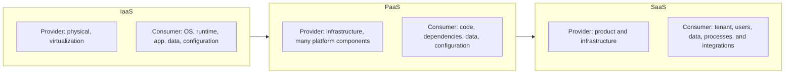
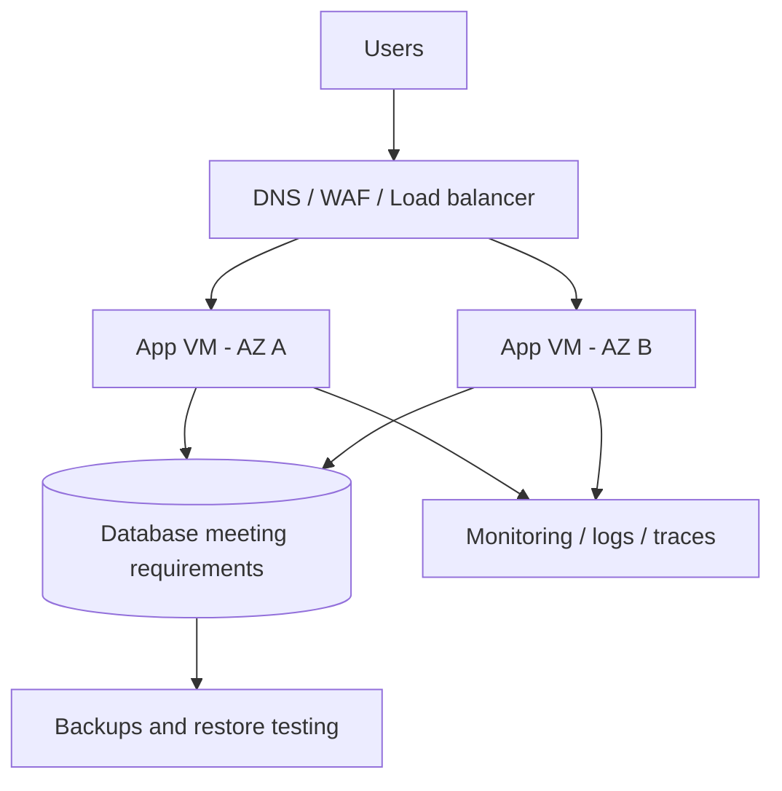
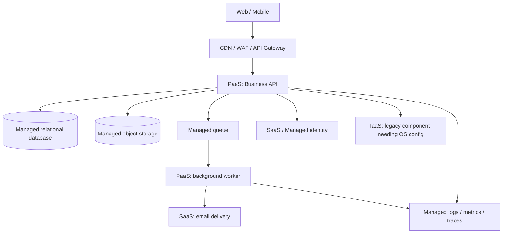
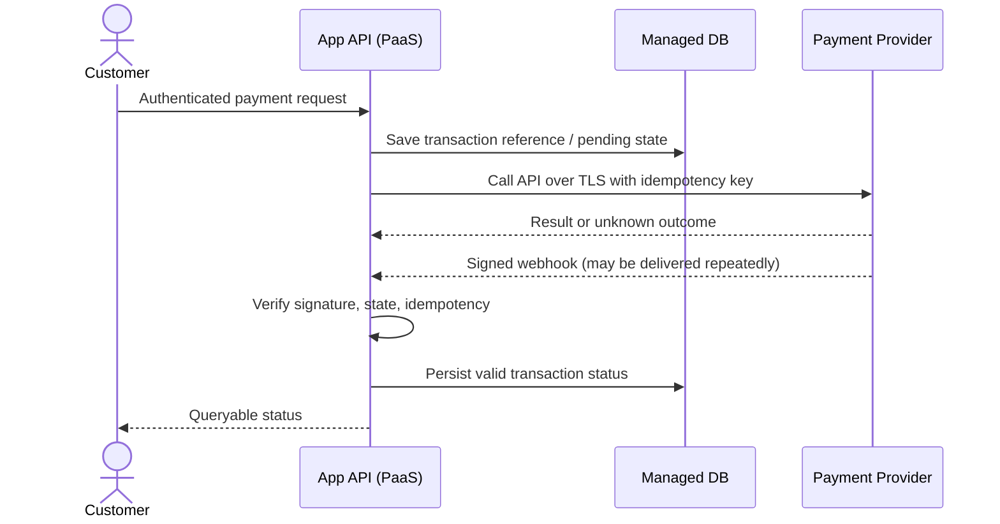
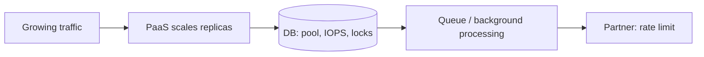

# Choosing IaaS, PaaS, SaaS, and Managed Services by Operational Responsibility

## 1. Problem Statement: Choosing a Service Means Choosing What You Must Operate Yourself

When designing a cloud application, the first question should not be "Virtual machines or Kubernetes?", but rather: **Which layers of the system does the team need to control, and how much are we capable of operating ourselves?** Two solutions running the same application code can have vastly different staffing needs, patching processes, security postures, recovery capabilities, and cost structures.

Suppose an enterprise is building an online booking system. The development team can:

- Rent virtual machines and self-install the web server, runtime, database, and monitoring tools.
- Push source code or a container image to an application deployment platform, letting the provider handle most of the underlying infrastructure.
- Use off-the-shelf subscription software for common business functions such as customer management.
- Combine provider-operated database, message queue, storage, and secrets management services.

All of these can be sound choices **if they meet business, security, reliability, scalability, cost, and operational capability requirements**. The goal of this lesson in the **Deployment Models** chapter of the **CLOUD_ARCHITECTURE** module is to establish a well-grounded approach to service selection, while clearly defining who is responsible during deployment, updates, monitoring, and incident response.

After this lesson, learners will be able to:

1. Distinguish between IaaS, PaaS, SaaS, and the meaning of the term *managed service*.
2. Outline the responsibility boundaries between the cloud provider, the consuming organization, and third parties.
3. Choose a model per application component, rather than forcing the entire system into a single model.
4. Compare options across flexibility, risk, total cost of ownership, reliability, and operability.
5. Write an architecture decision with acceptance conditions, verification methods, and review triggers.

## 2. Distinguishing Service Models from Deployment Models

These terms often appear side by side, yet they answer **two different questions**:

| Concept Group | Question | Examples |
| --- | --- | --- |
| **Service model** | Up to which layer of the stack does the consumer receive and self-manage the system? | IaaS, PaaS, SaaS |
| **Cloud deployment model** | For whom, where, and under what organizational model is the infrastructure provisioned? | Public cloud, private cloud, hybrid cloud, and community cloud in some classifications |
| **Service delivery/management form** | Who performs the ongoing operations for a specific component? | Managed database, managed Kubernetes, managed messaging, self-managed service on VMs |

A **PaaS application on public cloud** can connect to a **managed database**, use **SaaS** for CRM, and communicate with on-premises systems over a private connection. Therefore, a real-world architecture typically combines multiple service types.

You should also avoid equating "cloud native", "container", and "serverless" with the categories above:

- **Container** is a way to package and run software; containers can run on self-managed VMs, a managed container platform, or a PaaS-style platform.
- **Serverless** is a resource consumption model where the provider handles much of provisioning, scaling, and infrastructure maintenance; it often sits close to PaaS/FaaS but has its own execution limits and billing model.
- **Managed service** describes **the scope of operational work the provider takes on for a service**, not a fourth model completely separate from IaaS, PaaS, and SaaS.

## 3. Understanding Service Models Through the Lens of Responsibility

### 3.1. IaaS — Infrastructure as a Service

**IaaS provides foundational infrastructure resources** such as virtual machines, virtual networks, disks, and network addresses. The consumer deploys the operating system, runtime, application software, and operational policies on top of the provisioned resources.

Example: renting a Linux VM and self-installing the JVM, reverse proxy, and order service. The provider is responsible for the data center, physical servers, and virtualization layer within the scope of the contract; the application operations team is typically responsible for OS configuration, patching, process management, host security, application data backups, and availability design.

**Best suited when:** legacy applications require OS control or specialized software; kernel/agent/certification requirements are not supported by PaaS; very specific network or runtime configurations are needed.

**Trade-off:** the team gains high control, but must also maintain patches, configurations, recovery plans, deployment automation, and on-call incident response capabilities.

### 3.2. PaaS — Platform as a Service

**PaaS provides an application execution platform**: developers submit source code, packages, or container images to the service, while the platform manages many of the underlying infrastructure layers, operating system, and deployment mechanisms.

Example: a Java application deployed to an application hosting service or managed container runtime. The provider usually manages server provisioning and platform software. The consumer remains responsible for application code, dependencies, vulnerabilities in images they build, service configuration, access permissions, data, and application-level recovery plans.

**Best suited when:** teams need fast time-to-market, applications are relatively standardized, traffic fluctuates, and server administration overhead needs to be minimized.

**Trade-off:** constraints on runtime, network configuration, execution duration, resource quotas, storage types, scaling behavior, or low-level access; potential deep coupling to platform APIs.

### 3.3. SaaS — Software as a Service

**SaaS provides complete application software** for users or other systems to consume via UI/APIs. The provider develops, updates, and operates both the product and its supporting infrastructure.

Example: enterprise email, CRM, task management, or subscription-based accounting systems.

SaaS customers generally **do not operate the product's source code or internal database**, yet they still must manage user accounts, permissions, tenant configuration, data ingested into the system, integrations with other systems, data exportability, proper usage processes, and continuity plans when the service is disrupted.

**Best suited when:** the capability is a common business function, required customization fits within product boundaries, and deployment speed outweighs source code control.

**Trade-off:** reliance on the provider's customization options, permission rules, APIs, and policies; per-user/per-transaction subscription fees; constraints on data export or migration.

### 3.4. Managed Service

"Managed" means the provider takes on **a published set of operational tasks**. That set varies significantly across services and providers:

- **Managed relational database:** typically provisions database infrastructure and partially automates engine updates, backup/restore, and configurable high availability mechanisms.
- **Managed message broker/queue:** the provider handles most of the messaging broker infrastructure; the customer manages schemas, semantics, access permissions, retries, dead-letter queues, and consumers.
- **Managed Kubernetes:** the provider may manage the control plane; the customer may still be responsible for worker nodes, images, cluster add-ons, security policies, workloads, and capacity, depending on the service tier.
- **Managed object storage:** the provider operates the storage layer; the customer defines bucket permissions, data lifecycle, encryption, versioning, and access requirements.
- **Managed secrets/key service:** the provider operates the key storage/control component, while the customer must still manage access policies, key/secret lifecycles, and how applications consume them.

**Do not assume "managed" automatically means secure, properly backed up for your needs, or never disrupted.** The actual scope must be verified in the documentation and terms of the chosen service.

## 4. The Shared Responsibility Model: The Primary Decision-Making Tool

The **shared responsibility** mindset distinguishes between the provider securing and operating **the cloud infrastructure itself** versus the customer's obligations **when using services on the cloud**. The split of responsibilities shifts by service model; the remaining work does not vanish simply because resources are automated.

The table below illustrates typical patterns, not a universal contract across all products:

| Layer or Activity | IaaS: Self-Managed VM | PaaS: Application Hosting | SaaS: Software Consumption | Managed Database |
| --- | --- | --- | --- | --- |
| Facilities, power, physical servers | Provider | Provider | Provider | Provider |
| Virtualization / underlying service infrastructure | Provider | Provider | Provider | Provider |
| Operating system and OS patches | **Customer** on guest OS | Usually provider | Provider | Usually provider on DB host |
| Application runtime/framework | **Customer** | Shared depending on PaaS and deployment tier | Provider | Not applicable in the same way |
| Customer-written application code and dependencies | **Customer** | **Customer** | Provider operates product; customer owns integrations/customizations | Customer for applications accessing DB |
| Schema design, queries, business data quality | Customer | Customer | Customer governs usage, quality, and data permissions within SaaS capabilities | **Customer** |
| Permissions, user identity, tenant/service configuration | Customer | Customer | **Customer**, often shared responsibility with the product | Customer |
| Backup, retention, RPO/RTO decisions, and restore drills | Customer | Customer, may leverage platform capabilities | Customer must verify SaaS commitments/capabilities | Customer configures and verifies using provider-supported features |
| Business monitoring, bad transaction detection, application error handling | Customer | Customer | Shared: provider monitors product; customer monitors own workflows/integrations | Customer |
| Physical controls and hardware security | Provider | Provider | Provider | Provider |

**Note:** "Customer" in this table refers to the organization owning the system. With SaaS, the customer still bears certain legal/business responsibilities regarding data, processing purpose, permission granting, configuration, and user management; availability or recovery commitments must be checked in the specific contract.

### 4.1. Visual Intuition of Responsibility Split



The diagram shows **an increasing trend in the scope operated by the provider**—it does not mean IaaS is less secure or SaaS is always better. Control, customization limits, and cost must be evaluated alongside actual needs.

### 4.2. RACI Matrix for a Real Service

For each critical component, create a table recording who is **Responsible** for execution, **Accountable** for final sign-off, **Consulted**, and **Informed**. Example for a managed database:

| Task | Dev Team | Cloud/Platform Ops | Service Provider | Security |
| --- | --- | --- | --- | --- |
| Schema design, migrations, query tuning | R/A | C | I | C |
| Instance sizing, HA, backup/retention configuration | C | R/A | C | C |
| DB engine host operations per service scope | I | C | R/A | I |
| Defining IAM, network policy, encryption keys | C | R | C | A/C per governance model |
| Business data restore testing | R | A | C | I |
| Troubleshooting connectivity, query, or overload incidents | R | A/R | C per service responsibility | I |

This example is a **template to adapt**, since in practice a team or provider may hold different roles. What matters is that every task has an owner, a documented scope, and clear handoff paths—ensuring tasks like restore testing or patching application dependencies never fall through the cracks.

## 5. Profiling Workloads Before Choosing a Model

A system should be broken down into **workloads/components** with distinct characteristics: frontend, API, background processing, transactional database, search, analytics, authentication, and business tools. For each part, collect:

| Criteria Group | Required Data | Example Questions |
| --- | --- | --- |
| **Business objectives** | Required capabilities, launch deadline, KPIs, target users | Does the application have differentiators that SaaS cannot meet? |
| **Technical control needs** | OS, kernel, runtime type, agents, ports, protocols, library versions | Are drivers or kernel settings needed that the platform does not support? |
| **Load profile** | RPS, peak/burst, CPU, RAM, I/O, task duration, idle periods | Is load steady 24/7 or only a few minutes per hour? |
| **Data** | Sensitivity, consistency, volume, data residency, recovery | Which data is the source of truth and must it reside in a specific region? |
| **Reliability** | SLI/SLO, RTO, RPO, multi-AZ requirements, failure modes | How long of an outage causes severe business impact? |
| **Security/compliance** | IAM, encryption, audit, identity integration, regulatory checks | Are certifications or logs required that the service cannot provide? |
| **Integration** | APIs, protocols, private connectivity, data export, event contracts | How must it connect to internal systems or partners? |
| **Team capability** | On-call headcount, OS/DB/Kubernetes skills, incident response procedures | Who will patch and recover the service at midnight? |
| **Financials** | Resource cost, licensing, staffing, data egress, training | How does 12–36 month total cost change with load and user scale? |
| **Exit/portability** | Data export, formats, APIs, transition time | If we exit the service in 6 months, what is the migration path? |

### 5.1. Mandatory Gating Constraints to Filter First

Before scoring options, eliminate choices that **fail mandatory conditions**, such as:

- Unsupported runtime version, database engine, extension, operating system, or protocol.
- No deployment region meeting data residency, regulatory, or latency requirements.
- Lack of required access controls, audit logs, private connectivity controls, or mandatory encryption standards.
- Timeout, capacity, or throughput limits below evidenced minimum load.
- No backup/recovery capability matching approved RPO/RTO.
- Data protection terms, SLA, data exportability, or contract terms failing organizational requirements.

These conditions are **gating constraints**: an attractive overall cost score cannot compensate for a violated mandatory requirement.

### 5.2. Metrics Tied to Real Experience

"The service has HA" is a feature description, not proof that a business flow meets reliability targets. For example:

- **Search SLI:** percentage of valid requests returning results within the latency threshold, measured from the user side.
- **Checkout SLO:** percentage of requests reaching a final state or a queryable "in-progress" state within an agreed time window.
- **RTO:** maximum acceptable time to restore the core flow after disruption.
- **RPO:** acceptable data loss, measured in time.
- **Business invariant:** never confirm the same unit of resource for two conflicting transactions.
- **Unit cost:** total cost per completed business transaction, not merely cost per single request.

Specific values must be derived from acceptable loss thresholds and testing. A platform advertising high uptime can still let an application fail due to misconfiguration, exhausted quotas, or corrupted writes.

## 6. When to Choose IaaS?

Choose IaaS when **the benefit of infrastructure control outweighs the operational burden you take on**. Typical scenarios include:

1. Migrating a legacy application that requires system libraries, agents, or specific OS dependencies and cannot quickly change how it is deployed.
2. Commercial software requiring specific host, network, or installation licensing setups.
3. Steady workloads requiring fine-grained tuning where the team already has strong self-operation capabilities.
4. Components requiring low-level access that managed platform services do not offer.

IaaS **does not mean spinning up a VM completes the architecture**. A critical workload requires at least:



The diagram illustrates deployment across multiple availability zones; it does not claim every two-VM setup automatically achieves HA. You must verify health checks, session state, database failover, network connectivity, and single points of failure.

Operational activities that must be explicitly designed:

- **Provisioning:** infrastructure as code (IaC), golden images, change control, and drift management.
- **Patching:** OS, agent, and runtime patching schedules, testing processes, and rollbacks.
- **Hardening:** firewall/security groups, system access governance, restricting SSH/RDP, disk encryption.
- **Deployment:** rolling/blue-green deploys, health checks, graceful restarts, secret management.
- **Scaling:** autoscaling groups or VM scale-out processes, backend connection limits, and load distribution.
- **Recovery:** data backups, reproducible infrastructure configs, restore drills, and failover procedures.
- **Observability:** logs, metrics, traces, alerts, and on-call runbooks.

**Common trap:** comparing hourly VM rental prices against PaaS pricing while ignoring engineering hours for on-call, backups, patching, security, and incident response.

## 7. When to Choose PaaS?

PaaS is typically a strong fit for application services with a relatively standardized deployment interface, when the team wants to spend more time on **business logic** and less on host administration.

For example, a Java API with these traits:

- Stateless across requests; login sessions managed intentionally.
- Exposes health endpoints, proper readiness/liveness probes, and handles graceful shutdown signals.
- Connects to databases/queues over supported interfaces.
- Streams logs centrally, with config/secrets injected at runtime.
- Scales horizontally across instances and avoids storing persistent data on ephemeral local filesystems.

Such a service is a good candidate for a managed app platform or managed container runtime, provided runtime support, quotas, networking, security policies, and financials align.

### 7.1. PaaS Does Not Eliminate Application Developer Responsibilities

The team must still manage:

- Business logic bugs, input validation, authentication/authorization, and API contracts.
- Dependency versions and vulnerabilities in application images and third-party libraries.
- CPU/memory sizing, replica counts, autoscaling policies, timeouts, quotas, and connection pools.
- Database migration compatibility during rolling deploys/rollbacks.
- Defining SLIs/SLOs, latency/error alerts, and measuring cost per transaction.
- Handling retries, idempotency, and transaction state when integrating with unstable partners.

If a PaaS offers multiple modes, carefully read the **actual capabilities of the selected tier**: some platforms accept raw source code, container platforms allow image control, and function platforms enforce short execution limits or per-request/duration billing. Do not extrapolate one variant's benefits to all variants.

### 7.2. Key PaaS Trade-Offs

| Issue | When It Impacts Architecture | How to Evaluate |
| --- | --- | --- |
| Execution quotas | Tasks run longer than request/job limits | Extract background workers, check max duration and checkpoints |
| Autoscaling/cold start | Low latency required under sparse or bursty traffic | Measure cold/warm latency, concurrency, and scaling limits |
| Private network connectivity | Must reach internal DBs or partner systems | Check DNS, routing, egress, security policies, and cost |
| Stateless filesystem | App writes files to local disk | Move durable data to object storage/DB; use ephemeral space properly |
| Multi-version and rollback | Two app versions concurrently use different schemas | Expand/contract migrations, feature flags, controlled rollouts |
| Portability | Using platform-specific extensions/APIs | Assess adapters, interface standards, cost, and provider migration effort |

## 8. When to Choose SaaS?

SaaS is typically advantageous when the required capability is already well solved by a mature product, and building and operating it in-house offers little competitive differentiation. Examples: enterprise email, helpdesk ticketing, scheduling, CRM, or standard analytics tools.

Before choosing SaaS, separate two questions:

1. **Does the product satisfy the business workflow?** Review mandatory features, customization rights, APIs, data import/export, and support for workflow exceptions.
2. **Can the organization use and govern the SaaS safely and sustainably?** Review what data is uploaded, the tenant/role model, SSO/MFA, logs, data residency, backup/export, uptime commitments, incident response, and termination clauses.

SaaS-specific checklist:

| Question | Risk If Unclear |
| --- | --- |
| How are SSO/MFA and account provisioning/deprovisioning (e.g., via SCIM) supported? | Departed employees retain access |
| Who can export/delete data? Are access and change audit logs available? | Difficult incident investigation or data policy enforcement |
| What are the API rate/quota limits and webhook mechanisms? | Broken integrations, missing data, or duplicate events |
| Where is data stored, which subprocessors handle it, and how do terms change? | Failure to meet residency, privacy, or contractual requirements |
| Does export include complete data and relationships in a reusable format? | Vendor lock-in and costly data recovery |
| To what extent are RTO/RPO or backup policies committed by the product? | Confusing vendor internal recovery with customer self-service data restore |
| Does pricing scale by seat, feature tier, API calls, or storage? | Rapid cost spikes as user count or usage grows |

**Data responsibility does not disappear with SaaS.** While the provider may operate the application and infrastructure, the consumer still controls who can enter or view which data, sharing configurations, required retention periods, integrations, and proper data usage. Contractual vendor-handled aspects must be verified explicitly.

### 8.1. Example: Buy SaaS or Build a Custom CRM?

An enterprise has 50 sales reps and a relatively standard customer care workflow. Buying a SaaS CRM gives the team ready-made workflows, reporting, permissions, and mobile apps—in exchange for subscription fees, customization limits, and API dependency. Building in-house can support bespoke workflows, but requires investing in feature development as well as security, availability, upgrades, backups, and user support.

The decision must be grounded in **workflow differentiation, integration capability, data requirements, total cost, and time-to-value**, rather than assuming "build is always more flexible" or "SaaS is always cheaper."

## 9. Using Managed Services in the Right Places: Reducing Ops Overhead While Keeping Business Ownership

An architecture does not have to put everything onto a single platform. A common example:



Each component has its own choice based on its role:

| Component | Initial Candidate | Responsibilities Still Actively Owned |
| --- | --- | --- |
| Static frontend | Managed object storage + CDN | Cache invalidation, HTTPS, content protection, versioning |
| Business API | PaaS/managed container runtime | Code, dependencies, auth, scaling, SLOs, rollouts |
| Transactional database | Managed relational DB | Schema, indexes, transactions, permissions, backup policy, restore |
| Background jobs | PaaS worker/function | Retries, idempotency, poison messages, timeouts |
| Messaging | Managed queue | Message payload, semantics, ordering, DLQ, consumers |
| Authentication | Managed identity or SaaS IdP | Role mapping, session policies, MFA, app permissions |
| Commodity business tools | SaaS | Tenant configuration, integrations, data, vendor risk |
| Specialized legacy app | IaaS VM | OS, deployment, security, backups, monitoring |

### 9.1. Crucial Example: Managed Database

A managed database usually reduces host and engine operations, but does not replace the team's data ownership. Questions that must be answered before production:

- Are automated backups enabled? What are the retention period, point-in-time recovery window, and backup scope?
- Are multi-AZ or read replicas enabled? They solve **different goals**: read replicas mainly increase read capacity; HA/failover requires dedicated mechanisms and commitments.
- During failover, do application connections recover cleanly? Will connection pools and DNS caching cause prolonged outages?
- Who chooses maintenance windows, engine versions, and upgrade schedules? Is there downtime or breaking compatibility changes?
- Have RPO/RTO targets been **drilled via real restore tests**?
- If data is accidentally deleted or a bad migration runs, what is the safe point-in-time recovery procedure?
- Are there requirements for encryption key management, auditing, private networking, storage/IOPS monitoring, and growth thresholds?

**Caution:** automated backups, snapshots, replication, and failover do not substitute for one another. Replication can replicate accidental deletions; backups do not prove recovery speed until tested.

### 9.2. Crucial Example: Managed Kubernetes

"Managed Kubernetes" is one of the most misunderstood terms. Many services only manage the **control plane**, leaving the customer to operate or configure worker nodes, add-ons, network policies, images, RBAC, secrets, ingress, autoscalers, storage classes, workloads, backups, and version-compatible upgrades. Some services offer deeper node management modes, but the exact scope must be verified per product.

Managed Kubernetes is useful when an organization genuinely needs the Kubernetes API, its deployment ecosystem, workload diversity, or container orchestration capabilities. For a small API, a simpler PaaS runtime typically cuts cluster operational overhead dramatically. Ask: **Is there a requirement that a simpler application platform cannot meet?** If not, adding Kubernetes may increase component count, failure paths, and on-call costs.

## 10. Security and Compliance Across Operating Models

### 10.1. Responsibility Remains Centered on Identity, Data, and Configuration

Control areas that usually cannot be completely "handed off":

1. **Identity & Access Management:** who can access services, data, and the cloud console; least privilege, MFA, and machine identities for workloads.
2. **Data:** classification, processing purpose, access permissions, lifecycle and deletion; data export, recovery, and sensitive data protection workflows.
3. **Application code:** dependency scanning, input handling, business authorization, abuse prevention, secret protection.
4. **Configuration:** never exposing buckets, database endpoints, or secrets publicly; auditing network access, logs, and policies.
5. **Observation and response:** monitoring anomalous behavior, audit logs, and coordinating with the provider during incidents.

On IaaS, these sit on top of server hardening and patching. On PaaS, host configuration scope shrinks, but application vulnerabilities remain. On SaaS, overly broad tenant permissions or leaked integration tokens can still cause data exposure even when the vendor patches infrastructure on schedule.

### 10.2. Trust Boundary Matrix

Example of a payment flow passing through a PaaS API and a SaaS payment processor:



Boundaries requiring control include: untrusted clients, Internet-facing APIs, app-to-database connections inside a private network, outbound calls to partners, and inbound webhooks from the Internet. The application team is responsible for verifying **messages and business outcomes**, and cannot assume that using a SaaS or managed service guarantees correctness.

### 10.3. Evidence Package for Compliance Requirements

Before approving a service, collect exactly what internal policy and applicable laws require: data region, data processing agreement (DPA), independent certification/audit history, audit scope, administrative access policies, retention, and data deletion procedures. Do not infer that a provider certification automatically makes **the entire application** compliant; customer access controls, processes, and configurations are also part of the assessment scope.

## 11. Reliability, Scalability, and Operations by Model

| Perspective | IaaS | PaaS | SaaS | Managed DB/Queue |
| --- | --- | --- | --- | --- |
| **Scaling** | Consumer designs/executes autoscaling and infrastructure limits | Platform supports scaling per config, quotas, and workload behavior | Vendor scales product within service scope; customer still faces tenant/API limits | Provider handles part; customer selects capacity, quotas, data/consumer design |
| **Failover** | Must self-design topology, health checks, load balancing | Must choose region/AZ/replicas and verify platform limits | Governed by service SLA; customer needs interim fallback plans | Must enable and verify HA config if available |
| **Backup/restore** | Customer designs and tests end-to-end | Data still requires its own strategy | Restore/export capabilities depend on product/contract | Built-in features do not replace setting retention and running drills |
| **Patch/upgrade** | Customer owns OS, runtime, application | Vendor patches platform; customer updates code/dependencies and verifies compatibility | Vendor updates product; customer manages config/integration changes | Vendor handles engine/host per scope; customer checks versions and compatibility |
| **Observability** | Customer collects host and application telemetry | Platform provides partial telemetry; customer still needs business telemetry | Internal visibility may be limited; need audit/export and integration tracking | System metrics provided; customer needs query/business metrics |

### 11.1. SLOs Are Journey-Level Requirements, Not Just Service-Level

If checkout depends on a PaaS API, a managed database, and a SaaS payment gateway, **the checkout SLO is not simply the product of each provider's SLO**. You must measure actual end-to-end completion time and success rate, accounting for retries, caches, reconciliation, and how the system behaves when one component degrades. A platform with high uptime can still cause failures if connection pools are exhausted or resource quotas run out.

The design should explicitly state:

- How the system responds when a dependency slows down: timeouts, circuit breakers, in-progress notices, queuing, or falling back to manual handling.
- How well the system recovers from single-AZ/region failures, and what remains a single point of failure.
- Who receives alerts first, what diagnostic data is sent to the provider, and which runbooks are triggered.
- How recovery drills are conducted to prove RTO/RPO, data integrity, and incident workflows.

### 11.2. Scalability Is More Than Adding Instances

For example, a PaaS API might autoscale from 2 to 30 instances during a traffic spike, yet the database hits connection limits and lock contention on a hot table. Latency still spikes even while app CPU stays low. You must examine **the entire dependency chain**:



Design metrics must cover throughput, p95/p99 latency, contention, queue lag, quotas, cache hit ratio, operational cost, and transactions **actually completed**.

## 12. Total Cost of Ownership: Service Pricing Is Only One Part

You can model 12–36 month total cost as follows:

```text
TCO = service/infrastructure fees
    + storage, networking, and data egress
    + licenses/seats/API usage
    + engineering hours for operations and on-call
    + security, observability, backup/DR
    + deployment/migration and training
    + reasonably quantified risk/downtime costs
```

**Hypothetical example for learning how to compare:** An internal API with identical functionality is deployed on either an IaaS VM or a PaaS app. The team estimates monthly costs and applies an internal hourly rate for operational engineering time; these figures are illustrative inputs, not market quotes.

| Monthly Line Item | IaaS VM | PaaS App |
| --- | ---: | ---: |
| Compute and platform resources | 420 units | 560 units |
| Logging, backups, additional traffic | 90 | 80 |
| Operational engineering hours/month | 18 hours | 6 hours |
| Internal hourly engineering rate | 30 units/hour | 30 units/hour |
| **Illustrative monthly TCO** | **1,050** | **820** |

Calculation: IaaS = 420 + 90 + 18 × 30 = **1,050**; PaaS = 560 + 80 + 6 × 30 = **820**.

This example only shows that **PaaS can carry higher resource sticker prices yet lower TCO**. The outcome flips if the workload has different characteristics, PaaS incurs steep request/egress charges, the organization already operates an efficient VM platform, or the workload runs at steady baseline load. In a real evaluation, include redundancy, backups, and on-call staffing in both options to compare at equal reliability standards.

### 12.1. Common Pricing Structures

- **IaaS:** billed by VM runtime and size, block storage, snapshots, load balancers, public IPs, and egress traffic.
- **PaaS:** may bill by vCPU/RAM-time, instances, requests, concurrency, builds/deployments, or underlying platform resources.
- **SaaS:** typically per seat, feature tier, tenant, usage volume, or transaction count; review price-escalation terms and usage caps.
- **Managed database:** adds instance type, storage capacity, IOPS, excess backups, networking, replication, and cross-region transfer.
- **Managed queue:** usually billed by requests, message volume, throughput tier, network traffic, or retention storage.

Do not compare options on a single price line if they **do not deliver the same business value**. Buying a SaaS CRM versus running a custom CRM API represent vastly different development timelines, capabilities, and upgrade models; first establish a baseline of equivalent minimum capabilities.

### 12.2. Sensitivity Checks Before Finalizing

Test at least three forecast scenarios:

| Scenario | What Changes | What to Inspect |
| --- | --- | --- |
| Baseline | Planned load, user count, and pricing | TCO, SLOs, and staffing needs |
| Rapid growth | 3x RPS, 2x seats, growing data | Quotas, autoscaling, license fees, egress |
| Disruption/recovery | Single-AZ failure, partner outage, data restore | Redundancy cost, recovery time, on-call hours |

The weighting between cost and reliability should follow business loss tolerance, rather than applying a uniform formula across every component.

## 13. Per-Component Decision Making and Documenting Trade-Offs

### 13.1. Six-Step Model Selection Process

1. **Identify the workload and owner:** what function the component serves, and who owns business outcomes, development, and on-call operations.
2. **Lock in mandatory constraints:** data, security, connectivity, runtime, SLOs, RTO/RPO, budget ceiling, and timeline.
3. **Build a shortlist of viable options:** SaaS for buyable functions; PaaS for custom apps; managed services for specialized infrastructure; IaaS when OS/host control is truly needed.
4. **Build a responsibility matrix:** every option must have clear owners for patching, configuration, backups, monitoring, failover, security, and incident response.
5. **Validate with a proof of concept:** test load, failures, export/restore, latency, compatibility, and actual workload costs.
6. **Record the decision and review triggers:** choose based on evidence, publish trade-offs, and define rollback/exit plans.

### 13.2. Illustrative Scoring Matrix

Suppose you need to deploy a **new transactional API**. After eliminating options that violate mandatory requirements, the team compares three ways to run **the same application**: IaaS VM, PaaS application runtime, and managed Kubernetes (assuming cluster/nodes require operations). Each option is scored from 1 (weak) to 5 (strong).

| Criterion | Weight | IaaS VM | PaaS App | Managed Kubernetes |
| --- | ---: | ---: | ---: | ---: |
| Time to market | 20% | 2 | 5 | 3 |
| Infrastructure customization | 15% | 5 | 3 | 4 |
| Operational effort reduction | 25% | 1 | 5 | 3 |
| Ease of baseline security setup | 15% | 2 | 4 | 3 |
| Ease of HA setup | 15% | 2 | 4 | 4 |
| Cost predictability | 10% | 3 | 3 | 2 |
| **Weighted score (out of 5)** | **100%** | **2.30** | **4.20** | **3.20** |

PaaS calculation: `(20×5 + 15×3 + 25×5 + 15×4 + 15×4 + 10×3) / 100 = 4.20`.

**Conclusion in this hypothetical context:** PaaS scores highest because the team is small and prioritizes fast delivery and low operational overhead. If a mandatory requirement demands kernel control that PaaS does not support, PaaS must be eliminated **before scoring**, regardless of its high weighted average. Conversely, if the enterprise has a mature Kubernetes platform team and needs its specialized ecosystem, the scores will shift.

SaaS is excluded from this table because the requirement is to **run a custom-built API**; SaaS should only be compared if an off-the-shelf product fulfills **the same business function**, in which case an equivalent feature evaluation is required.

### 13.3. Recording Decisions with an ADR

```markdown
# ADR-007: Select App PaaS for Transactional API
Status: Proposed
Context: Stateless Java API; variable load; small team;
         p95 and RTO/RPO requirements validated separately.
Options considered: IaaS VM, App PaaS, Managed Kubernetes.
Decision: Use App PaaS for the API; Managed DB for transactional data.
Rationale:
- Meets runtime and private network connectivity requirements.
- Reduces OS operations, fitting team size.
- Supports scaling and deployment under a tested model.
Trade-offs:
- Platform quotas and proprietary APIs.
- Still must manage code, dependencies, IAM, backups, and telemetry.
Pre-production verification:
- Load testing and scale/cold-start tests.
- Failover, backup/restore, and schema rollback testing.
- Measure TCO and compare against budget.
Review triggers:
- Missing SLOs, hitting hard quotas, unit cost exceeding threshold,
  or needing OS/platform features unsupported by PaaS.
Exit plan:
- Docker image, IaC config, verified DB export,
  clear API contracts, and estimated cutover window.
```

A good ADR does not merely state "choose solution X"; it answers **why it was chosen, what was verified, and when it must be re-evaluated**.

## 14. Real-World Architectural Scenarios

### 14.1. Startup Launching an E-Commerce App

**Context:** 4-engineer team needing rapid feature delivery, with sharp traffic spikes during sales events. Order data is transactional; email delivery and reporting can run asynchronously.

**Selection direction:**

- PaaS/managed containers for business APIs.
- Managed relational database for orders, with appropriate transactions, HA, and backups.
- Managed queue for notifications and out-of-band updates.
- SaaS for email and customer support tooling.
- CDN/object storage for images and static frontend assets.

**Why:** the team focuses capacity on order logic, pricing, and checkout flows. However, they still must test inventory contention, payment idempotency, data recoverability, and burst costs under peak load.

**Reversal option:** if a mandatory requirement introduces a runtime/agent unsupported by PaaS, that specific component can run on IaaS while keeping the rest on managed services.

### 14.2. Enterprise with Legacy Accounting Software

**Context:** the application requires installation on Windows Server with specific libraries and only supports certain SQL Server versions; release cadence is slow.

**Initial selection direction:** IaaS for the irreplaceable component, prioritizing hardening, backups, access controls, and patching processes. Vendor licensing and support terms must be verified.

**Next steps:** isolate the system using appropriate networking, build controlled integration APIs, and plan upgrades or migration of suitable functions to SaaS/PaaS once compatibility is evidenced. Do not force a direct move to PaaS if it jeopardizes vendor support or business continuity.

### 14.3. Batch Data Analytics System

**Context:** runs nightly data processing for 45 minutes; does not need machines running all day; input data sits in object storage.

**Candidates:** managed batch/containers, serverless jobs, or on-demand PaaS workers.

**Trade-offs:** verify execution time limits, memory, startup cost, quotas, idempotency, checkpointing, rerun behavior, and completion SLAs. If the job requires specialized agents/drivers or GPUs unsupported by the platform, consider dedicated IaaS.

### 14.4. Organization Handling Strictly Regulated Data

**Context:** strict requirements for data residency, audit logs, key management, or access control evidence.

**Rule:** first define the regulatory scope, data classification, and concrete requirements; evaluate the compliance capabilities of **each service in permitted regions**, including subprocessors. When a managed service meets every requirement, it can reduce human operational error. When a mandatory feature is missing, IaaS or a dedicated platform may be required despite higher operational cost. A service model's name **never determines compliance on its own**.

## 15. Migration, Vendor Lock-In, and Exit Capability

Model selection is a lifecycle decision. A strong choice at the MVP stage may need revisiting as data, load, team structure, or regulations evolve. Avoid trying to achieve "zero lock-in" at all costs; instead, **know which dependencies deliver value and what the realistic migration cost is**.

### 15.1. Separating Three Types of Lock-In

| Dependency Type | Manifestation | Mitigation Strategy |
| --- | --- | --- |
| **Compute/runtime** | Relying on PaaS runtime hooks, deploy APIs, or proprietary config | Containerize where appropriate, standardize interfaces, reproducible IaC and pipelines |
| **Data/service API** | Using proprietary schemas, SQL extensions, queue semantics, or database APIs | Evaluate exports, versioning, adapters, compatibility testing, and data migration drills |
| **Organization/process** | Operations, permissions, and reporting tied to the provider console | Runbooks, automation, config-as-code, identity governance, cross-skill training |

**Portability is not free.** An architecture forcing every component to the lowest common denominator can forfeit the performance and reliability benefits of managed services. Document decisions based on expected switching costs and real business needs.

### 15.2. Roadmap for Migrating from IaaS to Managed Services

1. **Inventory:** document applications, data, runtimes, OS configs, integrations, licensing, owners, and SLOs.
2. **Compatibility assessment:** lock in limits and mandatory features; run a representative test workload.
3. **Data design:** define acceptable downtime, data replication, consistency, migration strategy, and rollback.
4. **Security and operational setup:** IAM, secrets, networking, logs, backups, alerts, and runbooks.
5. **Parallel run/validation:** compare business outputs, load test, failover, restore, and measure cost.
6. **Cutover and monitoring:** controlled traffic shift, rollback readiness, data validation, and ADR updates.

For transactional data, carefully design synchronization and the **write cutover** point; flipping DNS alone does not guarantee data consistency. When replacing SaaS, verify full export of required data, permission mappings, and dependent workflows before retiring the old service.

## 16. Evaluation Using Well-Architected Principles

You can use Well-Architected pillars to challenge service choices. Pillar names and scopes vary across providers/frameworks; the table below covers common cloud design perspectives.

| Perspective | Questions to Answer After Choosing a Model |
| --- | --- |
| **Operational Excellence** | Are owners clear for every task? Are IaC, pipelines, runbooks, alerts, and incident drills in place? |
| **Security** | Who owns IAM, data, secrets, patching, and auditing? Are trust boundaries, least privilege, and control evidence established? |
| **Reliability** | How does the workload handle AZ/region failures, service quotas, or slow partners? Have backup/restore and failover been tested? |
| **Performance Efficiency** | Does scaling meet p95/p99 at peak load? Are databases, queues, or partners bottlenecks? |
| **Cost Optimization** | How do TCO and unit cost behave across three change scenarios? Are idle, egress, licensing, and on-call hours measured? |
| **Sustainability** | Does the service improve resource utilization, shut down unneeded workloads, and optimize storage and compute? |

Do not merely list features visible in the console. Every answer must link to **actual configurations, test evidence, or specific service commitment docs**.

## 17. Common Mistakes

**1. "PaaS means the provider handles everything."** The provider may manage the host, but code bugs, dependencies, access control, schema migrations, and business transactions remain the application team's responsibility.

**2. "A managed database means you don't need a DBA."** Schema design, indexing, queries, transactions, capacity, permissions, data lifecycle, and restores still need accountable owners; host patching drops, but data engineering does not vanish.

**3. "SaaS is always safer and recovers better than self-built."** You must verify contracts, tenant permissions, export support, auditing, backups, and API/connectivity dependencies.

**4. "IaaS is always cheaper because VM prices are low."** Resource sticker price is only part of TCO; engineering hours for operations, fault tolerance, and backups can cost far more.

**5. "Managed Kubernetes equals a full application PaaS."** A managed control plane does not automatically mean workers, ingress, add-ons, workloads, and security policies are managed.

**6. "Adding replicas solves every performance problem."** Platform quotas, database locks, connection pools, and partner APIs can still remain bottlenecks.

**7. "Having built-in HA features is enough."** If left disabled or misconfigured, single points of failure remain. You must test failover, recovery, and business outcomes.

**8. "You must pick one model for the whole system."** Custom-code components can run on PaaS, data on managed DBs, commodity business tools on SaaS, and legacy apps temporarily on IaaS.

**9. "Judging by product name is enough."** The same word "managed" can cover vastly different operational scopes, SLAs, and limits. Always inspect the actual service version, region, and mode.

## 18. Hands-On Exercise: Designing Service Models for a Booking System

**Context:** A company is launching a booking service with these components:

- Website and mobile app; 30,000 daily active users, with heavy traffic spikes during promotions.
- Availability and booking API written in Java; must never double-confirm the same resource.
- Payment processing via an external provider; webhooks may arrive late or duplicated.
- Internal reporting and notification delivery can run asynchronously.
- Customer management currently uses spreadsheets; the business wants a fast launch.
- A legacy application relies on specialized OS libraries; changes infrequently, but requires secure connectivity.
- A 5-person development team, with no dedicated Kubernetes operators.

**Requirements:** Choose a model per component and defend your decisions with evidence. You may use this template table:

| Component | Proposed Model | Team Responsibilities | Pre-Production Verification Needed |
| --- | --- | --- | --- |
| Frontend | … | … | … |
| Booking API | … | … | … |
| Booking DB | … | … | … |
| Queue/worker | … | … | … |
| CRM | … | … | … |
| Payments | … | … | … |
| Legacy app | … | … | … |

Also answer:

1. What are **three mandatory constraints** that eliminate an option before scoring?
2. List **at least eight operational tasks** and state whether the app team, platform team, or provider is responsible.
3. Pick two critical flows and write **measurable, testable** SLIs/SLOs or RTO/RPO targets.
4. Propose one concurrency test for inventory/booking, one data recovery drill, and one test for delayed payment webhooks.
5. For the CRM, compare SaaS vs. custom build on business value, deployment time, integration, data, 3-year cost, and data exportability.
6. Write a short ADR for the API hosting choice, covering constraints, options, trade-offs, verification, and review triggers.

**Solution guidance:** The Java API is typically a PaaS candidate; a managed relational database fits if transactional and recovery constraints are met; a standard CRM can be evaluated as SaaS; the legacy app can stay on IaaS if OS control is needed; background workers and queues are candidates for managed services. These choices are only valid **after verifying mandatory constraints and clarifying responsibilities**.

### Self-Assessment Criteria

A passing solution must explain **why** each model was chosen, **who operates** each layer, **what remains the application's responsibility**, **how** reliability/security/cost are proven, and **when** the choice must be re-evaluated. Simply naming services without ownership, SLOs, tests, and failure-handling plans is insufficient.

---

**Key Takeaway:** IaaS, PaaS, SaaS, and managed services establish **different boundaries of operational responsibility**. The best-fit model is the one that satisfies business needs and technical constraints while enabling the organization to operate securely, recover to target requirements, and control costs throughout the workload's lifecycle.
