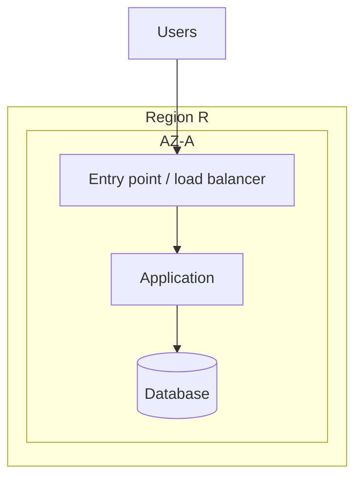
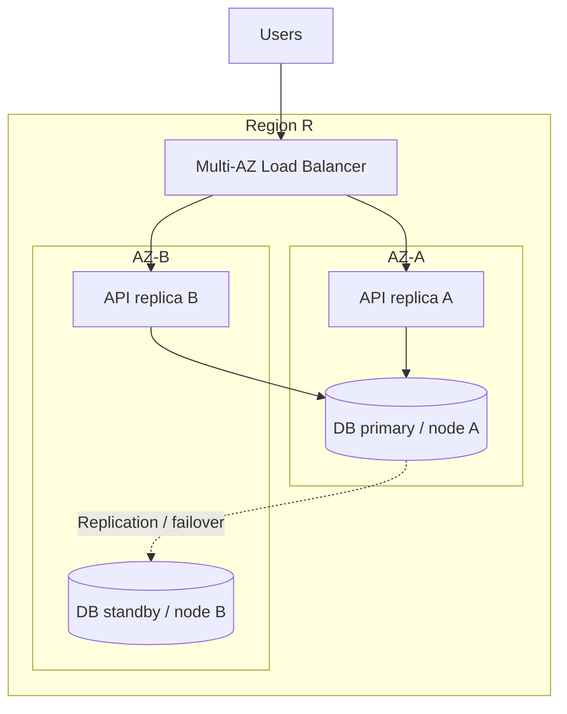
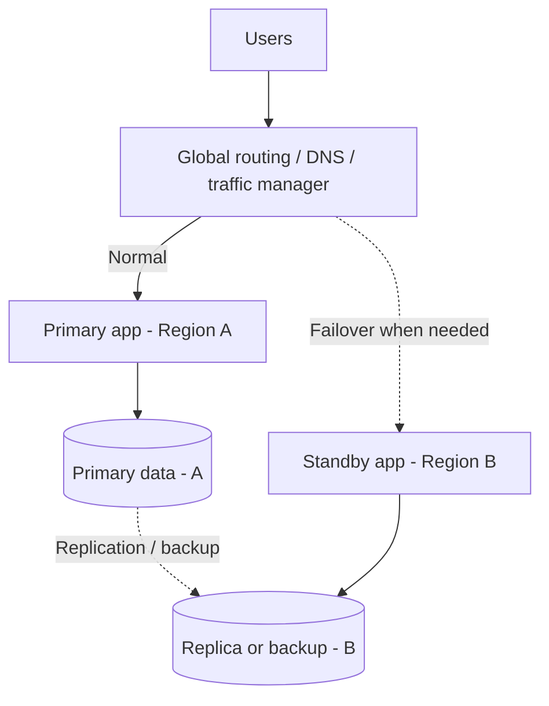
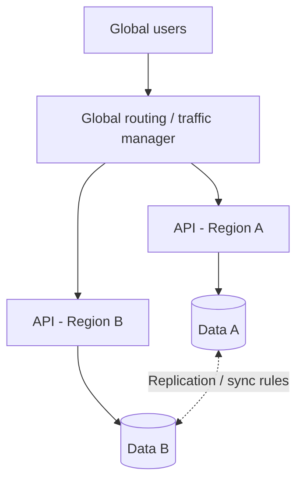
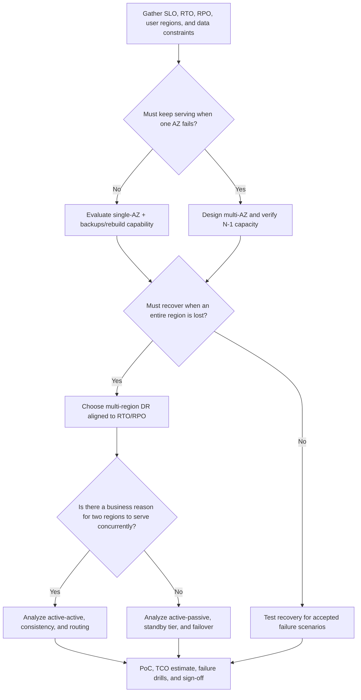

# Single-AZ, Multi-AZ, and Multi-Region Deployment

## 1. Choosing Deployment Scope to Contain Blast Radius

In cloud application architecture, **where you place the system** directly affects reliability, security, latency, scalability, cost, and operations. An application with multiple server replicas all sitting inside a single availability zone can still go down when that zone experiences an outage. Conversely, spreading an application across multiple geographic regions can improve resilience against wide-area failures, yet introduces data synchronization, traffic routing, and operational cost challenges.

This lesson belongs to the **Deployment Models** chapter of **CLOUD_ARCHITECTURE**. We will start from business objectives and recovery requirements, then select the appropriate networking, compute, data, and deployment configuration; every option is examined through **Well-Architected** trade-offs.

After this lesson, you will be able to:

- Distinguish **region**, **availability zone (AZ)**, data center, and fault domains.
- Explain **single-AZ in one region**, **multi-AZ in one region**, and **multi-region** architectures.
- Choose between **active-passive** and **active-active**, while recognizing each option's limits.
- Map architectures against **SLO, RTO, RPO**, data residency mandates, staffing, and budget.
- Design failure, failover, and recovery tests before moving a system into production.

## 2. Core Concepts: Region, Zone, and Fault Domain

A **Region** is a geographic area defined by a cloud provider, typically containing multiple **availability zones (AZs)** or **zones**. Each AZ is an infrastructure domain engineered to increase fault isolation from other AZs within the same region. Exact isolation of power, networking, facilities, and services varies by provider; **never assume every service automatically spans multiple AZs**.

A **Fault domain** is a set of components that can be impacted together by a single failure cause. Within the same AZ, multiple instances can still fail together if that AZ loses connectivity. Two AZs in one region reduce certain shared infrastructure risks, yet still share regional or global dependencies: control planes, routing configs, IAM, DNS, deployment pipelines, application bugs, or data mutations.

| Concept | Scope | Key Design Consideration |
|---|---|---|
| Instance/container/pod | A single application runtime unit | Adding replicas tolerates single-instance failure, but does not protect against AZ loss |
| Availability zone (AZ) | An infrastructure domain inside a region | Partially isolates power/network/facility faults; verify per service |
| Region | A geographic area, usually with multiple AZs | Contains regional resources and services; region-level outages require out-of-region plans |
| Global/edge service | Spans multiple regions or edge locations | Can assist global routing/coordination, yet is also a dependency to verify |

**Terminology note:** in this lesson, **single-AZ** means deploying in one availability zone inside **one region**. **Multi-AZ** still resides within **one region**. **Multi-region** means deploying across two or more geographic regions. A region is not synonymous with an AZ.

## 3. Option A — Single Availability Zone (Single-AZ)

For example, both an API and its database run in **AZ-A** of Region R. You can run multiple processes or instances inside AZ-A to survive single-process/host crashes; however, those replicas still share the AZ fault domain.



**Advantages:** simpler network topology, data control, and deployment workflows; usually lower baseline cost than multi-AZ redundancy; suitable for test environments, learning, PoCs, rerunnable batch jobs, or products that tolerate longer outages.

**Limitations:** if the AZ loses connectivity or core AZ resources are disrupted, the entire serving path can halt. Autoscaling within the same AZ or adding instances **does not turn a single-AZ deployment into multi-AZ**. Same-AZ backups may also be unavailable when recovering from an AZ-level incident.

If choosing single-AZ, explicitly decide on **acceptable downtime**, time required to rebuild in another AZ, an independent backup location, and IaC/data recovery procedures; never label it "high availability" merely because multiple instances run in the same AZ.

## 4. Option B — Multiple Availability Zones in One Region (Multi-AZ)

In a multi-AZ model, application-tier replicas run across **at least two AZs**. An AZ-aware load balancer/entry point routes requests to healthy replicas. When one AZ stops serving, the remaining AZ must have **enough capacity to handle the surviving load**, and the data path must remain usable.



The diagram illustrates **one sample deployment pattern**: the database has a primary and standby, and the application writes to the database endpoint. Replication behavior, read/write capabilities, primary promotion, and failover duration depend on the specific product and configuration. Do not assume the standby always serves reads or always uses synchronous replication.

### 4.1. Three Tiers Must Each Have Matching Fault Tolerance

| Tier | Design Considerations | Risk If Overlooked |
|---|---|---|
| Entry and networking | Multi-AZ load balancer; subnets, routes, firewalls, NAT/egress, and critical endpoints resilient to AZ loss | API replicas survive, yet receive no traffic or cannot reach external services |
| Compute | Replicas spread across AZs; health checks, auto-restart, placement rules, autoscaling, and resource limits | All replicas pile into one AZ, or the surviving AZ collapses under load |
| Data | Multi-AZ HA/replication, database failover, access permissions, reconnection, backups, and restore tests | App stays up but cannot read/write data; lost transactions during primary switchover |
| Supporting components | Caches, queues, session stores, secrets, service discovery, logging | A single-AZ dependency becomes a single point of failure for the entire app |

**Stateless applications** are usually easy to run multi-AZ because any replica can serve any request. If sessions are stored in an instance's memory, losing that instance/AZ destroys sessions or forces requests onto a specific node. Use appropriate session tokens or a fault-tolerant session store instead.

### 4.2. Single-AZ Failure: From Redundancy to Continuity of Service

Suppose two AZs split traffic evenly, each normally handling ~50% of load. When AZ-A fails, **AZ-B may suddenly carry nearly 100% of load**. If AZ-B only has headroom for 50%, the system can still overload. Capacity design should account for **N-1**: losing one fault domain while the remainder still meets committed performance targets, or at minimum sustains an approved graceful degradation mode.

The data path matters just as much as compute. If the database primary sits in AZ-A, the standby in AZ-B must be configured and tested for taking over the primary role. The application must tolerate **dropped database connections**: bounded retries with backoff, timeouts, idempotency for retryable operations, connection pool reset/re-establishment, and handling transactions with uncertain commit status. Do not measure only "when the database failed over" while ignoring when the business capability actually recovered.

Multi-AZ **does not protect against region-wide incidents** or logic faults propagated via replication, such as accidental data deletion or deploying a buggy release across all replicas.

### 4.3. The Price Paid for Multi-AZ

Costs rise due to standby capacity, cross-AZ data transfer, replication, load balancing, and observability. You also need deployment processes that avoid taking all AZs down simultaneously, failover testing, and minimizing shared config changes that trigger simultaneous failures.

The required number of AZs depends on availability targets, service behavior, and quorum rules: **two AZs may suffice for some primary-standby setups**, whereas some distributed systems need additional fault domains to maintain quorum. Do not generalize "two AZs are always enough."

## 5. Option C — Multiple Regions (Multi-Region)

Multi-region places system components or copies across **two or more regions**. Goals may include surviving wide-area outages, serving distributed users with lower latency, satisfying geographic mandates, or ensuring business continuity. You must specify **what actually exists in the secondary region**: only backups, cold unprovisioned infrastructure, idle standby apps, or active serving in both regions.

### 5.1. Active-Passive: One Primary Region, One Standby Region



In **active-passive**, Region A serves primary traffic while Region B is prepared to take over. Region B's "readiness" level varies widely:

| Recovery Pattern | Secondary Region State | Typical Trade-Offs |
|---|---|---|
| **Backup and restore** | Primarily stores data backups, docs, and IaC to rebuild on incident | Usually lower cost; recovery time can be long, depending on infra rebuild and restore speed |
| **Pilot light** | Keeps minimal core services/data running, scaling out apps when DR triggers | Cheaper than full-scale running env, but needs time to boot, sync, and scale capacity |
| **Warm standby** | Runs a scaled-down copy of the app with data kept updated per design | Faster switchover in many cases, yet incurs ongoing compute costs |
| **Hot standby** | Standby infrastructure runs at high readiness, able to handle near-full load upon cutover | Higher cost; still must verify data, permissions, and traffic cutover |

These are **design patterns**, not guaranteed RTO/RPO numbers. For instance, warm standby does not inherently guarantee sub-minute RTO; actual recovery time depends on fault detection, activation decisions, data sync lag, routing updates, and post-failover business verification.

### 5.2. Active-Active: Multiple Regions Serving Simultaneously



**Active-active** allows both regions to serve traffic. It can lower latency for users in different geographies and keep traffic flowing in healthy regions, yet requires:

- Deciding **where writes occur**: single primary writer, partitioned writers by region/tenant, or true multi-writer.
- Defining the **consistency model**, conflict resolution, event ordering, and replication lag bounds.
- Designing user and data routing (e.g., region pinning when legally required), retry/idempotency mechanisms, and duplicate-transaction prevention.
- Verifying each region's capacity when the other drops, quota limits, and dependencies on global services.

Never default to **multi-region = active-active**. A public content-reading app with independent caches can run active-active fairly easily; a payment system with concurrent writes across two regions is far harder. If both regions accept writes without coordination, **split-brain**, overwrites, or duplicate orders can occur during network partitions.

### 5.3. Commonly Underestimated Limitations

**Latency:** distant regions add round-trip time; forcing synchronous transactions over long distances raises latency and reduces throughput. Some services offer cross-region strong consistency, but the cost and partition behavior must be tested on the exact service.

**Asynchronous replication:** typically lowers write latency in the primary region, at the cost of standby lag. Upon failover, recent writes risk not yet being replicated; understand actual replication lag and its business consequences.

**Shared/correlated failures:** buggy application code, misconfigured IAM/permissions, incompatible schema migrations, accidental data deletion, or global control-plane outages can impact both regions. Therefore, you need backups independent of replication, strict access controls, phased rollouts, and rollback capability.

**Security and data:** verify data residency rules, data in backups/logs, cross-region transfer paths, encryption keys, access permissions, secrets, certificates, and auditing in the secondary region. Failing over must never inadvertently move data into an unapproved jurisdiction.

## 6. HA, DR, SLO, RTO, RPO: Four Commonly Confused Measures

**High availability (HA)** is the ability to keep a service running when components fail, typically via redundancy and automated failover. **Disaster recovery (DR)** is the ability to recover from a disaster or severe disruption using pre-prepared processes, data, people, and infrastructure. Multi-AZ typically serves intra-region HA; multi-region is often considered for regional DR, though this is not a rigid rule.

| Concept | Explanation | Example Acceptance Question |
|---|---|---|
| **SLI** | Actual metric measuring service quality, e.g., ratio of successful requests | Is it measured from the user side along critical business paths? |
| **SLO** | Target quality over a window, e.g., 99.9% valid requests succeed per month | Will an AZ/region failure exhaust the monthly error budget? |
| **RTO** (*Recovery Time Objective*) | Target maximum outage duration to restore functionality after an incident type | How long can pass between disruption and restored transactions? |
| **RPO** (*Recovery Point Objective*) | Target maximum data loss window, looking backward from the incident timestamp | Upon regional failover, how many minutes of written data can be lost? |

Hypothetical example: an ordering system requires **RTO ≤ 30 minutes** and **RPO ≤ 5 minutes when the primary region is unrecoverable**. If async replication routinely lags by 12 minutes, that architecture **has not proven a 5-minute RPO**. If rebuilding from backup takes 2 hours, backup-and-restore **does not meet a 30-minute RTO**. You must change the recovery mechanism, revise approved targets, or increase budget/staffing.

A 99.9% SLO over a 30-day month equals roughly **43.2 minutes of unavailability** using simple elapsed-time math: \((1-0.999)\times 30\times24\times60\). However, request-based or journey-based SLOs can yield different figures. **A multi-region architecture does not inherently guarantee a given SLO**; calculate based on observed metrics, shared dependency risks, and switchover mechanisms.

### 6.1. Distinguishing Replication from Backup

- **Replication** keeps a copy close to primary data and supports continuity, yet accidental deletes or corrupt writes can propagate to the replica.
- **Backup** enables restoring to an earlier point in time given proper history; check retention periods, immutability/delete protection, independent storage regions, and restore duration.
- **Failover** switches to alternate resources; **failback** returns or shifts roles back after the original site recovers. Failback can be complex because data on the two sides has diverged.

Therefore, verify **HA, backups, DR, and business integrity** as four complementary pieces.

## 7. Comparison Table of the Three Deployment Scopes

| Criterion | Single-AZ in One Region | Multi-AZ in One Region | Multi-Region |
|---|---|---|---|
| Losing one instance | Tolerable if replicas exist in the AZ | Tolerable if properly configured | Tolerable if tiers are redundant |
| Losing an entire AZ | Risk of full outage | Survivable via remaining AZs if capacity is sufficient and no shared SPOF exists | Survivable if required components sit outside the failed AZ |
| Losing an entire region | Usually requires rebuilding/restoring elsewhere | All AZs in that region may be lost; needs out-of-region plan | Recoverable in another region if data, routing, and procedures are prepared |
| Operational complexity | Lower | Moderate, including load balancing and failover | High, especially data, orchestration, and partitioning challenges |
| Baseline cost | Usually lower | Increases with replicas, standby capacity, and data transfer | Often increases significantly with secondary regions, redundancy, replication, and global traffic |
| Data latency | Simpler | Cross-AZ transfer latency may apply | Cross-region transfer latency applies; requires consistency choices |
| Common use cases | Dev/test, PoC, rerunnable jobs | Production apps needing AZ fault tolerance | Systems needing regional DR, global users, or geographic mandates |

This table describes **capabilities by deployment pattern**. Actual results depend on chosen services, configurations, quotas, network/data topologies, and drill outcomes. Merely "having resources in two AZs" or "having accounts in two regions" does not create HA/DR.

## 8. Decision Workflow: From Business Requirements to Architecture

Instead of starting with "how many regions should we use?", start from **the consequences of service disruption**, the failure types you must survive, and acceptable cost.



Detailed steps:

1. **Define objectives and failure scenarios.** Specify acceptable downtime/data loss for instance failure, AZ failure, region failure, accidental deletion, and bad deployments. Distinguish general API requirements from payment/order transactions.
2. **Locate users and data.** List customer geographies, latency targets, where data may be stored/transited, backup rules, and encryption key locations.
3. **Map end-to-end dependencies.** Trace from DNS/edge to load balancers, APIs, databases, caches, queues, KMS/secrets, third-party services, and internal systems; flag anything existing in only one AZ/region.
4. **Choose redundancy per tier.** Stateless compute can span AZs; databases need consistency-compatible failover; queues/caches/sessions must also survive fault-domain loss.
5. **Budget and check feasibility.** Include always-on resources, standby headroom, cross-AZ/region transfer, backups, logs, DR drills, ops labor, on-call, and quota limits.
6. **Test real failure modes.** Measure detection time, traffic shift, transaction recovery, replication lag, data loss, and post-failover peak load; compare against RTO/RPO/SLO.
7. **Write ADR and runbooks.** Record the choice, rationale, assumptions, trade-offs, alert owners, DR activation triggers, decision authority, and failback plan.

### 8.1. Checklist for Networking, Compute, and Data

| Tier | Design and Testing Questions |
|---|---|
| DNS / traffic | How is health evaluated? What triggers regional switchover? How long do DNS caching/TTL delay cutover? Can operators switch manually if auto-failover misfires? |
| Ingress / network | Does the load balancer span AZs? Do NAT, firewalls, routes, private endpoints, and on-prem links have any single point of failure? |
| Compute | Are replicas genuinely distributed across AZs? After losing an AZ, are CPU/RAM, quotas, IPs, connection pools, and autoscaling limits sufficient? |
| Database | Who can write? Can writes duplicate during leader election? Is RPO measured at the app layer or only at replication? Have restores been tested? |
| Queue / session / cache | Can in-flight messages be redelivered? Are deduplication/idempotency mechanisms in place? Will losing cache overload the database? |
| Security | Are IAM, secrets, certificates, KMS, audit logs, and data boundaries satisfied in the standby region? |
| Operations | Do alerts reach the right owners? Do runbooks verify business integrity, rollback, and failback? |

## 9. Running Example: E-Commerce Ordering System

Suppose a product serves customers concentrated in one country, handles **500 orders/hour at peak**, and must store data in regions approved by competent authorities. The numbers in this example are for learning how to make decisions, **not performance guarantees or provider SLAs**.

Initially the team has two developers and one part-time operations engineer. If the environment is only for demos and orders can be reconstructed from another source, single-AZ with backups and reproducible IaC can make sense, provided the product owner accepts downtime when an AZ fails.

When the product moves into production, the product owner sets these targets:

| Hypothetical Condition | Acceptance Criterion |
|---|---|
| Single-AZ outage | Users can still place orders, or functionality recovers within an agreed few minutes |
| Order data loss | RPO must be stated per scenario and proven via testing; silently dropping orders is unacceptable |
| Performance | During a single-AZ loss, remaining capacity handles expected peak load |
| Data and security | Backups, logs, and standby region remain within approved boundaries |
| Budget | Account fully for redundancy, bandwidth, backups, and on-call staffing costs |

**Step 1 — Multi-AZ within one region.** Spread API replicas across AZ-A and AZ-B, use a health-checked load balancer, configure HA database meeting targets, design idempotency for the order-creation API, and avoid local state sessions. Simulate AZ-A loss: AZ-B absorbs traffic, the database continues writes or fails over, and orders are not duplicated. Record the actual interruption window rather than claiming "zero downtime."

**Step 2 — Add multi-region only when a concrete requirement demands it.** Later, the product expands and sets **30-minute RTO and 5-minute RPO for full-region loss**. The team evaluates warm standby in Region B, suitable replication, and an approved traffic-switching process. If no data strategy meets the 5-minute RPO, or Region B fails data residency rules, this design is not approved. The team must test replication lag, restoration, promotion, routing, Region B load capacity, and failback to Region A.

**Step 3 — Consider active-active only when truly needed.** If later serving multiple geographies where latency targets demand running the app in both regions, the team can keep a single writer with local reads, or shard writes by customer. **Application active-active does not require a multi-writer database**; each consistency model carries its own design and trade-offs. Moving to multi-writer is justified only with clear conflict resolution, duplicate prevention, event ordering, and business acceptance criteria.

### 9.1. Verifiable Drill Scenarios

| Simulated Scenario | What to Observe | Passing Condition |
|---|---|---|
| Kill one API replica | Health check evicts node; requests route to other replicas | SLI stays within error budget; zero lost transactions |
| Isolate AZ-A | AZ-B serving capacity, network paths, queues, DB failover, latency | AZ-outage SLO/RTO met at target load |
| Sever connection to primary DB | Time to elect new leader, retries, uncertain transactions | No duplicate or lost orders; RPO verified by data reconciliation |
| Block all traffic to Region A | Detection time, DR activation, routing, Region B capacity | Region-level RTO/RPO met; any missing data reported |
| Accidentally delete a critical record | Point-in-time restore capability, protection/verification workflow | Restored per data policy; never rely on replication to undo user errors |
| Attempt failback to A | Sync new data from B, switch write authority, handle cache/DNS | No split-brain, lost orders, or infinite routing oscillation |

Run drills in a representative environment, limit blast radius, track outcomes, and maintain a safe rollback plan. Testing only on architecture diagrams or under idle load does not prove resilience under real incident traffic.

## 10. Evaluating Choices via Well-Architected

| Pillar | Single-AZ | Multi-AZ | Multi-Region |
|---|---|---|---|
| **Operational Excellence** | Simple to deploy, yet requires rebuild runbooks | Requires automating health checks, failover, and AZ-aware rollouts | Requires DR drills, on-call roles, failover/failback controls, and config sync |
| **Security** | Focus on access control, encryption, backups | Verify consistent IAM, secrets, and network policies across AZs | Govern data residency/transit, keys, certificates, and logs across multiple regions |
| **Reliability** | Cannot survive AZ failure without out-of-AZ plan | Survives AZ loss if every dependency is redundant | Survives region-level outages if data and orchestration truly work |
| **Performance Efficiency** | Simple, constrained fault domain | Sufficient N-1 capacity and low inter-AZ latency | Measure cross-region latency, consistency, caching, and user routing |
| **Cost Optimization** | Lower standby cost, higher outage risk | Trades replica, replication, and inter-AZ traffic fees for HA | Accounts for standby region, data transfer, traffic manager, testing, and staffing |
| **Sustainability** | Fewer baseline resources in many cases | More replicas, yet can be right-sized and autoscaled | Avoid unnecessary overprovisioning; balance efficiency with real DR needs |

There is no single "best" model for every application. **Single-AZ can be right** for systems accepting AZ outages; **multi-AZ is sufficient** for most intra-region availability targets; **multi-region only adds value when business scenarios, recovery mandates, or geography justify its complexity and cost**.

## 11. Common Mistakes and How to Fix Them

1. **"Three instances means we have HA."** Check how many fault domains they span, whether they share a database/network SPOF, and whether survivors can carry the load.
2. **"Having a database replica means we have backups."** Replication can propagate bad deletes; maintain independent backups, retention policies, and tested restores.
3. **"Multi-AZ survives losing a region."** Multi-AZ lives inside one region; build an out-of-region plan if surviving region loss is required.
4. **"Putting a VM in a second region means we have DR."** You need data copies, supporting dependencies, permissions, DNS/routing, runbooks, and business recovery tests.
5. **"DNS failover is always instant."** Caching, TTLs, health check intervals, client behavior, and open connections can prolong switchover.
6. **"Active-active just means turning on two endpoints."** Writer placement, consistency, split-brain, ordering, and idempotency must be solved first.
7. **"Adding regions always makes things more secure."** More regions expand where data, keys, and operational surfaces live; verify data rules first.
8. **"Once DR is designed, drills aren't needed."** Only test results verified against RTO/RPO and business transactions constitute evidence.

## 12. Architecture Decision Template (ADR) and Checklist

The template below is an **illustrative decision record** suitable for an architecture repository to align product owners and operations:

```yaml
decision_id: ADR-DEPLOY-003
system: ordering-service
business_criticality: high
deployment_model: multi_az_single_region
target_failure_scenarios:
  - single_instance
  - single_availability_zone
availability_slo: "99.9% over 30 days (per separately defined SLI)"
rto_by_scenario:
  az_loss: "10 minutes"
rpo_by_scenario:
  az_loss: "1 minute"
region_loss: "Not committed; requires separate DR assessment"
assumptions:
  - "Region is approved for customer data"
  - "Surviving AZ can handle peak load when the other AZ is isolated"
acceptance_evidence:
  - "Load balancing and database failover tests"
  - "Transaction recovery and data reconciliation tests"
  - "Cost estimates for compute, network, database, backups, observability"
review_triggers:
  - "SLO or RTO/RPO targets change"
  - "Product expands to new markets"
  - "Region-level recovery requirement emerges"
```

**The SLO, RTO, and RPO values in this YAML are illustrative assumptions**, not inherent guarantees of multi-AZ. Record them in a formal decision only after accountable stakeholders approve them and drills prove feasibility.

Before approving deployment, check:

- [ ] Clearly distinguished single-AZ, multi-AZ, multi-region, and required fault tolerances.
- [ ] Defined SLI/SLO and RTO/RPO targets **per scenario**, with owners and measurement windows.
- [ ] Networking, compute, database, cache, queue, sessions, secrets, and critical dependencies introduce no SPOF violating targets.
- [ ] Post-AZ/region-loss capacity measured under peak load or representative simulation.
- [ ] TCO includes standby capacity, replication, inter-AZ/region traffic, backups, monitoring, and on-call effort.
- [ ] Storage regions for data, backups, logs, keys, and transfer flows confirmed by authorized stakeholders.
- [ ] Failover, restore, and failback drilled; data comparison and duplicate/missing transaction checks exist.
- [ ] Runbooks, alerts, activation authority, rollback plans, ADR, and assumption review dates are in place.

**Key Takeaway:** fault tolerance comes from **the entire user-serving flow**, not merely the number of AZs or regions drawn on a diagram. Choose deployment scope by matching what failures the system must survive, how much data can be lost, how fast functionality must return, how much your team can operate, and what cost the organization is willing to pay.
