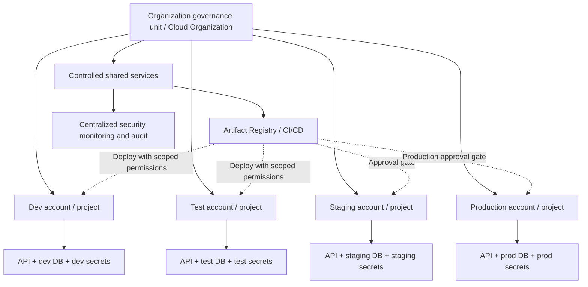

# Separating Development, Test, Staging, and Production Environments

## 1. Why Must Environments Be Separated?

In cloud architecture design, an application is more than just the system serving end users. The engineering team needs places to fix bugs, run automated tests, validate upcoming releases, and operate the live service. If these activities share resources, a single database drop command, load test, or configuration change can disrupt users and expose production data.

**Environment separation** means organizing resources and access permissions so that each stage has an appropriate change scope, data boundary, budget, and deployment process. This is an architectural decision directly tied to **security, reliability, scalability, cost, and operations**, not merely naming servers `dev` or `prod`.

This lesson belongs to the **Resource Organization** chapter of the **CLOUD_ARCHITECTURE** module. After this lesson, you can:

- Distinguish the purposes of **development, test, staging/preview, and production** environments.
- Decide isolation boundaries across accounts, projects, networking, data, identities, and deployment systems.
- Design a workflow to promote versions across environments using **CI/CD** and **Infrastructure as Code (IaC)**.
- Determine the right balance between production parity, safety, release velocity, cost, and operational capacity.
- Evaluate environment organization from the perspective of the **Well-Architected** pillars.

## 2. Four Environments Serving Four Different Goals

| Environment | Primary purpose | Typical activities | Key principles |
|---|---|---|---|
| **Development (dev)** | Coding, rapid experimentation, debugging | Running feature branches, manual checks, API testing | Easy to create and change; no write access to production data |
| **Test (test/QA)** | Verifying functional and non-functional behavior | Unit/integration/end-to-end tests, contract testing, security, regression | Reproducible state; verifiable test data and measurements |
| **Pre-production (staging/pre-production)** | Validating the candidate release before production | UAT, smoke tests, migration rehearsals, performance, integration, deploy/rollback | Configuration and behavior representative enough of production; controlled changes |
| **Production (prod)** | Serving real users and live data | Business transactions, SLO monitoring, backups, incident response | Data protection, least privilege, clear change and recovery procedures |

In many teams, **test** and **staging** may be named differently or combined if the scope is small. Here, **"staging/pre-production"** refers to the **staging/pre-production environment used to accept an upcoming release**. A sandbox environment for exploring services or trying unstable ideas can be an additional environment; do not confuse a sandbox with a pre-production acceptance environment.

### 2.1. Development: Optimizing the Feedback Loop

The goal is to catch errors fast and let developers experiment independently. Ephemeral resources or branch-based environments can be allowed, but they must have **limits on cost, access permissions, networking, and lifespan**.

Development should use synthetic data, fixtures, or sanitized and approved datasets. Do not issue production credentials to tools running on personal machines or development pipelines. Dev flexibility does not mean bypassing account and budget controls.

### 2.2. Test: Verifying Correctness Repeatably

The test environment supports running test suites with deterministic inputs and state, typically following a **provision → execute tests → collect results → clean up** flow. Multiple variants can be organized: integration tests using real databases, contract tests using mocked services, or load tests using sufficiently representative data and configurations.

One pitfall to avoid is sharing a single test database across concurrent pipelines without data isolation: tests will fail flakily as runs mutate the same records. You can provision a schema/database per run or spin up ephemeral resources with clear resource limits.

### 2.3. Staging: Rehearsing the Release

Staging aims to answer: **"If we release this exact version with this configuration, will the system behave as expected?"** Therefore, keep it close to production on characteristics that affect behavior: runtime versions, database engines and schemas, network/compute topology, service versions, access policies, deployment mechanisms, and monitoring.

You do not necessarily need to mirror full production capacity in staging. You can downsize to save cost, provided you **explicitly document what is not equivalent**; use a dedicated environment or load test run if validating peak load capacity. Any differences that can alter behavior—such as caches, queues, encryption keys, external service links, or HA settings—must be inventoried and tested appropriately.

### 2.4. Production: Protecting Live Transactions and Data

Production requires narrow access permissions, controlled deployments, traceable changes, tested backups and recovery, and user-centric observability metrics. Destructive experiments, high load testing, or handling sensitive data must be evaluated and planned separately. **Do not treat production as a routine debugging environment.**

## 3. What Does Separating Environments Mean Isolating?

A system with four namespaces named `dev`, `test`, `staging`, and `prod` might still share administrative accounts, networks, databases, secrets, or pipelines. In that case, an error in a lower environment can still spill into production. Boundaries must be defined across multiple layers:

| Isolation layer | Mandatory questions | If ignored |
|---|---|---|
| **Resource governance** | Is each environment in its own account/subscription/project or shared? Who can create/delete resources? | A change, quota, or billing event in another environment impacts production |
| **Identity and permissions (IAM)** | Are user accounts, service identities, and deployment roles separated by environment? | A leaked dev token could deploy to or read data from prod |
| **Networking** | Are subnets/VPCs/VNets, firewalls, DNS, egress, and private links independent? | A test service accidentally reaches the prod database or opens unintended paths |
| **Data** | Are databases, object storage, backups, queues, and retention policies separated? | Running migrations or deleting test data corrupts production |
| **Secrets and keys** | Are API keys, encryption keys, certificates, and webhook secrets shared? | Leaking or revoking a secret in one place affects multiple environments |
| **Deployment and operations** | Are pipelines, approval gates, rollbacks, alerts, and logs separated? | A deploy targets the wrong environment or production alerts get drowned in noise |
| **Cost and quotas** | Are budgets, tags, and usage limits isolated? | Load tests exhaust quotas or generate unexpected bills |

Strong isolation requires both **technical boundaries** and **process controls**: someone able to click "deploy prod" must hold appropriate authorization; test service accounts must have no write path into production; environment variables and connection strings must be validated before running migrations.

## 4. Resource Organization Models

On the cloud, governance unit concepts differ across platforms: for example, **account** in AWS, **subscription** in Azure, or **project** in Google Cloud. This lesson uses the generic term **governance unit** to refer to boundaries for permissions, quotas, and cost tracking. Exact isolation behavior must be verified against the chosen cloud provider and services.

### 4.1. One Governance Unit for All Environments

Resources are separated via namespaces, resource groups, naming, and tags; separate networks or roles may exist within the same governance unit.

**Pros:** fast initial setup, minimal organizational configuration, convenient when projects are small. **Risks:** quotas, top-level admin permissions, policies, shared resources, and billing can interfere across environments. Naming something `app-prod-db` is **not a security boundary**.

Best suited for learning/PoCs or low-risk internal apps, provided data, IAM, and networking are still minimally separated. Before serving critical data, re-evaluate these boundaries.

### 4.2. Two Groups: Production and Non-Production

Production resources reside in a dedicated governance unit; dev/test/staging share a non-production unit while still separating networks, data, service identities, and permissions. This is a clear risk-reduction step without creating too many management units.

Limitation: if staging is disrupted by load tests, or dev/test contend for shared quotas, acceptance tests may no longer be representative. Add resource limits and split out staging when such contention becomes a real issue.

### 4.3. One Governance Unit per Environment

Dev, test, staging, and prod each have **their own account/subscription/project** under a central governance structure. Security policies, IAM, budgets, and quotas can be enforced per environment. This model fits organizations with multiple teams, sensitive data, audit requirements, or mission-critical production apps.

**Pros:** clear separation of responsibilities and reduced risk of accidental cross-boundary changes. **Trade-offs:** more configuration for identities, networking, pipelines, DNS, limits, and logging; requires automated provisioning to prevent environment drift.

| Option | Initial simplicity | Governance isolation | Limitations and conditions |
|---|---|---|---|
| One unit, multiple namespaces/resource groups | High | Lower | Requires careful control of permissions and shared resources; insufficient for many compliance needs |
| Two units: prod/non-prod | Medium | Separates production from non-prod | Dev/test/staging can still affect one another |
| One unit per environment | More complex | Clearer boundaries | Requires automation, governance, observability, and organizational overhead |

**Principle:** choose boundary granularity based on **failure impact, data regulations, control needs, and operational capacity**. Do not choose a layout just because a diagram looks "enterprise-standard."

### 4.4. Recommended Organization Diagram



Shared services such as an artifact registry, organizational identity, log collection, or pipelines can be used across environments **if permissions, encryption, auditing, and blast radius are clearly designed**. They are critical dependencies, so avoid giving a pipeline a blanket admin key that can modify every environment unchecked.

## 5. Designing IAM, Networking, and Data Paths

### 5.1. IAM: Least Privilege and Environment-Specific Identities

A simple permission matrix to discuss with the engineering team:

| Role | Dev | Test | Staging | Production |
|---|---|---|---|---|
| Developer | Create/modify resources within assigned dev scope | Read results; limited test operations | Read required logs/metrics | Typically read-only for needed info; no direct deploy |
| QA | Permissions needed to inspect | Run tests, create/delete authorized test data | Run controlled acceptance tests | No permission to modify real data |
| Release pipeline | Scoped dev deploy permission | Scoped test deploy permission | Staging deploy permission via gate | Deploy only after prod gate, with time/scope-limited permissions |
| On-call operations | As needed for support | As needed for support | Rehearse runbooks | Approved operational permissions, audited; emergency elevation via dedicated process |

This is an illustrative model: actual permissions must be tailored to job roles, responsibilities, and organizational policies. Prefer short-lived credentials/federation for pipelines instead of distributing static keys; separate **service identities**, human user accounts, and deployment permissions. For production, enable access logging and use a monitored, time-bound, post-audited emergency elevation (**break-glass**) mechanism.

### 5.2. Network: Preventing Accidental Paths

- Each environment should have network segmentation clear enough to enforce inbound, outbound, DNS, and routing policies. Splitting networks by account/project helps management, but is insufficient if peering, firewalls, or private endpoints are overly permissive.
- Allow only **business-required network paths**. For instance, a test CI runner can reach the test database; there is no reason for it to reach the production database.
- Avoid reusing environment-less DNS names or reading a shared `DB_HOST` variable that could point a dev app at prod. Pipeline startup checks can enforce destination allow-lists/deny-lists.
- Log traffic to third-party systems. Test environments must use partner sandbox endpoints when available; avoid accidentally triggering real payments, emails, SMS, or webhooks.
- Production may require private links to on-prem or partner services; those permissions and routes must not be copied by default to dev/test.

### 5.3. Data: A Boundary That Must Be Verified

**Never copy an entire production database to dev/test just to get realistic data.** Data may contain personal information, tokens, password hashes, payment details, customer identifiers, or business secrets. Measures to consider:

1. **Synthetic data** as the default choice for functional tests.
2. When more realistic distributions or query shapes are needed, only use data that has been **anonymized or de-identified under an approved policy**; simple masking or pseudonymization can still permit re-identification, so it is not safe by default.
3. Strip or replace tokens, API keys, emails, phone numbers, and callback URLs; block flows that send real notifications or charge real accounts.
4. Separate **backups, snapshots, retention policies, encryption, and restore permissions** per environment. Do not allow dev team members to restore production snapshots arbitrarily.
5. Make test data repeatable and clean it up after runs; define retention periods and access controls for logs containing sensitive payloads.

A data copy permitted in staging must still comply with rules for **storage region, access permissions, backups, logging, and deletion**. Naming an environment "staging" does not exempt it from data protection obligations.

## 6. Configuration, Secrets, and Consistency Standards

Each environment needs its own configuration for database endpoints, queues, domains, log levels, data retention, load limits, and integration targets. However, **differences must be managed intentionally**, avoiding ad-hoc manual edits.

Separate:

- **Shared source code and infrastructure templates:** application logic, IaC modules, and config validation schemas; avoid duplicating separate codebases per environment.
- **Non-sensitive per-environment parameters:** region, resource sizing, autoscaling limits, domains, approved feature flags.
- **Environment-scoped secrets:** passwords, service keys, and tokens stored in a secrets manager or organization-approved store, granted to that environment's identity.
- **Environment-specific policies:** stricter access controls, deletion protection, backups, monitoring, and approval gates in production.

Example declarative configuration that can be stored in Git, **containing no secrets**:

```yaml
environment: staging
region: approved-region-1
app:
  replicas: 2
  public_base_url: https://staging.example.invalid
database:
  tier: managed
  secret_reference: secret://staging/order-db
observability:
  log_retention_days: 14
deployment:
  require_manual_approval: true
```

Values such as `example.invalid`, the region, and the secret reference are illustrative only; the `secret://...` syntax here is **not a standard API of any cloud provider**. In real implementations, use the syntax of your chosen tooling and organizational policies.

Critical environment variables should be **validated at deploy and startup time**: for example, block a `dev` service account from reading a secret labeled `prod`, block a test run from sending notifications to a real gateway, and block a production database migration if the identity lacks authorization. String-name checks alone are insufficient; IAM and network policies must serve as independent layers of defense.

## 7. Infrastructure as Code and Environment Lifecycle

### 7.1. Shared Modules, Different Parameters

IaC (such as Terraform, cloud-native tools, or equivalents) lets you rebuild environments in a reviewable, trackable way. The same **infrastructure module** can be called with parameters like `environment`, `region`, `instance_size`, `backup_policy`, and `allowed_principals`, while each environment maintains separately controlled state and deployment permissions.

A logical structure layout:

```text
platform/
  modules/
    application/
    network/
    database/
  environments/
    dev/       # Separate config and state
    test/      # Separate config and state
    staging/   # Separate config and state
    prod/      # Separate config and state; stricter approval workflow
```

This is an **illustrative layout**; you do not have to use these exact paths in every repository. State organization must protect locking, update permissions, and integrity; letting all environments write to an unsegregated state file can cause a single change command to affect the wrong scope.

### 7.2. Ephemeral Resources and Cleanup Rules

Branch-based or pull-request test environments (ephemeral environments) can be provisioned automatically for integration and UI testing. Define:

- Maximum environment/resource limits and budgets per team.
- Rules for creating DNS records, certificates, databases, secrets, storage, and access permissions during provisioning.
- Time-to-live (**TTL**) and reclamation mechanisms when a pull request closes; verify data and secrets are deleted per policy.
- Conditions to pause automatic deletion during an authorized failure investigation, and who is authorized to extend TTL.

Cleanup automation must validate **the exact environment identifier and permission scope**. Never grant an ephemeral-environment cleanup job permission to delete production resources.

### 7.3. Controlling Configuration Drift

When someone edits a firewall rule or database parameter directly in the production console without updating IaC, the environment no longer matches its definition. That is **configuration drift**. Compare actual state against declared definitions, alert, require review, and decide how to restore desired state. Do not blindly overwrite emergency changes before understanding their reason and impact; fold approved changes back into IaC to prevent recurring drift.

## 8. CI/CD: Promoting the Same Release Across Environments

A consistent deployment pipeline answers two questions: **which exact artifact was tested** and **which artifact is currently running in production**?


**Build once and promote the same tested artifact**, identified by version or immutable digest. Avoid rebuilding an image from the same branch name in each environment, because changed dependencies or build inputs can produce a different binary under the same version label.

**Gates** can include automated tests, IaC plan checks, vulnerability scanning, config/secret verification, smoke tests, migration reviews, performance results, and production deployment approvals. Teams can automate gates based on risk; not every dev action needs manual approval.

### 8.1. Safe Migrations and Deployments

For systems with databases, application deployment and database schema changes usually do not occur in a single atomic transaction. You can use the **expand → migrate → contract** pattern:

1. **Expand:** add fields/structures compatible with the current application version; verify in staging.
2. **Migrate:** deploy the new application, backfill or migrate data as planned; observe errors and rollback readiness.
3. **Contract:** remove old fields/structures only after all consumers have switched over and safety is verified.

Application rollback **does not automatically reverse schema migrations**. For hard-to-reverse data changes, prepare backups/restores, replay scripts, and a plan for data written after deployment.

In production, consider canary, rolling, blue-green, or feature flags depending on application and platform capabilities. Define halt and rollback criteria based on user-facing metrics—error rates, latency, successful transactions, and database load—rather than merely checking whether pods/containers are running.

## 9. Resource Naming, Tags, and Cost Tracking

Names and tags help locate, manage, attribute cost to, and automate resources. Example naming convention:

`<service>-<environment>-<region>-<component>`

For instance, `booking-staging-r1-api`, `booking-prod-r1-db`. Conventions must respect character limits and uniqueness constraints of each specific service; do not assume one pattern fits every resource type.

Useful tags/labels include: `application`, `environment`, `owner`, `cost_center`, `data_classification`, `managed_by`, `expiry_date` (for ephemeral environments only), and `criticality`. **Tags are metadata, not a security isolation mechanism**; enforcement controls must live in IAM, organization policies, networking, and the data layer.

### 9.1. Budgets Tailored by Purpose

| Environment | Optimization focus | Metrics to monitor |
|---|---|---|
| Dev | Fast feedback at reasonable cost; shut down when idle | Cost per team/branch, orphaned resources, running hours |
| Test | On-demand provisioning; clean up after test runs | Cost per test run, concurrent pipelines, leftover resources |
| Staging | Representative enough for release validation; downsize only when differences are acceptable | Baseline cost, parity with prod, load-test execution cost |
| Prod | Meet SLOs, performance, security, and growth within budget | Cost per transaction, capacity utilization, growth forecast, redundancy cost |

Set **budget alerts** per environment, assign alert-handling ownership, and track separate quotas where feasible. Budget alerts typically only notify; they are **not a guaranteed kill switch for all spending**. For non-production, use shutdown schedules, resource caps, and instance-creation policies; for production, never automatically shut down critical services solely because spend nears a budget threshold.

## 10. End-to-End Example: A Cloud Booking Application

Suppose a team builds a booking system with a web/API tier, PostgreSQL database, email queue, and payment service. The goal is to launch safely with a small team, protect real bookings, avoid accidental payment transactions, and preserve scalability for the future.

A reference design can organize **one project/account per environment** under the same central policy framework:

| Component | Dev | Test | Staging | Production |
|---|---|---|---|---|
| Compute | Small sizing, easy to update | Automated per pipeline | Matches prod runtime/topology enough for acceptance | Redundant/scaled per SLOs and load |
| Database | Synthetic data | Fixture data, reset periodically | Prod-compatible schema; synthetic or approved sanitized data | Real customer data, backups, and HA per targets |
| Email | Mock/test inbox | Provider stub/sandbox | Sandbox or allow-listed recipients | Real provider with delivery-failure alerts |
| Payments | Partner sandbox | Mock + sandbox for contract tests | Sandbox and compatibility tests | Live credentials, transaction monitoring, access controls |
| Secrets | Dev secrets | Test secrets | Staging secrets | Prod secrets; tighter access controls |
| Deploy permissions | Developers/CI in dev | Test pipeline in test | Acceptance gate | Release gate and audit |
| Observability | Data-restricted debug logs | Test results, traces | Metrics for comparison and rollback testing | SLIs/SLOs, alerts, incident runbooks |

### 10.1. Three Incidents to Prevent at Design Time

**Scenario A — Test accidentally connects to the production database.** A developer copies a connection string into test config. Prevent this with separate secret stores, test service identities having no access to prod secrets/DB, test networks having no route to the prod DB, and pipeline checks validating connection targets before migrations. Renaming variables alone is not enough.

**Scenario B — Staging is "cost-cut" so much that bugs are missed.** Prod runs multiple replicas with an HA database, while staging runs a single process and a single standalone DB. A release breaks during primary database failover, which staging lacked the failover setup to catch. Document parity gaps; add failover testing in staging or a dedicated test environment sufficiently similar to prod to validate critical changes.

**Scenario C — Load testing impacts production.** Test and prod share quotas or a NAT/database/queue component; a benchmark exhausts connections. Separate critical quotas/resources, cap test traffic, and audit shared dependencies. If production load testing is strictly unavoidable, require an approved window, monitoring, abort thresholds, and a recovery plan.

### 10.2. Release Lifecycle of a Version

1. The developer creates changes and tests locally; CI builds an immutable image `booking-api:v2.3.0` with its digest.
2. The pipeline deploys the image to dev for functional checks, then runs automated tests against an isolated test database/queue.
3. The same digest is promoted to staging. The team executes migration rehearsals, smoke tests, UAT, sandbox webhook tests, and verifies the rollback plan.
4. Once gates pass and approval is granted, the pipeline with **dedicated production permissions** deploys the same digest using the chosen rollout strategy.
5. The team monitors booking success rate, errors, and latency; if thresholds breach, executes a controlled rollback or roll-forward while handling data compatibility.

If staging fails criteria, **do not push that version to prod**. If capacity or budget constraints prevent full staging parity, explicitly document residual risks and require authorized sign-off prior to release.

## 11. Trade-Offs Through a Well-Architected Lens

| Pillar | Questions when organizing environments |
|---|---|
| **Operational Excellence** | Can environments be rebuilt with IaC? Do pipelines have reviews, auditing, rollbacks, and drift handling? Who owns each environment? |
| **Security** | Does prod have separate IAM/network/secret/data boundaries? Can live data be copied or accessed from non-prod? |
| **Reliability** | Can test failures, dev changes, or quota exhaustion spill into production? Are HA/backup/restore verified in a representative environment? |
| **Performance Efficiency** | Does the load test environment reproduce critical configurations and traffic patterns? Are staging-vs-prod differences tracked? |
| **Cost Optimization** | Does non-prod have shutdown schedules, TTLs, quotas, tags, and cost alerts? Is staging parity proportional to risk? |
| **Sustainability** | Are ephemeral environments cleaned up, idle resources reduced, and right-sized configs used for test and dev? |

One trade-off always remains: **stricter isolation and higher staging parity generally increase cost and governance effort**. The right approach balances business risk, reliability targets, security, operational headcount, and release speed. Never save money by letting dev/test share production permissions or data.

## 12. Step-by-Step Adoption Roadmap

**Step 1 — Inventory resources and dependencies.** List accounts/projects, networks, databases, object storage, DNS, secrets, IAM, CI/CD, logs, backups, and partner services serving each environment. Mark shared components and owners.

**Step 2 — Define separation goals.** Document which environments may hold real data, who can deploy, which apps require prod-like staging, non-prod budgets, and required isolation levels. If data has residency or compliance rules, confirm them before choosing resource locations.

**Step 3 — Design boundaries.** Choose governance units for prod and non-prod, separate networks/IAM/secrets/databases, and declare policies blocking cross-scope mistakes. Ensure external integrations have sandboxes or mocks.

**Step 4 — Build with IaC and standardize.** Define shared modules, per-environment parameters, separate state, naming/tagging, logging, backups, and budgets. Automate ephemeral environment cleanup and record all exceptions.

**Step 5 — Put CI/CD into practice.** Build artifacts once, add test/staging/prod gates, restrict pipeline permissions, validate migrations, monitor applications, and verify rollback mechanisms.

**Step 6 — Test boundaries before launch.** Attempt to reach the prod DB from a test identity, test using a secret across the wrong environment, simulate load tests, restore staging data, and verify alerts. Run tests within authorized scopes to avoid impacting live production services.

**Step 7 — Review periodically.** When adding teams, regions, customers, or compliance requirements, re-evaluate boundaries and configurations. Track drift, spend, access permissions, exceptions, and release quality.

### 12.1. Environment Organization Decision Record Template

This is a **YAML ADR template for discussion**, not a direct cloud configuration file:

```yaml
decision_id: ADR-ENV-003
title: Separate development, test, staging and production
service: booking
decision: one_cloud_management_unit_per_environment
environments:
  dev:
    data_policy: synthetic_only
    deploy: developer_and_dev_pipeline
  test:
    data_policy: synthetic_or_approved_deidentified
    deploy: test_pipeline
  staging:
    data_policy: synthetic_or_approved_deidentified
    deploy: release_pipeline_with_gate
  prod:
    data_policy: real_customer_data
    deploy: approved_production_release_pipeline
controls:
  - separate_networks_and_datastores
  - separate_environment_identities_and_secrets
  - isolated_infrastructure_state
  - immutable_artifact_promotion
  - central_audit_with_environment_scoping
  - budgets_and_resource_tags
tradeoffs:
  - higher_management_overhead
  - better_isolation_of_production
review_when:
  - compliance_or_data_residency_changes
  - new_team_or_region_is_added
  - staging_cannot_reproduce_production_failures
```

Architecture owners should append **compared alternatives, approval rationale, exceptions, test evidence, and review dates**. Environment boundary decisions must also be revisited when the application's criticality or number of operating teams changes.

## 13. Pre-Launch Environment Readiness Checklist

- [ ] Each environment has a defined purpose, owner, data scope, and access policy.
- [ ] Governance, network, IAM, database, secrets, and backup boundaries match the risk profile.
- [ ] Dev/test/staging identities cannot read production secrets or write production data outside controlled exceptions.
- [ ] Test data is synthetic or sanitized and approved; no unintended real emails, SMS, or payments can be triggered.
- [ ] IaC, state, parameters, and pipelines are separated; drift and manual changes are tracked.
- [ ] A single immutable artifact is promoted through test/staging/prod with gates, auditing, and a clear rollback path.
- [ ] Parity gaps between staging and production are documented, especially runtime, database, topology, security, and integration flows.
- [ ] Naming/tagging, budgets, quotas, shutdown schedules, TTLs, and cleanup workflows fit each environment.
- [ ] Logging, metrics, and alerts distinguish environments; test errors do not mask production alerts.
- [ ] Misconnection, permission error, misconfiguration, quota exhaustion, migration, and recovery scenarios have been tested.

**Practical takeaway:** separating dev, test, staging, and production is about designing **the blast radius of change**. The same source code and IaC modules can be reused, but data, identities, sensitive configuration, deployment permissions, and operational accountability must be organized around each environment's purpose. A well-structured model helps teams ship faster while protecting systems serving live users.
