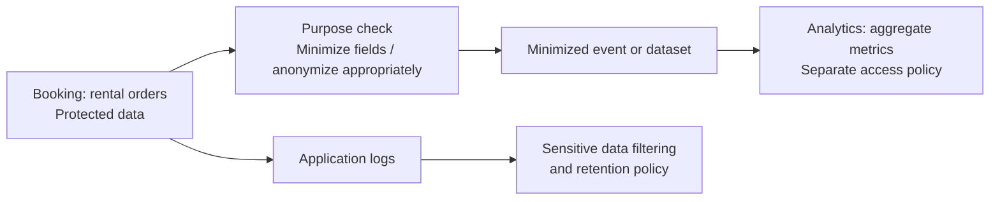
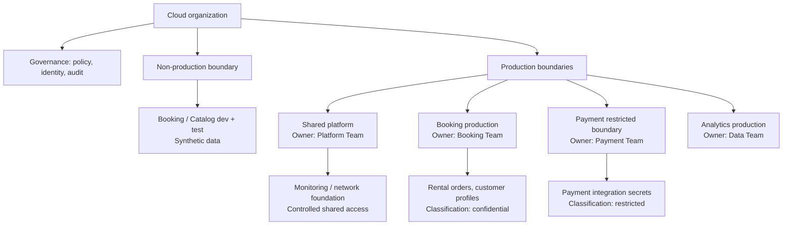
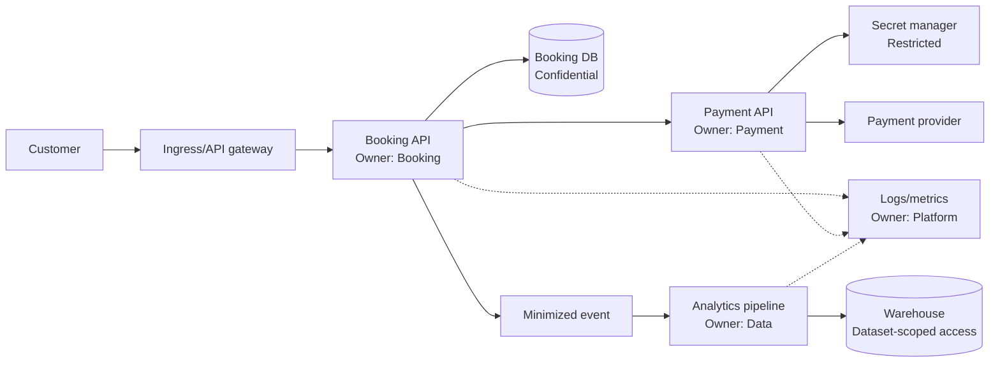

# Separating Resources by Product, Owning Team, and Sensitivity Level

In a cloud environment, resource counts can grow rapidly: applications, databases, buckets, queues, VPCs/virtual networks, service accounts, secrets, dashboards, logs, and recovery assets. If everything sits in one shared governance scope with broad access, teams struggle to answer three fundamental questions: **Which product does this resource serve? Who is accountable for it? How strongly must its data and functionality be protected?**

The **Resource Organization** topic in the **CLOUD_ARCHITECTURE** module focuses on turning these questions into **enforceable governance and protection boundaries**. When designing cloud application architecture from business requirements through networking, compute, data, and deployment, we must balance reliability, security, scalability, cost, operations, and Well-Architected principles.

This lesson uses an **equipment rental platform** example. Team names, resources, policies, and classification levels are illustrative assumptions; real classification must be grounded in actual data, impact severity, regulatory requirements, and organizational governance models.

## 1. Three Separation Axes Solving Three Different Problems

| Axis | Design question | Used to decide | Example |
| --- | --- | --- | --- |
| **Product / business domain** | Which product, capability, or business flow does the resource deliver value to? | Lifecycle, dependency, deployment, and cost allocation boundaries | Catalog, Booking, Payment, Analytics |
| **Owning team (ownership)** | Who is responsible for maintaining, responding to incidents, approving changes, and optimizing the resource? | Operational accountability, admin rights, alerting, budgets | Booking Team owns the booking API; Platform Team owns shared ingress |
| **Sensitivity level** | If data or resources are exposed, tampered with, or disrupted, how severe is the impact? | Trust boundaries, access control, encryption, auditing, retention, and sharing rules | Public config, internal data, customer profiles, sensitive access keys |

The three axes are **three parallel attributes** of a resource, not three nested folder tiers that must be stacked sequentially. For example:

> The rental orders database belongs to the **Booking product**, is owned by the **Booking Team**, contains **personal data requiring strict protection**, and resides in **production**.

Knowing only that a resource belongs to Booking is not enough to grant permissions. Knowing only that the Booking Team owns it does not authorize every team member to view customer data. Knowing only that data is sensitive does not identify which team handles an outage at midnight.

**Guiding rule:** use resource boundaries to enforce real isolation requirements; use metadata, IAM, tagging/labels, and processes to represent the remaining axes. Avoid creating a new account or project by default for every combination of product × team × sensitivity.

## 2. Which Resources Should Be Included in the Organization Map?

Cloud resources are not just VMs or containers. You must inventory components that establish **permissions, access paths, data, cost, and accountability**:

| Resource group | Examples | Key questions |
| --- | --- | --- |
| Compute and runtime | VMs, container services, serverless functions, Kubernetes workloads | Who deploys and responds to failures? |
| Networking | Virtual networks, subnets, load balancers, gateways, firewalls, DNS | Who can connect to whom, and across which boundaries? |
| Data | Managed databases, buckets, volumes, caches, warehouses, backups | Does it contain sensitive data, how long is it kept, and who manages it? |
| Integration | Queues, topics, event buses, API gateways, webhook endpoints | Who owns the contract, and which producers/consumers are permitted? |
| Identity | IAM roles, service accounts, secrets, KMS keys | Who can impersonate a workload or decrypt data? |
| Operations | Logs, traces, metrics, alarms, dashboards, pipelines, IaC state | Who is on-call, accesses logs, and modifies configurations? |
| Recovery | Backups, snapshots, replicas, DR deployments | Where are copies stored, and who can restore or delete them? |

Supporting resources can hold data just as sensitive as primary resources. For example, **logs** can contain email addresses, **snapshots** are copies of databases, **IaC state** can contain sensitive values, and **CI/CD** may hold permissions to create or delete production services. Therefore, never omit them from your separation model.

## 3. The Product Axis: Grouping Resources by Value-Delivery Capability

Separating by product or business domain helps teams clearly see **which parts must evolve, scale, deploy, and bear costs together**. It is a tool for reducing coupling and defining the blast radius of changes.

For the rental platform, we can logically separate:

| Product / domain | Typical resources | Rationale for grouping |
| --- | --- | --- |
| **Catalog** | Product APIs, search index, public images, catalog cache | High read traffic, mostly public data |
| **Booking** | Reservation APIs, expiration queues, rental order DB, state metrics | Transactional constraints and double-booking risks |
| **Payment** | Payment adapter, webhooks, audit trail, integration secrets | Tight access scope, handles financial events |
| **Analytics** | Data pipelines, warehouse, aggregate reports | Secondary data processing, tolerant of delay; separate access scope |
| **Shared Platform** | Core network connectivity, central identity, registries, telemetry platform | Used by multiple products; requires clear ownership and chargeback/cost model |

### What Determines Product Boundaries?

Evaluate:

1. **Business objective:** which capability does the resource serve? If that business function stops, does the resource retain an independent purpose?
2. **Change lifecycle:** does it need to be deployed, scaled, or recovered independently from the rest?
3. **Data and transactions:** which components require shared transactions, consistency guarantees, or low-latency interaction?
4. **Accountability and budget:** is there a clear owning team and cost owner?
5. **Dependencies:** if split, will it create excessive network calls, cross-boundary access policies, or operational complexity?

**There is no rule that "one microservice = one cloud account."** One product can comprise multiple modules or services within a single governance boundary; conversely, a component handling highly sensitive data may require its own boundary even if it belongs to the same product.

### Shared Resources Must Be Treated Explicitly

Root DNS, core networking, log ingestion systems, and registries typically serve multiple products. Do not "temporarily assign" them to a team simply because that team created them first. Every shared resource needs:

- An **operational owner** responsible for availability, configuration, upgrades, and incident response.
- **Consumers and usage contracts**: which teams may use it, via which APIs/processes, and under what limits.
- **Cost and quotas**: are platform costs absorbed by a central team or allocated back by usage?
- **Blast radius limits**: can changing a shared component take down multiple products simultaneously?

If a shared component holds data of differing sensitivity levels, evaluate data segregation, source-based access control, and operator activity auditing. Sharing an observability platform does **not automatically** grant every team permission to read all logs.

## 4. The Ownership Axis: Accountability Differs from Access Rights

A resource needs **one primary accountable owner** even when multiple teams co-develop or consume it. Read, write, deploy, and security-admin permissions should be granted based on specific roles and needs.

Example responsibility split:

| Activity | Booking Team | Platform Team | Security Team | Data Team |
| --- | --- | --- | --- | --- |
| Booking logic, APIs, rental orders | **Primary owner** | Supports runtime | Reviews sensitive permissions | Reads authorized data |
| Load balancers and shared network | Consumes, states requirements | **Primary owner** | Sets guardrails | Consumes when needed |
| Rental order data classification | **Business data owner** with data steward | Supports storage | Defines standards, audits | Advises on lineage, quality |
| Provisioning app infra via IaC | Proposes and reviews | Builds foundation and guardrails | Checks sensitive changes | — |
| Analytics data warehouse | Validates source data semantics | Supports infrastructure | Controls permissions and policies | **Operational owner** |

The assignment above is illustrative, not a mandatory matrix. For each resource, document at least:

- **Service owner**: accountable for service quality, operations, and on-call coverage.
- **Data owner/steward (when holding data)**: defines usage purpose, classification, retention, and business-level access rights.
- **Technical contact**: team or channel for incident response.
- **Cost owner**: where costs are booked and budgets approved.
- **Approval authority**: who approves high-risk changes, such as opening network paths or granting read access to sensitive data.

Roles may overlap in one team, but do not have to. For instance, the Platform Team operates the managed database, while the Booking Team owns the semantics and rental order data. **Owning infrastructure does not automatically grant permission to view data**; access should depend on approved responsibilities, appropriate identities, and audit logging.

### How Ownership Supports Operations

During an incident, alerting must reach the workload owner and dependency owners. If an API spikes in errors due to an overloaded database, the Booking Team investigates queries, the Platform Team can assist with service limits, and the Security Team engages only if there are indicators of security risk. Teams need **coordination and escalation procedures** instead of passing blame.

Ownership must also transfer cleanly across the lifecycle. When transferring a product from Team A to Team B, do not just update a tag: hand over IaC, alerts, runbooks, access permissions, budgets, related keys/secrets, on-call schedules, and data if applicable.

## 5. The Sensitivity Axis: Classifying to Apply Appropriate Protections

Sensitivity reflects **the impact if data or functionality is exposed, modified without authorization, made unavailable, or misused**. You can use the illustrative classification scheme below; each organization must define exact thresholds and align with applicable legal obligations:

| Reference level | Examples | Handling principles |
| --- | --- | --- |
| **Public** (intentionally public) | Published product images, public equipment descriptions | Allow public distribution via publishing workflow; still protect write/delete permissions |
| **Internal** | General operational docs, internal aggregate metrics | Accessible only to authorized internal personnel and workloads |
| **Confidential** | Customer profiles, rental order details, unpublished business data | Purpose-based access control, restricted copying, encryption, and access monitoring |
| **Restricted / Highly sensitive** | Private keys, authentication secrets, data with severe impact if exposed | Strict permission isolation, dedicated secrets vaults, auditing, and risk-based approvals |

Level names are examples only. Not all customer-related information shares the same sensitivity; nor should all Payment resources be assumed identical in sensitivity if their data and impact differ.

### Classify Data First, Then Derive Resource Requirements

1. List information types: names, phone numbers, addresses, rental history, transaction IDs, support records, logs.
2. Determine impact and usage purpose: who can view, edit, export, or share; consequences of exposure or loss.
3. Assign classifications to **datasets and processing flows**, along with an approver and retention rules.
4. For resources holding multiple data types, enforce controls matching at least the **highest-risk data the resource can actually touch**, unless strong isolation is proven.
5. Inspect derived data: backups, snapshots, logs, exports, search indexes, caches, dead-letter queues, and analytics datasets.

For example, a bucket holding public catalog images does not carry the same risk as a bucket storing invoices. If both share one bucket where a single permission mistake could expose all objects, consider splitting buckets or designing strict prefix/object policies; separate buckets are usually easier to govern when sensitivity differs sharply.

**Note:** a tag **`classification=confidential`** is only metadata; it **does not encrypt data, block access, or prove compliance on its own**. Classification must link to IAM, network policies, encryption, DLP, retention, backups, auditing, and verification checks.

### Data Can Change Classification Through Processing

A rental-order event containing customer details should not be copied verbatim to analytics merely to count orders. Use a flow like:



**Pseudonymization** (replacing direct identifiers with alternate identifiers) does not automatically render data public or fully anonymous. If an individual can still be re-identified via a lookup key or by joining other datasets, the derived data still requires commensurate controls.

## 6. Choosing Technical Boundaries: From Metadata to Independent Accounts

Not every axis requires the same strength of isolation. Assess blast radius, administrative privileges, data, and operational needs, then pick appropriate boundaries.

| Organization mechanism | Best suited when | Things to know |
| --- | --- | --- |
| **Naming, tags, labels, inventory** | Identifying product, owner, classification, budget | Useful for search, policies, and reporting; **not an isolation mechanism on its own** |
| **Resource group / equivalent** | Grouping resources with shared lifecycle or admin scope | Strength of permissions, billing, and policies depends on the cloud provider |
| **Namespace / logical workload boundary** | Dividing workloads within a cluster or shared platform | Not automatically a hard tenant or security boundary; needs RBAC, network policies, workload identity |
| **IAM / policy / key boundary** | Restricting user, pipeline, and workload permissions by need | Effective only if enforced at the right scope and not bypassed by higher-level roles |
| **Network boundary** | Restricting connectivity and data paths | Does not replace authentication, data authorization, and application-layer protection |
| **Independent account / subscription / project** | Distinct risk profiles, production environments, quota, billing, ownership, or clear blast radius needs | Requires organizing IAM, networking, logging, guardrails, and cross-boundary access; does not guarantee absolute isolation by itself |
| **Separate data stores / encryption keys** | Data has differing purposes, sensitivity levels, or lifecycles | Simplifies limiting access, retention, and backups; adds integration overhead |

Illustrative comparison across cloud providers:

| Provider | Common organizational/governance units | Notes |
| --- | --- | --- |
| **AWS** | Organization / Organizational Unit (OU) / Account; inside an account sit resources and tags | OUs manage **accounts** and apply governance policies; they are not direct containers for individual resources |
| **Azure** | Management group / Subscription / Resource group / Resource | Policies, RBAC, billing, and limits apply at appropriate scopes; subscriptions and resource groups serve different roles |
| **Google Cloud** | Organization / Folder / Project / Resource | Projects are typically the primary unit for resources, quotas, APIs, and billing association; policies can inherit from parent tiers |

These mappings are for architectural reasoning—**do not treat units across the three providers as completely equivalent in quotas, IAM, network isolation, or billing**. Verify against actual provider documentation during implementation.

### Principle for Choosing Isolation Level

Split into an **independent governance boundary** when you need to isolate administrative rights, blast radius, budgets/quotas, data residency policies, or clear legal accountability. Use **logical groupings and tags** when resources share an operational lifecycle and can share protections without creating material risk. Scale isolation strength with actual risk rather than multiplying accounts for every team name and label.

For example, experimental analytics should not implicitly hold admin access to a database containing production personal data. Separating a project/account for analytics workloads—granting read-only access solely to sanitized datasets—can be simpler than managing a web of complex cross-permissions.

## 7. Multi-Axis Model: Organize by Boundary, Record Attributes in Metadata

Beyond the three main axes, consider **environment (dev/staging/prod)**, **region**, **service criticality**, and sometimes **tenant**. These are additional dimensions, not a reason to multiply every combination into a separate infrastructure unit.

Suppose you have 5 products, 4 teams, 4 classification levels, and 3 environments: creating a boundary for every combination would spawn **240 units**, including combinations with no real workloads. That approach balloons overhead across IAM, networking, quotas, cost reporting, and governance.

A more practical approach:

1. Use strong boundaries for **production**, high-privilege workloads, specially sensitive data, and wherever blast radius must be contained.
2. Within each boundary, group resources by **product/lifecycle** and attach **owner, classification, environment, cost-center, criticality** attributes.
3. Grant permissions through **user, workload, and pipeline** roles; policies define which resources may be accessed.
4. For shared services, designate a **platform owner** and usage contracts; never grant shared admin rights to all teams.
5. When requirements change, split out a new boundary if current controls no longer satisfy risk or operational limits.

### Illustrative Organization Diagram

The diagram below shows **governance logic**, not an object tree to copy verbatim into AWS, Azure, or Google Cloud:



A smaller business might use fewer accounts than shown above; an organization with strict compliance obligations or many autonomous teams might need more boundaries. What matters is that decisions have **clear rationale, accountable owners, and corresponding controls**.

### Standard Resource Metadata

Example of an **internal metadata convention model**, not a tag syntax applicable verbatim to every cloud:

```yaml
resource:
  name: booking-orders-db-prod
  product: booking
  ownerTeam: booking-platform
  environment: production
  dataClassification: confidential
  criticality: high
  costCenter: digital-rentals
  technicalContact: oncall-booking
  managedBy: infrastructure-as-code
  region: ap-southeast-1
```

Fields like **technicalContact** can hold a team name or on-call channel identifier—do not put personal phone numbers, tokens, or sensitive data into tags. Real tagging systems have limits on tag counts, characters, inheritance, and per-service support; therefore, define a common **metadata schema** and a provider mapping mechanism.

Metadata must actually be used: policies enforcing required tags at creation time; asset inventories surfacing unowned resources; budget reports grouped by **product/costCenter**; alerts routed by **ownerTeam**; security checks driven by **dataClassification**. If fields only exist in a handbook and are never used operationally, they quickly go stale.

## 8. End-to-End Example: Booking, Payment, and Analytics

Consider three flows in the rental platform:

- **Booking** reserves equipment, confirms orders, and manages customer information. It performs many write operations requiring consistency.
- **Payment** communicates with the payment provider, receives webhooks, and manages secrets used to verify notifications. Actual data scope depends on integration design; prefer storing no more sensitive payment data than necessary.
- **Analytics** aggregates order counts, revenue, and success rates. Most reporting queries do not require direct customer identifiers.

### 8.1. Mapping Resources and Permissions

| Resource | Product | Primary owner | Illustrative data / sensitivity | Boundaries and controls |
| --- | --- | --- | --- | --- |
| Catalog CDN and published equipment images | Catalog | Catalog Team | Public content | Public delivery, but write/delete restricted to authorized pipelines |
| Booking API | Booking | Booking Team | Processes customer data, no durable local storage on instances | Dedicated workload identity; calls only necessary APIs and datastores |
| Booking database | Booking | Booking Team | Rental orders, customer info; confidential | Private access, encryption, backups, restricted read/write permissions |
| Payment webhooks and adapter | Payment | Payment Team | Transaction status; depends on actual payload received | Webhook signature/auth verification, restricted network access, audit |
| Payment gateway secrets | Payment | Payment Team + secrets management unit | Restricted | Secrets manager/KMS, accessible only to authorized workloads and rotation workflows |
| Minimized order events | Booking → Analytics | Booking Team publishes; Data Team consumes | Depends on retained fields; do not assume public | Event contracts, topic/consumer authorization, retention |
| Warehouse and revenue dashboards | Analytics | Data Team | Internal to confidential depending on data | Dataset-level access control, separate dashboard permissions, query auditing |
| Centralized logs and traces | Shared Platform | Platform Team | May contain sensitive data if unfiltered | Source-side redaction, product-scoped log access, appropriate retention |
| Booking DB backups | Booking | Booking Team and backup ops team | Same protection level as source data | Encryption, independent restore/delete permissions, restore testing |

From the table above, several protection requirements span multiple resources. The **Data Team** needs revenue KPIs, but should not implicitly hold read access to the database storing customer profiles. The **Platform Team** needs to view system health, but does not need to read database table rows. The **Payment Team** can deploy the payment adapter, yet only dedicated pipelines or workloads are permitted to access production secrets.

### 8.2. Designing Least-Privilege Access Flows



The diagram shows **functional relationships**, not every network connection or IAM policy. When implementing, ensure:

1. The Booking API uses a dedicated workload identity to write Booking data, without sharing database admin credentials.
2. Booking calls Payment via an authenticated API with idempotency; it does not need permission to read Payment's secrets.
3. The Payment adapter accesses only the secrets it requires; secrets are never shared via config files or logs.
4. Data flowing to Analytics must follow a field contract, usage purpose, and consumer authorization; unnecessary sensitive fields must be stripped or transformed prior to export.
5. Cross-boundary traffic must use authentication, transport protection, and appropriate logging; simply being on an "internal network" does not guarantee trust.

### 8.3. Writing Policies at the Principle Level Before Selecting Cloud Services

Example of **intent-level** policies, not directly applicable policy files:

```yaml
# Example internal governance rules, NOT provider IAM syntax.
rules:
  - resourceType: customer-data-store
    allowedWorkloads:
      - booking-api-prod
    permittedActions:
      - read-required-fields
      - create-and-update-booking
    humanAccess: approved-break-glass-only

  - resourceType: payment-provider-secret
    allowedWorkloads:
      - payment-adapter-prod
    permittedActions:
      - retrieve-secret-at-runtime
    humanAccess: restricted-and-audited

  - resourceType: analytics-order-event
    producer:
      - booking-event-publisher
    consumers:
      - analytics-ingestion
    dataContract: minimum-fields-for-reporting
```

A real cloud system must translate these rules into **service-specific IAM/policies**, network controls, application-level authorization checks, and pipeline guardrails. For example, "read-required-fields" is not a universal IAM action: it may require an intermediary API, column/row-level policies if supported by the service, or stripping fields before sharing.

## 9. Environments, Deployment Regions, and Tenants Are Additional Dimensions

### Separating Non-Production from Production

Dev, test, and staging environments are often used to run unstable code or test data. They should have appropriate **permission, budget, and blast-radius boundaries** so an experiment cannot break production.

| Criterion | Dev / test | Staging | Production |
| --- | --- | --- | --- |
| Data | Prefer synthetic/mock data | Representative data, de-identified if needed | Real data, purpose-controlled |
| Deploy permissions | Broader for dev teams within bounds | Via pipeline, with review | Restricted, pipeline and risk-based approvals |
| Networking | Restrict connections to prod | Topology close to prod on attributes under test | Strictly segmented and monitored |
| Cost | Budget-capped, auto-cleanup for ephemeral resources | Sufficient for testing; avoid wasteful idle capacity | Driven by SLOs, load, redundancy, and recovery |
| Secrets | Dedicated test secrets | Scoped staging secrets | Production secrets, strict access and audit |

**Do not copy production data to dev for testing convenience** without evaluating permissions, purpose, masking/anonymization, retention limits, and legal rules. A copy of sensitive data is still sensitive data, even if stored in a project named **dev**.

### Data Residency and Recovery

Region selection is not solely about latency. Data may carry constraints on storage location and cross-border transfer; backups, replication, centralized logs, and disaster recovery must all be included in the data scope. If a product must restrict data to a region, check **auxiliary data paths** as well, not just the primary database.

Splitting across regions also affects availability and cost: multi-region helps provide recovery options during broad regional outages in certain architectures, but increases data transfer, synchronization, observability, and operational complexity. Choose it only when RTO/RPO, availability targets, and operational capacity justify the need.

### Should Each Tenant Get Its Own Boundary?

In multi-tenant SaaS, tenant is another separation axis. Options include:

- **Pooled:** share infrastructure and separate logically by tenant in the application/data layer. Highly cost-effective, but requires strict permission enforcement in application queries and data access.
- **Silo:** each tenant gets its own environment, database, or account. Reduces blast radius and helps satisfy strict isolation requirements, at the cost of more resources and operational effort.
- **Hybrid:** high-isolation tenants get dedicated boundaries, while remaining tenants share controlled infrastructure.

Tenant separation is **different** from product and team separation. Do not rely on a **`tenantId` tag** as the sole access control mechanism; enforce authorization and consistency across all queries, APIs, events, and data export paths.

## 10. Considering Cost, Quotas, and Operations When Choosing Boundaries

Sound resource separation helps track costs per product, but every boundary carries governance overhead: logs, networking, IAM, budgets, quotas, pipelines, and baseline resources.

### Cost Traceability and Allocation

A metadata convention might include:

| Attribute | Reporting purpose |
| --- | --- |
| **product** | Direct costs of Catalog, Booking, Payment, Analytics |
| **ownerTeam** | Team accountable for optimizing and verifying active resources |
| **costCenter** | Budget unit bearing the cost |
| **environment** | Distinguish dev/test/staging/prod and spot long-lived test resources |
| **sharedService** | Separate platform infrastructure and shared costs |
| **criticality** | Evaluate whether redundancy spend matches service value |

Not every cloud cost appears under resource tags: network traffic, support plans, commitment discounts, shared fees, and organization-level charges may require a separate allocation model. For shared infrastructure costs, choose **usage-based allocation**, **transparent proportional rules**, or a **central platform cost center**. Document the method to prevent misleading reports.

For example, a core network serving four products can be operated by the Platform Team, with egress allocated based on measured traffic and remaining shared operating overhead charged to the platform. Do not duplicate that network four times just to make cost spreadsheets easier to sum.

### Quotas, Scaling, and Blast Radius

Quotas/limits are typically enforced at provider-specific scopes such as account, subscription, project, region, or service. Two products sharing compute or API request quotas can impact one another when one surges. Separating boundaries can isolate quotas, but you still need to monitor aggregate limits, costs, and cross-boundary connectivity.

For critical systems, ask: **"Which products can be affected by a single deployment, compromised account, firewall misconfiguration, or database outage?"** That is a practical way to measure blast radius. Proper boundaries must reduce failure impact **in combination** with backups, IAM, networking, observability, and incident response processes.

## 11. Evaluating with Well-Architected

| Pillar / concern | How sound separation helps | Trade-offs to verify |
| --- | --- | --- |
| **Operational excellence** | Clear owners, alerts, runbooks, and deployment scopes; fewer "orphaned" resources | Too many boundaries multiply pipelines and procedures |
| **Security** | Reduces overly broad permissions; isolates sensitive workloads, keys, and data; clear audit | Over-fragmented boundaries complicate cross-policies and encourage shortcut permissions |
| **Reliability** | Isolates faults, quotas, and recovery around critical systems | Shared services can still be single points of failure; duplication increases sync complexity |
| **Performance efficiency** | Scales around product needs; reduces noisy-neighbor resource contention | Cross-boundary calls can add latency, egress costs, and network dependencies |
| **Cost optimization** | Enables budget allocation, resource cleanup, and per-product cost visibility | Overly granular splitting raises baseline, traffic, and operational overhead |
| **Sustainability** | Organizes workloads and resource lifecycles efficiently, reducing idle assets | Excessive duplication increases overall resource consumption |

A good design does not maximize security or minimize cost blindly at all costs. Connect **data sensitivity**, **failure impact**, **operating team count**, **actual traffic**, and **budget** before deciding how far to split.

## 12. Decision Matrix: When to Isolate Strongly vs. Group Logically

| Scenario | Initial option worth considering | Why / what to verify |
| --- | --- | --- |
| Two modules in the same product, same owner, data, and lifecycle | Same account/project; separate resource groups, namespaces, or tags if needed | Splitting admin boundaries may only add overhead; still enforce per-workload IAM |
| Two products by different teams needing separate release schedules and quotas | Separate resource boundaries or accounts/projects depending on impact | Reduces cross-permissions and blast radius; evaluate shared networking and logging |
| Workload handling high-risk payment integration secrets | Dedicated secrets/key vault and workload role; consider separate account/project | Scope of access and impact if credentials are exposed |
| Real customer data vs. test environments | Separate environments with distinct data, identities, and secrets; prefer synthetic data | Reduces risk of exposing or corrupting production data |
| Multiple products sharing DNS, registry, identity | Shared platform with clear owner, policies, quotas, and cost allocation | Avoids duplicating foundations; manage single-point-of-failure risk |
| Analytics needs metrics from Booking | Data contract and minimized data export; dedicated consumer permissions | Reduces direct DB access and PII replication scope |
| Enterprise tenant requiring special isolation | Dedicated data/workload boundary when contract and risk demand it | Higher cost; requires automation to provision and operate tenants |
| Every team member wants their own account for convenience | Consider budgeted, time-bound, permission-scoped sandboxes; avoid ad-hoc prod accounts | Organizing by individual does not yield a stable product accountability model |

These are starting guidelines, not rigid rules. Final decisions require evidence around permissions, data, quotas, billing, and operational capabilities of the chosen cloud provider.

## 13. Common Anti-Patterns and How to Fix Them

**1. Using one production account for everything with shared admin permissions.** When misconfigured or credentials leak, the blast radius is huge. Scope roles, separate environments, segment high-risk workloads, and protect platform admin tooling.

**2. Mirroring the HR org chart as a rigid resource tree.** Teams rename and reorganize much faster than infrastructure. Keep boundaries aligned to relatively stable products and risk profiles; manage ownership via metadata and handover procedures.

**3. Relying solely on tags to protect data.** Tags help classify and can serve as policy conditions, but only matter when policies are enforced. Combine IAM, networking, keys, application authorization, auditing, and unauthorized-access tests.

**4. Leaving logs, backups, caches, and test data outside classification scope.** Sensitive data frequently spills into auxiliary systems. Add data-flow inventories, log redaction rules, retention policies, and appropriate restore permissions.

**5. Splitting every service into an independent project/account.** Inflates networking and operational costs, complicates cross-account IAM, and obscures system flows. Split based on blast radius and real need; keep modules in a shared boundary when there is no compelling reason to separate.

**6. Sharing secrets and deploy identities across all products.** If one pipeline is compromised, an attacker can manipulate the entire system. Issue short-lived credentials, enforce least privilege, and separate roles by environment and workload.

**7. Having no owner for shared resources.** Nobody responds when they fail, and nobody optimizes when costs spike. Establish an owner, SLOs, usage contracts, quotas, and cost allocation rules.

**8. Building analytics dashboards by granting read access to the production database.** Increases database load while expanding sensitive data exposure. Prefer contracted/minimized data exports, controlled replication, and dataset-specific permissions.

## 14. Process for Designing and Implementing Resource Separation

### Step 1 — Define the Product Catalog and Accountable Owners

List products, shared services, environments, operating teams, and budgets. For each component, document **business purpose**, **owner**, **data handled**, and **impact on failure**. You do not need to know the exact cloud account count immediately.

### Step 2 — Map Data Flows and Trust Boundaries

For critical flows (registration, booking, payment, reporting), mark:

- Where data originates and flows; which source is authoritative.
- Who can read, write, delete, export, or restore data.
- Whether data enters logs, events, caches, backups, or test environments.
- Whether restrictions apply to storage region, purpose, and retention duration.

### Step 3 — Choose Boundaries Based on Impact and Independence

Select primary scopes: production vs. non-production, high-risk workloads, network and permission boundaries, and product groups needing separate deployments and quotas. Identify shared services and cross-access mechanisms. If splitting accounts/projects, design connectivity, communication permissions, logging, and baseline overhead simultaneously.

### Step 4 — Standardize Metadata and Permissions

Design the naming/tagging/labeling schema; mandate **product, ownerTeam, environment, classification, costCenter** where supported. Manage IaC and IAM as reviewed code; grant roles to workloads and pipelines scoped to what they need. Build processes for temporary access elevation and permission revocation.

### Step 5 — Build Guardrails and Observability

Check for resources created without owners, non-compliant public buckets, overly broad admin permissions, disallowed deployment regions, non-compliant backups, and budget overruns. Route alerts by owner and maintain a central inventory, while restricting access to sensitive data inside logs and dashboards.

### Step 6 — Test Failure and Violation Scenarios

Attempt to use analytics credentials to call customer-profile read APIs; have a dev workload try to access production secrets; have one team try to modify another team's resource policies; test how network changes affect shared services. These attempts must **be blocked as expected**. Also test backup/restore against RTO/RPO and monitor costs/quotas after splitting.

### Step 7 — Record Decisions, Plan Migrations, and Iterate

For existing live systems, moving databases, keys, endpoints, or accounts is not merely renaming: resource IDs, network paths, policies, billing, backup workflows, and dependencies can all change. Plan data migration, traffic shifting, validation, and rollback per resource type. Record ADRs so teams can re-evaluate later as products, data, or sensitivity evolve.

Example of a short ADR:

> **Decision:** separate the Payment production workload and integration secrets into a boundary with independent admin rights; Booking calls Payment via an authenticated API.  
> **Rationale:** Payment has distinct credential risks and audit needs; reduces the number of workloads and people able to access secrets.  
> **Trade-offs:** adds network management, cross-IAM, pipeline, and operational overhead; requires monitoring API latency and errors.  
> **Verification:** Booking identities cannot read Payment secrets; Payment still meets SLOs, and key rotation and recovery are rehearsed.

## 15. Scenario Exercises and Self-Check

### Scenario A — Transferring Ownership While Keeping the Same Product

The Booking Team hands over notification delivery to the Customer Experience Team. The notification queue and consumer currently run inside the Booking production boundary.

**Question:** do we need to create a new account immediately?

**Hint:** first clarify who owns the service, who can deploy, whether message payloads are sensitive, release schedules, and shared risks. You can hand over ownership, alerts, IAM, and cost attribution without moving resources immediately. Split boundaries only if independence, permissions, or risk truly demand it.

### Scenario B — Dataset Sensitivity Level Changes

The Analytics Team previously received only daily total order counts. Now the product wants to display per-customer repeat purchase rates, so the dataset adds linkable customer identifiers.

**Question:** does resource separation need to be updated?

**Hint:** reclassify the data and evaluate usage purpose, view permissions, retention, exports, logs, backups, and sharing methods. If the existing analytics warehouse has broad access or weak protections, you may need a new dataset/warehouse with tighter permissions rather than just changing a tag.

### Scenario C — Shared Service Becomes a Single Point of Failure

Multiple products share a central API gateway. One misconfigured route stops both Booking and Catalog from accepting requests.

**Question:** does central ownership force a shared blast radius?

**Hint:** no. The Platform Team can remain the central owner while isolating configurations/entry points per product, protecting policies, enforcing route validation, rolling out in small scopes, and maintaining verified rollbacks. Weigh the cost of splitting gateways against shared-failure risk.

### Self-Assessment Table

| Question | What evidence exists? |
| --- | --- |
| Which resources serve which products and business capabilities? | Inventory, product mapping, data-flow/service dependency diagrams |
| Does every resource have a clear owner, cost owner, and on-call contact? | Tags/CMDB, runbooks, on-call routing |
| Which data is confidential/restricted and where does it travel? | Data catalog, classification, lineage, log/backup inspections |
| How are permission boundaries enforced? | IAM, network controls, KMS/secret policies, access-denied tests |
| Are dev and production separated according to risk level? | Accounts/projects, roles, networks, secrets, data policies |
| When one product changes, how can other products be affected? | Dependency map, blast-radius reviews, quota and failure scenarios |
| How are shared and dedicated infrastructure costs allocated? | Billing exports, tag coverage, shared-cost model |
| Can recovery, auditing, and ownership handover be demonstrated? | Backup/restore tests, audit trails, ADRs, runbooks, drills |

Separating resources by **product** helps control lifecycles and blast radius; by **owning team** clarifies accountability and operations; by **sensitivity level** drives appropriate protections. When these three axes are modeled alongside environment, region, permissions, and cost dimensions, organizations can evolve their cloud architecture while maintaining full traceability over who is accountable, how data is protected, and why each boundary exists.
