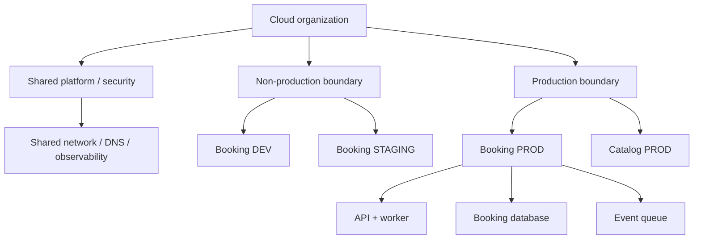
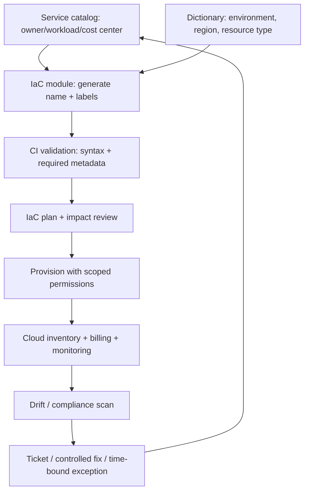
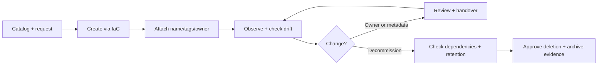

# Planning Resource Identifiers, Labels, and Ownership

## 1. Why Must Resources Be Planned Right at Architecture Design Time?

In the **CLOUD_ARCHITECTURE** module, cloud architecture is built from business requirements and choices across networking, compute, data, and deployment models, while balancing reliability, security, scalability, cost, and operations using **Well-Architected** thinking. To manage an architecture after deployment, teams also need to know **what each resource is, which system it belongs to, which environment it serves, and who is accountable for it**.

A diagram with two application clusters, a database, and a queue is not enough to answer practical operational questions:

- Which resources caused this month's 30% bill increase, and whose budget do they belong to?
- When a database runs out of storage at midnight, who receives the alert and has permission to perform recovery?
- Can a virtual machine with zero traffic for three months be deleted, or does it serve a periodic batch job?
- Which resources contain sensitive data and must comply with backup, access, and retention policies?
- If an application is moved to another geographic region, will naming conventions and ownership still hold?

**Planning resource identifiers, labels (tags/labels), and ownership** solves **identification, classification, traceability, and governance** of resources throughout their lifecycle. It helps evaluate cost and risk by business service, though it **does not by itself guarantee security, availability, or access control**.

After this lesson, you will be able to:

1. Distinguish between **platform-assigned identifiers**, **resource names**, **metadata labels**, and **ownership records**.
2. Design a consistent naming pattern without relying on a single syntax across every cloud service.
3. Define a minimum label set for managing cost, environment, data, security, and lifecycle.
4. Establish accountability during operations, incident handling, handovers, and resource deletion.
5. Automatically enforce and verify conventions through Infrastructure as Code (IaC), policies, inventory, and change workflows.
6. Evaluate a resource organization plan against Well-Architected objectives.

## 2. Four Concepts That Must Stay Distinct

| Concept | Function | Illustrative example | Notes |
|---|---|---|---|
| **Resource ID** | Resource identifier in the provider's management plane | Cloud-issued ID/ARN/resource path | May include a name or path; never assume it stays immutable across all migrations/recreations |
| **Resource name** | Human-readable or physical name given at creation | `acme-booking-prd-sea-db-01` | Subject to service-specific rules on characters, length, and uniqueness scope |
| **Tag/label** | Key–value metadata for grouping, billing, filtering, policies | `environment=prod`, `owner-team=booking` | Not every resource or billing service supports and inherits tags identically |
| **Ownership record** | Records who holds technical, business, cost, and incident responsibility | Group `team-booking` in the service catalog | Can live outside the cloud in a CMDB/service catalog; owners must be verified and kept current |

Example: the transactional database has a cloud-assigned **resource ID**, **name** `acme-booking-prd-sea-db-01`, **tags** `workload=booking`, `environment=prod`, `owner-team=team-booking`; in the service catalog, `team-booking` is the on-call operations team and `finance-apps` is the cost-bearing unit.

**A name is not an access permission.** Changing a display name or adding `owner-team=team-booking` does not automatically grant IAM access to that team. You must use IAM/RBAC policies and dedicated authorization workflows; some platforms allow **referencing tags in IAM conditions**, but that is an explicitly defined policy that must be tested and protected against unauthorized tag modification.

## 3. Organizing Resources by Governance Boundaries

Before naming individual servers, establish **governance boundaries**: cloud organization, account/subscription/project, environment, workload, region, network, and data residency zone.

Specific names differ across providers:

| Purpose | Example organizational mechanisms |
|---|---|
| AWS | Organization/Organizational Unit (OU), account, region, resource |
| Azure | Management group, subscription, resource group, resource |
| Google Cloud | Organization, folder, project, resource |

The structures above are **not strictly equivalent**. Policy inheritance, billing models, permission boundaries, and resource portability differ by platform. When implementing, verify the capabilities and limits of the specific services.

### 3.1. Why Separate Environments at a Strong Governance Tier?

Separating `dev`, `staging`, and `prod` solely via name prefixes can leave environments sharing access permissions, quotas, networks, or billing limits. For critical workloads, consider a **dedicated account/subscription/project for production**, combined with organizational policies and controlled cross-environment links.

Reference logical diagram:



This is a **conceptual structure**; it does not pre-describe physical resources or exact permission inheritance mechanics in AWS, Azure, or Google Cloud. Shared components generally need a **dedicated operational owner, cost allocation mechanism, and access limits**; do not dump full responsibility onto one application team by default.

When choosing boundaries, answer:

1. Could a misconfiguration in development disrupt production?
2. Who is allowed to create/delete production resources? Are human permissions separated from pipeline permissions?
3. Can costs be broken down cleanly by workload and environment?
4. Are there requirements for data to reside in specific regions or be isolated by customer?
5. Do service quotas, IP address space, DNS, and recovery workflows conflict across teams?

## 4. Designing Naming Conventions

### 4.1. What Questions Should a Name Answer?

Names should help humans quickly recognize the **application, environment, logical location, and resource type**; detailed or frequently changing attributes belong in tags and catalogs. Do not cram everything into the name.

A starting template:

```text
<organization>-<workload>-<environment>-<region-code>-<resource-type>-<index>
```

Example for a hypothetical organization `acme`, workload `booking`, production `prd`, internal region code `sea`:

```text
acme-booking-prd-sea-api-01
acme-booking-prd-sea-db-01
acme-booking-prd-sea-queue-01
acme-booking-stg-sea-api-01
```

These are **illustrative logical names**, not guaranteed valid for every service type. The `sea` code in the example is merely an internally defined location code mapped in an official lookup table; it is not a universal region name accepted directly by every provider.

| Component | Example | Recommended rule |
|---|---|---|
| `organization` | `acme` | Stable abbreviation containing no sensitive info |
| `workload` | `booking` | Business service name from the service catalog, independent of individual names |
| `environment` | `dev`, `stg`, `prd` | Closed list of values, standardized across teams |
| `region-code` | `sea`, `euw` | Lookup table mapped to actual regions, avoiding collisions or ambiguity |
| `resource-type` | `api`, `db`, `queue`, `bucket` | Controlled abbreviation dictionary |
| `index` | `01`, `02` | Use only when distinguishing multiple resources of the same type; do not use for autoscaled replica counts |

### 4.2. Rules for Designing Operable Names

- **Simple and deterministic:** the same set of inputs produces a predictable name; abbreviations must come from a central dictionary rather than each team inventing their own.
- **Stable:** avoid embedding application version numbers, employee names, temporary dates, or statuses like `new`, `final`; those attributes change frequently.
- **Valid per service:** max length, casing, `-`/`_`/`.` characters, required prefixes, and case sensitivity vary. Some resource types require **globally unique names**; others only need uniqueness within an account, project, or region.
- **Never put secrets in names:** tokens, phone numbers, personal email addresses, sensitive customer IDs, and internal secrets must not appear in names or tags.
- **Keep logical and physical names distinct when needed:** in IaC, module/resource names in code can stay stable even if the provider appends a suffix to physical IDs to avoid collisions.
- **Plan for lifecycle:** do not assume every resource can be renamed in place; changing `name` on some resources forces replacement, causing downtime, DNS/endpoint changes, or data loss without a migration plan.

For example, storage buckets/object namespaces often have different naming rules and uniqueness scopes than VMs. Build a naming helper parameterized by **resource type**, optionally appending a managed short suffix to prevent collisions; avoid letting pipelines generate untraceable random names.

### 4.3. Do Not Use Names as Permanent Business Identifiers

If a resource name changes during a system split, scripts hardcoded to that name can break. Store **resource IDs**, catalog links, and IaC outputs appropriately; wherever applications need stable endpoints, use DNS/service discovery or contract endpoints rather than relying on specific machine names.

For IaC, distinguish **the resource address in state management** from **the physical name in the cloud**. Renaming an address in code can cause the tool to plan a destroy/recreate unless a state move is declared; renaming the physical name may require replacement. Always review the execution plan before applying changes to stateful resources.

## 5. Designing a Standard Tag/Label Dictionary

Labels are key–value pairs used to answer: which environment does the resource belong to, who owns it, where is cost booked, what data does it hold, and how is it managed?

### 5.1. Recommended Minimum Field Set

| Internal standard key | Example values | Purpose | Required? |
|---|---|---|---|
| `workload` | `booking` | Associate with an application/business service | Yes |
| `environment` | `dev`, `stg`, `prod` | Filter environments, apply appropriate policies | Yes |
| `owner-team` | `team-booking` | Technically accountable team, look up in service catalog | Yes |
| `cost-center` | `cc-042` | Attribute costs to a budget unit | Yes if the resource falls within cost allocation scope |
| `managed-by` | `terraform`, `platform` | Indicate management source, aid drift detection | Yes |
| `data-classification` | `public`, `internal`, `confidential`, `restricted` | Classify data and guide protection policies | Yes for data resources; `not-applicable` when appropriate |
| `criticality` | `low`, `medium`, `high` | Prioritize alerts, recovery, and changes | Yes for critical workloads |
| `lifecycle` | `persistent`, `ephemeral` | Identify temporary vs. long-lived resources | Recommended |
| `expires-on` | `2027-02-28` | Review/deletion target date for temporary environments | Required for temporary resources with TTL |

These keys represent an **illustrative internal policy**. Cloud providers impose limits on tag count, length, characters, and reserved key names; Kubernetes labels have their own rules; never assume the exact same key set works verbatim everywhere. Choose the appropriate implementation variant while preserving **business semantics**.

Example expected metadata for the booking database:

```yaml
resource:
  logicalName: booking-primary-db
  providerResourceId: "<provider-issued-id>"
  accountOrProject: acme-production
  region: "<actual-region>"
  tags:
    workload: booking
    environment: prod
    owner-team: team-booking
    cost-center: cc-042
    managed-by: terraform
    data-classification: confidential
    criticality: high
    lifecycle: persistent
```

The YAML block above is an **illustrative inventory record**; the `resource/tags` structure is not a provider resource-creation API.

### 5.2. Label Data Quality Matters More Than Quantity

An effective tagging policy requires:

- **Allowed-value lists:** `environment=prod` must not randomly morph into `PRD`, `production`, or `live`, skewing reports; provide mappings and automated validation.
- **Single source of truth:** `owner-team` must reference an active team ID in the catalog; `cost-center` must reference an active budget code.
- **Distinguish required from optional:** do not require tags on provider-auto-created resources if the API does not support them; record documented exceptions and supplement with inventory mapping.
- **Control label modification permissions:** someone able to change `environment` or `owner-team` could bypass policies or distort reports. Restrict write access on sensitive tag keys.
- **Verify inheritance:** child resources do not automatically inherit tags from an account/project/parent. Verify actual tag propagation per service or propagate explicitly via IaC modules.
- **Protect sensitive information:** tags can appear in APIs, logs, inventory tools, and billing exports. Never store tokens, customer names, personal data, or security secrets in tags.

For example, distinguish **cloud tags** from **resource labels** in container platforms: Kubernetes labels typically serve selector matching, workload organization, and queries; cloud tags often drive cost allocation. Do not assume Kubernetes Pod labels automatically appear on cloud bills; if you need namespace/workload cost attribution, build a dedicated metering and allocation pipeline.

### 5.3. Cost Tags Are Not a Complete Cost Metric

Certain expenses such as data transfer, shared services, support fees, or external vendor charges may not map cleanly through resource tags. Many billing systems also require explicitly activating cost allocation tags and impose latency before tagged data appears.

Therefore, a chargeback/showback model requires **account/project hierarchy**, tags, and shared-cost allocation rules together. If shared network costs are allocated by request count or usage volume, document the formula, data source, and who absorbs unallocated remainder costs.

## 6. Resource Ownership: Who Decides, Who Operates?

An `owner-team` tag is useless if nobody answers during an outage. Ownership should be captured in a **service catalog/CMDB** and bound to a team, never hardcoded to an individual.

| Role | Typical responsibilities | Example |
|---|---|---|
| **Service owner** | Accountable for business goals, SLOs, change priorities, and accepted risks | Booking product ownership team |
| **Technical/resource owner** | Configuration, lifecycle, data, upgrade/recovery plans for owned resources | `team-booking` owns the API and business schema |
| **Platform owner** | Provides foundation, networking, central policies, IaC modules, and shared services | `team-platform` |
| **Security owner** | Defines control standards, reviews risks, and approves security exceptions | `team-security` |
| **Cost owner** | Tracks budgets, validates chargeback/showback, and drives optimization | `cost-center=cc-042` |
| **On-call responder** | Receives alerts, runs runbooks, performs initial recovery, and escalates | On-call rotation tied to `team-booking` |

One team may hold multiple roles, or roles may be distributed between platform and product teams. What matters is that **each workstream has one final accountable owner** and clear handoff paths.

### 6.1. Example Responsibility Matrix (RACI)

Legend: **R** Responsible, **A** Accountable, **C** Consulted, **I** Informed. Each row has one **A** to avoid decision ambiguity.

| Task | Booking team | Platform team | Security team | Finance/FinOps |
|---|:---:|:---:|:---:|:---:|
| Confirm naming/tags for Booking API | **A/R** | C | I | I |
| Provide IaC modules and central tagging policies | C | **A/R** | C | C |
| Approve security control exceptions | R | C | **A** | I |
| Optimize Booking app queries/backups | **A/R** | C | C | I |
| Review chargeback and budgets | R | C | I | **A** |
| Fix shared platform network/service outages | I | **A/R** | C | I |

This is an organizational example; in another enterprise, data protection sign-off or production change approval may sit with different roles. Adapt the RACI to real structures and delegated authority.

### 6.2. Distinguishing Shared Resource Ownership

For example, NAT, DNS, observability pipelines, and core connectivity managed by platform yet serving many workloads. Document:

- **Technical owner:** platform team operating and recovering the service.
- **Consumers:** workloads/teams using it, traceable via catalog or dependency graph.
- **Budget owner:** platform or consumer teams per agreed allocation rules.
- **Change process:** impact notices, maintenance windows, rollback plans, and stakeholder sign-off.

Never cram three team names into one `owner-team` tag and hope alerts find the right person. Set **one primary accountable team**, and record secondary stakeholders in separate fields or the catalog.

### 6.3. Staff Turnover, Team Transfers, and Orphaned Resources

When an engineer leaves a team, ownership must not disappear with their personal account. Use stable group IDs, sync members into IAM, and manage on-call rotations independently. When transferring a workload, transfer **accountability** before changing **tags**: inventory, dependency diagrams, runbooks, access rights, budgets, backups, dashboards, secret rotation, residual risks, and accepting owner.

A resource whose owner cannot be resolved in the catalog is an **orphan resource**. Route it to a platform/FinOps triage queue—do not delete it immediately just because a tag is missing: it could be a live system component or a critical recovery asset.

## 7. Connecting Conventions to Security and Well-Architected Goals

### 7.1. Security: Governance Boundaries First, Tags Second

Tags help select targets for audits or policy conditions, but **do not replace isolation**. Critical production resources require least-privilege access, network boundaries, encryption, audit logs, and dedicated deployment roles.

Typical risks when using tags in access policies:

1. If users can change `environment=prod` to `dev`, an unprotected tag-based IAM policy can be bypassed.
2. If a policy requires tags at creation time but a service fails to propagate tags to child resources, pipelines may create untagged resources or fail unexpectedly.
3. If a resource type does not support tag-based conditions, enforce alternative policies at another scope (account/project, path, role, or service-specific conditions).

Therefore, test policies using **authorized**, **unauthorized**, and **untagged** roles—covering creation, tag modification, deletion, and data reads. Roll out enforcement in stages so emergency recovery actions are never locked out.

### 7.2. Reliability

Attaching owners, criticality, and service links helps route alerts and plan RTO/RPO. However, `criticality=high` **does not automatically create Multi-AZ, backups, or failover**. The catalog must link to actual configurations and test evidence.

If a production DB is mislabeled as `dev`, automation could apply wrong retention or cleanup policies. Consequently, fields driving lifecycle automation require restricted edit access, cross-checks against the actual account/project, and approval gates for destructive actions.

### 7.3. Performance and Scalability

Tags grouping resources help dashboards aggregate latency, CPU, database connections, and queue age by `workload` and `environment`. Yet mislabeled metrics can hide bottlenecks or mislead autoscalers. Avoid attaching high-cardinality labels like `request-id` or `customer-id` to time-series metrics.

### 7.4. Cost and Operations

Good labels help identify idle resources, forecast budgets, allocate spend, verify backups, and detect drift. Tagged costs must be reconciled against **untagged** spend and shared charges. Exceptions require an owner, remediation deadline, and tracking process.

### 7.5. Sustainability

An inventory with owners and expiration dates helps remove unused test resources, cutting surplus storage and idle compute. Still, automate deletion only after verifying dependencies, retention policies, and data worth keeping; setting `expires-on` does not blindly authorize deleting critical data.

## 8. Enforcement via IaC, Policies, and Continuous Checks

To prevent conventions from staying purely on paper, define a **metadata contract** from a single authoritative source and feed it into templates, IaC modules, pipelines, and inventory.

### 8.1. Recommended Enforcement Flow



A logical representation might look like this (pseudocode, **not direct configuration for every cloud**):

```text
required_tags = {
  "workload": catalog.workload_id,
  "environment": deployment.environment,
  "owner-team": catalog.technical_owner_team,
  "cost-center": catalog.cost_center,
  "managed-by": "terraform"
}

assert catalog.technical_owner_team exists
assert deployment.environment in ["dev", "stg", "prod"]
assert catalog.cost_center is active
assert all values match provider-specific limits

resource_name = naming_policy.build(
  workload=catalog.workload_id,
  environment=deployment.environment,
  region=deployment.region,
  resource_type="api"
)

plan = iac.plan(resource_name, required_tags)
review(plan, especially_destroy_or_replace=true)
```

**Never assume every tool-created resource automatically receives tags.** Default resources, child resources, managed components, or autoscaled instances may require different metadata propagation mechanisms or lack tag support altogether.

### 8.2. Layered Policy Controls at the Right Stages

| Stage | Control | Appropriate action |
|---|---|---|
| Pre-merge | Validate naming functions, required fields, catalog schema, value validity | Block invalid configs with specific error messages |
| At resource creation | Scope policies, resource-type rules, tag-on-create where supported | Deny actions violating mandatory protections; log justified exceptions |
| Post-deployment | Scheduled inventory and policy scans | Flag missing tags/owners, open tickets, alert on drift |
| Monthly | Reconcile cloud billing with catalog/FinOps | Isolate unallocated spend, update owners/budgets |
| On modify or delete | IaC plan, dependency checks, backup/retention checks, risk-tiered approvals | Prevent accidental deletion of production resources and needed data |

Start in **audit/notify** mode to uncover platform limitations, then transition to **enforce** for resource types with full support. For sensitive production resources, blocking miscreation must be paired with controlled bootstrap and break-glass mechanisms so incident response is never blocked.

### 8.3. Exception Rules

An exception is a structured record containing: resource ID, resource type, missing or non-standard metadata, justification, risk level, approver, owner, compensating controls, expiration date, and remediation plan. "Special resource" is never an excuse to leave ownership blank.

## 9. Lifecycle of Metadata and Ownership

### 9.1. At Creation

Before creating a resource: create/verify the workload entry in the catalog, confirm technical and cost owners, environment, region, data classification, and relevant SLO/RTO/RPO. The pipeline builds the compliant name, attaches tags, and records the resource ID/link in the catalog.

### 9.2. During Operations

Reconcile inventory periodically to detect resources missing tags, sitting in the wrong environment, lacking valid owners, or violating naming rules. During an incident, dashboards must link straight to runbooks and the accountable on-call team; responders should never have to manually hunt down who created a VM years ago.

### 9.3. During Renames or Team Transfers

Do not automatically rename physical resources just because a product name or org chart changed. Assess impacts on DNS, clients, IaC state, backups, IAM, monitoring, and billing; update catalog/tag records first if only ownership changes. For resources that require replacement to rename, prepare a migration/rollback plan and change window.

### 9.4. At Expiration and Deletion

Experimental resources with `expires-on` need advance expiration warnings, verification of zero remaining traffic/dependencies, and snapshot/retention checks before controlled deletion. After deletion, update inventory and cost reports; clean up stale keys, secrets, routes, and alerts as well.



## 10. End-to-End Example: Booking System Resources

Suppose the Booking application has two environments, `stg` and `prod`, serving one primary region. The API, worker, and DB have distinct protection needs; shared networking and logging are managed by the platform team.

| Resource | Illustrative logical name | Workload / Environment | Technical owner | Cost owner | Operational notes |
|---|---|---|---|---|---|
| Production API | `acme-booking-prd-sea-api-01` | booking / prod | team-booking | cc-042 | Health checks, p95 alerts, and autoscaling where appropriate |
| Transactional DB | `acme-booking-prd-sea-db-01` | booking / prod | team-booking | cc-042 | `data-classification=confidential`, backups, HA, and restore tests |
| Event queue | `acme-booking-prd-sea-queue-01` | booking / prod | team-booking | cc-042 | Retries, DLQ, backlog alerts |
| Staging API | `acme-booking-stg-sea-api-01` | booking / stg | team-booking | cc-042 | No unauthorized live data; cost limits |
| Shared network | `acme-shared-prd-sea-net-01` | platform / prod | team-platform | cc-platform | Linked consumers; transparent egress cost allocation |
| Shared logs/observability | `acme-shared-prd-sea-obs-01` | platform / prod | team-platform | cc-platform | Retention and log access aligned to data classification |

The names above can act as **logical aliases** if a provider/service rejects that exact syntax. For autoscaling APIs, a resource group or deployment name can remain stable while replicas are dynamically created and destroyed with distinct IDs.

### 10.1. Two Useful Inventory Queries

The pseudocode below represents **synchronized data** from cloud inventory + service catalog; it is not universal SQL for provider APIs:

```sql
-- Production resources without a valid owner
SELECT r.resource_id, r.resource_type, r.name, r.owner_team
FROM resource_inventory AS r
LEFT JOIN team_catalog AS t ON r.owner_team = t.team_id
WHERE r.environment = 'prod'
  AND (r.owner_team IS NULL OR t.team_id IS NULL OR t.active = FALSE);

-- Costs not yet allocated by workload/cost center
SELECT billing_period, SUM(cost_amount) AS unallocated_amount
FROM normalized_billing
WHERE workload IS NULL OR cost_center IS NULL
GROUP BY billing_period;
```

Results from these two queries drive ticket creation or FinOps reviews, **not automated deletion commands**. Determine inventory coverage and billing data sources: untaggable resources and shared service fees still require separate accounting.

### 10.2. An Operational Scenario With and Without Ownership

**Scenario:** DB costs rise while booking error rates spike during peak hours.

With a solid catalog and tagging, alerts for `workload=booking`, `environment=prod`, `criticality=high` route directly to `team-booking`. The team locates the DB and related dashboards, identifies lock waits and connection pool exhaustion, coordinates DB limits with platform, and ships a fix. FinOps sees the cost increase under `cc-042` and tracks optimization results.

If the DB lacks an owner inside a shared account with no inventory, teams waste time asking who created it, whether parameters can be changed, and who owns the budget. Technically the database still runs, yet **incident resolution time and mischange risk climb**.

## 11. Evaluating Against Well-Architected

| Pillar | Questions to ask when reviewing conventions | Evidence |
|---|---|---|
| **Operational Excellence** | When an alert fires, can responders identify the on-call team and runbook from the resource ID? | Catalog, dashboard links, incident drills |
| **Security** | Are prod/non-prod separated, tag edits controlled, and metadata free of secrets? | IAM/RBAC, policies, audit logs, permission tests |
| **Reliability** | Who owns backup/restore, DR, and changes to critical resources? | RACI, restore tests, SLO/RTO/RPO, rollback plans |
| **Performance Efficiency** | Are metrics grouped by workload/env to spot bottlenecks? | p95 dashboards, saturation, query/queue metrics |
| **Cost Optimization** | What percentage of spend is reliably attributed to an owner/cost center? | Billing, inventory, shared-cost allocation rules |
| **Sustainability** | Are idle test resources detected and removed after checking retention? | Utilization, idle reports, controlled deletion workflows |

The AWS Well-Architected Framework uses these six pillars, including **Sustainability**. The questions apply beyond AWS, though specific enforcement tools must be tailored to your cloud provider and organizational model.

## 12. Common Planning Mistakes

| Mistake | Consequence | Fix |
|---|---|---|
| Putting the entire system in one account/project, distinguishing only by prefix | Hard to isolate permissions, quotas, billing, and failure impact | Separate governance boundaries for critical environments/workloads |
| Embedding creator name, dates, `new`, `final` in names | Names go stale fast, migrations are painful | Use stable workload IDs; record creators in audit logs if needed |
| Treating the `owner-team` tag as an IAM permission | Resources risk unauthorized access | Design separate IAM/RBAC, restrict tag edits |
| Letting teams pick `prod`, `prd`, `production` inconsistently | Inconsistent reports and policies | Standardize value dictionary and CI validation |
| Allowing personal info or secrets in tags | Exposure via inventory/logs/billing | Screen sensitive fields, use a secrets manager |
| Assuming all child resources inherit tags | Coverage gaps and skewed cost allocation | Check each resource type, add inventory mapping |
| Using tags as the sole source of truth | Ownership lost if tags are mistyped or deleted | Maintain a catalog/CMDB linking resource IDs and owners |
| Automatically deleting every resource with `expires-on` | Risk of destroying needed data or dependencies | Verify owner, traffic, retention, and approvals |
| Renaming production resources directly | May force replacement, downtime, lost endpoints | Review plans, back up, plan migration and rollback |
| Ignoring shared resources | Missing network, observability, and backup costs | Define allocation rules and owners for shared services |
| Blocking all operations on missing tags without checking provider support | Breaks bootstrap or emergency recovery | Scope policies per resource, audit first then enforce incrementally |

## 13. Practice Exercise: Designing Standards for a Cloud Application

An organization is preparing to run three workloads: **Booking API**, **Catalog API**, and **Reporting job**. Booking/Catalog have `dev`, `stg`, and `prod`; Reporting runs scheduled aggregate jobs. There is a shared network and logging system. Each workload has its own engineering team; the platform team manages shared services.

Create a short design document covering these deliverables:

1. **Draw the hierarchy**: pick prod/non-prod boundaries and shared services placement; explain how your layout affects IAM, blast radius, and billing.
2. **Propose a naming convention**: generate logical names for an API, a DB, a queue, a storage bucket, and a log sink. Note which types require checking global uniqueness, character sets, or rename behavior per provider.
3. **Build a tag dictionary**: select at least six keys; specify allowed values, who creates them, who can modify them, and what data is forbidden in tags.
4. **Define ownership**: assign technical owner, cost owner, on-call, and platform owner for each resource and shared component; describe how the Booking team hands over to a new team.
5. **Set automated controls**: define CI checks at creation, post-creation inventory scans, handling untaggable resources, and time-bound exception workflows.
6. **Run a review exercise**: assume a storage resource has existed for three months with no owner, rising bills, and unknown contents. List the **read-only** steps required before proposing deletion.

### Answer Framework Hint

```yaml
workload: booking
environment: prod
technical_owner_team: team-booking
cost_center: cc-042
resource_type: db
data_classification: confidential
criticality: high
managed_by: terraform
resource_name_example: acme-booking-prd-sea-db-01
controls:
  - validate-catalog-owner
  - validate-environment-and-cost-center
  - review-iac-plan
  - inventory-drift-check
  - verify-backup-and-restore
```

This is an **exercise template**, not a DB creation manifest. A strong answer must explain both **why** each field exists and **which team acts when a field's value is wrong**.

## 14. Architecture Review Checklist

- [ ] Does the hierarchy define environment boundaries, cost accountability, and failure blast radius?
- [ ] Are logical and physical names distinguished, and do naming rules account for per-service constraints?
- [ ] Can every resource be traced back to a workload, environment, owner, and budget?
- [ ] Do tags follow a standardized value dictionary, exclude sensitive info, and restrict modification rights?
- [ ] Do shared, managed, and untaggable resources have alternative ownership/cost attribution mechanisms?
- [ ] Does the catalog include technical owner, on-call, cost owner, dependencies, and runbooks?
- [ ] Do CI/IaC and inventory detect missing tags, invalid owners, and drift?
- [ ] Do handover, rename, exception, retention, and deletion workflows have owners and verification steps?
- [ ] Is there evidence that `criticality`/environment classifications are backed by real backup, IAM, SLO, and alert configurations?

Sound planning of identifiers, labels, and ownership makes a cloud architecture **discoverable, understandable, and accountably operated** throughout its lifecycle. Metadata conventions alone do not replace network, compute, data design, or Well-Architected validation; they ensure those architectural decisions are applied, tracked, and verified consistently.
