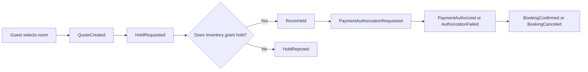
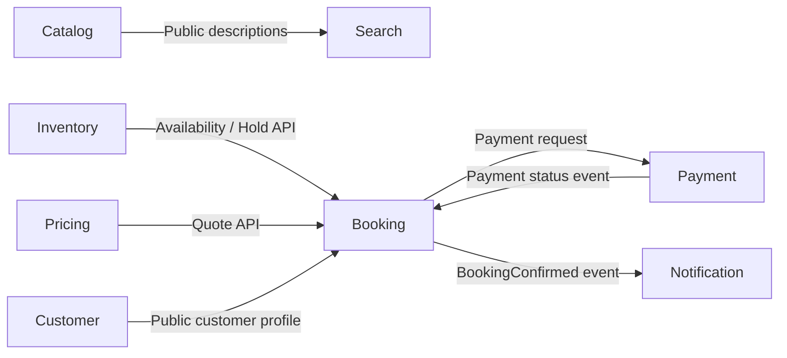
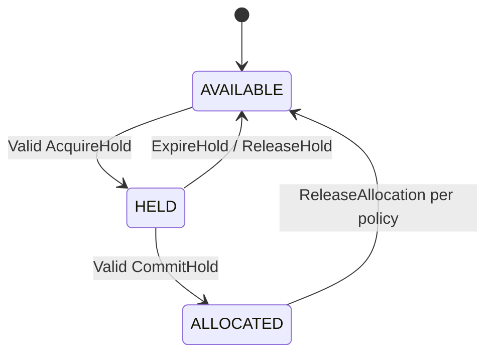
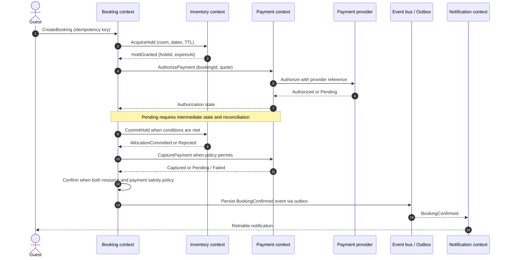
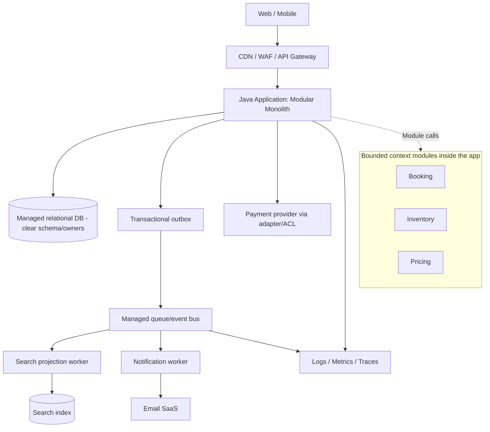
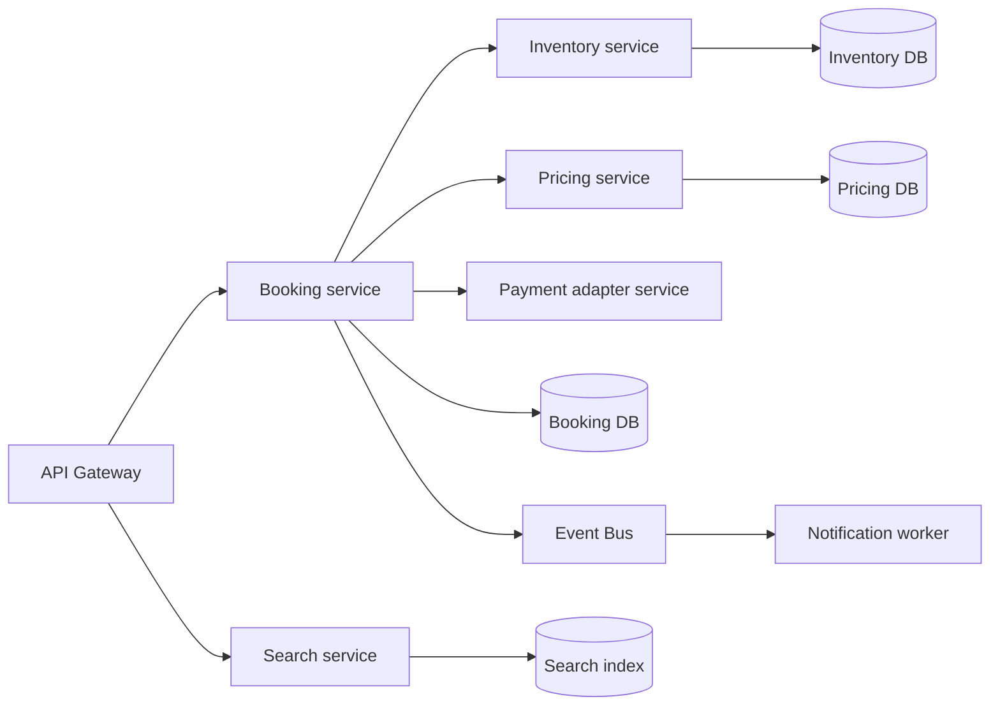

# Domain-Driven Design and Bounded Context Boundaries

## 1. Why domain-driven design matters in cloud architecture

An application can use the right cloud services, autoscale, and deploy continuously, yet still be very difficult to change when business rules are tangled together. For example, in a booking platform, a change to the refund policy forces the development team to edit search logic, room management, and invoice issuance. Components might be deployed independently on the cloud while still tightly coupled through a shared database, inconsistent terminology, and circular calls.

**Domain-driven design (DDD)** helps structure a software model around the concepts, rules, and outcomes the business actually cares about. At the architectural level, DDD helps identify **bounded contexts**: scopes within which a business model and language have consistent meaning.

In the **Application Models** chapter of the **CLOUD_ARCHITECTURE** module, this lesson aims to turn business requirements into design boundaries that remain maintainable as the system grows on the cloud. Learners should weigh reliability, security, scalability, cost, and operations using Well-Architected principles, rather than treating splitting the system into as many services as possible as an end in itself.

After this lesson, you will be able to:

1. Distinguish domain, subdomain, bounded context, aggregate, and deployment unit.
2. Identify boundaries from business language, rules, data, invariants, and rates of change.
3. Draw a context map and choose integration styles between bounded contexts.
4. Determine where to place consistent transactions, where to use events, and how to handle cross-boundary errors.
5. Translate a domain model into a cloud architecture with clear owners, SLOs, security boundaries, and sensible costs.
6. Evaluate a design using examples, tests, and architecture decision records.

## 2. Core concepts: do not equate "domain" with "service"

| Concept | Meaning | Example in the Booking Platform |
| --- | --- | --- |
| **Domain** | The problem space the business wants to solve, including goals, rules, and terminology | Hospitality / accommodation service business |
| **Subdomain** | A part of the domain, categorized by business capability | Room inventory management, booking, payment, customer care |
| **Bounded context** | Boundary within which a model, rules, and language have consistent meaning; other models may exist outside it | In *Booking*, "booking" is a request and confirmation state; in *Inventory*, "hold" is a temporary claim on a resource |
| **Ubiquitous language** | The vocabulary used consistently by business and engineering within a context | "Hold", "expired", "confirmed", "canceled" have concrete definitions |
| **Entity / Value Object** | An entity with identity / an object defined by its value | `Booking` / `Money`, `DateRange` |
| **Aggregate** | A cluster of domain objects with an *aggregate root* protecting invariants on updates | The `RoomAllocation` aggregate controls resource contention |
| **Context map** | A map of dependencies and how two models interact | Booking uses Inventory's public contract; Payment emits payment events |
| **Module / Service / Deployable** | Units of code organization / communication / technical deployment | Two bounded contexts can live in the same deployed application |

One especially important distinction:

- **Subdomains belong to the problem space:** which capabilities the business needs.
- **Bounded contexts belong to the solution space:** how software organizes and interprets models.

There is no mandatory one-to-one mapping between a subdomain and a bounded context. A complex subdomain may contain multiple contexts, one context may cover closely related parts of work, and one context may span multiple internal modules.

**A bounded context is also not synonymous with a microservice.** Model boundaries can live inside the same *modular monolith*, be deployed as one or more services, or rely on SaaS for part of the capability. The deployment choice depends on desired isolation, team organization, scaling needs, and total operational cost.

### 2.1. What a bounded context actually binds

Within a context, the team must agree on:

- Terminology and the meaning of each concept.
- Business rules that the context owns.
- Authoritative data, states, and valid state transitions.
- Public contracts provided to other contexts.
- Who is responsible for evolving the model, handling errors, and operating it.

Good boundaries enable **changing rules within a predictable scope**, reducing situations where a single concept carries multiple meanings while being used everywhere in the system.

## 3. Finding subdomains from business capabilities and journeys

Do not start with a service diagram or splitting `controller/service/repository` packages. Start by asking: what outcomes do users and the business want to achieve, and which rules are required to achieve them?

For example, an online room booking system has the following capabilities:

| Capability | Business Task | Notable Rules |
| --- | --- | --- |
| **Catalog** | Manage properties, photos, amenities, and descriptions | Display only approved content |
| **Search** | Search rooms by location, dates, and filters | Results may use a read index with acceptable update lag |
| **Inventory** | Know which room units are available; hold/release resources | Never allocate the same room unit to two overlapping requests |
| **Pricing** | Compute rates, discounts, taxes/fees, and quote policies | Quotes are valid under specific conditions and expiration windows |
| **Booking** | Track booking intent, status, confirmation, and cancellation | Confirm only when payment/resource conditions satisfy policy |
| **Payment** | Create, verify, and reconcile payment transactions | One logical command must not cause duplicate charges on retries |
| **Customer** | Manage profiles, contact channels, preferences | Access to customer data must be authorized |
| **Notification** | Send email/SMS and record delivery outcomes | Notification failure must not corrupt booking state |

These are **candidate subdomains**, not a final design. Validate them with domain experts: in some places Inventory and Booking need the same transaction boundary, in others Catalog and Search are owned by one team, and in others Payment is a third-party system while an internal Payment context still reconciles and normalizes state.

### 3.1. Classifying core, supporting, and generic

DDD commonly distinguishes:

- **Core subdomain:** where competitive advantage or differentiating value is created, worthy of deep modeling and engineering investment. For a real-time booking platform, the room allocation algorithm may be *core*.
- **Supporting subdomain:** functionality needed by the product but not a primary differentiator; can be built "good enough", shared, or delegated to another team.
- **Generic subdomain:** common capabilities like authentication, email delivery, basic reporting; can use SaaS/managed services if requirements are met.

Classification **depends on business strategy**, not fixed feature names. A payments company may treat Payment as core; a simple content app may buy payment processing as a supporting capability. When strategy shifts, classifications can shift too.

### 3.2. Domain discovery techniques

A useful workshop flow:

1. Pick **one critical journey**: "Guest searches, holds, and pays for a room."
2. List **business events that happened** in chronological order: "Quote created", "Room held", "Payment authorized", "Booking confirmed".
3. For each event, ask what command triggered it, who issued the command, which rules must hold, what data determines the outcome, and who owns it.
4. Spot places where the same term has multiple meanings, rules change at different cadences, or different owners are needed.
5. Group activities into model-consistent regions; tentatively name contexts by business responsibility.
6. Stress-test boundaries with conflict scenarios, error branches, load pressure, and deployment needs.

In *Event Storming*, use past-tense events such as `BookingConfirmed` to describe facts that already occurred. Distinguish them from a **command** like `ConfirmBooking`, which is a request to act that can be rejected.



This diagram is only a discussion backbone. Do not infer from it that booking confirmation and payment run inside a single distributed ACID transaction.

## 4. Ubiquitous language: one word can carry multiple meanings

Within an organization, the word "customer" might refer to a registered user account, a contract signer, or the party billed on an invoice. If a single `customer` table and a single `Customer` class serve every case, changing one meaning can break logic in another context.

Examples:

| Term | In Context | Meaning and Rules |
| --- | --- | --- |
| **Room** | Catalog | Room type, photos, and display description |
| **Unit** | Inventory | Physical/logical resource grantable for a date range |
| **Offer** | Pricing | Rate conditions package, validity window, policies |
| **Reservation/Booking** | Booking | Guest's service booking intent and outcome |
| **Charge** | Payment | Payment collection request/instrument with its own lifecycle |
| **Customer** | Customer | Profile and contact preferences owned by the guest |

This leads to two design consequences:

**First, do not force a single "enterprise-wide unified data model" for every use case.** Contexts can reference the same guest via a public identifier while modeling internals to fit their own responsibilities.

**Second, translate meanings at boundaries.** For instance, Pricing's API returns a quote with amount, currency, expiration, and terms version; Booking stores the accepted *snapshot* to explain why the order had that price. Booking should not directly query Pricing's internal rule tables.

### 4.1. Building a concrete glossary

Each bounded context should maintain a glossary with examples and counter-examples:

| Term | Definition | Must Not Be Interpreted As | Owner |
| --- | --- | --- | --- |
| **Hold** | Temporary claim on a resource until a specific expiration timestamp | Confirmed booking | Inventory |
| **Confirmed Booking** | Booking that has completed all policy confirmation requirements | Merely received request from client | Booking |
| **Authorized Payment** | Provider approved holding funds via a specific payment method | Funds settled/transferred to account | Payment |
| **Refunded** | Refund verified according to Payment rules | Clicked the "request refund" button | Payment |

This language must appear consistently in discussions, API docs, source code, tests, and dashboards. If business groups cannot agree on definitions, resolve the disagreement before carving out services.

## 5. Identifying bounded context boundaries with evidence

A sound boundary usually appears where multiple signals converge:

| Signal | Practical Question | Direction |
| --- | --- | --- |
| **Rules and invariants** | Which data must change atomically so a rule always holds? | Keep operations needing local transactions close together |
| **Language** | Does a term mean different things to two groups? | Create separate models and explicit translation contracts |
| **Ownership** | Which team makes business decisions and handles incidents? | Assign clear owners for models and contracts |
| **Rate of change** | Which rules change frequently and independently? | Consider separating modules/contexts to contain change impact |
| **Authoritative data** | Who has authority to confirm an entity's "true state"? | Only one authoritative writer per rule |
| **Load and latency** | Does one capability need very different scaling or optimization? | Consider runtime separation when gains are measurable |
| **Security/compliance** | Do data and permissions need different isolation? | Design IAM, network, and data-handling boundaries |
| **Operations** | Do availability and recovery procedures differ markedly? | Choose appropriate deployment/dependency separation |

### 5.1. Boundaries should not be based on table names or UI screens

Splitting `UserService`, `BookingService`, and `PaymentService` simply because the database has matching tables does not prove good boundaries. A single "Booking" screen can span multiple contexts; conversely, one context can serve multiple screens and background jobs.

Warning signs of poor boundaries:

- Two contexts frequently edit the same record or must always deploy together.
- One use case must make 5–6 synchronous service calls to complete a simple action.
- Service A directly queries B's tables because the API is "inconvenient."
- Events expose the publisher's entire internal model, coupling consumers to detailed schemas.
- Every pricing change requires editing Booking, Payment, Search, and Notification simultaneously.
- Two teams argue over who owns approving/returning the final state.

Boundaries should be adjusted when real evidence shows excessive coupling. Splitting or merging is not a design failure; it is part of domain learning.

### 5.2. Aggregates differ from bounded contexts

A bounded context can contain multiple aggregates. An aggregate is a transactional consistency boundary **for a group of objects**, whereas a bounded context is a broader **model and language** boundary.

For example, the Inventory context has `Hold` and `Allocation`. The rule against granting two overlapping usage rights may need enforcement within a shared transactional structure per resource unit, not merely inside a standalone `Hold` object. Aggregate design must stem from invariants and concurrent update behavior, not just class diagrams.

## 6. Context map: showing relationships, not just boxes on a diagram

Once candidate contexts exist, document **dependency directions and collaboration styles**:



These dependency lines represent one reference design. In another system, Booking and Inventory might share a context to protect transactions, or Search might consume events from both Catalog and Inventory to build a read model. Document clearly which model is the **authoritative data source** and which is a **derived copy**.

### 6.1. Common relationship patterns in strategic DDD

| Relationship Type | Core Meaning | When It Fits |
| --- | --- | --- |
| **Customer–Supplier** | Upstream context provides contracts negotiated with downstream consumer needs | Two teams can coordinate roadmaps |
| **Conformist** | Downstream consumer adopts upstream's model/contract with little influence | Integrating a vendor system with limited customization |
| **Anti-Corruption Layer (ACL)** | Translation layer preventing external models from "leaking" into internal models | Integrating legacy/SaaS with different terms or rules |
| **Published Language** | Public, agreed, versioned data contract | Many parties consume the same event/API contract |
| **Open Host Service (OHS)** | Well-defined integration interface for multiple consumers | Context provides a stable API to an ecosystem |
| **Shared Kernel** | Controlled, co-owned sharing of a very small model slice | Two teams collaborate closely and accept intentional coupling |
| **Separate Ways** | Two contexts solve problems independently, avoiding unnecessary dependency | Integration costs more than the value it delivers |
| **Partnership** | Two teams mutually depend on each other and commit to tight coordination | Viable when development cadence and coordination truly align |

**An ACL is not just an HTTP adapter.** It must translate **semantics**: for instance, a legacy system has status `P` ("paid") which actually only means "payment request recorded." The internal Payment context must not turn `P` into `PaymentSettled` without settlement proof.

### 6.2. Contract change authority

Every API/event should specify:

- Known owner and consumers.
- Field meanings, nullability, currency/time units, error codes, and data invariants.
- Policies for adding/removing fields and version compatibility.
- SLAs/SLOs, quotas, retries/idempotency, timeouts, and disconnect handling.
- Sensitive data flow directions and security policies.

A context map maps **social and technical relationships**. If a team lacks authority to propose upstream contract changes, acknowledge that reality when choosing an integration style rather than drawing two boxes communicating as equals when coordination is hard.

## 7. From bounded contexts to application models: monolith or microservices?

There are at least three ways to deploy domain boundaries:

| Organization | How Bounded Contexts Are Reflected | Pros | Trade-offs |
| --- | --- | --- | --- |
| **Modular monolith** | Each context is a separate module with encapsulated interfaces and data; runs in one deployment | Simpler internal transactions, fewer network hops, lower ops cost | Requires discipline to uphold boundaries; shared scaling/deploys |
| **Microservices** | One or a group of contexts deployed as a service owning its API and data | Isolates change/load and enables independent deployment | Network failures, distributed tracing, eventual consistency, SRE, CI/CD, ops cost |
| **Hybrid** | Core contexts live in a monolith or a few services; other capabilities use managed services/SaaS | Optimizes by stage and team capability | Diverse integration, ownership, and data transformation |

There is no rule saying "one bounded context equals one microservice." A very large context may have multiple technical deployments while still preserving a **unified model and clear owner**. Nor should one microservice lump unrelated models together merely to reduce service count.

### 7.1. Modular monolith example for a Java application

```text
com.example.reservation
├── catalog
│   ├── domain
│   ├── application
│   └── infrastructure
├── inventory
│   ├── domain
│   ├── application
│   └── infrastructure
├── booking
│   ├── domain
│   ├── application
│   └── infrastructure
├── payment
│   ├── domain
│   ├── application
│   └── infrastructure
└── shared
    └── technical
```

In this design, code in `booking` must not directly import internal entities/repositories from `inventory`. Instead, it calls a published **application port** or dispatches commands/events through an interface. The `shared` module holds only truly shared technical utilities; it must not become a dumping ground for every domain class.

Build-level architecture checks can enforce that dependencies only pass through permitted interfaces. Data encapsulation must also hold: sharing one physical database across modules does not mean one module may modify another module's internal tables.

### 7.2. When should deployment services be separated?

Consider splitting when one or more clear conditions are met:

- A team can own the full lifecycle, and an independent deployment cadence delivers real value.
- One context needs a distinct scaling profile, such as read-heavy search vs. booking writes.
- There is a need to isolate failures, network permissions, sensitive data, or compliance requirements.
- Contract and data boundaries are sufficiently stable and needed to reduce cross-dependencies.
- Latency, load, and network costs across boundaries remain acceptable.

**Do not split just to "do DDD right."** When the team is small, business rules change constantly, and transactions are tightly linked, a modular monolith is usually a better starting point. Express boundaries in code and processes before deciding whether to turn them into network boundaries.

## 8. Invariants and consistency: where must one transaction be shared?

An **invariant** is a condition that must always hold after every valid state change. It is the most important input for choosing aggregate boundaries and storage technology.

Examples:

- Two confirmed bookings must not occupy the same room unit during overlapping dates.
- A completed payment must not be recorded twice for the same logical transaction.
- A canceled booking cannot transition to confirmed on a late webhook if policy forbids it.
- A quote may be accepted only while still valid and meeting applicability conditions.

**A bounded context can contain multiple aggregates; there is no transaction guarantee across all contexts.** Invariants needing atomic verification should sit at a data boundary capable of real enforcement—typically a transaction in an authoritative write store. If an invariant always requires simultaneously modifying data in two contexts, revisit the boundaries or design intermediate states and a coordination protocol.

### 8.1. Resource contention in Inventory

Two guests book the last room simultaneously. Both might read `available = true` nearly at the same time. If each performs "check then write" in two separate commands, both can pass the check.

One strategy gives the Inventory context exclusive responsibility for granting usage rights and enforcing database-level concurrency control (appropriate locks, data constraints, or transaction isolation). The `HELD` state has an expiration; transitioning from `HELD` to `ALLOCATED` must re-verify conditions and execute safely.



The diagram simplifies to **one grant on one resource for one time interval**. Real implementations must handle overlapping date ranges and multiple consecutive sessions on a resource. Locking by `room_id` and checking intervals, or exclusion constraints, may fit depending on the DBMS; do not apply one locking technique blindly to every data model.

### 8.2. Aggregate root guarding state transitions

Illustrative Java example for a model in the Booking context:

```java
public enum BookingStatus {
    PENDING, CONFIRMING, CONFIRMED, CANCELED
}

public final class Booking {
    private final String id;
    private BookingStatus status = BookingStatus.PENDING;
    private String allocationId;

    public Booking(String id) {
        this.id = id;
    }

    public void beginConfirmation() {
        if (status != BookingStatus.PENDING) {
            throw new IllegalStateException("Booking is not pending");
        }
        status = BookingStatus.CONFIRMING;
    }

    public void confirm(String confirmedAllocationId, boolean paymentSatisfied) {
        if (status != BookingStatus.CONFIRMING || !paymentSatisfied
                || confirmedAllocationId == null
                || confirmedAllocationId.isBlank()) {
            throw new IllegalStateException("Confirmation conditions not met");
        }
        this.allocationId = confirmedAllocationId;
        status = BookingStatus.CONFIRMED;
    }

    public BookingStatus status() {
        return status;
    }
}
```

Here, `confirm` expresses a local rule. **The `paymentSatisfied` boolean and `confirmedAllocationId` must come from verified results**, never trusted from client-supplied values. This snippet does not yet solve cross-context coordination among Inventory, Payment, and Booking; that belongs to the business workflow and reconciliation mechanisms. In a real system, aggregate updates also need concurrency control (such as optimistic locking/versioning) so two commands cannot overwrite state incorrectly.

## 9. Cross-bounded-context flows: synchronous, asynchronous, and compensation

A business step may cross multiple contexts, but avoid assuming all participants' databases sit inside one ACID transaction.

**Synchronous calls** fit when the caller needs an immediate response to continue, such as fetching a valid quote or creating a hold. The caller needs timeouts, bounded retries, and handling for ambiguous outcomes.

**Asynchronous exchange** fits when an event has already happened and receivers can process it later, such as sending confirmation notifications, updating a Search index, or reconciling transactions. Receivers must handle duplicate, delayed, out-of-order, or repeatedly failing messages per infrastructure contracts.

### 9.1. Illustrative booking workflow



The diagram shows the happy path. In production, a timeout can occur after any call even when the receiver succeeded. Thus, Booking needs a **resumable state machine**, idempotency keys, cross-context references, and reconciliation jobs; if Payment already collected funds while Inventory could not commit the resource, compensate/refund per policy. If the resource was held while Payment failed, release it or let it expire cleanly. The confirmation flow must avoid promising a final state to the guest before conditions truly hold.

### 9.2. Sagas and compensating steps

A *Saga* coordinates multiple local transactions across a workflow; when one step fails, the system executes business-appropriate compensating actions. Two common styles exist:

- **Orchestration:** a coordinator (such as the Booking workflow) commands steps and handles results. Easy to observe from a central state, though the coordinator must be built resiliently.
- **Choreography:** contexts react to events without a direct coordinator. Reduces coordinator dependency, though long chains with many branches become hard to trace and prone to loops.

Compensating actions are **not necessarily technical rollbacks**. A refund is a new business transaction that can fail or take time; canceling a room after a guest already received confirmation may require customer-support workflows. Design policies and states such as `COMPENSATING`, `RECONCILING`, and `MANUAL_REVIEW` when needed.

### 9.3. Outbox, inbox, idempotency

Mechanisms that commonly work together:

| Mechanism | Problem Solved | Limits to Understand |
| --- | --- | --- |
| **Transactional outbox** | Writes business state and outgoing event records in the same local transaction | Relay may redeliver; consumers still need deduplication |
| **Inbox/deduplication** | Identifies already-processed events on the consumer side | Must use a stable event key and execute atomically with state updates |
| **Idempotency key** | Resending a logical command by client or service produces no new side effect | Keys need scope, retention, and payload checks; partner outcomes also need reconciliation |
| **Retry + backoff + jitter** | Mitigates transient errors and avoids thundering herds | Never retry infinitely or retry unsafe operations when outcome is unknown |
| **DLQ and reconciliation** | Isolates failing messages and resolves persistent discrepancies | Needs owners, alerts, runbooks, and controlled replay |

Do not promise "end-to-end exactly-once" merely because a queue has a deduplication feature. Business invariants must hold even when clients, queues, workers, and partners retry multiple times.

## 10. Data ownership and integration contracts

A practical principle is that **a context owns its authoritative data and write logic**. Other contexts access it via published interfaces, events, or permitted read models. Here, "ownership" means **authority over semantics and writes**, not necessarily that every context runs its own physical database server.

For example, Booking should not directly update the `inventory_hold` table. It must send a semantic command like `CommitHold`; Inventory decides whether invariants are satisfied.

### 10.1. Separating internal models from public contracts

An integration event should carry **information sufficient for consumers**, without copying all internal entities and SQL details of the publishing context.

```json
{
  "eventId": "evt-31b3",
  "eventType": "BookingConfirmed",
  "schemaVersion": 1,
  "occurredAt": "2026-01-12T08:15:00Z",
  "bookingId": "booking-842",
  "customerRef": "customer-119",
  "allocationRef": "allocation-713",
  "correlationId": "checkout-58d"
}
```

This is an illustrative contract example. Consumers should not infer Payment status from a Booking event if the contract does not guarantee it. Do not place card numbers, tokens, emails, or unnecessary personal data into events; reference IDs must also be protected according to access scopes.

### 10.2. API contracts must describe failure behavior

Example contract for Inventory's `POST /holds`:

| Attribute | Requirement |
| --- | --- |
| Input | Resource ID, time interval, logical request ID, and authorized identity |
| Success | Returns `holdId`, `expiresAt`, and committed state |
| Invalid | Rejects with business error codes distinguishing unavailable resource, invalid dates, missing permissions |
| Retry | Repeating the same idempotency key and payload returns the same logical outcome |
| Timeout | Caller must query status rather than assuming failure |
| Concurrency | Never grants conflicting holds/allocations violating business invariants |
| Observability | Emits correlation ID, latency, rejection rate, and query traces |

When evolving contracts, ensure **older consumers and newer producers still understand each other** during staggered deployments. Events already sitting in a queue may be processed by a newer worker version, so test historical payload compatibility. Event versioning and schema registries only help when paired with real change conventions.

### 10.3. When to use APIs, events, and data replicas?

| Scenario | Starting Choice | Rationale |
| --- | --- | --- |
| Need an immediate decision and success/failure response | Synchronous API/command or stateful command | Caller needs the outcome to decide the next step |
| Updating search indexes, caches, reports | Events + read models | Tolerates lag and reduces coupling |
| Aggregated queries across multiple contexts | Read models, query services, or API composition | Avoids cross-querying internal tables |
| Business follow-up after a fact has occurred | Domain/integration events | Consumers scale independently by contract |
| Maintaining strict invariants in one transaction | Local transaction at the owner | Shrinks inconsistency windows and reduces distributed complexity |

If a read model accepts eventual consistency, the UI must reflect that appropriately: search results may be slightly stale, whereas a room-hold command must check authoritative Inventory directly. Never use a cache or search index as proof to confirm room allocation.

## 11. How do domain boundaries shape cloud architecture?

DDD defines models and ownership; cloud architecture decides **where they run and how they are operated**. Map domain boundaries to justified infrastructure decisions:

| Cloud Decision | Question from a Bounded Context Viewpoint | Example |
| --- | --- | --- |
| **Compute** | Do contexts differ in load, runtime, or deployment cycle? | Search workers use different compute resources than Booking API |
| **Data** | Who has write authority? How far do transactions reach? | Inventory uses a transactional store; Search uses a derived index |
| **Network** | Which traffic crosses trust boundaries? Where are private endpoints or rate limits needed? | Booking calls Inventory via authenticated interface; Payment connects to external partner |
| **Security** | Which context handles sensitive data; which roles invoke dangerous commands? | Only Payment context holds payment provider secrets |
| **Deployment** | Should it be a module, container/service, or SaaS? | Booking and Inventory can share a modular monolith; Notification is a separate worker |
| **Scaling** | Can one part scale independently, and where is the real bottleneck? | Search scales read-heavy; DB holding bookings needs concurrency control |
| **Reliability** | Which context can fail while other flows continue? | Notification failing does not lose confirmed bookings |
| **Cost** | How many hops, logs, egress, and ops systems does distribution add? | Splitting too finely increases latency and platform cost |

### 11.1. Reference deployment diagram: start just right



Notably, **model boundaries remain clear even in a shared deployment**. You can establish module boundaries, data write ownership, and event contracts before deploying many microservices. When Search or Notification load rises, those workers are already logically separated and easy to scale independently.

### 11.2. Service-split deployment when justified



This diagram illustrates only **data ownership and logical traffic**, not a complete production architecture. You must add service identities, IAM, network policies, timeouts, retries, quotas, HA, tracing, key management, failover, backups, partner failure handling, and deployment tooling. If Booking calls Inventory/Pricing/Payment synchronously in sequence, end-to-end latency and failure probability can rise; design response paths and intermediate states upfront.

### 11.3. The cost of a deployment boundary

Every separated service may require CI/CD, image scanning, secrets, telemetry, on-call, quotas, monitoring, alerts, API contracts, rollout mechanisms, runbooks, and dashboards. A low-churn, low-traffic context may not justify its own deployment unit. Bounded contexts help at every scale; service count should depend on **the value of operational independence**.

## 12. Trade-offs in reliability, performance, security, and cost

One boundary choice can improve one pillar while straining another:

### 12.1. Reliability: limiting failure propagation

If Notification is an asynchronous consumer, email provider failures should not abort Booking transactions. Conversely, if Booking must call Payment synchronously to return a final result, partner timeouts can stall checkout or leave uncertain displays. Deadlines, `PROCESSING`/`RECONCILING` states, outbox, retries, and runbooks are required.

**Evidence:** test disconnects, queue lag, duplicate callbacks, database failover, and backup restores. Do not test only a single successful HTTP request.

### 12.2. Performance Efficiency: avoiding chatty services

If one screen must sequentially call Catalog, Pricing, Inventory, Review, and Customer before responding, total latency can exceed SLOs. Improvements include aggregated read models, bounded-TTL caches, appropriate parallel queries, fan-out limits, and fewer network hops. However, **never use stale read data to perform writes requiring correctness**.

### 12.3. Security: domain boundaries do not automatically become trust boundaries

Placing Payment in a separate service is not enough if every service still shares the same DB credentials or permission to read payment secrets. You need IAM boundaries, service-to-service authentication, authorization on business commands, secret management, encryption, and auditing. Events should carry only necessary data; consumers must be authorized to receive those event types.

### 12.4. Cost: comparing total cost of ownership

A request crossing many services incurs baseline compute, inter-service networking, queues, egress, telemetry, API gateway, and on-call hours. Conversely, scaling Search without scaling Payment/Inventory can save significantly as read traffic climbs. Evaluate using TCO across load scenarios and cost per **completed transaction**, not just per-VM/container price.

### 12.5. Operational Excellence: ownership before autonomy

Bounded contexts need owners accountable for models, data, contracts, and operations. Splitting into 20 services with only 3 engineers on call rarely operates smoothly. When a single team manages the entire application, clear module boundaries and shared deployment enable faster changes, simpler testing, and less coordination overhead.

## 13. Setting SLIs, SLOs, and recovery targets by business flow

Do not decide "Inventory needs 99.99% uptime" from the context name alone. Start from the business impact when that capability fails.

The following table shows **illustrative requirement templates**, not default SLOs:

| Flow / Context | Suggested SLI | Illustrative Target | What to Verify |
| --- | --- | --- | --- |
| Search | Share of valid searches returning within threshold | p95 ≤ 2 seconds under target load | Cache hit ratio, indexes, fan-out, behavior when Search degrades |
| Inventory | Count of conflicting resource allocations | **0 confirmed conflicts** per invariant | Race-condition tests, locks, transactions, timeouts |
| Booking | Share of requests reaching a valid outcome or queryable state | Business-agreed SLO over 30-day window | Never return "failed" when actual outcome is unknown |
| Payment | Maximum age of transactions awaiting reconciliation | Rate of overdue transactions below agreed threshold | Duplicate/late callbacks, reference IDs, reconciliation |
| Notification | Share of messages delivered within target window | Aligned with agreed UX expectations | DLQ, retries, idempotency, email provider |
| Transaction data | RTO/RPO for recovery | Per acceptable loss/outage tolerance | Actual restores and invariant verification |

**Service availability** and **business correctness** are two different dimensions. Inventory's API could return HTTP 200 continuously while still violating allocation invariants; the business flow has failed even though infrastructure looks healthy.

Link telemetry across contexts via `correlation_id` or `trace_id` without leaking personal data or secrets. A single transaction may spawn multiple traces across queues; store business-level reference links to trace across asynchronous steps.

## 14. From domain events to observability and runbooks

During an incident, operations teams need to see **business state**, not just CPU and container counts.

Illustrative business log example:

```json
{
  "event": "booking.state_changed",
  "bookingId": "booking-842",
  "correlationId": "checkout-58d",
  "fromState": "CONFIRMING",
  "toState": "RECONCILING",
  "reasonCode": "PAYMENT_RESULT_UNKNOWN",
  "retryCount": 2
}
```

A useful metric set may include:

- Hold success/failure rate, rejections due to contention.
- Count of bookings in `PENDING`, `CONFIRMING`, `RECONCILING` and intermediate state age.
- Unverified Payment authorizations/captures, refunds needing follow-up.
- Unconsumed event age, duplicate processing rate, DLQ depth.
- Cross-context contract errors and version incompatibilities.
- Cost per context/flow and end-to-end time from intent to confirmation.

Runbooks must clarify when the application retries automatically, when to reconcile with providers, when manual intervention is required, and who is authorized to adjust states. Never allow staff to "manually patch the database" bypassing invariants without a controlled, audited process.

## 15. Designing security and privacy limits per context

When dividing domains, attach **data classification** and **access policies** to each context:

| Context | Sensitive Data | Risk-Reduction Principles |
| --- | --- | --- |
| Customer | Contact details, user profiles | Purpose-based access, field minimization, auditing |
| Payment | Transaction references, payment tokens | Isolate provider secrets, restrict access, avoid storing unnecessary card data |
| Booking | Booking history and customer links | Verify booking ownership, never trust client IDs |
| Inventory | Resource schedules and allocation rights | Only authorized commands may update usage grants |
| Search | Read-optimized index data | Do not place sensitive profiles into public indexes |
| Notification | Recipient addresses and templates | Minimize personal info in queues/logs, enforce retention |

A multi-tenant system must enforce tenant boundaries on every command and query, whether running as a monolith or microservices. Context boundaries help organize ownership, but **authorization must still be enforced at the API, business logic, and data layers**, never relying on an architecture diagram alone.

## 16. Evolving an existing architecture: from tangled monolith to clear modules

Not every project starts greenfield. With a multi-year codebase, progress step by step:

1. **Identify existing journeys and domain events:** interview business stakeholders; trace critical flows and record change impacts.
2. **Map actual dependencies:** which modules call which, which tables are written by multiple teams, how many features a transaction spans.
3. **Pick one high-value boundary:** distinct language, low coupling, or frequent changes; assign an owner and contract.
4. **Create explicit modules inside the monolith:** move related logic to its proper context, restrict database access, add interfaces/ACLs.
5. **Separate reads or events before writes where appropriate:** build projections and idempotent consumers, measure latency/consistency.
6. **Split deployments only when justified:** rollback, observability, contract tests, and data ownership are ready.
7. **Clean up legacy integration paths:** remove cross-context table queries and old calls once verified unused.

This is an evolutionary approach (*incremental migration*, optionally paired with the *Strangler Fig pattern*), avoiding a "rewrite everything" big bang.

### 16.1. Caution when splitting databases

If two contexts currently write to the same table, merely "splitting repositories" is not enough. Decide:

- Which context is the final owner of each piece of data and rule.
- How data will be migrated or replicated, and how zero drift will be verified.
- When the legacy context's write access stops and how cutover executes.
- How to guarantee no lost updates during transition, including rollback.
- How to maintain contract compatibility while two versions coexist.

**Never run uncontrolled dual-writes** across two databases assuming they will stay consistent. If transitional synchronization is required, include drift detection, idempotency, ordering, and reconciliation.

## 17. Recording decisions with ADRs and verifying the design

An ADR (*Architecture Decision Record*) connects domain knowledge to concrete deployment choices. Example:

```text
ADR-014: Keep Booking and Inventory in the same modular monolith

Context:
- Team has 6 engineers; hold and confirmation rules are still evolving.
- Room allocation invariants must be strictly enforced.
- Search has high read load; Notification can run asynchronously.
- No current need to deploy Booking and Inventory independently.

Options:
A. One microservice per context with dedicated databases.
B. One modular monolith with explicit context interfaces and ownership.
C. An unstructured monolith sharing models and tables.

Decision:
- Choose B for the current phase.
- Inventory owns room allocation rights; Booking calls only the public port.
- Search and Notification receive integration events via outbox.
- Ensure transactions, concurrent booking tests, and restore drills.

Trade-offs:
- Booking/Inventory still deploy together.
- Reduces network hops and on-call operational costs.
- Requires architecture tests to block cross-boundary imports/repository access.

Review triggers:
- Rules for both contexts stabilize.
- Dedicated owning teams exist with clear independent scaling/deploy needs.
- Contract tests, tracing, outbox, runbooks, and SRE budget are in place.
```

### 17.1. Essential tests

| Scope | Scenario | Pass Criteria |
| --- | --- | --- |
| **Domain unit test** | Transitioning `CANCELED` booking to `CONFIRMED` against policy | Command rejected, state unchanged |
| **Concurrency test** | Two guests hold/book the same last room for overlapping dates | Zero conflicting confirmed allocations/bookings |
| **Contract test** | Old consumer receives new event/schema version | Fields and semantics remain compatible per rules |
| **Integration test** | Inventory rejects hold while Booking is processing | Booking transitions state and notifies properly without erroneous charges |
| **Failure test** | Payment provider times out after processing command | No duplicate logical charges; state reconciled |
| **Event replay** | Events redelivered or reordered | No duplicate side effects or invalid state transitions |
| **Resilience test** | Notification worker fails while Booking remains active | Bookings still confirm; backlogged events reprocess |
| **Recovery test** | Restore database and recover consumers | RPO/RTO targets met; data and invariants verified |
| **Performance test** | Search load spikes during checkout | Checkout SLO remains within design bounds |
| **Security test** | One tenant calls another tenant's booking API | Access denied with proper audit trail |

The test suite should prioritize **invariants and contracts**, not merely asserting that a controller called a service. When deployments split, expand to contract tests and real network-fault testing.

## 18. Common mistakes when applying DDD

1. **One context per entity/database table:** creates tiny CRUD services where business actions require many network round trips.
2. **One context per existing team:** org charts change; also gather evidence on language, responsibilities, and invariants.
3. **Using one company-wide domain model:** creates coupling across different definitions of the same term.
4. **Letting every service write to a shared database:** loses data ownership and makes invariants hard to enforce.
5. **Splitting microservices before understanding the business:** wrong boundaries get cemented into network APIs and are costly to fix.
6. **Overusing events for every step:** decisions needing immediate answers turn into hard-to-understand eventual consistency chains.
7. **Using synchronous REST calls for every step:** elongates flows, raising timeouts and cascading failures.
8. **Treating events as full snapshots of internal entities:** leaks internal models, sensitive data, and creates version coupling.
9. **No owner for intermediate states:** transactions get stuck in `PROCESSING` with nobody responsible for reconciliation.
10. **Mistaking bounded contexts for security boundaries:** misses authorization, IAM, tenant isolation, and secret management.
11. **Ignoring cost and operations teams:** builds a "pretty" distributed architecture with nobody to deploy, monitor, and recover it.
12. **Optimizing before measuring:** splits Search or Payment without evidence on load, churn, limits, or cost.

## 19. Applied exercise: event ticketing platform architecture

**Context:** A concert ticketing application. Buyers select an event and seat tier, hold tickets for 7 minutes, and pay. Organizers edit event details, the payment provider sends webhooks that may be delayed/duplicated, and customer support can approve refunds. When ticket sales open, thousands compete for the last seats; confirmation emails may lag by a few minutes.

### Tasks

1. Identify candidate subdomains; classify core, supporting, and generic based on business strategy in this scenario.
2. Propose at least **five bounded contexts**, stating the ubiquitous language, authoritative data, and critical rules for each.
3. Draw a context map with dependency directions and integration styles (`API`, event, ACL, or read model); explain why directly querying another context's tables should be avoided.
4. Identify at least **three invariants**, such as a ticket being granted only once and refunds never exceeding captured amounts; state where atomic enforcement happens.
5. Design the `HoldTicket → AuthorizePayment → ConfirmTicket → NotifyBuyer` workflow, adding branches for timeouts, hold expiration, duplicate callbacks, and refunds.
6. Choose between modular monolith, microservices, or hybrid assuming a 5-person team; state which conditions would make you change that choice.
7. Design SLIs/SLOs for the ticket-buying flow, test scenarios for last-ticket contention, unknown states, and a data recovery plan.
8. Write an ADR covering context, options, decision, costs/trade-offs, ownership, and verification criteria.

### Analysis hints

- **Ticket Inventory** should own granting rights to seats or ticket counts; **Ticket Order/Booking** owns order state; **Payment** owns transaction semantics and reconciliation; **Event Catalog** owns event descriptions; **Notification** handles message delivery only.
- Catalog/Search may display slightly stale data, but confirming ticket ownership must read authoritative state.
- A small team can start with a modular monolith for tightly coupled business logic; notification workers can use a queue.
- If Payment collected funds after the hold expired, compensation states and an audited refund flow are required; never treat a successful payment callback as proof the seat is still available.

**Grading criteria:** Boundaries are grounded in business logic; invariants sit with the right owner; cross-context contracts and semantics are clear; failure paths are handled; deployment decisions reflect Well-Architected trade-offs and measurable tests.

## 20. Pre-finalization boundary checklist

- [ ] Business experts and engineering teams agree on the language within each context.
- [ ] Every context has a clear owner, documented responsibilities, and authoritative data.
- [ ] Invariants requiring atomicity have specific enforcement points.
- [ ] Consumers use public contracts and avoid directly modifying another context's tables.
- [ ] The context map specifies dependency directions, plus ACL/Published Language where needed.
- [ ] Policies exist for timeouts, retries, idempotency, intermediate states, and reconciliation.
- [ ] Eventual consistency and derived data are represented accurately in the UI.
- [ ] Security, privacy, IAM, and tenant boundaries are enforced wherever required.
- [ ] SLIs/SLOs, RTO/RPO, and cost budgets derive from business flows.
- [ ] Choosing modular monolith or microservices is backed by evidence on load, team, and deploy needs.
- [ ] Contract tests, concurrency tests, resilience tests, and restore drills exist.
- [ ] ADRs document trade-offs and conditions requiring re-evaluation.

---

**Key takeaway:** DDD and bounded contexts separate boundaries of **meaning and responsibility** in an application. Once those boundaries are clear, the team has a solid basis to decide which modules deploy together, which services should be extracted, which data must be strongly consistent, which events can run asynchronously, and which controls must be deployed on the cloud. Good design is judged by safe business evolution, reliable operations, appropriate security, and controllable cost.
