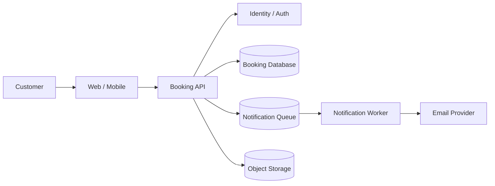
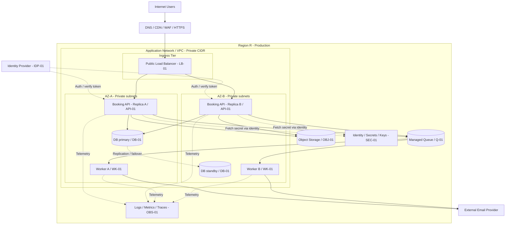

# Deployment Diagrams and Mapping Components to Cloud Resources

## 1. What Questions Does a Deployment Diagram Answer?

When designing a cloud application architecture, a diagram that simply states `Web → API → Database` is not enough to deploy or evaluate risk. Implementers also need to know **where the API runs**, **how many replicas exist**, **which network and availability zones it resides in**, **which data services are used**, **under what permissions resources are accessed**, **over which protocols they connect**, and **which components remain operational if a resource fails**.

A **deployment diagram** describes the binding between software components and where they execute or store data: servers, containers, application clusters, managed services, networks, regions, and availability zones (AZs). **Mapping components to cloud resources** is the step of translating functional blocks in a logical design into resources that can be configured, operated, and verified on a cloud platform.

This lesson belongs to the **Diagrams and Decisions** chapter of the **CLOUD_ARCHITECTURE** module. The goal is to practice designing from business requirements through networking, compute, data, and deployment models, while clearly seeing the trade-offs across reliability, security, scalability, cost, and operations under **Well-Architected**.

After this lesson, you will be able to:

- Distinguish **context**, **logical component**, and **physical/cloud deployment** diagrams, and know what question each answers.
- Map a web application with an API, database, queue, and worker to cloud resources along with their connections and dependencies.
- Represent **account/project, environment, region, AZ, network, access permission, and data** boundaries so readers accurately interpret failure and security scopes.
- Document assumptions, decisions, and details still needing verification; link diagrams to **ADRs**, resource tables, and IaC.
- Evaluate diagrams against traffic, reliability, security, scalability, cost, and operations.

## 2. Choosing the Right Diagram Level for the Right Audience

| View level | Core question | Elements that typically appear | Audience |
|---|---|---|---|
| **System context** | Who uses the system? Which external parties does the system communicate with? | Users, target system, payment gateway, email, internal systems | Product owner, business, security |
| **Logical / container** | What processing blocks and data flows make up the application? | Web, API, worker, database, queue, object storage, logical protocols | Architects, developers |
| **Deployment** | What resource does each block run on, where is it located, and how are they connected? | Region, AZ, subnet, load balancer, compute, database, endpoint, IAM | Cloud engineers, SRE, operations, security |
| **Operations / recovery** | When an error occurs, how is it detected and recovered? | Alerts, replicas, backups, failover, dependency points, on-call | SRE, operations, service owners |

You can use the **C4 model** for context/container and deployment views, or **UML Deployment Diagram** notation with nodes, execution environments, artifacts, and communication paths. Mermaid, PlantUML, draw.io, or other documentation tools can all express the ideas; a drawing tool does not substitute for the accuracy of decisions.

**You do not need to put everything into a single diagram.** An overview diagram helps discuss ideas; a detailed deployment diagram helps review feasibility; separate data or security diagrams can explain complex paths. When one picture contains too many crossing lines, split it into multiple named, cross-linked views.

### 2.1. Distinguishing Logical Components from Physical Resources

For example, `Order API` is a **logical component** providing ordering capabilities. It can be deployed as two containers across two AZs, a group of VMs, or a serverless service. Conversely, one container cluster can run multiple independent logical services.

Therefore, mappings commonly exhibit these relationships:

- **One component → many resources:** `Order API` → multiple replicas, load balancer, autoscaling configuration, and access permissions.
- **Many components → one runtime platform:** `Order API` and `Notification Worker` may share a container platform while keeping separate deployments, scaling, and IAM.
- **One logical capability → a managed service:** `Order Database` → managed relational database with endpoints, backups, HA capability, and capacity parameters.
- **Cross-cutting dependencies:** logging, metrics, secrets, and identity often serve multiple applications yet still must be captured on the diagram or an accompanying catalog.

Do not confuse a logical box name with a cloud product name. For instance, a `Queue` box only indicates asynchronous event delivery is needed; it does not prescribe which queue service to use until requirements around ordering, retries, retention, throughput, and delivery semantics are known.

## 3. Start from Requirements, Not from Cloud Icons

Before drawing, build an input table so the diagram reflects real needs:

| Input category | Questions to answer | Impact on the deployment diagram |
|---|---|---|
| Business | Which critical journeys must work? Which third-party systems exist? | Logical boxes and request, event, and response flows |
| Load and performance | RPS/orders per hour, peak load, target latency, growth? | Replica counts, autoscaling, caching, network/database limits |
| Reliability | SLO, RTO, RPO; must it survive instance/AZ/region failures? | Number of AZs/regions, replicas, failover points, backups |
| Security | Data classification, access permissions, encryption, private/public connectivity? | Trust boundaries, IAM, networks, secrets, data flows |
| Data | Relational or non-relational, transactions, consistency, volume, retention? | Database type, backups, replication, storage, read/write paths |
| Cost and staffing | Budget ceiling and operational skills? | Managed vs. self-managed services, environments, standby sizing |
| Organizational constraints | Approved regions, existing tech stack, IaC standards, launch deadline? | Account/region scope, permitted services, rollout schedule |

If data is missing, record an **assumption** with an owner responsible for verifying it. For example, "one region with two AZs meets outage requirements" is only an assumption until checked against fault-tolerance targets, database architecture, service support, and test results.

## 4. Running Example: A Booking System in the Cloud

Suppose an organization is deploying a booking application with the following **illustrative** requirements:

- Users access via web/mobile, create bookings, and view history. The API must authenticate users.
- Creating a booking is a transaction that must prevent duplicates when clients retry; sending confirmation emails can be processed asynchronously.
- The system needs to serve an expected peak load of **300 requests/second**. This figure is an exercise input and does not yet prove the capacity of any option.
- Must continue serving when one AZ goes down; detailed RTO/RPO targets must be finalized and tested by the system owner.
- Customer data must remain in an approved region; production environments are separated from non-production.
- The operations team is small, so appropriate managed services should be considered before choosing complex self-managed platforms.

### 4.1. Logical Diagram: Functions and Business Flows



This diagram shows the API reading/writing the database, emitting confirmation events, and the worker sending emails. It does **not yet** state whether the API runs on VMs, containers, or serverless; whether the database is HA; or how networks/secrets are protected. Those are precisely what the mapping step must add.

### 4.2. Mapping Logical Boxes to Cloud Capabilities

| Logical component | Possible cloud capabilities/resources | Decisions to finalize | Evidence to verify |
|---|---|---|---|
| Web/mobile entry | DNS, CDN, TLS certificate, WAF where appropriate | Access domain, HTTPS, caching, traffic control | TLS checks, routing, cache policy, access logs |
| Booking API | Managed container/PaaS, VM group, or serverless; load balancer if needed | Runtime, replica count, autoscaling, health checks, concurrency limits | 300 RPS load test, failure injection, latency/error metrics |
| Identity/Auth | Identity service, IdP/OIDC, or approved auth component | Token validation, roles, key rotation, dependency points | Token failure tests, access control, audit |
| Booking Database | Schema-compatible managed relational DB | Multi-AZ HA, backup/PITR, connectivity, RPO/RTO, encryption | Migration PoC, restore/failover drill, connection limit measurements |
| Notification Queue | Managed queue or suitable broker | At-least-once, TTL, dead-letter queue, retries, ordering | Retry, duplicate, and poison-message tests |
| Notification Worker | Managed container/job/worker or serverless | Concurrency, retry/backoff, idempotency, email-send permissions | Provider outage test, message replay |
| Object Storage | Regional object storage service | Permissions, encryption, retention, access URLs, lifecycle | Upload/download tests, permissions, deletion policies |
| Secrets/keys | Corresponding secret manager, IAM, KMS | Workload identity, rotation, least privilege | Access review, unauthorized-access denial test |
| Observability | Logs, metrics, traces, alerts, audit | Retention, cost, SLIs, alerts, and recipients | Alert drill, failed-transaction tracing |

**Key point:** the table describes resource **roles**, not a shopping list of products. A single managed service can cover multiple capabilities; each provider has different limits, region/AZ scopes, and HA models.

## 5. Cloud Deployment Diagram: Showing Placement and Dependency Scope

The following example assumes **one region, two AZs, compute replicas in both AZs, and a database with multi-AZ HA**, while the queue and object storage are represented as regional managed services. Real services may have different regional/zonal characteristics; always check the documentation and configuration of the chosen service.



The diagram above is a **conceptual diagram for learning representation**; it is not a ready-to-deploy configuration template. Several details are omitted for readability, such as dedicated database subnets (which must be separated from application network ranges per security policy), route tables, NAT/egress, private endpoints, IAM roles, and specific service names. The diagram places the primary database in AZ-A and standby in AZ-B to **illustrate fault-domain isolation requirements**; putting two boxes in the figure does not prove the service actually has HA or automatic failover.

### 5.1. Six Things a Deployment Diagram Must Show

1. **Governance boundaries:** cloud organization/account/subscription/project and environment name, to avoid confusing production with test.
2. **Geographic and failure boundaries:** region, AZ, and the scope of each service. Annotate regional/global services if they do not reside in a specific subnet.
3. **Connection flows:** call direction, key protocols/ports, private vs. public requirements, and Internet ingress/egress points.
4. **Execution and data locations:** compute replicas, databases, queues, object storage, replication, backups, write permissions, and failover points.
5. **Trust boundaries:** identity, IAM roles, secrets, encryption, TLS, firewalls/security groups, and which paths sensitive data traverses.
6. **Operability:** logs, metrics, traces, health checks, autoscaling, alerts, backups, recovery, rollout/rollback, and owners.

You do not need to cram every detail next to every icon. Longer details can live in a **mapping table**, **data-flow diagram**, **runbook**, or **ADR**. Each artifact should use the same resource IDs so information links together.

### 5.2. Presenting Network Paths and Dependency Relationships

In diagrams, **arrows carry meaning**:

- `A --> B` shows A calls or sends data to B. If communication is genuinely bidirectional, describe each protocol separately or annotate explicitly when needed.
- `API → DB : TCP/TLS, database port` describes the data access path; specify the exact port only after confirming configuration.
- `API → Queue : Publish`, `Queue → Worker : Consume` helps distinguish producer from consumer and where retries occur.
- `DB primary ⇢ standby : replication` lets readers inspect recovery capability without claiming zero data loss.
- Dashed lines can be defined by convention as **control/telemetry/replication dependencies** rather than user request flows; include a legend on formal diagrams.

Never draw "Internet directly accessing database" if the database actually lives in a private network; likewise, do not draw the API-to-object-storage path going through NAT if the design uses a private service endpoint. Those details affect security, observability, and data transfer costs.

## 6. Turning Diagrams into a Verifiable Mapping Table

A good diagram helps visualize; a **mapping table** lets the implementation team verify every decision. For the booking example, we can build the following table:

| ID | Component | Resource and scope | Permissions/connectivity | Metrics and risks to verify |
|---|---|---|---|---|
| `EDGE-01` | Public entry | DNS/CDN/WAF/TLS per service scope | Public HTTPS to load balancer | TTL, WAF rules, certificates, availability, and caching |
| `LB-01` | Load balancing | Regional LB supporting application AZs | HTTPS from edge; routes to API | Health checks, backend behavior after AZ loss, timeouts |
| `API-01` | Booking API | Minimum two replicas in AZ-A/AZ-B in example | Role reads only needed secrets, writes DB, publishes to queue | 300 RPS load, autoscaling, idempotency, latency |
| `IDP-01` | Identity provider | Approved identity service, deployment scope per provider | Token/signature verification API, user roles | Token expiry, JWKS/key rotation, auth outages |
| `DB-01` | Booking DB | Managed DB with verified HA configuration | Only authorized workload identity/network paths | Failover, backup/PITR, lag, restore, RPO/RTO |
| `Q-01` | Queue | Regional managed service | API publishes, worker consumes | Backlog, retries, DLQ, delivery semantics |
| `WK-01` | Email worker | Workers across AZs, scaled independently | Consumes queue, calls email provider | Duplicate emails, retry/backoff, rate limits |
| `OBJ-01` | File storage | Approved regional object storage | Prefix/bucket permissions per actual need | Encryption, lifecycle, public access, egress |
| `SEC-01` | Secret/key | Approved secrets/keys service | Workload identity, least privilege | Rotation, audit, no secrets written to logs |
| `OBS-01` | Observability | Logs/metrics/traces/alerts per policy | Agents/workloads send telemetry, on-call granted read access | SLIs, log retention, cost, alerting |

For real resources, add `owner`, `environment`, `region`, `AZ` (where applicable), `resource_id`, `IaC_module`, `data_classification`, `cost_center`, and runbook links. **IDs in the table must match IDs on the diagram** or have an explicit mapping table; avoid cases where the diagram says "Main DB" while IaC defines two databases and nobody knows which one serves production.

### 6.1. Example Mapping Profile in YAML

The snippet below is **illustrative documentation data**, not a valid configuration file for a cloud provider or Terraform:

```yaml
architecture_id: booking-prod-v1
environment: production
approved_region: region-r
components:
  - id: API-01
    logical_name: Booking API
    resource_kind: managed_containers
    placement:
      azs: [az-a, az-b]
      network: private-application-subnets
    dependencies: [DB-01, Q-01, SEC-01, OBS-01]
    service_identity: booking-api-prod
    verification:
      - handle_single_az_failure
      - pass_peak_load_test
  - id: DB-01
    logical_name: Booking Database
    resource_kind: managed_relational_database
    placement:
      region: region-r
      availability: multi_az_subject_to_provider_capabilities
    data_classification: customer_data
    verification:
      - backup_restore_drill
      - database_failover_drill
  - id: Q-01
    logical_name: Notification Queue
    resource_kind: managed_queue
    verification:
      - retry_and_dead_letter_queue
      - duplicate_delivery_handling
references:
  adr: ADR-BOOKING-001
  diagram: deployment-booking-prod
  iac: infrastructure/production
```

Names like `region-r`, `az-a`, and `resource_kind` are abstract placeholders. In real deployments, replace them with valid provider region/AZ/service IDs and estimate costs per provider; `verification` lists checks to perform, **not passing test results**.

## 7. Reviewing Diagrams Across Network, Compute, and Data Layers

### 7.1. Network Layer

Mark **ingress/egress** points, reverse proxies/load balancers, public/private subnets, routes, security groups/firewalls, NAT, or private endpoints. Not every managed service sits directly inside a VPC; many are accessed via endpoints and IAM. Represent this accurately so wrong networking assumptions are not made.

Questions to answer:

- Where do Internet users connect? At which layer does TLS terminate, and is traffic re-encrypted to the backend?
- Can the API reach the database over a private path? Which resources truly need outbound Internet access?
- Which IP/egress path carries third-party connections? Do third parties require allowlisting?
- If one AZ fails, do routing paths, endpoints, egress, and load balancers still function?
- Does any data flow cross into an unapproved region or system?

### 7.2. Compute Layer

Represent execution units as needed: VMs, container services, serverless functions, or batch jobs. Note metric-based autoscaling, minimum replica counts, AZ boundaries, and quotas. For workers, distinguish **scaling by queue depth** from API scaling by RPS/CPU; they follow two different load models.

The diagram must help answer: if one replica dies, who takes the traffic? If one AZ goes down, does the remaining AZ have enough capacity to serve or only run in degraded mode? If fast recovery is required, does it depend on provisioning new capacity during an outage?

### 7.3. Data Layer

Clearly show the **source of truth**, where writes are permitted, replication method, backups, and restores. A database replica may serve HA or read traffic depending on the service; **never assume a standby always accepts read queries**. Verify consistency behavior, replication lag, failover mechanics, connection limits, and application responsibility when connections drop.

For asynchronous workloads, explicitly show queues, workers, DLQs, retries, and idempotency handling. If a queue provides at-least-once delivery, handling duplicate messages is a normal scenario to design for—never infer "exactly-once" email sending merely from a queue icon.

## 8. Drawing Security and Responsibility Boundaries

Deployment diagrams are also useful inputs for **threat modeling**. Draw or annotate trust boundaries:

1. **Internet ↔ public entry:** TLS, WAF/rate limiting, access logging, protection against malformed requests.
2. **Public entry ↔ private network:** security groups/firewalls, exposing only required backends.
3. **Application ↔ data:** workload identity authentication, IAM/DB permissions, encryption, access restrictions.
4. **Application ↔ managed services:** endpoints, resource-scoped permissions, secret manager, auditing.
5. **Cloud ↔ third parties:** HTTPS, webhook/callback verification, egress policies, retries/timeouts, and protecting exchanged data.
6. **Operators ↔ production:** job-based roles, controlled privileged access, audit trails, and break-glass procedures.

For example, if the diagram shows API → database, ask **which identity has write permission**, **whether the DB has a public endpoint**, **which networks are allowed to connect**, and **whether backups/logs carry the same data classification**. Drawing a padlock icon next to a database provides zero evidence that data is actually protected.

## 9. From Diagrams to Architecture Decision Records (ADRs) and IaC

A diagram answers **"how is deployment proposed?"**; an **Architecture Decision Record (ADR)** explains **"why was that option chosen, against which alternatives, and what conditions might cause the decision to change?"** IaC creates and governs the corresponding resources, but does not replace documenting business needs.

Short ADR example for the exercise:

> **ADR-BOOKING-001 — Deploy Booking API on managed containers across two AZs, using a managed relational database with an HA option.**
>
> **Context:** the booking system must handle 300 RPS peak load, keep customer data in an approved region, be operated by a small team, and tolerate single-AZ failure.
>
> **Choice:** use a managed container platform to run API replicas across two AZs; managed DB with verified backups and failover; queue to decouple email processing from booking transactions.
>
> **Rationale:** reduces server administration burden and allows independent scaling of API and workers; establishes the basis for surviving single-AZ loss.
>
> **Trade-offs:** higher cost for replicas, cross-AZ traffic, and HA; still depends on regional cloud services, health check/replication configuration, and the operations team must run failover drills.
>
> **Acceptance criteria:** approved data region; pricing within budget; load tests, database failover, restore, idempotency, and alerting meet agreed targets.

### 9.1. Keeping Diagrams and Real Infrastructure Aligned

A workable process:

1. Assign IDs to components/resources on the diagram and mapping table.
2. Link IDs to IaC modules, cloud resource groups, and tags (`environment`, `service`, `owner`, `cost_center`).
3. Require pull requests that change topology, IAM permissions, network paths, or HA configuration to update related diagrams/ADRs.
4. After deployment, reconcile live resources against IaC and the mapping table to detect **configuration drift** or unmanaged resources.
5. Periodically verify the diagram reflects newly added dependencies: queues, third parties, database replicas, endpoints, logging, and backups.

A polished diagram that no longer matches production leads to flawed risk assessments. Part of a diagram can be generated from IaC or automated inventory, yet **"why" and "what requirement"** still must be recorded by designers.

## 10. Reading Diagrams to Spot Failure Points and Trade-Offs

Use the sample deployment model to ask Well-Architected questions:

| Pillar | Questions when reviewing the diagram | Expected outcome |
|---|---|---|
| **Operational Excellence** | Are there owners, alerts, runbooks, CI/CD, rollback, and ways to verify live state? | Reproducible deployment and incident response via clear procedures |
| **Security** | Which public/private paths exist? Do IAM, secrets, encryption, and data have control boundaries? | Resources expose only required flows and required identities |
| **Reliability** | Losing an instance/AZ breaks which dependencies? Are backups independent of replication? | Fault tolerance and recovery proven by tests |
| **Performance Efficiency** | Which components scale by RPS, queue backlog, or IOPS? Where are database/egress bottlenecks? | Capacity and limits measured at target load |
| **Cost Optimization** | Are standby resources, cross-AZ bandwidth, NAT, storage, logs, and backups accounted for? | TCO estimated adequately across load scenarios and DR plans |
| **Sustainability** | Can idle replicas/resources be right-sized or auto-stopped in non-prod? | Capacity matches demand without unbounded over-provisioning |

### 10.1. Single-AZ Failure Test

Suppose AZ-A becomes isolated. The diagram shows API replica B still runs; however, you must verify **whether the standby database in AZ-B can promote to writer**, **whether the LB routes to B**, **whether the queue/secret manager remain reachable**, **whether workers have enough capacity**, and **whether B can handle the entire peak load**. If any service lives only in AZ-A, the entire transaction can still fail even when API B reports "healthy".

If protection against a full-region outage is required, the current diagram **does not yet have multi-region DR**. You must add a standby region, data replication strategy, traffic-shifting approach, RTO/RPO testing, and data-residency constraints. Never infer regional resilience from having two AZs inside one region.

### 10.2. Shared-Resource Test

Two components may run separately yet both depend on the same secret, DNS zone, service account, queue, or deployment service. Deleting that secret or pushing a bad deployment can impact all AZs at once. Diagrams must surface shared dependencies alongside change controls, permissions, and rollback mechanisms to reduce **common-mode failure**.

## 11. Common Mistakes When Drawing Deployment Diagrams

| Mistake | Consequence | How to fix |
|---|---|---|
| A box labeled `Cloud` with no region/AZ/network | Cannot assess failure scope or network flows | Add meaningful deployment boundaries |
| Multiple API replicas while the database is a single point of failure | False confidence that the system is HA | Draw DB dependencies and failover/backup mechanisms |
| Listing only commercial service names without stating roles | Hard to understand why the service is used or alternatives | Record logical name, role, ID, and resource choice |
| Using connectors with no direction or protocol | Cannot distinguish request flow, replication, and egress | Add direction, labels, and line/connector conventions |
| Drawing every service inside private subnets | Can misrepresent managed-service connectivity models | Show service endpoints/service scope per provider docs |
| Omitting IAM, secrets, backups, logs, and monitoring | Security and operational needs remain hidden | Add dependency blocks or reference documentation |
| Cramming everything into one dense picture | Readers miss critical details | Separate context, logical, deployment, data flow, and operations |
| Diagram lacks version, date, owner, and status | Easy to deploy from an outdated diagram | Attach metadata, IaC/ADR links, and update on change |

## 12. Step-by-Step Practical Workflow

To produce a diagram ready for an architecture review, follow this order:

1. **Write the business scenario.** Pick a critical transaction, such as "user creates a booking and receives a confirmation email"; record correctness, load, and latency requirements.
2. **Create the logical diagram.** Draw user, entry, API, database, queue, worker, and external providers; mark request and data flows.
3. **Define deployment boundaries.** Choose environments, governance units, regions, AZs, and networks. Check data-protection requirements before finalizing the region.
4. **Map each component.** Pick cloud capability classes, execution forms, data services, replica counts, and scaling approaches; mark open options where evidence is lacking.
5. **Add communication details.** Note ingress/egress, protocols, access permissions, sync/async paths, recovery points, and managed services.
6. **Incorporate non-functional attributes.** Show HA, backups, relevant SLO/RTO/RPO, monitoring, security, and rollback mechanisms.
7. **Walk through failure scenarios.** Trace a request during replica loss, AZ loss, DB failover, queue backlog, and email provider outage.
8. **Cross-check cost and operations.** Account for standby resources, bandwidth, logs, backups, and on-call duties; review against budget and team capacity.
9. **Record decisions and implement.** Link the diagram to ADRs, mapping tables, IaC, and tests; never promote assumptions as verified outcomes.
10. **Review after changes.** Every change to topology, services, permissions, or regions must update the diagram and supporting evidence.

### 12.1. Self-Practice Exercise

The booking app needs to add an **illustrative image upload** feature, up to 10 MB/image, allowing users to view uploaded images later. Update:

1. **Logical diagram:** client, API, object storage, and upload/download URL generation; decide whether clients transfer images through the API or directly to storage.
2. **Deployment diagram:** HTTPS path, upload-authorization mechanism, bucket/object policy, data location, CDN if needed, and monitoring flows.
3. **Mapping table:** record max size, projected storage volume, retention period, read/write permissions, encryption, lifecycle, and egress costs.
4. **ADR:** compare "upload through API" vs. "direct upload via time-limited signed URL"; state impact on API load, access control, malicious-file prevention, and auditability.

The right answer depends on actual requirements. For instance, direct upload can offload bandwidth from the API, but requires validating file type/size, limiting URL expiry, enforcing object-level permissions, scanning content where appropriate, and confirming business completion once upload finishes.

### 12.2. Checklist Before Handing Off a Diagram to Implementers

- [ ] Includes system name, environment, scope, version, update date, and owner.
- [ ] Context/logical diagram explains transactions and external systems.
- [ ] Deployment diagram shows account/project, region, AZ, networks, ingress, egress, and managed services at the right scope.
- [ ] Every logical component has a corresponding resource or deployment choice in the mapping table.
- [ ] Data flows show direction, key protocols/ports, and trust boundaries.
- [ ] Database, cache, queue, storage, secrets, identity, backups, and observability are shown wherever dependencies exist.
- [ ] Scaling mode, HA plan, backups, failover, and post-failure capacity are stated or explicitly marked unverified.
- [ ] Owners, appropriate IAM, data policies, storage location, and data-protection requirements are specified.
- [ ] Operational costs, bandwidth, replicas, logs, backups, and quotas have been reviewed.
- [ ] Diagram links to ADRs, IaC, runbooks, and tests; every open assumption has a designated verifier.

**Core principle:** a deployment diagram is a **verifiable map between application needs and how the cloud actually operates**. Draw enough so developers, security, operations, and product owners all understand where components live, how they connect, how they are protected, and what happens when part of the system stops working.
