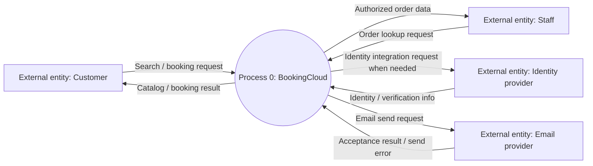
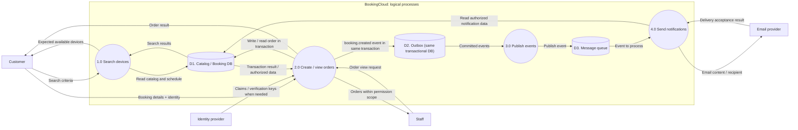
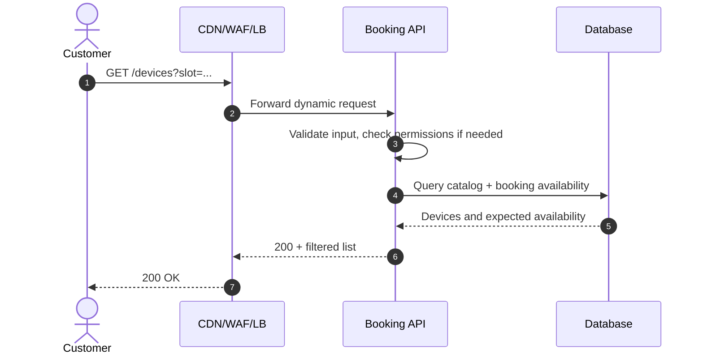
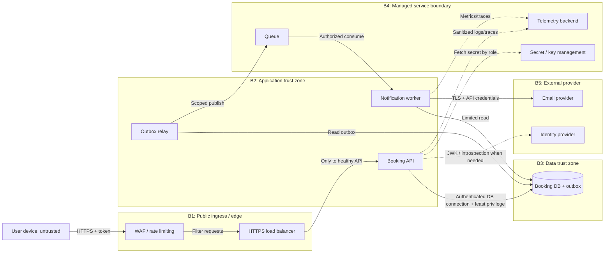
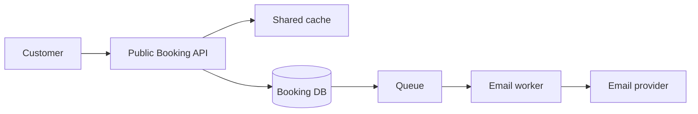

# Data Flow Diagrams, Request Flows, and Trust Boundaries

## 1. Why Does the Same System Need Multiple Diagrams?

In the **CLOUD_ARCHITECTURE** module, we design cloud applications from business requirements through networking, compute, data, and deployment models, and then evaluate trade-offs across reliability, security, scalability, cost, and operations using **Well-Architected** thinking. An overview diagram with API, database, and queue icons is not enough to explain whether a system is secure and processes requests correctly.

Imagine a simple question: **"When a customer clicks Book, where does their data go and who is authorized to access it?"** To answer completely, we need at least three perspectives:

1. **Data Flow Diagram (DFD):** what data is generated, which processes does it pass through, where is it stored, and who is it shared with?
2. **Request flow / sequence diagram:** which component calls which component, in what order, synchronously or asynchronously, and what happens on failure?
3. **Trust boundary diagram:** where do trust assumptions change, and who checks identity, permissions, input data, and network policies?

The three diagrams **complement** each other. A DFD clarifies information movement but usually does not show chronological order. A sequence diagram depicts the journey of one interaction but does not automatically reveal all data storage locations. A trust-boundary view pinpoints where controls are needed but does not replace IAM policies, network design, or security test results.

After this lesson, you will be able to draw and read all three diagram types; cross-check them against business requirements; spot sensitive data paths and design flaws; and record architectural decisions alongside verification evidence.

## 2. Running Problem and Design Assumptions

Consider a hypothetical application **BookingCloud** for renting equipment by time slot. Customers use web/mobile to search for available devices, create rental orders, and receive confirmation emails. Staff members are authorized to view orders within their management scope.

| Code | Requirement or assumption | What must appear on the diagrams |
|---|---|---|
| F1 | Customers search the catalog and availability status | Query flow, cache if any, returned data, authoritative data source |
| F2 | Customers book one device for a time slot | Write flow with transactions and double-booking protection |
| F3 | After the order is recorded, send a confirmation email | Event/queue flow, retries, email provider dependency |
| S1 | Only the order owner and authorized staff can read/modify an order | Identity, API authorization, data boundaries, and auditing |
| S2 | Do not expose emails, phone numbers, access tokens, or secrets | Storage/transit points of sensitive data, logs, and data recipients |
| R1 | If the API fails mid-write, retries must not create a second order | Idempotency key, commit boundary, error branch |
| Q1 | Illustrative target: order-creation p95 no more than 1.5 seconds | Synchronous path affecting response time, latency measurement points |
| O1 | Can identify and resolve email slowness or backlogs | Queue age, pending outbox, dead-letter queue (DLQ), owner |

Numeric targets here are **assumptions for learning purposes**, not measured benchmarks or cloud provider SLAs. Assume the application runs in **one region with multiple Availability Zones**, the API holds no local session state, uses a managed relational database, object storage for public images, and an external email service. We draw only at the **logical level**; physical placement and specific service configurations must be finalized during deployment.

## 3. Prepare a Shared "Dictionary" for All Three Diagrams

Before drawing, list **actors**, **data**, **processes**, and **ownership zones**. Avoid generic names like `Service A` or `Data 1` that force reviewers to guess.

| Element | Role | Related data | Who is responsible |
|---|---|---|---|
| Customer | Searches devices, creates orders | Rental slot, account, order ID | End user |
| Staff | Views orders within authorized scope | Order ID, permitted contact info | Product owner + business operations team |
| Identity provider (IdP) | Login, token issuance | Identity, claims, verification keys | Identity team or service provider |
| Booking API | Authentication, authorization, business execution | Requests, user ID, booking data | Booking application team |
| Transactional DB | Authoritative transactional data source | Devices, slots, bookings, outbox | Booking team in coordination with platform |
| Object storage/CDN | Serves catalog images | Public or access-controlled images | Booking/platform team |
| Outbox relay + queue | Forwards committed events | Event ID, booking ID | Booking/platform team per operating contract |
| Notification worker | Sends notifications per event | Recipient email, notification template | Booking team |
| Email provider | Delivers outbound emails | Email address, notification content | External provider; Booking owns integration |
| Logs/metrics/traces | Operational observability and troubleshooting | Request ID, status, timing, metrics | Application team and platform |

For each data stream, also note **data classification**, **storage locations**, **retention period**, **reason for sharing**, and **access permissions**. For example:

| Data | Illustrative classification | Where it may travel | Control requirements |
|---|---|---|---|
| Public device images | Public | CDN, object storage, browser | Protect write permissions and content origin; valid caching |
| Catalog and slot availability | Internal/public depending on product | API, DB, client, read cache | Avoid exposing internal fields; cached state may be stale |
| Order ID and rental slot | Internal, linkable to individuals | API, DB, events, worker | Enforce per-order permissions; minimize event payload |
| Customer email/phone | Personal/confidential | DB, worker, email provider | Encryption in transit/at rest, retention, recipient controls |
| Access token or secret | Sensitive credential | Client/API or secret manager | Never place in URLs, queues, tags, or logs; limit scope and lifetime |
| Request logs and traces | Operational, potentially sensitive | Collector, observability backend | Redact personal data, RBAC, retention, and audit |

**Data flow** is not necessarily the same as **network flow**: a DFD can describe "read booking" as a logical action, whereas a network diagram must show specific protocols, ports, endpoints, and network policies. Keep component names consistent across diagrams for traceability.

## 4. DFD: What Data Is Created, Transformed, Stored, and Shared?

### 4.1. Logical DFD Notation

DFDs typically have four element types:

- **External entity:** an actor or system outside the scope under analysis, such as a customer or email provider.
- **Process:** work that transforms or processes data, such as "Process booking". Name using **verb + object**.
- **Data store:** a place that persistently or meaningfully stores business data, such as "Booking DB" or "Outbox".
- **Data flow:** a named data stream, such as "Booking request", "Booking result", or "Committed event".

An arrow labeled "booking details" indicates **information transferred**, without by itself stating that the request is HTTP POST, encrypted, or in what execution order. Those details belong in other diagrams or annotations. Never draw a "DB calls DB" arrow just to depict processing without a responsible process; DFDs focus on how data is processed.

### 4.2. Context DFD (Level 0)

First treat BookingCloud as **a single system**. This answers "who exchanges data with the system?" before asking how internal components are structured.



**Scope being drawn:** the business journey inside BookingCloud. The "external entity" boxes only indicate they lie outside the analysis boundary; they **do not mean** they all sit outside the same VPC or network zone. For instance, the IdP may be a managed service while users are on the Internet.

The context diagram also does not indicate whether the customer logged in earlier or whether the API verifies JWTs locally. The arrow to the IdP represents **possible exchange when needed**, not an assertion that every request calls the IdP over the network.

### 4.3. Level 1 DFD: Decomposing into Processes and Data Stores

Next, expand Process 0 into functional processes. The goal is to clarify **what data enters each process**, **where it is stored**, and **what data leaves the system**.



**Important note:** D1 and D2 are drawn as two **logical stores** to distinguish business tables from the outbox table, yet in this design they live in the **same transaction-capable database**. If the outbox were in a separate datastore outside the same transaction scope, you could not claim an "atomic write" across both places.

Arrows to D1 carry read/write labels for readability; when documentation calls for stricter formal DFDs, split read requests and corresponding read results into separate arrows. A DFD is a map of **data**, so a process should not have only inputs without explainable outputs or side effects.

### 4.4. Checking Consistency Between the Two DFD Levels

When decomposing from context to level 1, flows **crossing the system boundary** must preserve their meaning (the *balancing* principle):

| Flow at context | Corresponding flow in level 1 | What to check |
|---|---|---|
| Customer requests lookup | C → P1 | Search criteria input is present |
| Customer receives results | P1/P2 → C | Lookup and booking results are present |
| Staff requests order view | A → P2 | Authorization check occurs before returning data |
| Identity information | ID → P2 | Matches actual token verification / IdP integration |
| Email send request | P4 → EMAIL | Notifies only about committed orders |
| Email send result | EMAIL → P4 | Failure logging/tracing path exists |

Never introduce analytics systems, customer-support tools, or new recipients at level 1 while omitting them at context: that signals **undeclared outbound data flows**. If only one user group or data domain is analyzed, state the scope explicitly rather than claiming to depict the entire enterprise.

## 5. Request Flow: Processing Order, Sync, Async, and Failure Branches

A DFD cannot precisely answer "does the API return 201 before or after sending the email?" or "if two people book the same slot simultaneously, who wins?" A sequence diagram shows **message order, commit points, response timing, and failure branches**.

### 5.1. Lookup Flow (Read)



If lookups go through a cache or read replica, availability status **may be stale**. Displaying "available" does not guarantee the subsequent booking operation will succeed. The write path must enforce the invariant via transactions/constraints on the authoritative data source.

For queries involving customer data or private permissions, avoid shared caches with incorrect cache keys. Traces/logs should use a correlation ID rather than recording raw tokens, sensitive parameters, or contact details.

### 5.2. Booking Flow (Write) and Notification Events

Assume each `device_id + slot_id` can have only **one active booking**. The database must enforce this invariant with appropriate constraints/transactions; a separate "check availability then insert" pattern can create a race condition.

```mermaid
sequenceDiagram
    autonumber
    actor U as Customer
    participant API as Booking API
    participant DB as Transactional DB
    participant Relay as Outbox relay
    participant Queue as Queue
    participant Worker as Notification worker
    participant Mail as Email provider

    U->>API: POST /bookings + token + Idempotency-Key
    API->>API: Verify token, authorize, validate, rate limit
    API->>DB: BEGIN; check idempotency; insert booking + outbox; COMMIT
    alt Commit succeeds
        DB-->>API: booking_id
        API-->>U: 201 Created + booking_id
        Relay->>DB: Read committed outbox
        DB-->>Relay: booking.created + event_id
        Relay->>Queue: Publish event
        Queue-->>Worker: Deliver event (may repeat)
        Worker->>Worker: Deduplicate by event_id
        Worker->>DB: Fetch needed email/content per permissions
        DB-->>Worker: Notification data
        Worker->>Mail: Send email
        Mail-->>Worker: Accepted or failure
        Worker-->>Queue: Ack after successful processing
    else Duplicate slot booking
        DB-->>API: Conflict / rollback
        API-->>U: 409 Conflict
    end
```

Read the diagram through its **invariants**:

1. **Before touching the DB**, the API must verify identity, permission to create an order, input validity, and abuse limits. Never assume the WAF already enforced business authorization.
2. **Inside one transaction**, the DB writes both the order and the outbox row. The transaction commits only if the booking invariant holds; competing requests must be handled as conflicts. For arbitrary time ranges, time-overlap constraints may require a mechanism beyond a simple unique key.
3. **Only after DB commit** does the API return success. Email can be sent afterward; an email failure must not "roll back" a committed order.
4. The relay may publish duplicates on timeout; queues typically operate with **at-least-once** semantics. The worker should process idempotently by `event_id`, with retry/backoff, a DLQ, and monitoring for stale outbox rows.
5. Events only need minimal ID/metadata; the worker can fetch email details when processing. Do not put tokens or excess personal data into messages or logs.

**Implementation refinement:** if the API receives the same `Idempotency-Key` again after a timeout, key lookup/write must be protected atomically; if the key was already used for a different payload, the API should return an appropriate error. If the email provider does not support a deduplication key, you cannot claim "exactly-once" email delivery; design delivery states and reconciliation procedures instead.

### 5.3. Failure-Branch Map: What Happens to the Data?

| Incident | Position on sequence | Correct state to protect | Response and verification test |
|---|---|---|---|
| Expired token or missing permission | Before DB | No unauthorized data read/write | 401 for auth failure or 403 when authenticated without permission, per API contract |
| Two customers book the same slot | Inside DB transaction | Only one booking claims the slot | Concurrency test, constraints/locking, and 409 for conflicting requests |
| API crashes before commit | Inside transaction | No order committed | DB rollback; retrying with the same key is safe |
| API times out after commit | After commit, before response | Order exists exactly once | Client retries with same key and receives the matching prior result |
| DB failover mid-transaction | Inside transaction | Commit outcome may be unknown to client | After recovery, query by key; do not create a new order with a different key |
| Relay publishes then times out | D2 → queue | Event may appear twice | Consumer deduplication; replay does not mutate the booking |
| Email provider fails | Worker → provider | Booking stays saved; event awaits processing | Retry/backoff, DLQ, queue-age alert, and delivery status tracking |
| Logs/tracing unavailable | Observability path | No data leak; fail-open/fail-closed depends on control type | Define policy clearly; avoid turning routine logging into an unexpected blocker |

Sequence diagrams should depict **timeouts** and **errors**, rather than drawing only success arrows. When a dependency stops responding, specify timeouts, retries, attempt limits, circuit breakers where appropriate, and mechanisms to prevent duplicating side effects.

## 6. Trust Boundaries: Where Do Permission Assumptions Change?

A **trust boundary** is where a flow crosses from one domain of policy, ownership, or trust level into another. It is not merely a VPC border. Boundaries can include:

- User browser or mobile app ↔ public Internet services.
- Internet ↔ edge/ingress tier with WAF and load balancer.
- Ingress tier ↔ API inside a private subnet/VPC.
- API with its own role ↔ DB and secret store with tighter permissions.
- API/relay ↔ queue or managed service with its own access policy.
- Worker ↔ email provider outside the team's operational scope.
- Application ↔ logging/analytics systems, since sensitive data can ride along telemetry paths.
- Production ↔ development/test, and between tenants, even when they share a network or the same service.

Never treat two components in the same VPC as automatically "trusted": if the API is compromised, its DB access permissions still must be tightly scoped. Managed services may sit outside your subnet while still belonging to a policy domain protected by private endpoints, TLS, and service identities.

### 6.1. Logical Trust-Boundary Diagram



**How to read:** boxes B1–B5 represent **policy and responsibility boundaries** for asking design questions; they do not assert that all of them are physical network subnets. In this diagram the DB is the authoritative transactional source, while queue/secret/telemetry are separate integrations. One physical boundary may contain multiple permission boundaries, and a managed service may be accessed via appropriate private networking.

### 6.2. Control Table at Each Boundary Crossing

| Path | Data/permissions | Key threats | Design controls to verify |
|---|---|---|---|
| Client → edge/API | Tokens, search params, booking data | Spoofing, abuse, malicious input, eavesdropping | TLS, WAF/rate limits, validation, authentication |
| Ingress → API | Internal HTTP requests | Direct access bypassing ingress, spoofed headers | Restrict ingress, handle trusted proxy headers properly, TLS where needed |
| API → DB | Order writes/reads, PII | Overly broad DB permissions, injection, cross-user access | Least-privilege IAM/DB roles, parameterized queries, object-level authorization, encryption |
| API/relay → queue | Event ID, booking ID | Unauthorized publish, forged or duplicate events | Separate publish/consume permissions, payload validation, idempotency, audit |
| Worker → DB | Email/content to send | Worker reads too much data | Read-only role scoped to needed fields, query/retention limits |
| Worker → email provider | Customer email, notification | Data leak via third party, exposed credentials | TLS, egress controls where appropriate, secret rotation, data-processing agreements |
| API/worker → telemetry | Metadata, errors, traces | Tokens/PII leaking into logs, unauthorized log viewers | Redaction, access control, retention, audit, appropriate trace sampling |
| IaC/CI → control plane | Deployment keys, create/delete rights | Unauthorized production changes | Federated identity or short-lived credentials, approvals, and IAM scoping |

**Authentication** answers "who is calling?", while **authorization** answers "what is the caller allowed to do on this specific resource?" Both must be expressed in the design. For example, a valid JWT belonging to customer A does **not** allow A to view customer B's order. The API must still check owner/role on every booking.

One specific note on tokens: with signed JWTs, the API can usually **verify signature, issuer, audience, and expiration** using properly managed public keys without calling the IdP on every request. With opaque tokens or immediate-revocation requirements, the verification architecture may need token introspection or another mechanism. The diagram must match the actual choice.

### 6.3. Sensitive Data Boundaries

Pick one sensitive field, such as customer email, and trace its entire lifecycle:

1. **Collection:** email is provided at registration/booking for a defined purpose; client transmits over TLS.
2. **Processing:** API validates input and permissions and keeps it in memory only as needed; avoid putting such info in URL query strings whenever possible.
3. **Storage:** DB enforces encryption at rest, backup/retention policies, and restricted permissions; protect replicas and backups too.
4. **Transfer to processors:** worker retrieves only the recipient/content required to send; email provider receives data under applicable contract and legal basis.
5. **Observability:** logs use appropriate booking IDs/request IDs, never logging full request bodies or tokens; log viewers hold appropriate permissions.
6. **Retention/deletion:** define retention across DB, events, DLQ, email provider, and backups; deleting from the primary DB does not mean deletion from all copies.

If you only diagram the DB while ignoring queue payloads, DLQs, and telemetry, data-protection reviews will miss places where sensitive data persists. Trust-boundary reviews must trace **secondary data flows**, not just the main HTTP path.

## 7. Using STRIDE to Review Boundary-Crossing Flows

**STRIDE** is a threat-identification framework: *Spoofing, Tampering, Repudiation, Information Disclosure, Denial of Service, Elevation of Privilege*. It is a checklist of questions to inspect a design, not proof that the system is secure.

| STRIDE category | Example on BookingCloud | Related components/boundaries | Mitigations and verification checks |
|---|---|---|---|
| Spoofing | Client uses forged token or message spoofs publisher | Client → API; relay → queue | Verify token/issuer/audience, service identity, publisher policy; forged-token tests |
| Tampering | Changing `booking_id` to modify another user's order, altering event payload | API → DB; queue → worker | Object-level authorization, validation, integrity controls; ID-tampering tests |
| Repudiation | Staff edits an order with no record of who did it | API, DB, audit pipeline | Audit events with actor/action/time/trace ID; protect logs from unauthorized edit/deletion |
| Information Disclosure | Email/token leaks into logs or DLQ readable by many people | App → telemetry; queue/DLQ | Redaction, data minimization, encryption, scoped view access; inspect log samples |
| Denial of Service | Request flood exhausts DB connections or builds queue backlog | Edge/API/DB/queue | Rate limits, pool limits, backpressure, proper autoscaling, alerts, and load tests |
| Elevation of Privilege | Worker has DB admin rights; user alters tags to grant self access | Worker → DB; IAM/control plane | Least privilege, role separation, policy/tag-edit controls, deny tests |

STRIDE guides **what to ask**, while prioritization depends on data sensitivity, actor capability, business impact, and control complexity. For multi-tenant systems, beyond network trust boundaries you must also mark **tenant boundaries** at the data and authorization layers.

## 8. Walking Through Incidents to Check Whether All Three Diagrams Agree

A good diagram helps reason during incidents, not just when everything works.

### 8.1. Scenario: API Returns Timeout After DB Commit

- **DFD:** shows the booking and outbox are durably saved; the email has not necessarily been sent yet.
- **Sequence:** pinpoints that timeout happened **after commit but before response**; retrying with the same idempotency key must retrieve the prior result.
- **Trust boundary:** only an authenticated API call is allowed to query results by key/user; prevent one customer from probing another's keys.
- **Evidence:** concurrency/retry tests for a key and payload produce only one booking; audit and traces show commit status.

### 8.2. Scenario: Email Provider Loses Connectivity for 20 Minutes

- **DFD:** the event remains in the outbox/queue; recipient email should only be fetched when needed.
- **Sequence:** booking has already returned success; worker retries with limits/backoff, backed by a DLQ or controlled replay mechanism.
- **Trust boundary:** provider credentials stay in secret manager and are never logged when the provider errors; data goes only to the designated recipient.
- **Evidence:** measure queue age, pending/retry/DLQ counts, delivery rate after provider recovery, and duplicate-send count.

### 8.3. Scenario: Customer A Tries to View Customer B's Order

- **DFD:** order info leaves D1 to return to the client; this is a **sensitive data flow**.
- **Sequence:** `GET /bookings/{id}` must verify the token and per-order permissions before reading/returning content.
- **Trust boundary:** the client is untrusted even with a valid token; authorization must be enforced at the API or appropriate data layer.
- **Evidence:** cross-account/cross-tenant tests for read, update, file download, and list endpoints; no PII in error responses or public access logs.

### 8.4. Scenario: Loss of an Availability Zone

- **DFD:** data and business functions **do not** show how they are replicated.
- **Sequence:** must show retries when connecting to failed-over instances/DB, uncertain-commit transactions, and potential duplicate event delivery.
- **Trust boundary:** routing after failover must preserve IAM/network checks; never open DB access publicly as a "quick fix".
- **Evidence:** AZ-failure drill measuring outage duration, failed requests, booking integrity, and RTO/RPO against defined targets.

These examples demonstrate that you must add a **deployment diagram** and infrastructure configuration if you want to prove a multi-AZ topology: DFDs and sequences **do not replace** a deployment view.

## 9. Connecting Diagrams to Architectural Decisions

A diagram easily becomes mere decoration unless linked to **requirements → decisions → trade-offs → evidence**. Use a simple traceability table:

| Requirement | DFD | Sequence | Trust boundary | Decision and verification test |
|---|---|---|---|---|
| No double booking | P2 writes D1 | Transaction/commit, 409 branch | API → DB | DB constraints/locking; 100 concurrent requests for the same slot |
| No order data leak | P2 returns data to C/A | Permission check before response | Client → API → DB | Object-level authorization; cross-customer access test |
| No lost events after commit | D2 → P3 → D3 | Outbox relay after commit | Relay → queue | Transactional outbox; crash test between commit and publish |
| API does not wait on email | P4 off the main booking path | 201 before worker sends | Worker → provider | Queue; measure POST p95 and backlog when provider slows down |
| Failures can be investigated | Event flows, data stores | Request/event IDs across hops | App → telemetry | Distributed tracing, redacted logs, request-tracing test |

### 9.1. Example ADR: Decoupling Notifications from the Booking Transaction

```markdown
# ADR-003: Send notifications after booking creation

Status: Proposed

## Context
POST /bookings must commit accurately under the no-double-booking invariant.
The email provider is an external dependency that can be slow or fail.

## Options
A. API calls email synchronously after writing to the DB.
B. API writes booking + outbox in one transaction; relay, queue,
   and worker send email asynchronously.

## Proposed Decision
Choose B to decouple API latency from the email provider
and keep the event record within the same business transaction.

## Trade-offs
Requires operating outbox, queue, retries, and DLQ; events may be delivered more than once.
A created order may receive its email later; requires a separate notification SLO.

## Verification
Test API crash after DB commit; test provider outage; measure API p95,
queue age, processed event count, and duplicate-email count.

## Review Triggers
When business requirements for confirmation timing or third-party
data processing capabilities change.
```

An ADR should link to the corresponding **diagram version** and test results. If the diagram later changes without updating the ADR, reviewers may misjudge the original assumptions.

### 9.2. From Diagrams to Well-Architected Reviews

| Perspective | Questions when looking at the three diagrams | Evidence to look for |
|---|---|---|
| **Operational Excellence** | How do you trace an error from request ID to message ID? Who owns queues and alerts? | Traces, dashboards, alerts, runbooks, on-call, replay procedures |
| **Security** | Which trust boundaries does PII cross? Who has read/write access? | IAM/network rules, authorization tests, secret management, audits |
| **Reliability** | If API/DB/queue/email provider fails, what state are bookings and events in? | Fault-injection tests, failover, restore, RTO/RPO |
| **Performance Efficiency** | Which hops sit on the request critical path? Do caches/retries amplify load? | End-to-end p95/p99, distributed traces, load tests, DB saturation |
| **Cost Optimization** | Which functions drive DB, egress, log, queue, and external-provider costs? | Bills/metrics per workload, cost per booking, retention |
| **Sustainability** | Are there redundant compute/storage flows or frequently reprocessed events? | Utilization, duplicate/retry rates, lifecycle, and retention |

For instance, the AWS Well-Architected Framework has six pillars corresponding to the perspectives above. Simply labeling lines "encrypted" or "multi-AZ" is not evidence; deployment policies and verification results are required.

## 10. A Drawing and Review Workflow You Can Apply Immediately

1. **Lock down scope:** users, critical features, environments/regions/tenants, third parties, and questions to answer.
2. **List data sources and types:** sensitive fields, storage locations, recipients, retention periods, and which data is allowed to be stale.
3. **Draw the context DFD:** one system, external entities, and all primary data flows crossing the boundary.
4. **Decompose to level 1:** separate processes, data stores, and events, and check balancing against context; mark the authoritative data source.
5. **Select critical sequence scenarios:** at minimum read, write, retry after timeout, concurrent contention, and dependency failure.
6. **Mark trust boundaries:** Internet, edge, application, data, managed services, third parties, control plane, and tenants where applicable; assign controls to each path.
7. **Ask STRIDE questions:** spoofing, tampering, repudiation, information disclosure, denial of service, and elevation of privilege on priority flows.
8. **Cross-check all diagrams:** component names, events, stores, data directions, owners, authentication, and commit order must agree.
9. **Record ADRs and evidence:** why sync/async, DB/queue, networking, and deployment model were chosen; attach concrete metrics/tests.
10. **Put diagrams into the change lifecycle:** version, update date, owner, and open assumptions; review whenever schemas, endpoints, dependencies, or network boundaries change.

### 10.1. Quality Checklist for the Diagrams Themselves

- [ ] Has title, scope, date/version, legend, and document owner.
- [ ] External entities, processes, data stores, queues, and data paths are named consistently.
- [ ] Arrows carry **clear data or action labels**; sync and async are distinguished.
- [ ] Context DFD and level 1 DFD agree on all flows crossing the system boundary.
- [ ] Authoritative data source and write/commit conditions are clear for critical business operations.
- [ ] Sequence shows which requests can time out, retry, and receive errors; includes contention branches.
- [ ] Trust boundaries clearly show untrusted sources, network/permission crossings, and third parties.
- [ ] Authentication, object-level authorization, IAM/service identity, TLS, and sensitive-data protection appear at appropriate hops.
- [ ] Logs, backups, event payloads, DLQs, and telemetry are examined whenever they contain personal data.
- [ ] Includes a requirements → data paths → risks → decisions → tests table; unknowns are marked as **assumptions/open questions**.

## 11. Practice Exercise: Finding Gaps in a Sample Architecture

A team proposes the following diagram for BookingCloud:



The team states: "Cache every request for speed; the API verifies JWT once when the user logs in; one DB and multiple API replicas are enough; the queue guarantees every email is sent exactly once."

Complete the following tasks:

**Exercise 1 — DFD.** Redraw the context DFD and level 1 DFD. Specify which data is cached, what the authoritative source is for booking, which events are emitted, and which parties receive PII. If the team intends to send emails directly from the DB, point out the missing post-commit event publishing mechanism.

**Exercise 2 — Sequence.** Draw the scenario where two customers simultaneously book `device-17` for `slot-09h`, with one request succeeding and one rejected. Add the case where a client times out after DB commit and retries with the same idempotency key. Indicate exactly where transactions/constraints must protect correctness.

**Exercise 3 — Trust boundaries.** Outline Internet, ingress, API, DB, queue, telemetry, and email provider. Identify at least five points requiring checks on authentication, authorization, network policies, or secret management. Explain why a valid token still does not grant access to someone else's order.

**Exercise 4 — Risk assessment.** Using STRIDE, choose the three highest-impact threats to booking integrity and personal data. For each threat, propose one test or configuration proof.

**Exercise 5 — Architectural decision.** Write a short ADR choosing between synchronous email calls and outbox + queue. Present trade-offs in latency, consistency, operations, and cost; do not claim exactly-once email delivery without mechanisms and proof.

**Comparison hints:** caching public catalog data may be suitable, whereas sharing caches for private results or hold states creates risk. JWTs must be verified on protected access paths; per-order authorization is a separate control. Multiple API replicas do not solve a DB single point of failure. "DB → queue" must explain how committed events are relayed and retried. Queues can deliver duplicates, so consumers need idempotency and appropriate processing state.

## 12. From Diagrams to Verifiable Architecture

Good design documentation enables readers to answer **what data goes where**, **in what sequence requests execute**, **which boundaries they cross**, and **what happens under failure or abuse**. For real cloud systems, always anchor the three views to networking, compute, datastore, and identity configurations, deployment design, testing, and decision records.

DFDs prevent overlooking where data travels; sequences reveal commit timing, timeouts, and side effects; trust boundaries pinpoint where identity, permissions, and data protection must be proven. When all three diagrams align with requirements and are backed by test evidence, they become genuine architectural decision tools rather than mere illustrations.
