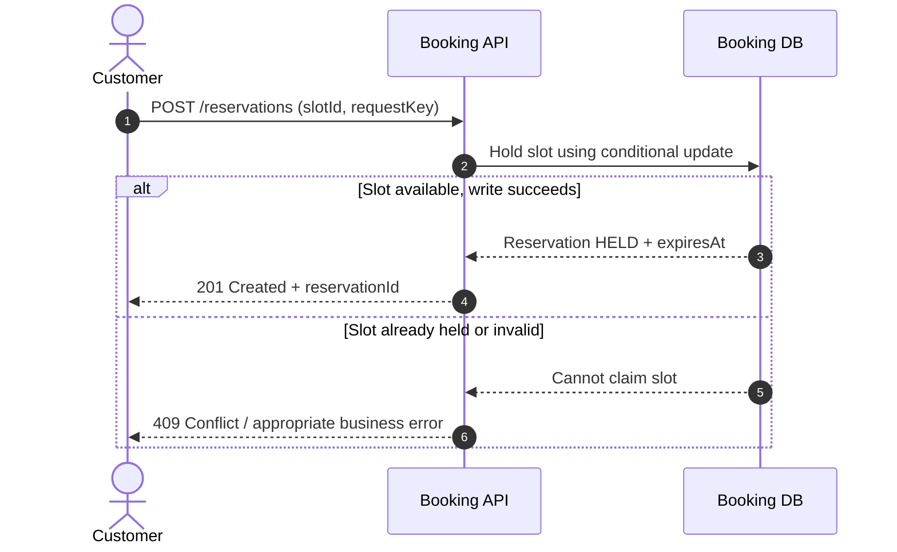
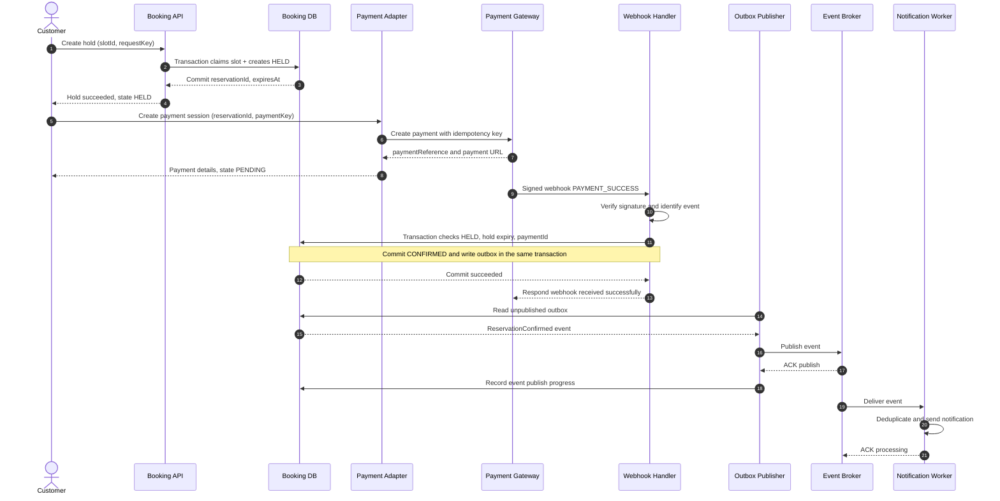
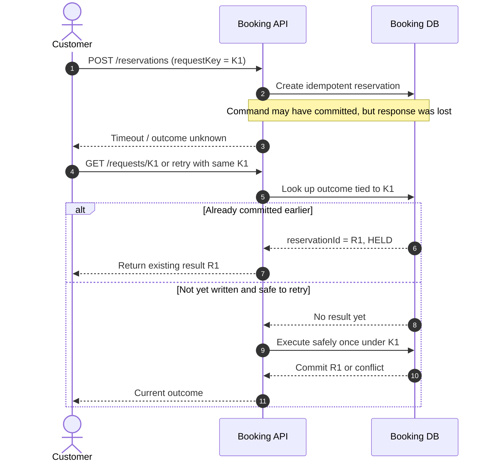
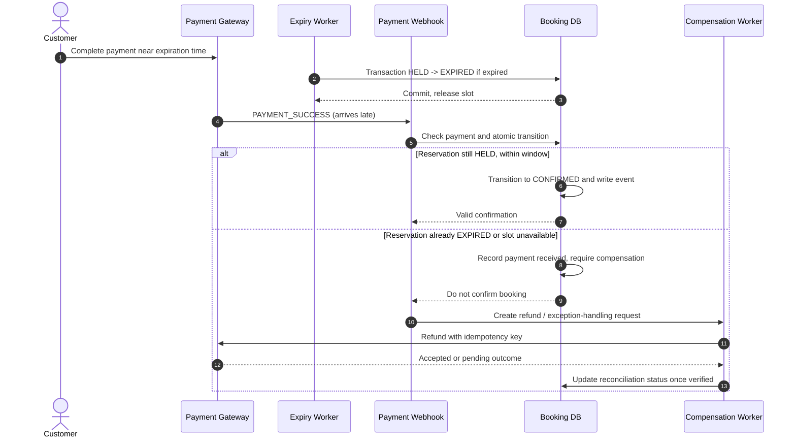
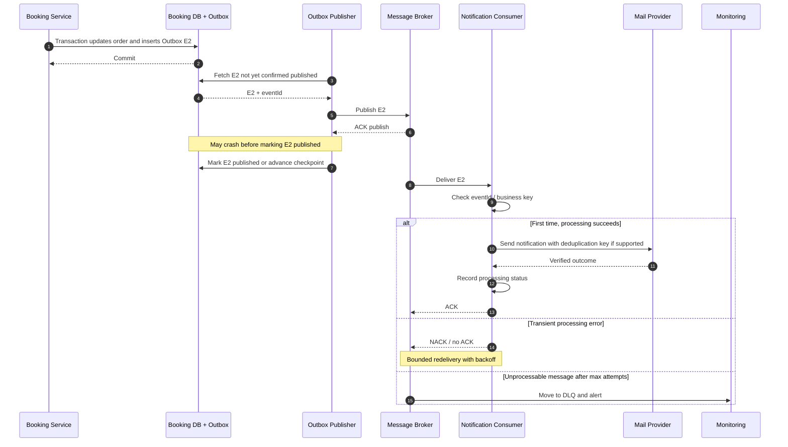
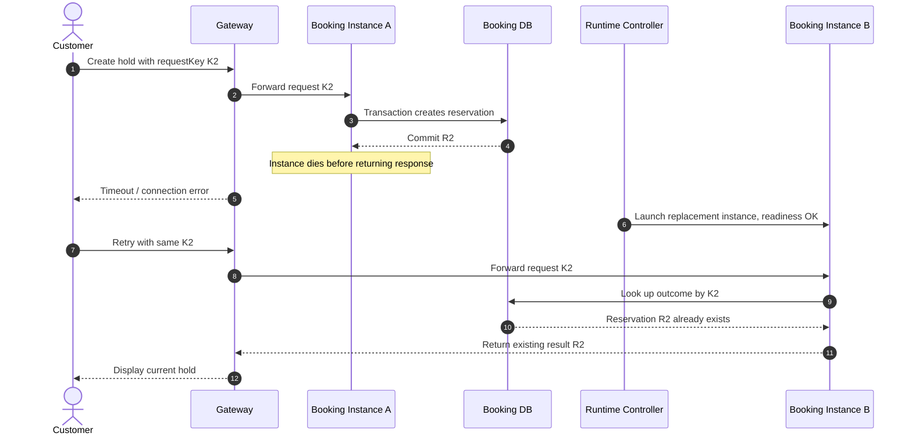

# Sequence Diagrams for Success, Failure, and Recovery Flows

An architecture diagram shows which components make up a system and how they connect. Yet when a user clicks **Book**, which component runs first, when is data written, where does payment confirmation come from, and what happens if the network drops between two steps? Those questions require another view: a **sequence diagram**.

A sequence diagram depicts **interactions over time** among users, applications, cloud services, and data stores. In **CLOUD_ARCHITECTURE** design, it turns business requirements into verifiable behavior, explains networking, compute, data, and deployment choices, and exposes trade-offs across **reliability, security, scalability, cost, and operations** under Well-Architected thinking.

The most important point: **a single business flow has at least three stories that must be told clearly**:

1. **Success (happy path):** every component responds as expected; what condition determines that the transaction is complete?
2. **Failure (failure path):** what happens when a request is rejected, times out, loses connectivity, hits conflicting data, or results arrive multiple times?
3. **Recovery (recovery path):** what does the system do to reach a valid state again, report the outcome to the user, and handle side effects that already occurred?

These three stories are related, not identical. A diagram showing only success can hide an architecture full of failure points; a failure diagram without recovery behavior is still insufficient for operations.

## 1. What Questions Does a Sequence Diagram Answer?

Each sequence diagram should cover **one clear scenario**: for example, "customer holds a spot and pays successfully", "payment gateway times out after receiving the request", or "webhook arrives after the hold expiration time".

| Diagram element | Meaning | Example in a rental booking system |
| --- | --- | --- |
| **Actor** | Party initiating or receiving outcomes | Customer, operations staff |
| **Participant / lifeline** | Application, service, database, broker, or external system | Booking API, Booking DB, Payment Provider |
| **Message** | Semantic call, result, event, or command | CreateReservation, PaymentSucceeded |
| **Chronological order** | Processing sequence and dependency points | Record hold before opening payment session |
| **Conditional branching** | Outcomes handled differently depending on state | Booking succeeded / slot already held |
| **Asynchronous operation** | Sender does not wait for receiver to finish business processing | Send event to Notification via queue |
| **Commit point** | Moment when durable state changes | Commit transaction creating Reservation |
| **Timeout / retry / compensation** | Wait limits and how failures are handled | Re-query payment status, refund when needed |

A sequence diagram **does not replace** C4/container diagrams, network diagrams, data models, or ADRs. C4 identifies components and responsibility boundaries; a sequence diagram explains how they interact in a scenario; an ADR records **why** the team chose that interaction pattern.

### Conventions to Align On Before Drawing

- Name elements **by responsibility**, not just by VM or pod name. For instance, "Booking API" is more useful than "EC2-01".
- Distinguish **synchronous calls** from **asynchronous message sends**. A reply arrow does not mean the user has received notifications from every downstream consumer.
- Clearly note **before/after data states** and **commit points** when transactions are involved.
- Add **conditions**, **timeouts**, and **exception-handling paths** at critical points.
- Note **owners** and **trust boundaries** in annotations when calls cross outside, across regions, across accounts/projects, or carry sensitive data.
- Put timeout parameters, retry counts, and alert thresholds in an assumptions table if they have not been measured/approved yet; avoid turning illustrative numbers into product commitments.

## 2. Reading and Writing Mermaid Sequence Diagrams

Mermaid provides syntax that can live alongside Markdown and be reviewed like code. Useful constructs include:

| Mermaid syntax | When to use | Notes |
| --- | --- | --- |
| **sequenceDiagram** | Start a sequence diagram | Time typically flows top to bottom |
| **actor / participant** | Define actors and systems | Choose an adequate level of detail |
| **A->>B: ...** | A sends a call/message to B | Does not by itself imply A received the outcome |
| **B-->>A: ...** | B replies or responds to A | Specify errors, status, or returned data |
| **alt ... else ... end** | Mutually exclusive conditional branches | Conditions must be verifiable |
| **opt ... end** | Optional step | For example, writing an audit entry when needed |
| **loop ... end** | Retries or repeated processing | Must specify limits or stop conditions |
| **par ... and ... end** | Work that can happen in parallel | Watch out for data race conditions |
| **Note over / Note right of** | Constraints, assumptions, invariants | Keep concise; do not turn the diagram into a long document |

Minimal example with two branches:



**Note:** the "conditional update" call is a concurrency-safe operation on the data side, not "check availability" followed by update as two independent operations that easily cause double booking. HTTP status codes are illustrative; the actual API contract must be agreed upon.

## 3. Choosing the Right Level of Diagram Detail

Before drawing, define:

1. **Business objective:** "the customer books a valid rental slot and is charged only once".
2. **Invariants:** one slot must not be confirmed for two active reservations; one successful payment must not be confirmed twice.
3. **Participating systems:** client, Booking, transactional data store, payment gateway, message broker, notification worker.
4. **Contracts:** request ID/idempotency key, reservation ID, payment ID, event ID, states, and expiration rules.
5. **Completion milestone:** when Booking DB commits **CONFIRMED**, or when the notification email is sent? Those are two different milestones.
6. **Failure assumptions:** network calls can time out; webhooks and events can repeat; systems do not necessarily share the same clock or instantaneous state.

You do not need to put every code class, framework, load balancer, and server into a single diagram. Use **one end-to-end diagram at the responsibility level**, then split dedicated diagrams for transactions, payment errors, event publishing, or regional recovery when they matter.

### Reference State Model

For example, the rental platform uses:

| Reservation state | Meaning | Typical valid transitions |
| --- | --- | --- |
| **HELD** | Slot is temporarily held within the allowed window | CONFIRMED, EXPIRED, CANCELLED |
| **CONFIRMED** | Confirmed per payment and hold policy | CANCELLED if business rules allow |
| **EXPIRED** | Hold window elapsed; claim on slot released | Must not auto-transition back to CONFIRMED when a late webhook arrives |
| **CANCELLED** | Order cancelled by an authoritative action/rule | Depends on refund and history-retention policy |

These states must be protected by transactions or atomic check-and-update operations on the authoritative data store. If the system books arbitrary time intervals rather than fixed slots, add constraints preventing **overlapping time ranges**; checking a single slot ID is not enough.

## 4. Success Flow: Writing Data, Receiving Payment, and Emitting Events

Suppose the customer gets a **10-minute** hold to pay. This is a **learning assumption**, not a universal rule. The design team decides confirmation is valid only if a verified payment event arrives and the reservation is still in a valid hold state at the moment of the atomic update.



Points to read carefully:

- **Booking DB commits before the API returns the hold**; if the response is lost, a retry with the same request key must look up the existing result rather than creating a new reservation.
- **Payment PENDING does not mean CONFIRMED**. The user receives payment session info, yet the final outcome must come from a trusted payment source or verified reconciliation process.
- **Webhooks arrive across an external trust boundary**; verifying signatures, duplicate events, and state-transition eligibility is mandatory.
- **Writing the outbox in the same confirmation transaction** prevents losing the intent to publish an event if the process crashes right after commit.
- **Notifications are an asynchronous step**. Slow email delivery must not revert a confirmed order back to HELD.

The **business completion point** must be clearly defined in requirements: it may be when reservation **CONFIRMED** commits, while sending notifications follows afterward. If the business requires delivering an access code before the customer can use the service, add appropriate states and guarantees.

## 5. Synchronous Failure Flows: Slot Unavailable, Lost Connectivity, and Uncertain Outcomes

Synchronous failures must be categorized before choosing an action. A **deterministic business error** differs from a **technical error where it is unknown whether the transaction completed**.

| Situation | What does the system know for sure? | Appropriate response | What not to do |
| --- | --- | --- | --- |
| Slot already held and DB returns conflict | The current request could not claim the slot | Return business error; suggest choosing another slot | Retry the same slot indefinitely |
| Validation fails before write | Request is invalid | Return actionable error; do not call downstream services | Resend the exact same invalid data |
| DB connection lost before sending command | No write command was sent on this attempt | Retry per policy if operation is safe | Assume the whole system saw no changes from other requests |
| Client times out after DB may have committed | Outcome of that request is **unknown** | Query by requestId/idempotency key; retry safely | Immediately create a new request with a different key |
| Dependency returns 429/503 | Downstream dependency is throttled or temporarily unavailable | Backoff, jitter, circuit breaker if appropriate, report temporary status | Fan out aggressive retries that worsen overload |

### A Processing Flow with Bounded Retries



**An idempotency key must be scoped to a specific operation and identity.** For instance, store results keyed by **(customer, operation type, requestKey)**, a unique constraint, and a fingerprint of the request payload. If the same key arrives with a different payload, reject per contract instead of silently running a different operation. Idempotency record retention must cover the retry window and business policy, not necessarily forever by default.

A response timeout does not tell you the database rolled back. What matters is defining **observable states and a re-query path**, rather than simplifying every timeout into "failed".

## 6. Payment Gateway Timeouts: Why You Cannot Retry Blindly

Suppose Payment Adapter calls an external system and gets no response. There are at least three possibilities: the command never arrived, the command was processed but the response was lost, or the external party is still processing it. You cannot conclude no money was charged from a timeout.

```mermaid
sequenceDiagram
    autonumber
    actor KH as Customer
    participant PAY as Payment Adapter
    participant PSP as Payment Gateway
    participant DB as Payment/Booking DB
    participant JOB as Reconciliation Worker

    KH->>PAY: Request payment (paymentKey = P1)
    PAY->>DB: Write payment attempt PENDING with P1
    DB-->>PAY: Recorded
    PAY->>PSP: Create or charge payment with P1
    Note over PAY,PSP: Timeout elapsed; PSP outcome unknown
    PAY->>DB: Mark UNKNOWN/PENDING, keep reference for reconciliation
    PAY-->>KH: 202 Accepted / awaiting outcome, do not confirm charge

    JOB->>DB: Fetch payment attempts with unknown outcome
    DB-->>JOB: P1 and provider reference if any
    loop Query status within limit with backoff
        JOB->>PSP: Query status by P1 / provider reference
        PSP-->>JOB: Returned status or still unavailable
    end
    alt PSP confirms payment collected
        JOB->>DB: Record payment success, process hold state
        DB-->>JOB: Committed or refund/compensation required
    else PSP confirms failure or cancellation
        JOB->>DB: Update failure per contract
    else Still unknown after reconciliation window
        JOB->>DB: Record state requiring investigation
        Note over JOB,DB: Raise alert / escalate to manual handling
    end
```

If the payment provider supports an **idempotency key**, you can retry with that exact key per their contract. If not, prefer querying status by transaction ID or using the provider's reconciliation process. You must know the key's validity window and API semantics: do not apply one blanket retry policy to every "charge", "capture", or "refund" method.

The user interface must display **PENDING/UNKNOWN** clearly, provide a way to check status, and discourage customers from immediately initiating a brand-new payment while the previous one is unresolved. That is a business and user-experience decision, not just an HTTP client timeout setting.

## 7. Duplicate, Out-of-Order, or Late Webhooks

External messages may be delivered **at least once** or resent when the receiver fails to ACK in time. Even if a provider states specific guarantees, the application should still be designed to tolerate duplicate webhooks or webhooks arriving after another request.

The webhook intake flow should:

1. Authenticate the sender via signature/HMAC or provider-specified mechanism; check timestamps/replay protection per contract.
2. Identify the **provider event ID** and **payment transaction ID**; prevent duplicate writes using authoritative data constraints.
3. Locate the corresponding payment attempt, and verify amount, currency, recipient, current state, and transition rules.
4. Update state inside a transaction or conditional update; combine with an outbox if events must be emitted.
5. ACK only after durably recording the processing decision per contract; if processing is complex, persist to an inbox/queue and ACK once safely stored.

```mermaid
sequenceDiagram
    autonumber
    participant PSP as Payment Gateway
    participant WEB as Webhook Handler
    participant DB as Booking DB
    participant OUT as Outbox

    PSP->>WEB: Event E1: PAYMENT_SUCCESS
    WEB->>WEB: Verify signature and metadata
    WEB->>DB: Transaction: insert E1 if absent, check transition
    alt E1 is new, hold still valid
        DB->>DB: CONFIRMED and append outbox event
        DB-->>WEB: Commit succeeded
    else E1 already processed
        DB-->>WEB: Prior outcome, no state re-update
    else Reservation expired or incompatible
        DB->>DB: Record payment; create reconciliation/compensation task
        DB-->>WEB: Commit exception case
    end
    WEB-->>PSP: 2xx after durable write
    PSP->>WEB: Retry E1 if previous ACK was lost
    WEB->>DB: Look up E1
    DB-->>WEB: Already processed
    WEB-->>PSP: 2xx, no duplicate side effects
```

Deduplicating by event ID **alone is not enough** to stop two different events for the same payment from causing repeated state transitions. You need constraints on **payment transaction ID**, reservation state, and business rules. When events arrive out of order, consult **authoritative state** or query the authoritative source; never use a naive "last event wins" rule.

The diagram above shows that **a redelivered message is not necessarily a new business transaction**. A successful ACK also does not prove downstream emails/notifications finished; those are separate flows.

## 8. When a Hold Expires Mid-Payment: Business Recovery

Hard failures are not just network timeouts. There are situations where every component behaves properly under its local contract, yet **the overall business state still conflicts**.

For example, a customer initiates payment when reservation **HELD** has only a few seconds left. An expiry worker transitions the reservation to **EXPIRED**, releasing the slot to another customer, and then the **PAYMENT_SUCCESS** webhook arrives. If the system only checks payment success to write **CONFIRMED**, it could confirm two orders for the same slot.



The **invariant to protect** is that no two confirmed bookings occupy the same resource during overlapping rental periods. You need an authoritative decision point and an **atomic** operation tying reservation state transition to slot claim; never base that decision on a cache or merely on receiving an event.

For a policy that **allows payment to succeed based on when the PSP collected funds** rather than when the webhook arrived, the team must define a trusted time source and conflict-resolution rules for late events. The diagram above illustrates **checking hold state at update time**, which is an example, not a substitute for a business decision.

In the compensation flow, refunds can be asynchronous, rate-limited, prone to failure, or require approval. You should define states like **REFUND_PENDING / REFUNDED / NEEDS_REVIEW**, traceability, duplicate-refund prevention, and customer support workflows. **Compensation is not a cross-system transaction rollback**: real money may already have moved, and only a new compensating transaction reverses its effect.

## 9. Asynchronous Flows: Outbox, Retries, Consumers, and Dead-Letter Queues

In cloud architecture, many tasks do not need to block the main request's response: sending emails, updating reports, syncing search indexes, or writing audits to another system. A message broker/queue decouples processing timing, yet introduces new risks: failed event publishing, duplicate delivery, out-of-order delivery, and unprocessable messages at consumers.

### Why "Commit Database Then Publish Event" Has a Gap

Suppose Booking DB commits **CONFIRMED** successfully, and then the process terminates before sending the event. The database has changed, yet Notification never learns of the new order. Reversing the order—publish first, then commit—risks a consumer receiving an event for a transaction that later rolls back.

The **transactional outbox** solves losing the intent to publish an event: the same transaction writes the business state and an outbox record. Another worker publishes pending records. This achieves **publish recoverability**, yet **does not guarantee the consumer receives the message only once**.



Implementation notes:

- **The publisher may re-publish E2** if it sent the message successfully before updating its checkpoint. Consumers need idempotency/inbox tracking or unique constraints keyed by event ID and business effect.
- **ACK the consumer** only after durably recording processing progress. With external systems lacking idempotency (such as email delivery), you cannot promise "guaranteed sent only once" across every possible crash point; accept/minimize duplicates, track delivery state, reconcile, or use APIs supporting deduplication keys.
- **A DLQ (dead-letter queue) does not fix errors by itself.** It requires an owner, backlog metrics, alert thresholds, root-cause inspection capability, and controlled data-fix or replay procedures.
- **Event ordering** depends on partition/key, broker, and producer/consumer design. If ordering is a business requirement, use aggregate versions/sequences or query authoritative state; never assume all events system-wide always arrive in order.
- **Backpressure** must limit consumer count/concurrency when downstream dependencies are weak; blindly adding workers can overwhelm the database or email provider even faster.

### What Information Should an Event Carry?

A state-change notification event should carry identifiers and minimal information sufficient for consumers, for example:

```json
{
  "eventId": "event-123",
  "eventType": "ReservationConfirmed",
  "eventVersion": 1,
  "aggregateId": "reservation-456",
  "aggregateVersion": 4,
  "occurredAt": "2026-11-18T05:00:00Z",
  "correlationId": "request-789",
  "payload": {
    "reservationId": "reservation-456"
  }
}
```

This is **illustrative** data, not a default contract. Avoid putting card numbers, secrets, tokens, addresses, or unnecessary personal data into events: messages are often copied into queues, retries, DLQs, logs, and other consumers. If the event schema changes, plan for **version compatibility** when producers and consumers deploy asynchronously.

## 10. Timeouts, Retries, Circuit Breakers, and Resource Limits

You cannot design recovery flows with a mere "if it fails, retry". For synchronous calls, clearly define **who owns retries, what is retried, for how long at most, whether repeating is safe, and when to stop**.

| Mechanism | Purpose | How to show on diagrams | Warning |
| --- | --- | --- | --- |
| **Timeout** | Avoid waiting forever on slow/broken dependencies | Note showing deadline or wait limit; timeout branch | Timeout does not mean the receiver rolled back the transaction |
| **Retry + backoff/jitter** | Ride out recoverable transient errors | Conditional loop with explicit limit | Retrying at multiple layers can multiply load and spread outages |
| **Circuit breaker** | Stop flooding a failing dependency | Open/half-open/closed branches based on health | Does not repair data or business state already created |
| **Bulkhead** | Prevent one downstream failure from exhausting all threads/connections | Explicitly note isolated pools/quotas per workload type | Overly tight quotas can throttle legitimate throughput |
| **Queue/backpressure** | Absorb bursts and decouple producer/consumer speeds | Enqueue, process later, lag metrics | Unbounded queues and message age can build huge backlogs |
| **Fallback** | Preserve partial functionality during dependency failure | Degraded-mode branch | Fallback data must be recognized as potentially stale/incomplete |
| **Idempotency** | Prevent repeated side effects of the same operation | Use request/event key and stored result | Key scope and shared state must be explicitly defined |

Illustrative example: the overall request deadline is **3 seconds**, and Booking has **2 seconds** left to call a dependency. If the HTTP client retries three times waiting 2 seconds each, the time budget is blown. Deadlines must propagate/coordinate across layers; the 3-second and 2-second figures here are illustrative only, not default configuration recommendations.

**Retries are only appropriate when success likelihood improves and side effects are controlled.** Reads are usually easier to retry than payment charges. Commands with external side effects must use idempotency keys or status-check procedures before retrying.

### Distinguishing Transient Errors from Permanent Errors

Input violating a schema or lacking authorization is an error **unlikely to succeed if replayed verbatim**. Such messages must be rejected or routed aside, not retried endlessly. Timeouts, network drops, and rate limits may be transient errors, yet still require time bounds, total attempt caps, and observability.

When batching multiple messages, prevent a single poison message from blocking an entire partition/queue. Design isolation and replay mechanisms aligned with **ordering** and **deduplication** requirements.

## 11. Distinguishing Application, Data, and Infrastructure Recovery

A cloud system faces many kinds of incidents. Sequence diagrams must show **execution paths and where state is recorded**, while linking to deployment diagrams, runbooks, or recovery plans when an incident spans beyond a single request.

| Incident type | Example | Application recovery action | Infrastructure/data requirements |
| --- | --- | --- | --- |
| **Instance failure** | Pod/VM dies mid-request | Client retries with key; replace instance; uncertain requests must be reconciled | Health checks, multiple instances or autoscaling, durable state outside instances |
| **Database temporarily unavailable** | Connection lost during commit | Block unguaranteed writes; re-query transaction; shed load | Suitable HA/failover config, connection pools, and monitoring |
| **Queue/broker failure** | Outbox cannot publish | Keep outbox durable; publisher retries; monitor lag | Broker with appropriate durability, quotas, backlog alerts |
| **PSP failure or slowdown** | Unclear if payment collected | PENDING, reconciliation, prevent duplicate charges | Timeouts, connection limits, resource isolation, and business fallback if any |
| **Logic bug after deploy** | New release mishandles state | Halt rollout, revert/roll forward app, and remediate affected data | Versioned artifacts, canary, rollback runbook, compatible migrations |
| **Large regional outage** | Region becomes unavailable | Stop or shift traffic per policy; re-sync state | DR/replication, tested backups, DNS/routing, RTO/RPO plan |

A single request diagram is insufficient to deduce **RTO** (Recovery Time Objective) or **RPO** (Recovery Point Objective). Those two targets stem from business impact and must be **measured through recovery drills**, not inferred merely from using managed services or multiple availability zones.

### Example Recovery Flow When an Instance Is Replaced



**Conditions for this diagram to hold:** the request key and outcome are stored durably, instances hold no unique state needed to identify the transaction, the gateway routes to healthy instances, and the operation can repeat without extra side effects. If sessions lived only in Instance A's RAM, the recovery diagram would have to add a session-recovery strategy or stateless design.

For **multi-region**, the diagram must additionally show region failover, data consistency, and **split-brain** prevention if two regions could write simultaneously. Shifting traffic to a standby region before verifying the freshest data copy can produce invalid business states. DR requires data-source precedence rules, fencing of the old writer, and post-recovery reconciliation procedures.

## 12. Annotating Non-Functional Qualities onto Diagrams

Under Well-Architected design, inspect a sequence diagram not only for function, but also for the quality boundaries the flow traverses.

| Attribute | Places usually needing diagram annotations | Questions to answer |
| --- | --- | --- |
| **Reliability** | DB commits, timeouts, retries, outbox, duplicate handling | If a message is lost/redelivered, which invariants still hold? |
| **Security** | Actor → API, service → service, webhooks, secrets, logs | Which identity calls, how is it verified, where does sensitive data go? |
| **Performance efficiency** | Synchronous call chains, slow queries, external APIs, queues | Do end-to-end p95/p99 latency and throughput under real load meet SLOs? |
| **Cost optimization** | External calls, publishes, retries, cross-region flows, consumer count | During errors, can retries and backlogs cause runaway costs? |
| **Operational excellence** | Logs, traces, metrics, alerts, DLQ, runbooks | Can we tell where a request stalled and who owns resolving it? |
| **Sustainability** | Repeated calls, redundant work, idle workers, standby capacity | Can unnecessary compute or storage be reduced while still meeting SLOs? |

### Estimating Latency Along a Call Chain

Suppose an API makes three sequential synchronous calls, each with its own latency. Total end-to-end duration also includes app processing, network transit, connection wait time, serialization/deserialization, and potential retries. **Never add the three components' p95 values directly and claim that as end-to-end p95**, because latency distributions and correlations differ; you must measure or simulate the real flow.

If notifications are not required for confirming a rental booking, moving them to asynchronous processing can reduce response latency. In return, the system must address **eventual consistency**, retries, DLQs, and notification-delay metrics. The diagram makes this trade-off explicit.

### Security at Each Boundary

Sequence diagrams are useful for marking where trust levels change:

- **Client → API:** authentication, per-rental authorization, replay protection, and rate limiting.
- **API → Database:** workload identity, least privilege, transport encryption, parameterized queries.
- **Payment Provider → Webhook:** event authenticity, signature/timestamp checks, replay protection, payload filtering, and endpoint protection.
- **Service → Broker:** topic-level publish/subscribe permissions, encryption, retention, and data minimization.
- **Logs/Tracing:** correlation IDs and sufficient diagnostic info; avoid storing secrets, full tokens, or sensitive payment data.

**A valid arrow on a diagram does not prove access permissions are configured properly.** Combine it with authorization denial tests, IAM policies, network controls, and live verification.

## 13. Observability and Testing Along Each Path

To know whether the system follows the intended flows, turn every branch into **observability signals and tests**:

| Path | What to observe | Valuable tests |
| --- | --- | --- |
| Hold succeeds | HELD reservation count, creation duration, conflict rate | Concurrent requests competing for one slot; only one valid hold succeeds |
| Client retries on lost response | Duplicate request rate, responses returned for same key | Inject timeout after commit then resend with same request key |
| PSP timeout | PENDING/UNKNOWN payments, unresolved transaction age, reconciliation count | Simulate PSP succeeding while blocking response |
| Duplicate/out-of-order webhooks | Duplicate event count, invalid state-transition attempts | Send duplicate event IDs and two different events for one transaction |
| Webhook arrives after expiry | Compensated payment count, refund/reconciliation duration | Let reservation expire, then deliver PAYMENT_SUCCESS |
| Broker or consumer failure | Outbox lag, retry count, consumer lag, DLQ depth | Disconnect broker then recover; ensure events replay and consumers deduplicate |
| Instance dies after DB commit | Timeouts, instance replacement, query results by request key | Kill instance right at commit boundary and verify no duplicate order is created |

A **correlation ID** tracks one logical request across components; a **trace ID** supports distributed call tracing; a **business ID** (reservationId/paymentId) supports long-lived state reconciliation. Each plays a distinct role and should be linked safely in logs/metrics. Never embed personal information or secrets inside identifiers merely to make log searching easier.

When data is processed asynchronously, a single trace may not span the entire business lifecycle; store correlation or causation IDs in events/orders and link traces within the observability platform's capabilities.

## 14. From Sequence Diagrams to Architecture Decision Records (ADRs)

Diagrams describe **what happens**. For reviewers to understand **why it was designed that way**, record decisions affecting reliability, security, and cost.

| Decision on the diagram | Options to compare | Common rationale | How to validate |
| --- | --- | --- | --- |
| Confirm order on verified webhook | Sync wait on PSP / webhook / reconciliation | Reduces reliance on instant response; accepts PENDING state | Test late webhooks, lost responses, duplicate events |
| Hold slot in Booking DB atomically | Check-then-write / distributed lock / database transaction | Protects no-double-booking invariant with minimal moving parts | Concurrency stress test, transaction rollback |
| Write outbox in same transaction | Direct publish after commit / outbox / suitable CDC | Prevents losing publish intent on service crash | Stop publisher/broker and test replay |
| Idempotent consumer | Trust once-only delivery / persist processing markers | Redelivery can happen; mitigates duplicate effects | Redelivery and crash injection |
| Decouple Notification from response path | Sync send / async queue | Reduces request latency and isolates email outages | Test slow mail provider, backlog |
| Payment after expiry → compensation | Late confirmation / refund / manual support | Preserves anti-duplication invariant and business policy | Race test between webhook and expiry |

A concise ADR can read:

> **Decision:** Booking writes **CONFIRMED** state and the outbox event in the same transaction. Outbox publisher dispatches events asynchronously; consumers handle idempotency.
>
> **Context:** the system must preserve accurate order state even if a process stops right after commit or the broker briefly loses connectivity.
>
> **Options considered:** publish directly from the request; use an outbox; use CDC if the data platform and operations support it.
>
> **Trade-offs:** adds an outbox table, worker, cleanup mechanism, and backlog metrics; events can be delivered more than once, so consumers must deduplicate.
>
> **Verification:** inject failures between commit and publish, and between publish and checkpoint; ensure every confirmed order eventually emits an event without creating duplicate business effects.

An ADR can link to diagram versions, data definitions, API contracts, RTO/RPO tables, runbooks, and test results. Whenever business policies or error-handling approaches change, update both the ADR and related diagrams.

## 15. A Sequence-Diagram Design Process Ready for Reviews

### Step 1 — Pick One Scenario and Define the Outcome

Write one sentence with an actor, action, and completion condition: "When a customer creates a reservation and completes a valid payment within the hold window, the system confirms one order and emits a notification event." Do not start with tool names like Kubernetes or API Gateway before the business objective is clear.

### Step 2 — Identify the Source of Truth and State-Transition Authority

Specify which component owns which data, which operations must be atomic, and where idempotency is required. Mark transactions, commits, and events that external partners may send repeatedly. Cross-service access must follow explicit contracts, not default direct database sharing across every service.

### Step 3 — Draw the Happy Path First

Include only the participants needed to explain the outcome. Note requests/responses, correlation IDs, PENDING/CONFIRMED states, and async handoff points. From this, identify the hot path affecting latency and the dependencies needing protection.

### Step 4 — Add One Failure at Every Boundary

For every critical call, ask in turn:

- If the receiver returns a business error, what is the final state?
- If a timeout hits during commit, do we know the outcome for sure?
- If an ACK is lost or the same event arrives multiple times, is duplicate processing prevented?
- If another process mutates state while waiting, is any invariant violated?
- If a dependent service does not recover quickly, does the flow stop, retry, enqueue, or escalate to a human?

You do not have to cram every error into one chart. Organize a **family of diagrams** with scenario identifiers: **Success**, **PaymentTimeout**, **DuplicateWebhook**, **LatePayment**, **BrokerFailure**, **InstanceRecovery**.

### Step 5 — Draw Recovery Paths with Clear End States

Recovery must show who triggers it, where the final outcome lands, when retries stop, and who receives alerts. For example, payment timeout → reconcile by key → confirm or refund/compensate → record final state. "Retry" without a stop condition is not a complete recovery design.

### Step 6 — Check Quality Attributes and Trade-Offs

Walk through Well-Architected considerations: data security, permissions, reliability, observability, latency budget, retry load, queue/reconciliation cost, and DR requirements. Record unverified assumptions, especially third-party API behavior and storage/broker durability guarantees.

### Step 7 — Turn Branches into Tests and Update Docs

Build test cases from each branch and transaction boundary, including fault injection at tricky points: before commit, after commit before response, after publish before checkpoint, and before/during refund. Keep diagrams in sync with API contracts, data states, and ADRs as the system evolves.

## 16. Practice Exercises

### Exercise A — Customer Clicks Pay Twice

**Scenario:** The UI sends two payment requests closely together because the customer clicked the button twice. The first request reached the PSP, yet the client never received the response.

**Task:** Draw a sequence diagram with actor, Payment Adapter, database, and PSP. Include branches for successful response, lost response, and duplicate request.

**Verification hints:** the same business operation uses one idempotency key; the application validates payload, records/queries the payment attempt, and the provider enforces the key if supported. When the outcome is unclear, return PENDING and reconcile—do not issue a new charge with a different key.

### Exercise B — Broker Outage After DB Confirmed the Order

**Scenario:** The reservation is CONFIRMED, yet the broker rejects publishes for 20 minutes. After the broker recovers, the publisher crashes right after the first ACK.

**Task:** Draw the outbox diagram with publish-failure, retry, and "publish succeeded before checkpoint was saved" branches.

**Verification hints:** the outbox retains the event durably; the publisher uses bounded retries and backlog metrics; the consumer deduplicates. Booking confirmation is never rolled back merely because notification delivery has not succeeded yet.

### Exercise C — Recovery Failure After Failover

**Scenario:** An API request wrote data right before the instance died. The standby region receives the retried request, yet the data replica has not caught up to the latest commit.

**Task:** Describe a diagram adding steps to determine the authoritative write region, replication status, and whether to open write traffic.

**Verification hints:** account for RPO, risk of split-brain dual writes, unreplicated data, reconciliation mechanisms, and rules preventing duplicate reservations. Never declare a region switch safe solely because compute is ready.

### Self-Evaluation Criteria

| Criterion | Meets expectations when |
| --- | --- |
| **Business outcome** | Clear end state exists; PENDING is never confused with CONFIRMED |
| **Data invariants** | Authoritative source and atomic operations prevent invalid states |
| **Technical errors** | Deterministic errors are separated from uncertain outcomes after timeouts |
| **Recovery** | Clearly specifies who retries/reconciles/compensates, stop conditions, and end state |
| **Asynchronous flows** | Shows broker, ACK, redelivery, and potential duplicate events |
| **Security** | Permission/signature checks appear at trust boundaries; no leaked secrets |
| **Operations** | Correlation IDs, metrics, alerts, DLQ/runbooks cover unfinished work |
| **Trade-offs** | Records chosen solution and verification via tests/ADRs |

## 17. Checklist When Reviewing Cloud Sequence Diagrams

- Does it have a concrete scenario name and business objective?
- Does every participant have a clear responsibility at the right level of abstraction?
- Does the success path record exact states, commit points, and returned results?
- Do all async flows specify producer, consumer, ACK, retries, limits, and owner?
- Are timeouts that can lead to **uncertain** outcomes explicitly represented?
- Do duplicate requests and events have idempotency, duplicate-write protection, and invariant safety?
- If a transaction spans multiple systems, is there compensation/reconciliation instead of assuming a global transaction?
- If a customer pays late, data arrives out of order, or resources change state, are handling rules clear?
- Are network, identity, sensitive-data, and third-party boundaries identified?
- If an instance, DB, queue, or region fails, are runbooks and suitable RTO/RPO assumptions in place?
- Are metrics, logs/traces, correlation IDs, alerts, DLQs, and ownership of unfinished items defined?
- Are there tests covering each critical branch, especially pre/post-commit boundaries?
- Do architecturally significant decisions have ADRs and trade-offs across cost, latency, security, and recovery?

A useful sequence diagram lets reviewers predict **what the system will do when everything goes smoothly, when a step fails, and after a component recovers**. When diagrams connect to state machines, API/event contracts, ADRs, tests, and runbooks, they become reliable design and operational tools rather than sketches of an idealized happy path.
