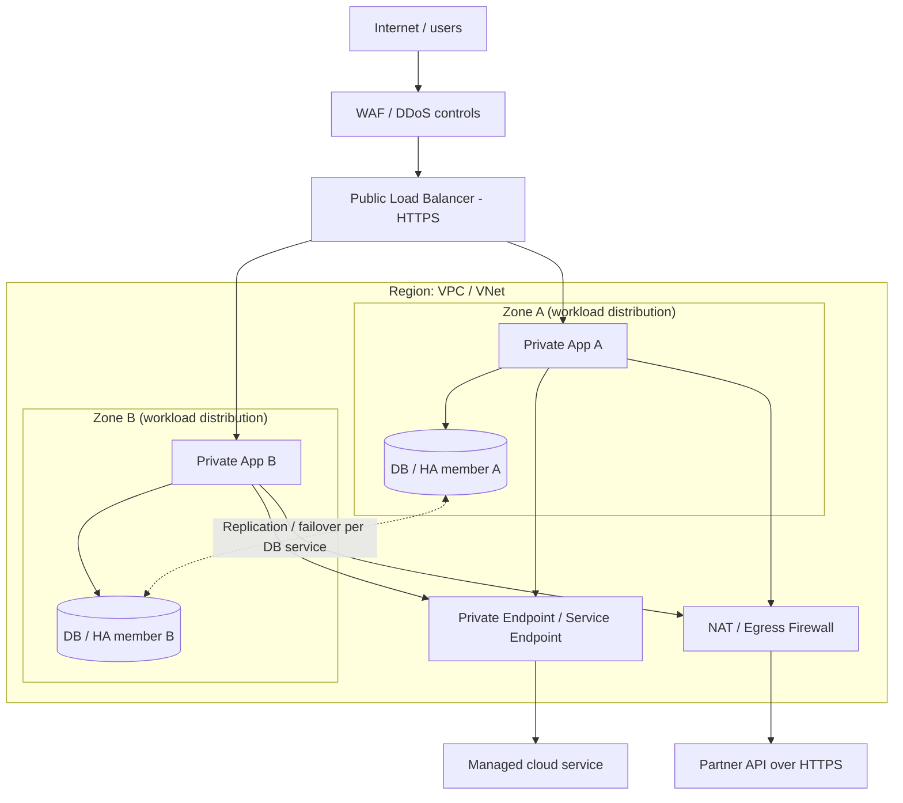
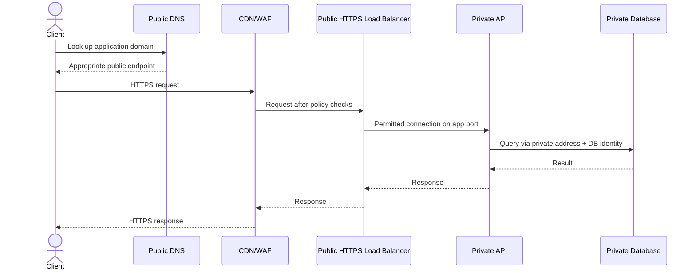
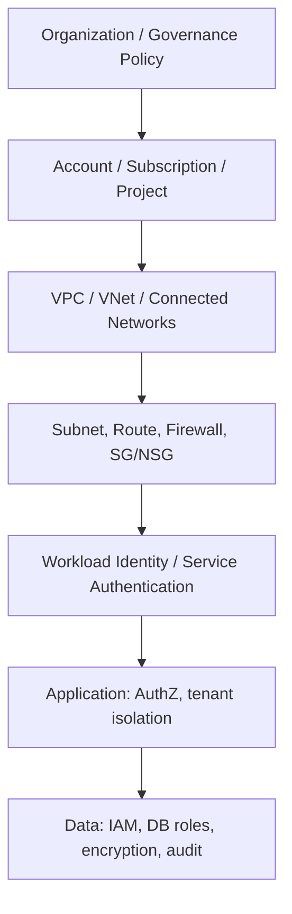
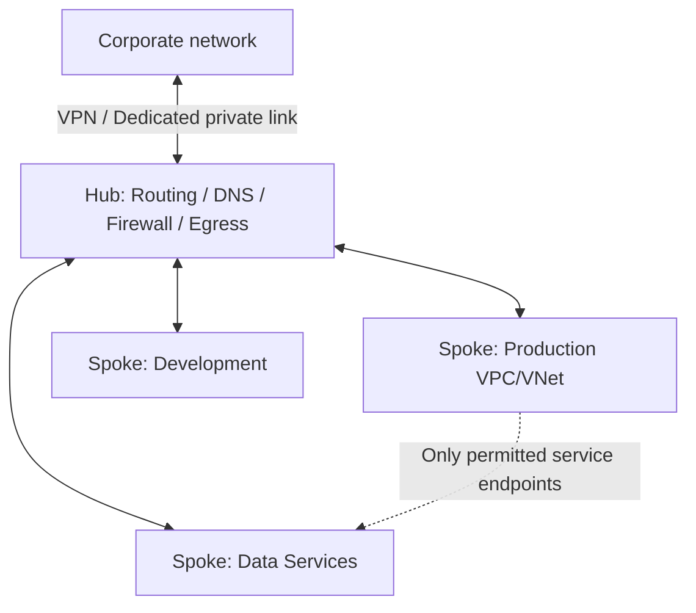
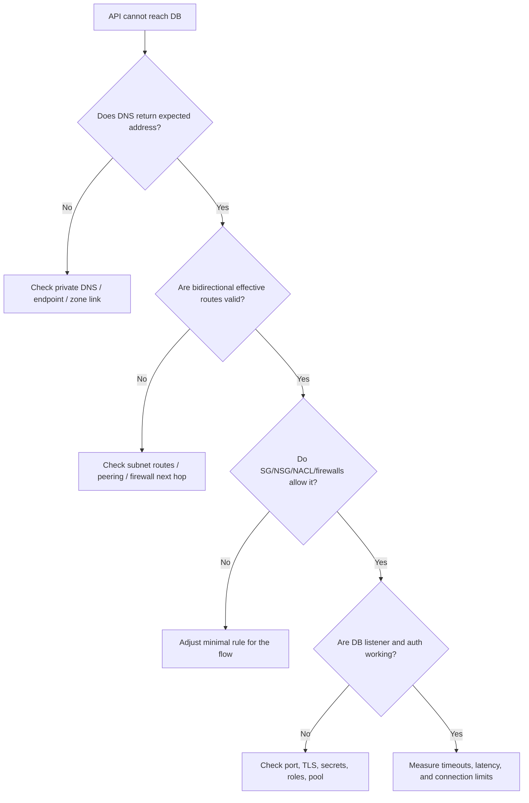

# Designing VPC or VNet, Subnets, and Isolation Boundaries

## 1. Why Is Network Design an Architectural Decision?

A cloud application system can use auto-scaling compute, managed databases, and multi-zone load balancing and still suffer outages if components communicate over unintended network paths. An ordering application might run smoothly in a test environment and then fail to reach the database when moved to a private network; or a database might accidentally accept Internet connections due to overly broad firewall rules.

**VPC/VNet design is the design of address scope, packet paths, and the points allowed to cross trust boundaries.** It must stem from business requirements, traffic characteristics, security, reliability, scalability, cost, and operational capability. Within the **CLOUD_ARCHITECTURE** module, the **Network Architecture** chapter helps learners turn those requirements into an implementation structure verifiable through the Well-Architected mindset.

After this lesson, you will be able to:

1. Distinguish VPC/VNet, subnets, route tables, gateways, endpoints, and access control layers.
2. Design CIDRs and subnet allocations with growth reserves, avoiding address duplication across environments and connected networks.
3. Define public zones, private application zones, restricted data zones, and inbound/outbound traffic paths.
4. Design multi-layer isolation boundaries: account/subscription, network, subnet, identity, application, and data.
5. Evaluate availability, security, operations, performance, and cost across network options.
6. Validate designs using connectivity matrices, failure scenarios, measurements, and practical exercises.

## 2. Mental Model: Addressing, Routing, Access Control, and Identity

A sound network design must answer four independent questions:

| Question layer | Purpose | Example |
| --- | --- | --- |
| **Addressing** | Which IP range do resources sit in? Do ranges overlap? | VPC `10.42.0.0/16`; app subnet `10.42.16.0/22` |
| **Routing** | Through which device/path do packets reach the destination? | App reaches Internet via NAT or cloud services via private endpoint |
| **Traffic control** | Which rules allow or block connections? | Only API may connect to DB on TCP 5432 |
| **Identity and business permissions** | Who is allowed to call a service or manipulate data? | API uses workload identity to read secrets; users only view their own orders |

**Having a route does not mean access is permitted.** Routes only determine the path. Firewalls and network policies can drop packets; IAM and application authorization mechanisms also decide whether an operation is accepted.

**Having no public IP does not mean absolute safety.** Machines in a private subnet can still be accessed without authorization from internal networks, VPN links, peered networks, or a compromised workload. Multiple control layers must be combined under *least privilege* and *zero trust* principles.

## 3. What Are VPC and VNet? Key Similarities and Differences

**VPC** (*Virtual Private Cloud*) typically refers to a customer-defined virtual private network in a cloud environment. **VNet** (*Virtual Network*) is Azure's name for the roughly equivalent concept. They establish the address space, subnets, routes, and connectivity points among resources.

| Concept | AWS (commonly VPC) | Azure (commonly VNet) | Design implication |
| --- | --- | --- | --- |
| High-level network space | VPC within a Region | VNet within a Region | Pick non-overlapping CIDRs; decide connectivity and governance boundaries |
| Subnet | Subnet is bound to **one Availability Zone** | Subnet is scoped to the VNet, **not bound to a single Availability Zone** like AWS | Multi-AZ subnet layout must follow each cloud's model |
| Internet path | Internet Gateway and matching route, plus public IP conditions for direct resources | Azure-model Internet routing; public IP, load balancer, NAT Gateway, or firewall as needed | Do not copy gateway names verbatim between the two clouds |
| Outbound connectivity using a stable public address | NAT Gateway or purpose-built NAT/egress appliance | NAT Gateway, Azure Firewall, or appropriate egress mechanism | Separate outbound capability from inbound exposure |
| Traffic filtering | Security Group (stateful) and Network ACL (stateless) on AWS | Network Security Group (stateful) and other firewall capabilities | Rules attach to different layers and resources |
| Private access to managed services | VPC endpoint/PrivateLink and corresponding private connectivity | Private Endpoint/Private Link and private connectivity options | Verify DNS, routing, policies, and the actual data path |
| Custom routing | Route table associated with subnet | Route table/User Defined Routes (UDR), effective routes | Understand provider precedence and effective routes |

This table highlights foundational differences, **not an exhaustive capability list for each product**. In actual deployments, verify service documentation for the specific region, version, SKU, and features in use.

A pattern like “two public subnets and two private subnets, one pair per AZ” can be a useful **AWS VPC** template. On Azure, do not assume each subnet belongs exclusively to one AZ; instead, distribute zone-capable instances or services across zones using the service's deployment options, while subnets remain VNet-wide shared networks.

### 3.1. Logical Boundaries Do Not Replace Organizational Boundaries

Multiple VPCs/VNets can coexist inside one account or subscription, yet organizations can also use **multiple accounts/subscriptions/projects** to isolate production, development, or sensitive environments. IAM, billing, policy, quota, and administrative permission boundaries are often just as critical as network boundaries.

If two environments share a single VPC/VNet, misconfigurations, route errors, or admin permissions can have a wider blast radius. If each environment has its own network, isolation improves while shared connectivity, DNS, and operations become more complex. Choose the model based on risk level and management scale.

## 4. Gathering Requirements Before Allocating CIDRs

Before drawing subnets, assemble a list of business traffic flows. For a booking application, users access the web frontend, the API needs to connect to the DB, background jobs call a payment partner, and the operations team needs access via an administrative channel.

| Source | Destination | Purpose | Direction/connection | Sensitivity level |
| --- | --- | --- | --- | --- |
| Browser/mobile | Public HTTPS entrypoint | Browse and book | Internet inbound TCP 443 | Session data, user info |
| Load balancer | Application API | Forward valid requests | Inside VPC/VNet, app-configured TCP port | Business data |
| API | Transactional database | Read/write bookings | Private, specific DB port | Authoritative data |
| API | Object storage | Read/write business files | Endpoint/private path where supported | Files/data requiring authorization |
| API/worker | Payment provider | Call payment API | Outbound HTTPS via controlled egress | Sensitive transactions |
| Payment provider | Public webhook endpoint | Send transaction results | Inbound HTTPS, verified in app | Financial events |
| Operations team | Admin tools | Investigate incidents | Identity-backed, audited admin path | Privileged access |

For each flow, specify **the owner, data classification, protocol/port, latency target, source and destination trust zones, and behavior when connectivity fails**. Opening ports simply because “the app cannot connect yet” usually produces overly permissive rules.

Other baseline data to gather:

- Current and future workload counts and types: VMs, containers, Kubernetes nodes, managed databases, private endpoints, and services needing dedicated IPs.
- Projected IP counts over time and IP requirements per node/pod/instance depending on the platform.
- On-premises networks, branches, partners, other environments, and CIDRs already in use.
- Regions, multi-AZ/multi-region requirements, data residency, RTO/RPO.
- Rules for inbound/outbound Internet traffic, egress allowlists, inspection, or logging requirements.
- Latency, throughput, cross-AZ/region traffic profiles, and cost forecasts.
- Team capability in handling DNS, BGP, NAT, network security, and incident response.

## 5. IP Address Planning: CIDR First, Subnets Second

### 5.1. CIDRs and Basic Calculations

An IPv4 CIDR looks like `10.42.0.0/16`. The `/16` means the first 16 bits form the network prefix; the remaining 16 bits are for addresses within that range. Theoretical address count:

```text
IPv4 addresses in a prefix /n = 2^(32 - n)

/16 = 2^16 = 65,536 addresses
/22 = 2^10 = 1,024 addresses
/24 = 2^8  = 256 addresses
/27 = 2^5  = 32 addresses
```

**Addresses assignable to workloads may be fewer** because providers reserve addresses for networking or enforce service limits. Do not treat theoretical math as a guarantee that every IP is usable.

Common RFC 1918 private IPv4 ranges:

- `10.0.0.0/8`
- `172.16.0.0/12`
- `192.168.0.0/16`

Not every `172.x.x.x` address is private; the private range is strictly `172.16.0.0` through `172.31.255.255`. Likewise, never pick a private CIDR at random without checking existing networks.

### 5.2. Avoiding Overlapping CIDRs to Preserve Connectivity

Suppose a system uses VPC `10.42.0.0/16`, while an on-premises network already uses `10.42.16.0/20`. The two ranges **overlap**. When setting up a VPN or peering link, routers may fail to distinguish destinations properly; many connection types do not support direct routing across overlapping ranges, or require complex NAT translation.

An **IPAM** (*IP Address Management*) design should centrally track:

- Ranges assigned to each region, environment, business unit, cloud network, and on-premises network.
- Ranges in use, reserved, and available for expansion.
- Owner, purpose, lifecycle state, allocating system, and connectivity status.
- Networks planned for peering, VPN, transit, or firewall traversal.
- IPv6 addressing plans if dual-stack is supported.

**Do not check only the subnets within a single VPC/VNet.** Check all networks slated for current and future connectivity, including partners and addresses used in DR environments.

### 5.3. Valid CIDR Subdivision Example

An illustrative **AWS VPC** design using VPC `10.42.0.0/16` in one region across two Availability Zones (AZ A, AZ B). None of the subnets below overlap:

| Function | AZ A | AZ B | Notes |
| --- | --- | --- | --- |
| Public/edge subnet | `10.42.0.0/24` | `10.42.1.0/24` | For public-facing components requiring subnets by design |
| Private application | `10.42.16.0/22` | `10.42.20.0/22` | Ample addresses for apps/workers, scaling, and service connectivity |
| Isolated data | `10.42.32.0/24` | `10.42.33.0/24` | Databases/subnets with strict access requirements |
| Infrastructure/private endpoints | `10.42.40.0/24` | `10.42.41.0/24` | For infrastructure needing dedicated private IPs where appropriate |
| Future reserve | `10.42.64.0/18` | — | Unallocated; can be subdivided further |

For `/22`, the AZ A application range is `10.42.16.0` through `10.42.19.255`; AZ B is `10.42.20.0` through `10.42.23.255`. All `/24` ranges in the table fall outside those two spans. The reserve `10.42.64.0/18` does not overlap any allocated range in the example.

This table is a **reference addressing plan**, not a claim that every resource type requires its own separate subnet. When applying to Azure, map according to VNet/subnet characteristics and zone capabilities of specific Azure services rather than forcing subnets into AWS's AZ structure.

### 5.4. Leaving Room for Growth and Special Resources

Size IP counts for **peak scaling**, not today's VM count. A Kubernetes cluster or container platform may consume extra addresses for nodes, pods, interfaces, or endpoints depending on networking mode. HA managed databases, load balancers, Private Link/Private Endpoints, and network appliances may also require dedicated IPs or specialized subnets.

Key questions:

1. What is the maximum spike in instance/worker count during peak hours?
2. Have reserve IPs been included for rolling deployments, blue/green, and failover?
3. What are the provider's minimum subnet size, reserved addresses, and interface quotas?
4. Are additional regions, accounts, or parallel test environments planned?
5. If CIDRs must expand later, what routes, VPNs, and policies will have to change?

When a subnet runs out of IPs, scaling can fail even though compute quotas and CPU remain available. Network capacity planning is therefore part of scalability design.

## 6. Network Zones: Public, Private, and Isolated

A subnet's name alone grants no security power. A subnet is typically considered public or private based on **routes, endpoint types, IP assignments, and network rules**.

### 6.1. Public Subnets or Segments for Internet-Facing Components

In common AWS designs, a subnet with a `0.0.0.0/0` route to an Internet Gateway is called a *public subnet*. However, **a VM still needs conditions such as a public IPv4/IPv6 and matching security rules before it can accept direct Internet connections**. A route alone does not open ports, nor does it assign public IPs.

Components typically placed at the Internet edge include public load balancers, appropriate firewall/ingress appliances, and certain infrastructure resources. Do not move databases or business VMs into this zone merely for convenient debugging.

On Azure, “public subnet” is more an architectural concept than a formal attribute identical to AWS: Public IPs, load balancers/gateways, effective routes, NSGs, and firewalls are used as appropriate to define the Internet-exposed path.

### 6.2. Private Application Subnets

Business-processing workloads normally do not need direct public IPs. They receive traffic from internal/public load balancers over private paths, while potentially needing to call partner APIs or fetch updates.

If outbound IPv4 to the Internet is required, a **NAT/egress gateway** or controlled proxy/firewall can be used. NAT primarily lets workloads initiate outbound connections and receive matching replies; it is **not an application firewall**, and does not replace domain/URL inspection, logging, secret management, or outbound deny policies.

### 6.3. Isolated/Data Subnets

The data zone should only accept connections from authorized components, needing no default Internet route unless required. For example, only the application may connect to PostgreSQL on TCP 5432, enforced via appropriate network/security identities and DB permissions.

“Isolated” does not mean zero routes; it still has internal **local routes** and may use private endpoints or mandatory management paths. You must define backup, telemetry, key management, patching, and operator paths according to service characteristics. With managed databases, the provider operates much of the control plane; do not assume direct outbound Internet access from the database is required for the managed service to function.

### 6.4. Sample Zone Architecture Diagram



The diagram emphasizes traffic paths and workload distribution. It **does not fully depict how subnets map to AZs** on each cloud, does not imply the DB replication shown is supported identically by every database, and does not replace a verified physical/logical blueprint.

## 7. Route Tables: Every Flow Must Have a Valid Path

A route table maps **destination prefix → next hop/target**. Cloud providers may inject system routes, private network attachment routes, gateway routes, or user-defined routes. When multiple routes match, the more specific prefix usually wins; still, always follow the provider's route priority and effective routes model.

Illustrative route table for an AWS-style VPC:

| Subnet/route table | Destination | Illustrative target | Meaning |
| --- | --- | --- | --- |
| Public subnet | `10.42.0.0/16` | Local | Reach subnets inside the VPC |
| Public subnet | `0.0.0.0/0` | Internet Gateway | Default IPv4 path to the Internet |
| Private app A | `10.42.0.0/16` | Local | Internal communication |
| Private app A | `0.0.0.0/0` | NAT Gateway A | Outbound IPv4 |
| Private app B | `0.0.0.0/0` | NAT Gateway B | Outbound IPv4 in multi-AZ pattern |
| Isolated DB | `10.42.0.0/16` | Local | Internal access; no Internet default route needed |
| Subnet with route to corporate network | `172.20.0.0/16` | Appropriate VPN/Transit gateway | Access on-premises systems |

This example omits private endpoints from the route table because **each endpoint type uses a different routing mechanism**. Some rely on prefix/service routes, while others use a private IP and depend on DNS; check documentation for the chosen service.

### 7.1. Common Misconceptions

- **A default route does not establish connectivity if security rules block it.** Both outbound and return paths must be evaluated.
- **Having a route to the Internet does not mean a workload accepts inbound traffic from the Internet.** That still depends on public addressing, firewalls, listeners, and NAT/edge.
- **NAT does not inspect HTTP content or identify users on its own.** If you need domain allowlists, DLP, TLS inspection, or auditing, design the appropriate components and weigh privacy implications.
- **Peering does not automatically create transit across every network.** Transitive routing depends on the connection type and cloud platform; design a hub/transit if interconnecting many networks.
- **Return traffic may take the wrong path.** Asymmetric routing across stateful firewalls/inspection appliances can cause connections to drop.
- **A blanket rule that “every subnet goes through NAT” is rarely optimal.** Databases may not need Internet access, and many managed services have dedicated private paths.

### 7.2. AWS and Azure Routing Must Be Verified Separately

On AWS, a design typically specifies subnet-to-route-table associations, Internet Gateway, per-AZ NAT Gateways, and VPC endpoints. On Azure, inspect **system routes, UDRs, NSGs, NAT Gateway, Azure Firewall, and effective routes** on the subnet/NIC. In particular, do not copy AWS's “Internet Gateway” into an imaginary identical Azure component.

## 8. Ingress: Exposing a Controlled Entry Point

Ingress is the path for external requests entering the system. The goal is usually that only the **edge layer** is Internet-accessible, while internal workloads are reached via private addresses.



Decisions to document:

- **DNS and TLS:** Public/private domain names, TLS termination point, certificate renewal policy, and whether traffic is re-encrypted from LB to backend.
- **Application layer:** WAF mitigates certain HTTP attacks; rules must be tuned and false positives monitored. WAF does not replace authentication and business authorization checks.
- **DDoS and rate limiting:** Edge protection capabilities, quotas, rate limiting, and API/login abuse controls.
- **Load balancing:** Health checks, multi-zone backends, connection draining during deployments, session handling, and appropriate retries.
- **Public webhooks:** An endpoint may be public for partner callbacks, but must verify signatures/credentials, prevent replay attacks, and handle duplicate callbacks idempotently. IP allowlisting is only supplementary if the provider publishes a reliable list.
- **Management exposure:** Never expose SSH/RDP or admin dashboards to the Internet just for “operational convenience”.

If an edge layer connects to backends over the provider's public network, do not label that a private path. Verify product configuration, DNS, and actual packet paths using real diagnostic tools.

## 9. Egress: Controlling Outbound Traffic

Outbound traffic is often overlooked in network diagrams, even though a compromised app can use open egress to contact command-and-control servers or exfiltrate data. Identify exact destinations that need to be reached:

| Source | Destination | Connectivity option | Controls |
| --- | --- | --- | --- |
| API/worker | Payment provider | HTTPS via NAT or egress firewall/proxy | TLS, credentials, allowlist if applicable, logs |
| API/worker | Object storage/cloud API | Private endpoint if supported by service | Endpoint policies, IAM, private DNS |
| Build/deployment | Artifact registry | Private path or approved egress | Permit only required registries |
| Workload | Monitoring/log service | Endpoint/private connectivity or controlled egress | Credentials, telemetry retention |
| Managed DB | Provider management plane | Per service mechanism | Do not open a default Internet route if unnecessary |

### 9.1. NAT Gateway and Trade-Offs

A NAT Gateway lets IPv4 workloads in private networks **initiate outbound connections** without assigning public IPs to each instance. In a multi-AZ AWS layout, you can place a NAT Gateway per AZ and route each AZ's private subnets through its local NAT to limit cross-AZ dependencies. This improves fault isolation while increasing fixed hourly and data-processing costs.

A single NAT shared across all AZs can save baseline fees in small environments, at the cost of a shared failure point and potential cross-AZ data transfer charges. Compare options against SLOs, recovery plans, NAT fees, data processing fees, and actual transfer costs.

On Azure, NAT Gateway does not follow the exact “one NAT placed inside a public subnet” relationship of the AWS pattern; design around how Azure NAT Gateway attaches to subnets and its zone scope.

### 9.2. Private Endpoints Reduce NAT/Internet Dependence

Connections to object storage, secret managers, or other managed services can use the cloud's private connectivity mechanisms. Benefits typically include reduced reliance on public Internet paths and stronger data-path control.

However, **private endpoints require correct DNS and policy configuration**. If the hostname still resolves to a public address, the app may take a path different from design. If an endpoint is set up but IAM permissions remain overly broad, data risk persists. Test DNS lookups, effective routes, access logs, and real connectivity from the workload.

## 10. East–West Traffic: Isolation Between Internal Tiers

*North–south traffic* crosses the system perimeter inbound/outbound; *east–west traffic* flows between internal workloads, across subnets, VPCs/VNets, or services.

A common mistake is “allowing all traffic inside `10.0.0.0/8` because it is all private”. That undermines containment when a single component is compromised. Instead, build a **least-privilege connectivity matrix**:

| Source | Destination | Protocol/port | Action | Reason |
| --- | --- | --- | --- | --- |
| Internet | Public LB | TCP 443 | Allow | Valid web access |
| Internet | Private app | Any port | Deny | No direct inbound needed |
| Public LB | App backend | TCP 8080 or actual app port | Allow | Internal HTTP forwarding |
| App backend | DB | TCP 5432 (e.g., PostgreSQL) | Allow | Data queries |
| Worker | DB | TCP 5432 if permitted | Restricted Allow | Authorized background jobs |
| App backend | Object endpoint | TCP 443 | Allow | Read/write objects per IAM |
| App backend | Payment provider | TCP 443 via egress | Controlled Allow | Payment processing |
| Any workload | Admin dashboard | Default Deny | Deny | Limit lateral movement |

**Ports in the table are examples** and must be replaced with actual application ports. Tie rules as closely as possible to resource/workload identities; where platforms support security group references or application security groups, prefer controlled group identities over broad IP ranges.

### 10.1. Security Groups, NSGs, NACLs, and Firewalls Serve Different Roles

- **AWS Security Group:** Typically attached to network interfaces/resources, operates *statefully*. Permits traffic via inbound/outbound rules; return traffic for valid connections is tracked statefully.
- **AWS Network ACL:** Applied at the subnet boundary, *stateless*; both inbound and outbound rules—including ephemeral ports—must be accounted for.
- **Azure Network Security Group:** Stateful rules applied to subnets/NICs under Azure's model, ordered by priority; inspect effective security rules when NSGs are attached at both levels.
- **Network firewall/appliance:** Can provide deep inspection, egress filtering, or richer segmentation; routing, HA, and logging design are critical.
- **Kubernetes NetworkPolicy/service mesh:** Can isolate pods/services at the workload layer when supported by the CNI and platform. NetworkPolicy alone does not replace NSGs/SGs, IAM, or cloud-network controls.

No SG/NSG rule replaces application security or database permissions. An API allowed over TCP 5432 must still authenticate to the DB, follow least privilege, and enforce business-level authorization.

### 10.2. Isolating by Function and Sensitivity

An initial grouping approach:

1. **Edge zone:** Public entry points and abuse-mitigation systems.
2. **Application zone:** APIs and workers processing requests, with no direct public IPs.
3. **Data zone:** Databases and caches holding sensitive data; accepting traffic only from authorized apps.
4. **Management zone:** Administrative tools accessed through controlled, audited channels.
5. **Shared services zone:** DNS resolvers, egress inspection, identity, logging, and private endpoints depending on topology.

You do not need a separate VPC/VNet for every zone in every system. **A zone is a trust-boundary concept** that can be implemented via subnets, SGs/NSGs, firewalls, accounts, or a combination. Choose the isolation granularity based on compromise impact and maintainability.

## 11. Multi-Layer Isolation Boundaries: From Account to Data

Isolation design should follow *defense in depth*:



| Boundary | Which risk it reduces | What you still must implement |
| --- | --- | --- |
| Account/subscription/project | Separates admin rights, quotas, audits, policies, and some blast radius | Landing zone, identity, role assignments, shared connections |
| VPC/VNet | Separates address spaces and network paths | Peering/transit, CIDRs, routes, endpoints, DNS |
| Subnet/route | Partitions zones and controls traffic paths | SG/NSG, firewalls, IAM, endpoint configuration |
| SG/NSG/firewall | Filters traffic by source/dest/port and conditions | AuthN/AuthZ, encryption, credential management |
| Workload identity | Verifies a workload is allowed to call APIs/services | Secret rotation, least privilege, audits |
| Application authorization | Blocks unauthorized actions even when network is reachable | Authorization tests, tenant/resource ownership checks |
| Data controls | Protects data access and lifecycle | Backup/restore, retention, encryption, logging |

Example: separate production and development into two accounts/subscriptions and two networks with no default routes between them. If development needs sample data, use sanitized data or a specifically authorized API; never open the entire network between the two environments.

### 11.1. Zero Trust Does Not Mean Abandoning Private Networks

Zero trust assumes every request must be verified by identity, context, and permissions, even when originating from an internal network. Private networks remain valuable for **reducing attack surface**, constraining paths, and isolating faults. The two layers complement each other: the network governs reachability; identity and applications govern what actions are allowed.

### 11.2. Multi-Tenancy and Sensitive Data

If multiple customers share a platform, separate subnets **do not automatically create tenant isolation**. Tenant IDs and permissions must be validated across every API, query, event, and background job, and dedicated databases/accounts should be considered when risk warrants it. Avoid putting tokens, card numbers, or unnecessary personal data into VPC Flow Logs, packet captures, or firewall logs.

## 12. DNS and Private Name Resolution Are Part of the Architecture

Many “network connectivity failures” are actually DNS issues. A service may have both a public endpoint and a private endpoint; the same hostname must resolve properly depending on where the query originates.

Decisions to cover:

- **Public DNS:** Application domains, TTLs, records pointing to edge/load balancers, and failover if multi-region.
- **Private DNS:** Internal names for databases/services, which VPCs/VNets zones are linked to, and permissions to create/edit records.
- **Hybrid resolution:** Which zones forward between on-premises and cloud; avoid forwarding loops.
- **Private endpoints:** Does the managed service hostname resolve to a private IP from the intended workloads?
- **Caching:** How do TTLs and caching in the JVM, resolvers, or proxies affect endpoint failover?
- **Logging:** Appropriate DNS query logs for investigating misconfigurations and anomalies while respecting privacy policies.

Counter-example: an app sits in a private subnet with a private endpoint to object storage, yet DNS is misconfigured; the hostname still returns a public IP and requests go out through NAT. Designers must verify **DNS answers, effective routes, firewall policies, and actual connection outcomes**, rather than merely confirming the endpoint exists in the console.

## 13. Interconnecting Multiple VPCs/VNets and the Hub–Spoke Model

When there are multiple apps or environments, you generally choose an interconnection model:

| Model | Best suited when | Trade-offs |
| --- | --- | --- |
| **Single network for all** | Small systems, simple permission boundaries | Large blast radius and hard to separate ownership |
| **Multiple independent VPCs/VNets** | Environments/services do not need to talk | More complex DNS and integration paths |
| **Point-to-point peering** | Few networks need direct links | Pairwise links grow fast; do not assume transitive routing |
| **Hub–spoke / Transit** | Many workloads share egress, DNS, inspection, or hybrid links | Hub can become a bottleneck or blast radius if poorly designed |
| **Private service connectivity** | Only a specific service needs exposure across networks/units | Great for minimizing exposure surface, but has specific endpoint/DNS/policy needs |



A hub–spoke model centralizes firewalls, hybrid connectivity, and DNS, yet **spokes must not be allowed to reach one another by default**. Routes and policies must explicitly define permitted flows. If the hub firewall fails, multiple spokes can be impacted; design HA, capacity, and change processes carefully.

### 13.1. Avoid Treating Peering as an Extended LAN

Peering provides network-level connectivity between two VPCs/VNets as supported by the cloud, but you should not assume it automatically supports transiting a third network, accessing provider services, resolving DNS, or enforcing security policies. Each capability must be explicitly designed.

If the only goal is for app A to call B's API, consider **private endpoint/service exposure** scoped to that single service rather than opening access to B's entire CIDR.

## 14. Hybrid Networking: VPN, Dedicated Circuits, Routing, and Partners

When the cloud must connect to data centers or branches, you must design **paths, security, bandwidth, failover, DNS, and access permissions**.

Common options:

- **Site-to-site VPN:** Encrypted connection over the public network, suitable for initial rollout or backup depending on requirements.
- **Dedicated private connectivity:** Dedicated circuit or specialized interconnect offering more consistent throughput/network characteristics; **dedicated links are not inherently end-to-end encrypted**, so verify TLS/IPsec requirements.
- **Transit/hub networking:** Centralizes connectivity across multiple VPCs/VNets and on-premises while enforcing clear routing policies.

### 14.1. BGP and Route Advertisement

In dynamic hybrid setups, BGP helps advertise routes and switch backup paths. Define which prefixes may be advertised, prevent route leaks, avoid overly broad advertisements like accidental default routes, and design failover.

Specifically verify:

1. Do cloud, on-premises, and partner CIDRs overlap?
2. Are routes symmetric in both directions and permitted by firewalls?
3. Do redundant links traverse appropriately independent physical/carrier components?
4. Do MTU/MSS settings affect TLS or bulk data transfers?
5. Do private DNS and identity systems continue working when one link drops?
6. Does path failover drop active connections? How do applications recover?

### 14.2. Partner Boundaries

Never grant a partner access to an entire VPC just because they need to call one API. Prefer dedicated endpoints, proxies, service-scoped private connectivity, or an API gateway with auth/rate limiting. Document access rights, data contracts, IP allowlists if used, monitoring, and access revocation when the partnership ends.

## 15. Multi-AZ Design and Network Failure Resilience

Application reliability depends not just on server counts, but also on **network paths**. When planning, ask: “If one AZ fails, one NAT fails, or a route changes, which business journeys keep working?”

### 15.1. Single Points of Failure to Hunt Down

| Component | Failure scenario | Mitigation |
| --- | --- | --- |
| Load balancer/edge | Backends deployed in only one zone | Use multi-zone backends and verify health/routing |
| NAT/egress | All apps depend on one outbound path | Depending on requirements, deploy redundant egress per cloud capabilities and verify routes |
| Centralized firewall | One appliance failure impacts many spokes | HA, proper distribution, health-based routing, and runbooks |
| DNS | Internal zone/forwarder stops answering | Redundant resolvers, TTL control, and resolution monitoring |
| Private endpoint | DNS or endpoint fails | Health checks and verified service failover options |
| Database | Multiple app nodes but a single DB | HA/replication/backups per SLO and service capabilities |
| On-prem link | Single VPN/dedicated link | Redundant links and tested BGP route failover |
| Network policy | One rule change locks out the entire app | IaC reviews, staged rollouts, rollback, connectivity tests |

### 15.2. Multi-AZ Is Not Multi-Region

**Multi-AZ** typically handles a single-zone failure within the same region, with relatively low inter-zone latency and platform-scoped fault isolation. **Multi-region** supports DR, geographic latency, or data requirements, at the cost of higher DNS, routing, replication, and data consistency complexity.

If the business mandates specific RTO and RPO targets, validate via drills:

- When one zone fails, do backends/DBs fail over to another zone?
- Do DNS, NAT, firewalls, and private endpoints remain reachable?
- When active connections reset, do clients/APIs retry safely?
- Is there data loss or duplicate transaction creation during failover?
- Does region failover satisfy data residency and acceptable latency?

**Network-layer HA does not automatically guarantee transactional correctness.** Database replication, transaction semantics, and idempotency still must be engineered at the data/application layer.

## 16. IPv6 and Dual-Stack: More Capacity, More Control Paths

IPv6 reduces reliance on scarce private IPv4 space and can simplify addressing at certain scales. Yet adopting dual-stack increases the number of paths that must be governed.

| Aspect | IPv4 | IPv6 |
| --- | --- | --- |
| Address space | Typically RFC 1918 for private subnets, NAT for many Internet outbound flows | Massive space; in cloud typically uses assigned prefixes and subnet sizes per provider policy |
| NAT/egress | IPv4 NAT Gateway is common | Does not use IPv4 NAT by default; may need egress-only gateway/firewall or distinct IPv6 policy |
| Security rules | SG/NSG/firewall rules using IPv4 CIDRs | **Must have separate IPv6 rules** on platforms requiring separate configuration |
| DNS | A records | AAAA records, resolution behavior, and address preference |
| Testing | IPv4 connectivity | Dual-stack, IPv6-only clients/backends, and fallback paths |

**Security trap:** Blocking `0.0.0.0/0` for IPv4 while leaving IPv6 ingress/egress wide open leaves a gap. Control `::/0` as well whenever workloads have IPv6, and verify appropriate gateways, firewalls, and endpoints.

Do not assume enabling IPv6 solves every cloud service IP shortage; certain services, clusters, or endpoints have specific dual-stack or IPv4 constraints. Check support matrices and test in practice.

## 17. What Changes with Containers, Kubernetes, and Serverless?

When services run on containers or serverless platforms, subnets can be consumed in less obvious ways than with traditional VMs.

### 17.1. Containers/Kubernetes

Factors affecting design:

- Nodes, pods, and CNIs consume IPs under different models: IPs from the VPC/VNet, delegated prefixes, overlays, or other networking modes.
- Clusters may need subnets for nodes, load balancers, endpoints, control-plane integration, or ingress/egress.
- Pod scaling up/down can exhaust IPs even while nodes still have spare CPU/memory.
- NetworkPolicy/Service Mesh, where supported, can restrict east–west traffic at the workload layer.
- API servers, image registries, DNS, secret stores, and logging need connectivity paths; private clusters must design these dependencies upfront.

For Kubernetes, **pod/service CIDR ranges** must also be checked against VPCs/VNets, on-premises, and interconnected networks, especially when pod network routes may be advertised externally.

### 17.2. PaaS and Serverless

A PaaS service may support VNet/VPC integration via **private ingress, outbound integration, or connectors** with varying capabilities. Never assume “VNet-integrated” means both inbound and outbound traverse the VNet, or that all requests originate from the same source address.

Questions to answer:

- Does the platform support private ingress or only private outbound?
- Does the workload need a public endpoint for webhooks?
- Will serverless concurrency spikes open too many DB connections or consume extra IPs?
- Is stable NAT/egress or a private endpoint needed for managed services?
- How do cold starts, DNS, timeouts, and connection limits affect SLOs?
- Which logs/flow metrics are available when the provider manages most of the infrastructure?

PaaS/serverless networking must be designed from the **specific service's** capabilities, not extrapolated from how VMs use subnets.

## 18. Network Security and Management Access Paths

### 18.1. Enforcing Least Privilege

Every connection must have a business justification. Decision sequence:

1. Identify source/destination, protocol, port, owner, and data involved.
2. Restrict sources by SG/NSG/service identity, workload group, or tightest appropriate CIDR.
3. Restrict destinations and traffic direction; avoid uncontrolled `0.0.0.0/0`/`::/0` egress in sensitive zones.
4. Use TLS/mTLS and service authentication where appropriate; network reachability does not imply API authorization.
5. Monitor anomalous connections, retain appropriate logs, and review rules periodically.

### 18.2. Administrative Access

Do not expose SSH/RDP to the Internet on every VM for convenience. Use identity-backed, access-controlled, audited management channels: hardened bastions, private VPNs, provider session/remote management services, or mechanisms aligned with organizational policy.

Management paths must remain accessible during incidents without becoming an unmonitored “backdoor”. Privileged accounts require MFA, least privilege, session logs, and just-in-time elevation where appropriate.

### 18.3. Preventing Exfiltration

A compromised application can still exfiltrate data over legitimate HTTPS. Mitigations include restricting egress destinations, private endpoint policies, DNS/firewall monitoring, domain-filtering proxies, key/token governance, and DLP where required. Weigh privacy and compatibility impacts when considering TLS inspection.

## 19. Network Observability, Diagnostics, and Troubleshooting

Network infrastructure needs **telemetry** to prove actual traffic paths match the design:

- **Flow logs** (VPC/VNet or equivalent layer): Capture connection metadata, source/dest/port, and accept/reject status per service capability.
- **Firewall/WAF/access logs:** Show which rule blocked traffic, which requests were rate-limited, and which destinations were contacted.
- **DNS logs:** Help investigate private/public resolution mix-ups.
- **Route/effective security rule inspection:** Verify routes and policies actually in effect.
- **Load balancer metrics:** Healthy targets, TLS handshakes, latency, connection errors.
- **Application telemetry:** Traces from requests to DBs/partners, pool states, timeouts, retries, and business errors.
- **Synthetic probes:** Test critical paths from the real source context, not just an admin's laptop.

### 19.1. Workflow for Diagnosing a Failed Connection

Suppose the API cannot reach the database:



Inspect both return traffic and actual paths. A `connection timeout` may stem from routes, firewalls, DNS, or an unresponsive backend; an `authentication failed` error usually means earlier network steps succeeded and credentials/DB permissions need checking. Distinguishing error classes prevents unnecessarily loosening firewall rules.

### 19.2. Symptoms and Probable Causes

| Symptom | Causes to check | Evidence |
| --- | --- | --- |
| App cannot reach Internet via NAT | Missing default route, NAT in wrong subnet/path, SG/NSG block | Effective routes, connection logs, NAT metrics |
| Private endpoint exists yet traffic goes public | DNS resolves to public IP; wrong endpoint policy/route | DNS lookup from workload, route traces/logs |
| One AZ works, another AZ fails | Differing route/NAT/SG/NSG or subnet associations | Compare per-zone configs, flow logs |
| VPN is up but app times out | Return route, firewall state, MTU/MSS, DNS | Packet metadata, BGP routes, session logs |
| New pods fail to schedule | Subnet IP exhaustion, CNI limits, quotas | IP usage, cluster and provider events |
| Failures under scale | DB connection limits, port exhaustion, NAT quotas | NAT/connection pool/DB metrics, traces |
| Unexpected latency spikes | Hairpinning via hub, cross-AZ routing, DNS, inspection | Traces, topology, transfer metrics |

## 20. Infrastructure as Code and Change Control

Designs that live only in diagrams quickly drift from live environments. Manage network infrastructure via **Infrastructure as Code (IaC)** and automated checks:

1. Define CIDRs, subnets, routes, gateways, and security policies in versioned configuration.
2. Validate non-overlapping subnets, accurate destination routes, and non-permissive rules.
3. Review network changes like code; distinguish opening a port from restructuring routes.
4. Roll out progressively across environments; avoid a single change severing management access.
5. Automatically test connectivity and detect configuration drift after deployment.
6. Maintain rollbacks/runbooks and confirm resource teardown ordering to avoid data disruption.

### 20.1. Illustrative YAML Network Specification Sample

This is an **architectural intent document**, not a configuration runnable directly on AWS or Azure:

```yaml
network:
  environment: production
  region: example-region
  address_space: 10.42.0.0/16
  subnets:
    - name: public-a
      cidr: 10.42.0.0/24
      zone: a
      ingress: internet-edge-only
    - name: public-b
      cidr: 10.42.1.0/24
      zone: b
      ingress: internet-edge-only
    - name: app-a
      cidr: 10.42.16.0/22
      zone: a
      public_ip: false
      outbound: nat-or-approved-private-endpoints
    - name: app-b
      cidr: 10.42.20.0/22
      zone: b
      public_ip: false
      outbound: nat-or-approved-private-endpoints
    - name: data-a
      cidr: 10.42.32.0/24
      zone: a
      default_internet_route: false
    - name: data-b
      cidr: 10.42.33.0/24
      zone: b
      default_internet_route: false
  allowed_flows:
    - from: public-lb
      to: app
      protocol: tcp
      port: 8080
    - from: app
      to: database
      protocol: tcp
      port: 5432
  deny_by_default: true
```

The `zone` field here illustrates an **AWS per-AZ subnet model**, and does not mean this YAML translates verbatim to Azure. Real implementations must map to the corresponding resource types, dependencies, IAM, NSGs/SGs, and product limits.

### 20.2. Automated Policy Checks Beat “Counting Subnets”

Policies to detect automatically:

- Overlapping CIDRs or ranges outside the approved IPAM plan.
- DB/management interfaces with public IPs or improper routes/ingress.
- `0.0.0.0/0` or `::/0` inbound rules to management ports or databases.
- Missing routes/endpoints for essential services or broken private DNS.
- Missing logs in sensitive zones required by policy.
- Loss of HA when modifying NAT, load balancers, firewalls, or routes.
- Unaccounted egress paths and overly broad IAM permissions.

## 21. Cost, Performance, and Scalability of Network Architecture

Cloud networking may charge by **gateway/appliance uptime, data volume processed, cross-AZ/region data transfer, Internet egress, endpoints, firewalls, and logging**. Pricing and billing models vary by provider, region, and service type; use real pricing for the option under review.

| Decision | Benefit | Cost/trade-off to measure |
| --- | --- | --- |
| Per-zone NAT | Reduces single-egress dependency and cross-AZ detours | Fixed gateway fees, data processing, public IPs |
| Centralized egress firewall | Centralized policy and observability | Firewall fees, throughput, inspection latency, HA, hairpinning |
| Private endpoint | Private path to managed services | Endpoint and transfer fees (if any), DNS/policy complexity |
| Hub–spoke | Centralized governance and hybrid connectivity | Transit/hub processing, data transfer, blast radius |
| Multi-region | DR, geographic reach | Cross-region replication, routes/DNS, ops, consistency |
| Small subnets | Easy initial segment control | IP exhaustion at scale, hard to expand |
| One large VPC/VNet | Fewer network objects and easy internal routing | Harder permission isolation and governance scaling |
| Multiple VPCs/VNets | Stronger isolation and delegation | More peering/transit, DNS, IAM, observability, and ops |

### 21.1. Egress Cost Estimation Example

Suppose (numbers are for learning only, not a price quote):

- Workloads generate **150 GB** per day of outbound traffic traversing NAT.
- Another portion accesses managed storage via an appropriate private endpoint.
- The provider charges hourly for NAT runtime and per GB of data processed.

Estimation formula:

```text
NAT monthly cost ≈ gateway_count × hourly_rate × hours_in_month
                 + data_processed_GB × processing_rate
                 + related_data_transfer_and_IP_costs

External egress cost ≈ outbound_GB × relevant_transfer_rate
```

If reducing NAT via private endpoints, include **the corresponding endpoint and data transfer fees**; lowering NAT usage does not automatically lower total cost. If adding per-AZ NATs, weigh availability gains against fixed costs. Hidden costs often lurk in hub/cross-AZ detours and excessive log retention.

### 21.2. Do Not Measure Performance from a Single Point

Measure latency **from client to edge, edge to app, app to DB, and app to partners**. Hairpinning through a firewall hub or another region can inflate p95/p99. Measure bandwidth, packet drops, connection resets, DNS latency, NAT utilization, idle connection timeouts, and business API latency under realistic load.

## 22. Well-Architected Review

A network design can interrogate itself using standard Well-Architected perspectives:

| Pillar | Review questions |
| --- | --- |
| **Operational Excellence** | Are network diagrams/IaC/IPAM up to date? Are owners for routes, firewalls, and DNS clear? Do rollbacks and runbooks exist? |
| **Security** | Is every ingress/egress justified? Are DBs and admin endpoints shielded from public exposure? Are IAM, TLS, microsegmentation, and logging sufficient? |
| **Reliability** | If one AZ/NAT/firewall/DNS resolver fails, how do critical flows behave? Has failover been tested? |
| **Performance Efficiency** | Do routes hairpin? Are end-to-end latency, quotas, concurrent connections, and IP pressure measured under scale? |
| **Cost Optimization** | Are NAT, endpoints, cross-AZ, transit, firewall, and flow log costs modeled across load scenarios? |
| **Sustainability** | Are unnecessary data transfers and idle network resources minimized? Do caching/CDNs cut backend traffic? |

These questions are not a paper-pushing checklist. They must end in **verifiable artifacts**: configurations, measurements, chaos/incident drill results, cost budgets, and accountable owners.

## 23. Practical Scenario: Network Design for a Booking Service

### 23.1. Hypothetical Context

An enterprise deploys a booking web app and API in Java. Users connect from the Internet; the system uses managed PostgreSQL, object storage, an email delivery service, and an external payment gateway. Baseline traffic is low but spikes manyfold during promotions. Initial requirements:

- The application must support multi-AZ deployment and must not expose the database directly to the Internet.
- Only the backend may access the database; the frontend never connects directly to the DB.
- The backend needs to call the payment provider over HTTPS and access object storage.
- The operations team needs audited access to logs, metrics, and administrative sessions.
- Future on-premises integration is possible; on-premises CIDRs are not yet finalized.
- Checkout SLOs and data RTO/RPO are confirmed by the business before locking HA levels.

### 23.2. Initial Design Choices

**Addressing:** Propose `10.42.0.0/16` once IPAM confirms zero overlap with networks slated for interconnection. Split public, app, and data across two zones as in section 5; keep a future reserve block for growth.

**Ingress:** Public HTTPS endpoint at the edge (CDN/WAF/LB as required), with the API in the private app tier. Permit inbound to the backend solely from the authorized LB/ingress layer.

**Data:** PostgreSQL uses private connectivity/endpoints per the managed database's capabilities; only apps/workers receive DB port connectivity and matching DB permissions. Zero direct Internet inbound.

**Outbound:** API has an egress path to the payment gateway; use private endpoints for cloud services where feasible. Size NAT/egress per HA requirements, allowlist needs, and measured budget.

**Operations:** Restrict SSH/RDP; use identity-backed, audited admin channels, latency/flow/route alerts, and sensitive-data log controls.

**Resilience:** Distribute instances and HA databases according to each service's capabilities, and drill losing a zone, egress failure, DNS misconfiguration, and database restore.

### 23.3. Pre-Production Verification Matrix

| Scenario | Verification step | Expected outcome |
| --- | --- | --- |
| Valid Internet access to API | Send HTTPS via public domain | Valid TLS, reaches right backend, trace recorded |
| Direct Internet access to DB | Check public addressing, routes, SG/NSG, run controlled probe | No public connection path allowed |
| API connects to DB | Query from authorized subnet/workload identity | Connection allowed, DB auth and TLS follow policy |
| Unauthorized worker to sensitive DB | Attempt connection from a different worker group | Blocked at the appropriate layer |
| Object storage uses private path | Run DNS lookup from app; inspect logs/routes | Resolves and connects per approved architecture |
| Payment provider unavailable | Simulate egress/partner timeout | API persists reconcilable state, no duplicate charge |
| One zone fails | Disable test zone backend/egress | System continues within confirmed RTO |
| Multi-fold scaling | Generate controlled load; monitor subnet IPs and quotas | No IP exhaustion or NAT/DB bottleneck past threshold |
| Network rule change | Deploy via reviewed IaC, test flows | No unintended ports opened; rollback verified |
| Future hybrid routing | Validate CIDRs prior to attachment | No overlapping ranges or route leaks |

### 23.4. Sample ADR

```text
ADR-021: Use private application tier and isolated data tier

Context:
- Java API requires public HTTPS ingress, PostgreSQL access, and payment API calls.
- Database holds sensitive transactions; workloads must scale with load.
- Multi-AZ deployment is planned, with potential hybrid connectivity.

Decision:
- Only the public edge/load balancer exposes an Internet-facing endpoint.
- Apps use private addressing and accept traffic only from the authorized edge.
- DB uses private addressing with no public Internet endpoint.
- App egress traverses controlled gateways/policies; prefer private
  endpoints for managed cloud services where suitable.
- Operate using IPAM, IaC, flow logs, and a connectivity matrix.

Rationale:
- Shrinks attack surface, clarifies inbound/outbound paths, supports scaling and auditing.

Trade-offs:
- Adds NAT/endpoints and DNS/route management; connectivity and logging costs.
- DNS, NAT, or policy errors can disrupt the application.

Acceptance criteria:
- Zero public DB connectivity.
- Backend permits only approved traffic sources.
- DNS/private endpoints, failover, IP capacity, and restore are verified.
- Forecasted cost stays within agreed budget.

Review triggers:
- Introduction of hybrid networking, multi-region, load exceeding subnet capacity,
  or changes in security/cost requirements.
```

## 24. Common Mistakes and How to Avoid Them

1. **Choosing CIDRs by intuition:** Causes overlaps with on-premises or partner networks. Require IPAM and future connectivity planning.
2. **Assuming a subnet named “private” is automatically safe:** Always check effective routes, public IPs, ingress, security rules, and app permissions.
3. **Putting the database in a public subnet and relying on passwords:** Expands attack surface; require private access and least privilege.
4. **Opening all internal traffic:** Creates lateral movement paths if one workload is compromised.
5. **Sharing one NAT/firewall without checking HA:** Creates a major dependency, especially across multiple zones.
6. **Adding a private endpoint while ignoring DNS:** Applications may still route publicly or fail to connect.
7. **Confusing “route reachable” with “API authorized”:** Routing, firewalls, IAM, and application auth are distinct layers.
8. **Ignoring outbound traffic:** Applications can exfiltrate data or over-depend on NAT/Internet.
9. **Copying an AWS diagram onto Azure verbatim:** Subnets/AZs, Internet routes, gateways, and security rules differ.
10. **Omission of IPs for pods, blue/green, and failover:** Exhausts IPs during scaling even with spare compute.
11. **Monitoring CPU only:** Misses broken DNS, route changes, dropped packets, or NAT failures.
12. **Treating multi-AZ as complete DR:** Lacks failover drills, data recovery, and single-point-of-failure review.
13. **Leaving all IPv6 open by reviewing only IPv4 rules:** Opens unassessed access paths.
14. **Letting architecture diagrams diverge from live config:** Enforce IaC, drift detection, and post-change tests.
15. **Ignoring data-path costs:** Cross-AZ, NAT, firewalls, endpoints, transit, and logs can exceed estimates.

## 25. Applied Exercise

Design the network for an e-commerce platform with the following requirements:

- Public web frontend, Java API, order-processing workers, managed PostgreSQL, Redis, and object storage.
- 2 Availability Zones in a supported layout, with plans to expand to a second region after one year.
- The company has an office network `172.20.0.0/16`, a data center `10.10.0.0/16`, and a partner connecting via VPN.
- Peak load can reach 8× normal; the container platform needs extra IPs during rolling deployments.
- Only API and workers may reach the DB; no public SSH/RDP; the payment API only allows registered egress IPs.
- Production and development require auditable isolation.

**Deliverables:**

1. Choose a VPC/VNet CIDR **non-overlapping** with the two existing networks; subdivide subnets and reserve IP headroom.
2. Diagram ingress, app tier, data tier, egress, DNS/private endpoints, and the planned hybrid connection path.
3. Write a **traffic matrix** with at least 8 rows: source, destination, protocol/port, allow/deny, owner.
4. Precisely distinguish the design for AWS VPC vs. Azure VNet when implementing the same requirements on both platforms.
5. Propose how to give the API **allowlisted egress addresses** at the payment provider; describe HA/cost impacts.
6. Design production/development isolation across account/subscription, network, permissions, and data.
7. Specify four verification tests: Internet cannot reach DB, private DNS works, one AZ fails, and peak scale does not exhaust IPs.
8. Outline an incident-detection and rollback plan for a route or firewall change that cuts off checkout from the DB.
9. Evaluate the design across Security, Reliability, Performance Efficiency, Operational Excellence, and Cost Optimization.

### Self-Check Guide

A design is high-quality when it explains **why each subnet has its size**, **which path packets take**, **which rules allow/block traffic**, **who owns each layer**, and **what happens when a component fails**. Diagrams must accompany route tables, security policies, and verification plans; resource names alone do not prove a design.

## 26. Checklist Before Approving a Network Design

- [ ] CIDRs for VPC/VNet, subnets, on-premises, partners, and DR do not overlap.
- [ ] IP allocation table covers current usage, peak load, and growth reserve blocks.
- [ ] Zone/region layout matches provider semantics; no copied AWS/Azure assumptions.
- [ ] Public endpoints are limited to edge layers that truly require public exposure.
- [ ] Applications, databases, and management points have separate, minimal inbound policies.
- [ ] Route tables/effective routes are verified for every critical flow.
- [ ] Outbound paths to the Internet, cloud services, and partners have explicit routes and controls.
- [ ] Private endpoints are paired with proper DNS and IAM/policies.
- [ ] Management networks, production/development, and sensitive data zones are isolated by risk.
- [ ] SG/NSG/NACL/firewalls and application permissions are not conflated.
- [ ] Both IPv4 and IPv6 are included in security reviews when dual-stack is enabled.
- [ ] Hub/peering/VPN setups have bidirectional paths, DNS, and HA plans.
- [ ] Flow logs, connectivity telemetry, route/firewall change alerts, and runbooks are in place.
- [ ] Single AZ/NAT/DNS failures and restores have been drilled against RTO/RPO.
- [ ] NAT, egress, cross-AZ, endpoints, transit/firewall, and logging costs are forecasted.
- [ ] IaC configurations are reviewed, policy-checked, post-deploy tested, and rollback-ready.

---

**Remember:** VPC/VNet and subnets are tools for organizing addresses and connectivity scope, whereas **true isolation boundaries** are built by combining multiple layers: routes, firewalls, service permissions, workload identity, encryption, and application authorization checks. Sound design ensures business flows follow intended paths, blocks out-of-scope access, tolerates reasonable failures, and keeps operational costs under control as cloud systems grow.
