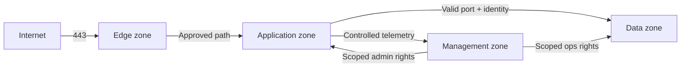

# Separating North–South and East–West Traffic in a System

## 1. Why Distinguish Between the Two Traffic Directions?

When moving an application to the cloud, merely connecting components is only a necessary condition. Architects must also understand **who is communicating with whom, which trust boundaries are crossed, what latency is required, and which parts of the system are affected when a network segment fails**. That is why network design typically separates two categories:

- **North–south traffic:** Traffic **entering or leaving a chosen system boundary**, for example an Internet user calling an API in the cloud environment, or an internal application calling an external payment gateway.
- **East–west traffic:** Traffic **between components residing inside that same boundary**, for example an API calling a cart service, a booking service accessing a database, or two workloads exchanging events.

Separation is not just for drawing clean diagrams. The two groups generally have different **control points, security policies, load balancing methods, observability needs, and failure modes**. A vulnerability at a public entry point and a vulnerability allowing lateral movement across internal services require different defenses. Conversely, placing excessive unnecessary inspection layers on every internal call can inflate latency and cost.

In the **CLOUD_ARCHITECTURE** module, this lesson guides translating business requirements into **networking, compute, data, and deployment model** choices while balancing **security, reliability, performance, scalability, cost, and operations** in the Well-Architected spirit.

**Running example:** A booking platform has web/mobile clients, an API, a search service, a booking service, a database, a queue, a monitoring system, and a third-party payment gateway. The system must let customers book safely, keep search available when a downstream dependency is slow, and allow operations to diagnose incidents.

## 2. Define the Boundary Properly Before Naming Flows

These two terms **do not describe geographic directions** and do not inherently say whether packets are HTTP, TCP, or UDP. They depend on the **boundary under consideration**: a data center, cloud account, VPC/VNet, Kubernetes cluster, trust zone, or single application.

| Flow | If the boundary is the application environment inside a VPC/VNet | Common classification |
| --- | --- | --- |
| Internet browser → public load balancer → API | Crosses from outside to inside | North–south, **ingress** |
| API → payment service on the Internet | Crosses from inside to outside | North–south, **egress** |
| API → database over private address | Two internal components communicating | East–west |
| Search service → internal cache | Two internal components communicating | East–west |
| API in VPC A → service in VPC B of same org | Crosses VPC boundary, yet inside the enterprise system | Can be called inter-VPC east–west at the whole-system level; boundary-crossing if evaluating VPC A alone |
| Cloud app → private datacenter via VPN/private link | Crosses cloud/on-premises boundary | Usually north–south per environment; may be viewed as inter-site internal flow in overall architecture |
| Pod A → Pod B in the same Kubernetes cluster | Communication between cluster-internal workloads | East–west |

**Important convention:** on every diagram or flow table, explicitly state **which boundary is used for classification**. Do not argue over labels without agreeing on the architectural scope. A connection between two VPCs might be named differently when viewed at the VPC level versus the enterprise platform level, yet **its source, destination, port, path, and trust level do not change**.

### Do Not Confuse with Other Concept Pairs

- **Ingress/egress** emphasize the direction **into/out of** a boundary. Both are common cases of north–south traffic.
- **Public/private subnets** describe routing design and network reachability. Labeling something private does not by itself create a complete security policy.
- **Control plane/data plane:** The control plane manages configuration and state; the data plane forwards/enforces traffic. Both can generate north–south or east–west traffic depending on the boundary.
- **L4/L7:** TCP/UDP or application-protocol inspection layers; these describe **how traffic is processed**, not traffic direction names.

## 3. Seeing Both Flows on One Architecture Diagram

~~~mermaid
flowchart TB
    USER["Web / mobile users"]
    PAY["External payment gateway"]

    subgraph CLOUD["Application boundary in the cloud"]
        EDGE["Public DNS / CDN / WAF"]
        LB["Public Load Balancer / API Gateway"]
        WEB["Web / API"]
        SEARCH["Search Service"]
        BOOK["Booking Service"]
        DB[("Private Database")]
        Q[("Message Queue")]
        EGRESS["Egress Proxy / NAT / Firewall"]
        EDGE --> LB
        LB --> WEB
        WEB --> SEARCH
        WEB --> BOOK
        SEARCH --> DB
        BOOK --> DB
        BOOK --> Q
        BOOK --> EGRESS
    end

    USER -->|"North–south: HTTPS ingress"| EDGE
    EGRESS -->|"North–south: HTTPS egress"| PAY
~~~

In the diagram, connections from the API to Search, Booking, the database, and the queue are **east–west** relative to the drawn cloud environment boundary. Connections from clients inbound and from Booking to the external payment gateway are **north–south**. The return path of a connection does not turn it into a different flow type; distinguish the **session initiator** from reply packets belonging to that session.

This diagram is a logical model only. In a real system, there may be an out-of-account CDN, multiple availability zones, private load balancers, private DNS, identity systems, and managed services living outside subnets managed by the app team. You must also draw components that materially affect routing, access control, and fault tolerance.

## 4. Designing Inbound North–South Traffic (Ingress)

Flows from external users to the application must specify the **public receiver, control chain, application routing, and path to non-public backends**.

~~~text
Internet Client
  -> Public DNS
  -> CDN / DDoS protection layer if needed
  -> WAF (for suitable HTTP flows)
  -> Public L7 load balancer / API gateway
  -> Internal web / API service
  -> Downstream business services
~~~

Components may be combined, reordered, or omitted depending on the service and needs. For example, a load balancer can integrate a WAF; a CDN can be the first TLS termination point; an API Gateway can directly act as the traffic-receiving layer. Not every application needs every device in this chain.

### 4.1. Identify Valid Entry Points

For each public API, answer:

1. Which **hostnames, paths, methods, and protocols** must be served from the Internet?
2. Where is TLS terminated? Does the segment **from proxy to backend** also need TLS and internal authentication?
3. What enforces **authentication and authorization**? A WAF helps filter a subset of HTTP attack patterns, but does not replace authentication or business permission checks.
4. Are there rate limits by IP, account, session, or API key? What abuse protections are needed?
5. Do backends need public addresses? If not, keep backends in networks that accept no direct Internet connections.
6. When backends fail, how do health checks and routing behave? Could an app bug trigger a region-wide outage?

**Attack-surface reduction principle:** expose **only genuinely necessary entry points**. Databases, message brokers, administrative services, and metrics ports generally should not have Internet endpoints. Administrator access should go through authenticated, logged, role-restricted channels.

### 4.2. Role of Load Balancers and API Gateways

| Component | Best suited for | Do not assume by default |
| --- | --- | --- |
| **L4 load balancer** | Distributing TCP/UDP connections while preserving protocol traits and transport performance | Understanding all HTTP authorization rules |
| **L7 load balancer / reverse proxy** | Host/path routing, TLS, health checks, basic HTTP controls | Performing full authentication, authorization, and business logic |
| **API gateway** | API policies: token validation, client quotas, routing, versioning, logging, occasional request transforms | Automatically securing every internal service and app logic |
| **WAF** | Filtering HTTP requests against relevant rules/risk signatures | Replacing multi-layer DDoS protection, IAM, vulnerability patching, or data access controls |
| **CDN** | Caching/distributing content, lowering RTT for distributed users | Safely caching every response containing personal data or transaction state |

For example, a **booking confirmation** request typically requires authentication, order-ownership authorization, idempotency protection against retries, and transactional backend updates. A CDN/WAF/API gateway can offload traffic and filter inputs, but cannot replace these backend checks.

### 4.3. Trusting Client IP Addresses Properly

When passing through a CDN, reverse proxy, or load balancer, backends may see the proxy's IP instead of the original client IP. Headers like X-Forwarded-For are trustworthy only when **generated/normalized by a proxy under the organization's control**, and when the app accepts them strictly from valid proxy sources. Trusting raw headers sent by Internet clients can break rate limiting, auditing, or IP-based authorization.

## 5. Designing Outbound North–South Traffic (Egress)

Applications need external access to call payment gateways, send emails, download patches, invoke partner APIs, or reach identity services. **Outbound flows also require control**, as they can serve as data exfiltration channels and major sources of cost and external dependency.

### 5.1. Three Common Egress Patterns

| Egress approach | Characteristics | Things to verify |
| --- | --- | --- |
| Direct public IP on workload | Simple in some setups, yet expands workload network exposure | IAM, firewalls, blocking unintended inbound, IP rotation, and observability |
| NAT gateway/NAT instance | Lets private-IP workloads initiate outbound connections using a translated source IP | **NAT does not inspect app payloads or enforce FQDN allowlists on its own**; still needs routing, firewalls, and policies |
| Dedicated egress proxy/firewall | Centralizes destination controls, identity, filtering, and logging | Throughput capacity, TLS, HA, privacy, latency, cost, and becoming a shared failure point |

**NAT and firewalls have distinct jobs.** NAT translates addresses/ports for traversing flows. An outbound connection can still reach unwanted targets if you deploy NAT without proper egress policies. Conversely, blocking all egress can break DNS, NTP, partner API calls, or patch retrieval.

### 5.2. Categorizing Destinations and Scoping Required Flows

- **Partner services:** Document FQDNs/APIs, protocols/ports, auth requirements, timeouts, retry rules, permitted outbound data, and contract owners.
- **Cloud managed services:** Prefer private endpoints when suitable and supported; check connection types, policies, and costs. A private endpoint does not eliminate the need for IAM, TLS, or policies.
- **System/CI updates:** Identify image/package sources, registries, patch repositories, and mirroring solutions if needed.
- **Logging/telemetry:** Document log/trace shipping paths and data classification to avoid accidentally sending customer info to unapproved collectors.

**Domain-based egress allowlists** require checking tool/appliance enforcement capabilities: network-layer cloud firewalls may only support IPs/CIDRs; domains may resolve to dynamic IPs or sit behind CDNs; SNI/HTTP-host filtering has limitations with TLS and DNS. Never write a domain rule on paper and assume every firewall supports it.

### 5.3. Designing for Unresponsive Partners

In a booking platform, the payment API may slow down or return ambiguous results. Behaviors to specify clearly include:

1. Reasonable timeouts aligned with the **end-to-end journey latency budget**, never letting calls hang indefinitely.
2. Bounded retries with backoff/jitter; never automatically retry non-safe transactions without idempotency/reconciliation mechanisms.
3. Recording intermediate states and reconciling when a request was sent without receiving a clear response.
4. Distinguishing egress connectivity errors, DNS errors, TLS errors, partner 4xx/5xx responses, and business logic errors.
5. Prioritizing keeping independent journeys (such as search) operational when the payment partner suffers an outage.

Egress control is therefore both a networking problem and a direct driver of application workflow reliability.

## 6. Designing East–West Traffic Between Services

Internal traffic must not be trusted by default just because it uses private addresses. If one workload is compromised, permissive east–west connectivity enables **lateral movement** toward databases, queues, or management services.

The goal is to **permit legitimate workflows, curb lateral movement, protect data, and maintain appropriate latency**.

### 6.1. Build a Communication Matrix Before Writing Rules

Example traffic matrix for the booking platform:

| Source | Destination | Illustrative protocol/port | Purpose | Permitted conditions |
| --- | --- | --- | --- | --- |
| Public LB | Web/API | HTTPS :443 or chosen backend port | Forward Internet requests past edge layer | Accept only from authorized LB/proxy layer |
| Web/API | Search Service | TCP :8080 over HTTP/gRPC as suited | Room search | Service-to-service auth, bounded timeouts |
| Web/API | Booking Service | TCP :8443 | Submit booking requests | Clear identity/authZ, tracing, and safe retries |
| Booking Service | Booking DB | TCP :5432 (e.g., PostgreSQL) | Read/write transactions | Only Booking service account/role and approved ops team |
| Booking Service | Message Broker | Actual broker port | Publish confirmation events | Permission to publish only to target topic/queue |
| Search Service | Cache | TCP :6379 if using Redis accordingly | Read acceleration | Only Search authorized; cache non-public |
| Booking Service | Egress Proxy | Approved proxy port | Call external payment | Egress restricted to permitted partners |
| Services | DNS, telemetry, identity | Environment-specific port/protocol | Name resolution, logs/traces, auth | Verified list of platform dependencies |

Ports and services in the table are **illustrative**, not mandatory defaults. In real deployments, verify TLS, ports, sources/destinations, auth methods, IPs or identity labels, and multi-environment behavior.

### 6.2. Segmenting the Network by Trust Zone

An organization may divide into:

- **Edge zone:** Contains only permitted public entry points such as load balancers, proxies, or ingress.
- **Application zone:** Application workloads, accepting no direct Internet connections unless required.
- **Data zone:** Databases, brokers, caches, and sensitive stores; accepting connections only from authorized apps and management channels.
- **Management/observability zone:** Admin channels, logging, monitoring, and deployment control.

A desired flow model:

Enforce **default-deny policies where suitable**, opening only required connections. Depending on the platform, use security groups, NSGs, distributed firewalls, Kubernetes network policies, service meshes, or workload-identity policies.

Do not assume a security group, ACL, and network policy behave identically: some are **stateful**, some **stateless**, some evaluate network-layer rules, and others identify workloads at the application layer. Verify traffic direction, return rules, inheritance, and rule evaluation order on the specific platform.

### 6.3. Network Segmentation and Service Identity Complement Each Other

Network blocking reduces reachable surface area. **Service identity and application authorization** decide whether a connected service may perform a specific action. For example:

- Security policies may let Booking Service open TCP to the DB, yet Booking's DB account should only hold permissions on needed schemas/tables.
- Proper TLS/mTLS protects and authenticates service-to-service connections; you still need action-level authorization and certificate lifecycle management.
- Service-level rate limits/bulkheads contain resource consumption if one caller sends excessive requests.
- Access logs, trace IDs, and app-layer audits answer **who performed which operation**, which IP/port flow logs cannot deduce on their own.

**Zero trust** here means never trusting services implicitly merely for sharing a VPC. Verify identity, access policy, and security posture proportionate to risk; it does not mean routing every internal call through a single central gateway that adds latency.

## 7. Choosing Controls by Network Layer and Platform

| Mechanism | Where applied | Primary effect | Limitations to understand |
| --- | --- | --- | --- |
| Route table | VPC/VNet, subnet, inter-network links | Defines next hop/reachable prefixes | Does not authenticate identity or authorize access |
| Security group/NSG/firewall | Workload, NIC, subnet, or network | Permits/blocks by address, port, protocol, and supported objects | Usually unaware of business semantics |
| Network ACL | Subnet or supported network boundary | Additional filtering layer | Must verify stateful/stateless behavior and return traffic |
| Private endpoint/service endpoint | Connection to managed services | Enables private-path flows where supported | Does not replace authorization, encryption, or data scoping |
| Kubernetes NetworkPolicy | Pods within namespace/cluster | Restricts pod ingress/egress by selectors and supported IP blocks | Effective only if the CNI enforces it; not equivalent to L7 policy |
| Service mesh/mTLS | Inter-workload traffic | Service identity, internal encryption, some L7 routing/controls | Adds proxy/control plane, cost, and operational complexity |
| API Gateway / ingress controller | API or cluster entry point | Routing, HTTP auth/policies per product | Does not automatically block internal paths bypassing the gateway |
| Flow logs + tracing | Traffic/application observability | Diagnoses paths, rejected connections, journey latency | Flow logs do not replace business logs; traces may miss blocked packets |

### Kubernetes Example: Restricting API Pods to Accept Traffic Only from Web Pods

The snippet below **illustrates a NetworkPolicy** on a cluster whose CNI enforces policies. Placed in namespace booking, API pods have label app: api and web pods have label app: web:

~~~yaml
apiVersion: networking.k8s.io/v1
kind: NetworkPolicy
metadata:
  name: api-default-deny
  namespace: booking
spec:
  podSelector:
    matchLabels:
      app: api
  policyTypes:
    - Ingress
    - Egress
---
apiVersion: networking.k8s.io/v1
kind: NetworkPolicy
metadata:
  name: api-allow-web
  namespace: booking
spec:
  podSelector:
    matchLabels:
      app: api
  policyTypes:
    - Ingress
  ingress:
    - from:
        - podSelector:
            matchLabels:
              app: web
      ports:
        - protocol: TCP
          port: 8080
~~~

**Explanation:** the first rule selects API pods and isolates both ingress and egress. The second rule lets web pods **within the same namespace** call port 8080 on API pods. Policies applying to the same pod combine additively under NetworkPolicy rules. This snippet is **not a complete production configuration**: API egress to DNS, identity, DB, queues, telemetry, and approved dependencies is currently blocked and requires matching policies. Verify actual ports, CNI behavior, selectors, and traffic behavior to managed services outside the cluster.

This example also shows that **allowing ingress to the API does not automatically allow the API to make egress calls**. Separating both directions is a clean way to control one side of east–west communication.

## 8. Packet Paths, Latency, and the Trap of Centralizing Every Flow

Network design must examine the **actual packet path**, not just confirm that endpoints exist. For each flow, account for hops through reverse proxies, load balancers, NAT, firewalls, private links, service mesh sidecars, and cross-zone links.

### 8.1. Latency Budget Example

Suppose processing a booking request happens sequentially:

| Segment | Illustrative time |
| --- | ---: |
| Edge and public LB | 20 ms |
| Web/API processing and calling Booking | 25 ms |
| Booking DB read/write | 45 ms |
| Calling payment dependency | 180 ms |
| Returning response and other overhead | 30 ms |
| **Total in one illustrative trace** | **300 ms** |

These are **hypothetical numbers for a single trace**, not a sum of percentiles. Never add each component's p95 and call the result end-to-end p95: latency distributions and call correlations must be measured directly from live requests or representative tests.

If every API ↔ DB connection is forced through a centralized firewall in another zone, east–west traffic incurs extra RTT, data transfer fees, and a central failure point. In a **hub-and-spoke** topology, the hub is useful for shared connectivity and centralized controls; however, not all spoke-internal communication needs to traverse the hub. Balance **centralized control** against **short paths, availability, cost, and throughput**.

### 8.2. Do Not Overlook Network Path Costs

Costs can accrue from load balancers, NAT gateways, Internet egress data, cross-zone/region transfers, private endpoints, dedicated firewalls, dedicated interconnects, and network log volume. Pricing varies by cloud and configuration; never assume "private traffic is free".

When evaluating an option, quantify **bytes, connection counts, request rates, source/destination locations, traffic direction, hop counts, and growth forecasts**. Use real workload profiles to decide which flows warrant passing through costly gateways/firewalls and which should stay on optimized internal paths.

## 9. Network Boundaries, Availability Zones, and Hybrid Cloud

From a reliability standpoint, north–south and east–west boundaries also relate to **failure blast radius**:

- **Multiple availability zones:** An API in zone A may call a DB/instance in zone B. Within the app boundary this remains internal communication, yet you must weigh latency, inter-zone transfer fees, and fault tolerance.
- **Multiple VPCs/VNets:** Private links between networks still require non-overlapping CIDRs, policies on both ends, DNS, and observability. Having a route does not mean policy allows traffic.
- **Hybrid cloud/on-premises:** Use VPN or dedicated private links as required; specify which data crosses, who owns DNS/identity, backup bandwidth, and behavior when the link drops.
- **Multi-region:** Applications must decide which state replicates, how users fail over across regions, RPO/RTO, and failover authorization policies. Avoid letting a distant synchronous dependency become a blocking failure point for the whole journey.

For example, placing web/API in the cloud while every search query calls a database in an on-premises datacenter can turn **cross-environment north–south traffic** into a bottleneck on every request. If the business tolerates slight update lag, a read index or cache near search can cut link crossings. In return, define the **source of truth, acceptable freshness, replication permissions, and desync handling**.

## 10. Designing Security Around Paths and Checkpoints

Before applying firewall rules, run a **data-flow threat modeling** exercise:

1. **Assets:** Customer data, payment state, credentials, app secrets, management systems.
2. **Threat actors and entry points:** Internet, partners, hijacked accounts, compromised internal workloads, CI/CD pipelines, or admin connections.
3. **Trust boundaries:** Internet ↔ edge, edge ↔ app, app ↔ data, cloud ↔ third parties/on-premises.
4. **Controls:** TLS, authentication, authorization, segmentation, input validation, mTLS where suited, data IAM, rate limits, audits.
5. **Incident response:** Can a single flow be temporarily blocked or a service isolated while keeping independent journeys running?

### External Controls and Internal Controls Have Different Purposes

| Threat | Primary control point | Evidence |
| --- | --- | --- |
| Invalid client calls public API | Edge, WAF/rate limit, API authentication and authorization | Send invalid requests, verify 401/403/429 and audit logs |
| Backend accessed directly, bypassing edge | Security policies, private routing, endpoint config | Scan from public Internet and inspect routes/SGs |
| Compromised service moves laterally to another DB | Segmentation, workload identity, DB credentials and schema permissions | Test denied connections across trust zones |
| Data exfiltrated externally without authorization | Egress allowlist/proxy, IAM, data controls, and logging | Test blocked egress targets and audit transferred data |
| Attacker sniffs/tampers with internal traffic | Transport encryption, endpoint verification, certificate lifecycle | Verify TLS/mTLS and invalid-certificate rejection |
| Network link disrupted | Timeouts, circuit breakers, queues, standby zones | Chaos test/link-loss simulation and verify app behavior |

Never put every resource behind a reverse proxy and assume protecting the reverse proxy is enough. If an internal service retains alternate access paths or overly broad DB rights, a compromise in one workload can spread.

## 11. Observing and Verifying Each Traffic Type's Path

Network diagrams must be validated against real observations. Good observability distinguishes the **network layer, application layer, and business layer**:

| Telemetry source | Best suited to answer | Limitations |
| --- | --- | --- |
| Load balancer / gateway logs | Which client hit which route, status, edge latency | Misses downstream internal calls without tracing |
| Flow logs, firewall logs | IP/port/protocol, accept/deny, traffic between zones and workloads | Cannot alone prove which business user triggered an action |
| DNS/proxy logs | Which endpoints were resolved/called, DNS failures or egress blocks | Must weigh privacy, log retention, and dynamic IP churn |
| Distributed traces | Service-to-service call paths, per-span latency, logic bottlenecks | May omit packets dropped before a span starts |
| Application/DB audit logs | Business identity, data operations, transaction states | Must protect PII, secrets, and log access |
| System metrics | Error rate, saturation, connection pools, queue depth, throughput | Normal CPU metrics do not prove user journeys succeed |

An illustrative metric set should cover:

- **North–south ingress:** Valid request rate, 4xx/5xx by cause, end-to-end p95/p99, connection counts, rate-limit/WAF drops, TLS errors, per-route distribution.
- **North–south egress:** Request rate per third party, DNS/connect/TLS timeouts, retry rates, HTTP errors, NAT or proxy volume/cost.
- **East–west:** RPC success rate, timeouts, connection resets, DB saturation, queue backlog, flows blocked by firewall/network policy, cross-zone throughput.
- **Resilience:** Time to detect faults, time to isolate, partial availability during partner/segment outages, failover outcomes, and transaction reconciliation.

When diagnosing “API is slow”, ask **where in the path is it slow?**. If the LB shows low latency while traces reveal a dependency call to service B taking 2 seconds, tuning the CDN alone will not fix the root cause. If traces show no call reaching B and flow logs show rejected connections, check routes/policies/DNS before rewriting app logic.

## 12. Actionable Design and Verification Workflow

~~~mermaid
flowchart TD
    A["Define user journeys, SLOs, and data types"]
    A --> B["Map trust boundaries and inventory flows"]
    B --> C["Classify ingress, egress, and east–west"]
    C --> D["Build source-dest-port-identity matrix"]
    D --> E["Select routing, LB, NAT/proxy, segmentation"]
    E --> F["Deploy via IaC and test policies"]
    F --> G["Load test, fault test, security test"]
    G --> H["Observe in production, write ADRs, and refine"]
    H --> B
~~~

### Minimum Test Suite

| Scenario | Expected verification |
| --- | --- |
| Internet client calls API via intended path | DNS, TLS, edge routing, and auth work; p95 meets target under defined load |
| Client attempts direct call to private database/backend | Denied at network or appropriate checkpoint, with evidence |
| Unauthorized service calls DB or another service | Connection/authorization rejected per matrix; legitimate flows unaffected |
| Application calls payment partner | Uses approved egress path and policy; logs, timeouts, and safe reconciliation verified |
| Payment partner loses connectivity | Search journey stays up; bookings enter clear error/pending state |
| A zone, VPN link, or egress proxy fails | Predictable failover/degradation behavior; RTO/RPO measured if applicable |
| Multi-fold traffic surge during campaign | Check LB, NAT ports/capacity, DNS, connection pools, DB, and cross-zone costs |

**Do not test only the happy path.** An architecture can pass load testing under normal conditions yet collapse when a pod, subnet, zone, or link drops. Test results should record configuration, load level, duration, region, and scope limits.

## 13. Practice Exercise: Separating Flows in a Booking System

**Prompt:** A company wants to deploy a booking website to the cloud. External clients connect over HTTPS; the API calls search and booking services; the booking service updates PostgreSQL and publishes events to a broker; payment requests go to an off-cloud provider. Search must stay available when the payment gateway is slow. The database must not be reachable directly from the Internet.

### Tasks

1. **Draw a boundary diagram** of the application and label/color-code ingress, egress, and east–west flows. Clearly show DNS, public LB/gateway, private workloads, database, and egress.
2. **Build a matrix of at least eight flows:** source, destination, protocol/port, data exchanged, identity, allow policy, and owner.
3. **Design the entry point:** Identify public components, TLS termination, authentication, rate limiting, and backend routing; explain how direct backend access is blocked.
4. **Design egress:** Which third-party targets are allowed, which NAT or proxy is used, how errors/load are monitored, and how the system degrades when the partner is disrupted.
5. **Design east–west:** At least three trust zones; specify blocked connections and how blocks are tested. Also state corresponding service/DB auth mechanisms.
6. **Test one failure scenario:** Loss of payment egress, a compromised service, or loss of cross-zone connectivity. State latency/availability targets and measurable verification data.
7. **Estimate costs:** List load balancers, NAT/proxies, cross-zone/region transfer, private endpoints, and network logs if used; propose how to measure actual spend.
8. **Write a short ADR:** Pick one network option, list rejected alternatives, weigh security–performance–reliability–cost trade-offs, and state review triggers.

### Submission Table Template

| ID | Direction per chosen boundary | Source → Destination | Routing/control mechanism | Acceptance evidence |
| --- | --- | --- | --- | --- |
| F-01 | North–south ingress | Client → public API | DNS, TLS, WAF/LB, auth | Valid API calls succeed; unauthorized requests rejected |
| F-02 | East–west | API → Booking | Private routing + identity/allow policy | Only valid API allowed to call |
| F-03 | East–west | Booking → DB | Private connection + DB role | External clients and unauthorized services cannot connect |
| F-04 | North–south egress | Booking → Payment provider | Approved egress path and timeouts | On partner failure, safe state/reconciliation works |

**Pass criteria:** Each component sends/receives only required flows; evidence covers permissions, latency, traffic, errors, and cost; public ingress/egress and internal east–west paths are verified independently; disruption scenarios do not trigger cascading failures beyond agreed targets.

## 14. Well-Architected Architecture Review Checklist

- [ ] A system boundary is defined to classify north–south vs. east–west, with a complete source–destination diagram.
- [ ] Only necessary endpoints are exposed publicly; backends and sensitive data are protected by network and authorization layers.
- [ ] Ingress has TLS, authentication, authorization, routing, abuse protection, and monitoring suited to risk.
- [ ] Egress is controlled by destination/business need; NAT is not treated as a firewall; partner failures are handled.
- [ ] East–west matrix specifies ports, identities, data, owners, and verification methods for every flow.
- [ ] Dependencies such as DNS, identity, logging, NTP, and image/patch registries are accounted for when applying default-deny.
- [ ] Lateral movement risk if a single workload is compromised has been assessed.
- [ ] Actual semantics of security groups/NSGs, ACLs, Kubernetes policies, and service meshes (if used) are verified.
- [ ] End-to-end journey p95/p99 is measured rather than inferred from single-component latency or health checks.
- [ ] Routing, latency, single points of failure, and data transfer costs across hubs, zones, regions, or hybrid links are evaluated.
- [ ] Service loss, link loss, misconfigured policy blocks, peak load, and recovery have been tested and results recorded.
- [ ] Operational, security, and change-management ownership is assigned, and an ADR documents the network choices.

Properly separating north–south and east–west traffic helps architects **place the right controls in the right spots**: protecting system entry/exit points, containing blast radius among internal services, and keeping paths and costs aligned. Separation delivers value only when tied to business requirements, actual network configurations, observability metrics, and failure testing.
