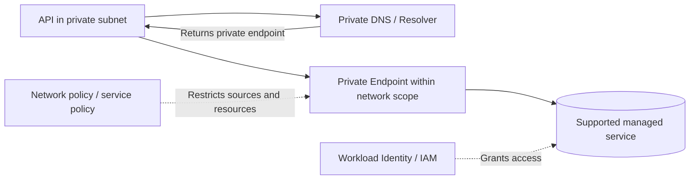
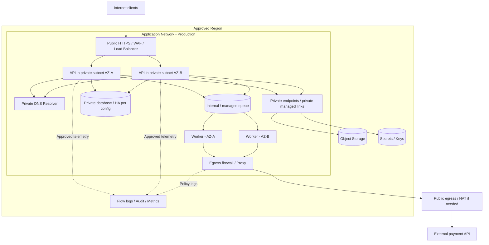

# Private Endpoints, Internal Services, and Egress Control

## 1. The Architectural Problem: Sufficient Connectivity, Minimal Unnecessary Paths

A cloud application may accept requests from the Internet, yet that does not mean every backend component needs a public address or unrestricted outbound Internet access. For example, a booking system has a customer-facing API, a database holding personal data, an object store for documents, and a worker calling a payment gateway. Opening public network paths on every resource widens the attack surface and increases the risk of accidental data leakage; conversely, blocking all connections without auditing dependencies can stop the app from reading secrets, pulling container images, or authenticating users.

In the **Network Architecture** chapter of the **CLOUD_ARCHITECTURE** module, this lesson focuses on three tightly coupled decisions:

1. **Private endpoints:** Allow workloads to access a managed or published service over a private path per platform capabilities.
2. **Internal services:** Place APIs, databases, queues, admin tools, or shared services behind controlled access boundaries.
3. **Egress control:** Define where workloads may initiate outbound connections, via which path, using which identity, and how outbound traffic is observed or restricted.

The goal is to turn business requirements into **networking, compute, data, and deployment model** choices while accounting for **reliability, security, scalability, cost, and operations** under **Well-Architected** principles.

After this lesson, you will be able to distinguish public/private endpoints, design internal service connectivity, build network flow matrices, combine DNS–routing–firewalls–identity for egress control, and verify architectures with live tests.

## 2. Distinguishing Traffic Flows and Network Boundaries

Before picking a cloud product, classify traffic:

| Flow group | Meaning | Examples | Questions to answer |
|---|---|---|---|
| **Ingress** | Traffic entering the app from external clients/systems | Customer → HTTPS load balancer → API | Which public points are mandatory? Where are TLS, WAF, auth, and rate limits? |
| **East-west** | Traffic between workloads/services inside the controlled boundary | API → database, API → queue, worker → internal API | Which sources may call which targets? Are they segmented by environment/team? |
| **Egress** | Connections initiated by workloads **going outside** the network or trust boundary | Worker → payment API, API → SaaS service | Is the Internet needed? How are unapproved targets blocked? |
| **Control/management plane** | Exchanges for configuration, identity, deployment, operations | Node → registry, workload → token/secret service, agent → telemetry | Which network do control endpoints traverse? Does blocking egress break operations? |

A connection to a managed service **can leave the subnet while remaining on a private path**, or traverse an endpoint provisioned inside the VPC/VNet. Therefore, distinguish **Internet egress** from **traffic to services outside the subnet/VPC**; never equate every outbound connection with public Internet access.

For example, the flow **Internet → public load balancer → private API** is a standard pattern: the API receives requests via the load balancer without requiring public IPs on API instances/containers. When the API calls the database, traffic stays entirely within the private network under scoped permissions.

## 3. What Is a Private Endpoint, and What Problem Does It Solve?

A **private endpoint** generally provides an access point to a service using a private address/link inside the consumer's network, rather than requiring workloads to hit a public endpoint over the Internet. Names and implementations differ across providers: e.g., **AWS PrivateLink/interface VPC endpoint**, **Azure Private Endpoint**, or **Google Cloud Private Service Connect**. Supported services and features vary; do not treat them as an identical API or networking model across clouds.

Common goals include:

- Reducing reliance on public IPs and Internet egress for connections to supported services.
- Creating a connection boundary from a controlled subnet/VPC/VNet, paired with IAM and service policies.
- Simplifying rule enforcement for service callers, especially when workloads live in private subnets.
- For certain services, providing private access from other connected networks (VPN/dedicated links, peering/transit), depending on routing and DNS capabilities.

However, **having a private endpoint does not mean the service has become completely private**. A managed service may still keep its public endpoint active; you must explicitly configure it to disable or restrict public access if required. Nor does a private endpoint replace **IAM, data access permissions, TLS, encryption, logging, or data-exfiltration controls**.

### 3.1. Distinguishing Commonly Confused Mechanisms

| Mechanism | Typical access path | When appropriate | Limitations to verify |
|---|---|---|---|
| **Public service endpoint + TLS/IAM** | Workload calls public service name, possibly via NAT/egress | Normal workloads when security and policy allow | Public path must be secured; control source, target, permissions, and egress |
| **Private endpoint / private service connection** | Connects to service via a platform-supported private access point | Accessing managed databases, secrets, storage, or privately exposed services | Region/zone scope, DNS, quotas, cost, and public endpoint state vary by product |
| **Service endpoint / private API access** | Provider-managed subnet routing and identity mechanism to services | Accessing certain cloud services without workload public IPs | **Does not necessarily assign a private IP to the service**; differs from private endpoints on many platforms |
| **Gateway endpoint / route-based endpoint** | Dedicated route from VPC to supported services | Services with native platform routing integration | Applies only to select services; DNS/policy behavior differs from interface endpoints |
| **Internal load balancer / private ingress** | Internal clients hit the app's private IP/DNS | Exposing internal APIs across subnets/VPCs/shared teams | Needs network reachability, IAM/mTLS where suited, health checks, and HA |
| **NAT gateway / outbound proxy** | Workload initiates connections to external targets via an intermediary | Services needing public APIs or package downloads | NAT only translates addresses/egress; **does not provide app-level destination filtering on its own** |

An important example: on some platforms, a **service endpoint** lets a subnet reach a service over cloud backbone routes and subnet policies, yet the service's IP remains public. Never diagram or describe every service endpoint as a NIC/private IP inside the subnet.

### 3.2. Path When an App Calls a Managed Service via Private Endpoint

Logical model:

**Explanation:** the application uses the service name, DNS resolution returns the corresponding private address/path per config, network policies permit the connection, and the service verifies identity and permissions. All four pieces must work together; provisioning an endpoint without DNS, routes, or IAM still causes requests to fail or take unintended paths.

## 4. DNS: The Component Deciding Which Endpoint Clients Actually Call

Many private-endpoint failures happen at **name resolution**, not inside the endpoint itself. Applications normally call hostnames so TLS validates certificates and avoids hardcoding fixed IPs. When enabling a private endpoint, understand how the service name resolves from every network.

### 4.1. Verification Steps

1. **Canonical name (FQDN):** Does the application use the hostname supported by the service for private access?
2. **Private DNS zone:** Is the private zone/record or private DNS mechanism properly linked to the VPC/VNet?
3. **Query from the right vantage point:** Answers returned to cloud workloads, CI runners, VPN clients, and on-prem can differ. Verify every caller side.
4. **DNS forwarding:** If using self-managed or hybrid DNS, do conditional forwarders and resolvers support private service names?
5. **TLS and SNI:** Never swap the service name for an arbitrary IP if that breaks certificate verification. Preserve certificate/hostname validation per the supported service model.
6. **Endpoint lifecycle:** Track endpoint changes, IPs, records, TTLs, and cache behavior across failovers/redeploys.

Illustrative example: an API calls `storage.example.invalid`. Inside the production network, DNS is configured to return the private IP of the access point. On a machine outside private DNS scope, the same name may return a different answer or fail to resolve. **Names and IPs are illustrative only; follow the actual DNS conventions of your cloud service.**

### 4.2. Common Mistakes

- Endpoint created successfully, yet private DNS is unlinked from the VPC so clients still resolve the public endpoint.
- Staging uses a different resolver than production, causing tests to pass in one place and fail in the other.
- On-prem-to-cloud routing works, yet on-prem DNS lacks forwarding for private names; clients receive public IPs.
- Manually creating DNS records overlapping provider-managed zones and breaking access to other services.
- Treating a single private endpoint/IP as a single point of failure without checking the service's AZ/region resilience.

**Test DNS directly from the runtime** (pod, container, VM, or job) instead of inferring from a personal laptop. If egress controls depend on internal DNS, the DNS resolver must have HA, monitoring, and policies blocking unapproved resolvers where feasible.

## 5. Organizing Internal Services

An **internal service** is meant exclusively for authorized clients within scope—for instance `inventory-api`, databases, worker admin APIs, or event processors. “Internal” is defined by **access policies and trust boundaries**, not merely by holding an RFC 1918 IP.

### 5.1. Common Connectivity Patterns

| Pattern | How published | What to protect |
|---|---|---|
| Same VPC/VNet | Internal load balancer, service discovery, private DNS; direct links if suitable | Ingress only from permitted workloads, service auth, network segmentation |
| Across VPCs/VNets | Peering/transit/hub-and-spoke or platform-supported private service publishing | Avoid flat networks, IP overlaps, unintended route propagation, cross-env access |
| On-prem to cloud | VPN or dedicated private interconnect, hybrid routing and DNS | Bidirectional routes, IP overlaps, TLS, identity, link fault tolerance |
| Across product teams/tenants | API gateway/private service exposure and per-consumer policies | Never expose the provider's entire network to consumers; quotas, audits, API contracts |

Inside a Kubernetes cluster, a **ClusterIP Service** is normally routable only within the cluster; if external-network clients need it, add a proper exposure mechanism, network policy, and auth. Never assume ClusterIP is reachable from the whole VPC/on-prem without extra infrastructure.

### 5.2. Do Not Turn a Private Network into an Implicitly Trusted Network

Placing a service behind an internal load balancer or private endpoint only shrinks who can reach it; if a workload is compromised, attackers can still call whatever that workload can reach. Combine:

- **Network:** Security groups/firewalls/network policies scoping exact sources and ports; separate subnets and environments.
- **Identity:** Workload identity, IAM, mTLS, or app authentication as needed; roles may only execute necessary business actions.
- **Data:** Encryption in transit and at rest, data classification, resource access policies, backup protection.
- **Observability:** Access logs, network flow logs, audits, anomaly alerts, and distributed tracing across services.

If using a service mesh, document where mTLS and policies are enforced (proxy vs. app), how certificates rotate, and behavior if the control plane becomes unavailable. Adding a mesh makes sense only if the team can operate it and the problem genuinely warrants it.

## 6. Controlling Outbound Internet and External Services

A workload inside a **private subnet** without a direct public IP can still reach the Internet via NAT, proxies, firewalls, or a shared egress gateway. Therefore, claiming “the API is in a private subnet so it cannot call the Internet” is usually false unless you inspect **route tables, gateways, policies, and IPv4/IPv6 flows**.

### 6.1. Choosing an Egress Strategy Based on Need

| Strategy | How it operates | Pros | Risks/trade-offs |
|---|---|---|---|
| **No outbound Internet path** | No Internet routes/paths; use private links for mandatory dependencies | Minimizes attack surface and accidental data exfiltration | Many dependencies (registries, updates, identity, telemetry) may need redesign |
| **NAT/gateway for outbound** | Private workloads exit via NAT service address/path | Simple when public access is needed; workloads need no public IPs | NAT does not filter URLs/FQDNs by default; gateway and transfer fees |
| **Egress firewall** | Outbound traffic forced through policy-enforcing, logging device/service | Filters via supported rules, auditing, centralized governance | Cost, throughput, failover, rule maintenance, potential failure point |
| **HTTP(S) proxy/secure web gateway** | Apps route through a proxy to permitted targets | Destination/domain policies and request logging per platform | Some workloads ignore proxies; must block direct bypass paths |
| **Private endpoint for supported services** | Private path to a managed/producer service | Cuts NAT/public egress need for that path | Requires DNS, policies, per-region endpoints, and applicable fees |

**A NAT gateway is not an application firewall:** NAT translates addresses/ports for outbound flows, but cannot guarantee callers only contact approved payment domains. Likewise, a DNS allowlist only governs name resolution; if routes and firewalls still permit direct connections to arbitrary IPs, that policy can be bypassed.

### 6.2. Workflow for Designing an Egress Policy

1. **Inventory permitted destinations by function:** e.g., payment APIs, identity providers, email providers, container registries, secret managers, telemetry, and OS updates.
2. **Classify paths:** Which destinations support private endpoints, private links, or native endpoints; which strictly require HTTPS over the Internet.
3. **Select enforcement points:** Force routes through firewalls/proxies where required; pair source–dest–port rules, identity/service policies, and subnet restrictions.
4. **Design allowlists:** Record FQDNs/domains, ports, protocols, and URLs/paths if tooling supports them; account for IP churn behind CDNs/load balancers. Static-IP rules only work when providers guarantee IP ranges and you have an update process.
5. **Default-deny within enforceable scope:** Open only approved targets; test both allowed and denied cases. Provide time-bound exception workflows for ad-hoc needs.
6. **Observe and operate:** Flow logs, proxy logs, DNS logs per policy, blocked-traffic alerts, and rule-change audits. Keep sensitive content out of logs unless authorized.
7. **Test fault tolerance:** Test losing a gateway/firewall/proxy/DNS instance or AZ; verify backup routes and peak-load performance.

### 6.3. Easy-to-Miss Details

**IPv6:** If subnets or workloads have IPv6, a policy governing only IPv4 NAT misses outbound IPv6 paths. Verify IPv6 routes, matching firewalls, and gateway types; never assume IPv4 NAT covers IPv6.

**DNS and encrypted traffic:** FQDN filtering often relies on DNS, TLS SNI, or proxy inspection capabilities; not every tool can read URLs/paths inside HTTPS. If using TLS inspection, assess impacts on certificate trust, privacy, performance, and apps using certificate pinning.

**Operational dependencies:** Nodes/pods may need registries, time services, token services, KMS, log ingestion, package repositories, or cloud control APIs. Blocking all outbound without including these dependencies in the flow matrix can break deployments, autoscaling, or workload startup.

**Bypass paths:** If a workload still holds a public IP, secondary route, or alternate gateway outside the main firewall/proxy, traffic can bypass egress policies. Reconcile routes, policies, network ACLs/security rules, and live flow logs rather than trusting high-level diagrams alone.

## 7. Reference Architecture: Private API, Private Data, and Controlled Egress

Suppose a booking service has a public website/API, PostgreSQL holding customer data, object storage for documents, a secrets manager, a notification queue, and a worker calling an external payment gateway. Illustrative requirements:

- Only the web/API entry point is exposed to the Internet. Databases, queues, secrets, and buckets must not accept direct Internet access outside approved boundaries.
- The API runs across two AZs in one region; evaluate single-AZ fault tolerance.
- Managed services with private endpoints are preferred; availability and location support must be verified.
- Workers may call only the approved payment gateway; no arbitrary outbound web uploads are needed.
- The team needs sufficient logs to debug network errors, alerts, and policy change workflows within a bounded operational budget.

### 7.1. Architecture-Level Flow Diagram

**This diagram is a conceptual model, not a default cloud topology.** The actual roles and placement of DNS resolvers, WAF/load balancers, endpoints, queues, and databases must match the chosen services. The label “private” on a DB box **does not guarantee the database has built-in HA**; verify backups/failover, AZs, connectivity, and security independently. Likewise, the firewall/proxy and NAT may be one combined service or reside in a hub network rather than two appliances wired in series.

### 7.2. Sample Network Flow Matrix

| ID | Source | Destination | Purpose, protocol | Permit / restriction mechanism |
|---|---|---|---|---|
| F-01 | Internet client | Public entry | HTTPS 443 to API | TLS, WAF/rate limit, application auth |
| F-02 | Public entry | API private replicas | HTTPS or LB-supported protocol | Ingress strictly from LB; health checks from valid sources |
| F-03 | Booking API | Private PostgreSQL | TLS/TCP to **configured** DB port | Network allowlist from API, DB identity, least-privilege SQL |
| F-04 | Booking API | Object Storage via private endpoint | Storage API over HTTPS | Regional endpoint/DNS, IAM scoped to exact bucket/prefix, public access policy |
| F-05 | Booking API/worker | Secret service via private endpoint | Read secrets over HTTPS | Dedicated workload role, audit, secret rotation |
| F-06 | Booking API | Queue | Publish booking events | Publish-only identity, bounded retries |
| F-07 | Worker | Queue | Consume events | Consume identity, DLQ, idempotency |
| F-08 | Worker | Public payment API | HTTPS 443 via egress policy | Approved FQDNs/targets only, timeouts, metadata logs, rate limits |
| F-09 | Workload | Required DNS / telemetry | DNS queries, ship logs/metrics | Approved resolvers/endpoints only, log retention |
| F-10 | CI/CD runner | Control-plane/deploy endpoint | Deploy app, images, IaC | Dedicated deploy identity; scoped environments and permissions |

Protocol/port values in the table are **examples to verify**. For instance, PostgreSQL commonly uses TCP 5432, though ports can be customized; never hardcode ports without checking the environment. The matrix should also track **owner**, data classification, approval status, connectivity test evidence, and review date.

### 7.3. Processing Sequence for a Booking Transaction

1. Client hits the public entry over HTTPS; ingress forwards the request to an API replica in a private subnet.
2. API authenticates the user and reads connection info from the secrets manager using workload identity over a private endpoint where supported.
3. API connects to PostgreSQL over the restricted internal path; write privileges cover only required business data.
4. API publishes a confirmation event to the queue; workers process asynchronously with deduplication across retries.
5. If payment is needed, the worker exits via controlled egress to the partner's exact API over HTTPS.
6. Logs/metrics/traces record success/failure and policy checkpoints without dumping tokens, personal data, or sensitive payloads indiscriminately.

Private paths to storage/secrets **do not eliminate the need for payment-partner egress**. Each flow is designed and verified independently per business requirements.

## 8. Security Factors to Verify

Designs relying solely on private endpoints or firewalls are incomplete without additional layers:

| Layer | Minimum check | Signs of an inadequate design |
|---|---|---|
| **Public surface** | Which resources hold public endpoints; are unneeded ones disabled/restricted? | Storage/DB still accepts Internet traffic from any source |
| **Network policy** | Do security groups, routes, firewalls, and endpoint policies restrict exact source–dest–port? | Dev API can reach prod DB; every subnet can call every service |
| **IAM and data** | Per-workload roles, bucket/secret/DB permissions, encryption, and backups? | One service's token can read every secret or bucket in the org |
| **DNS** | Do private FQDNs resolve properly, with bypasses prevented? | Hostnames return unexpected public IPs; unmanaged resolvers allowed |
| **Egress policy** | Allowlists for mandatory targets, unapproved targets blocked, IPv6 controlled? | NAT reaches everywhere; proxies can be bypassed |
| **Application** | SSRF checks, URL inputs, redirects, tokens, webhooks; proper TLS validation? | API fetches arbitrary user-supplied URLs with high network privilege |
| **Monitoring** | Flow logs, audits, anomaly alerts, and traceability? | Unable to tell who called which destination after an incident |

**Data exfiltration defense** must span multiple layers. Egress filtering curbs unwanted paths but cannot prove data cannot leak: data can still exit via an allowed endpoint if application/IAM policies are flawed. Inbound data channels like webhooks, proxies, or API gateways also need authentication and payload validation.

## 9. Reliability, Performance, and Cost as Controls Increase

A private endpoint or egress gateway can sit directly in the **serving critical path**. Evaluate:

- **AZ outages:** Should endpoints, resolvers, firewalls/NAT/proxies, load balancers, and workers be multi-AZ? Multi-AZ compute sharing a single-AZ egress gateway can lose partner calls when that AZ fails.
- **Service/region outages:** Private endpoints do not create multi-region DR on their own; verify DNS, replication, permissions, and regional routing in the standby region.
- **Load and throughput:** Endpoints/network appliances have connection/bandwidth caps, NATs have port/connection limits, and firewalls/proxies add processing latency. Test against peak load and retry storms during downstream outages.
- **Failure behavior:** When egress targets or DNS are blocked, apps need timeouts, backoff, circuit breakers where suited, queues, and clear error messages; avoid tight retry loops that jam the network.
- **Cost:** Some private endpoints bill by uptime hour and/or GB processed, egress gateways/NAT/firewalls/proxies add separate charges, plus cross-AZ, logging, and Internet transfer fees. Pricing varies by provider, region, and service.
- **Operations:** Allowlist policies shift whenever partners change FQDNs/IPs; assign owners and test procedures so stale rules do not cause outages.

### 9.1. Comparing Choices When Optimizing Cost

| Choice | Potentially suitable when | Trade-offs to accept |
|---|---|---|
| Managed service via private endpoint | Sensitive data, curbing public egress, service supported, budget permits | Managing DNS, endpoints, IAM, link fees, and resilience |
| Managed service via public HTTPS + tight IAM | Service lacks private endpoint or risk appetite allows | Must tightly govern public access, egress paths, and policies |
| Egress via a single NAT | Few destination-filtering needs; dev/test or risk assessment permits | Does not automatically enforce FQDN destination allowlists |
| Egress via policy firewall/proxy | Compliance mandates target restrictions, audits, and central governance | Added cost, complexity, HA demands, and runbooks |

No single option is universally optimal. If the business requires “every outbound Internet connection must be allowlisted and audited”, **deploying NAT alone** fails the requirement. If the requirement is “DB never exposed publicly”, **blocking API outbound alone** is also insufficient; configure the DB itself and inbound paths.

## 10. Repeatable Design and Verification Workflow

### Step 1 — Gather Requirements and Classify Data

List users, APIs, databases, queues, object storage, secret managers, on-prem systems, third-party services, and control-plane flows. Tag personal data, payment data, approved storage regions, and traceability needs.

### Step 2 — Diagram Current and Target Paths

Separate at least three views: **ingress**, **east-west/private service access**, and **egress**. Label environments, accounts/projects, VPCs/VNets, subnets, regions/AZs, DNS, routing, firewalls/endpoints, and external services. Every arrow needs direction and a functional label.

### Step 3 — Choose Private Connectivity Where Appropriate

Verify whether services support private endpoints, endpoint policies, private DNS, and access from required networks. Confirm public paths can be disabled/restricted, along with costs and zone/region constraints. For internal APIs, assess internal LBs, service discovery, shared networks, or service-publishing mechanisms.

### Step 4 — Build a Matrix-Backed Egress Policy

For each permitted public target, confirm owner, hostname/IP, port/protocol, data types transferred, frequency, and logging needs. Route traffic through appropriate enforcement points; pair network rules with IAM and app auth. Account for IPv6, secondary exit paths, and DNS/control-plane needs.

### Step 5 — Codify Configurations in IaC and Change Control

Manage networks, DNS zones/links, endpoints, routes, firewall rules, IAM policies, tags, and logging as code wherever supported. Separate state/permissions across dev, test, staging, and prod. Require peer review and rollback plans for rule changes; never open `0.0.0.0/0` permanently just to troubleshoot a temporary error.

### Step 6 — Run Evidence-Based Acceptance Tests

| Test scenario | Action | Expected result |
|---|---|---|
| **Private DNS** | Resolve service FQDN from workloads in every subnet and hybrid network needing access | Resolves to the designed private path without falling back to public endpoint |
| **Private service access** | Call storage/secrets from API using valid workload identity | Succeeds over approved path; zero public Internet needed for that flow if supported |
| **Unauthorized identity** | Call the same service using an unprivileged identity | Denied by IAM/service policy even though network is reachable |
| **Public bypass** | Attempt calling public path when policy mandates private-only | Blocked by policy; no alternate route crosses the boundary |
| **Valid Internet target** | Call approved partner sandbox from worker | Succeeds, TLS validates cleanly, metadata logged |
| **Unapproved Internet target** | Call an illustrative hostname not on the allowlist | Blocked; logs identify source, rule, and reason |
| **AZ / gateway loss** | Simulate losing one AZ or egress path in a test environment | Traffic shifts or degrades cleanly within agreed SLO/RTO |
| **Load surge** | Test connection counts, throughput, timeouts, and logs at peak load | No NAT/firewall/proxy/endpoint saturation; cost and limits measured |

Do not hit live partner production systems during fault-injection drills; use sandboxes or approved test endpoints. Pre-define **pass criteria**, observers, rollback plans, and blast-radius limits.

### Step 7 — Monitor Continuously

Track rejected connections per app, DNS changes, endpoint/NAT spend, egress throughput, timeout failures, security audits, private endpoint status, and expiring exception rules. When onboarding new services or regions, update the network matrix and ADRs instead of quietly adding wildcard allow rules.

## 11. Sample ADR: Private Endpoints for Data and Partner Egress Filtering

> **ADR-NET-007 — Private service access and centralized-policy egress.**
>
> **Context:** The Booking API handles customer data; storage and secrets need no Internet access; workers must call one public payment API. The team wants to prevent unintended paths and maintain audit evidence.
>
> **Proposed decision:** Deploy APIs/workers in private subnets across required AZs; use private endpoints for storage/secrets where supported; restrict the database solely to authorized workloads; route worker Internet connections through egress policies permitting only approved destinations. Keep a separate public HTTPS entry for customers.
>
> **Rationale:** Shrinks public surface on data tiers, constrains outbound paths to actual business needs, and centralizes network change observability.
>
> **Trade-offs:** Adds private DNS, endpoint policy, firewall/proxy governance, DNS/egress availability dependencies, and operational/data-transfer costs.
>
> **Approval conditions:** Verified service/region support, tested DNS and TLS, proven wrong-identity denial, tested blocking unapproved targets, tested valid payment flow, measured peak load/HA, and forecasted costs. All exceptions carry an owner and review date.

An ADR helps readers see which requirements drove network decisions and **when to revisit them**—for example, changing payment partners, adding regions, reclassifying data, or hitting NAT/proxy saturation.

## 12. Well-Architected Evaluation

| Pillar | Key questions |
|---|---|
| **Operational Excellence** | Are networks, endpoints, DNS, and firewalls managed via IaC with drift detection? Who approves new rules and responds to DNS/egress incidents? |
| **Security** | Do DBs/storage/secrets have unneeded public paths? Do network policies and IAM scope down to exact workloads? Does egress block bypasses and unapproved targets? |
| **Reliability** | Are DNS, private endpoints, and egress gateways single points of failure? Does losing an AZ break essential service calls? |
| **Performance Efficiency** | Can endpoints/NAT/firewalls handle peak connection counts and throughput? Do proxies or cross-AZ hops add unacceptable latency? |
| **Cost Optimization** | Are hourly/per-GB endpoint fees, NAT, firewalls, logs, Internet egress, and cross-AZ charges accounted for? Are there unused endpoints? |
| **Sustainability** | Are idle network resources removed, gateways right-sized, flows consolidated sensibly, and unnecessary cross-AZ/region transfers avoided? |

### Common Misconceptions

1. **“A private subnet has no Internet access.”** Check routes, NAT/proxies, firewalls, and IPv6 before assuming.
2. **“Adding a private endpoint means the service is no longer public.”** Explicitly verify/disable public paths and restrict service-level policies.
3. **“With a private endpoint, IAM isn't needed.”** Network connectivity and data access permissions are two independent layers.
4. **“A NAT gateway is an FQDN filter.”** NAT does not enforce domain-based destination policies by itself.
5. **“Using private endpoints means we can ignore DNS.”** Bad name resolution can send requests over public paths or fail outright.
6. **“Blocking all outbound makes everything 100% secure.”** It can break deployments, identity, updates, and telemetry—and never replaces SSRF defenses or IAM.
7. **“With an egress firewall, data cannot leak.”** Data can still exfiltrate through an approved target if permissions or business validation are flawed.
8. **“The API is multi-AZ so egress is multi-AZ too.”** Egress paths, resolvers, endpoints, and dependencies must each be verified independently.

## 13. Pre-Approval Checklist for Network Architecture

- [ ] Ingress, east-west, egress, and control-plane traffic classified for every environment.
- [ ] Source–destination–protocol/port–purpose–owner matrix documented alongside matching access policies.
- [ ] Internal services have network/identity boundaries; databases, storage, and secrets have no public exposure beyond approved needs.
- [ ] For every private endpoint, service/region support, private DNS, routes, TLS, IAM, endpoint/service policies, and residual public paths are verified.
- [ ] DNS and hybrid connectivity designed if clients span multiple VPCs/VNets or on-premises.
- [ ] Essential Internet destinations use controlled egress; IPv4/IPv6 bypasses, proxies, and public IPs are audited.
- [ ] Registry, identity, KMS, telemetry, DNS, and software-update dependencies are listed so they aren't accidentally blocked.
- [ ] Single-AZ/gateway/DNS failures drilled with monitoring and runbooks; no unacceptable single points of failure remain.
- [ ] Endpoint, NAT, firewall/proxy, Internet/cross-AZ transfer, logging, and ops labor costs are estimated.
- [ ] Allowed/denied flow tests, policy audits, ADRs, and review triggers for changing requirements are documented.

**Key takeaway:** private endpoints create dedicated private paths to services, internal services constrain reachability, and egress controls govern where workloads may initiate outbound connections. They deliver real security and reliability only when **DNS, routing, network policies, IAM, data protection, and operations** are engineered as one cohesive system and proven with real-world tests.
