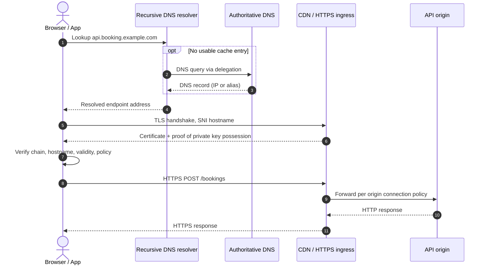
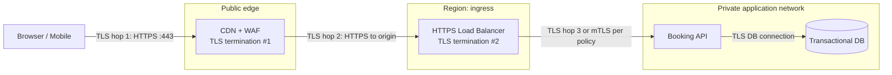
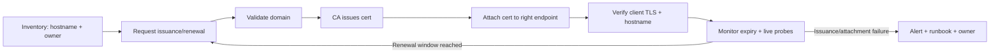
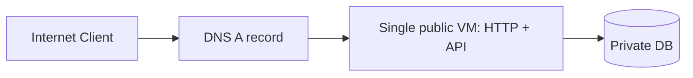

# Domain, Certificate, and TLS Termination Design

## 1. System Entry Points Are an Architectural Decision

Users typically know an address like `https://booking.example.com` rather than the IP addresses, virtual machine names, containers, or load balancers behind it. For an HTTPS request to reach the right application, the system must solve at least three things:

1. **Domains and DNS:** determine who owns the hostname and which entry point that hostname resolves to.
2. **Digital certificates:** allow clients to verify the identity of the HTTPS endpoint through an appropriate certificate and trust chain.
3. **TLS termination:** determine which component receives, decrypts, and handles the client's TLS session; whether traffic forwarded to backend services is re-encrypted and re-authenticated.

In the **CLOUD_ARCHITECTURE** module, cloud design starts from business requirements and then selects networking, compute, data, and deployment approaches. Entry points directly impact **security, reliability, performance, scalability, cost, and operations**. A single misconfigured DNS record or certificate can make the entire application unreachable even when the API and database are completely healthy.

After this lesson, you will be able to:

- Design a clear hostname hierarchy for web, API, static assets, and administration.
- Read both the DNS resolution path and the HTTPS connection path, and distinguish between the two.
- Explain the roles of certificates, the TLS handshake, SNI, trust chains, and TLS termination models.
- Choose where to place TLS termination and protect **all required data-in-transit hops**.
- Establish processes for issuing, deploying, automatically renewing, and monitoring certificates.
- Analyze DNS/TLS failures, region failover scenarios, and endpoint changes using **Well-Architected** thinking.

## 2. Running Context: A Cloud Scheduling Application

Suppose an organization deploys **BookingCloud**, an application for renting equipment by time slot. Customers access the web app, which calls the API to view availability and create orders; equipment images are distributed via a CDN; staff use a dedicated admin interface.

The following figures are **illustrative assumptions for learning design only**, not actual SLAs or benchmarks:

| ID | Requirement | Impact on Entry Points |
|---|---|---|
| F1 | Customers access the web app and book via API | Stable hostnames, accurate routing to web/API, mandatory HTTPS |
| F2 | Equipment images load fast and are cacheable | Static asset hostname, CDN, appropriate caching policy |
| F3 | Staff access the admin interface | Admin endpoint with strong authentication and policy-based access restriction |
| S1 | Contact information and rental orders must be protected | TLS, hostname/certificate verification, application-level authorization, log controls |
| R1 | Illustrative target: core API achieves 99.9% monthly availability | Monitoring DNS, certificates, edge, load balancers, health checks, and failover |
| P1 | Illustrative target: p95 lookup latency under 400 ms | Consider CDN, edge/origin placement, connection reuse, and handshake time |
| O1 | Small operations team requiring automation | Managed certificates, IaC, expiry alerts, and runbooks with clear ownership |
| C1 | Budget constraints | Weigh CDN/WAF/LB, connection, data transfer, and certificate costs against benefits |

**Proposed endpoint breakdown:**

| Example Hostname | Purpose | Logical Entry Point | Accessibility |
|---|---|---|---|
| `booking.example.com` | Web interface | CDN → web origin | Public over HTTPS |
| `api.booking.example.com` | Booking API | CDN/WAF or API gateway/LB → API | Public over HTTPS, with API auth/authorization |
| `assets.booking.example.com` | Images and static assets | CDN → object storage | Public or signed URLs depending on data |
| `admin.booking.example.com` | Administration | Dedicated ingress or shared ingress with strict policy | Authorized users only; consider identity-aware proxy, VPN/Zero Trust, MFA |

The `example.com` domain is reserved for documentation examples. In real deployments, you must use a domain controlled by your organization and review your cloud/provider-specific rules. "Hiding" an admin page behind a hard-to-guess hostname is not an access control measure.

## 3. Distinguishing Domain, Hostname, DNS, and Endpoint

| Term | Meaning | Example |
|---|---|---|
| **Registered domain** | The name registered by the organization at a registrar | `example.com` |
| **DNS zone** | Scope of records managed by an authoritative DNS server | The `example.com` zone or a delegated subzone |
| **Hostname/FQDN** | Fully qualified name used to access a service | `api.booking.example.com` |
| **DNS record** | Instructions for resolving a hostname | `CNAME`, `A`, `AAAA`, or other record types |
| **Endpoint** | Actual network/application address receiving connections | Public LB, CDN distribution, API gateway |
| **Certificate** | Credential binding domain/endpoint identity to a public key via a trust chain | Certificate for `api.booking.example.com` |
| **TLS termination** | Where the TLS session of a hop is decrypted/inspected | CDN edge, HTTPS LB, ingress gateway, or API |

Domain registration, DNS management, certificate issuance, and application hosting may be handled by **different systems**. A designated owner must coordinate them so a domain does not expire silently while the servers remain running.

### 3.1. The Name Resolution Path Is Not the Request Path

When a user opens `https://api.booking.example.com/bookings`:

1. The client or operating system queries a recursive DNS resolver, potentially using an existing cache.
2. The resolver fetches records from authoritative DNS when cached entries are no longer usable. This lookup may traverse root/TLD/delegation or use cached delegation information.
3. DNS returns the appropriate answer: the service IP, or a `CNAME` target hostname for further resolution.
4. The client connects to the resolved address and starts a TLS session while indicating the intended hostname.
5. After TLS verification succeeds, the client sends the HTTP request over the protected connection.



The diagram above **simplifies the DNS/TLS flow** and does not depict every handshake message. DNS does not "forward" HTTP requests; it only helps locate the endpoint. DNSSEC, when enabled and properly validated, provides data authentication for DNS responses; it **does not encrypt** DNS contents and does not replace TLS. DNS-over-HTTPS/TLS protects the DNS query path separately and does not by itself guarantee the HTTPS application is secure.

### 3.2. Choosing the Right DNS Record Type

| Type | Role | When to Use | Caveats |
|---|---|---|---|
| `A` / `AAAA` | Maps a name to IPv4 / IPv6 | Endpoint has a provider-confirmed stable/appropriate IP address | Do not hardcode ephemeral IPs of autoscaling instances |
| `CNAME` | Points a name to **another hostname** | Alias for a CDN/LB with a provider-assigned DNS name, typically on a subdomain | Do not use standard CNAME at a zone apex with SOA/NS; check provider ALIAS/ANAME/flattening |
| `ALIAS` / `ANAME` / flattening | DNS-provider mechanism that maps an alias to appropriate answer records | Commonly used for zone apex or managed endpoints | Not a universal standard DNS record type; varies by provider |
| `CAA` | Specifies which CAs are authorized to issue certificates for a domain | Reduces risk of unauthorized issuance when policy is configured accurately | Misconfiguration can block legitimate issuance/renewal |
| `TXT` | Stores arbitrary text; used for domain ownership verification | ACME DNS-01, domain verification, and other policies | TXT records for ACME challenges must have tightly scoped permissions and lifecycle |
| `NS` / `DS` | Authoritative DNS delegation and DNSSEC chain of trust | Zone administration or subzone delegation | Incorrect NS/DS changes can break name resolution broadly |

A **logical** configuration for our example environment:

```text
booking.example.com          CNAME  web-edge.provider.example.net
api.booking.example.com      CNAME  api-edge.provider.example.net
assets.booking.example.com   CNAME  assets-edge.provider.example.net
admin.booking.example.com    CNAME  admin-ingress.provider.example.net
```

These `provider.example.net` hostnames are also illustrative only. Actual DNS records use targets supplied by your provider. Check how your provider handles IPv6, apex records, custom domains, certificates, and aliasing before selecting a record type.

### 3.3. TTL, Caching, and Endpoint Cutovers

**TTL (Time to Live)** specifies how long a record may be cached according to DNS mechanisms. A lower TTL can help **many resolvers** pick up updates faster after a record change, but it does not mean every client switches immediately: OS caches, application caches, non-compliant resolvers, and existing open HTTPS connections still remain.

For example, ahead of a CDN migration, a team might lower TTL from 3,600 seconds to 300 seconds well in advance, wait for old caches to expire, and only then update the record. This is a procedural example, **not a guarantee that cutover completes in exactly 300 seconds**. You must keep the old endpoint running long enough to serve clients still using cached DNS/open connections, and maintain a rollback plan.

DNS failover can shift traffic **after re-resolution**, but it does not automatically recover databases, transaction state, sessions, or active connections. HA/DR architecture must address the entire data path behind the endpoint.

## 4. Where Does TLS Operate in the Request Path?

**TLS (Transport Layer Security)** is a protocol that establishes an encrypted, integrity-checked transport channel; in HTTPS, HTTP runs over TLS or an equivalent secure transport—such as HTTP/3 over QUIC with integrated TLS 1.3. Distinguish clearly between:

- **Server authentication:** the client verifies the server represents the intended hostname; the server proves possession of the matching private key.
- **Encryption and integrity:** protects data over the negotiated connection, which does not imply data is always encrypted at every intermediate machine.
- **Application authentication/authorization:** users, service accounts, and order access permissions must still be enforced at the application layer.

HTTPS does not prevent SQL injection, object-level authorization flaws, sensitive data exposure in logs, client-side malware, or compromised servers.

### 4.1. What Does a Client Check in a Certificate?

When establishing TLS to `api.booking.example.com`, a typical client checks:

1. The server certificate has a trust chain leading to a CA accepted by the client's trust store/policy.
2. **The hostname** matches an identity in the certificate, typically via **Subject Alternative Name (SAN)**, evaluated under hostname verification rules.
3. The certificate is within its validity period and satisfies applicable usage constraints/validation policies.
4. The server proves possession of the corresponding **private key** during the TLS handshake.
5. The TLS session uses a protocol version and cipher suite compliant with security policy; additional certificate status checks may apply depending on the client.

If a certificate is issued for `booking.example.com` without covering `api.booking.example.com`, clients will encounter a **hostname mismatch** error, even if both hostnames point to the same load balancer.

**SAN, wildcards, and scope:** a certificate for `*.booking.example.com` typically covers a single sub-label such as `api.booking.example.com` or `admin.booking.example.com`, but **does not** automatically cover `booking.example.com` or `deep.api.booking.example.com`. Verify that SANs cover all actual hostnames. Wildcards can simplify managing multiple endpoints but increase blast radius if the private key is compromised; per-service certificates are better suited when separation of permissions and lifecycles is needed.

### 4.2. SNI and Multiple Domains on a Single Ingress

**Server Name Indication (SNI)** is a TLS extension allowing the client to indicate the intended hostname at the start of the connection so an ingress can select the matching certificate across multiple hostnames on the same listener. The SNI hostname should be validated against the certificate and routed to the correct virtual host.

After the handshake, the server may use the HTTP `Host`/`:authority` header to route the request. Never trust these client-supplied headers unconditionally; **allowlist hostnames** to protect against host-header injection or cross-tenant misrouting. Behind a proxy, only trust `Forwarded`/`X-Forwarded-*` headers if set or overwritten by a trusted proxy according to policy. Hostname/SNI alone never substitutes for user authentication.

### 4.3. Example TLS Hops



Each arrow represents **a separate connection**. If the CDN terminates TLS and then opens a new TLS session to the LB, data is decrypted at the CDN and re-encrypted on the way to the origin: this is commonly called **TLS re-encryption**. Do not describe this as "one continuous TLS session from browser to DB."

If LB → API uses plain HTTP inside a private subnet, explicitly document it as **a segment not protected by TLS** and evaluate the threat model and policy requirements; merely residing inside a VPC **does not automatically encrypt traffic**. For sensitive data or compliance requirements, TLS on internal hops, backend certificate verification, or **mTLS** for mutual service authentication is often needed.

The CDN → LB leg must also **verify the origin certificate and target hostname**. Encryption-only modes that skip origin identity verification allow attackers or DNS misconfigurations to divert traffic to unintended endpoints. Prevent direct origin access bypassing the CDN/WAF using network/identity controls, such as restricting traffic to trusted edge sources or proper origin authentication.

## 5. Choosing Where to Terminate TLS: Three Common Models

### 5.1. Termination at CDN/Edge

Clients communicate over HTTPS with the CDN/WAF; the edge decrypts requests to perform caching, WAF inspection, routing, and rate limiting. The CDN opens a new connection to the origin—ideally over HTTPS with certificate verification and origin access controls.

**Best suited for:** public Internet applications with geographically distributed users requiring content caching and edge traffic protection.

**Trade-offs:** adds CDN and egress costs, introduces DNS/edge operational dependencies, and requires managing certificates for both public hostnames and origins. Because the edge can inspect decrypted request contents, appropriate policies are needed for sensitive data and WAF/log access.

### 5.2. Termination at HTTPS Load Balancer or API Gateway

Clients connect over HTTPS to the LB/gateway; this tier selects backends, performs health checks, optionally enforces auth/throttling depending on the service, and forwards traffic to the API over HTTP or HTTPS.

**Best suited for:** single-region systems needing managed ingress and API autoscaling without necessarily needing a CDN for every flow.

**Trade-offs:** the LB/gateway handles handshake load and adds a hop; you must define backend TLS policy, certificates, hostnames, and health routes. If a CDN sits in front, **both the edge and the LB can serve as TLS termination points for different hops**.

### 5.3. TLS Passthrough to the Application

A transport-layer load balancer forwards encrypted TLS traffic directly to the backend application/ingress; the application holds the private key/certificate and terminates TLS itself.

**Best suited for:** requirements where the application must control the TLS handshake/certificate directly or uses protocols incompatible with standard HTTP proxies.

**Trade-offs:** difficult to enforce WAF or HTTP-based routing at the passthrough tier since it cannot inspect HTTP payloads; requires distributing/rotating certs and keys across replicas carefully and handling observability elsewhere. Passthrough does not mean every tool or endpoint supports all L7 features.

| Criterion | CDN/Edge Termination | LB/API Gateway Termination | Passthrough to Application |
|---|---|---|---|
| Can inspect/process HTTP at termination point | Yes | Yes | Not at the passthrough tier |
| Where do certificates live? | Edge and typically origin | LB/gateway; backend per policy | On the terminating application/ingress |
| HTTP Caching / WAF | Convenient at edge | Depends on LB/gateway and add-on services | Must be placed at another decrypted tier or equivalent mechanism |
| Deploying certs across API replicas | Typically unnecessary for client connections | Typically unnecessary for client connections | May be required depending on termination topology |
| Operational complexity | Managing two hops (edge → origin) | Managing ingress → backend | Managing key/cert lifecycle within workloads |
| Primary risks | Origin bypass, edge caching/policy mistakes | Plaintext internal hops, spoofed proxy headers | Distributed keys, harder L7 visibility and policy enforcement |

**Selection rule:** base your choice on security/access control requirements, measured latency, operational model, and cost—do not choose simply because "deeper TLS is always more secure." An edge setup that protects both client **and** origin, paired with strict backend TLS verification and proper IAM, can be both easier to operate and compliant. Conversely, an architecture with many encrypted hops that lacks user authorization checks remains insecure.

## 6. Planning Certificates by Hostname, Trust Zone, and Lifecycle

### 6.1. Building a Certificate Inventory

Before issuing certificates, record the following fields:

| Field | Meaning | Example |
|---|---|---|
| `hostname/SAN` | Names the certificate must protect | `booking.example.com`, `api.booking.example.com` |
| `terminating service` | Where the certificate is used | CDN edge, HTTPS LB, or ingress |
| `certificate source` | Managed public CA, ACME public CA, or internal PKI | Managed certificate for CDN |
| `owner` | Team responsible for renewals and incidents | `team-platform` / `team-booking` |
| `expiry/renewal method` | Validity period, automated re-issuance, alerts | Managed rotation with 30/14/7-day alerts per policy |
| `private-key control` | Where keys are generated, stored, and scoped, or non-exportable managed certs | Secret store/HSM or provider-managed key |
| `deployment/rollback` | How to update certificates without downtime | Deploy new cert first, test, roll out incrementally |

**Protecting the private key matters more than hiding the public certificate**. Public certificates are visible to clients; private keys must be strictly access-controlled and kept out of repositories, container image layers, logs, or overly permissive config files. With managed certificates, providers can keep keys non-exportable, reducing operational burden.

### 6.2. Domain Validation and Certificate Issuance

A **CA (Certificate Authority)** verifies domain control via supported methods and issues a public certificate trusted by compatible clients. With **ACME** (the automated certificate issuance protocol), common challenge types include:

- **DNS-01:** creates a TXT record at `_acme-challenge.<domain>` as required by ACME to prove domain control. Typically required for wildcard certificates and useful when no public HTTP endpoint exists yet. Keep DNS update permissions tightly scoped and handle propagation/challenge cleanup.
- **HTTP-01:** serves a token at `http://<domain>/.well-known/acme-challenge/<token>` for CA validation over HTTP per ACME rules. Requires allowing the validation path on the appropriate port (usually port 80) without WAF, redirects, or routers blocking it prematurely.
- **Other methods:** some CAs/clients and cloud managed certificates use proprietary validation mechanisms. Follow the mechanism actually supported by your provider rather than assuming all automated certificates use ACME identically.

Public certificates for hostnames must match the **exact domain** clients call. Origin/internal certificates may be issued by a private CA if clients on that hop trust that CA and validate the hostname appropriately. Never use untrusted self-signed certificates for public browsers and instruct users to "ignore the warning."

**CAA** records can restrict which CAs are permitted to issue certificates; if you plan to use multiple CAs across edge/origin or fail over CAs during an incident, ensure your CAA policy accounts for all legitimate issuers. Avoid ad-hoc CAA edits during renewals, as doing so can block needed certificates.

### 6.3. Certificate Lifecycles Must Be Automated and Observable



Recommended workflow:

1. **Register names and owners:** hostname, environment, TLS termination point, domain ownership, CA, and on-call owner.
2. **Issue certificates:** use managed certificates or automation with domain validation, scoping DNS/secret permissions tightly.
3. **Attach to the right endpoint:** avoid mixing up staging vs. production certificates, or client-facing vs. origin certificates.
4. **Verify externally:** real clients must validate hostname, full chain, expiry, and TLS policy; check all hostnames/SNIs and standby endpoints.
5. **Renew ahead of expiry:** never wait until the last moment; use automated renewal with retries/runbooks, accounting for CA rate limits and policy updates.
6. **Monitor from two sources:** inventory/CA reporting certificate state **and** live HTTPS probes checking the certificate **actually being served** at the edge/origin. A successful renewal that fails to attach to the endpoint still causes an outage.
7. **Revoke/rotate keys during incidents:** if private key compromise is suspected, rotate the key/certificate, update endpoints, assess revocation, and check dependencies; merely renaming cert files does not remediate exposure.

Useful operational metrics: **count of hostnames without an owner**, certs nearing expiry, renewal success rate, certificate propagation time, hostname mismatch errors, and endpoints using non-standard TLS policies. Alerts at 30/14/7 days are **internal policy examples**, not universal constants across all CAs/certs.

## 7. Protecting Ingress and Commonly Overlooked Settings

### 7.1. HTTP → HTTPS, HSTS, and Cookies

- Prefer advertising `https://...` URLs directly with stable TLS. HTTP-to-HTTPS redirects can be used for appropriate requests, but **a redirect does not protect a sensitive request already transmitted over HTTP**. Never rely on redirects to let clients send credentials or personal data payloads over HTTP.
- Pick semantically appropriate redirect codes: `301`/`308` are permanent; `307`/`308` preserve the HTTP method and body per HTTP semantics. Avoid redirect loops between CDN and origin when each tier perceives the scheme differently.
- **HSTS (HTTP Strict Transport Security)** instructs browsers to strictly use HTTPS for a host after receiving a valid header over HTTPS. Only increase `max-age` and consider `includeSubDomains` or preloading once **all** relevant subdomains are HTTPS-ready with clear owners and recovery plans. Misconfigured HSTS can lock users out of subdomains still on HTTP.
- For web apps, session cookies should use `Secure`, `HttpOnly`, and appropriate `SameSite` attributes; these are defense-in-depth measures, not replacements for TLS or DNS.

### 7.2. TLS Versions, Ciphers, and Performance Characteristics

Prefer **TLS 1.3** and allow **TLS 1.2** where compatibility is needed using modern cipher configurations supported by your provider and security policy. Do not enable deprecated TLS versions just to "support every client." Audit actual client distribution before changing policies.

TLS handshakes incur round-trip and compute costs. Keep-alive connections, HTTP/2 multiplexing, HTTP/3/QUIC where appropriate, and connection reuse can reduce overhead on certain paths; actual gains must be measured via end-to-end p95/p99 latency, handshake failure rates, connection reuse, and edge→origin latency.

**TLS 1.3 early data (0-RTT)** carries replay risks inherent to the protocol. Do not allow 0-RTT to directly process **non-idempotent** requests like `POST /bookings` without robust replay protection; generally, disable or exclude early data on sensitive write paths.

### 7.3. Never Leave Bypass Paths Around the WAF

If an API is fronted by a CDN/WAF while the origin LB remains publicly reachable and accepts direct requests, callers can bypass edge rate limits and WAF rules. Implement one or more appropriate controls:

- Restrict inbound connections solely to trusted edge sources or use private connectivity where supported by the provider.
- Authenticate the origin at the service layer—such as properly managed mTLS or shared secrets—rather than relying solely on a spoofable client header.
- Reject unconfigured hostnames, enforce `Host`/`:authority` policies, and normalize proxy headers.
- Enforce business authentication/authorization at the API and test direct origin calls against a **deny** policy.

Do not assume CDN IP allowlists remain static forever: if using provider IP ranges, establish controlled updates or prefer provider-supported identity/private endpoint mechanisms.

## 8. Reliability: DNS and TLS Are Part of the Critical Path

Entry points can fail independently of the API:

| Incident | User-Facing Symptom | Diagnosis and Response |
|---|---|---|
| Domain expired or delegation changed | Name fails to resolve or points elsewhere | Registrar ownership, auto-renewal, MFA, inspect NS/DS and change history |
| Wrong / accidentally deleted DNS record | `NXDOMAIN`, wrong IP/alias, routing to wrong environment | Query authoritative DNS, inspect audit logs, restore records via IaC |
| TTL/cache causing uneven cutover | Portion of users hit old endpoint | Probe from multiple resolvers/regions, keep old endpoint live, execute planned rollback |
| Certificate expired | Browsers/SDKs reject HTTPS connection | Monitor live served cert via SNI, renew and attach new cert, investigate automation |
| Wrong SAN or incomplete chain | `hostname mismatch` / chain validation failure | Inspect cert SANs per hostname, full chain, and client trust store |
| Edge → origin TLS validation / origin error | 502/503/525/526 per provider or corresponding origin error code | Inspect origin handshake, SNI/hostname, LB health, and network policies |
| WAF blocking valid requests | 403/429, error spike after rule change | Review WAF logs, replay sample traffic, tune rate limits carefully |
| Incompatible TLS policy shift | Legacy clients fail handshake | Track TLS versions, supported client base, and phase rollouts |
| Redirect loop | Too many redirects or app unreachable | Check scheme at each hop, `X-Forwarded-Proto` from trusted proxies, and origin HTTPS config |
| Single region outage | Endpoint still resolves but origin stops serving | Verify health routing **and** DB/queue/data recovery; DNS failover alone does not ensure RTO/RPO |

### 8.1. Health Checks Should Not Merely Ask "Is Port 443 Open?"

An endpoint can complete a TLS handshake while the API has lost its database connection. Distinguish between:

- **Liveness:** is the instance running sufficiently to be considered alive?
- **Readiness:** can the instance serve real traffic, or should it be temporarily drained from the load balancer?
- **External synthetic probe:** do DNS resolution, TLS verification, and a representative request still succeed from a user's perspective?
- **Business health / SLI:** percentage of valid requests achieving business outcomes, p95 latency, auth errors, and anomalous latency.

Health checks should have minimal privileges, avoid mutating state, and avoid exposing admin endpoints publicly. Overly strict deep dependency checks can trigger cascading failures; choose readiness policies carefully and separate dependency alerting.

### 8.2. Cross-Region Failover: Decide Data Before DNS

Suppose BookingCloud must recover from a **full region outage**. DNS can be one mechanism for shifting traffic to a standby region, but you must answer:

1. Does the standby region already have valid hostnames, certificates, and TLS policies configured?
2. Is booking data replicated/recovered within the committed **RPO**? Which writer is authorized to accept reservations?
3. What happens to unprocessed outbox/queue events, idempotency keys, and committed orders?
4. Could DNS routing, health checks, and traffic cutover mechanisms induce **split-brain**?
5. What happens to clients holding existing connections or stale DNS caches when the primary goes down?
6. Have you conducted drills measuring **RTO**, failed request counts, and business correctness?

Never write "TTL is 60 seconds, so RTO is 60 seconds." TTL is only one factor; application state, data replication, open connections, failure detection, and operations all contribute to recovery time.

## 9. Safe Domain Rollouts and Cutovers

Suppose the business migrates `api.booking.example.com` ingress from an older LB to a new CDN/WAF. The process requires coordinating DNS, certificates, routing, security, and clients:

1. **Inventory:** document hostname, current DNS, owner, active cert, TTL, origin, WAF rules, health checks, dependent endpoints, and SLO/rollback thresholds.
2. **Stand up the new endpoint:** provision CDN/WAF/LB and network policies via IaC; ensure the origin accepts traffic only from authorized paths.
3. **Issue/attach certs:** validate domain ownership, attach certs matching the hostnames, test both client-facing and origin certs; verify auto-renewal.
4. **Pre-cutover testing:** use a staging environment or test routing/host override mechanisms to verify DNS/TLS/HTTP, SNI, authorization, WAF, load, and write flows. Never skip certificate verification just for a "quick test."
5. **Prepare DNS:** lower TTL sufficiently ahead of time if needed, account for resolver limits, and keep the old endpoint operational.
6. **Shift traffic gradually:** use weighted routing or CDN/DNS cutover policies if supported; monitor p95 latency, 4xx/5xx rates, TLS handshakes, cert status, WAF false positives, origin health, and booking conversion rate.
7. **Conditional rollback:** define explicit thresholds and decision-makers; keep the old endpoint and cert valid for clients using stale caches. DNS rollbacks also take time to propagate.
8. **Wrap-up:** verify logs and costs, decommission old origins/records/secrets once dependencies clear, and update diagrams, inventory, ADRs, and runbooks.

A **design-level illustration, not a deployable manifest**:

```yaml
application: booking
environment: production
endpoints:
  - hostname: booking.example.com
    purpose: public-web
    dnsTarget: web-edge.provider.example.net
    tlsTerminations: [cdn, web-origin]
    owner: team-platform
  - hostname: api.booking.example.com
    purpose: customer-api
    dnsTarget: api-edge.provider.example.net
    tlsTerminations: [cdn, origin-lb, backend-if-required]
    owner: team-booking
    requirements:
      enforceHttps: true
      validateOriginCertificate: true
      protectOriginFromBypass: true
      redactSensitiveLogs: true
  - hostname: admin.booking.example.com
    purpose: staff-console
    dnsTarget: admin-ingress.provider.example.net
    owner: team-platform
    access: authenticated-and-authorized-staff
certificateOperations:
  renewal: automated
  externalTlsProbe: enabled
  expiryAlertDays: [30, 14, 7]
```

This describes policy for cross-team alignment. Actual IaC, certificates, DNS, LB, WAF, and secret manager configurations depend on the cloud/provider. Never store private keys, CA tokens, DNS credentials, or user data in sample metadata files.

## 10. Client-Side DNS/TLS Testing and Troubleshooting

The following commands help separate **name resolution failures** from **HTTPS establishment failures**. They may require pre-installed tools and vary in syntax by OS. Replace example hostnames with real ones during practice.

```bash
# Check DNS from the active resolver (command is often pre-installed on OS)
nslookup api.booking.example.com

# If dig is available, inspect specific records and response TTL
dig api.booking.example.com A
dig api.booking.example.com CNAME

# Inspect client-side HTTP/TLS responses; verification errors must not be ignored
curl -Iv https://api.booking.example.com/

# With OpenSSL, verify SNI, trust chain, and certificate validation
openssl s_client \
  -connect api.booking.example.com:443 \
  -servername api.booking.example.com \
  -verify_return_error
```

Note that `curl -I` sends a HEAD request; a valid API might **not support HEAD on the root URL** and return 404/405. In that case, test a valid health endpoint rather than treating a 404 alone as evidence of broken TLS. `openssl s_client` is helpful for inspecting certs/handshakes, but you must still check hostname matching, full trust chain, validity dates, and actual client policies; never infer from a single "handshake succeeded" line that all checks passed.

**Rapid triage workflow:**

1. **DNS:** does the domain still exist, are NS/DS delegations intact, are authoritative records correct, and what does the client resolver return?
2. **Connectivity:** is there a route to the IP/port 443, is the load balancer/edge healthy, and are firewalls blocking anything?
3. **TLS:** are SNI, SAN, chain, expiry, TLS version, and origin certificate validation all correct?
4. **HTTP:** are hostname/routing, redirects, WAF, auth, upstream responses, and proxy headers behaving properly?
5. **Business logic:** are authentication/authorization, DB, booking states, p95 latency, and request success rates meeting targets?

Layering your triage prevents changing DNS when the real fault is an expired certificate, or swapping certificates when the API is hitting DB timeouts.

## 11. Well-Architected Review

| Pillar | Entry-Point Review Questions | Expected Evidence |
|---|---|---|
| **Operational Excellence** | Who owns domain/cert/DNS? Who gets alerted on renewal failures and is there a runbook? | Inventory, IaC, expiry alerts, change logs, renewal/rollback drills |
| **Security** | Is TLS hardened? Can the origin be bypassed? Are private keys and DNS credentials protected? | TLS scans, IAM, network policies, origin auth, WAF/audit logs, and permission tests |
| **Reliability** | What happens to users if the CA, DNS provider, edge, or AZ fails? | External probes, failover tests, scenario-scoped RTO/RPO |
| **Performance Efficiency** | How do TLS handshakes, edge→origin latency, cache hit ratio, and connection reuse affect p95? | RUM, synthetic probes, distributed traces, handshake latency, and load tests |
| **Cost Optimization** | Are CDN, WAF, LB, cross-zone/region egress, and certificate costs fully accounted for? | Billing breakdowns, cost per request, traffic/egress forecasts |
| **Sustainability** | Are there unnecessary repeated redirects/handshakes, idle edge/origin resources, or poor cache efficiency? | Connection reuse, cache metrics, load-aligned resources, and retention policies |

These perspectives align with the six pillars of the **AWS Well-Architected Framework**; the questions remain useful across provider-agnostic cloud architectures. A diagram labeled "TLS 1.3," "multi-AZ," or "managed cert" is not compliance proof; live configurations and test results confirm actual behavior.

## 12. Sample ADR: Where to Terminate TLS for a Public API

```markdown
# ADR-001: TLS termination for api.booking.example.com

Status: Proposed

## Context
BookingCloud serves a public API requiring HTTPS, WAF, and rate
limiting. A small team needs auto-renewing certificates and API
scalability. Direct origin access bypassing edge policies must be
disallowed.

## Options
A. Terminate TLS at the application; LB acts as passthrough.
B. Terminate TLS at HTTPS LB; backend TLS per policy.
C. Terminate TLS at CDN/WAF, re-encrypt HTTPS to origin LB;
   origin LB uses appropriate TLS to API.

## Proposal
Choose C for public Internet traffic if testing confirms acceptable
latency, security, and budget. Delegate public certs to a managed
certificate service; verify origin certs with exact hostname matching.

## Consequences
CDN gains HTTP inspection capability at the edge and adds another
TLS hop, billing cost, and WAF/log governance responsibilities.
Origin must restrict inbound access and manage backend certificates.

## Verification
Run multi-region HTTPS probes, test SNI/cert/expiry, test origin
bypass attempts, load test p95 and TLS handshake latency; simulate
cert renewal failure.

## Revisit When
End-user mTLS requirements, data sensitivity, traffic volume, CDN
pricing, or serving regions change.
```

This proposal is a **conditional decision**, not a blanket claim that a CDN is always better than a direct LB. An ADR should link traffic-flow diagrams, ownership tables, TLS policies, and test results before approval.

## 13. Practice Exercise: Entry-Point Design Review

A team proposes the following architecture:



The team says: "We can open port 80 and redirect to HTTPS later; install certificates manually on the VM and replace them when they expire; if the VM fails, we'll just update DNS to point to another VM. That's cheap and gives us enough HA."

Address the following scenarios:

**Exercise 1 — Hostname design.** Propose at least three hostnames for web, API, and static assets along with their corresponding ingresses. Explain how to distinguish domain/zone/hostname and when CNAME usage at the zone apex must be checked.

**Exercise 2 — Draw the accurate request path.** Diagram DNS resolution separately from the HTTPS connection, then mark **every TLS termination point** and where data is re-encrypted. If a CDN sits in front of an LB, which certificates are required at the edge, origin, and between LB–API?

**Exercise 3 — Certificate operations.** Design an inventory and renewal runbook. Suppose the `api.booking.example.com` certificate has 10 days remaining and the renewal job reports "success," yet live HTTPS probes still show the old certificate: what must be checked and who is responsible?

**Exercise 4 — Security.** Identify the risks if the origin accepts direct Internet requests, misuses `X-Forwarded-Proto`, enables HSTS `includeSubDomains` while an HTTP subdomain still exists, or enables TLS 1.3 0-RTT on order creation without replay protection.

**Exercise 5 — Reliability.** The team chooses a 60-second TTL and concludes RTO is 60 seconds. Critique this assumption; add failure tests for AZ, DNS, certificate, origin, and DB outages. When would DNS failover still fail to produce successful bookings?

**Exercise 6 — Trade-offs.** Compare CDN termination, HTTPS LB termination, and passthrough across security, p95 latency, cost, and operational load; write a conditional ADR listing at least three metrics to collect.

**Self-review hints:** a sound design never leaves certificate expiry to manual memory; never assumes private subnets encrypt traffic automatically; never treats DNS failover as a substitute for data recovery; never disables hostname verification as a "quick fix"; and never promises "clients will switch in exactly one TTL" while caches and open connections linger.

## 14. Pre-Production Checklist for Entry Points

- [ ] Every hostname has a clear owner, purpose, DNS zone, record, endpoint, and environment.
- [ ] Domain/registrar has auto-renewal, MFA, DNS/NS/DS permission scoping, and change control.
- [ ] DNS resolution path is distinguished from the HTTPS request path; every hop is explicitly documented.
- [ ] Live served certificates match hostname/SAN, full chain, and validity; automated renewal and alerts are active.
- [ ] TLS policy enforces secure versions/ciphers; SNI, HTTP protocols, and client compatibility are verified.
- [ ] Client→edge, edge→origin, LB→API, and API→DB hops have appropriate TLS/identity policies; no unintended plaintext hops are hidden.
- [ ] Origin is protected against bypass; WAF, rate limits, `Host`, and proxy headers are properly configured and tested.
- [ ] HSTS, redirects, cookie security, and 0-RTT are evaluated against app behavior to avoid breaking or exposing sensitive requests.
- [ ] DNS TTL, cutover, rollback, and standby endpoints are tested from multiple vantage points; RTO is never inferred solely from TTL.
- [ ] External TLS/DNS/HTTP synthetic probes, handshake metrics, WAF false positives, p95 latency, and API success rates are monitored.
- [ ] Runbooks exist for expired certificates, bad records, CA/edge/origin failures, and endpoint changes.
- [ ] Documentation includes ADRs, designated owners, and Well-Architected evidence rather than cloud icons alone.

Well-designed domains, certificates, and TLS termination ensure users reach the **right entry point, verify the true server identity, and communicate over properly protected channels**. To meet real-world goals, DNS/TLS decisions must align with access controls, networking, data resilience, automation, recovery testing, and system-wide cost.
