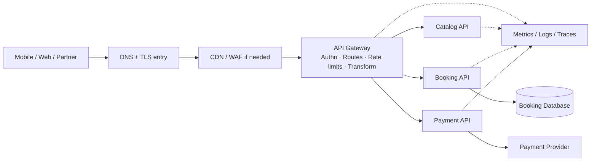
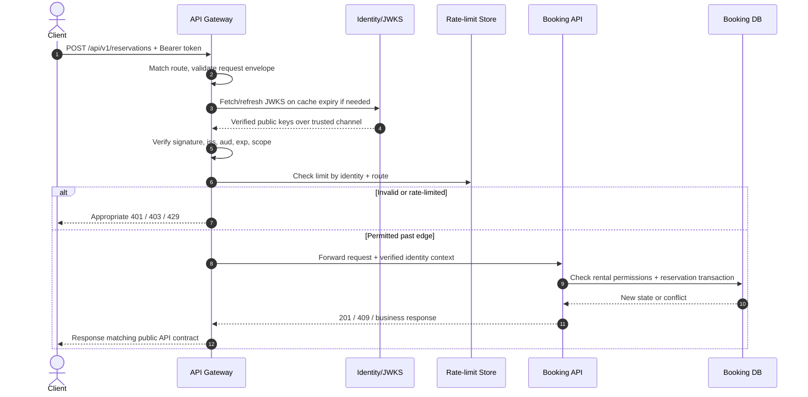
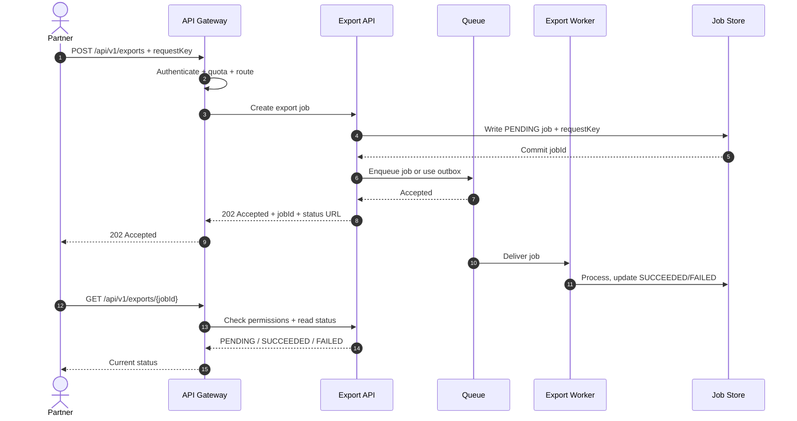
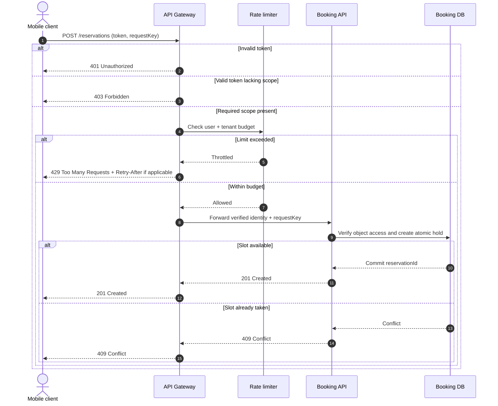

# API Gateway: Authentication, Routing, Rate Limiting, and Protocol Translation

When web, mobile, and partner applications call into a cloud system, each call needs to pass through a manageable **entry point**. That entry point must determine which API is being called, who the caller is, whether the request is permitted to proceed, whether usage limits are exceeded, and whether the target service receives requests matching its communication contract. An **API Gateway** is a component commonly used to centralize edge API capabilities and reduce duplication across multiple services.

In the **CLOUD_ARCHITECTURE** module, this topic belongs to **System Entry Points**. Gateway design starts from business requirements and traffic characteristics, driving decisions across networking, compute, data, deployment, and operations. No single gateway configuration fits every system: you must weigh trade-offs across **reliability, security, scalability, cost, and operational effort**, validating them with Well-Architected thinking.

Running example: an equipment rental platform exposes APIs to browse its catalog, reserve equipment, and pay. End users call from a mobile app; integration partners call dedicated APIs. A gateway can handle token validation, service version routing, traffic throttling, and request format translation without forcing every backend to duplicate all edge logic.

## 1. Where Does an API Gateway Sit in the Architecture?

An API Gateway is the logical entry point for **API traffic**. It receives requests, applies appropriate policies, and forwards traffic to downstream services. Distinguish a **managed API gateway** from other components that can also sit in front of applications:

| Component | Typical Responsibilities | Relationship to API Gateway |
| --- | --- | --- |
| **DNS** | Resolves domain names to endpoints | Steers clients to the entry point; does not authenticate APIs itself |
| **CDN** | Distributes/caches content near users, sometimes adding edge security | May sit in front of the gateway and offload read traffic |
| **WAF** | Filters malicious web traffic per security rules | Can be integrated or placed ahead of the gateway; never replaces business authorization |
| **Load balancer** | Distributes connections/requests across healthy backends | Can sit at the edge or behind the gateway; some support routing and TLS |
| **Reverse proxy** | Forwards HTTP, optionally rewriting, caching, or balancing load | Underlying engine of many gateways; lacks full API management by default |
| **API Gateway** | API policies: routing, authentication, quotas, transforms, versioning, telemetry | Coordinates shared edge processing before calling backends |
| **Kubernetes Ingress/Gateway** | Declaratively exposes cluster routes via controller capabilities | Can act as an API gateway, though features depend on the controller/product |
| **Service mesh** | Governs service-to-service traffic, typically internal | Complements east-west policies; does not inherently replace north-south entry points |
| **Backend service** | Executes business logic, object-level authorization, and data management | Remains ultimately responsible for business invariants and permissions |

Capabilities often **overlap**. For example, an API Gateway product may include built-in load balancing, WAF integration, or service discovery. You do not need every box in the table—choose only the components that solve real requirements.



This diagram illustrates logical flow only. Public/private subnet separation, multi-AZ layout, workload identity, WAF placement, and gateway product selection are decided once security, latency, resilience, and budget goals are known.

## 2. Four Core Capabilities

| Capability | What the Gateway Must Decide | Example | Boundary to Remember |
| --- | --- | --- | --- |
| **Authentication** | Which identity or client sent the request? Are the credentials trustworthy? | Verify user JWT; validate partner mTLS | Does not replace resource/business **authorization** |
| **Routing** | Which service, version, and region should receive a valid request? | `/api/v1/catalog` to Catalog; `/api/v1/reservations` to Booking | Correct routing does not guarantee the backend can safely handle the request |
| **Rate limits / quotas** | Who may call how frequently within a window or budget? | Partner rate limit scoped per client and API | Request throttling does not prevent double-booking or protect all resources alone |
| **Protocol / contract translation** | Must representations or transport protocols change for backends? | Public REST/JSON to backend gRPC; field/header mapping | Complex translations can lose semantics and introduce version coupling |

Beyond these four capabilities, gateways often support TLS termination, CORS, caching, validation, request/response logging, tracing, canary routing, and API lifecycle governance. Exact features vary across platforms and versions; never assume all gateways behave identically.

## 3. Designing the Request Processing Pipeline

A request typically traverses the following **conceptual** stages; actual execution order or parallelism varies by gateway:

1. Accept the connection, complete the **TLS handshake**, and apply edge controls.
2. Match virtual host, path, HTTP method, and the corresponding API policy.
3. Enforce input size/format checks, resource caps, and early filtering.
4. Validate identity, token, API key, or client certificate per route policy.
5. Check **coarse-grained authorization**, scopes, audience, and client policies; leave **object-level authorization** to the backend.
6. Enforce rate limits, quotas, concurrency controls, and request-specific guardrails.
7. Apply bounded request transformations, pick a healthy backend, and forward with an explicit timeout.
8. Receive the response, apply controlled response mapping, emit observability telemetry, and reply to the client.



**Note on JWKS:** when JWTs are validated locally using cached public keys, the gateway avoids calling the identity provider on every request. Still, key refresh, key rotation, and behavior when keys cannot be fetched must be explicitly designed. Opaque tokens requiring introspection follow a different flow.

**Note on rate limits:** the diagram shows a rate-limit store as a separate participant for clarity. Managed gateways may use internal mechanisms, and distributed limits are often approximate. Do not assume every request makes a synchronous network hop to a central counter store.

## 4. Authentication at the Gateway: Who Is Calling the API?

**Authentication (Authn)** answers *which user, application, or workload identity is calling?*; **authorization (Authz)** answers *which actions is that identity permitted to perform on which objects?*

For public APIs, common mechanisms include:

| Mechanism | Typically Suits | What to Verify | Limitations to Understand |
| --- | --- | --- | --- |
| **OAuth 2.0 JWT access token** | Mobile/web apps backed by an identity provider | Signature, allowed algorithm, issuer, audience, exp/nbf, scopes/claims | A valid JWT does not mean the user can access every reservation |
| **Opaque access token + introspection** | Systems needing live token status from the authorization server | TLS, introspection result, audience/scopes, caching, timeouts | Depends on network path and availability of the introspection service |
| **API key** | Identifying consuming apps, metering usage, binding service tiers | Valid key, active status, quota, rotation workflow | API keys usually do not represent end-user identity; insufficient Authz for sensitive data |
| **mTLS client certificate** | System-to-system or B2B partner traffic needing TLS-level client auth | Trust chain, validity, revocation/rotation, identity binding | Client cert verification does not automatically establish business permissions |
| **Session cookie** | Web apps maintaining edge sessions | Cookie flags, session validation, CSRF protection on ambient cookies | Requires care across separate frontend/API origins or multi-client apps |

With OAuth 2.0 and OpenID Connect, distinguish **access tokens for API calls** from **ID tokens for client login verification**. Never use an ID token as an access token unless explicitly specified by your protocol/issuer design. A gateway must verify tokens were minted **for its API** via audience, issuer, and scope policies.

### Proper JWT Validation

When accepting a JWT, the gateway must enforce strict rules:

1. Accept only pre-configured signing algorithms and trusted keys; never trust the token's declared `alg` header blindly to downgrade security.
2. Fetch keys from a pre-configured issuer/JWKS endpoint over a trusted connection; never fetch keys from an arbitrary URL embedded inside the token.
3. Verify **issuer (`iss`)**, **audience (`aud`)**, **expiration (`exp`)**, and related time claims, allowing only a small, bounded clock skew if needed.
4. Validate **scope/permission claims**, client ID, tenant context, or route-specific constraints.
5. Plan **revocation/rotation**. Validly signed JWTs remain accepted until expiry when permissions change; short TTLs, token introspection, or explicit revocation lists represent key trade-offs.
6. After verification, pass identity context over a protected gateway-to-backend channel; backends must never trust identity headers spoofable by clients.

### Who Checks Rental Permissions?

A gateway can block **POST /reservations** if the token lacks the **booking:create** scope. Yet when a client calls **GET /reservations/R123**, the backend must verify whether this user is permitted to read **R123**. Checking scopes only at the gateway while omitting object-level authorization lets users swap IDs to read others' records (**BOLA/IDOR**).

The right model is **defense in depth**: the gateway enforces authentication and shared edge policies; the backend enforces per-entity permissions, business conditions, data state, and field-level visibility/mutability. On sensitive routes, internal services may independently verify access tokens or validate signed assertions/identity context from a trusted gateway depending on the trust model.

### Trust Boundaries and Spoofed Headers

If a gateway passes **X-User-Id: 123** to backends, clients must never be able to send **X-User-Id: admin** and have the gateway forward it verbatim. **Strip/overwrite** inbound identity headers and reconstruct identity context strictly from verified credentials. Likewise, client IP headers such as **X-Forwarded-For** must rely on trusted proxy lists and controlled append/overwrite rules—never trust raw Internet headers as the sole basis for security rules.

Backends must be shielded from direct access bypassing the gateway whenever edge enforcement is required. Apply private networking, resource policies, workload identities, mTLS, and backend authentication. **A gateway provides no protection if backends remain public and accept unauthenticated calls.**

## 5. Routing: Sending Requests to the Right Service and Version

Gateway routing matches attributes like **host, method, path, and headers**, and occasionally version, locale, tenant, region, or client traits. Routing rules should be readable, unambiguous, safe by default, and thoroughly testable.

| Public API Rule | Logical Backend | Design Characteristics |
| --- | --- | --- |
| **GET /api/v1/equipment** | Catalog API | Eligible for GET caching per policy and data privacy |
| **GET /api/v1/equipment/{id}** | Catalog API | Handle path variables and consistent 404 responses |
| **POST /api/v1/reservations** | Booking API | Requires user identity, write throttling, idempotency |
| **GET /api/v1/reservations/{id}** | Booking API | Backend enforces reservation ownership |
| **POST /api/v1/payments/sessions** | Payment API | Conservative rate limits and duplicate-submission keys |
| **POST /webhooks/payments/provider** | Payment webhook handler | Verify provider signature; never validate webhooks with end-user JWTs |
| **GET /api/v2/equipment** | Catalog API v2 or compatibility adapter | Requires versioning policy and client migration plan |

In multi-instance cloud environments, gateways typically route to **logical service endpoints**, backed by a load balancer or service discovery selecting healthy instances. Never hardcode individual pod/VM IPs into public API configs when compute lifecycles are dynamic.

### Choosing API Versioning: Path, Host, or Header?

- **Path versioning** is explicit and easy to debug (e.g., **/api/v1/**, **/api/v2/**). Older routes must be managed through deprecation.
- **Host versioning** suits ecosystems or lifecycles needing separate domains, but adds DNS, certificate, and documentation overhead.
- **Header/media-type versioning** keeps URLs stable, yet complicates observability, caching, and debugging without strong tooling.

Choose one consistent strategy; no single versioning scheme is universally best. Versioning **never solves** breaking changes without explicit contracts, compatibility tests, and retirement plans.

### Canary and Weighted Routing

Gateways often support shifting a fraction of traffic to a new version via weights or client rules—for example, sending **5% of catalog requests** to v2 while watching error rates and latency before ramping up. Keep in mind:

- Distribution rules must stay **consistent per session/customer** if flows require sticky behavior.
- **Database schemas, idempotency, and business state** must stay compatible while both versions run concurrently.
- If an API interleaves writes and reads, randomly splitting requests between two versions can produce confusing behavior.
- When a canary fails, rolling back routing does not automatically revert data mutations already persisted.

Weighted routing is typically probabilistic or load-balancer driven, so observed splits fluctuate at low traffic. Evaluate using request counts and real metrics rather than expecting exact per-request ratios.

## 6. Limits: Rate Limits, Quotas, and Concurrency Controls

These three controls address distinct problems:

| Control | Question Answered | Example | Typical Scope |
| --- | --- | --- | --- |
| **Rate limiting** | How fast can a client send requests over a short window? | 60 requests/minute for lookup API | Token/IP/client/route |
| **Quota** | What total usage is permitted over a billing/usage period? | 50,000 requests/month on partner tier | Subscription/client/product |
| **Concurrency limit** | How many requests may execute simultaneously? | 100 active search requests | Route/backend/tenant |
| **Request size/connection cap** | How much resource may a single request/connection consume? | Max payload bytes and body read timeout | Gateway/backend |
| **Backend capacity protection** | How should load shed/smooth when downstream saturates? | Throttle on queue lag or DB saturation | End-to-end, requiring backend coordination |

Limits must derive from **service capacity, latency targets, budgets, partner contracts, and fault tolerance**, not arbitrary numbers chosen for tidy configs.

### Token Bucket and Sliding Window

A **token bucket** allows brief bursts up to bucket capacity while refilling tokens at a steady rate:

- Bucket capacity **B** caps consecutive requests accepted when full.
- Refill rate **r** tokens/second sets the sustained long-term average rate.
- Each request consumes one or more tokens per policy. If tokens run out, requests are rejected or queued depending on gateway capabilities.

Illustrative example with **B = 20** and **r = 2 tokens/second**: a client can burst up to 20 requests when the bucket is full; once depleted, sustained traffic caps near 2 requests/second. This explains the algorithm, **not a recommended rental API configuration**.

A **fixed window** counts requests per calendar interval—simple to implement, yet prone to double-bursts across window boundaries. A **sliding window** or equivalent algorithm smooths boundary spikes at the cost of slightly more state/estimation complexity.

### Which Identity Key Should Limits Target?

| Key | When to Use | Common Pitfalls |
| --- | --- | --- |
| **Source IP** | Coarse pre-auth abuse blocking at the edge alongside WAF | NAT/proxies group many users behind one IP; IP headers can be spoofed if unnormalized |
| **API key / client ID** | B2B partners and subscribed apps | Keys can be shared or leaked; requires rotation and per-API limits |
| **User ID** | Per-authenticated-user limits | Users on multiple devices; consider fairness policies |
| **Tenant / organization** | Preventing one tenant from starving shared resources | A tenant with many users/keys can exceed intended bounds if checked only per user |
| **Route + client tier** | APIs with widely differing compute costs | Must be updated as contracts and backend load evolve |

**Layered limiting** is usually needed: IP-based limits curb unauthenticated floods; client/user/tenant limits govern authenticated traffic; concurrency or queue limits protect expensive backend resources. Separate cheap read routes from payment routes with external side effects; one uniform limit either blocks valid traffic or fails to protect hotspots.

### Responding When Limits Are Exceeded

For HTTP, **429 Too Many Requests** signals rate limiting. Include **Retry-After** when a sensible retry time/interval is known; it guides clients without guaranteeing the next attempt succeeds.

```http
HTTP/1.1 429 Too Many Requests
Content-Type: application/problem+json
Retry-After: 10

{
  "type": "https://api.example.com/problems/rate-limit",
  "title": "Too many requests",
  "status": 429,
  "detail": "Please retry after the advised interval.",
  "requestId": "req-123"
}
```

This example only illustrates the contract; problem type URLs are placeholders. If exposing rate-limit metadata headers, standardize units, semantics, and client support, and avoid leaking another tenant's quota.

**429 is not 503:** 429 indicates client throttling policies, whereas **503 Service Unavailable** reflects temporary backend or infrastructure unavailability. Error mapping depends on root cause and API contracts; never turn every backend failure into 429, which masks real service outages.

### Distributed Rate Limits and Drift

When multiple gateway instances or regions serve the same client concurrently, per-instance counters can allow aggregate traffic above target. Three common designs:

1. **Local counters:** low latency and zero external dependency, but only enforce per-instance caps.
2. **Shared counter store:** tighter global consistency in some topologies, adding network latency, availability coupling, and cost.
3. **Local budget allocation / periodic sync:** reduces latency while accepting bounded drift or requiring quota reclamation.

For **commercial quotas** tied to billing, build auditable usage metering and reconciliation in an authoritative billing system—never treat a rate-limit cache as the financial source of truth. Likewise, never rely on gateway counters to guarantee "only one booking per time slot," an invariant that belongs in the business data store.

### Fail-Open vs. Fail-Closed When the Limit Store Fails

This is a **per-API risk decision**:

- **Fail-open** lets requests proceed if the limiter fails, preserving availability at the risk of downstream overload or abuse.
- **Fail-closed** rejects requests when quotas cannot be checked, limiting abuse/cost while impacting legitimate users.
- **Graceful degradation** falls back to tighter local instance limits temporarily, accompanied by alerts and automated recovery.

A public lookup API may choose differently from a payment route. Record the choice in an ADR, test limit-store outages, and track 429 rates, latency, cost, and downstream errors.

## 7. Protocol Translation and Contract Transformation

An API Gateway can expose a stable public interface while backends speak different protocols. Distinguish two concepts clearly:

- **Protocol translation:** changing transport protocols or interaction styles—such as **HTTP/JSON ↔ gRPC/Protobuf**, **HTTP ↔ WebSocket** at supported gateways, or turning an HTTP call into a queue message.
- **Message transformation:** modifying **paths, headers, queries, bodies, status codes, field names, or schemas** while both sides still speak HTTP with differing data contracts.

A gateway **does not turn an asynchronous call into a completed synchronous transaction**. When an HTTP request enqueues a job, the immediate response proves only that the system durably accepted the work per contract, not that business execution has finished.

| Transformation | Example | Benefit | Risks Requiring Design |
| --- | --- | --- | --- |
| REST/JSON → gRPC | `GET /equipment/123` invokes `Catalog.GetEquipment` | Clients avoid Protobuf; backends use internal RPC | Error/status mapping, deadlines, metadata, streaming, schema versioning |
| Public URL → internal URL | `/api/v1/catalog` → `/catalog-service/items` | Keeps public routes stable during internal refactors | Bad rewrites alter semantics or query encoding |
| Header/claim mapping | Validated token → verified identity metadata | Eliminates repeated identity parsing | Header spoofing, lost tenant context, token leaks in logs |
| Body/field mapping | Public JSON fields → internal contract fields | Shields backend structure | Dropped fields, validation mismatch, backward compatibility |
| HTTP → async queue | `POST /exports` → enqueue job → `202` | Absorbs slow work, avoids HTTP timeouts | Needs job ID, durability, polling/webhooks, deduplication |
| HTTP → WebSocket upgrade | Client opens realtime channel to backend | Bidirectional persistent messaging | Idle timeouts, connection quotas, load balancing, connection auth |
| HTTP → GraphQL gateway | Client queries a federated graph | Aggregation and unified contract | N+1 queries, query depth/cost limits, field-level authz |

**Not every API Gateway supports all translations.** REST-to-gRPC transcoding typically requires Protobuf descriptors or a dedicated proxy/adapter. Keep gateway translations simple, auditable, and observable; place complex business orchestration in backend services or a dedicated BFF.

### REST/JSON to gRPC: Preserving Semantics

Public API example:

```http
GET /api/v1/equipment/eq-123 HTTP/1.1
Host: api.example.com
Authorization: Bearer <access-token>
Accept: application/json
```

Logical backend gRPC service definition:

```proto
syntax = "proto3";

package rental.catalog.v1;

service CatalogService {
  rpc GetEquipment(GetEquipmentRequest) returns (GetEquipmentResponse);
}

message GetEquipmentRequest {
  string equipment_id = 1;
}

message GetEquipmentResponse {
  string equipment_id = 1;
  string display_name = 2;
  bool available_for_listing = 3;
}
```

The gateway/adapter maps **equipment_id = eq-123** into the gRPC request and serializes the Protobuf reply to JSON per the public contract. Still, you must explicitly specify:

- **Errors:** should gRPC `NOT_FOUND` map to HTTP 404 or an application-specific payload? Never turn `INTERNAL` into 404 and hide faults.
- **Deadlines:** how do HTTP timeouts propagate to gRPC deadlines so upstreams stop working once the client disconnects?
- **Metadata:** how are authorization context, correlation IDs, and traces forwarded without leaking tokens into logs?
- **Streaming:** streaming RPCs do not map cleanly to finite JSON responses without altering semantics and resource usage.
- **Versioning:** added or renamed fields must preserve backward compatibility under published contracts.

Some providers offer **automatic transcoding** from annotations or API specs; others require custom adapters or functions. Verify native support, payload caps, and error handling before committing to the design.

### HTTP to Queue: Why Return 202?

Suppose a periodic report generation endpoint takes several minutes:



Here **202** indicates the request has been accepted for **deferred processing**, not that the report is complete. If the API writes the job record and loses connection to the queue, an outbox/retry pattern is needed so jobs do not get stuck silently. Backends must also authorize **read access to `jobId` status**, even when the gateway already verified the token. Gateway throttling limits abuse, yet the job store and workers still require resource quotas and concurrency caps.

### Transformations Should Reduce Coupling, Not Create Duplicate Business Logic

Appropriate gateway transformations include **URL rewrites, header normalization, simple field mapping, envelope validation, or correlation ID injection**. Rules like "how long VIP users may hold equipment," "which orders qualify for refunds," or "who owns a time slot" belong in business services with proper data and transaction models.

Putting excessive transformation logic in the gateway creates real pain: hard-to-test and version configs; small edits impacting many APIs; accidental sensitive data logging; and validation drift between gateway and backend. If you find yourself writing multi-step workflows inside the gateway, introduce a **Backend For Frontend (BFF)** or dedicated adapter service that is easy to test and monitor.

## 8. Managing Gateway Configuration as Versioned Policy

Manage API Gateways using **Infrastructure as Code / configuration as code**, with code reviews, environment isolation, automated tests, and rollback capability.

The example below is **conceptual YAML, not deployment syntax for AWS, Azure, Google Cloud, or any specific gateway product**:

```yaml
gateway:
  host: api.example.com
  tls:
    required: true
  routes:
    - id: public-equipment-v1
      methods: [GET]
      path: /api/v1/equipment/**
      upstream: catalog-service
      auth:
        mode: optional
      limits:
        key: trusted-client-ip
        algorithm: token-bucket
        capacity: 60
        refillPerSecond: 2
      cache:
        enabled: true
        varyBy: public-representation

    - id: create-reservation-v1
      methods: [POST]
      path: /api/v1/reservations
      upstream: booking-service
      auth:
        mode: jwt
        issuer: https://identity.example.com/
        audience: rental-api
        requiredScopes: [booking:create]
      limits:
        key: verified-user-plus-tenant
        algorithm: token-bucket
        capacity: 10
        refillPerSecond: 0.2
      request:
        requireIdempotencyKey: true
        maxBodyBytes: 32768

    - id: partner-export-v1
      methods: [POST]
      path: /partners/v1/exports
      upstream: export-api
      auth:
        mode: mtls-and-client-credential
      limits:
        key: verified-partner-id
        maxConcurrent: 5
        monthlyQuota: 50000
      timeoutSeconds: 10
```

Values and URLs above illustrate policy concepts only, **not recommended defaults**. Identifiers like **trusted-client-ip**, **verified-user-plus-tenant**, or **mtls-and-client-credential** represent policy intent rather than guaranteed provider flags. **Requiring an idempotency key at the gateway does not guarantee idempotency** unless the Booking API persists keys and performs conditional updates.

Before deploying, verify:

- Every route has an **owner** and contract: which API, scopes, consumers, and environment.
- No unintended wildcard routes exist; unmatched routes default to deny.
- TLS/certificates, secret references, key rotation, and API protections are configured properly.
- Staging and production share security principles while tuning load/risk parameters.
- Changes undergo **diff/review**, route/auth/limit/transform tests, and canary rollout or rollback readiness.
- The gateway itself has adequate quotas, HA, logging, alerts, capacity, and disaster recovery.

## 9. Optimizing Entry Points Without Undermining Reliability

Because the API Gateway sits on nearly every request path, it centralizes policy enforcement while also potentially **expanding blast radius** during incidents.

### High Availability and Failure Modes

| Incident | Potential Impact | Controls to Consider |
| --- | --- | --- |
| Single gateway instance fails | Subset of requests time out or drop | Multi-instance/multi-zone, health checks, connection draining, platform autoscaling |
| Bad route configuration | One or more APIs fail despite healthy backends | IaC review, route tests, config canaries, fast rollback |
| Identity provider / JWKS unavailable | New tokens or rotated keys cannot be validated | Cache JWKS with safe TTL/rotation; enforce fail-secure auth; alert on auth errors |
| Shared rate-limit store fails | Rate-limited routes may degrade or block | Risk-based fail-open/fail-closed policy, bounded fallbacks, prevent gateway hangs |
| Slow backend | Gateway queues and connections pile up | Deadlines, circuit breaking, connection limits, backpressure, controlled autoscaling |
| Gateway / region outage | Multiple public APIs lose external ingress | Multi-AZ/multi-region design per SLO, backup routing, failover drills |
| Bad global security policy | Legitimate clients blocked or access widened inadvertently | Policy testing, staged rollouts, config audits, audited emergency rollback |

**HA is more than running multiple instances.** If all instances share one corrupted config store, one saturated dependency, or push a bad policy simultaneously, outages still cascade. Evaluate both the **control plane** (config management) and **data plane** (request handling); how managed gateways decouple them varies by provider and SLA.

### Gateway Caching: When Does It Help?

Public, slowly changing read routes can use CDN or gateway caching to lower latency, backend load, and cost. Always check:

- **Cache keys** include host/path/query and headers that genuinely alter representations.
- **Personal data** or identity/tenant-dependent responses are never served across users.
- **TTL and invalidation** match freshness needs; caches are never the source of truth for booking permissions.
- **HTTP Cache-Control, Vary, ETag** interactions with CDN/browser caches; know which tier holds each copy.
- **Backend failures:** may stale data be served? If so, clients must understand staleness bounds.

For **GET /equipment**, public caching works well if payloads contain only generic catalog descriptions. For **GET /reservations/{id}** containing customer details, use private caching or disable shared caching per contract. For **POST /reservations**, caching is inappropriate to protect transaction invariants.

## 10. Defense-in-Depth for Gateways and Backends

Public APIs face abuse, credential theft, malicious payloads, and misconfigurations. A well-architected gateway combines:

1. **TLS** on client-facing connections and backend legs commensurate with risk; manage certificates, cipher/protocol policies, and renewals.
2. **Authentication** before granting access to sensitive routes; reject invalid issuers, audiences, expirations, or signatures.
3. **Multi-layer authorization:** gateway checks routes/scopes/client policies; backends check per-object, field, and transaction permissions.
4. **Rate/size/concurrency limits** scoped per client and backend, including unauthenticated public routes.
5. **Schema/content-type validation** where applicable; never forward arbitrary unvalidated payloads to trusted backends.
6. **WAF and DDoS protection** where required; remember WAFs do not catch every application-layer attack.
7. **Backend network and identity isolation:** block direct bypasses around the gateway; enforce least privilege and mTLS or request signing where needed.
8. **Log hygiene:** redact tokens, cookies, API keys, payment details, and PII; restrict log access and retention per data classification.

### CORS Is Neither Authentication Nor Authorization

**CORS** is a browser-enforced mechanism controlling whether cross-origin JavaScript can read responses. It does not protect APIs from server-side scripts, mobile apps, or `curl`, nor does it prove caller identity. A valid **Access-Control-Allow-Origin** header **never replaces** access token verification and business authorization.

If the app relies on ambient cookies, implement CSRF protections alongside `SameSite`, `Secure`, `HttpOnly`, and domain scoping. If using bearer tokens in headers, threat models differ, yet token theft prevention remains critical.

### External Webhooks Need Dedicated Policies

Webhooks from payment providers typically **do not carry end-user access tokens**. The gateway should route them to a dedicated handler with appropriate bounds. That handler must verify the provider's cryptographic signature or signed auth scheme, block replays, deduplicate by event ID, and process idempotently.

Source IP allowlists help if the provider publishes stable IP ranges, yet should never serve as the sole authentication check for financially impactful webhooks. Overly aggressive webhook rate limits can trigger relentless provider retries; size limits against realistic event bursts and provider 429/5xx retry behavior.

## 11. Observability: Knowing Where and Why Requests Are Blocked

Because the gateway sees every request before backends, it yields rich telemetry:

| Signal | Meaning | Usage Guidance |
| --- | --- | --- |
| **Request count by route/method/status** | Entry-point volume and error rates | Track 2xx/4xx/5xx separately; avoid lumping client errors with service outages |
| **Client-to-gateway & gateway-to-upstream latency** | Whether slowness is at edge or backend | Track p50/p95/p99 distributions, timeouts, and connection queuing |
| **Auth failures (401/403)** | Invalid tokens or insufficient permissions | Alert on anomalous spikes; never log raw tokens |
| **Throttled requests (429)** | Clients hitting caps or overly tight policies | Break down by client/tier/route; measure impact on valid users |
| **Upstream 502/503/504** | Connection errors, unavailability, or timeouts per gateway | Separate backend faults from gateway faults; correlate with health metrics |
| **Request / trace ID** | Correlates gateway and backend logs | Use trusted IDs, propagate context, limit logged payload data |
| **Config revision / deployment version** | Pinpoints changes introducing regressions | Tag deploy events and dashboards with active revisions |
| **Cache hit/miss, bytes transferred** | Cache efficiency and bandwidth spend | Watch cache keys, hit ratios, and data isolation safety |
| **Connections, saturation, quota-store errors** | Entry point or dependencies nearing limits | Capacity planning, autoscaling, and failover testing |

Note that HTTP status semantics vary slightly by product. For instance, **504 Gateway Timeout** usually means the gateway received no upstream response before its deadline; it **does not prove** the backend failed to commit a write. For order creation or payments, client retries must supply idempotency keys or query transaction status.

**Trace propagation:** adopt standards like W3C Trace Context where supported, but never let trace headers control authorization or tenant selection. Accept only safe debugging fields, bound header sizes, and keep tokens out of baggage/logs.

### Where Should SLOs Be Measured?

If the target is "99.9% of valid API requests succeed monthly," define **valid requests**, the measurement window, and which error codes count against availability. Distinguishing legitimate **401** auth rejections, client-induced **429** throttles, and **503** gateway faults changes SLI math. Never divide total 2xx by all responses blindly without business semantics.

A gateway can report healthy while backends fail, or backends can stay healthy while bad route rules fail every call. Measure **client-facing SLIs** by combining gateway telemetry, backend metrics, and external synthetic probes.

## 12. Well-Architected Trade-Offs for API Gateways

| Pillar | Gateway Value | Trade-Offs to Manage | Verification Questions |
| --- | --- | --- | --- |
| **Operational excellence** | Centralized routes/auth/limits, unified logs, explicit versioning | Global changes affect many APIs; needs tests and clear owners | Are diff/review, config canaries, alerts, and rollbacks active? |
| **Security** | Blocks bad tokens, curbs abuse, standardizes TLS/policies | One misconfig can over-expose; backends still need authz | Can backends be bypassed? Is object-level authz enforced? |
| **Reliability** | Health routing, throttling, backend load shedding | Gateway and its dependencies become shared failure points | What happens when gateway, JWKS, or limit store fails? |
| **Performance efficiency** | Caching, appropriate compression, co-located routing | Extra network hop, JWT introspection, CPU-heavy transforms | How much p95/p99 latency does the gateway add? |
| **Cost optimization** | Blocks abuse, caches reads, meters usage | Per-request, transfer, logging, WAF, regional, and add-on fees | What is the total cost per request of gateway plus dependencies? |
| **Sustainability** | Cuts redundant calls via caching, avoids overprovisioning | Excessive transforms and verbose logs waste compute/storage | Can unnecessary resources be trimmed while meeting SLOs? |

Never evaluate a gateway from marketing feature lists alone. Verify **SLA scope, payload caps, throughput ceilings, WebSocket/connection durations, route limits, regional latency, billing tiers, quotas, and log/trace export capabilities**. For specialized APIs, a lightweight reverse proxy or direct load balancer routing may suffice; multi-consumer platforms with tiers and contracts gain far more from a full API Gateway.

## 13. Designing a Gateway for the Rental Platform: From Business Needs to Policy

Assume the business serves three consumer groups:

1. **Mobile customers** browsing and booking via APIs; requires user authentication for order actions.
2. **Integration partners** checking inventory and submitting bookings via organization-scoped APIs.
3. **Payment providers** delivering transaction status webhooks requiring dedicated event verification.

### 13.1. Per-Route Policy Matrix

| Route | Edge Authn / Authz | Illustrative Limits | Forwarding / Transform | Final Backend Controls |
| --- | --- | --- | --- | --- |
| `GET /equipment` | Public or token depending on data scope | IP/client; public content cacheable | Catalog API; JSON response | Never leak private inventory or customer-specific pricing |
| `POST /reservations` | User access token + scope | User/tenant; write protection | Booking API; forward idempotency key | Rental authorization and atomic double-booking transaction |
| `GET /reservations/{id}` | User access token | User/tenant | Booking API | Owner/staff permission check on order |
| `POST /partner/reservations` | Partner credentials, scope, and tenant mapping | Per partner + contract quota | Partner adapter / Booking API | Partner authorized for target asset; idempotency |
| `POST /webhooks/payments` | PSP event authentication (gateway + handler) | Sized to provider traffic & retries | Payment webhook handler | Signature/event ID/state validation and reconciliation |

Rate/quota numbers must come from **projected traffic, contracts, SLOs, and load testing**, not templates. Also assign clear ownership for route policies and incident response: an API Platform team often runs the gateway, while Booking/Payment teams own contracts and business logic.

### 13.2. Error Branches During Order Creation



In this flow, the gateway **never decides slot availability**. It blocks invalid identities/scopes at the route layer and throttles traffic; the Booking API owns data invariants and specific reservation authorization. If the client hits a timeout after commit, retrying with the same request key must safely return the original outcome rather than creating a duplicate booking.

### 13.3. Choosing Where Commercial Quotas Live

Partners purchasing API plans may need **monthly quotas**, usage dashboards, and billing settlement. Gateways conveniently enforce per-client rate/quota caps and consistent errors; however, billable quotas need an **auditable metering source**, clear rules for counting successful vs. failed calls, clock alignment, and deduplication. When partners exceed plan limits with legitimate demand, offer plan upgrades or contractual burst allowances.

Successful bookings mutate inventory, so backends must still enforce concurrency control. "A partner has 100 quota calls left" does not imply 100 units of equipment are available.

## 14. Common Architectural Mistakes

### 14.1. "Validating a JWT at the Gateway Means the System Is Authorized"

The gateway knows the token signature and scopes are valid, not which reservation belongs to which user. Without object-level checks in the backend, guessing an ID grants unauthorized access. **Gateway Authn + service business Authz** is almost always required; when delegating identity, protect the identity context against tampering.

### 14.2. "An API Key Equals User Login"

API keys usually identify an application or subscription, can be shared across people, and poorly represent individual permissions. Use them for quota tracking or client-app authentication per policy, never as blanket permission to read customer records. Sensitive data requires proper user identity and authorization.

### 14.3. "Setting 100 Requests/Second Keeps the Backend Safe"

A complex search request might fire multiple DB queries or downstream calls; 100 light calls vs. 100 heavy calls consume vastly different resources. Measure **cost per operation**, enforce backend concurrency caps, query timeouts, connection pooling, and data bottleneck guards.

### 14.4. "If the Gateway Returns 504, Retry with a Fresh Request"

If the backend committed before the gateway timed out waiting for a response, the client only sees a timeout. Retrying with a new request ID risks double-booking or double-charging. Enforce **idempotency keys**, atomic operations, and status lookup endpoints for mutating calls.

### 14.5. "All Transformations Belong Inside the Gateway"

Simple HTTP header mapping belongs there; coordinating bookings, credit checks, pricing, and refunds is business logic. Packing complex workflows into the gateway makes configs hard to test and version, turning the gateway into an organizational bottleneck.

### 14.6. "Since the Gateway Blocks Traffic, Backends Can Stay Public"

If backends accept direct unauthenticated calls, gateway policies are easily bypassed. Enforce network boundaries/private endpoints, workload identities, and backend verification; actively test direct non-gateway paths.

### 14.7. "All Gateway Errors Should Return 500"

**401** signals missing/invalid credentials; **403** insufficient permissions; **404** missing route/resource; **409** business state conflict; **429** throttling policy; and **502/503/504** distinct gateway/upstream failures. Map errors consistently without hiding actionable diagnostics or exposing internal stack details to clients.

### 14.8. "With a Gateway in Front, Backend Controls Can Be Turned Off"

A gateway trims repetitive edge code, yet remains just one **layer** of defense. Backends still need input validation, authorization, data safety, transactions, idempotency, resource caps, and logging—especially since internal service-to-service calls may bypass the public gateway altogether.

### 14.9. "One Organization-Wide Gateway Is Always Cheapest and Simplest"

Centralization reduces duplicate ops and standardizes policies, yet every route shares configuration blast radius, quotas, operator privileges, and sometimes infrastructure ceilings. High-risk products, separate environments, or strict tenant isolation may warrant multiple gateways or dedicated API domains under shared governance. Never split merely to split; decide based on risk and operability.

## 15. Decision-Making Workflow for API Gateway Design

### Step 1 — Gather Consumer and Business Requirements

Inventory clients (web, mobile, partners, webhooks), APIs and data classes, sensitivity levels, auth schemes, and versioned contracts. Capture baseline/peak traffic, client counts, regional distribution, p95/p99 targets, availability goals, throttling rules, and budget.

### Step 2 — Map Trust Boundaries and Request Paths

Mark TLS termination points, WAF/CDN if used, gateway, backends, and data stores. Clarify public vs. private backends, who authenticates clients, which headers may cross boundaries, privileged routes, and where object-level authorization executes.

### Step 3 — Build a Per-Route-Group Policy Matrix

Never force one policy onto dissimilar APIs. Specify Authn, coarse-grained Authz, limits/quotas, timeouts, max body size, caching, transforms, CORS, observability, and route owners. Webhooks require distinct partner authentication and retry behavior compared to user APIs.

### Step 4 — Choose the Right Level of Gateway Functionality

Compare managed gateways, self-hosted gateways, reverse proxies/ingress, and platform integrations. Evaluate per-request fees, throughput, egress, logging, WAF, HA, vendor-specific transforms, and upgrade burden. If you only need basic routing for a few internal services, a full API management suite may be overkill.

### Step 5 — Design Failure Paths

For every gateway dependency, ask what happens when: JWTs/JWKS expire, the identity provider slows down, the rate-limit store disconnects, backends return 503, backend connections time out mid-write, certificates rotate, or a route rule is misconfigured. Define risk-based **fail-safe/fail-open** policies; authentication checks must never fail open into assumed authentication.

### Step 6 — Version Configurations and Release Safely

Use IaC/config as code, diff reviews, unit/policy checks, and integration tests before production. Use canary config rollouts where supported, keep prior versions ready for rollback, and audit emergency overrides. Lock down permissions to edit routes and access gateway secrets.

### Step 7 — Load Test and Run Failure Drills

Measure gateway and upstream latency, traffic bursts, multi-tenant contention, distributed rate-limit accuracy, slow backends, auth failures, and dependency outages. Verify no backend bypass paths exist and caches never mix data across users.

### Step 8 — Monitor, Tune, and Document Decisions

Track 401/403/429/5xx rates, p95/p99 latency, cost per request, key rotations, cache hit ratios, and rejected requests. When real client behavior or load prompts policy changes, update API contracts and ADRs alongside configurations.

### Example ADR: Edge Authentication and Throttling at the Gateway

> **Context:** Mobile clients and multiple partners call the Booking API. We want to eliminate duplicated access-token validation and shield backends from partner traffic spikes.
>
> **Decision:** The gateway validates access tokens and enforces route scopes; limits apply by user, client, and tenant depending on the API. The Booking API continues enforcing per-reservation authorization and idempotent reservation transactions.
>
> **Options Considered:** Per-backend auth and throttling; managed API gateway; self-managed reverse proxy plus shared policy service.
>
> **Trade-offs:** Adds an extra hop, a centralized configuration point, per-request costs, and runtime dependency on identity/throttling stores. In exchange, it unifies edge policies and improves entry-point visibility.
>
> **Verification:** Tokens with wrong issuer/audience are rejected; other users cannot read foreign reservations; partners exceeding quotas receive 429 per contract; direct non-gateway backend calls fail; gateway and rate-limit store failures are drilled.

## 16. Design Review Exercises

### Scenario A — Valid JWT Reads Someone Else's Order

The mobile app calls **GET /reservations/R789** with a valid system-issued JWT carrying scope **booking:read**. R789 belongs to another user, yet the Booking API checks only that the gateway authenticated the request.

**Question:** Which control is missing and where does it belong?

**Hint:** Object-level authorization is missing inside the Booking API. The gateway can enforce coarse scopes; the backend must verify whether the caller owns or is permitted to read R789. Test with two users, two reservations, and cross-access denial checks. Do not try to fix this by adding rate limits.

### Scenario B — One Partner Burst Overwhelms the Database

The gateway enforces **1,000 requests/minute** across all routes. Partner A sends 100 heavy report-generation requests within seconds, each triggering expensive DB queries and exhausting the DB pool. Other clients start timing out.

**Question:** Which controls should be added and where?

**Hint:** Per-partner/per-route limits; token buckets with bounded burst capacity; route/worker concurrency caps; query timeouts, backpressure, and usage quotas; plus query tuning, pooling, and async queues for heavy jobs. Validate via load testing rather than picking flat request caps blindly.

### Scenario C — REST Offloaded to Queue, Client Misreads Success

Partners call **POST /exports**. The gateway returns **200 Success** immediately upon enqueuing, even though workers can fail later. Partners interpret 200 as "file ready."

**Question:** How must the contract change?

**Hint:** Model an asynchronous API returning **202 Accepted** (where appropriate), a `jobId`, a status URL/location, and `PENDING`/`SUCCEEDED`/`FAILED` states. Return completion only once work actually finishes per contract, and ensure durable job persistence and queue dispatch.

### Scenario D — Rate Limit Exceeded When Scaling from One to Five Gateway Instances

Each gateway instance keeps a local counter of **20 requests/second** per API key. After autoscaling to five instances, aggregate accepted traffic can far exceed 20 RPS.

**Question:** How should you redesign global limiting acceptably?

**Hint:** Evaluate a shared rate-limit service/store, per-instance budget allocation, or managed scoped limits. Define required precision, consequences of overshoot, latency, cost, and fail-open/fail-closed behavior if the store fails. For commercial quotas, add an auditable metering pipeline.

### Scenario E — Gateway Returns 504 After Booking DB Commits

A client submits a reservation; the backend commits, yet the response reaches the gateway too late. The gateway returns 504. The mobile app automatically retries with a new request ID and creates a second reservation.

**Question:** Is this a gateway bug or an application contract flaw?

**Hint:** It is an end-to-end contract flaw. The gateway can tune timeouts and telemetry, yet the backend must support idempotency via stable keys, clients must retry with the original key, and status lookup endpoints must exist. Never rely on raising timeouts to prevent duplicates.

## 17. Pre-Production API Gateway Checklist

- **Scope:** Which consumers, products, routes, and API versions does the gateway serve? Who owns them?
- **Authentication:** What token/API key/mTLS/signature does each route require? Are issuer, audience, expiry, and rotation verified?
- **Authorization:** Do gateway policies pair with backend object/tenant authorization? Are bypass paths blocked?
- **Routing:** Are hosts, methods, paths, wildcards, and precedence tested? Are versioning/canary and rollback plans ready?
- **Limits:** Are IP/user/client/tenant/route limits grounded in load tests? Are bursts, concurrency, 429s, and failure modes handled?
- **Protocols:** Do all HTTP/gRPC/queue/WebSocket mappings preserve semantics, status codes, timeouts, metadata, streaming, and versions?
- **Data protection:** Are TLS, secret handling, request/response logging, cache keys, redaction, CORS/CSRF, and retention configured properly?
- **Reliability:** Have gateway, JWKS, limit store, and backend failures been drilled? Do multi-AZ/DR meet RTO/RPO if required?
- **Performance:** Have end-to-end p95/p99 latency, connection/payload limits, cache hits, transform overhead, and throughput been measured?
- **Operations:** Are 401/403/429/5xx metrics, traces, config revisions, audits, alerts, and runbooks assigned to clear owners?
- **Cost:** Have request fees, egress, WAF, caches, logs, quota stores, HA, and rollout costs been estimated?
- **Verification:** Have you tested auth bypass, IDOR/BOLA, rate bursts, cache leaks, post-commit timeouts, route drift, and webhook retries?

An API Gateway establishes **one unified control point for API calls**, yet a system stays secure and reliable only when responsibility boundaries remain crisp: **the gateway verifies and regulates traffic at the edge; backends enforce business invariants and data permissions; infrastructure provides connectivity, availability, and observability; and operations teams validate assumptions through real testing.**
