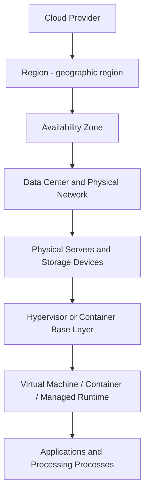
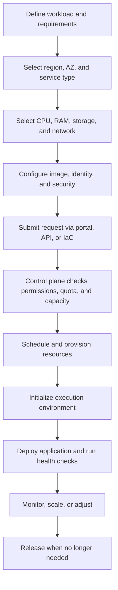
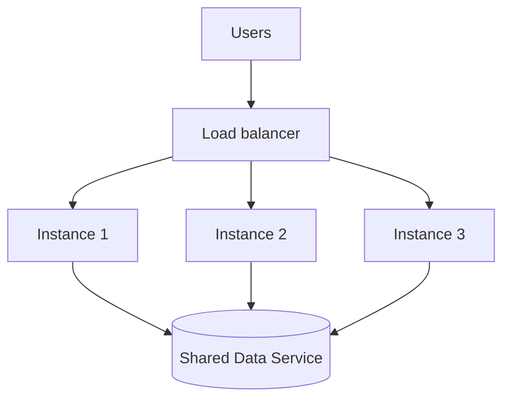

# What Is Cloud Compute and How Are Compute Resources Provisioned?

An application needs a place to execute code, process data, and exchange information over a network. Previously, organizations typically had to purchase servers, place them in a data center, connect networking, install an operating system, and manually manage capacity. With **cloud compute**, organizations can request compute capacity from a cloud provider via a management console, API, or automation tools. Resources are provisioned based on configuration and usage duration, and can be scaled up, scaled down, or released as demand changes.

Cloud compute serves as the foundation for running websites, APIs, transaction processing systems, data analytics applications, background jobs, and many other types of software. Users select resources such as CPU, memory, storage, and networking; the provider operates the physical infrastructure and underlying service layers according to the scope of the chosen service.

After this lesson, you will be able to:

- Explain cloud compute and the characteristics that allow cloud resources to be requested on demand.
- Describe how resources are organized from data centers and geographic regions down to servers and execution environments.
- Identify the roles of CPU, memory, storage, networking, and accelerators in a workload.
- Outline the process of provisioning, configuring, monitoring, scaling, and releasing resources.
- Make initial decisions regarding configuration, deployment location, security, and cost for an application.

## 1. What Is Cloud Compute?

**Cloud compute is the use of processing capacity delivered over a network as a service.** Instead of directly purchasing and operating physical servers, users request an amount of resources suited to their workload. Depending on the service, the provisioned unit may be a virtual machine, a dedicated physical server, a container, an application runtime environment, or an event-driven function.

The provider builds an infrastructure consisting of servers, storage devices, networking, virtualization systems, and management software. Multiple customers can share a common pool of physical resources through partitioning and isolation mechanisms. The management system receives requests, verifies permissions and quotas, locates sufficient capacity, configures the resources, and provides access endpoints for users to deploy applications.

The core idea of cloud compute is that users can focus on workload requirements and the required service level. They still need to choose configurations, set up security, monitor applications, and control costs; the degree of server management required depends on the type of service used.

### Fundamental Characteristics of Cloud Computing

Cloud compute typically exhibits the following five characteristics:

1. **On-demand self-service:** Users can create or modify resources via a portal, API, or configuration code without requiring the provider to perform manual operations for each provisioning request.
2. **Broad network access:** Resources and services are accessed using standard network protocols from authorized devices or systems.
3. **Resource pooling and sharing:** The provider orchestrates a shared pool of resources across multiple customers while applying appropriate isolation mechanisms.
4. **Rapid elasticity:** Capacity can scale up or down based on demand within technical limits, quotas, and available capacity.
5. **Measured service:** Usage is recorded for monitoring, allocation, or billing purposes, such as runtime duration, CPU, memory, storage capacity, requests, or network traffic.

These characteristics make the cloud well-suited for fluctuating demand. A team can spin up a test environment for a short period, increase the number of machines during a sales campaign, and then release them once the work is complete.

## 2. From Data Centers to Application Runtime Environments

Cloud resources still run on real hardware. Providers organize hardware into layers so they can provision, isolate, monitor, and recover resources at scale.



### Region and Availability Zone

A **Region** is a geographic area where a provider locates its cloud infrastructure. A region typically contains multiple data centers or availability zones. When choosing a region, you should consider user location, network latency, data residency requirements, available services, connectivity, and pricing.

An **Availability Zone (AZ)** is an infrastructure domain designed to reduce the impact of certain localized failures. AZs within the same region usually have independent power, cooling, and networking to a certain degree, and are interconnected via low-latency networks. Specific definitions and levels of independence vary by provider.

Running multiple application replicas within a single AZ can protect the application against single-process or single-server failures, but may not protect against an entire AZ outage. For critical workloads, you can distribute replicas across multiple AZs, place a load balancer in front, and ensure data has appropriate replication or recovery mechanisms.

### Physical Servers, Hypervisors, and Virtual Machines

A physical server contains CPUs, RAM, storage devices, and network interface cards. A **hypervisor** is a software layer that enables creating and managing multiple virtual machines on a single physical server. Each virtual machine is allocated a logical set of resources, runs a guest operating system, and is isolated from other virtual machines according to platform mechanisms.

A virtual machine can be created from an image containing the operating system and initial configuration. Users select the machine size, disks, networking, and security settings; the platform finds a suitable host and initializes the virtual machine. Moving or replacing virtual machines may be supported by the platform, but applications still need to be designed to tolerate failures and interruptions.

Containers typically share the host operating system kernel and package the application along with its dependencies. A container service can orchestrate containers across a cluster of servers. With serverless or FaaS services, the provider manages the execution environment more deeply and triggers code upon requests or events. These models represent different ways of consuming compute capacity; the next lesson will separately analyze the management boundaries of each model.

### Control Plane and Data Plane

In many cloud platforms, two functional groups can be distinguished:

- **Control plane:** Handles operations to create, modify, and delete resources; authenticates permissions; checks quotas; schedules; stores configurations; and orchestrates desired state.
- **Data plane:** Where the workload actually runs and processes application traffic, data, or requests.

For example, when sending a request to create a virtual machine, the control plane processes the request and orchestrates provisioning. After the virtual machine boots, the application running on it belongs to the data plane. If the control plane becomes temporarily unreachable, running workloads may continue operating depending on service architecture; however, new management operations may be affected.

## 3. Resources That Make Up Compute Capacity

A workload does not only need CPU. Performance and stability depend on the balance between CPU, memory, storage, networking, and sometimes specialized accelerators.

### CPU: Instruction Processing Capacity

The CPU executes program instructions. When choosing a configuration, you may encounter these concepts:

- **Core:** A physical processing unit inside a CPU.
- **Thread (hardware thread):** An execution thread that the CPU can schedule; a single core can support multiple hardware threads depending on architecture.
- **vCPU:** The logical CPU unit that a provider exposes or allocates to virtual machines and services. A vCPU may correspond to a hardware thread or a time-sliced share of processing depending on the platform; you should not assume one vCPU always equals one physical core.
- **CPU architecture:** For example, x86-64 or ARM64. Applications, images, and native libraries must be compatible with the chosen architecture.

More vCPUs help a workload process tasks in parallel if the application can utilize multiple threads. However, increasing vCPUs does not guarantee linear performance scaling. A single-threaded process can be bottlenecked by single-core performance; workloads waiting on network or disk may not fully utilize CPU; resource-sharing limits also affect actual performance.

Some configurations offer **burst** capability: under certain conditions, the machine can use CPU above its baseline for a period of time, typically based on a credit mechanism or provider limits. This configuration type suits workloads that remain low most of the time but experience brief spikes. For sustained high CPU loads, choose a configuration with steady capacity and verify performance limits.

### RAM Memory: Holding Data Currently Being Processed

RAM stores data and state that processes are actively using for fast CPU access. Insufficient RAM can force the operating system to use swap, causing severe performance degradation; in some environments, processes or containers may be terminated when exceeding memory limits.

When estimating RAM, account for runtime memory, heap, caches, threads, connections, libraries, and headroom for peak loads. Monitor actual usage, peak memory, and signs of memory pressure. Looking only at averages can miss sudden spikes.

RAM differs from persistent storage. Data in RAM is typically lost when a machine or process stops. Data that must persist across restarts must be written to an appropriate storage system.

### Storage: Holding the Operating System, Files, and Data

Cloud storage comes in several types, with different latency, throughput, durability, and access characteristics.

| Storage Type | Common Use Cases | Considerations |
|---|---|---|
| Block storage | Attached like a disk to a virtual machine; stores OS, databases, or data requiring block-level access | Capacity, IOPS, throughput, latency, snapshots, and backup policies |
| File storage | Sharing directories and files across multiple machines or workloads | Access protocols, file permissions, latency, throughput, and connection counts |
| Object storage | Storing images, videos, backups, logs, uploaded files, and unstructured data | Access APIs, data lifecycle, storage tiers, retrieval latency, and request fees |
| Local/ephemeral storage | Temporary data, caches, or intermediate processing files on a host/instance | May be lost when the instance is replaced, stopped, or migrated; do not use as the sole store for critical data |

Three common metrics used to evaluate storage performance:

- **Latency:** The time from issuing a read/write operation to receiving a response.
- **IOPS:** Number of input/output operations per second.
- **Throughput:** Amount of data read/written per unit of time, typically measured in MB/s or GB/s.

Database workloads may be sensitive to latency and IOPS; video processing or large file transfers may require high throughput. Measure actual access patterns rather than selecting disks based solely on capacity.

### Networking: Connecting Users and Components

Networking enables applications to receive requests, call other services, access data, and communicate across zones. A cloud environment typically provides private virtual networks, subnets, routes, IP addresses, firewalls or security groups, DNS, load balancers, and inbound/outbound gateways.

When evaluating networking, consider:

- **Bandwidth:** The maximum amount of data that can be transmitted per unit of time.
- **Latency:** Transmission and response time between two points; geographic distance and network hops can affect this.
- **Effective throughput:** The amount of data an application successfully transmits, affected by protocols, congestion, service limits, and configuration.
- **Ingress and egress:** Data entering and leaving a service or network zone. Some providers charge for certain types of outbound traffic or cross-region traffic.
- **Segmentation and access control:** Subnets, routes, firewalls, and security groups determine which workloads are allowed to communicate with each other.

Do not open all ports to the Internet just to make an application work. Expose only necessary endpoints, place internal services in private networks, and allow minimal communication flows between components.

### GPUs and Accelerators

Some workloads require GPUs or specialized accelerators to process large numbers of calculations in parallel. Examples include machine learning model training and inference, image/video processing, scientific simulations, and engineering computations.

GPUs do not automatically make every application faster. Programs must support the corresponding acceleration libraries and architectures; data must be transferred to the device; GPU memory and device-sharing capabilities are also limits to consider. GPUs are typically more expensive than standard CPU configurations, so you should measure utilization and job completion times to evaluate cost-effectiveness.

## 4. How Are Resources Provisioned?

The provisioning process typically starts with a request describing the workload to run and ends when the user receives accessible resources. Step names and automation levels vary across providers, but the general workflow is as follows:



### Step 1: Define Workload Requirements

Before selecting a configuration, understand what the application does and what load levels it must meet. Useful information includes:

- Processing type: API, website, worker, batch, self-managed database, or event-driven tasks.
- Load levels: requests/second, concurrent users, tasks per hour, data sizes, and growth trends.
- Resource profile: CPU-bound, memory-bound, I/O-bound, or network-bound.
- Quality targets: response latency, throughput, error rate, and uptime.
- Constraints: operating system, CPU architecture, libraries, data location, network connectivity, and security requirements.

If measurements are not yet available, make an initial assumption, deploy a test, and collect metrics. Avoid choosing configurations based solely on guesswork or copying another application's configuration.

### Step 2: Choose Deployment Location and Scope

Choose a region close to your user base or dependent systems to reduce latency. Check data residency requirements, whether required services are available in that region, connectivity to existing networks, and cross-region costs. For critical applications, determine whether multiple AZs or a backup region is needed.

### Step 3: Choose Resource Sizing

Select vCPU count, RAM, storage capacity and type, and bandwidth or network configuration based on workload characteristics. Some providers offer configuration families optimized for general purpose, CPU, memory, storage, or GPU. Family names and resource ratios differ across platforms.

Consider both current capacity and headroom. Undersized configurations cause bottlenecks or failures; oversized configurations increase costs and can mask optimization issues in the application.

### Step 4: Choose Image and Initialization Configuration

For virtual machines, an image may contain the operating system and base software. Users can use standard provider images or images tested, patched, and approved by their organization. Verify the image source, version, CPU architecture, patches, and update mechanism.

Initialization information may also include hostname, access keys, user data or cloud-init, environment variables, and monitoring agents. Do not place plaintext passwords or secret keys in startup scripts or metadata that could be read by unauthorized parties.

### Step 5: Configure Networking and Permissions

Place resources in appropriate virtual networks and subnets. Define which endpoints need to be public, which ports are allowed, administrative access methods, DNS, routing, and connections to data services. Attach an identity or service account with the minimum required permissions.

A successful provisioning request does not mean resources are ready to serve users. Verify connectivity, health checks, logs, and access to dependencies such as databases, queues, or storage services.

### Step 6: Deploy, Observe, and Tune

After the environment is created, deploy the application, run health checks, and enable monitoring. Initial metrics should include CPU, RAM, disk capacity, I/O, network traffic, application latency, request counts, error rates, and running instance counts.

Once data is available, adjust sizing, limits, replica counts, and scaling policies. When a workload finishes, delete or stop unnecessary resources while retaining data, logs, and backups according to organizational policy.

## 5. Compute Consumption and Pricing Models

Providers may offer multiple pricing and commitment options. Commercial names vary, but the following models are common:

| Usage Model | Characteristics | Best Suited For |
|---|---|---|
| On-demand | Create resources as needed; pay per billing unit and usage duration of the service | Testing, fluctuating loads, unpredictable workloads |
| Commitment/reserved | Commit to a usage level or term to receive discounted rates under provider terms | Steady baseline workloads predictable over the long term |
| Spot/preemptible | Lower pricing possible, but resources may be reclaimed when the provider needs capacity | Retryable batch jobs, interruption-tolerant distributed processing |
| Dedicated/bare metal | Provision physical servers or dedicated capacity on demand | Workloads requiring specialized performance, isolation, or hardware control |

Do not place a single critical workload solely on preemptible capacity if the application lacks checkpoint, retry, or failover mechanisms. With commitment options, forecast usage and understand terms for modifying, converting, or terminating commitments.

### Quotas, Limits, and Available Capacity

A **quota** is a limit on what an account, project, or region is permitted to use, such as the number of vCPUs, IP addresses, or virtual machines. Quotas help control usage and prevent provisioning beyond expected levels. When demand grows, teams may need to submit quota increase requests in advance.

Having sufficient quota does not guarantee that every configuration is immediately available at request time. Capacity for a specific machine type or GPU within an AZ may be constrained. Therefore, critical systems should have fallback options such as equivalent instance types, alternative AZs, or safe load limits.

## 6. Choosing Configuration by Workload Characteristics

A good configuration balances resources and service targets. Identify which component is limiting performance before increasing resources.

| Observed Symptom | Potential Bottleneck | Investigation Approach |
|---|---|---|
| CPU consistently near maximum, request queues growing | Insufficient CPU capacity or inefficient processing code | Profiling, optimizing algorithms, increasing vCPUs, or scaling horizontally |
| RAM continuously rising, heavy swapping, or processes being killed | Memory shortage, memory leak, or oversized cache | Analyzing heap, bounding caches, checking for memory leaks, increasing RAM if needed |
| High read/write latency, growing I/O queues | Storage not matching the access pattern | Checking IOPS, throughput, latency, block size, and data model |
| Low CPU yet slow requests, connections waiting long | Waiting on network, dependent services, or synchronization locks | Measuring per-hop latency, checking DNS, connections, timeouts, and dependency limits |
| Network traffic hitting limits or slow data transfers | Insufficient bandwidth or suboptimal network paths | Measuring throughput, packet loss, region placement, and cross-region traffic |

These symptoms are diagnostic hints, not automatic conclusions. For example, high CPU can result from genuine load growth or a buggy loop; high RAM can mean an efficiently used cache or a leak. Combine infrastructure metrics with application metrics and traces.

### Conceptual Configuration Example

Suppose an order management API needs to run continuously, serve users in a specific region, and handle peak-hour traffic spikes. An initial requirement specification might look like this:

```yaml
workload: order-api
runtime: linux
compute:
  vcpu: 4
  memory: 16 GiB
storage:
  root_volume: 50 GiB
  persistent_data: managed-database
network:
  placement: private-subnet
  ingress: load-balancer
availability:
  zones: 2
scaling:
  minimum_instances: 2
  maximum_instances: 8
  signal: request_rate_and_latency
security:
  identity: workload-service-account
  inbound: allow_only_load_balancer
```

This is an illustrative description, not a configuration directly applicable to a specific provider. Values for vCPU, RAM, storage capacity, and instance counts must be validated through load testing. Persistent data is placed in a separate data service so application instances can be replaced without losing orders.

## 7. Scaling Compute Capacity

When request volume or work increases, applications need additional capacity. There are two fundamental scaling approaches.

### Vertical Scaling

Increasing resources for a single instance, such as moving from 2 vCPU/8 GiB RAM to 4 vCPU/16 GiB RAM. This is often easier for legacy applications or applications that are hard to partition, but is limited by maximum machine size, reconfiguration downtime, and the fault tolerance of a single large instance.

### Horizontal Scaling

Increasing the number of instances or workload replicas to share load. A load balancer distributes requests across healthy replicas. This approach can increase throughput and reduce dependence on a single machine, but applications must handle shared state and synchronization across replicas.



Horizontally scaled applications should generally store session state in a shared service or use appropriate tokens, avoiding storing critical data solely in a single instance's memory. Background tasks can use queues to decouple request ingestion speed from processing speed.

### Autoscaling

Autoscaling automatically adjusts the number or size of resources based on declared signals and policies. Signals can include CPU, RAM, requests/second, latency, queue depth, or predictive schedules.

An autoscaling policy needs:

- A minimum level to maintain baseline capacity and a maximum level to cap costs.
- Thresholds or targets to trigger scaling out or scaling in.
- Observation windows and cooldown periods between changes to prevent thrashing.
- Health checks and mechanisms to remove unhealthy instances from serving traffic.
- Checks on quotas, zone capacity, and the load capacity of databases or dependent services.

Autoscaling does not replace good application design. If a database can only handle 100 connections, automatically scaling out to hundreds of API instances can overload the entire system. Set connection limits, and use connection pools, caches, or queues where appropriate.

## 8. Availability and Resilience

**Availability** reflects a system's ability to deliver service when users need it. **Resilience** is the ability to continue or recover operations after a failure. Provisioning more CPU does not automatically make a system more available.

Common practices include:

1. Running multiple application replicas and distributing them across fault domains or AZs where appropriate.
2. Using load balancers and health checks to avoid routing requests to unhealthy instances.
3. Designing applications not to depend on local state of a single machine; storing critical data in durable storage services.
4. Backing up data and regularly testing recovery capabilities.
5. Setting timeouts, bounded retries, backoff, and circuit breakers so failures in one dependency do not cascade.
6. Testing instance loss, AZ loss, or dependent service failures within permissible scope.

Two concepts commonly used in recovery planning:

- **RTO (Recovery Time Objective):** The target duration to restore service after an interruption.
- **RPO (Recovery Point Objective):** The maximum acceptable amount of data loss, typically expressed as a time interval of data.

Stricter RTO and RPO targets usually require more extensive redundancy, data replication, and recovery testing, resulting in higher costs. Define targets based on workload criticality.

## 9. Security When Provisioning and Operating Compute

Providers protect data centers, hardware, and platform layers within the service scope. Customers remain responsible for securing accounts, resource configurations, customer-managed operating systems or images, applications, and data. Responsibility boundaries vary by service, so verify them in the provider's documentation.

Key principles when deploying compute:

- **Identity and Access Management (IAM):** Grant least-privilege permissions by role; separate permissions for creating resources, deploying applications, and accessing data; enable strong authentication for administrative accounts.
- **Network security:** Place workloads in appropriate subnets, restrict inbound/outbound traffic, expose only necessary endpoints, and use private connections for internal components.
- **Images and patching:** Use images from trusted sources; update operating systems, runtimes, and libraries on schedule; retire outdated or unsupported images.
- **Secrets:** Store passwords, tokens, and keys in a secrets management service; grant access based on workload identity and rotate as needed.
- **Encryption:** Encrypt data in transit and at rest as required; manage keys and key usage permissions appropriately.
- **Logging and monitoring:** Record administrative actions, access, and security events; do not log sensitive data.
- **Isolation:** Avoid running untrusted workloads with privileged permissions; configure appropriate resource and system-permission isolation.

A newly created virtual machine with management ports open to the entire Internet and a shared password can be compromised even if the provider's physical infrastructure is well protected. Security must be configured right from provisioning time.

## 10. Understanding Compute Costs

Compute costs typically depend on resource type, size, deployment region, runtime duration, and pricing model. Beyond CPU and RAM, bills may include storage, snapshots, IPs, load balancers, data transfer, logs, monitoring, support, and auxiliary services.

Several cost-control principles:

1. **Right-size:** Choose configurations based on CPU, RAM, I/O, and latency measurements; consider downsizing if resources are frequently idle.
2. **Turn off unused resources:** Stop or delete test environments on a schedule; check whether disks, IPs, and snapshots still incur charges after machines are stopped.
3. **Bounded autoscaling:** Set min/max limits and cost alerts to prevent unexpected instance proliferation.
4. **Match pricing models to workloads:** Consider commitments for steady loads; use preemptible capacity for retryable batch jobs.
5. **Optimize data and networking:** Choose storage tiers based on access frequency, delete expired data, and reduce unnecessary cross-region data transfers.
6. **Tag resources:** Use tags/labels for application, environment, owning team, and cost center for bill allocation.

Compare costs per unit of work, such as cost per 1,000 successful requests or per batch run, while holding latency and availability requirements constant. A cheaper machine that processes slower or requires more operational effort is not necessarily more economical.

## 11. Example: Provisioning Capacity for a Retail API

An online store is preparing for a promotional campaign. The API handles product viewing and order creation requests; traffic surges sharply during certain hours.

**Workload analysis:** The team measures requests/second, read/write ratios, p95 latency, database connection counts, and CPU/RAM usage. Results show the API needs multiple replicas to serve traffic spikes, while order data requires durable storage.

**Location selection:** The team selects a region close to primary customers, checks data residency requirements, and deploys replicas across two AZs to mitigate localized failure risks.

**Provisioning:** The team creates application instances in a private subnet, places a load balancer in front, allows application traffic only from the load balancer, and assigns a dedicated identity for the API to access the database. The initial configuration is tested under representative load.

**Scaling:** An autoscaling policy increases instance count when request rate and latency exceed targets, up to a maximum cap. The team simultaneously monitors database connection counts to prevent the API from scaling faster than the data layer's processing capacity.

**Operations and cost:** Dashboards display CPU, RAM, errors, latency, instance count, and cost by tag. After the campaign, instance counts scale back to baseline; test environments are shut down on schedule.

This example illustrates that compute provisioning is a holistic decision: machine sizing is only one part, while region, networking, access permissions, data, scalability, and observability also determine whether an application operates well.

## 12. Common Misconceptions

**“Cloud compute means virtual servers.”** Virtual machines are one way to deliver compute. Cloud compute capacity can also be delivered via dedicated servers, containers, application platforms, or serverless functions.

**“One vCPU always equals one physical CPU core.”** A vCPU is a logical unit provisioned by the platform. Mapping and sharing depend on hardware architecture, machine type, and provider policies.

**“Adding CPU will solve every performance issue.”** Applications may be bottlenecked by RAM, I/O, networking, synchronization locks, or dependent services. Identify the bottleneck with metrics before upsizing.

**“Stopping a virtual machine eliminates all costs.”** Disks, snapshots, IP addresses, traffic, or certain related resources can still incur charges after a machine is stopped. Check pricing tables and the status of each resource.

**“Having multiple instances means you already have high availability.”** Instances may reside in the same AZ or depend on a single data service. Analyze fault domains and test recovery.

**“Provisioned resources are always immediately available.”** Quotas, service limits, and regional capacity can cause requests to be rejected or require selecting a different configuration. Critical workloads need capacity planning and fallback options.

## 13. Pre-Production Compute Readiness Checklist

Before deploying a new environment, verify the following questions:

- What type of work does the workload process, and what is the expected load level?
- Have you identified whether the primary bottleneck may lie in CPU, RAM, storage, or networking?
- Do the region and AZ meet latency, data residency, and availability requirements?
- Is resource sizing backed by measurements and reasonable headroom?
- Are the image, runtime, and CPU architecture compatible, up to date, and trusted?
- Is the network properly segmented; have public ports and access permissions been restricted?
- Are metrics, logs, alerts, health checks, and incident response procedures in place?
- Have quotas, scaling limits, and costs under sudden load spikes been identified?
- Does the data have backups and have recovery procedures been tested?
- Is there a schedule to review, stop, or release resources that are no longer needed?

## 14. Self-Check

1. How does cloud compute differ from purchasing and operating servers yourself? Which responsibilities still belong to the customer?
2. What roles do Regions and Availability Zones play? Why is deploying multiple replicas within the same AZ insufficient to protect against all failures?
3. Why can't you assume 4 vCPUs correspond to exactly four physical cores? What other factors affect CPU performance?
4. When should you use block storage, file storage, object storage, or local/ephemeral storage?
5. An API has low CPU but high latency—which components should be checked before increasing vCPUs?
6. Distinguish between vertical scaling and horizontal scaling. What conditions enable an application to scale horizontally safely?
7. Why is it necessary to cap autoscaling and monitor the capacity of databases and dependent services?
8. Aside from virtual machine runtime, what other items may still incur costs?

Once you can answer these questions, you have a foundation for understanding cloud compute as a resource delivery system that can be orchestrated, measured, and scaled. From here, you can continue exploring specific execution models and how to choose the right model for each application.
