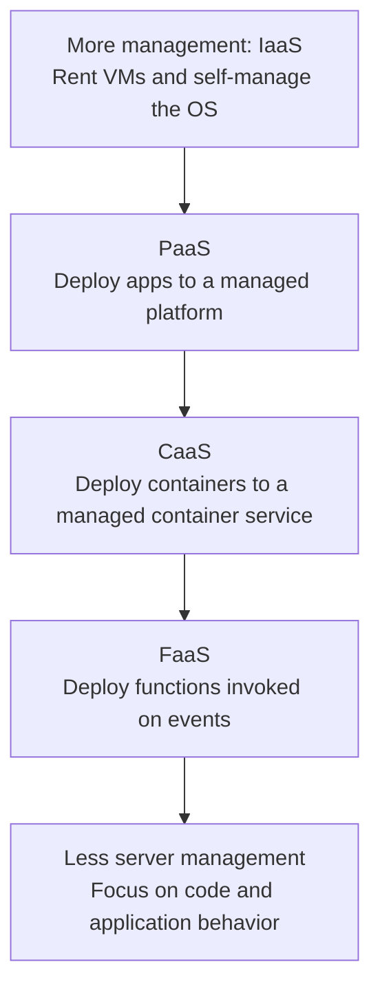
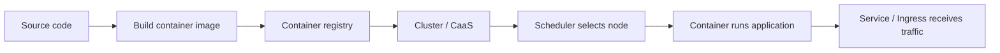
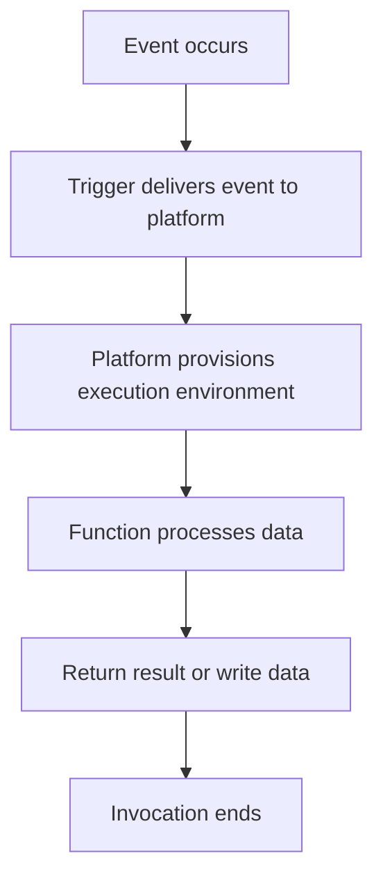

# Distinguishing IaaS, PaaS, CaaS, and FaaS in Application Execution

When deploying applications in the cloud, development teams can rent virtual machines, push source code to an application platform, package applications into containers, or deploy individual functions triggered by events. These deployment approaches correspond to four common service models: **Infrastructure as a Service (IaaS)**, **Platform as a Service (PaaS)**, **Containers as a Service (CaaS)**, and **Function as a Service (FaaS)**.

The models differ in the level of abstraction that the provider manages on the user's behalf. The higher the abstraction level, the less operations teams have to manage servers and runtime environments, though they generally must follow more platform conventions. No single model is always best: the right choice depends on application architecture, operational capabilities, performance requirements, availability, security, and budget.

After this lesson, you will be able to:

- Explain how IaaS, PaaS, CaaS, and FaaS execute an application.
- Distinguish between what the cloud provider manages and what the development team manages.
- Select the appropriate model for always-on applications, web applications, containerized systems, or event-driven workloads.
- Identify how each model affects CPU, memory, networking, security, scalability, availability, and cost.

## 1. Understanding Differences Through Management Level

An application typically requires multiple layers to run: hardware and networking, servers or virtual machines, the operating system, the runtime environment, the application, and data. In an on-premises data center, an organization may have to manage nearly all of these layers itself. Cloud services allow transferring part of that responsibility to the provider.

Picture the level of abstraction as a spectrum:

The order above only shows the general trend in abstraction level, not a ranking of quality. CaaS and PaaS can overlap: a PaaS platform may use containers underneath, while a CaaS service may provide additional application-level features. Read the actual management scope of each service rather than relying solely on its label.

## 2. IaaS – Infrastructure as a Service

**IaaS provides infrastructure resources on demand**, typically including virtual machines, storage disks, virtual networks, IP addresses, and network security components. Users install or choose the operating system, install the runtime, deploy applications, and organize most operations inside the virtual machine.

For example, to run an API on IaaS, a development team might create a Linux virtual machine, configure networking and firewalls, install Java or Node.js, deploy the application, set up a reverse proxy, monitor processes, and establish an OS update mechanism.

### Who Manages What?

The provider is typically responsible for the data center, physical servers, virtualization layer, and underlying network and storage infrastructure. The customer is responsible for the guest OS, OS patches, runtime, libraries, application configuration, access identities, data, and OS/application-level security rules. Exact boundaries depend on the service and configuration purchased.

| Aspect | IaaS Characteristics |
|---|---|
| Deployment unit | Virtual machine or group of virtual machines |
| Control | High; can choose OS, software packages, and machine configuration |
| Dev/ops responsibilities | Installation, OS patching, runtime, deployment, monitoring, backups, and scaling |
| Scaling | Resize machines or adjust machine count; often requires pairing with a load balancer and autoscaling |
| Best suited for | Legacy applications, software requiring OS privileges, custom configurations, or long-running environments |
| Trade-offs | Flexible, but requires significant operational skill and carries risk of paying for idle machines |

### Deployment Example

A legacy order-processing system requires a specific OS version and native libraries. The operations team can create a group of identically configured virtual machines, place them behind a load balancer, install the application on each machine, and manage rolling updates.

IaaS makes sense when server-level control is a genuine requirement. If an application only needs to handle HTTP requests and access a database, managing the entire operating system yourself can add unnecessary operational overhead.

## 3. PaaS – Platform as a Service

**PaaS provides a managed application execution platform.** Development teams focus on source code, application configuration, and data; the provider manages most of the servers, operating system, runtime, or platform deployment pipelines.

For a web service, a team can push source code or a build artifact to the platform, declare environment variables, and configure instance counts and custom domains. The platform provisions the runtime environment, starts the application, provides endpoints, and may support new version rollouts, health checks, logging, and autoscaling.

### Responsibilities and Limitations

PaaS significantly reduces server management work. However, the development team remains responsible for code quality, authentication and authorization, data, secrets management, application configuration, software dependencies, and error handling. A managed platform does not automatically make an application secure or highly available.

| Aspect | PaaS Characteristics |
|---|---|
| Deployment unit | Application, service, or build artifact |
| Control | Focused on the application; limited control over OS and underlying servers |
| Dev/ops responsibilities | Source code, configuration, data, access permissions, application observability, and release control |
| Scaling | Typically configured via instance count or application-level autoscaling policies |
| Best suited for | APIs, websites, standard backends, and teams wanting to reduce infrastructure administration |
| Trade-offs | Simpler development and operations, but constrained by platform runtimes, limits, and deployment patterns |

### Deployment Example

A team builds an e-commerce website using a popular web framework. The team packages the application in a format supported by the platform, declares database connections and environment variables, and deploys. As traffic grows, the team configures additional instances or enables autoscaling. The provider manages the servers and many parts of the runtime environment.

Before selecting PaaS, check supported runtime versions, request timeout limits, private network access capabilities, file storage mechanisms, resource limits, and log export methods. If an application depends on uncommon system libraries or requires deep control, the platform may not suffice.

## 4. CaaS – Containers as a Service

In this lesson, **CaaS stands for Containers as a Service**: a service providing an environment to deploy, manage, and scale containers. (In some contexts, the acronym CaaS may carry different meanings; check the provider's definition.)

Containers package an application along with its required libraries and components into an image. Images make development, testing, and deployment environments more consistent. A CaaS service provides a place to run containers and typically integrates orchestration, scheduling, health checking, service networking, configuration management, storage, and scaling. Kubernetes is a popular container orchestration ecosystem; managed CaaS services can help reduce the effort of installing and maintaining a cluster.

### How Applications Are Executed

Development teams build an image, push it to a registry, declare how the container should run, and deploy to a cluster or container service. The orchestrator finds suitable resources to run the container, monitors status, and restarts or replaces instances upon failure according to declared policies.

The provider may manage the control plane, worker nodes, or both, depending on the service tier. Customers typically remain responsible for images, library patches within images, workload configurations, service account permissions, network policies, data, and how applications communicate. If customers self-manage worker nodes, responsibility for node OS maintenance and cluster capacity also increases.

| Aspect | CaaS Characteristics |
|---|---|
| Deployment unit | Container image, pod, task, or equivalent workload |
| Control | Strong control over packaging environment and how components interact; exact privileges depend on the service |
| Dev/ops responsibilities | Building images, configuring workloads, resources, networking, secrets, observability, and deployment lifecycle |
| Scaling | Increase container replica counts, adjust resources, or combine with load-based autoscaling |
| Best suited for | Microservices, multi-component systems needing consistent environments, apps needing runtime control or portability |
| Trade-offs | Flexible and highly standardizable, but requires understanding containers, orchestration, networking, and storage |

### Deployment Example

A system comprising an API, a background worker, and a report-generation service can be packaged into three separate images. Each workload can use different replica counts, CPU/memory limits, and scaling policies. The API receives HTTP traffic; the worker reads from a queue; the reporting service runs on demand. Components can deploy independently while sharing cluster networking and observability systems.

Containers are not equivalent to virtual machines. Multiple containers typically share the host OS kernel, whereas a virtual machine runs its own guest OS on top of a virtualization layer. Containers speed up packaging and deployment, but do not inherently provide the same security boundary as a full virtual machine. You must configure permissions, namespaces, resource limits, trusted images, and appropriate workload isolation.

## 5. FaaS – Function as a Service

**FaaS enables deploying small functions or processing units invoked when events occur.** The provider manages the execution infrastructure and automatically initializes the required environment. Development teams write the function, declare triggers, set access permissions, and configure resource or execution limits.

A function can be invoked upon receiving an HTTP request, a new message in a queue, an uploaded file, or a scheduled timer. The platform receives the event, creates or reuses an execution environment, invokes the function, and returns a result or records processing status.

### Event-Driven Execution Lifecycle

FaaS typically scales concurrent executions up automatically when event volume increases and can scale down to zero when there are no requests. Billing is commonly based on invocation count and execution resources/duration, though exact formulas depend on the provider. Some platforms can keep warm environments or offer continuous execution options; therefore, do not assume every invocation experiences the same startup latency.

| Aspect | FaaS Characteristics |
|---|---|
| Deployment unit | Event-handling function or handler |
| Control | Focused on function logic, triggers, and configuration; very little control over underlying servers |
| Dev/ops responsibilities | Function code, idempotency, error handling, access permissions, execution limits, and observability |
| Scaling | The platform typically auto-adjusts execution environments based on invocations within quota limits |
| Best suited for | Event processing, short background tasks, webhooks, file processing, and system integrations |
| Trade-offs | Reduced ops and great for intermittent loads, but subject to duration, resource, state, and environment-control limits |

### Deployment Example

When a customer uploads a PDF invoice to object storage, the file-upload event can trigger a function. The function inspects metadata, writes a record to a database, and sends a message to a queue for another task to process. The development team does not need to maintain an always-on server waiting for this event.

Functions should be designed to be safely retried. In distributed systems, events may be redelivered upon timeouts or network errors; therefore, use idempotency keys, deduplication mechanisms, bounded retries, and dead-letter queues where appropriate. If a task is long-running, requires substantial intermediate state, or needs persistent connections, consider a containerized worker or a long-running application service.

## 6. Comparing the Four Models

| Criterion | IaaS | PaaS | CaaS | FaaS |
|---|---|---|---|---|
| Primary unit | Virtual machine | Application/service | Container/workload | Function/handler |
| Abstraction level | Low | High | Medium to high | Very high |
| OS control | Customer typically manages guest OS | Provider manages most of it | Depends on node management; customer manages images | Provider manages execution environment |
| Packaging | Direct install or machine image | Source code/platform build artifact | Container image | Function code and configuration |
| Typical execution style | Long-running processes | Web/API or long-running apps | Services and workers in containers | Events or short invocations |
| Scaling | Machines or machine groups | Application instances | Workload/container count and resources | Concurrent executions |
| Operations | Heavy server-level work | Minimal server-level work | Requires workload and orchestration management | Minimal server-level work; focused on events and functions |
| Key items to check | OS patches, machine capacity, HA | Runtime, quotas, platform limits | Cluster, images, network, storage | Timeouts, quotas, cold starts, retries |

Do not decide based solely on the number of layers managed by the provider. Evaluate required control, team expertise, observability, total cost, and platform lock-in.

## 7. One Application Can Run Across All Four Models

Suppose you need to deploy an order management API that receives requests, saves orders, processes payments, and sends confirmation emails.

**If choosing IaaS:** The team creates virtual machines, installs the OS and runtime, deploys the API as a system service, configures a load balancer, applies patches, and designs scaling themselves. This is useful when special system libraries or server control privileges are required.

**If choosing PaaS:** The team deploys the API onto a managed web platform and configures database connections and environment variables. The platform handles most machine provisioning and app startup. The team focuses on order logic, API security, and monitoring application behavior.

**If choosing CaaS:** The team packages the API and workers into container images. The API and workers run as separate workloads that can scale independently. The team manages deployment specs, resources, service discovery, secrets, and network policies; the provider manages cluster components according to the service tier.

**If choosing FaaS:** The team splits processing steps into functions triggered by HTTP or events. For example, an ingestion function creates the order, a new-order event triggers a payment-processing function, and a payment-succeeded event triggers an email-sending function. The team must design state management and error flows between invocations.

A real-world system can combine models: the main API runs on PaaS or CaaS, the database uses a managed data service, and image processing or notifications run on FaaS. Hybrid architectures allow matching each component to the right model, but also increase integration, observability, and cross-service permission management requirements.

## 8. How to Choose the Right Model

Start from workload characteristics and operational requirements, then select the service.

| Question to Answer | Typically Suitable Direction |
|---|---|
| Does the app need OS admin privileges, specialized agents, or kernel tuning? | Consider IaaS first; check whether CaaS meets requirements if the workload can run in a container |
| Is it a standard web/API app where the team wants to focus on features? | PaaS is often the simplest starting point |
| Are there multiple independent services needing consistent packaging and deployment control? | CaaS fits well when the team has container and orchestration operational skills |
| Is work event-triggered with uneven load and clear per-execution bounds? | FaaS is often a good fit |
| Must processes keep long-lived connections, run continuously, or execute long tasks? | IaaS, PaaS, or CaaS are usually better suited; verify exact service limits |
| Does the team lack cluster operations experience and need no deep control? | Starting with PaaS or FaaS can reduce complexity |

Before finalizing, test a representative flow and measure response time, throughput, error rate, latency under rising load, usage-based cost, and operational effort. Do not compare only CPU price or per-invocation price; factor in storage, data transfer, logs, monitoring, standby environments, and team engineering time.

## 9. Compute Resources, Networking, and Scalability

Regardless of the model chosen, the application still consumes CPU, memory, storage, and network bandwidth. The difference lies in where those resources are configured and how much control the service provides.

### CPU and Memory

- **IaaS:** Choose machine family and VM size based on load. Monitor CPU utilization, memory pressure, swap, and I/O wait time. Undersized machines cause bottlenecks; oversized machines waste money while idle.
- **PaaS:** Declare instance specs or resource tiers per service plan. Check memory limits, connection limits, process limits, and how the platform meters resources.
- **CaaS:** Declare CPU/memory requests and limits for each workload if supported by the orchestrator. Requests help the scheduler place workloads on nodes; limits cap usage. Setting limits too low can cause CPU throttling or OOM container termination.
- **FaaS:** Configure memory tier or resource profile offered by the platform; CPU may be allocated proportionally to that setting. Measure execution duration and peak memory to pick the right tier.

Do not size resources solely by looking at average utilization. Measure peak load, high-percentile processing times (such as p95), growth rates, and behavior under concurrent request bursts.

### Networking and Storage

In IaaS, operations teams typically configure virtual networks, subnets, routes, firewalls, and load balancers. In PaaS, the platform may provide public endpoints, private network links, or virtual network integration depending on the tier. In CaaS, you must understand service discovery, ingress, network policies, and workload-attached storage. In FaaS, you must define triggers, invocation permissions, outbound connection limits, and how functions reach private services.

Containers and functions are often short-lived or replaceable. Therefore, do not store critical state solely in an instance's ephemeral filesystem. Persistent data should reside in databases, object storage, or an appropriate storage service. Also account for data transfer costs across zones, between services, and out to the Internet.

### Scaling and Availability

Vertical scaling increases CPU or memory for a single instance. Horizontal scaling increases the number of instances, containers, or parallel executions. Horizontal scaling generally improves fault tolerance, but is only effective if the application does not rely on local state and downstream components can absorb the added load.

Autoscaling requires appropriate signals: CPU, memory, queue depth, pending requests, or latency. Relying solely on CPU means an I/O-bound worker may fail to trigger scaling even as the queue grows. Set min/max bounds and verify quotas to avoid unexpected costs or load surges.

High availability requires more than enabling autoscaling. Consider distributing instances across multiple availability zones when supported, health checks, load balancing, data backup and recovery, rolling deployments, rollback verification, and incident response processes. An application with multiple replicas all depending on a single database can still suffer an outage if that database fails.

## 10. Security and Operational Responsibilities

Service models shift responsibility boundaries, but do not transfer all security responsibility to the provider. Clearly establish who patches the platform, who updates the runtime, who protects data, and who configures access identities.

| Area | IaaS | PaaS | CaaS | FaaS |
|---|---|---|---|---|
| Underlying host OS patches | Provider | Provider | Depends on node/control plane management | Provider |
| Guest OS or customer-managed node patches | Customer | Usually not directly managed | Customer if self-managing nodes | Usually not directly managed |
| Application libraries and dependencies | Customer | Customer | Customer responsible for images | Customer responsible for function package/dependencies |
| Application identity and permissions | Customer | Customer | Customer | Customer |
| Data and data access permissions | Customer | Customer | Customer | Customer |
| Application-level network configuration | Customer, coordinated with provider | Depends on platform capabilities | Customer and platform per service boundary | Customer and platform per triggers/connections |

Practices to apply across all models:

1. Use least-privilege permissions for accounts, service accounts, workloads, and functions; separate deployment permissions from runtime execution permissions.
2. Store secrets in a secrets management service; avoid placing passwords, tokens, or private keys in source code, images, or logs.
3. Restrict required ports and network flows; do not expose admin endpoints or databases publicly without a clear justification.
4. Update operating systems, runtimes, images, and libraries through a tested process.
5. Log thoughtfully without exposing sensitive data; configure alerts for errors, latency, and resource usage.
6. Periodically test backups and restores; an untested backup does not prove recoverability.

## 11. Cost and Operational Optimization

Cost is not just compute resource pricing. Total cost can include VMs or instances, CPU time, memory, storage, snapshots, IPs, load balancers, requests, data transfer, logs, monitoring, support, and operational labor.

- **IaaS:** Easy to estimate by machine size and runtime, but always-on machines waste money during low load. Optimize via rightsizing, scheduled shutdowns for unused environments, autoscaling, and choosing appropriate machine types.
- **PaaS:** Reduces administration effort, but instance plans, limits, and bundled service fees may cost more than raw resources. Track actual utilization, minimum instance counts, and auxiliary service costs.
- **CaaS:** Account for node/cluster costs, control plane fees if applicable, storage, networking, and reserved headroom. Many small workloads can share nodes efficiently, but overly large requests reduce packing density, while overly small limits increase resource contention risk.
- **FaaS:** Advantageous for intermittent workloads since you do not necessarily pay to keep servers idle around the clock. However, high invocation volumes, long execution times, high memory tiers, frequent retries, or heavy data transfers can drive up costs. Optimize execution time and avoid unnecessary trigger loops.

A fair comparison should use the same load scenario: identical request or event volumes, identical p95 latency targets, identical availability levels, and identical data retention periods. Also factor in engineering operations labor. A service with a higher infrastructure bill can still reduce total cost if it saves many hours of administration and troubleshooting.

## 12. Common Misconceptions

**“CaaS and PaaS are the same thing.”** Both models may use the same underlying technology while giving users different levels of control. PaaS typically focuses on running applications; CaaS focuses on running and orchestrating containers. Check how much the user must supply images, declare workloads, manage clusters, and configure networking.

**“A container is a small virtual machine.”** Containers and virtual machines isolate differently. Containers typically share the host kernel; virtual machines run their own guest OS. Both can serve as deployment units, but their security, startup, resource, and operational characteristics differ.

**“Serverless means there are no servers.”** Servers still exist; the provider manages most of the execution infrastructure so users do not operate it directly. Serverless also does not mean applications are automatically secure, unlimited, or always cheaper.

**“FaaS is always the cheapest option.”** FaaS can be cost-effective for intermittent loads and short tasks. For steady, high-frequency loads or long-running tasks, PaaS, CaaS, or IaaS may offer better cost and latency profiles.

**“Using autoscaling gives you high availability.”** Autoscaling adjusts capacity as load changes. Availability also depends on deployment zones, data dependencies, health checks, recovery capabilities, safe rollouts, and incident response processes.

## 13. Practical Decision Workflow

When evaluating a new workload, you can follow this sequence:

1. **Describe the processing pattern:** Is the application always-on, serving HTTP, processing queues, or reacting to events?
2. **Identify environment requirements:** Does it require OS privileges, native libraries, special runtimes, private network connectivity, or long-running processes?
3. **Assess load profile:** Is load steady or spiky, what is the processing duration, concurrency level, CPU/memory demand, and data volume?
4. **Define quality requirements:** p95 latency, uptime targets, RTO/RPO, scalability, and security isolation levels.
5. **Evaluate team capabilities:** Who is responsible for updates, monitoring, deployments, incident response, and cost control?
6. **Prototype and measure:** Deploy a representative flow, generate realistic load, inspect errors, and calculate total cost.
7. **Document responsibility boundaries:** List the layers managed by the provider and the configurations the team must maintain.

A good decision is backed by measurements and can be revisited as load, architecture, or team capabilities evolve. You might start with PaaS for standard APIs, use CaaS when managing multiple containers, use FaaS for event-driven tasks, and reserve IaaS for workloads needing deep infrastructure control. This is a starting point for evaluation, not a rigid rule for every system.

## 14. Self-Check

1. An application requires installing an OS-level agent and tuning system settings. Which model should be evaluated first, and why?
2. A team only wants to deploy a web API on a standard runtime without managing server patches. How does PaaS help the team, and what does the team remain responsible for?
3. A system has an API and multiple workers that need independent packaging, separate scaling, and internal network communication. What benefits does CaaS bring, and what extra responsibilities does it add?
4. An image-processing function runs only when a new file is uploaded. Why might FaaS be suitable? How should retries, duplicate processing, and execution time be addressed?
5. Why can't you conclude which model is cheapest based solely on CPU price or per-invocation price?

If you can answer these questions by connecting practical requirements to control levels, operational responsibilities, and costs, you have the foundation to distinguish the four cloud application execution models.
