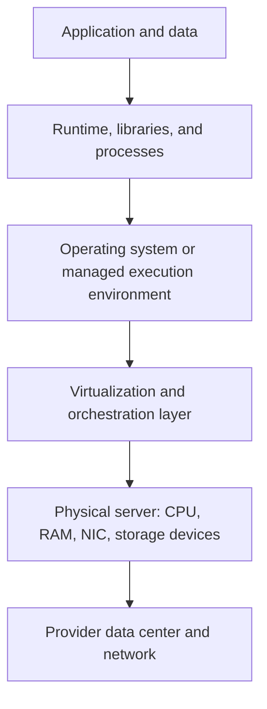
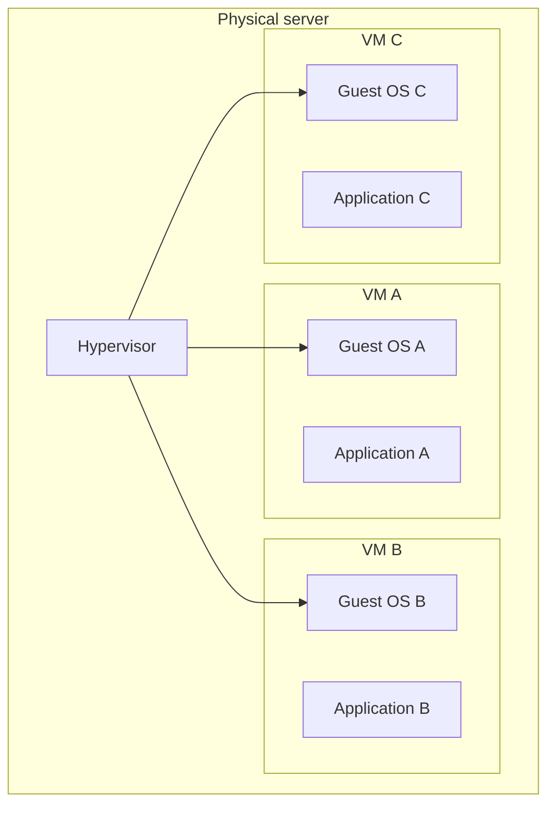
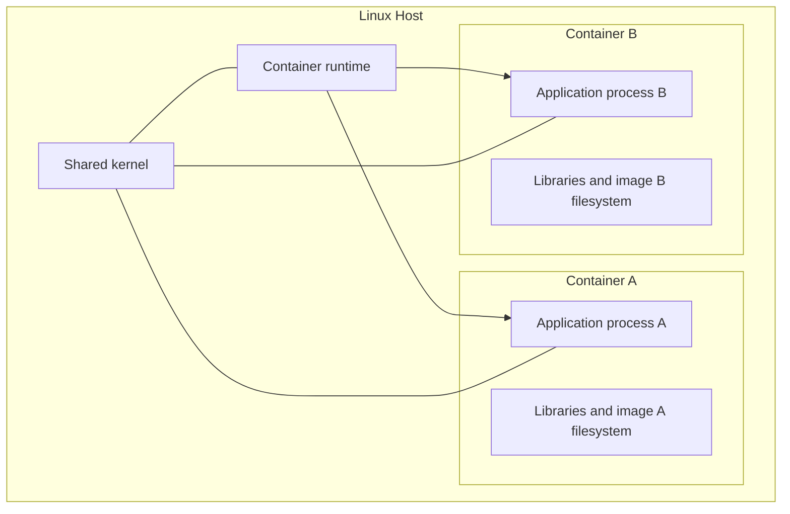
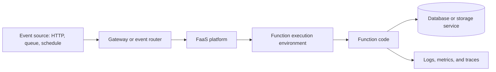
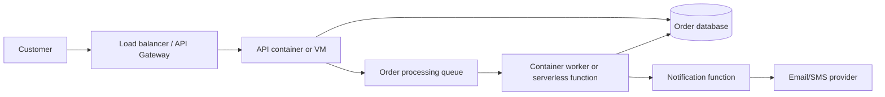

# Virtual Machines, Containers, and Serverless Functions: Execution Models and Limits

In **cloud compute**, an application can run on a virtual machine (VM), inside a container, or as a serverless function. All three models provide CPU, memory, networking, and storage capabilities, but differ in the infrastructure layers operators must manage, how processes are isolated, startup times, scaling mechanisms, and pricing models.

No single model is always best. VMs fit when OS and runtime control is needed; containers fit when consistent packaging, deployment, and orchestration are desired; serverless functions fit event-driven tasks where most server management can be offloaded to the platform. Choosing the right model is part of designing **CLOUD_CORE_SERVICES_COMPUTE**: you must understand how the application uses CPU, memory, networking, and data, while designing deployment, scaling, availability, security, and operational costs.

## Learning Objectives

After this lesson, you will be able to:

- Describe the execution layer and isolation boundaries of VMs, containers, and serverless functions.
- Explain common limits regarding CPU, memory, execution duration, storage, networking, and concurrency.
- Compare control, portability, scaling mechanisms, and cost models across the three options.
- Select a deployment model based on load characteristics, operational requirements, security, and budget.
- Propose how to configure resources, deploy securely, and monitor applications after moving to the cloud.

## 1. Cloud Compute Provides an Execution Environment

A program needs more than source code to operate. It needs a processor to execute instructions, memory to hold active data, an operating system or runtime to provide underlying services, networking to communicate, and durable storage for persistent data. Cloud providers pool physical resources into services that can be provisioned on demand.

You can picture the execution stack as the following layers:



VMs, containers, and serverless place responsibility boundaries at different positions in this stack:

- With **VMs**, customers typically manage the guest OS, runtime, and application. The provider manages physical servers and the virtualization layer.
- With **containers**, customers manage the image, application processes, and container configuration; the platform manages the host, container runtime, and potentially the orchestrator. Standard Linux containers share the host's kernel.
- With **serverless functions**, customers primarily manage function code, configuration, access permissions, and event flows. The platform manages servers, the OS, provisioning execution environments, and most scaling mechanisms.

Actual responsibility boundaries vary by service. For example, a fully managed container service may abstract away worker nodes entirely, whereas self-managed Kubernetes requires the operations team to carry more responsibility. A product name alone is not enough to determine responsibilities; check the provider's shared responsibility model and service limits.

## 2. Virtual Machines (VMs)

### 2.1. How Do VMs Work?

A VM is a software-emulated computer. A hypervisor partitions a physical server's resources into multiple virtual machines. Each VM has its own virtual CPUs (vCPUs), memory, network interface, and virtual disks, and runs its own guest operating system.



The hypervisor arbitrates CPU, memory, and I/O device usage across VMs. In modern cloud infrastructure, hypervisors typically run directly on hardware (commonly called type 1). Cloud users do not necessarily see or administer the hypervisor; they interact via APIs, consoles, or Infrastructure as Code (IaC) tools.

### 2.2. Components of a Cloud VM

| Component | Role and Decisions Required |
|---|---|
| OS image | Base image containing the OS and initial configuration. Use maintained, patched images from clear, trusted sources. |
| vCPU | Amount of processing capacity allocated to the VM. Check CPU type, hardware generation, burst capability, and performance guarantees of the machine type. |
| RAM | Memory allocated for the OS and applications. Insufficient RAM can cause swapping, OOM kills, or degraded performance. |
| System and data disks | Store the OS, applications, and data. Select capacity, disk type, IOPS, throughput, and backup policies. |
| NIC and virtual network | Connects the VM to subnets, routes, firewalls/security groups, load balancers, and other services. |
| Metadata and identity | Provides workload information or identity. Must restrict permissions and protect metadata endpoints per platform guidelines. |
| Deployment region/zone | Defines fault domains and latency. Multiple VMs in a single zone do not automatically form a cross-zone fault-tolerant architecture. |

When creating a VM, select both the machine configuration and network placement. A VM with suitable CPU and RAM placed in the wrong subnet or lacking required routes still cannot serve the application.

### 2.3. Strengths and Limitations

VMs provide machine-level boundaries, a dedicated OS, and high control. This is a reasonable choice when an application needs kernel modules, system agents, custom OS configurations, legacy software, or long-running environments. VMs are also useful when running multiple processes with different lifecycles and dependencies on the same machine.

In return, operators carry more work: updating the OS, managing accounts, configuring host-level firewalls, installing runtimes, monitoring disk usage, rotating logs, backing up, and remediating vulnerabilities. VMs generally take longer to start than a container whose image is already cached on a host, because the guest OS must boot and background services must initialize.

Several limits to understand clearly:

- **vCPUs do not equate to dedicated physical CPU cores.** Depending on machine type and provider policy, resources may be shared or use burst mechanisms. Sustained CPU load may be throttled once burst credits are exhausted or when encountering resource contention.
- **RAM has hard limits per machine type.** When memory runs out, the OS may swap, kill processes, or become unresponsive. Adding CPU does not solve RAM shortages.
- **Disks have performance limits.** Large capacity does not automatically mean high IOPS or throughput. Check limits by disk type, size, disk count, and VM configuration.
- **Networking has bandwidth and packet limits.** Some machine types have maximum network throughput, connection limits, or performance dependent on packet size.
- **Account and region quotas can block provisioning.** Limits on VM count, vCPUs, IP addresses, or disk capacity may vary across regions and accounts.
- **Availability is not automatic.** A single VM remains a single point of failure. Multiple instances, health checks, load balancers, backups, and recovery plans are needed.

VMs fit well when OS control is required or when running steady workloads, but you must factor in OS operational overhead and potentially idle capacity costs.

## 3. Containers

### 3.1. How Do Containers Work?

Containers package an application together with its runtime, libraries, and required dependencies into an image. At runtime, a container spawns one or more processes isolated via kernel features. For common Linux containers, mechanisms like **namespaces** provide isolated views of processes, networking, mounts, and hostnames; **cgroups** limit or meter CPU, memory, and certain other resource usage.

Containers generally do not carry their own kernel. Linux containers on the same host share the host's Linux kernel. Consequently, containers start faster and are lighter than VMs in many scenarios, though isolation boundaries rely heavily on the kernel, runtime configuration, and privileges granted to processes.



Images typically consist of multiple read-only layers. When creating a container, the runtime adds a writable layer for the running instance. This lets multiple containers share image layers, enabling consistent application distribution and saving disk space. However, a container's writable layer is ephemeral; critical data must be written to volumes or persistent storage services.

### 3.2. From Image to Running Workload

A typical workflow includes the following steps:

1. Write a Dockerfile or equivalent build configuration describing the image.
2. Build the image from source code and version-pinned dependencies.
3. Scan for vulnerabilities, inspect components, and attach an immutable tag or digest.
4. Push the image to an access-controlled registry.
5. The platform pulls the image, creates the container, attaches networking and volumes, and starts the process.
6. Health checks confirm the application is ready to receive traffic.
7. The orchestrator monitors health, creates replacement instances, or scales replica counts according to policy.

Minimal Dockerfile example for a Python web application:

```dockerfile
FROM python:3.12-slim

WORKDIR /app
COPY requirements.txt .
RUN pip install --no-cache-dir -r requirements.txt
COPY . .

RUN useradd --create-home appuser
USER appuser
EXPOSE 8080
CMD ["python", "app.py"]
```

This example illustrates application packaging. In production environments, pin base images by digest, apply patches regularly, remove unnecessary build tools from the final image, keep secrets out of images, and ensure the main process handles termination signals for graceful shutdown.

### 3.3. Container Resource Limits

Containers can be resource-limited at the runtime or orchestration layer. Example with Docker:

```bash
docker run --rm \
  --cpus="1.5" \
  --memory="1g" \
  --pids-limit=128 \
  --read-only \
  --tmpfs /tmp:rw,noexec,nosuid,size=64m \
  my-app:1.0
```

The options above illustrate limits on CPU, memory, process counts, and writable filesystems. Real-world applications may need extra temporary writable directories or volumes; enable `--read-only` only after clearly identifying which paths require writes.

In Kubernetes, `requests` and `limits` carry distinct meanings:

- `requests` are the resource amounts the scheduler uses to decide which node can host a Pod. They are also a key basis for capacity planning.
- `limits` are the hard maximum thresholds enforced on a container. Exceeding CPU limits typically causes throttling; exceeding memory limits can trigger an OOM kill.

Configuration example:

```yaml
apiVersion: v1
kind: Pod
metadata:
  name: web-api
spec:
  containers:
    - name: app
      image: registry.example.com/web-api:1.0
      resources:
        requests:
          cpu: "250m"
          memory: "256Mi"
        limits:
          cpu: "1"
          memory: "512Mi"
```

`250m` CPU equals one-quarter of a CPU in Kubernetes units; `1` CPU equals one logical CPU as represented by the platform. Setting requests too low can cause the scheduler to pack too many workloads onto one node; setting requests too high wastes capacity. Setting CPU limits too low can cause throttling and increase latency. Memory limits must accommodate reasonable peak usage, but should not be set so high that a single container can exhaust node memory.

### 3.4. Strengths and Limitations

Containers deliver consistent packaging across developer machines, testing environments, and production. They support new version rollouts, rollbacks, workload replication, and cluster orchestration. A platform like Kubernetes can manage scheduling, service discovery, configuration, secrets, rolling updates, and Pod-level self-healing.

Key limitations include:

- **Shared kernel.** Kernel bugs or weak runtime configurations can affect multiple containers on the same host. For multi-tenant workloads or strict isolation requirements, evaluate sandboxed runtimes, microVMs, or dedicated VMs.
- **CPU throttling.** A container can still be CPU-throttled even when a node has spare capacity if the container's quota is set too low. Monitor throttling alongside latency and CPU utilization.
- **OOM kills.** When a container exceeds its memory limit, the kernel may terminate the process. Observe working set, heap, caches, and memory growth over time.
- **Ephemeral filesystem.** Data in a container's writable layer can be lost when the container is replaced. Never store sole copies of business data here.
- **Architecture and OS dependencies.** Images must match the target CPU architecture and kernel/runtime environment. Linux containers do not run directly on a Windows kernel in the same way Windows containers do.
- **Orchestration complexity.** Clusters require managing nodes, capacity, network policies, storage classes, ingress, versions, and upgrades. Kubernetes solves many problems while introducing operational surface area.
- **Images and software supply chain.** Stale images, vulnerable libraries, mutable tags, or poorly controlled registries can introduce risks into production.

Containers fit when development teams need frequent packaging and releases, operate multiple services, or require flexible orchestration. These benefits come with the responsibility of governing images, runtimes, and clusters.

## 4. Serverless Functions and Function as a Service (FaaS)

### 4.1. What Does Serverless Mean?

Serverless does not mean applications run without servers. Servers still exist, but the provider handles provisioning and operating most of the underlying infrastructure. With the **Function as a Service (FaaS)** model, users deploy a function or code package. The platform invokes the function upon receiving events, HTTP requests, or direct calls.



The platform can spin up an execution environment on demand, reuse warm environments for subsequent invocations, and scale out instances as events increase. When idle, some services scale down to zero active instances. Scale-to-zero behavior, environment retention, and billing mechanics depend on the specific service.

Serverless can also refer to a category of managed services such as databases, queues, object storage, or workflows. In this lesson, the focus is FaaS because it is an execution model whose lifecycle is driven by the platform.

### 4.2. Lifecycle of a Function Invocation

An invocation typically goes through these steps:

1. An event source emits a message or request.
2. The platform authenticates, routes, and checks quotas or concurrency.
3. The platform selects an available execution environment or provisions a new one.
4. The runtime loads the code, initializes dependencies, and invokes the handler.
5. The function processes data, potentially calling other services over the network.
6. The function returns a result or reports an error; the platform and event source apply retry, timeout, or dead-letter policies.
7. The environment may be reused for subsequent invocations or reclaimed.

Example event-driven Python handler:

```python
def handler(event, context):
    order_id = event["orderId"]

    # In a real application, check idempotency_key in a data store.
    # If the event was already processed, return the stored result instead of creating the order again.
    result = process_order(order_id)

    return {
        "statusCode": 200,
        "body": {"orderId": order_id, "result": result}
    }
```

This is an illustrative example, not a universal input contract across all providers. Handler names, `event` schemas, `context` objects, and return formats depend on the runtime and integration type.

### 4.3. Characteristic Limits

Serverless reduces server administration but imposes platform limits:

- **Maximum execution duration.** Functions have timeouts. Longer work must be split up, moved to queues/workflows, or run on suitable containers/VMs.
- **CPU and memory tied to configuration.** Some platforms allocate CPU proportionally to RAM settings; memory configuration affects both processing power and cost. Benchmark performance across configurations.
- **Cold starts.** When a new environment must be provisioned, runtime initialization, package loading, and dependency connections can increase first-invocation latency. Heavy runtimes, large packages, VPC/network setup, or synchronous connection initialization can make cold starts more pronounced.
- **Concurrency and quotas.** Platforms impose limits on concurrent invocations, instance counts, scaling burst rates, or account/region quotas. Exceeding thresholds can result in rejections or throttling.
- **Package and payload sizes.** Limits apply to deployment code size, layers, input/output events, or synchronous payloads. Large data should typically be stored in object storage and passed by reference.
- **Ephemeral filesystem.** Temporary directories have limited capacity and must not be treated as durable storage. Environments can be reclaimed at any time.
- **No state guarantees between invocations.** Environments may be reused, but do not rely on global variables or local filesystems to retain business state. State belongs in databases, caches, or appropriate storage services.
- **Retries and event delivery.** Some event sources redeliver events on timeouts or errors. A function may run multiple times for the same event; design for idempotency and deduplication.
- **Network connections and downstream dependencies.** Functions can hit socket limits, connection timeouts, DNS limits, bandwidth caps, or database connection concurrency limits. Opening new connections on every invocation can exhaust the target service's connection pool.
- **Runtime and platform constraints.** Language versions, OS, extensions, native libraries, and system customization privileges are constrained to supported runtimes.
- **Cost under high or sustained load.** Serverless can be economical for sparse and irregular traffic, whereas high invocation volumes, long execution times, or high resource tiers can exceed the cost of continuously running containers or VMs.

Exact numbers such as max timeout, max RAM, `/tmp` size, payload limits, concurrency, and quotas vary by provider, region, runtime, and account type. Before designing, consult current service limit documentation and verify actual quotas in your account.

### 4.4. Designing Safely Retryable Functions

Suppose a payment-processing function receives an event from a queue. The function records a successful payment but times out before acknowledging the message. The queue may redeliver the event. If the function charges the customer again, duplicate billing can occur.

To prevent this error:

1. Give each business event a stable idempotency key, such as `paymentRequestId`.
2. Have the function check the key in a data store before performing side-effecting operations.
3. Perform result recording and key marking using an appropriate transaction or atomic conditional write.
4. If the event was already processed, return the stored result or acknowledge the message without repeating the side effect.
5. Configure bounded retries, monitor repeated failures, and route unprocessable messages to a dead-letter queue for investigation.

Retries should not be treated as a cure-all for every error. Continuously retrying configuration errors, malformed data, or overloaded downstream services can amplify an outage. Use backoff, retry caps, and traffic throttling.

## 5. Comparing the Three Execution Models

| Criterion | Virtual Machine (VM) | Container | Serverless Function (FaaS) |
|---|---|---|---|
| Deployment unit | VM with guest OS | Image and container/Pod | Function or code package invoked by events/requests |
| Operating system | User typically manages guest OS | Host OS/kernel managed by platform or ops team | Provider manages OS/runtime environment |
| Isolation | VM boundary via hypervisor | Isolated processes, typically sharing host kernel | Platform-managed execution environment; isolation level varies by service |
| Startup time | Typically longer due to OS boot | Typically fast if image is cached | Very fast when warm; cold starts add latency |
| System control | High | Medium to high depending on host/runtime privileges | Lower; constrained by runtime and service limits |
| Scaling | Add/remove VMs or resize | Add/remove replicas and nodes | Platform scales executions based on events and quotas |
| State | Can be kept on VM disk, though backups are still needed | Containers should be stateless; durable data on external volumes/services | Functions should be stateless; store state in external services |
| Operational work | OS, patches, network, runtime, backups | Images, runtime, cluster, orchestration, storage/network | Function code, permissions, events, quotas, retries, observability, and dependencies |
| Cost model | Typically billed by provisioned duration and attached resources | Node/cluster, workload, storage, network, and control plane costs | Typically billed by invocations, duration, and allocated resources; plus auxiliary services |
| Best suited for | Long-running workloads, legacy apps, custom OS needs | Microservices, APIs, workers, consistent deployments | Event processing, short tasks, irregular loads, service integrations |

Descriptors like “fast,” “lightweight,” or “cheap” are relative. Performance and total cost depend on configuration, packaging, traffic patterns, deployment region, network data transfer, auxiliary services, and optimization level.

## 6. Selecting and Configuring Compute Resources

Choosing VM, container, or FaaS is only the first decision. Next, determine how much CPU, RAM, storage, and network capacity the application genuinely requires.

### 6.1. CPU

CPU directly impacts processing time and concurrency capacity. Classify your workload:

- **CPU-bound:** Encryption, compression, image/video processing, numerical computation, or data analytics. Measure throughput per vCPU and test parallel execution capability.
- **I/O-bound:** Waiting on databases, APIs, queues, or disks. Increasing vCPUs may yield little improvement if time is spent mostly waiting on I/O.
- **Burst workload:** Short traffic spikes and long idle intervals. Burstable VMs or FaaS may fit, but understand credit limits and cold starts.
- **Steady workload:** Consistent load running continuously. Properly sized VMs or containers on nodes may offer more predictable costs.

Do not choose CPU based solely on average request counts. Benchmark with representative data, observing p95/p99 latency, CPU utilization, throttling, and peak-hour throughput.

### 6.2. Memory

RAM holds heaps, stacks, caches, buffers, libraries, and active processing data. Undersizing causes swapping, prolonged garbage collection, OOMs, or allocation failures; oversizing reduces workload density and increases cost.

Track memory usage over time, peak levels under max load, growth trends per request, and headroom for background processes. For containers, distinguish memory working set from total usage counted against limits. For FaaS, inspect the relationship between RAM tier, CPU allocation, and cost.

### 6.3. Storage

Distinguish three categories of data:

1. **Ephemeral data:** Local caches, intermediate files, scratch space. Can use temporary filesystems or container writable layers if data loss is acceptable.
2. **Workload-attached persistent data:** Requires volumes or block storage with backup, snapshot, and recovery policies.
3. **Shared or independently scalable data:** Consider managed databases, object storage, or file services.

Evaluate capacity, IOPS, throughput, latency, durability, shareability, and access costs. Snapshots do not fully replace backups if snapshots are exposed to the same failure or deletion scope in the same administrative domain.

### 6.4. Networking

A cloud application typically communicates across multiple paths: clients to load balancers, apps to databases, workers to queues, or services to external APIs. Network design should consider:

- Subnets, route tables, NAT or gateways, and paths to dependent services.
- Firewalls/security groups and network policies following least-privilege port exposure.
- Bandwidth, concurrent connections, socket limits, DNS, and cross-zone latency.
- TLS for data in transit and service-to-service identity authentication.
- Egress data transfer, NAT gateways, or cross-region charges that can become a significant portion of the bill.

If an application opens many short-lived database connections, bound connection pools and reuse connections appropriately. With FaaS, pay special attention to how concurrent instances can create sudden connection spikes.

## 7. Scaling Load and Ensuring Availability

Scaling has two main directions:

- **Scale up/down:** Changing CPU, RAM, or capacity of a single instance.
- **Scale out/in:** Increasing or decreasing the number of instances/replicas to distribute load.

Scaling up is easier to operate in some legacy systems, but hits machine size limits and retains a single point of failure if only one instance runs. Scaling out increases capacity and fault tolerance, but the application must handle concurrency, shared state, and traffic distribution properly.

| Model | Common Scaling Mechanism | Things to Control |
|---|---|---|
| VM | Auto Scaling Group or instance group; load balancer distributes requests | VM provisioning time, bootstrapping, quotas, health checks, multi-zone distribution, and session data |
| Container | Scale Pod/task replicas; autoscaler adds nodes when capacity is tight | CPU/RAM requests, scheduling, readiness, node limits, image pull time, and startup time |
| FaaS | Platform scales executions based on events or requests | Concurrency quotas, throttling, cold starts, retries, downstream limits, and burst costs |

### 7.1. Do Not Confuse Instance Count with Availability

Multiple replicas only improve availability when they do not share a single point of failure. Examine zones, load balancers, databases, queues, DNS, secret stores, and networking. If all replicas sit in one zone or share a single database, the system can still go down when that fault domain fails.

A baseline design should include:

- Health checks separating process liveness from traffic readiness.
- Multiple instances/replicas distributed across required fault domains.
- Rolling deployments or gradual replacements to minimize update disruption.
- Graceful shutdown: stop accepting new requests, finish or cleanly cancel in-flight tasks, close connections, and flush logs.
- Timeouts, backoff retries, circuit breakers, or concurrency limits to prevent cascading failures.
- Backups, restore testing, and RPO/RTO targets aligned with business data requirements.
- Monitoring latency, error rates, throughput, saturation, and scaling/throttling events.

### 7.2. Stateless and Stateful

**Stateless** applications do not rely on an instance's local memory to handle subsequent requests. Sessions, shopping carts, task progress, or business data live in databases, caches, or external services. This makes replacing and replicating instances straightforward.

**Stateful** applications retain local state or require ordered processing. When deploying on VMs/containers, design volumes, replication, backups, and failover mechanisms. When using FaaS, offload state to appropriate storage services and use workflows or queues to coordinate multi-step tasks.

## 8. Security by Execution Boundary

Each model exposes a different administrative surface, yet the core principles remain the same: least privilege, regular updates, network segmentation, secure secrets management, data encryption, and activity observability.

### 8.1. For VMs

- Use maintained base images; apply OS and software patches periodically.
- Disable unnecessary services, ports, and accounts; favor controlled administrative access channels.
- Use VM-attached identities/roles to grant cloud service access; avoid storing long-lived access keys on disk.
- Restrict inbound/outbound traffic with security groups or firewalls; avoid exposing admin ports directly to the Internet unless necessary.
- Protect the metadata service per platform guidelines to reduce the risk of untrusted processes stealing credentials.
- Encrypt volumes and backups; control snapshot access permissions.

### 8.2. For Containers

- Run processes as non-root users whenever possible; drop unnecessary Linux capabilities.
- Avoid `privileged` mode and host namespaces/host paths without clear justification.
- Use read-only filesystems, CPU/RAM/PID limits, and enable seccomp or appropriate sandboxing mechanisms.
- Scan images, sign images, or verify artifact provenance; prefer immutable digests and access-controlled registries.
- Keep passwords, tokens, and private keys out of images or logged environment variables; use a secrets manager and secure mount/injection mechanisms.
- Isolate workloads using namespaces, network policies, and service account permissions; never grant cluster-admin rights to applications.

### 8.3. For Serverless Functions

- Create dedicated roles per function or function group with identical needs; grant permissions only to required resources.
- Validate event sources and protect HTTP endpoints with appropriate authentication/authorization.
- Manage secrets via a secrets manager or secure configuration service; avoid logging sensitive payloads.
- Set concurrency limits and timeouts to reduce risk of runaway costs or overloading downstream services.
- Treat input data as untrusted; validate schemas, sizes, and resource ownership.
- Monitor invocations, errors, retries, and access to downstream services.

Serverless shifts part of infrastructure protection to the provider, yet customers remain responsible for code, data, identities, configuration, and access permissions. Containers are likewise not automatically secure merely because they run in the cloud; isolation levels must be assessed against your threat model and actual configuration.

## 9. Cost and Utilization Efficiency

Do not compare pricing solely by hourly VM rates, per-invocation function fees, or container node prices. Compare **Total Cost of Ownership (TCO)** for the same level of service quality.

Common cost components:

- **VM:** Instance runtime, machine type, disks, snapshots, IPs, load balancers, licenses, data transfer, and OS operational effort.
- **Container:** Nodes/compute, control plane if billed, registry, storage, load balancers, logging/monitoring, networking, and cluster operational effort.
- **FaaS:** Invocation count, duration, allocated resources, concurrency or add-on features, plus queue, API gateway, database, log, NAT, and data transfer costs.

An initial estimation framework:

```text
VM Cost ≈ runtime hours × machine configuration rate
          + disks + snapshots + networking + auxiliary services

Container Cost ≈ node/task compute
                 + cluster/registry/storage/networking/observability

FaaS Cost ≈ invocation count × duration and resource rate
            + API/queue/storage/database/logs/networking
```

This is a conceptual model; billing units and pricing tiers differ across providers. For fair comparisons, use identical load data, region, latency targets, and availability requirements. Include idle capacity, peak hours, retries, logs, egress, and operational engineering time.

Several common patterns:

- Steady, consistently high utilization often works well with right-sized VMs or containers.
- Highly variable loads with long idle periods can benefit from FaaS or fast autoscaling.
- Numerous short functions making frequent database calls can incur connection, NAT, or database costs exceeding function execution costs.
- Containers can save resources through high deployment density, but idle clusters or oversized standby nodes erase those gains.
- VMs can achieve lower unit prices with long-term commitments, though you must weigh idle capacity risk and administration overhead.

Track costs by application, environment, team, or service using tags/labels; set budgets and alerts; regularly clean up unused resources, tune requests/limits, and monitor cost growth trends.

## 10. Process for Choosing a Deployment Model

You can follow this sequence to make an evidence-based decision:

1. **Identify workload pattern.** Always-on app, event processing, batch job, HTTP serving, or compute-intensive work? Steady or bursty load?
2. **Define performance requirements.** Specify throughput, p95/p99 latency, acceptable startup time, data size, and concurrency level.
3. **Determine OS needs.** Does it require kernel modules, specialized binaries, root access, agents, or custom system configs? If so, VMs are usually easier.
4. **Assess duration and state.** Do tasks exceed FaaS timeouts? Is a persistent filesystem or continuous process required?
5. **Define security boundaries.** Does the workload involve multi-tenancy, sensitive data, or strict isolation requirements? Evaluate VMs, sandboxed containers, and service isolation mechanisms.
6. **Check quotas and dependencies.** Cross-check CPU/RAM, instance counts, concurrency, networking, storage, payload limits, timeouts, and regional quotas against expected load.
7. **Estimate TCO.** Include compute, storage, networking, observability, backups, licenses, and operational labor.
8. **Prototype with representative load.** Measure latency, throughput, errors, resource utilization, scaling time, and costs before finalizing.
9. **Design operations.** Define deployment, rollback, backup/restore, alerting, incident response, and ownership.

### 10.1. Scenario-Based Suggestions

| Scenario | Suitable Starting Option | Rationale and Things to Verify |
|---|---|---|
| Legacy app needing a specific OS version or specialized agent | VM | Full guest OS and system config control; requires patching and HA plans. |
| REST API with multiple services needing independent releases | Container | Consistent images, replicas, and rolling updates; requires cluster operational capability. |
| Image processing when users upload files to object storage | FaaS or container worker | Natural event trigger; verify processing time, file sizes, and timeouts. |
| Batch jobs running for several hours | Container worker or VM | Avoids function duration limits; requires queues, checkpoints, and safe retries. |
| Website with steady, high traffic | VM or container | Leverages continuous compute; benchmark TCO and scaling speed. |
| Webhooks or scheduled tasks with low, irregular traffic | FaaS | No need to keep servers always running; check cold starts and quotas. |
| Workloads requiring custom kernels or specialized hardware | VM or dedicated service | Containers/FaaS typically restrict host customization; verify hardware support. |

These are starting points for experimentation, not absolute rules. A system can combine multiple models: VMs for legacy systems, containers for APIs, and FaaS for event-reactive tasks. Service boundaries should be based on lifecycle, load, and operational requirements.

## 11. Design Example: Order Processing

Suppose an online store has an order-intake API, an order-processing worker, and a notification task. They can be partitioned as follows:



The API must respond quickly and may receive continuous traffic, making containers or VMs a suitable starting point. The queue decouples customer response latency from background work. The worker can run in a container if each order takes a long time or requires specialized system libraries; FaaS fits if each event executes briefly within timeouts and the platform supports queue triggers.

The database durably stores order state. The worker needs idempotency to safely handle redelivered queue messages. The notification function can run event-driven and allow retries, but needs deduplication keys or delivery-status tracking. The API, worker, and function each need dedicated least-privilege identities. The queue has a dead-letter path, logs include correlation IDs, and metrics track end-to-end processing time from order receipt to completion.

As load grows, the API scales replicas behind the load balancer; the worker scales consumers based on queue depth and processing rate; the notification function scales concurrency within quotas. Set limits so workers do not open too many database connections or overload the email provider. A hybrid architecture lets you choose the right model per job type instead of forcing every component into one runtime.

## 12. Pre-Cloud Workload Checklist

**Model and Limits**

- [ ] Documented rationale for selecting VM, container, or FaaS.
- [ ] Verified CPU, RAM, disk, network, instance, concurrency, and timeout quotas on target services.
- [ ] Benchmarked with representative load and defined p95/p99 latency thresholds.
- [ ] Distinguished ephemeral data from data requiring durable storage.

**Deployment and Resilience**

- [ ] Artifacts/images are versioned and reproducible.
- [ ] Health checks, rollback mechanisms, and safe update workflows are in place.
- [ ] Retries/backoff, timeouts, and idempotency handling exist for repeatable tasks.
- [ ] Backups exist and restoration has been tested against RPO/RTO targets.
- [ ] Plan exists to distribute workloads across required fault domains.

**Security and Observability**

- [ ] Workload identities have least-privilege permissions; secrets are centrally managed.
- [ ] Network permits only required flows; sensitive data is appropriately encrypted.
- [ ] Images, OS, and dependencies are updated and scanned for vulnerabilities.
- [ ] Logs, metrics, traces, alerts, and correlation IDs exist for troubleshooting.
- [ ] Budgets, cost tags, and quota/cost anomaly alerts are configured.

## 13. Conclusion

VMs, containers, and serverless functions represent three ways to place management and execution boundaries for cloud workloads. VMs offer OS control and machine-level isolation; containers package applications in isolated processes typically sharing the host kernel; FaaS lets the platform manage most execution environment lifecycles and triggers code on events. Each choice carries limits around resources, runtime duration, isolation level, state, networking, and quotas.

Deployment decisions should begin with workload characteristics and service requirements, then be validated via benchmarks, provider limit checks, and total cost estimates. Once a model is selected, configure appropriate CPU, RAM, storage, and networking; design scaling, health checks, backups, identities, and observability so the application operates securely, reliably, and efficiently.

## Key Terms to Remember

| Term | Meaning |
|---|---|
| Hypervisor | Software layer that creates and manages virtual machines on a physical server. |
| Guest OS | Operating system running inside a VM. |
| vCPU | Virtual CPU unit allocated to a VM or workload per the platform's model. |
| Container image | Immutable package containing filesystem, application, and dependencies used to launch a container. |
| Container runtime | Component that creates, starts, and manages container lifecycles. |
| Namespace | Kernel mechanism providing isolated resource views to processes. |
| cgroups | Kernel mechanism metering and limiting resource usage of process groups. |
| FaaS | Function as a Service; model running functions on demand or upon events. |
| Cold start | Latency incurred when the platform must create or initialize a new execution environment. |
| Concurrency | Number of executions or requests processed simultaneously. |
| Idempotency | Property whereby repeating an operation produces the same business effect as executing it once. |
| Autoscaling | Mechanism that automatically scales resources/instances up or down based on policies and load signals. |
| TCO | Total Cost of Ownership, including resources, auxiliary services, and operational effort. |
