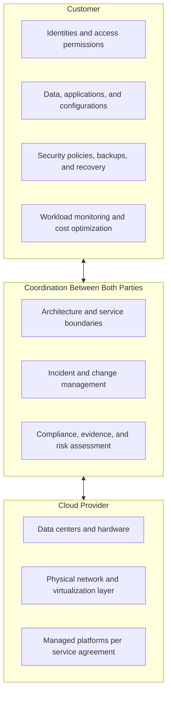
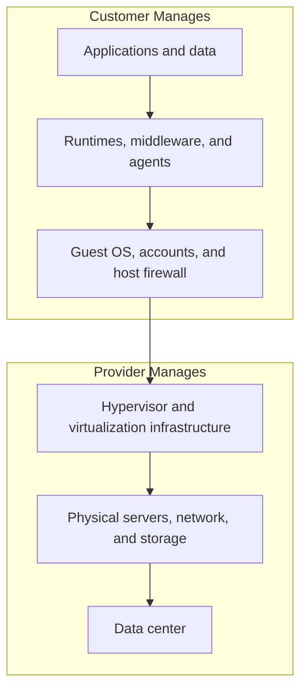
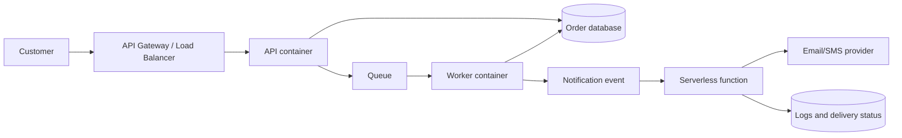

# Customer and Provider Responsibilities for Compute

When deploying applications in the cloud, the provider operates part of the infrastructure, while the customer configures and uses the provisioned resources. The boundary between the two sides shifts with the compute model: with virtual machines (VMs), customers typically manage the guest OS and software inside the machine; with managed container platforms, the provider may manage the control plane and nodes; with serverless functions, the provider manages most of the execution environment. Regardless of the model, customers remain responsible for protecting their source code, data, identities, configurations, and how the application is used.

Clearly defining responsibilities is the foundation for designing **CLOUD_CORE_SERVICES_COMPUTE**. This module helps learners choose compute models, configure CPU, memory, and networking, deploy applications, scale loads, ensure availability, and optimize costs. Those decisions are only safe and sustainable when each party clearly understands its own tasks, shared coordination tasks, and the evidence that must be verified.

## Learning Objectives

After this lesson, you will be able to:

- Explain the shared responsibility model in cloud compute.
- Distinguish provider and customer responsibilities across physical, virtualization, OS, runtime, application, data, and network layers.
- Compare responsibility boundaries when using VMs, self-managed containers, managed containers, and FaaS.
- Determine who must configure IAM, firewalls, patches, secrets, backups, monitoring, and recovery.
- Read SLAs and service documentation to identify commitment scopes, limits, and remaining responsibilities.
- Build a responsibility matrix and operational checklist for a specific workload.

## 1. What Is the Shared Responsibility Model?

The cloud is built on infrastructure owned or operated by a provider. Customers rent resources and consume services via consoles, APIs, SDKs, or Infrastructure as Code tools. The provider secures the cloud infrastructure; the customer secures their workloads, data, and configurations in the cloud. Both sides coordinate so the service operates securely and meets requirements.

Two concepts are commonly used to describe this boundary:

- **Security of the cloud:** The provider is responsible for protecting data centers, physical servers, network equipment, the virtualization layer, and platform components within the service scope.
- **Security in the cloud:** The customer is responsible for protecting data, identities, access permissions, network configurations, operating systems, or applications they manage. Exact scope depends on the chosen service.

The shared responsibility model is not an immutable table across all services. As the provider manages more layers, the customer's infrastructure operations burden shrinks. However, managing data, access permissions, application configurations, and intended usage generally remains with the customer.



For example, a provider may guarantee that physical servers operate and deliver a VM service. Yet the customer must still update the OS inside the VM, restrict access ports, protect login keys, and configure the application. If the customer leaves an admin port open to the Internet or leaks credentials, the provider's physical data center security cannot prevent that breach.

## 2. Responsibility Breakdown by Compute Layer

To map responsibilities, trace the path from hardware up to the data the application processes.

| Layer or Activity | Cloud Provider | Customer |
|---|---|---|
| Data center | Facilities, power, cooling, access control, and physical site security | Choose region/zone matching data and latency requirements; evaluate certifications and service terms |
| Physical hardware | Servers, CPU, RAM, NICs, storage devices, and hardware maintenance | Select resource type, capacity, and region; monitor provisioned usage |
| Physical network and underlay | Backbone, physical network gear, and cloud infrastructure connectivity | Design VPC/VNet, subnets, routes, firewalls, DNS, and traffic flows within account scope |
| Hypervisor and virtualization | Operate, patch, and protect provider-managed virtualization layer | Choose suitable VM types and configs; protect workloads running inside VMs |
| VM guest OS | Provide images or provisioning mechanisms; may maintain certain provider-issued images | Patch OS, hardening, accounts, services, agents, in-guest firewall, and startup configs |
| Host OS and worker nodes | Managed for fully managed container services or node scopes committed by the provider | Managed if self-operating nodes/clusters; with managed nodes, still configure workloads and control versions per service |
| Container orchestration control plane | Operate control plane when using managed Kubernetes/container services | Manage cluster configs, permissions, namespaces, policies, and workloads; self-operate control plane if self-hosted |
| Container images and applications | Provide registry/runtime or foundational tools per service | Build, scan, sign, store, and deploy images; patch libraries, source code, and app configs |
| FaaS runtime | Operate servers, OS, and base runtimes supported by the service | Select supported runtime/version, manage dependencies, function code, config vars, permissions, and triggers |
| Identity and permissions | Provide IAM service, authentication mechanisms, and key management platform | Create principals, roles, policies, trust relationships, MFA, credential lifecycles, and least privilege |
| Data | Protect storage infrastructure and fulfill durability/availability service commitments | Classify data, control access, encrypt as required, set retention, delete, back up, and restore |
| Monitoring and logs | Provide platform metrics/logs, API audits, or observability services where available | Enable log sources, set retention, build dashboards/alerts, monitor applications, and investigate incidents |
| Availability | Maintain service components within SLA scope | Design app HA, distribute workloads, configure health checks, failover, backups, and test recovery |
| Cost | Publish pricing, metering methods, and service billing | Right-size resources, set budgets, tag, control egress, clean up resources, and optimize utilization |

This table is a guiding framework. Contracts, service documentation, deployment types, and actual configurations determine the final boundary. For instance, a provider may be responsible for patching the host OS, while the customer must still choose when to upgrade node pool versions, verify app compatibility, and handle workload restarts.

### 2.1. Provider Responsibilities

Typically, the provider is responsible for the following activities within the service scope:

- Protecting data centers, physical equipment, power, cooling, and physical access controls.
- Maintaining servers, networking gear, physical storage, and the virtualization layer.
- Patching and securing platform components directly operated by the provider.
- Providing tenant isolation mechanisms and infrastructure safeguards per service design.
- Operating the control plane or runtime when a service is sold as a managed service.
- Providing documentation on limits, service health status, SLAs, security guidance, and configuration tools.
- Communicating incidents or service changes per published terms and notification channels.

The provider is not by default responsible for fixing bugs in application code, restoring data the customer never backed up, fixing misconfigured customer firewalls, or policing internal users granted overly broad permissions.

### 2.2. Customer Responsibilities

Customers are typically responsible for the decisions and content they bring to the cloud:

- Selecting services, regions, configurations, and architectures suited to business requirements.
- Managing user and workload identities; enforcing least privilege, MFA, and access revocation workflows.
- Protecting data, secrets, encryption keys, and authentication credentials.
- Configuring subnets, routes, security groups, network policies, endpoints, and connections to dependent services.
- Updating guest OS, middleware, runtimes, images, dependencies, and application code within their managed scope.
- Establishing backups, retention, restore testing, DR plans, and RPO/RTO targets.
- Monitoring applications, detecting anomalous behavior, resolving errors, and reporting incidents per contractual/legal obligations.
- Tracking quotas, performance, SLAs, billing, and optimizing resources.

### 2.3. Activities Requiring Coordination

Some tasks cannot be completed by either party alone. Both sides must align on technical boundaries, points of contact, and operational evidence:

- Designing architecture accounting for fault domains, regions, connectivity, and service dependencies.
- Planning upgrades when the provider changes platform versions or deprecates runtimes.
- Investigating incidents requiring logs from both the control plane and workloads.
- Remediating vulnerabilities spanning platform layers and customer-deployed configurations.
- Assessing compliance, retaining evidence, and meeting audit requirements.
- Testing recovery plans when incidents span beyond a single component.

## 3. Responsibility Boundaries by Deployment Model

The biggest difference among VMs, containers, and FaaS is how many infrastructure layers the customer must operate themselves. The same application can have different responsibility boundaries depending on the chosen cloud service.

### 3.1. Virtual Machines (VM / IaaS)

With Infrastructure as a Service (IaaS), the provider supplies compute, storage, and virtual networking resources. Customers hold higher control over the guest OS and software inside the VM, and therefore carry more operational responsibility.



**The provider is typically responsible for:**

- Securing data centers and physical servers.
- Maintaining the hypervisor, firmware, and physical network/storage infrastructure.
- Providing APIs to create VMs, disks, NICs, snapshots, and infrastructure features.
- Maintaining baseline service availability within SLA scope.

**The customer is typically responsible for:**

- Choosing images, VM types, vCPUs, RAM, disks, subnets, and security groups.
- Updating the guest OS and installing runtimes, middleware, and applications.
- Managing users, SSH keys, certificates, management endpoints, and in-guest firewalls.
- Configuring identities/roles for VMs to access cloud services; protecting metadata credentials.
- Backing up data, testing restores, and designing multi-instance/multi-zone layouts if HA is needed.
- Monitoring CPU, RAM, disk I/O, networking, logs, and vulnerabilities in the guest OS/apps.

**Example:** A company runs an API on a Linux VM. The provider is responsible for protecting physical servers and the hypervisor. The company's team must patch Linux, update the runtime, configure SSH, open only necessary HTTPS ports, restrict service account permissions, and back up the database. If the VM is compromised due to a weak SSH password or an application vulnerability, that generally falls inside the customer's managed scope.

### 3.2. Containers and Kubernetes

Containers can run on customer-operated clusters or on managed services. Therefore, simply saying “we use containers” is not enough to determine who owns nodes, runtimes, or the control plane.

**Self-managed Kubernetes:** Customers are typically responsible for installing and upgrading the control plane, nodes, OS, container runtime, network plugins, storage plugins, RBAC, and policies. The cloud provider still manages physical infrastructure or underlying VMs if the cluster runs on cloud VMs.

**Managed Kubernetes:** The provider may operate the control plane, API server, etcd, and certain core components. Customers must still manage cluster configuration, Kubernetes permissions, namespaces, workloads, images, secrets, network policies, and data. Worker node responsibility depends on mode: self-managed nodes generally belong to the customer; managed node pools may receive provider patching or upgrade support, but the customer must still coordinate rollouts and validate workloads.

**Managed task/service container platforms:** The provider may abstract away servers and schedulers. Customers remain responsible for images, task definitions, CPU/RAM, execution roles, network ports, secrets, health checks, and how applications persist data.

| Container Component | Self-Managed Cluster | Managed Control Plane | Node-Abstracted Container Platform |
|---|---|---|---|
| Physical servers/hypervisor | Infrastructure provider | Infrastructure provider | Service provider |
| OS and worker nodes | Customer if self-built on VMs; provider manages physical hosts only | Depends on node pool type; verify patch/upgrade ownership | Provider typically manages |
| Kubernetes control plane | Customer | Provider operates; customer configures cluster and permissions | May not be exposed to customer |
| Container runtime | Customer on self-managed nodes | Depends on node pool responsibility and service agreement | Provider typically manages |
| Images, dependencies, app code | Customer | Customer | Customer |
| RBAC, namespaces, network policies | Customer | Customer configures within API scope | Uses IAM/task roles or policies provided by the service |
| Secrets and application data | Customer | Customer | Customer |

**Example:** A team deploys an API as Pods on managed Kubernetes. The provider operates the control plane. The development team must still ensure images contain no secrets, configure `requests`/`limits`, define readiness probes, restrict service accounts, verify network policies, update images, and back up data in persistent volumes or databases. If a node pool requires a version upgrade, the team must check compatibility and potential disruption before applying.

### 3.3. Serverless Functions (FaaS)

With Function as a Service, the provider manages most of the execution environment: servers, OS, underlying runtime, instance creation, and scaling mechanisms. Customers focus on function code, dependencies, triggers, identity, data, and service limits.

**The provider is typically responsible for:**

- Operating hardware, hypervisors, host OS, and base runtimes per service.
- Provisioning and reclaiming execution environments.
- Providing event routing, scaling, and execution isolation per platform design.
- Patching runtime/infrastructure components within provider scope.
- Providing quotas, platform metrics, and service limit documentation.

**The customer is typically responsible for:**

- Writing, testing, packaging, and updating function code and dependencies.
- Choosing supported runtime versions and tracking end-of-support timelines.
- Configuring triggers, authenticating event sources, timeouts, memory, and concurrency.
- Granting least-privilege permissions to function roles; managing secrets and input data.
- Designing idempotency, retries, dead-letter queues, and duplicate event handling.
- Securing API endpoints, databases, object storage, and services called by the function.
- Monitoring errors, latency, cost, and concurrency limits.

**Example:** An image-processing function triggers when users upload files to object storage. The provider operates the runtime and scales instances. The customer must verify object read permissions, validate events, cap file sizes, sanitize untrusted content, configure timeouts and memory, write results to appropriate storage, and handle retries to avoid duplicate records.

Serverless reduces server administration, but does not shift all security and operational responsibility to the provider. Function code with overly broad permissions or unauthenticated endpoints can still leak data.

## 4. Security Responsibilities in Compute

Compute security consists of multiple coordinated control layers. A secure platform layer cannot compensate for vulnerable application code or overly permissive access.

### 4.1. Identity and Access Management (IAM)

The provider supplies the IAM system, authentication mechanisms, roles, and policies. The customer decides which user or workload may assume an identity and what actions it can perform.

Customers must:

- Enforce MFA for human administrative accounts and assign permissions by job role.
- Separate human user identities from workload identities; each VM, container, or function should have a dedicated role scoped to its needs.
- Grant least-privilege permissions per required resource and action; avoid giving owner/admin accounts to applications.
- Prefer short-lived credentials or workload-bound identities over long-lived access keys stored in config files.
- Audit permissions periodically, revoke unused privileges, and retain audit logs.
- Verify trust policies to prevent external principals or untrusted workloads from impersonating identities.

For example, if an API only needs to read objects in a specific bucket, the API's role should restrict read access to that bucket/prefix. Never grant admin permissions across all storage simply because it is the fastest way to make the app work.

### 4.2. Networking and Access Surface

The provider secures the physical network and supplies virtual networking components. Customers configure how workloads communicate:

- Place workloads in appropriate subnets; distinguish public subnets from private subnets.
- Allow only necessary inbound/outbound traffic via security groups, firewalls, or network policies.
- Use load balancers or API gateways as controlled entry points; restrict direct access to nodes and admin ports.
- Use TLS for connections requiring protection; enforce mutual authentication when security requirements demand it.
- Control DNS, NAT, routes, private endpoints, and cross-region connections.
- Monitor anomalous traffic and egress costs.

A common mistake is filtering only inbound ports while ignoring outbound traffic. If a workload is compromised, unrestricted egress can allow attackers to contact command-and-control servers or exfiltrate data.

### 4.3. Operating Systems, Images, and Dependencies

Patching responsibility depends on the layers managed by the customer:

- **VM:** Customer patches guest OS, guest kernel, packages, middleware, and applications. Provider patches hypervisor and host infrastructure.
- **Container:** Customer updates base images, libraries, binaries, and application code; provider or cluster ops team manages host OS/runtime depending on the service.
- **FaaS:** Provider patches the underlying runtime; customer updates code, dependencies, and migrates to supported runtimes upon deprecation notices.

A vulnerability management workflow should include asset inventory, image/package scanning, severity triage, owner assignment, patch scheduling, compatibility testing, and post-deployment verification. Building a new image while workloads continue running an old digest leaves the vulnerability unpatched.

### 4.4. Secrets and Encryption

Customers must identify which data is sensitive, who may access it, and which keys protect it. Providers may offer KMS, HSMs, or secrets managers, yet customers must still configure policies, key lifecycles, and usage permissions.

- Never commit secrets to Git, Dockerfiles, images, logs, or build artifacts.
- Use a secrets manager or platform key management service; restrict which principals can read secrets.
- Encrypt data in transit with TLS and at rest per data/policy requirements.
- Rotate keys and credentials; maintain revocation procedures in case of exposure.
- Avoid writing sensitive payloads into logs, traces, and analytics systems.
- Verify access permissions on snapshots, backups, object storage, and data replicas.

Encryption does not replace access control. A principal with valid permission to read decrypted data can still access the information; hence IAM, auditing, and data classification remain essential.

### 4.5. Runtime Isolation and Multi-Tenancy

The provider is responsible for designing and operating tenant isolation in infrastructure they manage. Customers must choose services and configurations matching their workload's risk profile.

- VMs typically establish boundaries via a hypervisor and dedicated guest OS.
- Standard containers share the host kernel; `privileged` rights, host namespaces, or host mounts can weaken isolation boundaries.
- Some platforms use sandboxes or microVMs to strengthen isolation; verify service documentation rather than inferring from product names.
- FaaS isolates execution environments per provider design; customers must still validate permissions, data flows, and cross-function invocations.

For workloads handling sensitive data or multiple untrusted tenants, perform dedicated threat modeling, assess isolation strength, and verify relevant security terms.

## 5. Responsibilities for Availability, Backups, and Recovery

A provider may commit to an availability target for an underlying service. That does not mean the customer's entire application achieves the same availability. An application can go down due to code bugs, database connection exhaustion, DNS misconfiguration, or expired credentials even while the compute service meets its SLA.

### 5.1. Distinguishing SLAs from Application Availability

An SLA (Service Level Agreement) defines service scope, measurement methods, commitment levels, exclusions, and remedies if the provider misses the target. When reading an SLA, verify:

- Which services and regions are covered? Does the commitment apply to VMs, databases, networking, or the combination?
- Is availability measured monthly, per region, or per individual resource?
- Are multi-zone deployments or redundant configurations required to qualify?
- How are planned maintenance, customer misconfigurations, or out-of-scope events handled?
- Is the remedy a service credit or another obligation? What are the claim deadlines?

An SLA does not replace HA architecture, backups, or DR plans. Service credits also do not restore lost data or fully compensate business losses.

### 5.2. Who Designs HA?

The provider maintains infrastructure components within the service scope. Customers must design workloads to keep serving when an instance or fault domain fails:

- Run multiple VMs or container replicas as needed; distribute across zones per availability goals.
- Configure load balancers, health checks, readiness probes, and mechanisms to drain unhealthy instances from traffic.
- Use autoscaling with sensible bounds; avoid letting fast compute scaling overwhelm downstream dependencies.
- Design databases, queues, caches, and storage for matching fault tolerance.
- Use timeouts, backoff retries, circuit breakers, and idempotency so failures do not cascade.
- Test failover and sustained serving capability under realistic load.

### 5.3. Backups and Data Recovery

Providers may offer snapshots, backup services, versioning, or replication. Customers must decide which data requires protection, frequency, retention period, replica storage locations, and how recovery is tested.

Two critical metrics:

- **RPO (Recovery Point Objective):** The maximum acceptable data loss, typically expressed as the time interval between recovery points.
- **RTO (Recovery Time Objective):** The target duration to restore service after an incident.

For example, if a system sets an RPO of 15 minutes and an RTO of 2 hours, backup/replication workflows and runbooks must reliably meet both targets in defined scenarios. You cannot infer RPO/RTO compliance merely from enabling snapshots.

Customers should:

1. Inventory data and classify criticality levels.
2. Choose application-consistent backups rather than isolated per-disk snapshots alone.
3. Store copies in appropriate fault domains or administrative accounts; protect backups from accidental deletion and unauthorized access.
4. Define retention, encryption, restore permissions, and data deletion workflows.
5. Perform periodic test restores, measure duration, and verify data integrity.
6. Maintain runbooks, designated owners, and provider support contact channels.

The provider is responsible for operating the backup service per product commitments. The customer is responsible for enabling the right features, choosing policies, protecting copies, and proving data can be restored.

## 6. Deployment, Change, and Lifecycle Management

A cloud workload typically undergoes repeated builds, deployments, scaling events, upgrades, and replacements. Responsibilities must be defined both at initial creation and during ongoing operations.

### 6.1. Infrastructure as Code (IaC)

Customers commonly manage cloud configurations using Terraform, CloudFormation, Bicep, or similar tools. IaC enables repeatable declarations of components such as VMs, networks, IAM, clusters, functions, and policies.

Example Terraform snippet illustrating the principle of not opening admin ports to every address:

```hcl
resource "example_security_group" "web" {
  name = "web-service"

  ingress {
    protocol    = "tcp"
    from_port   = 443
    to_port     = 443
    cidr_blocks = ["203.0.113.0/24"]
  }

  egress {
    protocol    = "tcp"
    from_port   = 443
    to_port     = 443
    cidr_blocks = ["0.0.0.0/0"]
  }
}
```

This is a hypothetical structural example, not a resource directly applicable to a specific provider. In real environments, use valid provider/resource types, add rules needed for dependent services, and review plans before applying.

Customers must govern IaC source code, review changes, protect state files, avoid writing secrets into state or outputs, run policy checks, and detect drift. The provider supplies the APIs and infrastructure services invoked by IaC; they do not automatically validate that customer-declared configurations are secure.

### 6.2. Patch and Upgrade Management

Patching responsibilities should map to each specific component:

| Component | Typical Primary Owner | Action |
|---|---|---|
| Firmware, hardware, hypervisor | Provider | Maintain and patch infrastructure per internal processes |
| Guest OS inside VM | Customer | Track patches, test, deploy, and verify |
| Self-managed host OS/nodes | Customer | Patch nodes, runtime, kernel, and schedule drain/restarts |
| Managed node pools | Shared per service | Provider supplies mechanism/patches; customer picks upgrade windows, tests, and ensures workload readiness |
| Managed Kubernetes control plane | Provider operates; customer configures and selects versions per service options | Track versions, API deprecations, and addon/workload compatibility |
| Base images and app libraries | Customer | Rebuild images, scan, test, and roll out |
| FaaS underlying runtime | Provider | Maintain provided runtimes and announce changes |
| Function code and dependencies | Customer | Fix vulnerabilities, upgrade dependencies, test, and deploy |

Do not assume “managed” means the provider automatically updates everything without customer action. Some services require customers to actively choose new versions, enable auto-upgrade, or migrate workloads before end-of-support dates.

### 6.3. Change Management and Rollback

Customers are responsible for controlling changes to their applications and configurations. A sound process includes reviews, testing, staged rollouts, health checks, and rollbacks. The provider must announce impactful platform changes, while customers must monitor announcements and assess workload impact.

For high-risk changes, you should:

- Store reproducible artifact and configuration versions.
- Test compatibility in staging or an equivalent environment.
- Use canary or rolling updates when supported by the platform.
- Define rollout halt criteria based on error rates, latency, and instance health.
- Maintain rollback plans for application code, configurations, and data schemas.
- Record approvers, timestamps, and change outcomes.

## 7. Responsibilities for Monitoring and Incident Response

Providers typically monitor underlying infrastructure and core service health, while offering status pages, metrics, or audit logs. Customers must monitor user experience and application behavior.

### 7.1. Signals Customers Should Monitor

- **Compute:** CPU utilization, memory working set, OOMs, throttling, instance counts, startup times, and scaling events.
- **Storage:** Capacity, IOPS, throughput, latency, I/O errors, volume usage, and backup status.
- **Network:** Packet loss, latency, connection counts, DNS errors, timeouts, throughput, and egress.
- **Application:** Request rate, error rate, p95/p99 latency, queue depth, job duration, and dependency failures.
- **Security:** Anomalous logins, IAM changes, secret access, security group changes, non-compliant images, and unusual egress behavior.
- **Cost:** Spend by service/tag, idle resources, data transfer, and budget overrun trends.

A useful observability system combines metrics, logs, traces, and audit events. Logs should include timestamps, request/correlation IDs, and enough context for investigation, while avoiding tokens, passwords, or unnecessary personal data.

### 7.2. Triage and Coordination During Incidents

When an incident occurs, customers must determine user impact, affected workload scope, start time, recent changes, and related dependencies. Then distinguish platform issues from configuration or application errors using evidence.

| Symptom | Initial Customer Action | When to Engage Provider |
|---|---|---|
| VM fails to launch despite valid quota and config | Check region, machine type, quota, image, and account events | Confirmed infrastructure provisioning failure or regional service disruption |
| High VM CPU, slow application | Inspect processes, profile code, check machine type and resource limits | Evidence of host/hypervisor fault or infrastructure event affecting instances |
| Pod OOMKilled or Pending | Check requests/limits, node capacity, events, and memory profile | Failure in managed control plane or provider-managed node component |
| Function throttled | Check concurrency, quotas, event rate, and dependencies | Need to verify service limits or platform bug outside documented limits |
| API cannot reach database | Check DNS, routes, firewalls, credentials, pools, and database status | Network connectivity fault or downstream managed service outage in provider scope |
| Multiple services in a region failing simultaneously | Check status page, health dashboard, and platform notices | Open support case with timestamps, region, request IDs, and relevant evidence |

When opening a support case, provide the region, service, resource identifiers, timestamps with timezone, request/correlation IDs, symptoms, impact severity, and troubleshooting steps already tried. Do not include secrets, private keys, or unnecessary sensitive data.

Customers remain responsible for mitigating business impact, activating fallback plans, and notifying users per internal procedures. The provider investigates platform components within their scope and shares progress updates through support channels.

## 8. Responsibilities for Cost and Compute Efficiency

The provider publishes pricing, metering units, quotas, and invoices. Customers decide resource types, runtimes, scale, traffic patterns, and workload architecture; consequently, most cost-optimization levers sit on the customer side.

Customers must:

- Size vCPU, RAM, and storage based on measurements, avoiding excessive over-provisioning or failure-inducing under-provisioning.
- Use autoscaling with sensible min/max limits and thresholds; validate scale-in behavior to avoid terminating busy instances.
- Shut down or delete unused resources, including disks, snapshots, IPs, load balancers, and test environments.
- Track egress, NAT, cross-region data transfers, and logging/monitoring costs.
- Apply tags/labels by application, environment, team, or cost center for spend allocation.
- Set budgets, alerts, and response workflows for unexpected usage spikes.
- Evaluate total cost of ownership covering compute, networking, storage, backups, licenses, and operational effort.

The provider is responsible for transparent pricing and metering per service terms, but cannot automatically know which configuration is optimal for a customer's application. A serverless service can be cheap for sparse loads yet expensive when invocation counts and execution durations climb; VMs can deliver predictable costs under steady loads yet waste money when left idle. Measure against real workloads.

## 9. Compliance, Data Ownership, and Evidence

Providers may maintain certifications, audit reports, and security controls for their infrastructure. Customers must identify compliance obligations applicable to their data and business processes, then configure services to satisfy them.

When evaluating a compute service, verify:

- Do data storage and processing regions satisfy data residency requirements?
- Does the service hold required certifications or audit reports, and which components do those reports cover?
- Who can access data, metadata, logs, and backups? Is an audit trail available?
- How are data retention, deletion, replica handling, and legal request support governed?
- Are encryption, key management, access controls, and provider personnel access restrictions in place?
- Upon contract termination, how is data exported, deleted, and deletion-verified?

A provider's certifications do not automatically make a customer's workload compliant. Customers must retain evidence of configurations, access permissions, backups, recovery tests, incident handling, and staff training per organizational requirements.

## 10. How to Define Responsibility Boundaries for a Workload

You can follow this process before deploying or when migrating from VMs to containers/serverless:

1. **Describe the workload.** Identify the application, data, users, network flows, dependencies, criticality, and performance requirements.
2. **Select the specific service.** Distinguish self-managed VMs, container platforms, managed Kubernetes, task services, or FaaS. Generic model names are insufficient to establish responsibilities.
3. **Read service documentation.** Review shared responsibility guides, security guides, service limits, patching, backups, SLAs, support plans, and lifecycle/deprecation schedules.
4. **List all layers.** Document who owns physical hardware, hypervisors, OS, nodes, control plane, runtimes, images, code, identity, networking, data, and monitoring.
5. **Assign owners.** Every activity needs a customer-side owner, even when the provider performs underlying actions. Note which tasks require provider support.
6. **Define controls and evidence.** Identify policies, logs, alerts, backup records, restore results, scan reports, and audit trails proving control execution.
7. **Test failure scenarios.** Simulate instance loss, zone failure, quota exhaustion, secret exposure, vulnerable images, and data restoration.
8. **Review periodically.** Update the matrix when changing services, upgrading versions, modifying contracts, or when the provider shifts management boundaries.

### 10.1. Sample Responsibility Matrix

The template below can be adapted to your organization. “A” is Accountable (ultimately owns the outcome); “R” is Responsible (performs the work); “C” is Consulted; “I” is Informed. Each row should have one clear A.

| Activity | Customer Owner (A/R) | Provider (R/C) | Evidence to Retain |
|---|---|---|---|
| Select service and region | Architect / workload owner | Provides documentation and limits | ADR, service assessment, region and quota records |
| Protect data center and hypervisor | C/I | A/R | Audit reports, certifications, security documentation |
| Configure VPC/subnets/firewall | Network owner | C | IaC, rule reviews, flow logs |
| Patch VM guest OS | Compute/OS owner | Provides images/guidance | Patch reports, agent status, test records |
| Patch managed host/nodes | Monitor and coordinate | R per contract; customer approves/coordinates as needed | Upgrade schedule, node versions, rollout results |
| Secure images and app code | Development/security owner | Provides base registry/runtime if applicable | SBOM, scan reports, digests, release records |
| IAM and secrets | IAM/application owner | Provides IAM/KMS/secrets service | Policy reviews, access logs, rotation records |
| Backups and restore testing | Data owner | Operates backup features per service | Backup policies, restore tests, RPO/RTO records |
| App monitoring and incident response | SRE/operations owner | Monitors platform and supports service layer | Dashboards, alerts, incident timelines, support cases |
| Cost management | Service owner / FinOps | Pricing, usage metering, and billing | Budgets, cost reports, tag coverage, action logs |

The matrix should specify real role or team names within the organization, contact channels, response SLAs, and escalation paths. Never leave a critical activity in a state where “everyone shares responsibility” with no single accountable owner.

## 11. Practical Example: Deploying an Order-Processing API

An online store runs an order-intake API, a payment-processing worker, and a notification function. The system uses containers for the API, a queue for background jobs, and FaaS for notifications. A database and object storage persist durable data.



A practical responsibility matrix might look like this:

| Item | Provider | Store's Dev/Ops Team |
|---|---|---|
| Physical servers, underlay network, hypervisor | Operate and protect | Select region and configure cloud resources |
| Managed container control plane | Operate per service | Configure cluster, namespaces, RBAC, policies, and compatible versions |
| Worker nodes | Per node pool scope | Choose upgrade policies, test workloads, monitor capacity |
| API/worker images | Provide base registry/runtime if applicable | Build, scan, sign, update images, and roll out |
| Serverless functions | Operate underlying runtime and scaling | Update code/dependencies, triggers, timeouts, concurrency, and roles |
| IAM and secrets | Provide IAM/KMS/secrets manager | Create separate roles for API, worker, functions; rotate secrets and audit permissions |
| Database and object storage | Secure service infra; provide backup/replication features | Configure access permissions, retention, encryption, backups, and restore testing |
| Queue and retries | Operate queue service | Configure visibility/retention, retries, dead-letter queues, and idempotency |
| End-to-end app availability | Per-service foundational SLAs | Distribute replicas, configure health checks, failover, and DR drills |
| Cost | Provide usage metrics and billing | Size resources, autoscale, manage egress, budgets, and optimize queries/connections |

If the API fails because an image contains a vulnerable dependency, the development team must update the image. If the managed control plane suffers an outage, the operations team collects request IDs and region details to open a support case while activating mitigation plans. If the queue redelivers a message, the worker must use an idempotency key to avoid double-charging. If the notification function experiences a concurrency spike, the operations team must inspect quotas and email-provider connection limits.

This example demonstrates that one system can leverage multiple compute models simultaneously. Responsibilities must be mapped per service and per layer—you cannot slap one blanket label across the entire system.

## 12. Common Misconceptions

**“Once we move to the cloud, the provider is responsible for all security.”**

Incorrect. The provider secures infrastructure within their scope. Customers still manage data, identities, applications, and resource configurations.

**“Using a managed service means no operations work is required.”**

Managed services reduce certain infrastructure administration tasks, yet customers still configure permissions, data, networking, backups, monitoring, quotas, versions, and dependencies.

**“A VM's SLA equals the application's SLA.”**

Incorrect. SLAs apply to defined services and qualifying conditions. Applications also depend on code, databases, DNS, networking, configuration, and multi-component architecture.

**“The provider runs backups, so we don't need to test restores.”**

Backups are only valuable when data can be restored within required timelines and in a valid state. Customers must choose policies, protect copies, and test recovery.

**“Containers are more secure than VMs in every case.”**

You cannot draw that blanket conclusion. Isolation depends on the kernel, runtime, configuration, and threat model. Standard containers share a host kernel; VMs enforce boundaries at the virtualization layer.

**“Serverless requires no version or dependency management.”**

Customers must still update code and dependencies, track runtime end-of-support dates, configure permissions, and handle events. The provider manages the base runtime within service scope.

**“A cloud provider's certifications prove my application is compliant.”**

Certifications cover only the assessed scope of controls. Customers must prove how they configure, operate, and use services in accordance with their obligations.

## 13. Pre-Production Compute Workload Checklist

**Scope and Ownership**

- [ ] Identified the exact service and read its responsibility model.
- [ ] Built a matrix showing who owns OS, nodes, control plane, runtimes, images, code, identity, networking, and data.
- [ ] Every critical activity has a customer-side owner and a provider support escalation path.
- [ ] Recorded quotas, limits, SLAs, support plans, and version lifecycle schedules.

**Security**

- [ ] Workloads use dedicated identities with least-privilege permissions.
- [ ] MFA, secrets manager, rotation, and audit logs are properly configured.
- [ ] Network permits only required flows; both inbound and outbound are reviewed.
- [ ] Patching workflows exist for guest OS, images, dependencies, and application code.
- [ ] Data and backups are classified, encrypted, access-restricted, and given retention policies.

**Availability and Recovery**

- [ ] Architecture satisfies fault-domain distribution and health check requirements.
- [ ] Timeouts, retries, backoff, and idempotency exist for repeatable tasks.
- [ ] Backups have clear policies; restores have been tested.
- [ ] RPO/RTO and runbooks are aligned with business owners.
- [ ] Procedures exist to coordinate with the provider during platform failures.

**Observability and Cost**

- [ ] Essential metrics, logs, traces, alerts, and audit events are in place.
- [ ] Dashboards track application and dependency health.
- [ ] Tags/labels, budgets, cost alerts, and designated responders are configured.
- [ ] CPU, RAM, storage, networking, and autoscaling are sized from measured data.
- [ ] Review schedules exist for permissions, patches, quotas, costs, and responsibilities when services change.

## 14. Conclusion

The shared responsibility model partitions work between the cloud provider and the customer across each compute layer. Providers generally protect data centers, hardware, underlay networks, hypervisors, and managed components they directly operate. Customers generally manage identities, data, network configurations, applications, dependencies, guest OS, or workloads within their control scope.

VMs give customers broad guest OS control along with greater operational responsibility. Containers and Kubernetes shift boundaries depending on who manages nodes and the control plane. FaaS offloads most server and base runtime management to the provider, while customers continue managing code, triggers, permissions, data, and error handling. Therefore, boundaries must be defined per specific service and verified against documentation, SLAs, responsibility matrices, and operational tests.

A secure, efficient compute workload requires clear ownership for every activity, IAM and network controls, patching workflows, backup/restore processes, monitoring, incident response, and cost management. Whenever services or architectures evolve, revisit and update the responsibility matrix accordingly.

## Key Terms to Remember

| Term | Meaning |
|---|---|
| Shared responsibility model | Model dividing security and operational responsibilities between cloud provider and customer. |
| Security of the cloud | Responsibility for protecting cloud infrastructure operated by the provider. |
| Security in the cloud | Responsibility for protecting customer workloads, data, and configurations inside the cloud. |
| IaaS | Infrastructure as a Service; infrastructure services such as VMs, networking, and virtual storage. |
| Managed service | Service where the provider operates part or most of the platform layer under contract. |
| IAM | Identity and Access Management; managing identities and access permissions. |
| SLA | Service Level Agreement; service-level commitment and coverage scope. |
| RPO | Recovery Point Objective; maximum acceptable data loss threshold. |
| RTO | Recovery Time Objective; target duration to restore service. |
| IaC | Infrastructure as Code; managing infrastructure configuration via code. |
| Control plane | Component managing, configuring, and orchestrating resources/workloads. |
| Data plane | Component directly handling traffic or executing workloads. |
| Least privilege | Principle of granting only the minimum permissions required to perform a job. |
| Drift | State where actual configuration diverges from managed or declared configuration. |
| Idempotency | Property whereby repeating an operation produces no unintended extra business side effects. |
