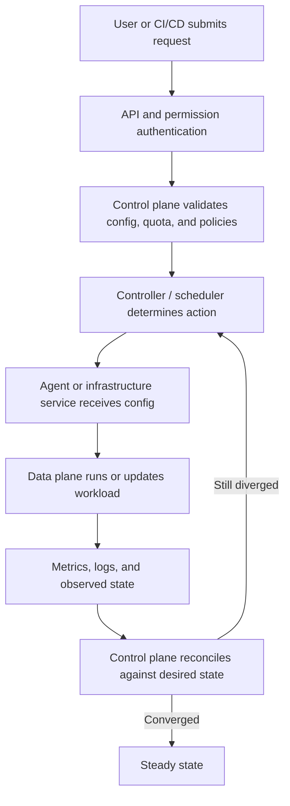

# Distinguishing Control Plane and Data Plane in Compute Services

## Context: Two Sides of a Compute Service

In cloud compute, users typically interact with an API or management console to create virtual machines, deploy containers, configure serverless functions, set CPU and memory limits, scale replica counts, or configure networking. Once a configuration is accepted, the application actually runs on servers, handles requests, and exchanges data over the network.

These two groups of activities belong to two different sides of the system:

- The **control plane** receives operator intent, checks permissions and configurations, decides which resources are needed, orchestrates creating or modifying resources, and tracks desired state.
- The **data plane** delivers actual execution capacity: running virtual machines, containers, or functions; allocating CPU and memory to workloads; processing packets and application requests; and reading/writing data per applied configurations.

You can think of the control plane as answering **“how should the system be configured and orchestrated?”**, while the data plane answers **“where and how are workloads and traffic currently being processed?”** This is a responsibility-based distinction. The two planes may be deployed across multiple components and machines; they are not necessarily two physically separate servers or networks.

In the **CLOUD_CORE_SERVICES_COMPUTE** module, understanding these two planes connects topics across virtual machines, containers, and serverless—such as choosing CPU, memory, networking, security configurations, deploying applications, scaling loads, ensuring availability, and optimizing operating costs.

## 1. What Is the Control Plane?

The control plane is the collection of APIs, management services, and orchestrators used to change or maintain a compute platform's configuration. Users, CI/CD systems, or automation services send requests to the control plane. The control plane authenticates identity, verifies permissions, validates configurations, records desired state, and coordinates infrastructure components to drive the system to that state.

Common tasks include:

1. **Receiving administrative requests:** Creating, modifying, starting, stopping, or deleting virtual machines; deploying container versions; creating serverless functions; configuring load balancers or autoscaling groups.
2. **Authenticating and enforcing policies:** Checking IAM, roles, access scopes, quotas, network policies, and security constraints.
3. **Scheduling and allocation:** Selecting suitable instance types, availability zones, hosts, or nodes; deciding workload placement based on resources and constraints.
4. **Lifecycle orchestration:** Coordinating resource creation, configuration updates, replacing failed instances, rolling deployments, and reclaiming unneeded resources.
5. **Maintaining desired state:** Comparing observed state against declared configuration, then taking corrective actions when needed.
6. **Providing management telemetry:** Returning deployment status, events, alerts, audit records, and data supporting scaling decisions.

For example, when requesting a virtual machine, the control plane may verify caller permissions, validate the image and machine type, check quotas, select a zone and host with enough capacity, instruct storage systems to create volumes, attach a network interface, and boot the VM. The user interacts with a single unified management request even though many components coordinate underneath.

The control plane typically exposes management interfaces such as a REST API, CLI, SDK, or console. Those interfaces are how requests are submitted; the interface itself is not the entire control plane. The core also includes authentication logic, schedulers, controllers, state stores, and infrastructure management services.

## 2. What Is the Data Plane?

The data plane is the part that directly executes workloads or forwards and processes traffic. In compute services, the data plane typically includes physical servers, hypervisors, worker nodes, container runtimes, function execution environments, networking components, and mechanisms enforcing security configurations.

Common tasks include:

- Allocating and consuming CPU, RAM, caches, and accelerators per workload configuration.
- Running the operating system and applications inside virtual machines.
- Running pods, containers, and application processes on worker nodes.
- Launching serverless function code upon events or invocations.
- Receiving, processing, and forwarding packets according to routing tables, network policies, and distributed configs.
- Enforcing traffic filtering rules, workload isolation, and resource limits where the workload actually runs.
- Emitting metrics such as CPU utilization, memory usage, latency, throughput, application errors, and network traffic.

For example, after a VM is successfully created, the application inside the VM handles HTTP requests, consumes CPU, allocates memory, and sends data over the network. Those operations happen on the data plane. The control plane may continue observing state and modifying configurations, but does not directly handle every HTTP request hitting the application.

Data plane does not merely mean “where data is stored.” In infrastructure terminology, *data* emphasizes the execution path or traffic-processing path. A packet forwarded across the network, a container serving requests, or a function executing code are all data-plane activities—even when no data is persisted long term.

## 3. Comparing Responsibilities of the Two Planes

| Aspect | Control Plane | Data Plane |
|---|---|---|
| Goal | Manage configurations and orchestrate resources | Execute workloads and process traffic |
| Typical inputs | Resource creation APIs, manifests, policies, scaling configs | Application requests, events, processes, packets |
| Activities | Authentication, scheduling, state updates, lifecycle orchestration | Running code, allocating CPU/RAM, handling requests, forwarding packets |
| Example components | API server, scheduler, controller, management services, state store | VM host, hypervisor, worker node, runtime, network datapath |
| Unit of observation | Resource status, rollout progress, administrative events | Latency, throughput, CPU, RAM, errors, and live traffic |
| Typical incidents | Unable to create or modify resources, slow orchestration | Application down, failing requests, or disrupted traffic |
| Operational question | “Has the desired configuration been applied?” | “Is the application serving traffic properly?” |

The boundary between the two planes is a responsibility boundary, not an absolute product boundary. A cloud service may run multiple functions inside one system cluster or split them across distributed services. When reading provider documentation, examine the specific function described rather than relying solely on product names.

## 4. The Two Planes Across Compute Models

### 4.1. Virtual Machines

For virtual machines, the control plane provides APIs or a console for users to choose images, instance types, CPU, RAM, deployment zones, subnets, security groups, disks, and autoscaling policies. The orchestrator checks quotas and permissions, finds a location with enough capacity, and instructs infrastructure services to create the VM and attach related resources.

The data plane is where hypervisors and physical servers deliver resources to the VM. The guest OS boots, the application runs, CPU is consumed, memory is allocated, disks perform reads/writes, and NICs process traffic. Users evaluating application performance are primarily observing outcomes from the data plane.

Example VM creation flow:

1. An operator submits a request to create a VM with 4 vCPUs, 8 GiB RAM, an image, and a subnet.
2. The control plane authenticates permissions, checks quotas, and validates configuration.
3. The scheduler selects a host with sufficient CPU, RAM, and placement-constraint compatibility.
4. Infrastructure components create volumes, network ports, and the VM; network and firewall rules are pushed to enforcement points.
5. The VM boots on the data plane and the application begins handling requests.

Selecting 4 vCPUs and 8 GiB RAM is a control-plane administrative decision. How much CPU and RAM the application actually consumes is data-plane behavior. If the application is slow, increasing vCPUs via API is a control-plane change; checking CPU throttling or CPU usage inside the VM is data-plane observation.

### 4.2. Containers and Kubernetes

In Kubernetes, the control plane receives declarative objects via the API server. The scheduler assigns unassigned pods to nodes; controllers watch state and create or replace objects to converge the cluster toward desired state. With a managed cluster, the cloud provider may operate the control plane on the customer's behalf.

The data plane resides primarily on worker nodes. Kubelet receives node-targeted instructions, the container runtime pulls images and runs containers, and node networking forwards traffic between pods and other destinations. Applications inside pods handle requests on those nodes.

The manifest below declares a desired state of three replicas for an application:

```yaml
apiVersion: apps/v1
kind: Deployment
metadata:
  name: web-api
spec:
  replicas: 3
  selector:
    matchLabels:
      app: web-api
  template:
    metadata:
      labels:
        app: web-api
    spec:
      containers:
        - name: api
          image: example.invalid/web-api:v1
          resources:
            requests:
              cpu: "500m"
              memory: "512Mi"
            limits:
              cpu: "1"
              memory: "1Gi"
          ports:
            - containerPort: 8080
```

Running `kubectl apply -f deployment.yaml` sends the configuration to the control plane's API server. The Deployment controller sees the desired state of three replicas and coordinates creating a ReplicaSet and Pods. The scheduler picks nodes; kubelet and the container runtime on worker nodes actually run the containers. The three application replicas process requests on the data plane.

A manifest only describes intent. Declaring `replicas: 3` does not prove three pods are ready. You must check rollout status while also inspecting application health, latency, errors, and worker-node resources. Kubernetes object status is the administrative view; actual serving ability is the data-plane view.

### 4.3. Serverless and Function as a Service

With serverless, users generally do not manage servers directly. The control plane accepts deployment packages, runtime configs, environment variables, access permissions, triggers, concurrency limits, versions, and scaling policies. The platform decides when to prepare or reclaim execution environments.

The data plane receives events or function invocations, provisions execution environments as needed, executes code, accesses downstream services, and returns results. Users observe response times, invocation counts, errors, concurrency levels, and usage-based costs.

Example: an image-processing function is configured to run whenever a new object lands in a bucket. Registering the trigger, granting object read permissions, and setting concurrency caps belong to the control plane. When an image uploads, the event triggers the function, image-processing code consumes CPU and memory, and the output image is written; that is data-plane activity.

Serverless hides many server details, but does not eliminate the distinction between the two planes. When a trigger is misconfigured, the control plane is where to check. When a function is invoked yet runs slowly or hits out-of-memory errors, inspect execution logs and metrics on the data plane.

## 5. Coordination Flow Between Control Plane and Data Plane

A compute change typically goes through the following cycle:



Crucially, the control plane typically operates on **desired state**. Operators declare the target outcome—such as three replicas, an instance type, or a scaling policy. Controllers continuously or periodically observe actual state (*observed state*) and act to reduce drift. Therefore, an accepted API call does not guarantee resources are ready; orchestration takes time and can still fail at a downstream step.

Coordination also flows in the opposite direction. The data plane emits metrics, logs, health signals, and events. The control plane or management system relies on those signals to replace failed instances, increase replicas, update displayed status, or alert operators. In many architectures, monitoring and orchestration are separate services, yet both participate in the operational feedback loop.

## 6. What Happens When One Plane Fails?

### 6.1. Control Plane Outage

If the management API or orchestrator becomes unavailable, users may be unable to create, modify, delete, or scale resources. Deployment pipelines may stall; autoscalers or controllers may fail to reconcile state. Even so, workloads already running on the data plane often continue serving for a period if they do not require live control-plane operations to handle individual requests.

This is a common architectural characteristic, not a guarantee across every service. Some data planes depend on the control plane to fetch fresh configurations, authenticate, issue tokens, receive events, or initialize execution sessions. When that dependency breaks, parts of data-plane activity can also suffer. Consult the dependency model and commitments of the specific service.

Common symptoms:

- Management APIs return errors or timeouts, while existing applications still respond.
- Unable to deploy new versions or increase instance counts.
- Resource status in the console lags or appears inconsistent.
- Controllers cannot reach the API or perform orchestration actions.

Response approach: check the provider's service health status, permissions and quotas, API errors, orchestration queues, and required dependencies. If existing workloads remain healthy, avoid making repeated changes that could complicate recovery; follow platform incident procedures.

### 6.2. Data Plane Outage

If worker nodes, hosts, runtimes, network datapaths, or workloads themselves fail, the application can lose serving ability even while management APIs remain operational. The control plane may show unhealthy nodes, failed pods, or stopped VMs, and can orchestrate replacements if spare capacity exists.

Common symptoms:

- Resource creation or query APIs still work, yet the application returns errors.
- CPU saturation, memory exhaustion, OOM kills, or continuous container crash loops.
- Latency spikes, packet loss, connection timeouts, or an unreachable deployment zone.
- Health checks failing across some instances or replicas.

Response approach: determine blast radius, inspect metrics and logs where workloads run, check host/node health, and verify networking and application dependencies. Shift traffic, replace instances, or spread workloads to another zone if architecture and capacity permit.

### 6.3. Quick Diagnostic Table

| Symptom | Where to Check First | Diagnostic Questions |
|---|---|---|
| Cannot create VM or cluster | Control plane | Are API, IAM, quotas, scheduler, or managed services failing? |
| Deployment succeeds but pods stay unscheduled | Both planes | Can the control plane find a matching node; do worker nodes have spare CPU/RAM and healthy status? |
| VM or pod is running but app times out | Data plane | Are the app, host, runtime, routes, firewalls, and health checks working? |
| Autoscaling does not add replicas | Both planes | Are metrics collected; does the controller have permissions and do nodes have capacity? |
| Console shows stale state while app still runs | Control plane and telemetry path | Are status APIs, reporting agents, and metric pipelines lagging? |

Do not draw conclusions from a single signal. For instance, a pod in `Running` status means Kubernetes sees the container started; it does not guarantee the application endpoint is healthy or ready to serve traffic.

## 7. Relationship to CPU, Memory, Networking, and Security

Distinguishing the two planes clarifies where decisions are made and where results must be verified for each resource type.

| Resource | Control Plane Decision | Data Plane Activity or Evidence |
|---|---|---|
| CPU | Select instance type, set CPU requests/limits, configure autoscaling | Actual CPU consumed, saturation, throttling, and processing time |
| Memory | Select RAM size, set memory requests/limits, configure runtime | Heap, working set, caches, page faults, OOMs, and actual usage |
| Networking | Create VPC/subnets, routes, security groups, policies, and load balancers | Packet forwarding, connections, throughput, packet loss, and latency |
| Storage | Choose volumes, disk types, sizes, and attachment policies | IOPS, throughput, latency, and workload read/write operations |
| Security | IAM, policies, firewall configs, secrets, and deployment rules | Process isolation, packet filtering enforcement, encryption, and runtime access control |

A valid configuration on the control plane can still produce poor performance on the data plane. For instance, setting CPU requests too low can hinder expected scheduling; setting limits too low can cause throttling; mis-sizing memory limits can trigger OOM kills. Similarly, syntactically valid routes and firewalls do not prove connectivity from application to target service works. Verify with metrics, logs, health checks, and connectivity tests from the workload's actual location.

On security, the control plane is often a high-value target because administrative privileges can create, alter, or delete many resources. Protect management APIs with least-privilege IAM, strong authentication, separation of duties, change auditing, and access restrictions. Protect the data plane with workload isolation, network segmentation, traffic filtering, secrets management, OS/runtime patching, and runtime behavioral monitoring. Secure control-plane configs cannot replace runtime security; conversely, host hardening cannot compensate for a compromised admin account.

## 8. Impact on Availability and Scaling

Service availability depends on both planes. The control plane needs redundancy across APIs, state stores, schedulers, and controllers so operators can manage the system when a component fails. The data plane needs distributed workloads, spare capacity, health checks, instance replacement mechanisms, and resilient network paths to keep serving if a node or zone fails.

During load scaling, the control plane receives scaling signals or policies and decides to increase VMs, pods, or function environments. The data plane absorbs the new workload and processes requests. If the control plane reacts slowly, new capacity may arrive after the traffic spike. If the data plane lacks CPU, RAM, connections, or network capacity, adding replicas may not clear the bottleneck and can even increase pressure on databases or auxiliary services.

When designing autoscaling, evaluate both sides:

- Choose metrics reflecting the true bottleneck, such as CPU, queue depth, concurrency, or latency.
- Set appropriate thresholds, stabilization windows, and scaling rates to prevent oscillation.
- Ensure quotas and spare capacity suffice for the control plane to provision additional resources.
- Account for VM boot time, image pulls, container startup, or function cold starts.
- Confirm new data-plane instances pass health checks before receiving traffic.
- Assess downstream dependency limits so compute scaling does not push failures onto databases, caches, or networks.

## 9. Impact on Operating Costs

Compute costs arise primarily from execution resources and companion services: vCPU, RAM, runtime duration, storage, data transfer, load balancers, and monitoring. This ties closely to data-plane consumption. However, the control plane directly drives cost efficiency via instance selection, quotas, schedules, autoscaling policies, request/limit settings, and reclaiming idle resources.

Several examples:

- Selecting oversized VMs increases costs even when actual CPU and RAM remain lightly used.
- Setting minimum replicas too high provides headroom but inflates costs during low traffic.
- Configuring autoscaling without scale-in thresholds leaves resources running after traffic spikes subside.
- Setting memory limits too low triggers crash loops, wasting resources and degrading user experience.
- Scaling compute without concurrency caps drives up bills or overloads downstream services.

Therefore, cost optimization requires a feedback loop: the control plane enforces policies and configurations; the data plane supplies utilization and performance telemetry; operators tune configurations from actual data. Do not slash CPU or RAM based solely on averages if the workload has brief spikes, strict latency targets, or requires failure headroom.

## 10. Practical Workflow to Identify the Right Plane

When deploying or troubleshooting a compute service, follow this sequence:

1. **Clarify the objective:** Are you creating resources, changing configs, deploying a release, handling requests, or fixing an app error?
2. **Locate the request entry point:** Which API, console, CLI, manifest, pipeline, or trigger initiated the change? This is usually the control-plane entry point.
3. **Check management state:** Permissions, quotas, configurations, deployment status, event history, scheduling results, and controller status.
4. **Check the execution site:** VMs, worker nodes, containers, function runtimes, CPU, RAM, disks, networking, and application logs.
5. **Compare desired vs. actual:** Have resources been created, is the workload ready, is traffic reaching the destination, and does performance meet targets?
6. **Make controlled changes:** Adjust control-plane configuration when needed; verify data-plane impact after changes take effect.
7. **Document and monitor:** Record root cause, actions, outcomes, and metrics to catch recurrences early.

A helpful self-check is asking two questions for every action:

- “What am I asking the platform to change?” — identifies the control-plane aspect.
- “What evidence must I observe to know the workload actually works?” — identifies the data-plane aspect.

For example, when deploying a new version, a successful rollout status is control-plane evidence that deployment objects converged to the configured spec. To conclude the service is operating well, you must still verify health checks, successful requests, latency, and error rates on the data plane.

## 11. Common Misconceptions

**Thinking the control plane is just the management console.** The console is merely one interface. APIs, schedulers, controllers, state stores, and policy logic also belong to the control plane.

**Thinking the data plane is only where data is stored.** In compute, the data plane is where workloads run and traffic is processed. CPUs executing code, containers handling requests, and datapaths forwarding packets are all data-plane operations.

**Assuming a control-plane outage immediately stops all applications.** Many existing workloads can keep running during management API disruptions, though deploying, reconfiguring, self-healing, or scaling may degrade. Impact depends on service design and dependencies.

**Assuming control-plane success means the application is healthy.** A resource can provision cleanly while the application still fails due to configuration, resource shortages, runtime bugs, networking, or downstream dependencies.

**Assuming the two planes are always physically separated.** They may share infrastructure or be distributed across multiple services. What matters is distinguishing management/orchestration functions from execution/processing functions.

**Assuming scaling the control plane scales the data plane.** Increasing API or scheduler capacity does not add CPU/RAM for applications. You must configure execution-resource scaling and verify new workloads are ready.

## Conclusion

The control plane manages intent, policies, and resource lifecycles; the data plane executes workloads and processes live traffic. Across virtual machines, containers, and serverless, both planes collaborate to turn administrative configuration into usable compute capacity. When deploying, scaling, securing, troubleshooting, or optimizing costs, inspect both management state and evidence where the workload runs. This perspective helps pinpoint root causes, choose the right actions, and evaluate services based on real outcomes.
