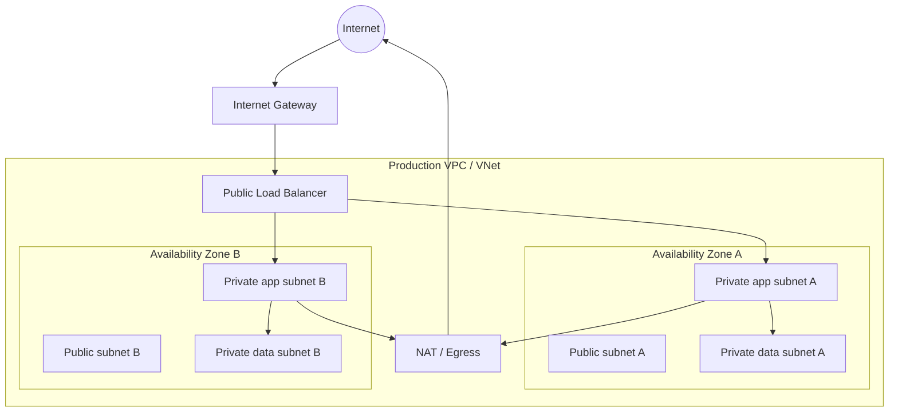

# VPC or VNet, Subnets, and VM Network Interface Placement

Cloud virtual machines do not connect directly to a physical network managed by the operator. A VM is typically placed inside a private virtual network belonging to an account or project, then connected to a subnet and assigned an IP address through one or more virtual network interfaces (NICs). This network design determines which components the VM can communicate with, which path it takes to reach the Internet, how it is segmented for security, and which availability zones it can be placed in.

Across cloud platforms, a virtual private network is commonly called a **VPC (Virtual Private Cloud)** or **VNet (Virtual Network)**. Naming and certain implementation rules differ between providers, but the foundational concepts are similar: IP address space, subnets, routes, network interfaces, traffic filtering policies, and connectivity to other networks.

## 1. What are a VPC and VNet?

A VPC or VNet is a user-configured logical network boundary in a cloud environment. It provides a private IP address space and mechanisms to control how resources communicate. Virtual machines, load balancers, data services, and supported resources can connect to this network according to platform rules.

A virtual network typically allows operators to:

- Choose one or more IPv4 address ranges and optionally add IPv6.
- Partition the network into subnets by application tier, environment, or availability zone.
- Define traffic paths using route tables and gateways.
- Control traffic using security groups, network security groups, network ACLs, or firewalls.
- Connect to on-premises networks, other VPCs/VNets, or partner networks via VPN, dedicated connections, or peering.
- Configure DNS, DHCP, and related network services.

A VPC/VNet establishes a logical boundary, but that does not mean every resource inside can automatically communicate with one another. Routes must exist, security policies must allow the traffic, and the target service must listen on the appropriate address and port.

| Concept | Role |
|---|---|
| VPC / VNet | Virtual network space and high-level connectivity boundary |
| CIDR | Describes the IP address range allocated to a network or subnet |
| Subnet | Segments a portion of the address space for placing resources |
| Route table | Determines the next hop for traffic to each destination |
| Gateway | Connects the virtual network to the Internet, private networks, or intermediary services |
| Network interface (NIC) | Network interface attached to a virtual machine or other resource |
| Security group / NSG / ACL | Specifies which traffic is allowed or blocked |

You should not treat VPC and VNet as two products with identical behavior. For example, regional scope, how subnets bind to availability zones, NIC limits, and routing mechanisms can differ. In an actual design, check the provider's documentation for the specific resource type and deployment region.

## 2. Planning IP Address Space

Address design should be done before creating a VPC/VNet. If you pick a range that is too small, the system may run out of addresses when scaling. If you pick a range that overlaps with office networks, data centers, or other VPCs/VNets, connecting via peering or VPN can run into routing issues.

### IPv4 and CIDR

CIDR (Classless Inter-Domain Routing) represents a network by its base address and prefix length. For example, `10.20.0.0/16` uses the first 16 bits for the network portion, while the last 16 bits are used for host addressing. The total number of addresses in the range is:

\[
\text{Number of addresses} = 2^{(32 - \text{prefix})}
\]

Some common sizes:

| CIDR | Total IPv4 addresses | Example range |
|---|---:|---|
| `/16` | 65,536 | `10.20.0.0` – `10.20.255.255` |
| `/20` | 4,096 | `10.20.0.0` – `10.20.15.255` |
| `/24` | 256 | `10.20.1.0` – `10.20.1.255` |
| `/26` | 64 | `10.20.2.0` – `10.20.2.63` |
| `/28` | 16 | `10.20.3.0` – `10.20.3.15` |

These are mathematical totals. The number of addresses assignable to actual resources is smaller because the platform reserves several addresses for the gateway, DNS, or internal purposes. The reserved count and minimum allowed subnet size vary by provider; you must look them up before calculating capacity.

Common private IPv4 ranges used in internal networks per RFC 1918 include:

- `10.0.0.0/8`
- `172.16.0.0/12`
- `192.168.0.0/16`

Private address space is not routed directly on the public Internet. However, two private networks can still conflict if they use the same address range and need to be connected to each other.

### How to Allocate Address Ranges

Suppose a system needs production, staging, and development environments. You can allocate a separate range for each environment, then divide it into subnets for each tier and availability zone. Illustrative example:

| Network | Supernet range | Example segmentation |
|---|---|---|
| Production | `10.20.0.0/16` | Web `10.20.0.0/20`, App `10.20.16.0/20`, Data `10.20.32.0/20` |
| Staging | `10.30.0.0/16` | Web `10.30.0.0/20`, App `10.30.16.0/20`, Data `10.30.32.0/20` |
| Development | `10.40.0.0/16` | Web `10.40.0.0/20`, App `10.40.16.0/20`, Data `10.40.32.0/20` |

The ranges above are examples only; verify the address space already in use across the organization before choosing. Reserve part of the range for new subnets, shared services, hybrid connectivity, and future growth. Document allocated ranges in IP address management (IPAM) or infrastructure documentation to prevent two teams from self-allocating overlapping blocks.

When calculating address counts, do not rely solely on the current number of virtual machines. Account for secondary NICs, additional private addresses, load balancers, service endpoints, scaling nodes, spare capacity, and blue-green deployment needs. If a subnet must serve hundreds of autoscaling instances, there must be enough addresses for peak scale and headroom during instance replacement.

### IPv6

IPv6 has a much larger address space and is typically allocated from a platform-provided or dedicated prefix. If a workload needs IPv6 access, plan consistently across the VPC/VNet, subnets, NICs, routes, security policies, DNS, and target services. Having an IPv6 address on a NIC does not guarantee connectivity works; IPv6 routes and rules must be configured accordingly. Do not assume IPv4 policies automatically apply to IPv6.

## 3. Segmenting Subnets by Function and Deployment Zone

A subnet is a subset of the VPC/VNet address range. Resources attached to a subnet receive addresses from that range according to the platform's mechanism. Subnetting helps segment address space and apply routes and security policies per workload group.

A common approach is tier-based segmentation:

- **Public or edge subnet:** hosts resources that must receive traffic from the Internet, such as public load balancers, reverse proxies, or bastions if the architecture still uses them.
- **Private application subnet:** hosts virtual machines running APIs, backends, workers, and internal services.
- **Private data subnet:** hosts databases, caches, or storage systems with strict access requirements.
- **Management subnet:** dedicated to administrative tools or operational services when separate isolation is needed.

The name "public subnet" is usually a routing-based convention, not a property that guarantees machines in the subnet automatically have public IPs. On many platforms, a subnet is considered public when its route table has a path to an Internet gateway. For a machine to receive direct Internet connections, it also needs an appropriate public address and rules permitting the traffic. Conversely, a machine with a public IP whose route or firewall blocks traffic still cannot be accessed as intended.

### Public and Private Subnets

| Characteristic | Public subnet | Private subnet |
|---|---|---|
| Route to Internet | Usually has a route to an Internet gateway | No direct inbound route from an Internet gateway |
| Public IP on workload | May have one if needed | Usually not assigned directly |
| Outbound Internet | Via Internet gateway per policy | Can go via NAT gateway, proxy, or egress firewall |
| Inbound from Internet | Only when a public endpoint and permissive rules exist | Usually enters via load balancer, VPN, bastion, or private connection |
| Suitable workloads | Public load balancers, edge proxies | Internal APIs, workers, databases, caches |

A NAT gateway typically allows private resources to initiate outbound connections using the NAT source address, while not providing a path for new inbound connections from the Internet to the workload. NAT does not replace security policies and does not by itself protect traffic between subnets. NAT cost, throughput limits, and zonal redundancy must be factored into the design.

### Distributing Subnets Across Availability Zones

To increase availability, workloads are usually distributed across multiple availability zones (AZs) or fault domains. A subnet may be bound to a specific AZ or have a different scope depending on the platform. For example, on some services, a subnet is an AZ-scoped resource; on other platforms, a subnet may span a region while NICs are placed in a specific zone.

For multi-AZ architectures, you need to:

1. Provision corresponding subnets for each tier in every AZ according to the provider's model.
2. Ensure each subnet has enough addresses for the expected number of instances in that AZ.
3. Configure consistent or intentionally differentiated routes and security policies across AZs.
4. Ensure load balancers, NAT, databases, and dependent services have appropriate fault-tolerant designs.
5. Check cost and latency when traffic crosses between AZs.

Simply creating subnets in multiple AZs does not make an application highly available on its own. The application needs multiple instances, data needs replication or recovery mechanisms, and network paths must continue working when one AZ experiences an outage.

## 4. Route Tables and Traffic Paths

A route table contains rules that select the next hop for packets based on the destination address. Each subnet is typically associated with a route table or uses a default route according to the platform's mechanism.

A route typically includes:

- **Destination:** the target CIDR range, such as `0.0.0.0/0` for all IPv4 destinations or `10.50.0.0/16` for a private network.
- **Target/next hop:** where to forward traffic, such as a local route, Internet gateway, NAT gateway, VPN gateway, transit gateway, or network virtual appliance.

Illustrative route table example:

| Destination | Next hop | Meaning |
|---|---|---|
| `10.20.0.0/16` | Local | Intra-VPC/VNet communication via the internal route |
| `0.0.0.0/0` | NAT gateway | Sends IPv4 outbound traffic from private subnets through NAT |
| `10.100.0.0/16` | VPN gateway | Sends traffic to the on-premises network |
| `10.60.0.0/16` | Peering connection | Sends traffic to a peered virtual network |

The destinations and target types in the table are conceptual examples; support and declaration syntax differ across clouds. More specific routes generally take precedence under longest prefix match. For example, a route to `10.100.0.0/16` takes precedence over the default route `0.0.0.0/0` for destinations within that range.

To diagnose a connection, check both directions. Request packets may reach the destination while responses lack a return route or are blocked by a firewall. For hybrid connections, verify routes in both the VPC/VNet and the on-premises router, VPN policies, route advertisements, and the possibility of overlapping CIDRs.

## 5. Virtual Machine Network Interfaces (NICs)

A NIC is a logical network interface attached to a virtual machine. It connects the machine to a subnet and provides network configuration such as IP addresses, MAC address, security policies, and other network attributes. A VM typically has one primary NIC; some instance types support additional secondary NICs.

A NIC can have attributes such as:

- The VPC/VNet and subnet to which the NIC belongs.
- Primary private IPv4 address and additional private addresses if supported by the platform.
- IPv6 address if enabled and assigned.
- Public IP associated directly or via NAT/load balancer mechanisms.
- Security group or network security group attached to the NIC or related resource.
- MAC address, DNS settings, IP forwarding, and attachment state.

On some platforms, a NIC has a lifecycle independent of the VM, allowing it to be pre-created, attached to a machine, detached, or moved to another machine within supported limits. However, a NIC may be constrained by region, AZ, instance size, OS type, or machine state. Do not assume a NIC can move freely between any machine or any subnet.

### Primary and Secondary NICs

The primary NIC is usually created or attached during machine creation and provides the default network path. Secondary NICs can be used for another network or traffic class—for example, separating the management network from the application network or connecting to a specialized system.

Illustrative example:

| Virtual machine | NIC | Subnet | Role |
|---|---|---|---|
| `app-vm-01` | `nic-app-01` (primary) | `app-private-a` | Requests from load balancer and outbound to internal services |
| `app-vm-01` | `nic-admin-01` (secondary) | `management-a` | Administrative channel over the internal network |
| `db-vm-01` | `nic-db-01` (primary) | `data-private-a` | Database traffic from the application tier |

Having multiple NICs on a machine does not automatically increase bandwidth or provide high availability. It increases complexity in routing, firewalls, DNS, and operations. When using multiple NICs, clearly define which traffic uses which interface, where the default route resides, and how the operating system handles return packets.

On Linux, multiple NICs can cause asymmetric routing issues: a request arrives on a secondary NIC, but the response exits through the primary NIC due to the default route. In multi-homed environments, policy-based routing, source-based routing, or specific route configurations may be required. Inspect `ip address`, `ip route`, `ip rule`, and the OS routing table after attaching NICs.

Some platforms require enabling IP forwarding or disabling source/destination checks when a VM acts as a router, NAT instance, or firewall appliance. Enable these features only when the architecture truly requires forwarding packets on behalf of other resources and appropriate firewall, route, and source/destination controls are configured.

## 6. Choosing NIC and Subnet Placement for Workloads

NIC placement should align with the machine's function, deployment zone, and traffic paths. When creating a VM, choosing the NIC or subnet typically determines the IP address, route table, security policy, reachability, and sometimes the AZ in which the machine is placed.

Before creating a machine, determine:

1. **Purpose of the machine:** public endpoint, application server, worker, database, or management host.
2. **VPC/VNet:** which environment network the machine belongs to and whether it needs hybrid connectivity or peering.
3. **Subnet:** whether the subnet has enough addresses, the right tier, the right routes, and the right zone/AZ.
4. **NIC:** whether one or more interfaces are needed; which NIC is primary; whether secondary private addresses or IPv6 are needed.
5. **Public exposure:** whether the machine needs a public IP, or only receives traffic via a load balancer or VPN.
6. **Security policy:** which sources are allowed to access it, which ports must be open, and what outbound traffic is permitted.
7. **DNS:** how the machine or service name is resolved internally or publicly.
8. **Capacity and limits:** how many NICs/IPs the instance type supports, and maximum throughput and packet rate.

Placing a machine close to the services it communicates with frequently can reduce latency and cross-zone data transfer costs. However, geographic proximity should not be the only factor: redundancy requirements, data policies, recovery capabilities, and service limits also influence placement.

### Attaching a NIC During Machine Creation

A typical machine creation workflow includes network choices in order:

1. Choose the VPC/VNet.
2. Choose the subnet by workload and AZ or fault domain.
3. Create or select the primary NIC.
4. Assign a private IP automatically or specify a pre-reserved address.
5. Associate the appropriate security group/NSG.
6. Associate a public IP only if required by the architecture.
7. Create the VM with the selected NIC and verify the configuration after provisioning.

Field names in the console, CLI, or API vary by provider. Some platforms let you choose a subnet directly in the VM creation command; others require creating a NIC first and passing the NIC ID into the machine configuration. Check the API contract to know whether the NIC is created automatically or must be managed separately.

## 7. Security Groups, NSGs, and Network ACLs

A VPC/VNet provides traffic control layers. Some platforms use stateful security groups attached to NICs or instances; others use NSGs at the subnet/NIC level and network ACLs at the subnet level. Naming and rule evaluation order can vary.

A **security group or NSG** typically defines inbound and outbound rules by protocol, port, and source or destination. With stateful rules, when a connection is allowed, return traffic for that connection is usually permitted automatically. A **network ACL** on some platforms is a stateless filtering layer that requires explicit rules for both inbound and outbound directions.

Example least-privilege policy for a three-tier web system:

| Destination | Allowed source | Port | Purpose |
|---|---|---:|---|
| Public load balancer | Internet per service requirement | 443/TCP | HTTPS from clients |
| Application subnet | Load balancer security group | 8080/TCP | Traffic from load balancer to API |
| Database subnet | Application security group | 5432/TCP | Internal PostgreSQL connections |
| Management interface | Management network range or private access system | 22/TCP or 3389/TCP | Controlled administrative SSH/RDP |

The ports in the table are examples only. Open only the exact protocols and ports used by the application. Prefer referencing the source security group when the platform supports it rather than using overly broad IP ranges. Avoid opening SSH/RDP from `0.0.0.0/0` or `::/0`; use a VPN, hardened bastion, or dedicated management access service.

Outbound policy should also be reviewed. If private machines only need to reach update repositories or specific APIs, you can restrict destinations via an egress firewall or proxy. Leaving outbound traffic open to the entire Internet reduces control over data exfiltration and can increase risk if an application is compromised.

## 8. DNS and Name Resolution in a Virtual Network

IP addresses handle routing, while applications typically communicate using hostnames. A VPC/VNet can integrate a DNS resolver, private DNS zones, or organization-managed DNS services. You must determine which names resolve internally, which resolve publicly, and how records are synchronized when machines are created or replaced.

Key principles:

- Use internal DNS for services that only serve within the private network.
- Do not rely on randomly assigned dynamic IPs when applications can use service names or service discovery.
- Check DNS search domains, resolvers, TTLs, and caching inside the guest OS.
- When sharing private DNS zones across multiple VPCs/VNets, clearly define zone association, forwarding, and query permissions.
- Ensure hostnames do not collide across environments or connected networks.

A NIC's private IP address can change when a machine is replaced or the NIC is recreated. If a workload needs a stable address, use managed static private IPs or DNS/service discovery that updates automatically with the machine lifecycle.

## 9. Connecting a VPC/VNet to Other Networks

Workloads may need to access systems in a data center, another VPC/VNet, or partner services. Common connectivity options include:

- **VPC/VNet peering:** direct connection between two virtual networks within platform scope and limits.
- **Site-to-site VPN:** encrypted tunnel over the Internet between the cloud and an on-premises or other network.
- **Dedicated private connection:** private circuit through a telecom provider or dedicated interconnect service.
- **Transit gateway or hub network:** connects multiple networks through a central hub for centralized route management.
- **Network virtual appliance:** routes traffic through user-managed firewalls, routers, or network inspection appliances.

Peering generally does not provide transitive routing automatically. If A peers with B and B peers with C, do not assume A can reach C through B unless the platform supports it or a suitable transit architecture is in place. Design routes and gateways explicitly.

Before connecting two networks, check for overlapping CIDRs. If both sides use `10.0.0.0/16`, routers cannot distinguish which network a destination address belongs to under normal routing. Re-addressing, NAT, or an appropriate intermediary architecture may be required.

## 10. Example VPC/VNet Architecture for a Web Workload

Suppose you deploy a web application consisting of a load balancer, two API VMs, and a database cluster. The system runs across two AZs for fault tolerance. One conceptual layout:

The diagram illustrates the tiering concept; specific implementations of multi-AZ load balancers, NAT, and databases depend on the provider. It can be organized as follows:

| Component | Placement | NIC / Address | Primary access rules |
|---|---|---|---|
| Load balancer | Public subnets across AZs | Public frontend or service-managed address | Accepts HTTPS from clients |
| API VM A | Private app subnet A | Primary NIC with private IP | Accepts application port only from load balancer |
| API VM B | Private app subnet B | Primary NIC with private IP | Accepts application port only from load balancer |
| Database | Private data subnets per HA design | Private IP or service endpoint | Accepts database port only from app tier |
| Egress NAT | Public subnet or managed NAT service | NAT source address | Allows permitted outbound traffic for app subnets |

API VMs do not need public IPs if they only receive requests from the load balancer. The database does not need an inbound route from the Internet. When APIs need to download patches or call external services, outbound traffic goes through a controlled NAT or proxy. If one AZ fails, the load balancer can shift traffic to the API in the remaining AZ, provided capacity, routes, the database, and dependencies remain available.

## 11. Common Network Design Mistakes

- **Overlapping CIDRs:** peering or VPN fails to route properly. Plan IP space organization-wide before creating networks.
- **Subnets that are too small:** autoscaling or replacement deployments run out of addresses. Forecast peak capacity and keep headroom.
- **Assuming a public subnet means every machine is public:** a subnet only provides the path; public IPs and workload rules still determine reachability.
- **Placing databases in subnets with inbound Internet routes:** increases the attack surface. Place the data tier in private subnets and open access only from required application sources.
- **Missing return routes:** requests arrive, but responses never return. Check bidirectional routes and stateful/stateless firewalls.
- **Attaching multiple NICs without configuring routes:** traffic exits the wrong interface or causes asymmetric routing. Define route policies inside the guest OS.
- **Treating peering as a transit router:** an intermediate network does not automatically forward between all connections. Design a hub/transit gateway when needed.
- **Configuring only IPv4:** applications have IPv6 enabled, but IPv6 security rules or routes are missing. Verify both protocols separately.
- **Overly permissive rules:** increases risk of unauthorized access. Apply least privilege by source, destination, protocol, and port.
- **Ignoring cross-AZ and NAT costs:** the design works, but bills are high. Estimate traffic volume and service placement before deploying.

## 12. Checklist Before Attaching a Virtual Machine to a Network

- [ ] The VPC/VNet has a CIDR range that does not overlap with existing or connected networks.
- [ ] The subnet plan has enough addresses for current load, autoscaling, and machine replacements.
- [ ] The subnet belongs to the right environment, workload tier, and AZ/fault domain.
- [ ] Route tables contain required paths and do not create unintended access routes.
- [ ] Public/private exposure is appropriate; machines that do not need public IPs are not assigned them directly.
- [ ] Primary/secondary NICs, private IPs, IPv6, and instance limits have been verified.
- [ ] Security groups, NSGs, or ACLs allow only required traffic.
- [ ] Internal DNS and name resolution work as designed.
- [ ] NAT, VPN, peering, or transit gateways have appropriate routes and capacity.
- [ ] If multiple NICs are used, guest OS routes and IP forwarding are configured properly.
- [ ] Bidirectional connectivity has been tested from actual sources to endpoints.
- [ ] Flow logs, network metrics, and alerts for connectivity failures are monitored.

VPC/VNet, subnet, and NIC design forms the foundation for every workload running on virtual machines. When address space is properly planned, subnets reflect functional boundaries, routes are explainable, and NICs are placed in the right networks with least-privilege access, applications gain clear connectivity paths that are easier to scale and troubleshoot.
