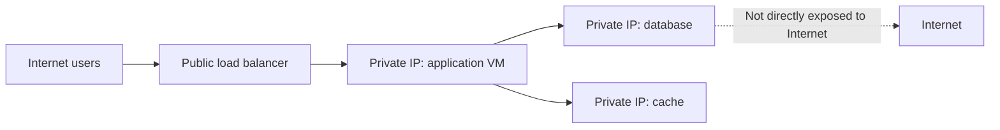
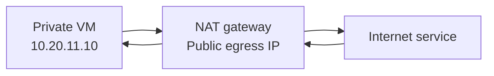
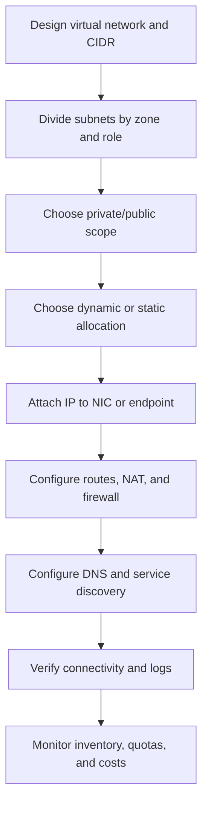
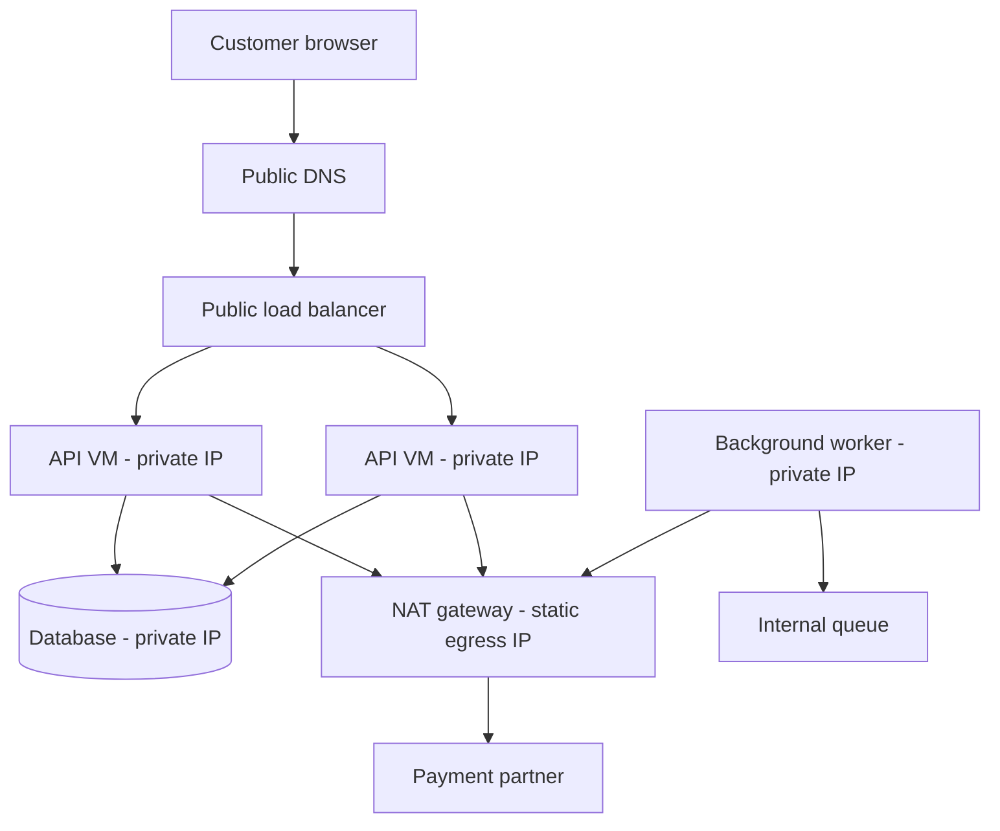

# Private IP, Public IP, and Static Addresses

Every workload needs a way to be identified for network communication. In a cloud environment, virtual machines, containers, load balancers, and network services can be assigned private IP addresses, public IP addresses, or both. Addresses can be allocated dynamically when a resource starts, or kept fixed so other systems can access them reliably.

Understanding address types helps you design secure connectivity, avoid network conflicts, configure DNS accurately, and control costs. You must distinguish between two independent concepts: **access scope** (private vs. public) and **allocation lifecycle** (dynamic vs. static). A private address can be static or dynamic; a public address can also be static or dynamic.

After this lesson, you will be able to:

- Distinguish private IP addresses, public IP addresses, and special IPv4/IPv6 address types.
- Explain how the cloud allocates dynamic and static addresses for workloads.
- Understand the role of subnets, routes, NAT, DNS, and load balancers in connectivity.
- Choose appropriate address types for virtual machines, internal services, and public endpoints.
- Configure and verify IPs safely to avoid conflicts, unintended access, and unnecessary costs.

## 1. How IP Addresses Identify Devices

An IP (Internet Protocol) address is a logical address used to route packets between network interfaces. A virtual machine can have multiple network interfaces (NICs), and each interface can have one or more IP addresses. An interface can also receive IPv4 and IPv6 addresses simultaneously.

An IP address does not necessarily identify a machine permanently. Dynamic addresses can change when a resource is recreated or when an allocation lease expires. Static addresses are preserved for the lifecycle of an address resource or network configuration, though they can still be released, reassigned to another resource, or changed by an administrator.

In the cloud, IP addresses are typically managed within a virtual network (VPC/VNet) and its subnets. The provider's control plane allocates the address, attaches it to a NIC or endpoint, and configures routing in the underlying infrastructure. The OS inside the VM sees the address assigned to the network interface, usually via DHCP or the platform's configuration mechanism.

## 2. IPv4 and IPv6

### IPv4

IPv4 uses 32-bit addresses, usually written as four decimal octets separated by dots, such as `192.0.2.10`. Because IPv4 address space is limited, clouds typically use private addresses inside virtual networks and use NAT or public addresses at the network edge when Internet connectivity is needed.

Three private IPv4 ranges are reserved for internal networks per RFC 1918:

| Address range | CIDR | Number of addresses |
|---|---|---:|
| `10.0.0.0` to `10.255.255.255` | `10.0.0.0/8` | 16,777,216 |
| `172.16.0.0` to `172.31.255.255` | `172.16.0.0/12` | 1,048,576 |
| `192.168.0.0` to `192.168.255.255` | `192.168.0.0/16` | 65,536 |

These addresses are not routed directly on the public Internet. Two organizations can both use `10.0.0.0/8` inside their own private networks, but when connecting via VPN or peering, overlapping address ranges create routing difficulties.

Other special IPv4 ranges include:

- `127.0.0.0/8`: loopback, used by a host to communicate with itself; the familiar address is `127.0.0.1`.
- `169.254.0.0/16`: link-local, commonly used for local link communication or certain metadata/network bootstrap mechanisms; not a private IP range freely routable across subnets.
- `0.0.0.0`: unspecified address; in some socket contexts, `0.0.0.0` means listening on all IPv4 interfaces of the host.
- `255.255.255.255`: limited broadcast address within a local network.

Do not arbitrarily assign these special addresses to service endpoints.

### IPv6

IPv6 uses 128-bit addresses written in hexadecimal groups, such as `2001:db8:1200::10`. The address space is vastly larger than IPv4 and supports prefix-based allocation for networks or interfaces.

Common IPv6 address types:

- **Global Unicast Address (GUA):** typically within `2000::/3`, globally routable when announced and properly routed. A GUA on a NIC does not automatically mean the firewall allows Internet access.
- **Unique Local Address (ULA):** within `fc00::/7`, used for internal scope similar to private IPv4. ULAs are not routed on the public Internet.
- **Link-local:** within `fe80::/10`, used on a single local network link; routers do not forward this address type.
- **Loopback:** `::1`, used by a host to communicate with itself.
- **Unspecified:** `::`, represents an unspecified address in certain configuration operations.

IPv6 generally does not need NAT to conserve addresses the way private IPv4 needs NAT. However, firewalls, routes, and access policies are still required to protect workloads. Do not assume IPv6 is safer simply because addresses are harder to guess or because NAT is not used.

### CIDR and Subnets

CIDR (Classless Inter-Domain Routing) represents a network by a base address and a prefix length. For example, `10.20.0.0/24` has 256 total IPv4 addresses; in traditional IPv4 networks, some addresses are reserved for network and broadcast, and cloud providers may reserve additional addresses for platform purposes.

Example of a virtual network divided into subnets:

```text
Virtual network: 10.20.0.0/16
  Public subnet A:  10.20.1.0/24  -> load balancer / ingress
  Private subnet A: 10.20.11.0/24 -> application instances
  Private subnet B: 10.20.21.0/24 -> database / internal services
```

This is an illustrative example. The actual number of usable addresses depends on how the provider reserves addresses in each subnet.

When designing CIDR blocks, leave enough room for growth, multi-AZ subnets, service endpoints, IPv6 addressing, and on-premises connectivity. Avoid ranges already used in VPNs, branch offices, or partner networks. Two networks with overlapping CIDRs may not be directly routable when connected.

## 3. Private IP Addresses

Private IP addresses are used for communication within a private network or across controlled connected networks. In the cloud, a VM typically receives a private IP from a virtual network subnet. Machines in the same network or networks connected via peering/VPN/Direct Connect/ExpressRoute can exchange traffic using private IPs if routes and firewalls allow it.

### Characteristics

- Not directly routed on the public Internet for RFC 1918 private IPv4 and IPv6 ULA.
- Commonly used for backends, databases, caches, workers, and internal communication.
- Can be allocated dynamically from a subnet or reserved/set statically per platform mechanisms.
- Can be reached from another network if VPN, peering, private link, or an appropriate connection path exists.
- Does not guarantee privacy on its own; requires appropriate security groups, firewalls, routes, and IAM.

### When to Use a Private IP

Private IPs are suitable for components that do not need a direct endpoint on the Internet. For example, an API backend can receive traffic from a load balancer in a public subnet, then call a database via its private IP. The database allows only the required port from the API's security group.



Private IPs help reduce public exposure, but they do not replace network segmentation. If all VMs in a VPC are allowed to connect to every port on one another, one compromised machine can probe the others. Restrict communication flows by role.

### Dynamic and Static Private IPs

A **dynamic private IP** is typically assigned from the subnet when the NIC or VM is created. It may be preserved across some stop/start operations, but can change when the NIC or instance is deleted and recreated. Retention rules depend on the platform.

A **static private IP** is pinned or reserved for a NIC or endpoint so the address does not change for the lifetime of that configuration. It is useful when an internal system needs an IP allowlist, internal DNS configuration, or connectivity to devices that do not support discovery.

Do not assign static private IPs to every machine solely for stable connectivity. Internal DNS, service discovery, or a load balancer is usually a better fit for services whose instances can change.

## 4. Public IP Addresses

A public IP is an address routable on the public Internet. In the cloud, it can be attached directly to a NIC, mapped via NAT, or owned by a public-facing service such as a load balancer, NAT gateway, or public endpoint.

Having a public IP does not mean a service automatically exposes open ports to everyone. Reachability still depends on routes, security groups, network ACLs, OS firewalls, listeners, and authentication policies. Conversely, a service can be reached from the Internet via a load balancer without backend machines needing public IPs.

### Public IPv4 and Public IPv6

Public IPv4 addresses are scarce and may incur charges per address or by usage state. A public IPv4 address can be mapped to a private IPv4 address using NAT or provider-managed mechanisms.

With IPv6, a NIC can receive a GUA and communicate with the Internet without address translation (NAT). Therefore, inbound and outbound firewalls must be explicitly configured. Do not restrict only IPv4 while forgetting to create equivalent policies for IPv6.

### When Does a Workload Need a Public IP?

Cases that may require a direct public IP include:

- A controlled bastion or management host, if not using a managed private access solution.
- An endpoint serving a specialized protocol that cannot pass through a standard load balancer or proxy.
- An appliance or workload requiring a stable source address for partner allowlisting.
- A test machine needing direct Internet access in a restricted environment.

For production websites or APIs, public IPs should generally sit on a load balancer, ingress, or API gateway. Backends and databases use private IPs only. This centralizes TLS, WAF, rate limiting, logging, and access policies at a single entry point.

## 5. Dynamic and Static Addresses

Dynamic/static describes how an address is allocated and retained, not whether the address is private or public.

| Attribute | Dynamic IP | Static IP |
|---|---|---|
| Allocation | Automatic from pool or DHCP/prefix | Reserved or statically configured |
| Mutability | May change when lease, NIC, or resource changes | Stable while reservation/configuration remains valid |
| Operations | Minimal per-address management | Requires inventory management and avoiding collisions |
| Best suited for | Replaceable VMs, autoscaling, internal workloads using service discovery | Endpoints requiring allowlists, stable DNS, or systems depending on fixed addresses |
| Risk | Hardcoded IP references break after address changes | Unused reserved addresses may still incur charges or cause confusion |

### Dynamic Private IP

This is the common default for VMs and containers. The system allocates an address from the subnet when the interface is created. When an instance is replaced, the new instance may receive a different address. Applications should use internal DNS, service discovery, or a load balancer to locate services.

### Static Private IP

The address is reserved for a NIC or internal endpoint. Useful when a partner inside a private network permits only a single address, or when a legacy appliance does not support DNS/service discovery. Reservations must be tracked and released when resources are no longer used.

### Dynamic Public IP

A public address allocated from a pool that can change across the lifecycle of the instance or network interface. Some platforms preserve the address across stop/start, while others release it on deallocate. Do not rely on a generic assumption; verify the exact behavior of the service.

Dynamic public IPs are generally unsuitable as fixed endpoints for long-lived DNS records or partner allowlists. If the address changes, DNS caches and external systems may continue using the old address.

### Static Public IP

A public address reserved independently or attached to a specific endpoint. Some providers call this an Elastic IP, reserved IP, or static public IP. The address can be moved between instances or endpoints within the supported scope, preserving the endpoint when replacing a machine.

Static public IPs are appropriate when partners require an allowlist, DNS requires a stable address, or an endpoint must persist across machine replacements. However, a reserved address does not by itself make a service highly available. If the IP points to a single VM, that VM remains a single point of failure.

## 6. NAT: Enabling Connectivity Without Exposing Private IPs

NAT (Network Address Translation) rewrites IP address information—and usually port information—as packets pass through an edge device or service. In the cloud, NAT is commonly used so workloads with private IPs can initiate outbound Internet connections without assigning a separate public IP to each VM.

### SNAT and NAT Gateway

With Source NAT (SNAT), the private source address is replaced by the NAT gateway's address or a shared public address for outbound packets. When return traffic arrives, NAT maintains state to forward responses back to the originating machine.



A NAT gateway is typically a managed service capable of serving multiple machines in private subnets. It centralizes egress IPs for partner allowlists and reduces the need to assign public IPs to individual VMs. However, NAT does not replace firewalls or egress policies; you still need to restrict where workloads are permitted to connect outbound.

### DNAT and Port Forwarding

Destination NAT (DNAT) rewrites the destination address to forward traffic to an internal address. Some public endpoint or port-forwarding services use this mapping mechanism. In production architectures, a load balancer or ingress is usually preferable for HTTP/HTTPS because it provides health checks, TLS termination, and load distribution.

### NAT Is Not a Firewall

NAT translates addresses and maintains flow mappings. Firewalls and security groups decide which flows are permitted. Having outbound connections go through NAT does not mean all inbound connections are blocked identically across every platform; understand stateful behavior and actual firewall configurations.

## 7. DNS and Stable IP Addresses

Users typically access services by domain name rather than memorizing IPs. DNS maps names such as `api.example.com` to one or more addresses or endpoints.

Common DNS records:

- **A:** maps a hostname to an IPv4 address.
- **AAAA:** maps a hostname to an IPv6 address.
- **CNAME:** creates an alias pointing to another hostname.
- **PTR:** reverse maps an IP address to a domain name, commonly used in reverse DNS.

If a public IP changes, DNS records must be updated. TTL (Time to Live) specifies how long resolvers can cache an answer. Low TTL makes changes take effect faster at the cost of increased DNS queries; high TTL reduces queries but slows transitions due to caching.

For internal services, use private DNS zones or service discovery to map service names to private IPs or load balancers. Do not hardcode an instance's private IP in application code if the instance can be replaced.

Static IPs are also not the only way to keep an endpoint stable. DNS pointing to a load balancer or managed service usually lets backends change transparently to users. If a static IP is required on the public side, you can reserve an IP at a supported load balancer or endpoint.

## 8. Choosing the Right Address Type per Workload

| Workload | Commonly suitable addressing | Reason |
|---|---|---|
| Public web/API | Public IP or hostname on load balancer/API gateway; private IPs on backends | Centralizes entry point, TLS, WAF, health checks, and load distribution |
| Database | Private IP, typically via stable endpoint/DNS | No direct Internet access needed; restricts access sources |
| Internal cache and message broker | Private IP and DNS/service discovery | Only authorized workloads can connect |
| Management VM | Private IP over VPN/bastion/managed session; limit public IPs | Reduces attack surface and controls administrative access |
| Autoscaling group | Dynamic private IP behind a load balancer or service discovery | Replacement instances do not need to keep the same address |
| Egress to allowlisted partner | Private IP on workload, NAT gateway with static public egress IP | Partner only needs to allowlist one or a few source addresses |
| Appliance/partner needing fixed endpoint | Static public IP or private IP depending on connectivity path | Preserves the address configured on the partner system |
| Interconnecting private networks | Non-overlapping private IPv4/IPv6 routed over VPN/peering | Transfers data across controlled private networks |

### Decision Questions

1. Does the workload need to receive connections directly from the Internet?
2. Can the entry point be placed on a load balancer or API gateway?
3. Does the address need to remain stable across stop/start, instance replacement, or redeployment?
4. Can dependent systems use DNS/service discovery instead of a fixed IP?
5. Does a partner require allowlisting a source or destination IP?
6. Does the CIDR range overlap with on-premises, VPN, or partner networks?
7. What are the costs for public IPv4, NAT gateways, egress data, and IP reservations?
8. Do both IPv4 and IPv6 have corresponding routes, firewalls, and monitoring?

## 9. IP Allocation and Management in the Cloud

### Typical Provisioning Workflow



1. **Design CIDRs:** define address ranges for VPCs/VNets, subnets, VPNs, and other networks.
2. **Segment subnets:** separate public-facing components, application, data, and management tiers per security requirements.
3. **Select scope:** decide whether each NIC needs a private IP, public IP, or both; for IPv6, determine prefixes and routes accordingly.
4. **Select lifecycle:** use dynamic allocation for replaceable instances; reservations/static IPs for endpoints requiring stability.
5. **Attach addresses:** assign addresses to NICs, load balancers, NAT gateways, or endpoints per service rules.
6. **Configure routing and filtering:** verify route tables, NAT, security groups, network ACLs, and host firewalls.
7. **Configure DNS:** create or update A/AAAA/CNAME/PTR records as needed; set TTLs according to the transition plan.
8. **Test:** verify connectivity within the network, over VPN, outbound to the Internet, and inbound from the Internet to permitted endpoints only.
9. **Govern:** update IPAM/inventory, tag owners, and monitor unused addresses.

### IPAM and Address Space Management

IP Address Management (IPAM) is a centralized approach to tracking CIDR ranges and allocated addresses. IPAM prevents overlaps, records ownership, tracks subnet capacity, and aids planning when connecting multiple networks.

An IP inventory should record:

- Address or prefix and IPv4/IPv6 type.
- Private/public scope and subnet/region/zone.
- Owning resource ID, NIC, or endpoint.
- Dynamic/static/reserved status and allocation timestamp.
- Owner, application, environment, purpose, and expiration.
- Associated DNS records, firewall/allowlist entries, and utilization status.

Do not manage IPs solely with a spreadsheet lacking owners or update history. For large environments, use provider IPAM or a management system with APIs and an audit trail.

## 10. Security When Using Private and Public IPs

### Reduce Public Endpoints

- Assign public IPs only to components that genuinely need to accept or initiate public connections per the architecture.
- Place backends and databases in private subnets; use load balancers or gateways as entry points.
- Never expose management ports such as SSH/RDP to the entire Internet. Use a VPN, hardened bastion, or managed session.
- Restrict inbound traffic by source CIDR, security group reference, or identity-aware access when supported by the platform.
- Restrict outbound traffic by required destinations and protocols; monitor for anomalous egress.

### Control IPv4 and IPv6 Together

A common mistake is restricting IPv4 firewalls while IPv6 GUAs still accept unintended connections. Verify listeners, routes, security groups, network ACLs, and host firewalls for both protocols. If IPv6 is not used, disable it or withhold routes according to approved policy; do not leave half-configured states.

### IP Is Not a Substitute for Identity

IP addresses can change or be reused. Never use an IP as the sole proof of user or workload identity. Combine TLS, IAM, workload identity, application authentication, and authorization. IP allowlisting can act as an additional defense layer, not a replacement for authentication.

### Caution When Releasing Public IPs

When a static public IP is released, it can return to the pool and be assigned to another customer. Before removing an IP from DNS or partner configs, update DNS records, allowlists, and dependent configurations. Do not assume a released address can be reclaimed later.

## 11. Cost and Operations of IP Addresses

IP addresses can generate direct and indirect costs:

- Public IPv4 addresses may be billed hourly or by usage state depending on the provider.
- Static/reserved IPs that are unattached or unused may still incur fees.
- NAT gateways typically bill for uptime and volume of data processed.
- Internet egress and cross-region data transfer can incur charges.
- Load balancers, firewalls, public endpoints, and DNS services have separate pricing tiers.
- Scarce IPv4 addresses increase opportunity cost when holding unnecessary reservations.

To optimize:

1. Audit public IPs not attached to active endpoints.
2. Release reservations with no active owner after verifying dependencies.
3. Use private IPs for internal communication.
4. Use centralized NAT egress when multiple workloads need Internet access and partners require source IP allowlisting, while accounting for NAT and traffic costs.
5. Avoid routing traffic unnecessarily through NAT or another region.
6. Apply tags and alerts to IP reservations, NAT gateways, and load balancers.

Do not replace a NAT gateway with public IPs on every machine merely because the visible NAT charge looks higher. Factor in security risk, endpoint count, traffic volume, firewall operations, and incident response costs.

## 12. Example: Addressing Design for an E-Commerce Application

An e-commerce application has a public website, API, background workers, and a database. The API must call a payment partner that requires source IP allowlisting.

**Network design:** create a virtual network with separate subnets for ingress, application, and data tiers. The load balancer has a public endpoint; the API and workers have private IPs only; the database permits connections only from the API's security group.

**Inbound traffic:** DNS `shop.example.com` points to the load balancer. Users never access the API's private IPs directly. The load balancer performs health checks and distributes requests to healthy instances.

**Outbound traffic:** the API calls the payment partner through a NAT gateway. The NAT uses a static public egress IP registered with the partner. API VMs do not need their own public IPs.

**Instance replacement:** when autoscaling replaces a VM, its private IP may change. The load balancer/service discovery updates the backend pool; public DNS needs no change. The NAT egress IP remains stable so the partner's allowlist continues working.

**Security:** the database has no public IP; inbound is allowed only from the API on the database port. SSH/RDP is permitted only over a private management channel. Firewalls enforce equivalent policies for IPv4 and IPv6 if dual-stack is enabled.



This architecture separates public-facing ingress addresses from backend addresses while keeping the source IP stable for partner connections. When scaling or replacing instances, the team does not have to update partner allowlists for individual machines.

## 13. Troubleshooting IP Address Issues

When a workload cannot connect, inspect layer by layer instead of merely pinging the destination address.

### Checking Addresses on the Host

Linux:

```bash
# List addresses and interface states
ip addr show

# View the routing table
ip route

# View the expected route to a destination address
ip route get 203.0.113.20
```

Windows PowerShell:

```powershell
# List IP addresses across interfaces
Get-NetIPAddress

# View IP configuration and gateway
ipconfig /all

# View the routing table
route print
```

### Checking DNS and Network Path

```bash
# Query IPv4/IPv6 records
dig A api.example.com
dig AAAA api.example.com

# Test TCP connectivity to a service port
nc -vz api.example.com 443

# Trace the network path if tools and permissions allow
traceroute api.example.com
```

Some tools may not be pre-installed or may be restricted by network policy. Blocked ICMP/ping does not mean the TCP/HTTPS service is down.

### Diagnostic Matrix

| Symptom | Possible cause | What to check |
|---|---|---|
| VM receives no private IP | NIC/subnet/DHCP or quota issue | NIC status, subnet, IP pool, allocation events |
| Two networks cannot connect | Overlapping CIDRs or missing routes | CIDRs on both sides, route tables, VPN/peering |
| Private IP machine has no Internet | Missing NAT/default route or egress firewall | `0.0.0.0/0`/`::/0` routes, NAT, security policy |
| Public endpoint unreachable | Unattached IP, wrong route, listener/firewall blocking | IP association, routes, security group, host firewall, service listener |
| Endpoint changes after restart | Dynamic address reassigned | Allocation mode, NIC lifecycle, DNS TTL |
| Partner rejects connection | Egress IP differs from allowlist or routed via different NAT | Observed public source IP, NAT route, allowlist |
| IPv4 works while IPv6 fails or vice versa | Mismatched DNS AAAA, routes, or dual-protocol firewalls | `dig A/AAAA`, IPv6 routes, security policy, listener |
| DNS still points to old IP | Cache TTL not expired or record not updated | Authoritative DNS, resolver cache, TTL and stale records |

## 14. Common Mistakes

**Assuming a private IP means unreachable from other networks.** VPN, peering, or private interconnects can route private IPs. Routes and firewalls must still be controlled.

**Assuming a public IP means service ports are open.** A public IP only enables routing; firewalls, routes, listeners, and application policies still govern access.

**Confusing static with public.** Static describes allocation stability. A private IP can be static, and a public IP can be dynamic.

**Attaching public IPs to every VM for easy administration.** This increases the number of scannable endpoints. Prefer private management channels or bastion/managed sessions.

**Using a dynamic IP for a long-term allowlist.** The address can change after instance replacement or deallocation. Use a static egress IP or private interconnect as required.

**Thinking NAT replaces a firewall.** NAT is not a complete access-control mechanism. Security groups, network ACLs, and host firewalls must still be configured.

**Configuring only IPv4.** IPv6 can create an alternate access path if GUAs and routes are provisioned. Protect both protocols.

**Failing to release idle static IPs.** Unused reservations may continue incurring charges and deplete address pools.

## 15. IP Design and Operations Checklist

- [ ] Virtual network CIDRs do not overlap with on-premises, VPN, or partner networks.
- [ ] Subnets are segmented by role, environment, and appropriate fault domain.
- [ ] Workloads receive public IPs only when genuinely necessary.
- [ ] Backends, databases, and internal components use private IPs or private endpoints.
- [ ] Dynamic vs. static addressing is chosen based on lifecycle requirements.
- [ ] DNS and TTLs match how instances or endpoints are replaced.
- [ ] NAT egress and public source IPs satisfy any allowlist requirements.
- [ ] Routes, security groups, network ACLs, and host firewalls have been verified.
- [ ] IPv4 and IPv6 have equivalent policies if dual-stack is enabled.
- [ ] IPAM/inventory records owner, resource ID, scope, and reservation state.
- [ ] Unused public IPs and NAT resources are audited and released upon approval.
- [ ] Metrics, flow logs, or network logs are available to support incident investigation.

## 16. Self-Check

1. How do private IPs and public IPs differ in routing scope?
2. Why is static/dynamic an independent classification axis from private/public? Name the four possible combinations.
3. What are the three RFC 1918 IPv4 ranges? Why must overlapping CIDRs be avoided when connecting via VPN or peering?
4. Does an IPv6 GUA mean everyone on the Internet can access the workload? What control layers are still required?
5. How does a NAT gateway help private workloads access the Internet or partners? Why does NAT not replace a firewall?
6. When should you place a static public IP on a load balancer or NAT gateway instead of assigning public IPs to individual VMs?
7. Why must DNS and TTLs be considered when changing IPs?
8. A VM cannot reach a partner even though its private IP and internal routes work. How would you inspect the egress IP, NAT, and allowlist?

IP addressing is part of workload connectivity and security design. By properly distinguishing private/public from dynamic/static, designing non-overlapping CIDRs, using DNS and NAT appropriately, and enforcing firewalls for both IPv4 and IPv6, a system can maintain stable endpoints while minimizing exposure and network costs.
