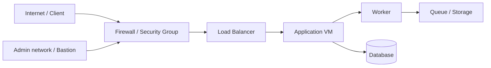
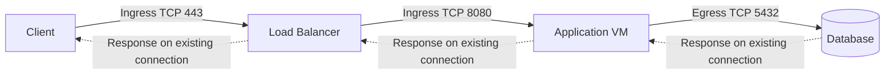
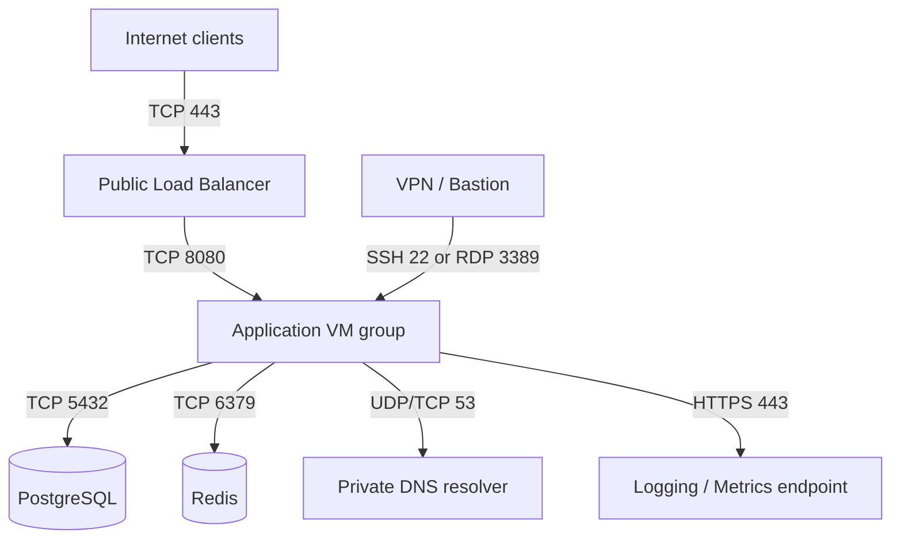
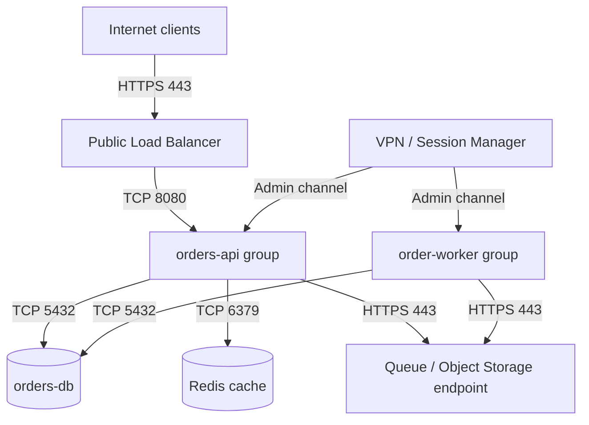

# Firewalls, Security Groups, and Compute Access Rules

A virtual machine, container, or serverless function should only communicate with genuinely necessary sources and destinations. Firewalls and security groups control network flows using rules on source, destination, protocol, port, and connection direction. When properly designed, they limit the attack surface, isolate workloads, and reduce the ability of a compromised component to move laterally to other systems.

In the **CLOUD_CORE_SERVICES_COMPUTE** module, network access rules tie into compute provisioning, subnets, load balancers, workload identity, storage, and dependent services. An application may need to accept HTTPS from users, receive internal traffic from a load balancer, access a database, ship logs, and fetch patches. Every flow must clearly specify its actor, destination, protocol, port, and business rationale. You should never widen network permissions simply to work around an undiagnosed connectivity error.

## Learning Objectives

After this lesson, you will be able to:

- Distinguish firewalls, security groups, network ACLs, and host firewalls.
- Explain the differences between stateful and stateless rules, and ingress vs. egress.
- Design access rules following default-deny and least-privilege principles.
- Segment networks across load balancers, applications, workers, databases, and management services.
- Handle TCP, UDP, DNS, ICMP, IPv4, IPv6, and return-port flows.
- Apply rules to VMs, containers, and serverless workloads.
- Log, test, audit, and manage firewall rules using IaC.
- Diagnose connectivity failures while preserving security boundaries.

## 1. Why Does Compute Need a Firewall?

A cloud workload typically has multiple interfaces and communication flows. A VM might accept connections from a load balancer, access a database, download packages from repositories, and send metrics to a monitoring system. A container might call internal APIs, queues, or storage services. A serverless function might receive events from a queue and call a database or external API.

If every port is open, an application bug or leaked credential can open an access path to unrelated components. Firewalls restrict network flows at control points such as the VPC/VNet perimeter, subnet, network interface, node, host, or workload.



The diagram illustrates flows that must be controlled:

- Users access the application's public entry point.
- The load balancer forwards traffic to the application port on the VM.
- The application accesses the database on a specific service port.
- Workers receive or send messages to the queue and store results.
- Operators access administration over an authenticated private channel.

Not every component needs to connect directly to every other component. For example, Internet users do not need direct access to the database; workers do not need to accept SSH from the Internet; the database does not need to open administrative ports to an entire subnet.

## 2. Firewalls, Security Groups, and Control Layers

Terminology varies across providers, but mechanisms can be distinguished by scope of enforcement and management model.

### 2.1. Firewall

A firewall is a mechanism that controls network traffic based on a set of rules. Firewalls can sit at multiple layers:

- **Network/perimeter firewall:** controls traffic entering, leaving, or traversing between networks.
- **Cloud-native firewall:** a provider service used to control traffic between VPCs/VNets, subnets, or workloads.
- **Host firewall:** runs inside the VM operating system, such as `nftables`, `iptables`, or Windows Defender Firewall.
- **Application firewall/WAF:** understands application protocols like HTTP and inspects URLs, headers, payloads, or application-layer attack patterns.

Network firewalls typically process IP addresses, protocols, ports, connection state, and sometimes identity or application attributes. A WAF has a different scope: it adds HTTP/HTTPS inspection rather than replacing security groups or host firewalls.

### 2.2. Security Group

A security group is a set of rules attached to one or more compute resources or network interfaces. It typically acts as a virtual firewall for VMs, NICs, load balancers, or service endpoints.

Common characteristics of security groups:

- Rules define permitted traffic by protocol, port, and source or destination.
- Many platforms treat security groups as **stateful**: when an allowed connection is initiated, return traffic for that connection is permitted automatically.
- Rules can reference another security group as the source or destination instead of hardcoding CIDR ranges.
- A resource can have multiple security groups attached depending on the platform; the effective policy is usually the union of allow rules.
- Security groups often lack explicit per-source deny rules; traffic not matching an allow rule is implicitly denied. Verify your provider's exact semantics.

Security groups align policies with workload roles. For example, `app-sg` allows port 8080 only from `load-balancer-sg`; `db-sg` allows the database port only from `app-sg`.

### 2.3. Network ACL and Subnet Firewall

A Network ACL (NACL) or subnet-level firewall controls traffic at the subnet scope. Some platforms evaluate rules in priority order and support explicit allow/deny actions. With AWS-style NACLs, rules are stateless: both outbound and inbound directions must be allowed, including client ephemeral ports where required.

NACLs are useful as a broad subnet guardrail, but they do not replace security groups. Overly restrictive subnet rules can block valid traffic before it reaches the security group; overly broad rules reduce the value of network segmentation.

### 2.4. Host Firewall

A host firewall runs inside the VM's operating system. It can control processes, interfaces, addresses, protocols, and ports depending on OS capabilities. This layer protects the VM even if a cloud network rule is mistakenly opened.

In return, host firewalls must be managed via machine images, OS configuration, and patching workflows. Misconfiguration can lock out administrative access or prevent the application from receiving load balancer traffic.

### 2.5. Comparing the Layers

| Mechanism | Scope | Characteristics | Typical responsibility |
|---|---|---|---|
| Network/perimeter firewall | Between networks or at network edge | Can inspect multiple layers and enforce centralized policies | Network/security team and service provider depending on deployment model |
| Security group | NIC, VM, or cloud resource | Usually stateful, rules bound to workloads | Customer configures; provider operates the control plane |
| Network ACL/subnet firewall | Subnet | May be stateless, ordered rules depending on platform | Customer configures inside the virtual network |
| Host firewall | VM operating system | Controls close to processes and interfaces | Customer manages guest OS |
| WAF | HTTP/HTTPS application traffic | Understands requests and application-layer attack patterns | Customer configures policies; provider operates managed platform if used |

Layers can complement each other. Define clearly which layer is the primary control point for each flow and avoid duplicating rules in ways that become hard to operate.

## 3. Ingress, Egress, and Connection Direction

Firewalls typically distinguish two directions:

- **Ingress:** traffic entering the protected workload or interface.
- **Egress:** traffic leaving the protected workload or interface.

For example, when a user accesses a website:

1. The client initiates a TCP connection to the load balancer's public address on port 443.
2. The load balancer forwards the connection or request to the application VM on port 8080.
3. The application VM initiates a new connection to the database on port 5432.
4. The database sends its response back to the application VM over the established connection.



With stateful security groups, response traffic for an allowed connection usually does not require a separate inbound rule for the return port. With stateless ACLs, both directions must be allowed with the right addresses and ports. Do not open an entire port range simply because you do not yet understand how ephemeral source ports work.

### 3.1. Service Ports and Ephemeral Ports

Servers typically listen on fixed service ports, such as HTTPS 443 or PostgreSQL 5432. Clients typically use an ephemeral source port chosen by the operating system. When the server replies, packets return to the client's address and that ephemeral source port.

With stateless firewalls, return rules must account for the OS/client ephemeral port range and actual policy. Port ranges vary by OS and configuration; do not assume a single universal range across all platforms. With stateful firewalls, the connection-tracking table usually handles response traffic.

### 3.2. Ingress and Egress Need Owners

An ingress rule typically answers: who is allowed to call this workload, and which service? An egress rule answers: where is this workload allowed to connect, and why?

Egress is often overlooked because many environments allow all outbound traffic by default. This creates risk if a workload is compromised: malicious processes can contact command-and-control servers, download payloads, or exfiltrate data. Egress policies should be designed alongside dependency maps, DNS, proxies, NAT, and private endpoints.

## 4. Fields of a Firewall Rule

A network rule typically includes these attributes:

| Field | Meaning | Example |
|---|---|---|
| Direction | Traffic direction | Ingress or egress |
| Action | Action taken | Allow or deny; may be implicit depending on platform |
| Protocol | Network protocol | TCP, UDP, ICMP, ICMPv6, or protocol number |
| Source | Traffic origin | CIDR, security group, tag, service account, or prefix list |
| Destination | Traffic target | CIDR, security group, subnet, or endpoint |
| Port/range | Port or port range | TCP 443, TCP 8080, UDP 53 |
| Priority/order | Evaluation order | Priority number or rule position |
| Target/scope | Protected target | VM, NIC, subnet, network tag, workload identity |
| Description | Rationale and owner | `app-to-orders-db` |
| Logging | Whether matches are recorded | Flow log, firewall log, or rule hit counter |

Not every platform exposes every field or evaluates them identically. Some firewalls evaluate rules by priority order; some security groups union allow rules; some services have implied rules or default policies. Before designing rules, verify the exact semantics of the service in use.

### 4.1. CIDR and Source Scope

CIDR represents an IP address range. Examples:

- `10.20.10.0/24`: an IPv4 subnet with 256 addresses by block size.
- `10.20.0.0/16`: a larger range spanning multiple subnets.
- `0.0.0.0/0`: all IPv4 addresses.
- `::/0`: all IPv6 addresses.
- `203.0.113.10/32`: a single IPv4 address; `203.0.113.0/24` is documentation/example address space.

Broad CIDRs increase the number of sources able to connect. If only the load balancer should call the application, referencing the load balancer's security group is clearer and less coupled to IP addresses than permitting an entire subnet. If the platform lacks group references, use the smallest appropriate CIDR and manage that list in code.

### 4.2. Protocol and Port

Open only the protocols and ports required. Common examples:

| Service | Common protocol/port | Notes |
|---|---|---|
| HTTPS | TCP 443 | Clients to TLS endpoint; TLS may terminate at load balancer or application |
| HTTP | TCP 80 | Commonly used to redirect to HTTPS or for controlled internal serving |
| SSH | TCP 22 | Only from approved management network/bastion |
| RDP | TCP 3389 | Only from management network; never expose directly to Internet |
| DNS | UDP 53 and TCP 53 | UDP handles most queries; TCP is needed for large responses/zone transfers and other cases |
| NTP | UDP 123 | Time synchronization to approved sources |
| PostgreSQL | TCP 5432 | Accessible only to required applications/workers |
| MySQL | TCP 3306 | Restricted by workload and private network |
| Redis | TCP 6379 | Never expose publicly; require auth/TLS per service configuration |
| ICMP/ICMPv6 | By message type | May be needed for diagnostics, Path MTU, or network operation; does not mean opening all traffic |

Ports are only part of the policy. Allowing TCP 443 does not replace TLS, user authentication, request validation, or a WAF.

## 5. Secure Rule Design Principles

### 5.1. Default Deny and Least Privilege

A secure model typically starts by denying traffic not explicitly permitted, then adding only the rules required for application flows.

For each rule, answer:

1. Which source workload needs to connect?
2. Which destination workload needs to receive the connection?
3. Which protocol and port are used?
4. What function does this flow serve?
5. Who owns and approves the rule?
6. Does the rule have an expiration date or require periodic review?

Avoid "allow all traffic" rules or opening an entire subnet just so one application can reach a database. If the required port is unknown, inspect flow logs, application documentation, and listener configurations before opening it.

### 5.2. Role-Based Workload Segmentation

Instead of placing all VMs in one large security group, group them by role:

- `lb-sg`: accepts HTTPS from clients and calls the application.
- `app-sg`: receives traffic from the load balancer and calls required databases/caches/queues.
- `worker-sg`: pulls jobs from queues and calls processing services.
- `db-sg`: accepts connections only from approved applications/workers.
- `admin-sg`: allows administrative access only from VPN or bastion.
- `monitoring-sg`: receives metrics/logs from workloads if agents require inbound connections.

This segmentation limits lateral movement. If an application VM is compromised, an attacker does not automatically gain a network path to every database, control plane, or management host.

### 5.3. Avoid Depending on Dynamic IPs When Possible

Autoscaling VMs, containers, and serverless workloads can change IP addresses. Rules hardcoding individual IPs break easily when instances are replaced. Prefer:

- Security group references or service-based workload groups.
- Platform-provided prefix lists or managed service tags.
- Private endpoints/service endpoints for cloud services.
- DNS service discovery paired with appropriate network policies.
- IaC updates to CIDR sets when changes are unavoidable.

DNS helps locate service addresses but does not replace firewall rules. Firewalls must enforce actual traffic flows and may need to handle resolved IPs, prefixes, or identities according to platform capabilities.

### 5.4. Controlling Egress

A workload may need outbound access to:

- Internal databases or caches.
- Queues, object storage, and cloud APIs via private endpoints.
- DNS resolvers, NTP, and configuration management systems.
- Package update repositories or image registries.
- Logging, metrics, tracing, and alerting systems.
- Approved external APIs.

Build a dependency inventory before tightening egress. If an application must call multiple external APIs, route traffic through an egress proxy or NAT gateway with logging and policy enforcement. For cloud services, private endpoints can keep traffic off the public Internet, though DNS, routes, and endpoint policies must be verified.

## 6. Example Access Flow Design for a Three-Tier Application

Suppose a system has a public load balancer, an application VM group, and a database in a private subnet.



Conceptual rule table:

| Protected target | Direction | Allowed source/destination | Protocol/port | Reason |
|---|---|---|---|---|
| Load balancer | Ingress | Internet clients or approved client ranges | TCP 443 | Accept HTTPS |
| Load balancer | Egress | Application group | TCP 8080 | Forward requests to application |
| Application | Ingress | Load balancer security group | TCP 8080 | Accept traffic only from managed entry point |
| Application | Admin ingress | VPN/bastion group | TCP 22 or 3389 | Controlled administration, if truly needed |
| Application | Egress | Database group | TCP 5432 | Business data access |
| Application | Egress | Cache group | TCP 6379 | Cache access |
| Database | Ingress | Application group | TCP 5432 | Accept queries from application |
| Cache | Ingress | Application group | TCP 6379 | Accept cache access |

Connection response traffic is handled by stateful security groups via the state table. If stateless subnet ACLs exist, add return rules for the proper source and destination port ranges. Never open SSH/RDP from `0.0.0.0/0` or `::/0`.

### 6.1. Administrative Access Flows

Do not share the same public access path between end users and system administrators. Use VPNs, bastion hosts, session managers, or organization-approved zero-trust access mechanisms. Administrative flows should include:

- Strong authentication, MFA, and individual identities.
- Time-bound or session-based access permissions.
- Audit logs recording who accessed what and when.
- Restrictions on source networks and administrative ports.
- Revocation and investigation procedures if credentials are compromised.

If the platform supports administration without opening inbound SSH/RDP, consider using control-plane-authenticated management channels. Regardless of method, IAM permissions and auditing must still be configured.

## 7. Stateful Security Groups vs. Stateless Firewalls

Understanding stateful vs. stateless behavior prevents redundant open rules and helps troubleshoot connection issues properly.

### 7.1. Stateful

A stateful firewall tracks connection state. When a connection is allowed to initiate, return packets belonging to that connection are usually permitted automatically without creating reverse inbound rules for every ephemeral port.

For example, an application VM initiates a TCP connection to a database on port 5432. The application's security group allows egress to the database; the database's security group allows ingress from the application on port 5432. Return packets from the database to the application's ephemeral source port are permitted by connection tracking.

### 7.2. Stateless

A stateless firewall evaluates each packet independently against current rules without inferring return traffic for an allowed connection. Therefore, rules are needed for both outbound and inbound directions.

Example with a stateless subnet ACL:

- Inbound to server: TCP 5432 from the application subnet.
- Outbound from server: TCP to the application client's ephemeral port range for responses.
- Inbound to client: TCP from database port 5432 to the client's ephemeral port range.
- Outbound from client: TCP to database port 5432.

Port ranges must match the operating system and actual connection behavior. Overly broad rules undermine the ACL; overly narrow rules cause intermittent, hard-to-diagnose failures.

### 7.3. Do Not Confuse Security Groups with NACLs

On some platforms, security groups are stateful and NACLs are stateless; however, terminology and behavior vary across providers. Read the documentation for the specific service. Do not assume every object called a "firewall" uses the same state-tracking model.

## 8. Rules for VMs, Containers, and Serverless

### 8.1. Virtual Machines

For VMs, cloud security groups can be combined with host firewalls inside the guest OS.

- Security groups restrict flows at the network interface or VM level.
- Host firewalls add OS-level restrictions and can differentiate interfaces/processes depending on platform capabilities.
- Workload identity determines access permissions to cloud services; it does not replace firewalls.
- SSH/RDP should traverse a management network or session management service.
- VMs in an autoscaling group should inherit identical policies from launch templates/IaC so new instances do not receive weaker configurations than older ones.

For example, a Linux host firewall using `nftables` should be built around the machine's specific interfaces and rules. A general policy typically defaults input to drop, allows loopback and established/related traffic, allows SSH only from the management subnet, and allows the application port only from the load balancer range. Before applying changes on a remote VM, ensure console access or a recovery mechanism exists in case a rule accidentally blocks management connectivity.

### 8.2. Containers and Kubernetes

Containers run on nodes and may share a network namespace or use a network plugin to obtain separate network addresses. Distinguish:

- Node or NIC security groups protect traffic at the VM/node level.
- Pod-level security groups or identity-aware policies exist only on certain platforms/plugins.
- Kubernetes `NetworkPolicy` typically controls traffic between Pods/namespaces at the network plugin layer; enforcement depends on whether the CNI supports it.
- Ingress controllers/load balancers control traffic entering services; Pod policies alone do not replace public endpoint protection.
- Egress policies can restrict Pods from calling databases, DNS, metadata endpoints, or the Internet.

Conceptual `NetworkPolicy` example allowing API Pods to receive traffic from the ingress namespace and egress only to the database and DNS:

```yaml
apiVersion: networking.k8s.io/v1
kind: NetworkPolicy
metadata:
  name: api-traffic-policy
  namespace: production
spec:
  podSelector:
    matchLabels:
      app: orders-api
  policyTypes:
    - Ingress
    - Egress
  ingress:
    - from:
        - namespaceSelector:
            matchLabels:
              purpose: ingress
      ports:
        - protocol: TCP
          port: 8080
  egress:
    - to:
        - podSelector:
            matchLabels:
              app: orders-db-proxy
      ports:
        - protocol: TCP
          port: 5432
    - to:
        - namespaceSelector:
            matchLabels:
              kubernetes.io/metadata.name: kube-system
      ports:
        - protocol: UDP
          port: 53
        - protocol: TCP
          port: 53
```

This is an illustrative example. Selectors, namespace labels, DNS deployment layout, and policy enforcement depend on the cluster and CNI. In real deployments, verify that `NetworkPolicy` is enforced, identify the actual DNS Pods, and add required flows such as metrics, logging, or external services. Once a Pod is selected by an ingress/egress policy, unpermitted flows may be blocked according to Kubernetes `NetworkPolicy` and plugin semantics.

### 8.3. Serverless/FaaS

Serverless functions may run in provider-managed networks or attach to a VPC/VNet/subnet. Rules to consider:

- Are the event sources invoking the function authenticated and restricted?
- Does the function need to access private resources such as databases?
- Does the function's security group or network policy permit the right endpoints/ports?
- Does Internet egress require NAT, a proxy, or a private endpoint?
- Will high concurrency across execution environments open excessive connections to the database?
- Do subnet DNS and routes allow the function to resolve and reach dependencies?

FaaS does not imply every function has a public IP or is reachable from the Internet. Network attachment and source addresses depend on the service. Do not write rules based on assumed static IPs when the platform provides security groups, subnets, or private endpoints.

## 9. DNS, ICMP, IPv6, and Background Flows

Firewall rules do not serve application ports alone. Several background flows must be accounted for when designing policies.

### 9.1. DNS

Workloads routinely resolve service names via DNS. Traditional DNS uses UDP 53 for most queries and may use TCP 53 for cases such as large responses or zone transfers. DNS-over-HTTPS/TLS uses different ports and targets depending on the resolver.

If an egress policy blocks DNS, applications may fail to reach dependencies even when database/API ports are open. Allow workloads to query only designated resolvers; do not leave DNS open everywhere by default if the organization operates dedicated resolvers.

### 9.2. ICMP and ICMPv6

ICMP may be required for ping, network error signaling, Path MTU Discovery, and diagnostics. Blocking all ICMP can make connections unstable, especially when packets fragment or MTUs differ across paths.

You do not need to allow every ICMP type from every source. Choose appropriate message types/codes, restrict sources where possible, and follow platform guidance. ICMPv6 plays an even more essential role in IPv6, so never copy IPv4 policies verbatim to IPv6.

### 9.3. IPv6

When workloads have IPv6 addresses, audit both IPv4 and IPv6 rules. A security group that blocks `0.0.0.0/0` without a corresponding rule for `::/0` can expose an endpoint over IPv6. Conversely, if IPv6 is unused, determine how to disable or restrict IPv6 addresses and routes per platform policy.

Check DNS AAAA records, IPv6 routes, IPv6 security groups, host firewalls, and load balancers. Do not assume testing over IPv4 proves an endpoint is protected on both protocols.

### 9.4. Management and Telemetry Flows

Beyond business traffic, workloads may need NTP, logs, metrics, traces, management agents, package updates, and secret manager access. Create a dependency inventory to identify endpoints and ports. When using private endpoints, verify routes, private DNS zones, and endpoint policies.

## 10. Applying Across Cloud Platforms

Providers share similar concepts, but naming, scope, and semantics are not identical.

| Platform | Common mechanisms | Key points to watch |
|---|---|---|
| AWS | Security Groups, Network ACLs, AWS Network Firewall, host firewall | Security Groups are stateful; NACLs are stateless and evaluated by rule number; SGs can reference other SGs in supported scenarios |
| Microsoft Azure | Network Security Groups (NSG), Azure Firewall, Application Security Groups, host firewall | NSGs apply at subnet or NIC; rules have priorities; Application Security Groups help group NICs by role |
| Google Cloud | VPC firewall rules, hierarchical firewall policies, Cloud NGFW, and host firewall | VPC firewall rules have priorities and target by tag or service account; understand implied rules and policy hierarchy |
| Kubernetes | NetworkPolicy, CNI policies, service mesh policies, and cloud security groups | NetworkPolicy is enforced only if the CNI supports it; network policies do not replace IAM or application auth |

Service names and capabilities can vary across versions, regions, and deployment types. Verify platform documentation before porting rules from one cloud to another.

### 10.1. AWS Security Groups and Network ACLs

In AWS, a security group attaches to a supported resource's network interface and is stateful. Inbound rules specify permitted incoming sources; outbound rules specify permitted destinations. Security groups contain only allow rules; traffic not matching an allow rule is implicitly denied.

Network ACLs attach to subnets and are stateless. NACLs have rule numbers, allow/deny actions, and must evaluate both inbound and outbound directions. When using NACLs, account for client ephemeral ports so return traffic is not blocked.

### 10.2. Azure NSGs

An Azure NSG can be associated with a subnet or network interface and is stateful: return traffic for an allowed connection is handled by connection state. Rules specify priority, direction, protocol, source/destination, port range, and action. When multiple rules exist, priority order determines the outcome; platform default rules also participate in evaluation. Application Security Groups help express rules by workload group instead of manual CIDRs.

### 10.3. Google Cloud VPC Firewall

Google Cloud VPC firewall rules apply per VPC and target, selecting VMs by network tag or service account depending on rule type. VPC firewalls are stateful for return traffic of allowed connections. Priorities and implied/default rules must be considered. Hierarchical firewall policies can apply at the organization/folder/project level depending on configuration.

Do not assume one provider's rule ordering or merging behavior matches another's. When migrating IaC, translate policy intent rather than copying port numbers and CIDRs blindly.

## 11. Expressing Firewall Rules in IaC

Firewall rules should be managed as code for peer review, traceability, and drift detection. A rule should have a readable name, purpose description, owner, source, destination, port, and environment.

### 11.1. Declarative Policy Example

Provider-neutral YAML example:

```yaml
network_policy:
  name: orders-production
  default_ingress: deny
  default_egress: deny
  rules:
    - name: public-https-to-load-balancer
      direction: ingress
      source: 0.0.0.0/0
      destination: orders-public-lb
      protocol: tcp
      ports: [443]
      purpose: accept-public-https
      owner: platform-network

    - name: load-balancer-to-api
      direction: ingress
      source: orders-lb-group
      destination: orders-api-group
      protocol: tcp
      ports: [8080]
      purpose: application-traffic
      owner: orders-service

    - name: api-to-database
      direction: egress
      source: orders-api-group
      destination: orders-db-group
      protocol: tcp
      ports: [5432]
      purpose: database-queries
      owner: orders-service
```

This is a discussion data model, not a schema directly applicable to a specific cloud provider. In production, you must also represent IPv6 if used, return rules if firewalls are stateless, DNS/telemetry/management dependencies, and rule priority handling.

### 11.2. Rule Management Conventions

- Name rules as `source-to-destination-purpose` or another easily searchable convention.
- Include description, owner, ticket/change reference, and environment on every rule.
- Declare CIDRs centrally to avoid repeating address strings across multiple files.
- Separate shared baseline rules from workload-specific rules.
- Add validation to reject `0.0.0.0/0` or `::/0` on administrative ports.
- Review changes that widen ports, sources, or destinations.
- Use IaC to remove obsolete rules; do not leave temporary rules in place indefinitely.
- Check for drift between code and the cloud control plane.

### 11.3. Making Rule Changes Safely

When adding a rule for a new flow:

1. Confirm the application genuinely needs the flow and identify protocol/port.
2. Identify exact source/destination workloads, avoiding broad CIDRs when identity/group references are available.
3. Add the rule in a test environment and verify connectivity.
4. Observe flow logs or rule hit counters to confirm traffic.
5. Review security impact and cost if firewall/NAT/egress services are involved.
6. Deploy to production within a change window or approval process.
7. Monitor for errors and maintain a rule rollback plan.

Do not open temporary rules in production "just to see if it works" without an expiration, approver, and change record. Experimental rules are easily forgotten and become long-term vulnerabilities.

## 12. Logging, Monitoring, and Testing Rules

A firewall is only useful when operators know which rules are allowing or blocking traffic and can investigate application failures.

### 12.1. Flow Logs and Firewall Logs

Flow logs typically record network flow metadata such as source/destination IP, port, protocol, timestamp, interface, and accept/reject status depending on the platform. Firewall logs can record rule IDs, actions, policies, and deeper inspection details.

Send logs to a centralized system with appropriate retention and access controls. Note that network logs can reveal internal addresses, service topology, and user behavior. Not every platform logs every packet or every rule match; verify collection scope and storage costs.

### 12.2. Metrics to Monitor

- Accepted/rejected connection counts by source, destination, port, and workload.
- Spikes in rejected connection rates after rule changes.
- Connection counts, conntrack table usage, and appliance limits if applicable.
- Packet drops, retransmissions, timeouts, and DNS errors.
- Anomalous egress volume or connections to unapproved endpoints.
- Rules with zero hits over long periods or overly broad rules.
- Changes to security groups, NSGs, NACLs, routes, and firewall policies from audit logs.

Do not delete a rule simply because it had zero hits during a short window. Scheduled batch jobs or disaster recovery flows may run only a few times a month. Confirm with the owner and business schedule before removing it.

### 12.3. Testing Connectivity

These tools help verify connectivity from source to destination:

```bash
# Test TCP to a specific port
nc -vz 10.20.30.15 5432

# Inspect route to destination
traceroute 10.20.30.15

# Test DNS resolution
dig orders-db.internal.example

# Test HTTPS and TLS
curl -v https://orders.example.com/health
```

On Windows, use `Test-NetConnection`, `Resolve-DnsName`, and equivalent tools. `ping` is not the sole test: ICMP can be blocked while TCP works, or vice versa. Run tests from the actual network source, matching subnet/VM/container and identity if policies depend on identity.

### 12.4. Pre-Production Policy Testing

Include test cases such as:

- Legitimate clients can reach required public endpoints.
- Unauthorized clients cannot reach internal ports.
- The application can call the database on the proper port.
- Workloads cannot call unrelated databases or services.
- SSH/RDP is reachable only from approved management networks.
- IPv4 and IPv6 enforce consistent policies.
- DNS, NTP, logging, and secret manager access continue working.
- Containers/Pods cannot connect to prohibited namespaces or workloads.
- Internet egress is restricted according to design.

Test both allowed and denied flows. Testing only allowed flows can leave a policy unintentionally wider than intended.

## 13. Diagnosing Connectivity Issues

When an application cannot connect to a dependent service, do not immediately open all traffic. Follow the packet path and inspect each layer.

### 13.1. Diagnostic Workflow

1. **Verify the endpoint:** are the hostname, IP, port, protocol, and DNS record correct?
2. **Verify the source:** which VM, container, Pod, or function originated the request? What is the source address after NAT?
3. **Check routes:** do the subnet, route table, NAT, peering, VPN, or private endpoint have a valid path?
4. **Check source rules:** do the egress security group, host firewall, or network policy allow it?
5. **Check destination rules:** do the ingress security group, NACL, firewall, or host firewall allow it?
6. **Check stateful/stateless handling:** are the return path and ephemeral ports permitted?
7. **Check the service:** is the process listening on the right interface/port? Do TLS and authentication succeed?
8. **Correlate logs:** what do flow logs, firewall logs, audit logs, and application logs show?
9. **Test from the same network context:** run tests from the workload or a diagnostic host with equivalent policies.
10. **Fix the exact rule and retest:** record the change reference, owner, and expiration if creating a temporary exception.

### 13.2. Common Symptoms

| Symptom | Possible cause | How to check |
|---|---|---|
| DNS lookup fails | Egress DNS blocked, wrong resolver, or unlinked private zone | `dig`, resolver config, UDP/TCP 53 flow logs |
| TCP timeout | Wrong route, firewall drop, NACL missing return path, or unresponsive target | Route tables, flow logs, ephemeral ports, listener |
| Connection refused | Target reachable, but no service listening or host firewall rejects | Process/listener, service status, host firewall |
| One direction works, other fails | Stateless NACL or asymmetric routing | Check both directions, ephemeral ports, and routes |
| New VM in autoscaling cannot connect | Launch template missing security group/route/identity or different bootstrap | Compare NIC, SG, subnet, routes, and image across instances |
| Pod cannot call another service | Wrong NetworkPolicy selector, CNI not enforcing, or missing DNS policy | Pod labels, namespace labels, CNI, and flow logs |
| Function cannot connect to private DB | Subnet, SG, route, DNS, or network interface quota | VPC attachment, routes, endpoint, and function logs |
| Connections drop randomly | Conntrack exhaustion, NAT port exhaustion, idle timeout, or inconsistent rules/routes | Connection counts, NAT metrics, timeouts, and packet traces |

## 14. Advanced Security: Microsegmentation and Identity-Aware Access

IP/port-based firewalls are useful but insufficient to establish whether a workload is trustworthy. IPs can change, subnets can host multiple applications, and a compromised machine still holds a valid address.

### 14.1. Microsegmentation

Microsegmentation divides the network into small zones by application, environment, or workload role. Rather than letting every VM in a subnet call every other VM, policies allow only specific flows such as API to database or worker to queue.

Benefits:

- Reduces lateral movement when a workload is compromised.
- Limits the blast radius of leaked credentials.
- Clarifies dependencies between services.
- Supports auditing and data classification.

Microsegmentation requires accurate inventory and automation. If every application change demands manual tickets for dozens of small rules, operations slow down. Manage policies by service identity and IaC with clear request/approval workflows.

### 14.2. Combining Network Controls with Identity

Security groups determine allowed network flows; IAM/workload identity determines allowed actions on cloud services; application authentication determines which clients can call APIs. These three layers complement one another.

For example, an application VM may be allowed to connect over TCP 5432 to a database. The database still needs user authentication, SQL permission limits, and connection encryption. A firewall allowing a connection does not mean the caller may read every table.

For service-to-service communication, combine mTLS, service mesh authorization, workload identity, and network policies. Network policies restrict paths; mTLS verifies workload identity at the connection layer; authorization policies decide which APIs/actions are permitted.

### 14.3. Protecting Metadata Endpoints

Some VMs expose a metadata service for instance information or temporary credentials. If an application has an SSRF vulnerability or an untrusted container can reach the metadata endpoint, credentials can be exposed.

Countermeasures include:

- Enable metadata protections per provider guidance, such as requiring tokens or setting appropriate hop limits.
- Restrict untrusted workloads from accessing the metadata endpoint.
- Do not grant overly broad roles to a VM just because one process needs a minor permission.
- Use separate identities per workload and monitor metadata access.
- Protect applications against SSRF via URL/target validation and destination allowlists.

## 15. Exception Management and Periodic Rule Reviews

Not every network flow can be defined perfectly upfront. Temporary exceptions may be needed for investigations or system migrations. Exceptions must be scoped and time-bound.

An exception record should document:

- Business rationale and affected systems.
- Source, destination, protocol, port, and environment.
- Requester, approver, and accountable owner.
- Start date, expiration date, and revocation criteria.
- Risks, compensating controls, and monitoring plan.
- Ticket/change ID and test evidence.

Review periodically to:

- Remove rules with no remaining owner or decommissioned workloads.
- Narrow overly broad CIDRs and port ranges.
- Audit IPv6 rules alongside IPv4.
- Verify administrative ports are never exposed to the Internet.
- Check for anomalous egress and unapproved flows.
- Compare active policies against IaC to detect drift.
- Ensure changes to subnets, instance groups, clusters, or serverless functions do not weaken network controls.

Never remove a rule based solely on low hit counts without checking periodic jobs, DR, backups, or infrequent operational tasks.

## 16. Practical Example: Network Segmentation for an Ordering Service

An online store runs an API on a VM group, order-processing workers, PostgreSQL, and Redis inside a private network. Users access the system through a public load balancer. Operators use VPN and session management.



Intended policy:

1. The load balancer accepts TCP 443 from clients. Port 80 is opened only if used for redirects or specific requirements.
2. The API accepts TCP 8080 only from the load balancer's security group.
3. Workers accept no Internet traffic; only a controlled administrative channel exists.
4. The database accepts TCP 5432 only from the API and worker groups.
5. Redis accepts TCP 6379 only from the API if the API is the sole consumer.
6. The API and workers egress only to the database, cache, queue/storage, DNS, logging, and required endpoints.
7. No public SSH/RDP is opened; administration goes over VPN/session manager with IAM/MFA.
8. Flow logs and audit logs are enabled for investigation and review.

If the API is compromised, an attacker cannot freely connect to every VM in the subnet. However, if the API holds overly broad database permissions or credentials leak, a firewall will not prevent abuse of valid permissions. Therefore, combine network policies, IAM, database authentication, and application-layer authorization.

## 17. Production Firewall Checklist

**Flow design**

- [ ] Flows are mapped across clients, load balancers, applications, workers, databases, and dependencies.
- [ ] Every flow has a source, destination, protocol, port, and owner.
- [ ] Both ingress and egress are reviewed.
- [ ] Stateful and stateless rules are distinguished; return/ephemeral ports are handled properly.
- [ ] IPv4 and IPv6 are checked consistently.

**Security**

- [ ] Unnecessary traffic is denied by default.
- [ ] Administrative ports are never opened to the Internet.
- [ ] Databases and caches accept traffic only from required workloads.
- [ ] Egress is restricted to approved dependencies and endpoints.
- [ ] Security groups, NACLs, host firewalls, and `NetworkPolicy` have clear boundaries.
- [ ] Workload identity and application authentication are configured independently of firewalls.

**Operations**

- [ ] Rules have names, descriptions, owners, and change references.
- [ ] Firewall/flow logs and audit logs are collected per requirements.
- [ ] Test cases cover both permitted and denied connections.
- [ ] Processes exist for rule changes, approvals, and rollbacks.
- [ ] Exceptions are time-bound and reviewed.
- [ ] IaC is the primary source of truth and drift is detected.

## 18. Conclusion

Firewalls and security groups restrict the network flows compute workloads are permitted to use. Security groups typically protect VMs or NICs with stateful rules; subnet ACLs may be stateless; host firewalls add OS-level controls; `NetworkPolicy` segments Pod traffic when supported by the CNI. Understand the scope and semantics of each layer before combining them.

Rule design should start from business flows, apply default deny and least privilege, segment by role, control both ingress and egress, and handle response traffic accurately. DNS, IPv6, ephemeral ports, administration, telemetry, and supporting services must all be accounted for. Managing rules with IaC, enabling logging, testing both allows and denies, and reviewing periodically keeps cloud networks both secure and operationally reliable.

## Key Terms

| Term | Meaning |
|---|---|
| Firewall | Mechanism for controlling network traffic according to a rule set. |
| Security group | Group of firewall rules attached to a VM, NIC, or cloud resource. |
| Network ACL | Subnet-scoped traffic control list; may be stateless. |
| Host firewall | Firewall running inside the host operating system. |
| WAF | Web Application Firewall; inspects requests at the web application layer. |
| Ingress | Traffic entering a protected workload or interface. |
| Egress | Traffic leaving a protected workload or interface. |
| Stateful | Firewall that tracks connection state and allows return traffic based on state. |
| Stateless | Firewall that evaluates each packet against rules without tracking connection state automatically. |
| CIDR | Notation representing an IP range using a network address and prefix length. |
| Ephemeral port | Temporary source port chosen by the client/OS for a connection. |
| Default deny | Denying traffic by default unless an allow rule matches. |
| Least privilege | Granting only the minimum network permissions required by a workload. |
| Microsegmentation | Dividing a network into small zones by application or workload role. |
| NetworkPolicy | Kubernetes object describing Pod ingress/egress policies, requiring CNI support for enforcement. |
| Flow log | Metadata log recording accepted or rejected network flows. |
