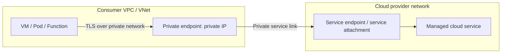
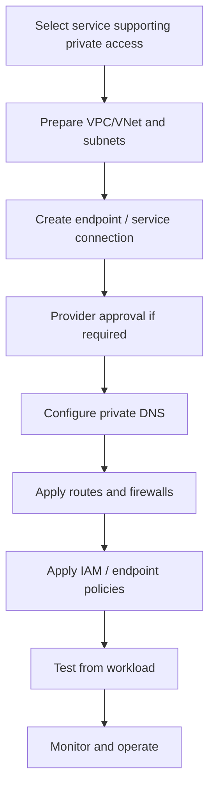
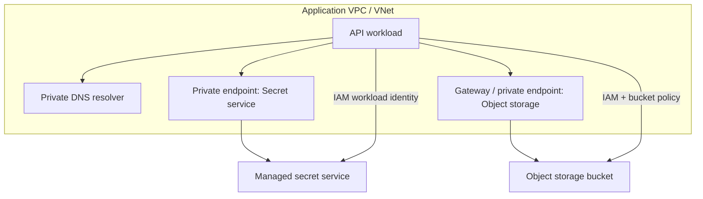

# Private Connectivity from Workloads to Cloud Services

## Context: Workloads Calling Services Without Traversing the Public Internet

An application running on VMs, containers, or serverless environments routinely needs to call cloud services such as object storage, databases, secret managers, message queues, logging, registries, or internal APIs. If every connection goes through public endpoints, traffic may have to leave the private network, depend on the Internet/NAT path, and expand the access surface. In many systems, operations teams want workloads to call services using private addresses, traverse the provider's backbone network, and be governed by network and identity policies.

**Private connectivity** allows workloads to access a service over a private network path or an endpoint with a private address inside the cloud network scope. The exact implementation depends on the provider and service type: it may be a private endpoint/interface endpoint, gateway endpoint, service endpoint, private service connection, or a connection to an internal load balancer.

The key point is that "private" describes the access path and network scope. It does not automatically prove the application is authenticated, data is encrypted, or the service has granted authorization. A secure design still requires proper DNS, routing, firewalls, TLS, and IAM/authorization.

In the **CLOUD_CORE_SERVICES_COMPUTE** module, private connectivity lets VMs, containers, and serverless workloads access supporting services reliably, restrict egress, reduce reliance on the public Internet, and enforce network segmentation for workloads.

## 1. Public Endpoints vs. Private Endpoints

An endpoint is the address a client uses to connect to a service, typically comprising a hostname, port, and protocol. A cloud service may offer a public endpoint, a private endpoint, or both.

| Attribute | Public endpoint | Private endpoint |
|---|---|---|
| Target address | Usually resolves to a public IP | Usually resolves to a private IP or uses a platform-provided private route |
| Traffic path | May traverse the Internet, NAT, or provider backbone depending on service | Stays within the private network/provider backbone per endpoint design |
| Access scope | Reachable from the Internet if service and policies permit | Typically restricted to a VPC/VNet, project, account, or connected networks |
| Controls | IAM, firewall/service policies, WAF, and network limits | IAM combined with endpoint policies, routes, security groups/firewalls, and DNS |
| Use cases | Public APIs, external clients, Internet integrations | Internal workloads calling storage, databases, secrets, or private APIs |

A public endpoint does not necessarily mean every packet crosses the public Internet; some services use a private backbone after the entry point. Conversely, using a private IP does not automatically provide end-to-end encryption. Read the connectivity model and guarantees for the specific service in use.

### 1.1. Common Benefits

- Reduces or eliminates the need for workloads to access the public Internet to call services supporting private access.
- Narrows destination address space and restricts egress flows through network control points.
- Keeps traffic on the cloud provider's network or approved private network interconnections.
- Limits exposure of public service endpoints to the open Internet.
- May reduce reliance on NAT gateways and public data transfer charges, depending on pricing models.
- Supports environment isolation and service connectivity across accounts/projects/VPCs without exposing services publicly.

Private connectivity does not guarantee lower cost or latency automatically. Endpoints may incur hourly, data-processing, or per-request charges; performance also depends on region, load, DNS, connection counts, and service limits.

## 2. Common Private Connectivity Models

Naming and implementation details vary across providers. Identify an endpoint type by how it creates addresses, routes, and control points.

### 2.1. Interface Endpoint / Private Endpoint

An interface endpoint typically provisions one or more virtual network interfaces with private IP addresses inside a subnet of the customer's network. Workloads connect to that private IP; the platform forwards traffic across a private link to the target service. On some platforms, this mechanism is called PrivateLink, Private Endpoint, or an equivalent name.

Conceptual model:



Applications typically continue using the service's standard hostname. Private DNS maps that hostname to the interface endpoint's IP address, requiring minimal application code changes. You must create the endpoint in appropriate subnets/zones, configure security groups or firewalls for the endpoint, and allow workloads to connect to the service port.

Interface endpoints are especially useful for API services supporting private link, cross-account/project access, or partner-provided services. An endpoint may carry its own fees and limits; verify supported endpoint counts, subnets, regions, and throughput.

### 2.2. Gateway Endpoint

A gateway endpoint integrates with the customer network's route table. Rather than creating a network interface with a private IP inside a subnet, the platform adds a route targeting the supported service, often via a prefix list or special route target. This model is common for certain provider object storage or key-value database services.

Workloads send requests to the service hostname; DNS may still return a public service address, while the route table selects the gateway endpoint route so traffic travels over the platform's internal path. Exact mechanics and supported services are provider-specific.

Gateway endpoints generally do not share the same properties as interface endpoints: they may not have a separate ENI/private IP, may not use endpoint security groups in the same way, and may apply only to specific services. Verify which route tables are associated with the endpoint and which policies restrict accessible buckets/resources.

### 2.3. Service Endpoint

Some clouds use the term **service endpoint** for a mechanism that lets a VNet/VPC reach a cloud service over the provider's backbone and enforces access rules by source network. In some designs, clients still connect to the service's public address while the service recognizes the permitted subnet/VNet. Thus, a service endpoint does not necessarily create a private IP inside the subnet.

Do not use the terms "service endpoint" and "private endpoint" interchangeably. When reading documentation, verify:

- Does the hostname resolve to a private IP or a public IP?
- Is a NIC/ENI created in the subnet, or is a route table modified?
- Does the service identify the caller by subnet/VNet, endpoint ID, or private link connection?
- Is public network access on the service still enabled?
- Can it connect across VPCs/accounts/regions, or only within a bounded scope?

### 2.4. Private Service Connection and Internal Load Balancers

If a service is operated by an internal team, it can be published via an internal load balancer or a service attachment/private service connection. Consumers create a connection to a private endpoint that the provider maps back to the provider-side service. This model fits when multiple VPCs or accounts need to call an internal API without peering entire networks.

For services running in the same VPC/VNet, workloads can also call an internal load balancer or the service's private address. Even as an internal connection, it still requires DNS, routes, firewalls, TLS, authentication, and health checks.

### 2.5. Peering, Transit Networks, and VPN/Interconnect

VPC/VNet peering, transit gateways/hubs, site-to-site VPNs, or dedicated circuits can link workloads to the network hosting a service. These models provide network-level routing between CIDRs or private networks, after which workloads reach the service's private IP.

Peering and transit networks are helpful when connecting many internal services or on-premises systems. However, broad network connectivity expands reachability. If the goal is simply allowing a consumer to call one specific service, a private endpoint/service connection generally bounds exposure better than opening routes to an entire provider network.

## 3. Private Connectivity Setup Flow

A private connection must be configured consistently across the consumer side, service side, and DNS. General workflow:

1. **Identify the target service:** confirm the service supports private access, region, account/project, protocol, port, and endpoint type.
2. **Prepare the consumer network:** choose the VPC/VNet, subnets, CIDRs, route tables, security groups/firewalls, and DNS resolvers.
3. **Create the endpoint or connection:** provision the interface/gateway endpoint, private service connection, or enable the service endpoint per provider model.
4. **Approve on the provider side if needed:** some private service connections require the service owner to approve the consumer or share a service attachment.
5. **Configure DNS:** enable private DNS or create private hosted zones/records so the service hostname resolves over the private path.
6. **Configure service permissions:** restrict IAM, resource policies, endpoint policies, or ACLs so only authorized workloads/endpoints can call the service.
7. **Test the path:** verify DNS, routes, firewalls, TLS, and access permissions from the actual workload.
8. **Enable monitoring:** track endpoint health, connections, errors, latency, traffic volume, and costs.



The actual sequence may vary because some services automatically create DNS records or routes upon endpoint creation. Even then, verify the final state across networking, DNS, and authorization layers.

## 4. DNS Determines the Traffic Path

Applications typically connect by hostname, such as `storage.example-cloud.com`, rather than IP. DNS determines whether that hostname maps to a public endpoint or a private endpoint. If a private endpoint exists while DNS still returns a public IP, workloads may continue taking the public path.

### 4.1. Private DNS and Split-Horizon DNS

Private DNS lets a hostname resolve differently depending on where the query originates. Inside the consumer network, the service hostname can return the endpoint's private IP; outside that network, the same hostname can return a public address or fail to resolve.

This is commonly called split-horizon DNS. Some providers offer an automatic private DNS option when creating an endpoint; the platform associates a private hosted zone or internal record with the VPC/VNet. If managing DNS yourself, ensure the zone is linked to the right network and does not override other required records.

### 4.2. Resolvers and DNS Forwarding

If workloads sit in a network with custom DNS, queries may hit an internal DNS resolver before reaching a private zone. Configure forwarding rules or conditional forwarders for the service domain. In hybrid environments, on-premises DNS may need to forward to an inbound cloud resolver; conversely, cloud resolvers may forward internal domains back to on-premises DNS.

Test DNS from the actual runtime environment, not solely from an administrator's laptop. In Kubernetes, DNS queries typically go through CoreDNS or the cluster DNS service; caching, stub domains, and forwarding settings can affect resolution results.

Example check on Linux:

```bash
dig +short storage.example-cloud.com
getent hosts storage.example-cloud.com
```

On Windows:

```powershell
Resolve-DnsName storage.example-cloud.com
```

Compare the output against the private IP/endpoint provided by the platform. If the hostname returns a public IP, check private DNS settings, zone associations, resolver forwarding, and DNS caches. Do not fix this by hardcoding IPs into the application, as endpoint IPs can change during replacement or scaling.

### 4.3. TLS, SNI, and Certificates

Even when DNS points to a private IP, applications should continue using the service's official hostname so TLS validates the certificate properly and sends the right SNI. Do not connect by raw IP unless the certificate covers that IP. Private connectivity does not replace TLS; application-layer encryption remains essential for protecting data and authenticating endpoints.

When using private DNS with custom hostnames, ensure the service certificate is valid for that hostname or configure TLS according to provider guidance. Avoid disabling certificate verification to work around DNS/TLS mismatches, as that removes server authentication.

## 5. Routing and Firewalls

DNS determines the target address, while route tables decide which path packets take. For interface endpoints, routing to the private IP is usually handled as internal VPC/VNet traffic. For gateway endpoints, the route table may contain a special route to the service prefix. For peering/transit, routes to the service-side CIDR and corresponding return routes are required.

Checkpoints:

- Does the workload's subnet have a route to the endpoint subnet or corresponding route target?
- Is the route table overridden by a broader or higher-priority route?
- Does the workload's security group/firewall permit egress to the destination port?
- Does the endpoint or service's security group/firewall permit ingress from authorized sources?
- Are network ACLs, firewall appliances, or egress policies blocking the flow?
- Is the return path valid and symmetric as required by the service?
- Does NAT/SNAT or a proxy alter the source address relied upon by policies?

For example, a private API listens for HTTPS on TCP/443. Workloads must be allowed egress TCP/443 to the endpoint; the endpoint's security group must allow ingress TCP/443 from approved source security groups or CIDRs. Exact rules depend on the platform and stateful/stateless security group behavior.

Do not open all egress simply to make connectivity work. Identify target hostnames, IP ranges/prefix lists, ports, and services, then create minimal rules. For services using dynamic IPs or multiple zones, prefer service/endpoint-ID policy mechanisms if supported rather than maintaining manual IP lists.

## 6. Network Permissions and Service Permissions Are Two Distinct Layers

A successful TCP connection only shows that a network path can be established. The service can still reject requests due to IAM, resource policies, endpoint policies, database users, tokens, or ACLs.

| Layer | Question | Example controls |
|---|---|---|
| Network reachability | Can the workload reach the endpoint? | Routes, security groups, firewalls, NACLs, private endpoints |
| Transport security | Is the connection properly authenticated and encrypted? | TLS, certificate validation, SNI, mTLS if required |
| Workload identity | Who does the service recognize as calling? | Instance role, managed identity, service account, workload identity |
| Service authorization | What is that identity permitted to do? | IAM policies, bucket policies, endpoint policies, database grants |
| Data authorization | Can it read/write the specific resource and object? | Resource ARN, bucket/prefix, schema/table, tenant ACL |

For example, a VM may connect privately to object storage yet receive `AccessDenied` because its instance role lacks bucket read permissions. Conversely, IAM may allow reading the bucket while requests time out due to routing or firewall blocks. Classify errors by layer before changing policies.

An endpoint policy (if supported by the service) can restrict which services or resources requests traversing the endpoint may access. It is typically an additional layer, not a replacement for IAM and resource policies. Policy evaluation rules vary by provider; verify evaluation order and the scope of each policy.

## 7. Private Connectivity by Workload Type

Each compute model attaches to the network differently. When designing endpoints, know the actual source address the service sees and which DNS resolver the application uses.

### 7.1. VMs

VMs in a VPC/VNet typically use subnet route tables and NIC-attached security groups. With interface endpoints, workloads connect to the endpoint's private IP; with gateway endpoints, route tables steer traffic to the service prefix through the gateway target. Applications use SDKs/APIs normally once DNS and identity are configured properly.

If a VM has multiple NICs, multiple subnets, or a default route through a firewall appliance, verify which interface and route are selected. Outbound and return paths can diverge if policy routing, NAT, or intermediate firewalls intervene. For private-only workloads, public IPs can be disabled with management allowed only via VPN, bastion, or session manager.

### 7.2. Containers and Kubernetes

Containers typically use the node's network namespace or a Pod network provided by the CNI. Private endpoints can be reached from Pods via VPC/VNet routes, though the source address seen by the endpoint depends on the CNI, SNAT, and cluster networking mode.

Points to verify:

- Pods use cluster DNS; does CoreDNS forward private zone queries to the appropriate resolver?
- Can Pods route to private endpoint IPs or service prefixes?
- Does `NetworkPolicy` allow egress from the namespace/Pod to required destinations and ports?
- Do node or Pod security groups (if supported by the CNI) have appropriate rules?
- Does SNAT make the endpoint see node IPs instead of Pod IPs?
- Does node autoscaling launch nodes in subnets with the corresponding routes, DNS, and endpoint access?

Example `NetworkPolicy` restricting Pods in namespace `orders` to HTTPS egress only to the private endpoint CIDR and cluster DNS:

```yaml
apiVersion: networking.k8s.io/v1
kind: NetworkPolicy
metadata:
  name: allow-private-service-egress
  namespace: orders
spec:
  podSelector:
    matchLabels:
      app: orders-api
  policyTypes:
    - Egress
  egress:
    - to:
        - ipBlock:
            cidr: 10.40.12.0/24
      ports:
        - protocol: TCP
          port: 443
    - to:
        - namespaceSelector:
            matchLabels:
              kubernetes.io/metadata.name: kube-system
          podSelector:
            matchLabels:
              k8s-app: kube-dns
      ports:
        - protocol: UDP
          port: 53
        - protocol: TCP
          port: 53
```

Replace the CIDR and labels in the example with actual endpoint subnets and DNS labels. `NetworkPolicy` takes effect only when the CNI enforces policies; it also does not replace security groups, routes, or IAM. If endpoint IPs change, maintaining static CIDRs in policies creates operational overhead; consider identity/endpoint-based policy mechanisms or an egress gateway if supported by the platform.

### 7.3. Serverless

Some function/serverless services allow attaching workloads to a VPC/VNet or configuring private network integration. Functions can then access private endpoints, internal databases, or services inside subnets. Implementations may use platform-managed network interfaces, connectors, or egress attachments.

Before enabling private integration, check:

- Does the runtime support VPC/VNet access and the required endpoint type?
- Does the subnet have enough IP addresses for expected concurrency and scaling?
- Does the runtime use private DNS?
- Does Internet egress still work, or is a separate NAT/proxy needed for public APIs?
- Are security groups, routes, endpoint policies, and IAM roles applied properly?
- Do concurrency limits, connection pools, and network interface quotas constrain scaling?

Attaching a function to a private network can alter its egress path and require NAT configuration for public destinations. Do not assume enabling VPC integration makes a function private-only, or that all traffic automatically flows through private endpoints. Verify routes and DNS for every destination.

### 7.4. Workloads Across Multiple VPCs/Accounts/Projects

If multiple consumer networks must call one service, you can create endpoints in each network or share connectivity per provider-supported patterns. Using private service connections can avoid opening routes between entire consumer and provider CIDRs. With peering/transit, verify transitive routing limits, CIDR overlaps, route propagation, and DNS scope.

Cross-account/project connections usually require coordination on both sides: the provider shares or authorizes the consumer principal; the consumer creates the endpoint; the provider approves the connection if an approval step exists. Verify consumer identity by specific account/project ID or principal rather than approving endpoints solely by display name.

## 8. Availability and Scalability

Private endpoints are also infrastructure components that can fail or hit quotas. Production designs must evaluate endpoint availability, zone count, capacity, DNS, and scaling alongside workloads.

### 8.1. Distributing Endpoints Across Fault Domains

If a service supports multi-availability-zone endpoints, deploy or enable endpoints in the zones where workloads run. This reduces single-zone dependency and avoids unnecessary cross-zone traffic. However, not every endpoint type provisions a NIC per zone; verify the provider's HA model.

The provider service also needs multiple backends/zones and proper health checks. A healthy consumer endpoint does not guarantee a healthy backend service; monitor both connection state and target service health.

### 8.2. Quotas, IPs, and Capacity

Endpoints can consume subnet IP addresses, per-account/region endpoint quotas, connection limits, or service bandwidth. When node autoscalers or serverless concurrency scale up, subnets must have sufficient IPs for workloads and network interfaces. IP exhaustion can prevent new Pods, functions, or endpoints from starting even when CPU and RAM remain available.

Capacity planning must account for:

- Number of endpoints and subnets/zones required.
- IP addresses for endpoint ENIs, nodes, Pods, and serverless integrations.
- Connection, request rate, throughput, and service quota limits.
- Number of consumer VPCs/accounts and future growth.
- Spare capacity when a zone or endpoint path becomes unavailable.

### 8.3. Failover and DNS

If an endpoint or zone fails, failover behavior depends on the service. It may require endpoints in other zones, DNS failover, alternate routes, or workload shifting. DNS caches and connection pools can retain stale addresses after a change; applications need bounded retries with backoff and connection recreation on appropriate errors.

Do not configure multiple endpoints under the same hostname without understanding how DNS returns multiple records and how clients choose addresses. Test failover from the actual subnet and runtime, measuring DNS convergence time, connection recovery time, and impact on in-flight requests.

## 9. Performance and Cost

Private paths are not automatically faster or cheaper than public paths. Outcomes depend on workload and service placement, endpoint type, call volume, data volume, cross-zone/cross-region traffic, NAT, and endpoint fees.

### 9.1. Latency and Throughput

Place workloads and services in the same region, preferring the same zone when aligned with HA and cost policies. If an endpoint sits in another zone, traffic can incur cross-zone latency and transfer fees. Some private link paths have throughput or connection limits; benchmark with request sizes and concurrency resembling production load.

Maintain sensible connection pools and reuse TLS connections instead of opening a new connection per request. Track DNS lookup, TCP connect, TLS handshake, service processing, and data transfer times to pinpoint bottlenecks accurately.

### 9.2. Cost

Cost components can include hourly endpoint fees, per-GB data processed by endpoints, cross-zone/cross-region transfers, NAT gateways, firewall appliances, private DNS resolvers, and target service usage fees. Pricing structures vary across providers and endpoint types.

Compare total cost using realistic traffic volumes. For workloads heavily calling object storage, gateway endpoints may have a different pricing model than interface endpoints. For low-traffic workloads, fixed hourly endpoint charges can dominate. Do not compare NAT prices against endpoint prices while ignoring egress, cross-zone, and operational costs.

### 9.3. Performance Observability

Track these metrics:

- Endpoint status and frequency of transitions to unhealthy.
- DNS resolution latency, private vs. public IP resolution ratio, and `NXDOMAIN` errors.
- TCP connect timeouts, TLS handshake failures, and connection resets.
- Request rate, throughput, p50/p95/p99 latency, and service errors.
- Connection counts, rejected/throttled requests, and quota utilization.
- NAT bytes, endpoint bytes, cross-zone traffic, and cost by tag/service.

Correlate flow logs, DNS query logs, endpoint metrics, and application logs. Network logs show rejected sources/destinations/ports, while application logs reveal authentication errors or request timeouts.

## 10. Troubleshooting Private Connectivity

When a workload cannot call a service, trace the path from domain name to application permissions. Avoid changing DNS, firewalls, and IAM simultaneously, as doing so obscures the root cause.

| Symptom | Possible cause | Check first |
|---|---|---|
| Hostname resolves to public IP | Private DNS not enabled, zone not linked, or misconfigured resolver forwarding | `dig`, `Resolve-DnsName`, private zone association, and DNS cache |
| `NXDOMAIN` or host not found | Missing record, wrong domain, forwarding rule, or private zone not visible | Resolver, zone links, CoreDNS, and conditional forwarders |
| DNS returns private IP but TCP times out | Route, security group, NACL, firewall, or endpoint not ready | Route tables, flow logs, endpoint status, and port |
| TCP connects but TLS fails | Hostname/SNI mismatch, certificate chain, or wrong trust store | Certificate SAN, SNI, system clock, and CA bundle |
| TLS succeeds but HTTP 403/AccessDenied | Denied by IAM, endpoint policy, resource policy, or ACL | Workload identity, policy evaluation, and target resource |
| Only one subnet/zone fails | Missing endpoint in zone, different route table, or subnet IP exhaustion | Per-zone endpoints, route associations, and IP utilization |
| VM works but Pod cannot connect | `NetworkPolicy`, CNI, CoreDNS, SNAT, or node security group | Test from Pod, Pod DNS, CNI policies, and flow logs |
| Function reaches neither private nor public services | VPC integration, egress routes, NAT, or subnet IP/capacity | Connector/ENI status, routes, NAT, and concurrency |
| Intermittent connectivity | DNS caching, endpoint failover, connection limits, or unstable backend | DNS TTL, connection pools, retries, endpoint metrics, and service health |

### 10.1. Layer-by-Layer Diagnostic Workflow

1. **Verify the exact workload:** run tests from the actual failing VM, Pod, or function; record subnet, zone, source IP, and timestamp.
2. **Check DNS:** query the hostname using the resolver used by the workload; confirm the record and IP match the private endpoint.
3. **Check the endpoint:** are endpoint status, approval, subnet/zone, IP, and target service ready?
4. **Check routes:** confirm the subnet route table, routes to the endpoint/service prefix, and the return path.
5. **Check firewalls:** inspect security groups, NACLs, `NetworkPolicy`, host firewalls, and firewall appliances.
6. **Check transport:** test TCP port, TLS handshake, certificates, and SNI.
7. **Check identity/permissions:** identify the workload's actual principal and evaluate IAM, endpoint/resource policies, or ACLs.
8. **Check the service:** inspect health, quotas, throttling, connection limits, request logs, and backend status.
9. **Verify after fixing:** retest from the exact workload, confirm the private path, test both permitted and denied operations, and monitor metrics.

Basic diagnostic commands:

```bash
# DNS: does the hostname return the expected private IP?
dig +short service.internal.example

# TCP: can a connection be established to the service port?
nc -vz service.internal.example 443

# TLS/HTTP: verify certificate and hostname
curl -v https://service.internal.example/health
```

These commands are diagnostic steps only. If an endpoint requires tokens or IAM signing, HTTP requests may return 401/403 even when DNS, TCP, and TLS all function normally.

## 11. Security Design Principles

Private connectivity should be part of a zero-trust model: verify identity and authorization on every request, bound network scope, log activity, and do not rely solely on IP location.

- **Private by default:** disable public network access when services and administrative workflows allow; if public access is needed, restrict sources and use explicit policies.
- **Least privilege:** workloads should call only required APIs and resources; use endpoint policies and resource policies to further narrow scope where available.
- **End-to-end TLS:** continue verifying certificates and hostnames; use mTLS when the service model requires mutual authentication.
- **Environment isolation:** dev, staging, and prod should use separate endpoints, DNS zones, identities, and policies when isolation is required.
- **Control DNS:** protect permissions to modify private zones/records; DNS changes can redirect traffic to a different endpoint.
- **Restrict egress:** allow workloads to call only required services; also audit Internet egress through NAT/proxies.
- **Audit:** log changes to endpoints, approvals, routes, DNS, IAM, and service access.
- **Protect metadata:** prevent untrusted workloads from accessing the metadata service or another workload's credentials.

Private endpoints reduce Internet exposure but do not stop a compromised workload from calling internal services if its identity holds permissions. Therefore, network isolation and authorization must be designed together.

## 12. Architecture Example: Private Application Calling Object Storage and Secret Manager

Suppose an API service runs on VMs or Pods in private subnets. The application needs to read secret configuration and download files from object storage. Reference architecture:



Execution flow:

1. The workload starts and obtains its identity from an instance role or workload identity.
2. The DNS resolver resolves the secret service and object storage hostnames via private configuration.
3. Requests travel to private endpoints over VPC/VNet routes.
4. TLS verifies hostnames/certificates; the service identifies the workload's principal.
5. IAM and resource/endpoint policies verify whether the workload may read the specific secret or object.
6. Application logs and flow/DNS logs record outcomes for monitoring.

If the application needs to call another public API, design a dedicated egress path via an approved NAT/proxy or gateway. Do not assume private endpoints to two services mean all workload traffic is private.

## 13. Private Connectivity Implementation Checklist

Before promoting private connectivity to production, verify:

- [ ] The target service supports the required private access type in the relevant region and account/project.
- [ ] Endpoints are created in the right VPC/VNet, subnets, and zones; provider approval is completed if required.
- [ ] CIDRs do not overlap with consumer/provider networks or connected on-premises networks.
- [ ] Route tables and return paths are correct; no unexpected routes, NATs, or firewalls interfere.
- [ ] Private DNS zones are linked to the right networks; workloads resolve hostnames to expected endpoints.
- [ ] TLS uses valid hostnames and certificates; certificate verification is not disabled.
- [ ] Security groups, NACLs, firewalls, and `NetworkPolicy` open only required ports and sources.
- [ ] Workload identity and IAM/resource/endpoint policies grant least-privilege access.
- [ ] Public network access is restricted per policy; private endpoints are not mistaken as a substitute for authorization.
- [ ] Subnets have sufficient IPs; endpoint, service, and connection quotas support expected load.
- [ ] Redundant endpoints/paths exist per HA requirements; failover and DNS caching have been tested.
- [ ] Metrics, flow logs, DNS logs, alerts, and cost allocation are configured for endpoints.
- [ ] Tested from actual VMs, Pods, or functions, including both authorized requests and requests expected to be denied.

## 14. Common Misconceptions

**A private endpoint means the service no longer has a public endpoint.** Private endpoints can coexist with public endpoints. Public network access and resource policies must be configured if you want to restrict public access.

**Service endpoints and private endpoints are the same thing.** Some service endpoints still use public addresses while traversing the backbone and identifying callers by subnet/VNet; private endpoints typically create private addresses or private link connections. Read the provider's exact model.

**Having a private IP means TLS is unnecessary.** A private IP only describes addressing and routing. TLS is still required to encrypt traffic and authenticate the service.

**DNS resolution working means network connectivity works.** DNS only answers which address a hostname maps to. Routes, firewalls, TCP, TLS, and service permissions can still fail.

**A successful TCP connection means data access is authorized.** IAM, endpoint policies, resource policies, and ACLs can still reject the request.

**Attaching a workload to a VPC guarantees every service is called over a private path.** Every hostname must be properly resolved and routed; public targets can still route through NAT or the Internet.

**Peering is always the best way to connect services.** Peering/transit opens connectivity at a broader network level; a private service connection can scope access to one specific service.

**Private paths are always faster and cheaper.** Endpoint charges, cross-zone fees, throughput limits, and NAT can raise total cost. Benchmark and calculate total cost using actual traffic.

## Conclusion

Private connectivity lets VMs, containers, and serverless workloads access cloud services through endpoints or network paths without relying on the public Internet. Interface/private endpoints, gateway endpoints, service endpoints, private service connections, and peering/transit differ in how they create addresses, routes, and access boundaries. For secure operation, configure DNS, routes, firewalls, TLS, workload identity, and service policies consistently. Test from the actual workload, design endpoints across fault domains, monitor performance and cost, and verify permissions at every layer before moving to production.
