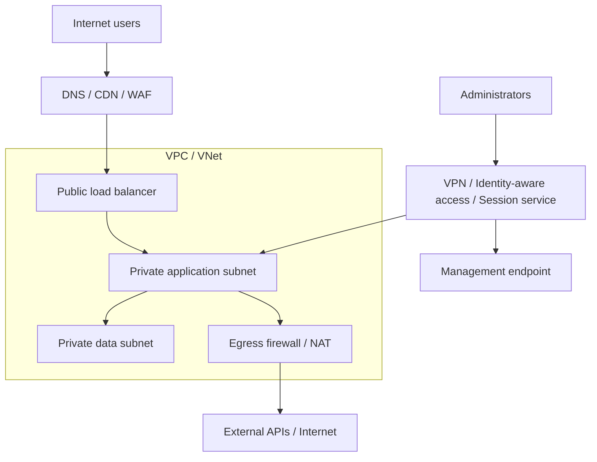
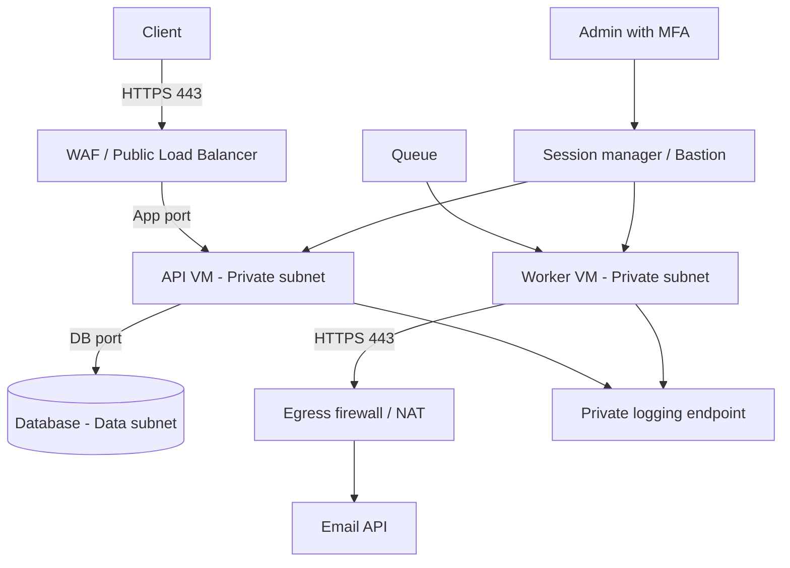

# Designing Ingress, Egress, and Management Access Flows

A cloud workload needs to accept requests from users, call dependent services, and allow operations teams to administer machines when needed. These three flow types carry different goals and trust levels. If the network is overly permissive, workloads can suffer unauthorized access or uncontrolled data exfiltration. If policies are tightened without understanding request paths, applications can lose connectivity to databases, external APIs, or monitoring systems.

Compute network design must clearly define **ingress** (traffic entering the workload), **egress** (traffic leaving the workload), and **management access** (administrative access). Then combine subnets, route tables, security groups/firewalls, load balancers, NAT, private endpoints, and identity-based access mechanisms. The objective is allowing only the right sources, destinations, protocols, and users while maintaining logs for incident investigation.

## 1. Three Network Flows to Design Separately

### Ingress: Traffic Entering the Workload

Ingress is traffic flowing from clients, upstream systems, or other components toward the application. Examples: browsers sending HTTPS to a website, an API gateway forwarding requests to a service, or an internal system calling workers over a private network.

Questions to answer:

- Who is allowed to connect: the Internet, corporate network, internal services, or a specific workload?
- Is the entry point a load balancer, API gateway, reverse proxy, or directly a VM?
- Which protocols and ports are permitted: HTTPS/443, internal HTTP, TCP, or UDP?
- Where does TLS terminate, and which hops require continued encryption?
- Are WAF, rate limiting, DDoS protection, or application-layer authentication required?

### Egress: Traffic Leaving the Workload

Egress is traffic initiated by the workload toward another destination. Examples: calling third-party APIs, downloading packages, shipping logs, accessing object storage, querying databases, or calling cloud services.

Questions to answer:

- Which services does the workload need to connect to, and over which ports?
- Do targets reside in the same VPC/VNet, corporate network, cloud services, or the Internet?
- Can private endpoints be used to avoid traversing the Internet?
- Should egress route through a NAT gateway, firewall, or proxy for centralized control?
- Do specific domains, IPs, service tags, or endpoints need allowlisting?
- What data is permitted to leave the environment, and how is outbound traffic logged?

### Management Access: Administrative Access

Management access is the path for administrators, SREs, or operational tooling to access VMs, operating systems, agents, and administrative interfaces. Examples: SSH/RDP, session manager, remote commands, serial console, or internal admin UIs.

Management flows require identity controls, MFA, least privilege, time-bound access, and audit logging. Never treat network reachability alone as proof that a user is authorized to administer a machine.

| Flow | Common sources | Destinations | Primary controls |
|---|---|---|---|
| Ingress | Users, API clients, upstream services | Load balancer or application | WAF, TLS, app auth, security group/firewall |
| Egress | VMs, containers, functions | Databases, APIs, cloud services, Internet | Routes, egress firewall, NAT/proxy, private endpoints, DNS |
| Management | Administrators, CI/CD, ops systems | Bastion, session service, management interface | IAM/RBAC, MFA, VPN/IAP, session auditing, temporary access |

## 2. Building Network Zones and Traffic Paths

In a typical VPC/VNet architecture, workloads sit inside private subnets. Subnets are commonly segmented by availability zone and role—for instance, public subnets for load balancers/NAT, private application subnets for VMs or nodes, and data subnets for databases.

The labels "public" and "private" primarily describe routing capabilities and Internet reachability per platform configuration. A subnet does not become secure merely by being named private. Inspect route tables, public addresses, security rules, firewalls, and reachability over peering/VPN.



The diagram shows a reference layout. In practice, load balancers may span multiple subnets/AZs, firewalls may be centralized services, and management sessions may not require direct SSH/RDP paths to VMs.

### 2.1. Public Subnets and Private Subnets

A public subnet usually has a route to an Internet gateway or equivalent public ingress mechanism. Resources placed in this subnet still require inbound and outbound controls. Place only resources that truly require public endpoints—such as load balancers or NAT gateways—depending on the architecture.

A private subnet has no path to accept direct inbound connections from the Internet via public IPs/Internet gateways under standard setups. Workloads inside can reach outside via a NAT gateway, egress firewall, proxy, or private endpoint. Management access can enter via VPN, bastion, session manager, or private interconnects.

### 2.2. Route Tables and Next Hops

Route tables decide where packets are forwarded based on destination addresses. A route can point to a local network, Internet gateway, NAT gateway, virtual appliance/firewall, VPN gateway, transit hub, or private endpoint depending on the platform.

When troubleshooting connectivity, trace both the outbound path and the return path. A valid outbound route without a matching return route can cause connection timeouts. For paths crossing stateful firewalls, verify both policy rules and session state. For peering or transit networks, verify route propagation, CIDR overlaps, and cross-region connectivity limits.

## 3. Designing Secure Ingress

A common pattern for web applications places the request entry point on a load balancer or API gateway while VMs/containers run in private subnets. The load balancer routes requests to backends based on health checks and routing policies.

### 3.1. Layer 4 and Layer 7 Load Balancers

| Type | Behavior | Best suited for |
|---|---|---|
| L4 (TCP/UDP) | Forwards by IP address, port, and transport protocol | TCP services, UDP services, traffic needing end-to-end protocol preservation |
| L7 (HTTP/HTTPS) | Understands HTTP hosts, paths, headers, and application attributes | Websites, REST APIs, host/path routing, TLS termination |

Load balancers need appropriate health checks. Health checks should verify the application is genuinely ready to serve traffic rather than merely checking that a process is running. Avoid health endpoints that depend on too many external services, which can mark all backends unhealthy when a non-essential dependency blips.

### 3.2. TLS and Request Protection

TLS can terminate at a CDN, WAF, API gateway, or load balancer. If sensitive data continues across internal networks, consider encrypting the load-balancer-to-backend leg with TLS/mTLS. Certificate management includes issuance, renewal, rotation, revocation, and private key protection.

A WAF filters malicious HTTP request patterns; DDoS protection absorbs large-scale attack traffic; rate limiting and quotas curb API abuse. These layers complement application authentication, authorization, and input validation.

### 3.3. Open Only Necessary Ports

If the load balancer is the sole entry point, backend security rules should permit traffic only from the load balancer's security group, subnet, or network identity on the application port. Never open backend ports to the entire Internet.

Example ingress matrix for an API:

| Component | Allowed source | Destination/port | Reason |
|---|---|---|---|
| Public load balancer | Internet or CDN/WAF per architecture | TCP 443 | Accept HTTPS from clients |
| Application VM | Load balancer security group | TCP 8080 | Accept traffic via controlled entry point |
| Database | Application VM security group | TCP 5432 | Only API may connect to PostgreSQL |
| Management endpoint | Controlled VPN/IAP/session service | SSH/RDP or required agent channel | Authenticated operational access |

Ports in the table are examples only. Substitute real ports and constrain sources using exact security groups, service identities, or CIDRs.

## 4. Designing Egress and Controlling Outbound Connections

Overly broad default egress lets a compromised machine download payloads, exfiltrate data, or call unauthorized services. Egress policies should start from the workload's actual dependency inventory.

### 4.1. NAT Gateway

A NAT gateway lets resources in private subnets initiate outbound connections without direct public IPs on each VM. Under standard NAT, connections are initiated from inside; NAT does not by itself allow new inbound connections from the Internet to VMs.

A NAT gateway is not an application firewall. It primarily performs address translation and enables outbound routing. If you need destination filtering, protocol inspection, or detailed logging, combine it with an egress firewall, proxy, or appropriate control service.

### 4.2. Egress Firewalls and Proxies

An egress firewall controls source, destination, protocol, port, and certain application attributes. An HTTP(S) proxy can enforce hostname allowlists, workload authentication, request logging, and content policies. Understand the limits of TLS inspection and comply with privacy, certificate, and application requirements.

IP-based allowlists are hard to maintain for SaaS services with changing IPs. Hostname-based allowlists require controlling DNS, SNI, proxies, and bypass vectors. Do not restrict domains at the application proxy while leaving workloads free to open direct Internet connections over another path.

### 4.3. Private Endpoints and Service Endpoints

Private endpoints allow workloads to access cloud services via private addresses inside the virtual network or platform-provided private links. This reduces public Internet traversal and narrows service access paths.

Private endpoints still require DNS, routes, security rules, and permissions on the target service. Having a private IP does not automatically grant permission to read buckets, databases, or secrets. Combine IAM/RBAC, resource policies, and network policies.

### 4.4. IPv6 Requires Dedicated Policies

An egress policy checking only IPv4 can miss IPv6 paths. If subnets or VMs have IPv6 enabled, define IPv6 routes, firewall rules, public reachability, and DNS AAAA records. Test both IPv4 and IPv6 so traffic cannot escape over an unmonitored protocol.

## 5. Secure Management Access

Management access typically holds elevated privileges: VM shells, command execution, log inspection, configuration file reads, or secret access. Design a separate, auditable management path.

### 5.1. VPN or Private Networks

Site-to-site VPNs link cloud networks to corporate networks; client VPNs let users connect from managed devices. A VPN provides a private network path, yet does not by itself govern which VMs a user may log into. Combine IAM, MFA, permission groups, and source-restricting security rules.

### 5.2. Bastion Hosts or Jump Hosts

A bastion is a hardened intermediary host administrators connect through to reach private machines. Bastions must be patched regularly, restrict inbound sources, enforce MFA/SSO where possible, log sessions, and avoid storing persistent credentials. Never share a single bastion with unrestricted permissions across everyone.

If SSH/RDP via a bastion is required:

- Open administrative ports only from approved VPN IP ranges or management devices.
- Allow the bastion to connect only to required VM groups and ports.
- Use short-lived SSH certificates or ephemeral credentials when supported.
- Restrict agent forwarding, port forwarding, and file transfers if unneeded.
- Log user identity, timestamps, target hosts, and session outcomes.
- Maintain patching, configuration backups, and bastion replacement procedures.

### 5.3. Session Managers and Identity-Aware Access

Several clouds provide management via agents or the control plane, such as AWS Systems Manager Session Manager, Azure Bastion or appropriate Azure Arc/VM access mechanisms, and Google Cloud IAP TCP forwarding with OS Login. These services reduce or eliminate the need for public IPs or open inbound SSH/RDP ports.

Prefer mechanisms utilizing user and workload identities, MFA, per-resource permissions, and session logging. Verify agent requirements, outbound endpoints, IAM permissions, and transcript storage. A session manager still requires strict control over who can start sessions, run commands, and access files.

### 5.4. Management Access Is Not Application Access

Do not share the same network rules between application users and administrators. Customer requests should enter via load balancers/API gateways; shell access should traverse the management plane. Separating these paths tightens permissions, simplifies auditing, and prevents administrative ports from sharing the application's public Internet surface.

## 6. Security Groups, Network ACLs, and Firewalls

Clouds often have multiple network filtering layers. Understand connection statefulness and evaluation order to avoid conflicting rules.

| Mechanism | Typical scope | Characteristics |
|---|---|---|
| Security group / NIC firewall | Attached to VMs, NICs, or workloads | Usually stateful: tracks connection state and allows return traffic for accepted sessions |
| Network ACL | Applied at the subnet | Usually stateless: requires rules for both outbound and inbound directions, including ephemeral ports where applicable |
| Host firewall | Inside the OS | Controls traffic to host processes/ports; useful as defense-in-depth |
| Cloud/network firewall | At network boundaries or centralized egress/ingress points | Can filter L3/L4/L7, detect threats, log, and enforce centralized policies depending on service |
| Kubernetes NetworkPolicy | At Pod/namespace level when CNI supports it | Controls flows between Pods and namespaces; verify network plugin enforces policies |

Stateful security groups usually permit return traffic for an allowed connection without a symmetric inbound rule. Stateless network ACLs require rules in both directions. Exact behavior and rule order depend on the platform; consult documentation and test in a real environment.

### Rules for Writing Rules

- Use specific sources/destinations instead of `0.0.0.0/0` or `::/0` unless public exposure is intended.
- Open only the protocols and ports the application genuinely uses.
- Reference security groups or service identities when supported instead of relying on shifting CIDRs.
- Attach descriptions, owners, and justifications to every rule.
- Remove obsolete rules and audit unused rules periodically.
- Avoid overlapping rules that obscure effective policy.
- Check IPv4, IPv6, east-west traffic, and management paths.

## 7. DNS, Service Discovery, and Name Resolution

Applications should use DNS or service discovery to locate services rather than hardcoding IPs. Internal DNS can return private endpoint addresses or internal load balancers. When using private DNS zones, associate zones with the proper VPCs/VNets and test resolution from each subnet.

Common errors:

- Private DNS zone not linked to the workload's network.
- Split-horizon DNS returning differing addresses between internal networks and the Internet.
- DNS resolvers unable to forward queries to zones in peered networks.
- Excessively long TTLs causing applications to keep using stale IPs after endpoint changes.
- DNS egress blocked or workloads disallowed from querying configured resolvers.

Never open all outbound traffic merely to fix a DNS error. Identify resolvers, DNS protocols (UDP/TCP 53 or DNS-over-TLS/HTTPS per design), routes, and explicit rules.

## 8. Connecting Workloads and Corporate Networks

Workloads may need to communicate with other VMs, container clusters, managed databases, or on-premises systems. Common connectivity mechanisms include:

- VPC/VNet peering for private networking between virtual networks within platform limits.
- Transit gateways, virtual WANs, or hub-and-spoke topologies for centralized multi-network connectivity.
- Site-to-site VPNs for encrypted connections over the Internet.
- Dedicated private connectivity such as Direct Connect or ExpressRoute when private, stable, high-throughput circuits are required.
- Private endpoints/service attachments to expose internal services without opening entire networks.

During design, check for non-overlapping CIDRs, bidirectional routes, DNS, MTU, throughput, latency, connection limits, and failover behavior. Private connectivity does not replace firewalls; source/destination controls and application authentication remain essential.

## 9. Network Segmentation by Environment and Application Tier

Never place every workload in one subnet under one shared rule. Segment by environment and role:

| Zone | Resources | Typical policy |
|---|---|---|
| Edge/public | CDN origins, public load balancers, WAF | Accepts traffic from Internet or edge networks; holds no business data |
| Application | VMs, container nodes, application services | Accepts only from load balancer or authorized services; egress per dependencies |
| Data | Databases, caches, queue endpoints | Accepts only from application identities/networks; outbound restricted |
| Management | Bastions, session endpoints, admin tooling | Accessible only from VPN/IAP or approved operator identities |
| Shared services | DNS resolvers, logging, monitoring, package mirrors | Provides shared services via defined endpoints and ports |

Subnet separation is an organizational and routing layer. For effective isolation, combine security groups, network ACLs, firewalls, IAM, and `NetworkPolicy`. If a workload can reach every subnet simply because routes exist, separate subnets alone do not establish a true security boundary.

## 10. Architecture Example for a Three-Tier Web Application

Suppose an application comprises a web/API tier, a database, and background workers. Internet users access the API; the API reads/writes the database; workers call an external email service; administrators need VM access for incident troubleshooting.

A flow policy could look like:

| Source | Destination | Action / Allow | Notes |
|---|---|---|---|
| Internet | WAF/public load balancer | HTTPS 443 | Public endpoint only |
| WAF/load balancer | API VM | TCP 8080 | Source restricted to load balancer |
| API VM | Database | TCP 5432 | API security group only |
| Worker VM | Email provider | HTTPS 443 | Via NAT/firewall/proxy and allowlist if feasible |
| API/worker VM | Logging/monitoring endpoint | HTTPS or required agent port | Private endpoint or shared service |
| Admin identity | Session manager/bastion | Platform-supported admin channel | MFA, short-lived access, and audit |
| Bastion/session service | Target management VM | SSH 22 or RDP 3389 if used | Management path only |
| Internet | API VM/database/SSH directly | Deny | Never expose backends or admin ports publicly |



This design restricts users to the public entry point. The API and workers run in private subnets, the database accepts connections only from the API, worker egress passes through a controlled egress point, and administrators use a separate management path.

## 11. Logging, Monitoring, and Investigating Network Flows

Network policies need telemetry to show which connections are permitted, which are denied, and which components they traverse.

Useful log sources:

- **VPC/VNet flow logs:** metadata on source/destination IPs, ports, protocols, actions, and timestamps; capture granularity depends on the platform.
- **Firewall logs:** matched rules, target destinations, threat detections, and actions taken.
- **Load balancer access logs:** clients, hosts/paths, status codes, backends, latency, and TLS metadata per service.
- **WAF/API gateway logs:** blocked requests, rate limits, rule matches, and application identities where present.
- **Host logs:** host firewall, SSH/RDP, agents, OS events, and processes opening connections.
- **DNS logs:** domain queries and resolution results, valuable for investigating anomalous egress.
- **Identity/session audits:** who started an administrative session, on which host, when, and which actions were recorded.

Synchronize clocks across VMs, firewalls, load balancers, and logging systems. Standardize correlation IDs, workload IDs, environments, and zones to stitch events together. Configure proper retention and restrict log read access, as logs can contain internal addresses or sensitive metadata.

### Metrics and Alerts

- Unusual spikes in requests rejected at the WAF/load balancer.
- Egress connections to unapproved IPs or hostnames.
- Failed SSH/RDP attempts or sessions opened outside operational windows.
- Sudden spikes in outbound traffic or abnormally large data transfers.
- Backend health check failures or rising latency across tiers.
- DNS queries to newly observed/rare domains or resolver errors.
- Firewall rules modified outside approved pipelines.

## 12. Testing Network Paths Before Release

Before promoting workloads to production, test both legitimate flows and flows that should be blocked.

1. From the Internet, confirm only required public endpoints respond.
2. From the Internet, attempt direct connections to private VMs, databases, and management ports; these must be blocked.
3. From the load balancer, confirm connectivity to backends on the application port.
4. From the API, confirm only the database and required dependencies are reachable.
5. From workers, confirm egress to approved services works and unauthorized targets are blocked.
6. Test private/public DNS and name resolution from every subnet.
7. Test both IPv4 and IPv6 if dual-stack is enabled.
8. Open a management session with an authorized identity; confirm unauthorized users cannot open sessions.
9. Inspect logs across firewalls, flow logs, load balancers, and session audits.
10. Simulate route or firewall changes in staging to verify alerts and rollback procedures.

Tools such as `curl`, `nc`, `traceroute`/`tracepath`, `dig`, and `ss` help test from inside the guest OS. A single successful connection test does not prove the entire policy is secure; verify both control-plane configurations and logs across network layers.

Example basic verification commands on Linux:

```bash
# Test DNS resolution
dig api.internal.example

# Test HTTPS to an approved endpoint
curl -I --connect-timeout 3 https://api.example.com/health

# Test a specific TCP port
nc -vz database.internal.example 5432

# View the selected route to a destination
ip route get 10.20.30.40

# View listening sockets
ss -lntup
```

Run tests only on systems you are authorized to administer. Use actual environment endpoints and ports; never scan network ranges outside approved scope.

## 13. Common Design Mistakes

**Placing application VMs directly in a public subnet with many open ports.** Expands the attack surface and complicates source control. Place backends in private subnets and accept traffic via load balancers or gateways.

**Allowing full Internet egress.** Compromised machines can reach arbitrary destinations. Build a dependency inventory, combine NAT with firewalls/proxies, and use private endpoints where applicable.

**Treating a NAT gateway as a firewall.** NAT does not replace application filtering or destination allowlists. Add a firewall/proxy when egress control is required.

**Opening SSH/RDP to all addresses.** Public management ports attract scanning and credential attacks. Use a VPN, bastion, or session manager with MFA and auditing.

**Creating private subnets without east-west controls.** Workloads can still connect laterally across services. Enforce security groups, firewalls, and `NetworkPolicy` per dependencies.

**Forgetting return rules on stateless ACLs.** Connections can time out even when outbound rules allow them. Verify ephemeral ports and both directions.

**Overlooking IPv6 or DNS.** Traffic may escape over an unmonitored protocol or resolve to the wrong endpoint. Check routes, firewalls, and DNS for every enabled protocol.

**Treating a VPN or private endpoint as authorization.** Private network paths do not replace IAM and application authentication. Always verify identity and permissions at the service layer.

**Failing to retain logs or synchronize clocks.** Network incidents become hard to trace. Enable flow/firewall/LB/session logs and standardize timestamps and correlation IDs.

## 14. Ingress, Egress, and Management Design Checklist

- [ ] Documented source, destination, protocol, port, and purpose for every flow.
- [ ] Public ingress enters through an appropriate load balancer, gateway, or edge control.
- [ ] Backend and data tiers have no public access beyond approved requirements.
- [ ] TLS is configured properly and certificates have renewal/revocation workflows.
- [ ] Security groups, ACLs, and host firewalls open only required ports.
- [ ] Egress is restricted per dependencies using NAT/firewalls/proxies or private endpoints.
- [ ] Evaluated both IPv4 and IPv6 if enabled.
- [ ] Private DNS zones, resolvers, and routes work from every required subnet.
- [ ] Management access uses IAM/RBAC, MFA, and short-lived permissions.
- [ ] SSH/RDP is never opened directly to the Internet; bastions/session managers are hardened and audited.
- [ ] Containers/Pods enforce `NetworkPolicy` when supported by the CNI and isolation is required.
- [ ] Flow logs, firewall logs, load balancer logs, and session audits are enabled.
- [ ] Tested both permitted flows and flows expected to be blocked.
- [ ] Assigned owners, descriptions, periodic reviews, and obsolete-rule cleanup processes.
- [ ] Prepared rollback plans before changing routes, firewalls, or DNS configurations.

## 15. Conclusion

Workload network design must cleanly separate ingress, egress, and management access. Ingress should traverse protected entry points such as load balancers, API gateways, or WAFs; egress should be restricted to known dependencies and prefer private endpoints where applicable; management access should rely on identity, MFA, least privilege, and audited sessions.

Subnets and route tables define traffic paths, while security groups, network ACLs, host firewalls, cloud firewalls, and `NetworkPolicy` determine which flows are permitted. Combining these layers with accurate DNS, comprehensive logging, and testing of both allowed and denied connections keeps workloads reliable, minimizes the attack surface, and simplifies incident investigation.
