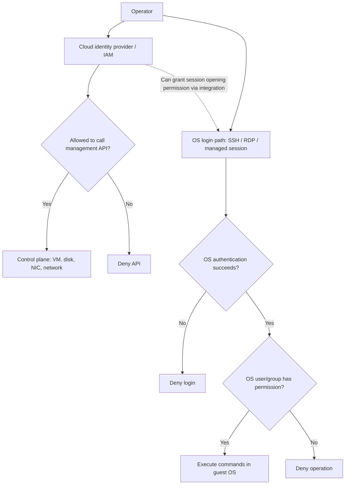
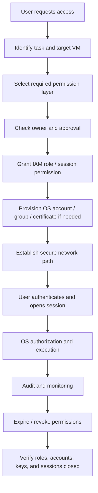

# Distinguishing Resource Administration Permissions from OS Login Permissions

A cloud virtual machine has at least two access layers that must be managed separately. The first layer determines who can create, view, modify, or delete cloud resources such as VMs, disks, NICs, and security groups. The second layer determines who can log in to the guest operating system to run commands, read files, install software, or change configurations inside the machine.

These two layers may be integrated in some services, but they are not automatically identical. Someone with permission to start or delete a VM via API does not necessarily have an SSH/RDP account in the operating system. Conversely, someone with Linux login access and sudo can control the operating system and data on the machine, but is not necessarily allowed to modify network settings or delete cloud resources.

Clearly distinguishing these two permission types helps enforce the principle of least privilege, separate duties between cloud teams and OS teams, limit the blast radius when an account is compromised, and investigate who performed an action at which layer.

After this lesson, you will be able to:

- Distinguish control-plane IAM from accounts and login permissions in the guest operating system.
- Explain authentication and authorization at each layer.
- Design VM administration permissions and OS permissions by role, task, and duration.
- Identify scenarios where IAM is integrated to grant SSH/RDP access and the limitations of that integration.
- Establish an administrative access workflow with controls, auditing, and permission revocation.

## 1. Two Access Layers of a Virtual Machine

### Cloud resource administration permissions (control plane)

The control plane is the provider's API and resource management layer. Users can interact through the portal, CLI, SDK, API, or Infrastructure as Code (IaC) tools. Identities are typically users, groups, service principals, workload identities, or service accounts managed by the cloud IAM system.

Permissions at this layer may include:

- Viewing VM lists and resource status.
- Creating, starting, stopping, restarting, resizing, or deleting VMs.
- Creating and attaching disks, NICs, public IPs, or security groups.
- Modifying subnets, routes, firewall rules, and load balancer configurations.
- Creating snapshots, images, or backup policies.
- Assigning roles, service accounts, or identities to VMs.
- Querying administrative logs, metrics, and billing information.

IAM determines which actions a principal can perform on which resource types, within what scope, and under what conditions. For example, an engineer may be allowed to restart VMs in a staging project, but not delete production VMs or modify IAM policies.

### Guest operating system login permissions (guest OS)

The guest OS is the operating system running inside the VM, such as Linux or Windows Server. Access permissions are enforced by the authentication and authorization mechanisms of the operating system, user directories, or remote access services.

Examples of permissions at the OS layer:

- Logging in to Linux via SSH, console, or remote management tools.
- Logging in to Windows via RDP, console, or remote management solutions.
- Reading, modifying, or deleting files in the filesystem.
- Installing packages, applying patches, and managing services.
- Viewing operating system logs and processes.
- Adding or locking user accounts, changing groups, and file permissions.
- Using `sudo`, `su`, the Administrators group, or elevation mechanisms to perform privileged operations.

The OS can authenticate using local accounts, domain/Active Directory accounts, LDAP, certificates, SSH public keys, Kerberos, or a mechanism integrated with cloud identity. Final permissions are still enforced inside the operating system, for example through users/groups, ACLs, sudoers, or Windows security policies.

## 2. Comparing Cloud IAM and OS Permissions

| Criterion | Cloud resource administration permissions | Operating system login permissions |
|---|---|---|
| Scope | Provider resources and APIs | Specific machine and resources inside the guest OS |
| Identity | Cloud IAM user/group/role, service principal, workload identity | OS user/group, domain account, SSH key, certificate, or integrated identity |
| Enforcement point | Cloud control plane | SSH/RDP, console, PAM, OS authentication and authorization |
| Actions | Create/start/stop/delete VM, attach disk, edit NIC/firewall, assign role | Run commands, edit files, install software, manage processes, change OS config |
| High-privilege example | VM administrator or project owner | root on Linux or local/domain Administrator on Windows |
| Audit scope | API audit logs and cloud management operations | Linux auth log, sudo log, Windows Security Event Log, and access tool logs |
| Permission revocation | Remove role/policy or disable principal in IAM | Lock account/key/certificate, remove group membership, or revoke permissions in OS/PAM |
| Typical risk | Deleting resources, opening public access, granting overly broad permissions | Reading data, installing malware, extracting credentials on the machine, altering the OS |

The two layers can connect to each other, but the exact integration flow must be understood. For example, cloud IAM may allow a user to call an OS Login or Instance Connect service to create an SSH session; afterward, the operating system still enforces the corresponding user/group and command permissions. Being allowed to open a session does not automatically mean having root privileges.

## 3. Authentication and Authorization

These two concepts appear in both the control plane and the guest OS:

- **Authentication:** verifying the identity requesting access. For example, cloud IAM verifies users via SSO/MFA; SSH verifies the private key; a Windows domain verifies Kerberos credentials.
- **Authorization:** deciding what an authenticated identity is allowed to do. For example, an IAM policy allows restarting a VM; Linux sudoers allows running `systemctl restart nginx`; a Windows group policy allows a group to manage services.

An access attempt may authenticate successfully yet still be denied when appropriate permissions are lacking. For example, a user can log in to the cloud portal but lacks the `compute.instances.delete` permission; or SSH verifies the correct key, but the account is not allowed to read `/etc/shadow`.



The diagram illustrates two independent authorization decisions. When IAM-to-OS integration exists, IAM can control who can initiate a session, while the OS still controls permissions inside the session.

## 4. Example: Cloud Permissions Do Not Equal SSH Permissions

Suppose an organization has three roles:

| Role | Cloud permissions | OS permissions |
|---|---|---|
| Cloud operator | View VMs, start/stop/restart within project scope; cannot edit IAM or delete production | No SSH/RDP by default |
| OS administrator | Can view metadata and request access sessions per workflow; cannot create or delete VMs | Allowed to log in to assigned machines; has scoped sudo/Windows admin permissions |
| Application developer | View dev environment status and application logs; cannot change network or IAM | Access application account or restricted shell in dev; no root by default |

A cloud operator can restart a VM without knowing the root password. An OS administrator can patch the kernel or modify service configurations without having permission to delete cloud disks. A developer can view application logs without reading files containing system credentials.

This separation reduces risk from a single compromised account. If a developer only needs to read application logs, that account should not simultaneously have permission to delete VMs, assign IAM roles, or log in as root to production.

## 5. Common OS Access Paths

### SSH on Linux

SSH typically authenticates users with public keys, certificates, passwords, or identity integration. With key-based authentication, the server stores authorized public keys in the account configuration; the user holds the private key. Private keys should not be baked into images or shared among multiple people.

Permissions after SSH succeeds depend on users/groups, file permissions, SSH daemon configuration, and sudo policies. For example, the `appops` account might be allowed to view logs and restart a specific service without full root shell access.

Common Linux administrative checks:

```bash
# View current user
whoami

# View user groups
id

# Check granted sudo privileges
sudo -l

# Check SSH daemon status
sudo systemctl status sshd
```

The SSH service name may be `ssh` or `sshd` depending on the distribution. Do not put private keys or passwords in command lines, scripts, tickets, or logs.

### RDP on Windows

RDP provides a remote login session into Windows. Users can authenticate with local or domain accounts; corresponding permissions depend on the Remote Desktop Users group, Administrators group, Group Policy, and remote access policies.

Being allowed to connect via RDP does not mean having Windows administrator privileges. An account may log in to run an application or view logs without being able to install drivers, modify the firewall, or manage other accounts.

Commonly applied principles:

- Restrict source networks allowed to access the RDP port.
- Prefer VPN, bastion, or managed session solutions instead of exposing RDP directly to the Internet.
- Use MFA and device/session controls if supported by the platform.
- Log successful/failed logins and elevation actions.
- Avoid sharing a common Administrator account among multiple people.

### Provider-managed sessions and consoles

Some platforms offer session management services without requiring public SSH/RDP ports to be opened. The user authenticates with cloud IAM, and the service establishes a session connecting to an agent on the VM over a managed channel. Some services support terminal access, port forwarding, or remote desktop.

This is still an OS access path. You must check:

- Which principals are allowed to start a session and on which VMs.
- Whether the agent needs to be running and what privileges it has.
- Whether the session is logged or recorded.
- Under which OS user commands in the session are executed.
- Whether approval, time limits, or MFA are required.
- Whether an active session is terminated immediately when the IAM role is revoked.

A serial console or recovery console can operate at a lower level than SSH/RDP and may grant very powerful access. Console access must be strictly restricted and audited separately.

## 6. Integrating IAM with OS Login

Some cloud services support logging in to VMs using centrally managed identities. Example of an integration model:

- IAM checks whether the user has permission to open a session to a specific VM.
- The service issues a short-lived certificate or credential.
- The agent or OS component receives the request and maps the identity to an OS account.
- The OS applies the corresponding groups, sudo policy, or login rights.
- The session is audited by user and target resource.

Integration helps reduce local SSH key or password management, but does not eliminate the responsibility to manage permissions inside the OS. If a cloud role allows opening a session under an administrative account, it can be equivalent to very powerful access even without a static private key.

### Examples by platform

Service names and features vary by version, region, and account configuration. The following examples illustrate the model, not a guarantee that every account has them enabled by default:

| Platform | Integration example | What the IAM layer controls | What the OS layer continues to control |
|---|---|---|---|
| AWS | Systems Manager Session Manager or EC2 Instance Connect | Permission to call API/session and instance scope | User, shell, sudo, file permissions, and agent configuration |
| Microsoft Azure | Azure Bastion or VM login via Microsoft Entra ID in supported configurations | Azure resource permissions and permission to initiate sessions | Linux user/group or Windows logon rights and privileges |
| Google Cloud | OS Login and IAP TCP forwarding in appropriate configurations | IAM roles for OS Login/IAP and project/instance scope | Linux account, POSIX groups, and configured sudo permissions |

Do not guess actual permissions solely from a role name. Read the policy, conditions, resource scope, and mapping to OS users/groups. A role named “VM Viewer” may only read metadata; a role named “OS Admin Login” may allow logging in with very high privileges.

## 7. Applying the Principle of Least Privilege

The principle of least privilege requires each identity to have only the permissions needed to complete its task, within an appropriate scope and timeframe.

### At the cloud IAM layer

- Grant permissions scoped to the appropriate project, subscription, account, resource group, or tag.
- Separate permissions for viewing, operating, modifying configurations, deleting resources, and administering IAM.
- Restrict `Owner`, `Administrator`, or account-wide wildcard permissions.
- Use workload roles instead of long-lived access keys embedded in VMs.
- Require MFA or approval for sensitive actions.
- Use policy conditions by environment, time, source network, or tags when supported by the platform.

### At the operating system layer

- Each person has an individual account; avoid shared accounts.
- Disable or lock unnecessary default accounts.
- Individual SSH keys/certificates per person or workload; with expiration and revocation procedures.
- Use sudoers or Windows groups to grant task-based elevation privileges.
- Do not grant persistent root/Administrator access when only log reading or restarting a single service is needed.
- Restrict access to configuration files, secrets, private keys, and unrelated data.
- Revoke accounts, keys, certificates, and group memberships when users change roles or leave the organization.

### Time-bound privileged access (JIT)

Just-in-Time access grants administrative permissions for a short period upon a valid request. For example, an engineer submits a request for production access for 30 minutes, citing a ticket and purpose; an authorized approver approves it; the system grants a temporary role or session; after the duration expires, permissions automatically lapse.

JIT reduces standing privileges, but requires procedures for extended sessions, emergency incidents, and mistakenly granted permissions. You must record the requester, approver, target VM, time, important commands or activities, and revocation outcome.

## 8. Separation of Duties Between Cloud Teams and OS Teams

Separation of duties helps prevent any single individual from holding full permissions to create infrastructure, change security controls, and manipulate production data without independent oversight.

Example responsibility matrix:

| Task | Cloud platform team | OS/platform operations | Application team | Security team |
|---|---|---|---|---|
| Create VM, subnet, disk | Execute via IaC and policy | Provide OS requirements | Provide workload requirements | Review critical policies |
| Manage cloud IAM | Manage foundational roles and policies | Request task-based permissions | Request workload identities | Approve or inspect sensitive permissions |
| Manage OS accounts | Provide identity integration if available | Manage users/groups and baseline | Manage application accounts within scope | Set standards and audit |
| Patch operating system | Provide images and infrastructure | Schedule, deploy, and verify | Compatibility testing | Track risks and exceptions |
| Production login | Manage access paths and IAM | Access via JIT/ticket | Only when needed and approved | Monitor, investigate, and audit |
| Revoke permissions | Remove cloud roles | Lock OS accounts/keys/groups | Revoke application permissions | Verify completion per policy |

Exact boundaries depend on the operating model. What matters is that every task has a clear owner and evidence for granting, using, and revoking permissions.

## 9. Network Path Controls Do Not Equal Authorization

Security groups or firewalls determine which network sources can connect to SSH/RDP ports. They do not verify what a logged-in user is allowed to do inside the machine.

For example, allowing TCP/22 only from the management subnet limits where SSH connections can be initiated. However, if a shared private key is leaked, anyone holding that key within the allowed subnet can log in. Network controls must be combined with individual authentication and OS authorization.

Similarly, a VPN or bastion only creates a controlled access path. Users still need individual identities, appropriate OS permissions, and auditing. Hiding a VM behind a private subnet should not be treated as sufficient to protect administrative accounts.

## 10. Layer-by-Layer Auditing and Investigation

To know who did what, logs must be collected at both the control plane and the guest OS.

### Control plane auditing

Record events such as:

- Who created, started, stopped, restarted, resized, or deleted a VM.
- Who attached/detached disks, changed NICs, IPs, routes, or security groups.
- Who assigned roles, modified policies, or created credentials.
- Who created an OS access session or opened a console, if logged by the service.
- Which API was called, timestamp, principal, resource ID, and result.

### Guest OS auditing

Record:

- Successful/failed logins, logouts, and session sources.
- Use of sudo or elevation on Windows.
- Changes to accounts, groups, SSH keys, certificates, and file permissions.
- Package installations, service changes, firewall or security configuration edits.
- Access to and modification of critical data per audit requirements.

For example, on Linux you can inspect authentication logs via journal or the auth log file depending on the distribution; sudo commands should be logged per configuration. On Windows, the Security Event Log can record logon, account management, and privilege use events depending on the audit policy.

### Correlating events

To investigate a change, correlate the cloud principal, VM resource ID, OS username, session ID, timestamp, and ticket. Synchronize system clocks using a reliable time service. Do not log private keys, passwords, tokens, or secret contents.

## 11. Machine Access Provisioning Workflow



A practical workflow can include:

1. **State the purpose:** the user specifies the task, target VM or machine group, environment, duration, and related ticket.
2. **Select permission type:** view metadata only, start/stop VM, OS login, run privileged commands, or access data.
3. **Confirm with owner:** the system owner reviews the need and impact.
4. **Grant cloud permissions:** assign the minimal role within the required resource/project scope.
5. **Grant OS permissions:** create or map the appropriate account, group, SSH certificate, or RDP access.
6. **Establish connection:** use VPN, bastion, managed session, or private network; restrict source and ports.
7. **Monitor session:** log authentication, privileged commands, and critical administrative actions.
8. **Revoke:** close sessions, expire JIT grants, remove roles, lock accounts, or revoke keys/certificates.
9. **Verify:** check that no residual permissions remain and store completion evidence.

## 12. Role-Based Permission Configuration Examples

### Illustrative permission matrix

Suppose an environment has two production VMs: an API server and a database. Permissions are divided as follows:

```yaml
roles:
  cloud_operator:
    cloud_actions:
      - vm.read
      - vm.start
      - vm.stop
      - vm.restart
    os_access: none_by_default

  os_operator:
    cloud_actions:
      - vm.read
      - session.start
    os_access:
      linux: named_user_with_limited_sudo
      windows: approved_remote_desktop_group

  application_developer:
    cloud_actions:
      - application_logs.read
      - vm.metadata.read
    os_access:
      environment: development
      privilege: no_root_or_local_admin

  security_auditor:
    cloud_actions:
      - audit_logs.read
      - iam_policy.read
    os_access: approved_read_only_audit_path
```

This is a conceptual model, not provider policy syntax. Actual action names and permissions must be mapped to the corresponding IAM service. Do not grant `vm.delete`, `iam.policy.write`, or OS root simply because a role needs to restart a service.

### Linux sudoers example

An operations account can be allowed to restart a specific service without full root privileges:

```sudoers
# Illustrative example; verify command paths and policies before use
%app-ops ALL=(root) /usr/bin/systemctl restart order-api
%app-ops ALL=(root) /usr/bin/systemctl status order-api
```

Sudoers rules must be carefully checked for command paths, arguments, and whether the command can spawn other programs. Granting permission to run a binary as root can still escalate to full root if the binary supports shell escapes or arbitrary file writes.

### Windows example

An application support group can be granted remote login rights and restricted service management permissions using Group Policy, service ACLs, or endpoint management solutions. Avoid adding the entire group to Local Administrators if they only need to view logs and restart a single service.

## 13. Revoking and Reviewing Permissions

Access permissions must be reviewed when users change teams, move projects, leave the organization, when VMs are replaced, or when a credential is suspected of compromise.

Revocation checklist:

- Remove IAM roles, group memberships, and policy bindings that are no longer needed.
- Revoke session permissions, JIT grants, and active sessions if possible.
- Lock OS accounts or remove users from login-authorized groups.
- Revoke SSH certificates/keys, RDP credentials, tokens, and related certificates.
- Rotate secrets if they could have been accessed from the machine.
- Verify that automation or pipelines do not automatically re-provision old permissions.
- Review audit logs for unusual activity during the period permissions were active.
- Store evidence of the approver, timestamp, and revocation outcome.

Periodic reviews should look for long-unused permissions, overly broad roles, ownerless accounts, keys without expiration dates, and service accounts granted unnecessary interactive privileges.

## 14. Common Mistakes

**Assuming VM administration permission automatically allows SSH.** IAM manages cloud resources; the OS still requires a login mechanism and appropriate permissions, unless a specific integration is configured.

**Assuming SSH root access grants permission to delete the VM.** Root privileges live inside the guest OS. Deleting a VM is a control-plane action and requires separate cloud API permissions.

**Using a shared OS account for the whole team.** It is difficult to attribute who ran a command and to revoke an individual's access. Use individual identities and audit per user.

**Granting Owner permissions to troubleshoot login failures.** SSH/RDP errors can stem from OS accounts, keys, firewalls, or agents. Granting broad cloud permissions does not fix root causes inside the OS and increases risk.

**Opening SSH/RDP ports to the entire Internet.** Firewalls are only one control layer. Use private paths, bastions, or managed sessions along with strong authentication.

**Treating managed sessions as not needing OS management.** Users can still run commands inside the guest. Users, sudo, groups, and auditing must still be configured.

**Forgetting to revoke permissions at one layer.** Removing an IAM role while leaving a local account or SSH key behind may still allow access via another path. Offboarding workflows must check both layers.

## 15. Machine Access Design Checklist

- [ ] Actions are classified as belonging to the control plane or the guest OS.
- [ ] Every person and workload uses a dedicated identity with an owner.
- [ ] IAM roles allow only necessary actions and resource scopes.
- [ ] Permissions to delete VMs, change networking, and edit IAM are separated from day-to-day operations.
- [ ] OS accounts/groups are centrally managed or have a clear lifecycle workflow.
- [ ] SSH keys/certificates are individual, rotated, and revocable; no shared private keys.
- [ ] RDP/SSH are not publicly exposed beyond necessity; access paths are restricted.
- [ ] Root/Administrator privileges are granted via JIT or per specific task when possible.
- [ ] IAM-to-OS integration is verified for both session initiation and in-session permissions.
- [ ] Control-plane and OS audit logs are enabled, time-synchronized, and protected.
- [ ] Offboarding workflows revoke roles, accounts, keys, certificates, and sessions at both layers.
- [ ] Periodic reviews are scheduled for residual permissions and ownerless accounts.

## 16. Self-Check

1. An engineer has the `vm.start` permission in cloud IAM but has no Linux account. Can that person SSH into the machine? Why or why not?
2. An administrator has root privileges in Linux but has no cloud IAM role. Can that person delete the VM via the cloud API?
3. Distinguish authentication and authorization in the control plane and the guest OS.
4. When using an IAM-integrated managed session, why is it still necessary to manage users/groups and sudo inside the operating system?
5. A developer needs to read production logs for 20 minutes. Propose appropriate cloud permissions, OS permissions, and duration.
6. Why is a security group allowing TCP/22 only from the management subnet still insufficient to protect SSH?
7. When an employee leaves the organization, what types of permissions must be checked and revoked across both layers?
8. What types of logs help correlate a VM modification action with commands executed inside the guest OS?

Secure machine administration requires controlling cloud resource permissions and operating system permissions separately. When IAM is scoped by action, OS accounts are scoped by task, access paths are protected, and logs are correlated, organizations can operate VMs with clear accountability and a smaller blast radius during incidents.
