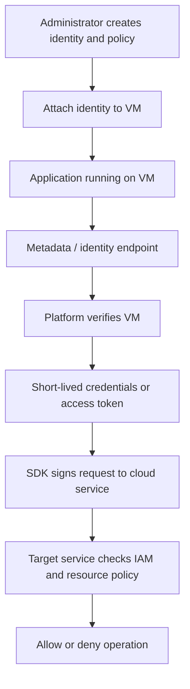
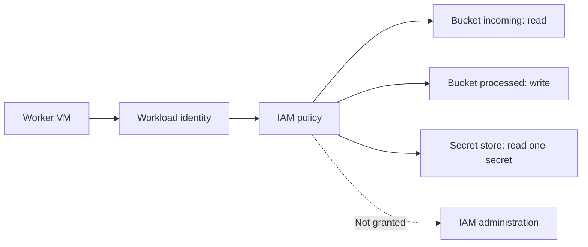

# Service Account, Managed Identity, and Instance Role for Workloads

## Learning Objectives

After this lesson, you will be able to:

- Explain why virtual machines (VMs) and applications running on VMs need dedicated identities to call cloud services.
- Distinguish service accounts, managed identities, IAM roles, and instance profiles.
- Describe how VMs obtain temporary credentials from the metadata service and how SDKs use those credentials.
- Design access permissions following the principle of least privilege, separating identity management permissions from identity usage permissions.
- Apply corresponding models on AWS, Azure, and Google Cloud.
- Troubleshoot common issues involving tokens, IAM permissions, the metadata service, VM lifecycle, and auditing.

## 1. Why Do Workloads Need Dedicated Identities?

A VM often needs to call many services outside the machine itself: reading objects in storage, writing logs, fetching secrets, querying databases, sending messages to queues, or calling internal APIs. These services must identify **who is calling** and **what they are allowed to do** before returning data or executing an operation.

If an application uses an administrator's personal account or stores long-lived access keys in configuration files, the application's permissions depend on secrets that can be copied, misplaced, or remain active after the user leaves the organization. A cloned VM image may also carry the same key, causing multiple machines to share a single hard-to-control identity.

Workload identity solves this problem by assigning an identity to the application or compute resource. The VM can prove its identity to the cloud platform and obtain short-lived credentials. The IAM system then evaluates the identity against policies to decide which operations are permitted.

For example, an invoice-processing VM may need to:

- Read input files from a specific bucket.
- Write results to another bucket.
- Read a database connection secret.
- Send a completion notification to a queue.

That VM does not need administrative permissions over all storage, databases, or the entire project. A dedicated identity for the workload scopes permissions accurately to its task and can be revoked when the machine is no longer in use.

### Concepts to distinguish

- **Authentication:** verifying the workload's identity. For example, the platform confirms which role or service account the VM is running with.
- **Authorization:** deciding which actions that identity is permitted to perform on which resources.
- **Principal:** an identity referenced by a policy, such as a user, group, service account, managed identity, or assumed role session.
- **Credential:** data used to prove identity, such as an access token, certificate, or key pair. Credentials can be short-lived or long-lived.
- **Role (IAM role):** a set of permissions or an object that can be assigned/assumed to grant permissions. Exact meaning varies by platform.
- **Workload identity:** an identity used by an application, process, VM, container, or automated workload.

Identity and permissions are two separate parts. Attaching a role to a VM gives the VM an identity or permission context, but actual permissions still depend on policies, scopes, conditions, and restrictions of the target service.

## 2. Service Account, Managed Identity, and Instance Role

Cloud providers use different names for the same goal: allowing workloads to access services using a platform-managed identity.

| Concept | Meaning | Typical examples |
|---|---|---|
| Service account | An identity for an application or service that can be granted resource access | Google Cloud service account; service accounts on other platforms |
| Managed identity | An identity whose lifecycle and credentials are managed by the cloud, attached to a resource | Azure managed identity |
| IAM role for VM | An IAM role attached or delegated to a VM so the VM receives temporary credentials | AWS IAM role for EC2 |
| Instance profile | An AWS object used to pass an IAM role to an EC2 instance | EC2 instance profile |
| Workload identity federation | A mechanism to exchange identity proof from another environment for cloud credentials | Workloads running outside the cloud or on Kubernetes platforms |

These names should not be treated as completely equivalent in implementation. For example, an AWS IAM role is an object defining permissions and trust relationships; an instance profile is the mechanism for attaching the role to EC2. An Azure managed identity is a platform-managed identity, while access permissions are granted via Azure RBAC or an equivalent mechanism. A Google Cloud service account is a principal that a VM can use when attached to that VM.

### 2.1. Service account

A service account is an identity intended for workloads rather than humans. A service account can be used by an application, a group of VMs, or an automated service. Its permissions are typically granted via policies or role bindings.

A well-designed service account should have:

- A name indicating the application, environment, and purpose.
- An owner responsible for operations.
- A list of allowed resources and actions.
- A clear usage scope, such as only one workload or one machine group.
- Processes for creation, modification, revocation, and permission review.
- Audit logs to trace activity.

Do not use a single broadly privileged service account for all workloads in a project. When multiple applications share one principal, logs make it hard to tell which application performed an action, and revoking permissions for one application can break others.

### 2.2. Managed identity

A managed identity is an identity created and managed by the cloud platform. The platform handles issuing credentials, refreshing them, and attaching the identity to resources according to the service mechanism.

In Azure, there are two common types:

- **System-assigned managed identity:** created alongside an Azure resource and tied to that resource's lifecycle. When the resource is deleted, the corresponding identity is also removed per the system lifecycle.
- **User-assigned managed identity:** an independent identity resource. It can be attached to multiple supported resources and managed independently from the VM lifecycle.

System-assigned is suitable when the identity serves only a single VM or a specific resource. User-assigned is suitable when you need to preserve an identity across VM replacements or share a controlled identity among a set of workloads. However, attaching the same identity to many VMs increases the blast radius if one machine is compromised; use it only when those machines truly require the same permissions.

Having a managed identity does not mean the VM is granted access to every service. After creating the identity, administrators must still assign appropriate roles at the required scope, such as a resource group, a storage account, or a specific vault.

### 2.3. Instance role and instance profile

On AWS, applications running on EC2 can use an IAM role attached to the instance. EC2 obtains temporary credentials via the Instance Metadata Service (IMDS), and the AWS SDK uses those credentials to sign requests.

An IAM role has two key parts:

- **Trust policy:** defines which principals are allowed to assume the role. For an EC2 role, the trust relationship allows the EC2 service to assume the role under appropriate conditions.
- **Permissions policy:** defines which actions the role is allowed to perform on which resources.

An instance profile is a container object holding a role to attach to an EC2 instance. In the console, operators typically select a role when launching a machine; the platform handles attaching the corresponding instance profile.

A single role can be used by multiple EC2 instances if configured that way. Therefore, the role's permissions must fit the entire set of machines to which it is attached. If two applications have different needs, use separate roles.

## 3. Credential Issuance Flow for VMs

The general model consists of four steps:

1. An administrator creates or selects a workload identity and attaches it to the VM.
2. The VM or application requests credentials from the metadata service or identity endpoint provided by the platform.
3. The platform verifies the VM and returns short-lived credentials or a token with the appropriate audience.
4. The SDK uses the credentials to call APIs. The target service checks the token/signature, IAM policy, conditions, and resource permissions.

Conceptual diagram:



The application does not need to generate a long-lived access key. The SDK can use a credential provider chain or default credential mechanism to automatically discover the identity attached to the VM and refresh tokens when needed.

### 3.1. What is the metadata service?

The metadata service is an internal endpoint provided by the virtualization platform to the VM. It can return information about the instance, network, project, startup configuration, and temporary credentials based on the attached identity.

Key characteristics:

- The endpoint is accessible only from within the VM environment via the provider's networking/virtualization mechanism.
- Credentials typically have an expiration time and are refreshed.
- Granted permissions depend on the role or service account attached to the VM.
- Endpoints and protocols differ across AWS, Azure, and Google Cloud.
- The metadata service is a critical security surface because applications can obtain credentials from it.

Do not include credential or token contents in logs, exceptions, debug pages, telemetry, or pipeline output. Do not send tokens to browsers or untrusted clients.

### 3.2. Short-lived credentials

Short-lived credentials have a limited lifetime. The application fetches new credentials when the current ones are about to expire, or the SDK refreshes them automatically via its supported mechanism.

Benefits:

- Reduces the usable window if credentials are leaked.
- Eliminates the need to distribute and store long-lived access keys on every VM.
- Permissions can be revoked or changed on the IAM side.
- Supports auditing by workload identity and session.

Short-lived credentials still require protection. An attacker able to execute code on the VM may attempt to access the metadata service and use still-valid credentials. Therefore, protect applications against SSRF, restrict OS privileges, control metadata access, and avoid granting overly broad roles.

## 4. Implementation on AWS, Azure, and Google Cloud

### 4.1. AWS EC2: IAM role and instance profile

On AWS, an EC2 instance can receive an IAM role through an instance profile. The application retrieves temporary credentials from IMDS, and the AWS SDK uses those credentials when calling services.

Reference workflow:

1. Create an IAM role for the EC2 workload.
2. Configure the trust policy to allow EC2 to assume the role.
3. Attach a permissions policy with the exact actions and resources needed.
4. Create or use an instance profile containing that role.
5. Attach the instance profile to EC2 during launch or update the instance configuration as supported by the service.
6. Verify that the SDK picks up the intended role and the application can only access permitted resources.
7. Enable auditing and monitor role assumptions, API calls, and AccessDenied errors.

**IMDSv2** adds a session token retrieval step before reading protected endpoints. Enforce IMDSv2 according to appropriate security configurations, restrict the hop limit per network architecture, and verify application compatibility before broad rollout.

Python example with the AWS SDK:

```python
import boto3

# The SDK automatically locates credentials from the instance role when running on EC2.
s3 = boto3.client("s3")

# Succeeds only if the role permits actions on this bucket/object.
response = s3.list_objects_v2(
    Bucket="example-private-bucket",
    Prefix="incoming/"
)
```

The snippet contains no access keys. In development environments outside EC2, the SDK may retrieve credentials from a profile or another source according to the credential provider chain. Avoid baking personal credentials into images used for production.

### 4.2. Azure VM: system-assigned and user-assigned managed identity

An Azure VM can enable a system-assigned managed identity or attach a user-assigned managed identity. Afterward, an administrator assigns Azure RBAC roles to the identity at the required access scope.

Reference workflow:

1. Enable a system-assigned identity on the VM or create a user-assigned identity.
2. Attach the identity to the VM if using the user-assigned type.
3. Create a role assignment at the smallest possible scope, such as a specific vault or storage resource.
4. Use the Azure Identity SDK to obtain a token for the corresponding resource/audience.
5. Call the service SDK using the token provided by the identity.
6. Verify the role assignment, token audience, and activity logs on the target service.

Python example using Azure Identity:

```python
from azure.identity import DefaultAzureCredential
from azure.storage.blob import BlobServiceClient

# On an Azure VM, the credential chain can use the managed identity.
credential = DefaultAzureCredential()

service = BlobServiceClient(
    account_url="https://exampleaccount.blob.core.windows.net",
    credential=credential
)

# The identity must have appropriate permissions on the storage account/container.
container = service.get_container_client("incoming")
for item in container.list_blobs():
    print(item.name)
```

In production, you can choose `ManagedIdentityCredential` directly when you want to bind the application to the managed identity. If a VM has multiple user-assigned identities attached, specify the exact client ID or configure explicit identity selection per the SDK in use. Do not assume the credential chain always picks the intended identity when multiple credential sources coexist.

### 4.3. Google Cloud VM: service account attached to an instance

On Google Compute Engine, a VM can be attached to a service account. Applications retrieve an access token from the metadata server and use it to call Google Cloud APIs. IAM roles are granted to the service account at the project or target resource level.

Reference workflow:

1. Create a dedicated service account for the workload.
2. Assign the required IAM roles at the smallest scope.
3. When creating the VM, attach the service account to the instance.
4. Configure appropriate access scopes. In modern designs, a broad API-compatible scope such as `cloud-platform` is commonly used, while actual permissions are controlled via minimal IAM roles.
5. Use Application Default Credentials (ADC) or client libraries to obtain tokens automatically.
6. Verify logs and access permissions on the target service.

Python example:

```python
import google.auth
from google.cloud import storage

# ADC on Compute Engine can obtain credentials from the service account
# attached to the VM via the metadata server.
credentials, project_id = google.auth.default()

client = storage.Client(
    project=project_id,
    credentials=credentials
)

# The service account needs permission to list objects in this bucket.
for blob in client.list_blobs("example-private-bucket"):
    print(blob.name)
```

Access scopes and IAM roles are two separate layers to understand. Scopes can restrict the OAuth token scopes the VM receives; IAM policies determine what the service account is allowed to do on resources. A valid role without the required token scope can still fail; conversely, a broad scope does not grant IAM permissions by itself.

### Quick comparison

| Criterion | AWS EC2 | Azure VM | Google Compute Engine |
|---|---|---|---|
| Identity attached to VM | IAM role via instance profile | Managed identity | Service account |
| Credential | Temporary credentials from IMDS | Access token from managed identity endpoint | OAuth access token from metadata server |
| Permission assignment | IAM permissions policy and resource policy | Azure RBAC role assignment and resource policy | IAM role binding and resource policy |
| Metadata protection | Prefer IMDSv2 and configure metadata options | Metadata endpoint requires protocol headers; protect apps from SSRF | Metadata endpoint requires `Metadata-Flavor` header; protect apps from SSRF |
| Identity lifecycle | Role can exist independently of EC2; attach/detach instance profile | System-assigned tied to resource; user-assigned has independent lifecycle | Service account typically exists independently of VM and can attach to multiple VMs |
| Key considerations | Trust policy, instance profile, IMDSv2 | Identity type, client ID, role assignment scope | IAM bindings, service account, and access scopes |

API names, endpoints, limits, and credential behavior depend on SDK versions and resource types. Check the documentation for the deployed service before changing production configurations.

## 5. Designing Permissions with the Principle of Least Privilege

The principle of least privilege requires a workload to have only the permissions necessary to perform its job. When designing permissions, define all four components:

\[
\text{Permission} = \text{Principal} + \text{Action} + \text{Resource} + \text{Condition}
\]

- **Principal:** which service account, managed identity, or role session is permitted.
- **Action:** which operations are allowed, such as reading objects, writing logs, or retrieving secrets.
- **Resource:** which specific resources are accessed.
- **Condition:** additional conditions such as environment, tags, network, encryption context, or time if supported by the platform.

For example, a data ingestion workload only needs permission to read the `incoming` prefix in one bucket and write to the `processed` prefix. It does not need permission to delete buckets, modify IAM policies, or list every resource in the project.

### 5.1. Separating identities by workload and environment

Identities should be separated by application, purpose, and environment:

| Workload | Suggested identity | Core permissions |
|---|---|---|
| Production API | Dedicated API identity | Read required secrets, write logs, access database per permissions |
| File processing worker | Dedicated worker identity | Read `incoming` area, write `processed` area |
| Backup agent | Dedicated backup identity | Create and read backups per policy |
| Development VM | Development-specific identity | Access test data only |
| Monitoring agent | Dedicated monitoring identity | Read metrics and send telemetry |

Do not share production identities with development. A compromised test environment must not gain access to production data simply because both environments share the same service account.

### 5.2. Separating identity management permissions from identity usage permissions

Several roles should be separated:

- **Identity administrator:** creates, attaches, detaches, or deletes identities; manages trust relationships.
- **Policy administrator:** manages permissions and access conditions.
- **Workload operator:** deploys VMs or updates applications within permitted scopes.
- **Security auditor:** reads policies, logs, and change history.
- **Workload identity:** executes granted runtime actions.

Anyone with permission to create VMs and attach roles can indirectly grant that role's permissions to a workload. Therefore, permission to attach roles/identities to VMs is sensitive and must be tightly controlled. An operator should not be able to attach arbitrary administrative roles simply because they can create instances.

### 5.3. Checking inherited permissions and target resource permissions

A single operation can be governed by multiple policies:

- Identity policy or role permissions.
- Resource-based policy on a bucket, queue, key, or secret.
- Organization policy or permission boundary.
- Deny rules, conditions, or network restrictions.
- Scope/role assignments at the organization, project, resource group, or resource level.

Granting a new role does not guarantee an operation will succeed if another policy explicitly denies it. Conversely, permissions inherited from a project or subscription may be broader than intended. Inspect both directly granted and inherited permissions.

## 6. Protecting the Metadata Service and Credentials

The metadata service is a critical credential delivery path. If an application has a Server-Side Request Forgery (SSRF) vulnerability, an attacker may trick the server into sending requests to the internal endpoint. If the metadata endpoint returns credentials for that request, the VM's permissions can be abused.

### Protective measures

- Enable platform metadata protections, such as requiring IMDSv2 on EC2.
- Do not allow untrusted input to control URLs fetched by the backend.
- Use hostname/protocol allowlists and block access to sensitive link-local addresses in URL-fetching features.
- Do not forward metadata headers or responses to clients.
- Restrict system and process permissions on the VM.
- Do not assign broad roles to machines running applications that process untrusted URLs or content.
- Isolate sensitive workloads onto dedicated VMs or identities.
- Monitor anomalous metadata requests and API calls inconsistent with application behavior.
- Never log access tokens, refresh tokens, or secrets returned from identity endpoints.

IMDSv2 mitigates certain unintended metadata access patterns via session tokens, but it does not replace fixing SSRF vulnerabilities or restricting role permissions. If malicious code already runs with sufficient privileges inside the VM, it can use whatever credentials the workload is allowed to obtain.

### Distinguishing metadata from a secret store

The metadata service is not a place to store arbitrary secrets. Metadata typically provides instance information and platform-issued credentials. Secret stores such as Key Vault, Secrets Manager, or Secret Manager store application secrets under dedicated policies.

The proper flow is:

1. The VM uses its workload identity to authenticate to the secret store.
2. IAM checks whether the VM is allowed to read the specific secret.
3. The secret store returns the secret to the authorized workload.
4. The application keeps the secret in memory only as long as needed and avoids writing it to logs.

Do not store application secrets in custom metadata when an appropriate secret management service is available. Custom metadata may be readable by multiple processes or anyone with metadata read access.

## 7. Aligning Identity Lifecycle with VM Lifecycle

Workload identities must be managed from VM creation until the machine is replaced or deleted.

### 7.1. When creating a VM

- Select an identity appropriate for the purpose and environment.
- Attach the correct identity in the VM creation configuration.
- Grant least-privilege permissions before the workload starts running.
- Verify that tokens are issued for the intended principal.
- Test one allowed operation and one operation that must be denied.

When creating VMs from a standardized image, the image should contain only the application and non-sensitive configuration. The identity should be attached at deployment time so cloned VMs do not share pre-baked long-lived credentials.

### 7.2. When changing roles or policies

Policy changes can have propagation delays. Already-issued tokens may remain valid until expiration, depending on the platform and service. When revoking permissions in an emergency, consider active credentials/sessions, SDK caches, and resource policies.

After making changes:

1. Verify the role assignment or policy was saved.
2. Confirm the scope and principal are correct.
3. Wait for platform propagation time.
4. Retry with a fresh request.
5. Inspect audit logs to confirm the principal and authorization decision.

Do not assume policy changes take effect instantaneously across every service. If emergency revocation is required, use session/credential revocation mechanisms or disable the identity as supported by the platform, and assess the impact.

### 7.3. When cloning or replacing a VM

When launching a new VM from an image, determine which identity will be attached:

- Does the new VM get a dedicated identity or reuse the group's identity?
- Is a new system-assigned identity created for the new resource?
- Which user-assigned identity or service account is permitted to be attached?
- Are old roles still assigned to the deleted VM?
- Do logs distinguish the old instance from the new one?

Do not copy credential files from an old VM to a new VM. Let the platform issue credentials for the attached identity. When replacing a machine, detach the identity or revoke permissions of the old resource per procedure so unused principals do not linger.

### 7.4. When deleting a VM

Before deletion:

- Confirm the workload has migrated to the new machine.
- Detach shared identities if the machine no longer needs them.
- Revoke role assignments that no longer serve a purpose.
- Check whether a user-assigned identity or service account is still used by other VMs.
- Retain audit logs according to retention policies.
- Delete the system-assigned identity with the resource lifecycle if not handled automatically by the platform.

Deleting a VM does not always delete independent identities or granted permissions. Check identities and policies separately so permissions do not outlive the workload.

## 8. Architecture Example: Worker Reading Files and Writing Results

A data processing system has a pool of worker VMs. Each worker reads files from an `incoming` area, processes them, and writes results to a `processed` area. Workers also need to read one secret to connect to an internal service.

Reference design:

- Create a dedicated identity for the production worker.
- Grant read access only to objects in the `incoming` area.
- Grant write access only to objects in the `processed` area.
- Grant read access to one specific secret.
- Do not grant permissions to delete buckets, edit policies, or administer KMS.
- Attach the identity to VMs using the cloud's managed identity / instance role / service account mechanism.
- Use the default SDK to retrieve temporary credentials.
- Log the request ID, principal, and processing outcome; do not log tokens or secrets.
- Use a separate identity for development workers with test buckets and test secrets.
- When a worker is replaced, launch the new VM with the designated identity and revoke permissions on the old machine if the identity is no longer needed.

Permission diagram:



This design reduces the worker's privileges and separates data processing from infrastructure administration. If a worker is compromised, its operational scope is bounded by the granted policy.

## 9. Testing and Verifying Workload Identity

Do not only check whether a VM has an identity attached. Verify that the application actually receives the intended principal and that permissions behave as expected.

### Verification checklist

1. Inspect the identity/role/service account attached to the VM.
2. Check the trust relationship or managed identity status.
3. Verify the SDK uses the expected credential source rather than picking up credentials from a file or environment variable.
4. Check that the token has the appropriate audience/resource for the target API.
5. Execute an allowed operation on a test resource.
6. Execute a disallowed operation to confirm least privilege.
7. Check audit logs to verify the principal, action, resource, and outcome.
8. Verify credentials refresh upon expiration without unexpected application restarts.
9. Confirm no tokens or secrets appear in logs.

### SDK verification example

For Python applications, each provider has its own library for retrieving default credentials. You can enable SDK diagnostic logging in a test environment to inspect the credential source, while ensuring logs never print access tokens or secret values.

Do not run debug commands that print the entire environment or metadata responses in production. Environment variables may contain temporary credentials, connection strings, or secrets injected by another component.

## 10. Common Troubleshooting

| Symptom | Possible cause | Investigation steps |
|---|---|---|
| VM API call returns AccessDenied/403 | Identity lacks permission, wrong scope, or target policy denies | Verify principal, action, resource, condition, and resource policy |
| SDK cannot find credentials | Identity not attached, metadata endpoint unreachable, or SDK uses wrong credential chain | Check VM configuration, identity endpoint, and SDK credential source |
| Token expired and application fails | SDK does not refresh token, stale credential cache, or clock skew | Update SDK, check refresh flow, and synchronize system time |
| New VM cannot access services like old VM | Identity not attached or role assignment not recreated | Compare identities and policies of both VMs |
| Managed identity exists but Azure Storage denies | Missing role assignment or wrong scope | Check role, scope, data-plane permissions, and propagation |
| EC2 does not receive role credentials | Instance profile not attached, wrong trust policy, or metadata blocked by configuration | Check instance profile, trust policy, and metadata options |
| GCE obtains token but API denies | Missing IAM role or mismatched access scope | Check service account, IAM bindings, and OAuth scopes |
| App picks up unintended credentials | Credential file/environment/profile takes precedence over VM identity | Inspect credential chain and remove unnecessary credential sources |
| Token leaked in logs | Debug or exception logging captures response/header contents | Remove or restrict sensitive logs, rotate/revoke credentials per procedure, and fix logging |

### Diagnostic workflow

1. Identify which VM the application runs on and what the expected identity is.
2. Check whether the identity is attached to the VM and active.
3. Determine whether the SDK gets credentials from metadata, files, environment variables, or another source.
4. Inspect the token audience/resource and expiration if metadata can be inspected safely.
5. Read the authorization error to identify the denied action, resource, and principal.
6. Check the identity policy, trust policy, resource policy, role assignment, and conditions.
7. Check metadata options, host firewall, proxy, and SSRF protection settings.
8. Retry using the SDK's standard credential provider and inspect audit logs.
9. After fixing, verify both an allowed operation and a denied operation.

If a credential is exposed, treat it as a security incident. Determine the token's scope and lifetime, revoke sessions or permissions per platform capabilities, fix the leak source, and inspect audit logs. Do not simply delete the log line while ignoring whether the token was accessed.

## 11. Common Misconceptions

- **Attaching an identity means having all permissions.** The identity only identifies the principal; permissions must be granted separately via IAM or resource policies.
- **Managed identity is a secret stored on the VM.** The platform issues credentials through an identity mechanism; the application does not need embedded long-lived secrets.
- **Service accounts are only for human login.** Service accounts are primarily for applications and workloads.
- **IAM role and instance profile are the same object on AWS.** The role defines trust and permissions; the instance profile is the mechanism that attaches the role to EC2.
- **Short-lived credentials cannot be stolen.** Credentials can still be abused during their validity window if a process or VM is compromised.
- **Sharing an identity simplifies administration without risk.** Sharing identities increases the blast radius and reduces accountability.
- **Adding Owner or Administrator fixes 403 errors.** Identify the exact denied action/resource and grant least-privilege permissions instead.
- **Deleting a VM deletes all identities and role assignments.** Independent identities and granted permissions can persist after the VM is deleted.
- **Metadata endpoints only contain harmless info.** Metadata can issue workload credentials; the endpoint must be protected from unintended access.
- **Broad access scopes mean broad permissions on Google Cloud.** IAM policies still determine actual permissions; scopes and IAM are two layers that must be evaluated together.

## 12. Self-Check

**Scenario 1:** A VM needs to read objects from a bucket. The administrator attaches a service account to the VM, yet the API still returns 403. What should be checked?

**Hint:** Confirm the correct service account is attached, then inspect IAM role bindings, scope, resource policies, and bucket access conditions. Attaching an identity does not automatically grant object read permissions.

**Scenario 2:** A group of data-processing VMs and a group of backup VMs share a single identity with read/write/delete permissions across all storage. Should this configuration be kept?

**Hint:** Separate identities by task. Workers only need to read the input area and write the output area; the backup agent needs backup/restore permissions in its own scope. This limits the blast radius if one workload is compromised.

**Scenario 3:** A backend application has a feature that fetches user-supplied URLs. Why must the metadata service be protected?

**Hint:** An SSRF vulnerability could cause the backend to send requests to the internal metadata endpoint and retrieve the VM's credentials. Validate URLs, block access to sensitive endpoints, harden metadata access, and restrict identity permissions.

**Scenario 4:** An Azure VM using a user-assigned managed identity is deleted, while another VM still needs that identity. Does the identity need to be recreated?

**Hint:** A user-assigned identity has a lifecycle independent of individual VMs. Keep the identity intact and verify it remains attached to the VM that needs it, along with the appropriate role assignments.

**Scenario 5:** An EC2 VM has an IAM role attached, yet the SDK still uses access keys from a configuration file. What might happen?

**Hint:** The credential provider chain may prioritize another credential source before the instance role. Inspect the provider order, remove unnecessary long-lived keys, and verify the SDK uses role credentials.

**Scenario 6:** After replacing a VM from a standard image, the application can no longer access a secret. What should be compared between the old and new VMs?

**Hint:** Check the attached identity, role assignments, trust relationship, scope, token audience, and secret read permissions. Images should not store credentials; the new VM must have its identity attached during deployment.

## Conclusion

Service accounts, managed identities, and instance roles enable VMs to authenticate to cloud services using workload-specific identities. Platforms issue temporary credentials through metadata or identity endpoints; IAM and resource policies determine actual permissions. Separate identities by workload and environment, apply least privilege, protect the metadata service, avoid storing long-lived access keys, and manage identities throughout the VM lifecycle. Verification must confirm the principal, token, resource permissions, and audit logs to ensure workloads operate strictly within their permitted scope.
