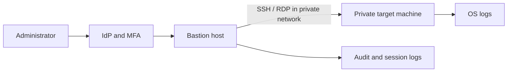
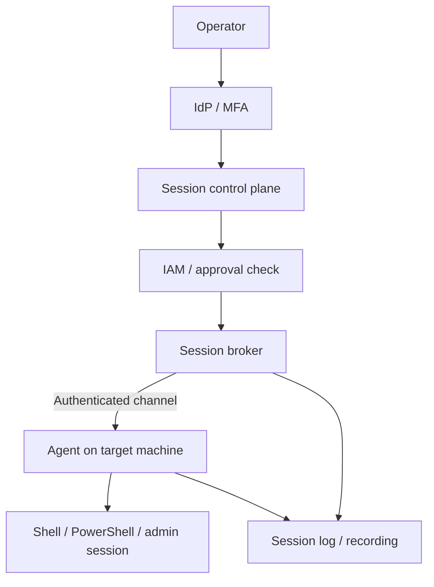

# Access via Bastion, Proxy, or Session Management Services

## 1. Why Is a Controlled Administrative Access Path Necessary?

Cloud virtual machines and servers often hold critical applications, data, and credentials. Administrators need access to install software, investigate incidents, patch operating systems, or restore services. If SSH or RDP is opened directly to the Internet for every machine, each machine becomes an exposed surface to defend. SSH keys, passwords, firewall rules, and patches across many machines also become difficult to manage consistently.

A sound administrative access architecture creates a controlled entry path. Operators authenticate with an individual identity, pass additional verification policies, are granted permissions scoped to the required resources and duration, and connect to the target machine via a bastion, proxy, or session management service. The system records who accessed which machine, when, and through what mechanism.

These three models play distinct roles:

- **Bastion host (jump host):** a tightly hardened intermediary server that accepts administrative connections and forwards them to machines inside a private network.
- **Administrative proxy:** an intermediary component that forwards or controls the access stream, optionally integrating identity authentication, policy enforcement, and routing to target machines.
- **Session management service:** a service operated by the platform or organization to open shell, PowerShell, RDP, or tunnel sessions without requiring users to connect directly to the target machine's administrative ports.

No model is automatically secure by name alone. A poorly configured bastion can become a centralized compromise pivot. A proxy that merely forwards TCP may have no visibility into commands a user runs. A session management service still requires identities, least privilege, agents or endpoints, logging, and fallback procedures when the service is unavailable.

Within the scope of **machine identity and access**, this lesson enables learners to:

- Distinguish bastions, administrative proxies, and session management services.
- Design access flows from operator identity to target machines in private networks.
- Combine MFA, RBAC, just-in-time access, and short-lived credentials.
- Restrict SSH/RDP, manage keys, control port forwarding, and record session logs.
- Operate access paths with high availability, auditability, and emergency procedures.
- Choose the appropriate model for VMs, Windows/Linux servers, and cloud workloads.

## 2. Components of an Administrative Session

### 2.1. Operator identity

Every administrator should use an individual identity tied to the organization's identity system. Identities can be managed through an identity provider (IdP), corporate directory, or IAM platform. Do not share a single `admin` account across a team because that obscures who performed an action and makes revoking an individual's access difficult.

Before granting a session, the system should verify:

- The user has signed in with an individual account.
- MFA or strong verification has been completed per policy.
- The device or login session meets access conditions if the organization enforces posture checks.
- The user belongs to a group or role authorized for that environment, machine, and operation type.
- Access permissions are currently valid and have not been revoked.

### 2.2. Broker, bastion, or proxy

This intermediary component receives access requests and connects the user to the target machine. Depending on the model, it may authenticate users, check permissions, issue credentials, record sessions, or simply forward network connections.

Distinguish network-layer proxies from identity-aware proxies. A TCP proxy can forward connections to an SSH port without knowing who the user inside the SSH session is. An IdP-integrated access proxy can verify identity before allowing a tunnel to open, though capturing commands inside the session depends on how it handles the protocol and target OS.

### 2.3. Target machine and local machine identity

The target machine must authenticate the user or certificate, enforce OS permissions, and log activity. On Linux, permissions are typically controlled through accounts, groups, `sudo`, SSH authorized keys, or SSH certificates. On Windows, permissions may rely on domain accounts, local groups, Remote Desktop Users, remote logon rights, and administrative policies.

Access to a machine does not equal full machine administration privileges. An engineer may only need to read logs or restart a service. Grant accounts and privileges matched to the task instead of giving everyone root or local administrator by default.

### 2.4. Control plane and data plane

The control plane determines who is allowed to open a session, to which machines, for how long, and under which policies. The data plane is the actual transport path of the administrative session, such as an SSH/RDP connection through a bastion, a tunnel through a proxy, or a session channel maintained by a session management service.

Separating the two planes clarifies design: IAM and approval workflows decide authorization; networking and gateways relay the session; the target OS decides what the user can do after logging in. If controls exist at only one layer, alternative access paths may bypass policy.

## 3. Bastion Host (Jump Host)

### 3.1. How it works

A bastion is an intermediary server placed in a network zone able to accept connections from operators. Application or database machines reside in private subnets that allow SSH/RDP only from the bastion or designated management paths.

Typical connection flow:



The operator authenticates to the bastion, then opens a connection to the target machine. The bastion can act as a jump host with two separate SSH sessions, or as a TCP forwarding hop so the end-to-end protocol authenticates directly with the target machine. These two modes differ in where keys reside, where sessions terminate, and what activity can be recorded.

### 3.2. Advantages

- Centralizes administrative network entry, reducing the number of machines exposing SSH/RDP ports.
- Enables enforcing MFA, identity checks, and access policies in one place.
- Simplifies restricting connection sources to target machines: allow only the bastion's subnet or security group.
- Can record logins, connections, and activity on the bastion.
- Fits environments requiring traditional SSH/RDP connections or existing administrative tooling.

### 3.3. Risks and limitations

A bastion is a high-value asset. If compromised, an attacker may gain a path into many internal machines. Therefore, bastions must be hardened, patched, monitored, and restricted in installed software. Do not use a bastion as a general-purpose workstation, arbitrary file-download server, or storage place for multiple users' private keys.

A bastion can also become a single point of failure or connection bottleneck. With only one host, maintenance or host failure can block all administrative operations. Use multiple instances, partition by environment, or maintain recovery mechanisms when the bastion is down.

Audit capability depends on where the session terminates. If the bastion only forwards TCP, it may know who opened a tunnel and to which destination address, but not necessarily record individual SSH commands or RDP contents. Command-level auditing requires combining target-machine logs, session recording, or application-layer controls.

### 3.4. Hardening a bastion

Baseline measures:

1. Use a minimal image, installing only necessary administrative tools.
2. Never store application data or shared secrets on the bastion.
3. Patch the OS, SSH/RDP server, and agents on schedule.
4. Disable direct root login and disable password authentication when policy uses SSH keys/certificates.
5. Restrict access sources using VPN, private access gateways, or approved management IP ranges.
6. Allow the bastion to connect only to required subnets/ports; avoid full-network access.
7. Use individual identities, MFA at the access layer, and least-privilege OS permissions.
8. Ship logs to a centralized system where bastion users cannot modify or delete them.
9. Monitor failed logins, unusually long sessions, connections to unfamiliar destinations, and configuration changes.
10. Maintain a procedure to replace the bastion from a standard image when compromise is suspected.

## 4. Administrative Proxy and SSH ProxyJump

### 4.1. Connection-forwarding proxies

Proxies can operate at multiple layers:

- **L4/TCP proxy:** forwards TCP streams to target machines. It typically does not fully understand identity or commands inside SSH/RDP.
- **SSH jump/proxy:** uses SSH to traverse an intermediary host. The target machine can still authenticate the user via their own key or certificate.
- **Identity-aware access proxy:** checks identity, MFA, groups, device posture, and policies before opening a connection or tunnel.
- **Protocol gateway:** terminates or mediates protocols such as RDP/SSH, potentially providing session recording, clipboard control, or file-transfer controls depending on the product.

Do not lump all of these into the same security bucket. A packet-forwarding proxy does not replace authentication on the target machine; an identity-aware proxy does not automatically grant OS administrative rights unless configured.

### 4.2. Connecting over SSH via ProxyJump

OpenSSH supports `ProxyJump` (`-J`) to connect to a target machine through a jump host. Example:

```bash
ssh -J access-user@bastion.example.net ops-user@10.20.1.15
```

Configuration can be saved in `~/.ssh/config`:

```sshconfig
Host bastion-prod
    HostName bastion.example.net
    User access-user
    IdentityFile ~/.ssh/id_ed25519
    IdentitiesOnly yes

Host app-private-01
    HostName 10.20.1.15
    User ops-user
    ProxyJump bastion-prod
    IdentityFile ~/.ssh/id_ed25519
    IdentitiesOnly yes
```

Then connect with:

```bash
ssh app-private-01
```

The example uses a single key for illustration; enterprise environments should consider short-lived SSH certificates or centralized credential issuance. Keep private keys on the user's device or in a controlled agent. Do not copy personal private keys onto the bastion for convenience.

With `ProxyJump`, the SSH client creates a forwarding tunnel through the bastion; authentication to the target machine still happens according to the target machine's configuration. The bastion does not natively see the end-to-end SSH session contents. Collect logs on the target machine or use an appropriate session recording solution if command auditing is required.

### 4.3. SSH agent forwarding and risks

`ssh-agent` forwarding allows an intermediary machine to ask the agent on the user's workstation to sign subsequent authentication requests. This avoids copying private keys onto the bastion, but a compromised bastion can abuse the forwarded agent socket to request authentication signatures while the session remains open.

Enable agent forwarding only with a clear justification, limiting duration and scope; prefer `ProxyJump` or short-lived certificates when appropriate. Never set `ForwardAgent yes` globally for all hosts. If forwarding is unavoidable, review `AllowAgentForwarding` and policies on both client and server.

### 4.4. Proxies and port forwarding

SSH local, remote, or dynamic port forwarding can create tunnels to internal services. This is useful for reaching dashboards, databases, or administrative endpoints over an authenticated path. However, tunnels can bypass network segmentation or application-layer access policies.

Grant forwarding permissions only when required by the task; restrict target hosts/ports at the bastion or proxy if possible. Monitor tunnel sessions, duration, traffic volume, and destination targets. Do not allow users to create arbitrary tunnels into the entire private network.

## 5. Session Management Services (Session Manager)

### 5.1. Operating model

A session management service provides a control layer where users request a session to a target machine. Instead of opening inbound SSH/RDP ports from the Internet or management networks to each machine, the target machine can run an agent or establish an outbound channel to the service's control plane. The user authenticates to the service, the service checks IAM and policies, and then establishes a shell, PowerShell, tunnel, or supported administrative session.

Conceptual flow:



Implementation details vary by service. Some platforms use an on-host agent, while others use a gateway or built-in management channel. Some services require private network endpoints for the agent to connect; others require outbound HTTPS to the control plane. Read the architecture and limitations of the specific product.

### 5.2. Benefits

- Can eliminate the need for public IPs or inbound SSH/RDP ports on target machines.
- Centralizes authentication, authorization, approvals, and session duration limits.
- Uses IAM/workload identities or agents instead of distributing long-lived keys to every machine.
- Can log session metadata, transcripts, or session recordings to centralized logging systems.
- Supports access from console, CLI, or API depending on the platform.
- Can govern port forwarding and shell sessions through policy.

### 5.3. Dependencies and limitations

A session management service does not eliminate dependencies. The target machine may need a running agent, valid machine identity, network endpoints, DNS, certificates, and control-plane reachability. If the agent stops or egress is blocked, the machine cannot accept session requests.

Some services cannot capture full session contents when users use tunnels or unsupported protocols. Some session recording mechanisms do not log commands executed inside applications tunneled through the session. Verify exact audit capabilities rather than assuming every session is fully recorded.

When choosing a service, verify:

- Supported operating systems and machine types.
- Agent requirements, versions, and update mechanisms.
- Endpoints, DNS, proxies, and egress requirements.
- Supported session types: shell, PowerShell, RDP, port forwarding, file transfer.
- IAM, MFA, approval workflows, and tag/machine-group permissions.
- How transcripts, video/session recordings, metadata, and audit logs are captured.
- Log storage location, encryption, retention, read permissions, and export capabilities.
- Quotas, concurrent session limits, timeouts, idle sessions, and service availability.
- Emergency access mechanisms when the control plane or agent fails.

## 6. Comparing Bastion, Proxy, and Session Management Services

| Criterion | Bastion host | Administrative proxy | Session management service |
|---|---|---|---|
| Primary role | Intermediary host to enter private networks | Forwards/controls connections per policy | Brokers administrative sessions via control plane |
| Inbound ports on target machine | Allowed only from bastion or management subnet | Allowed only from proxy/gateway per architecture | Often able to close inbound SSH/RDP if agent/service channel supports it |
| User authentication | At bastion and target machine | Possibly at proxy and target machine | Typically centralized via IdP/IAM and service policies |
| Session content capture | Requires extra tooling or target-machine logs | Depends on whether proxy terminates/inspects protocol or only tunnels | May provide transcripts/recordings depending on session type and product |
| Operations | Must patch, harden, scale, and monitor bastion hosts | Manage gateways, policies, certificates, and capacity | Manage agents/endpoints, IAM, logs, and service availability |
| Best fit | Environments needing traditional jump hosts | Centralized connection routing or policy enforcement | Managing private machines without opening inbound ports |
| Key risks | Compromised bastion becomes a pivot point | Proxy abused as a tunneling path | Loss of access when agent/control plane fails; overly broad IAM permissions |

Models can be combined. For example, an identity-aware proxy can verify users before opening a session to a bastion; a session manager can serve as the primary administrative path while a bastion is kept for compatibility or emergencies. When combining models, avoid leaving uncontrolled side access paths open.

## 7. Designing Authentication and Authorization

### 7.1. MFA and strong authentication

Require MFA for administrative operations, especially for production, root/administrator privileges, and network or data modifications. Prefer phishing-resistant methods where supported by the organization. MFA at the access gateway does not replace authentication on the target machine; both layers must be properly configured.

Do not share accounts or passwords. Emergency accounts must be managed separately, stored securely, trigger alerts when used, and be tested periodically.

### 7.2. RBAC and least privilege

Role-based access control (RBAC) maps job roles to permissions. For example:

| Role | Permissions that may be granted | Permissions to avoid by default |
|---|---|---|
| Developer | Access dev/test machines, read logs, and restart designated services | Production access or root on all machines |
| On-call operator | Open production sessions while on call, view metrics, restart services per runbook | Modifying IAM, firewalls, or deleting data |
| System administrator | Administer OS for assigned machine groups | Admin permissions across all cloud accounts if unneeded |
| Security auditor | Read session metadata, audit logs, and policy configs | Executing state-changing commands on target machines |
| Break-glass operator | Time-limited emergency access with approval | Routine daily use or unalerted usage |

Scope permissions by environment, machine group, tag, project, or account. Avoid granting `*` across all resources when access is only needed for one instance group.

### 7.3. Just-in-time access

Just-in-time (JIT) access grants permissions for a short duration instead of maintaining standing administrative privileges. The user requests access with a reason, the system checks conditions or obtains approval, and grants time-limited access. When time expires, permissions are automatically revoked.

A JIT workflow should record the requester, approver, target machine, role, justification, start/end times, and ticket ID if applicable. For emergency incidents, an expedited approval flow may be used, provided it includes auditing and post-incident review.

### 7.4. Short-lived SSH keys and certificates

SSH public keys can be managed in authorized keys or via a centralized provisioning system. Long-lived keys are easily forgotten when employees change roles or lose devices. SSH certificates signed by an internal CA can carry short lifetimes, explicit principals, and constraints, reducing the need to distribute static keys to every machine.

A certificate policy should specify:

- Which CA is trusted by target machines.
- Which principals are allowed to log in and which OS accounts they map to.
- Certificate lifetime and re-issuance workflow.
- Whether port forwarding, agent forwarding, or PTY allocation is allowed.
- How access is revoked or disabled when a user leaves the organization.
- How individual human identity is recorded in target-machine logs.

Do not share private keys. Protect keys with passphrases or hardware-backed authenticators where appropriate. Never store private keys in images, bootstrap scripts, or source code repositories.

### 7.5. Permissions inside the operating system

After login, privileges must remain restricted. On Linux, use `sudoers` to allow specific commands where possible; limit interactive root shells and log privileged commands. On Windows, use appropriate administrative groups, Just Enough Administration (JEA), or equivalent delegation mechanisms when available.

Do not share a single OS account among multiple people merely because the access gateway already authenticated their individual identities. If a shared service or technical account must be used, ensure a mechanism correlates every session back to the human identity who requested it and records the approver.

## 8. Network Controls for Administrative Paths

### 8.1. Closing unnecessary exposure

Target machines in private subnets should not have public IPs solely for administration. Security groups/firewalls should allow SSH (22), RDP (3389), or other administrative ports only from designated management sources. When using an outbound session manager, inbound SSH/RDP can be closed after confirming all necessary administrative tasks work through that service.

Never allow `0.0.0.0/0` or `::/0` on administrative ports. If temporary access must be opened, restrict source, duration, ticket, and alerting; revoke automatically once no longer needed.

### 8.2. Segmentation by environment

Separate dev, staging, and production access paths. A development bastion should not automatically have network routes to production. Use security groups, subnets, routes, firewall policies, and IAM permissions to constrain destinations. Bastions can be separated by environment or sensitivity tier.

### 8.3. DNS, routing, and endpoints

The access path must resolve target hostnames and route traffic properly. For a session manager, the agent may need access to control, logging, or secret manager endpoints. For a bastion, valid routes from the bastion to the target subnet and return paths are required.

Verify private DNS zones, VPC/VNet peering, transit gateways, VPNs, or hybrid connectivity. Even an authenticated connection cannot establish a session without valid routing and DNS.

### 8.4. RDP and other administrative protocols

For Windows, restrict inbound RDP to trusted sources, enable Network Level Authentication where appropriate, use TLS/certificates per policy, and limit Remote Desktop permissions. Disable clipboard, drive redirection, printer redirection, or copy/paste when unnecessary because they provide data exfiltration/ingress paths.

Apply similar principles to other administrative protocols: strong authentication, encryption, source restrictions, logging, timeouts, and never opening ports wider than the job requires.

## 9. Logging, Session Recording, and Auditing

### 9.1. What to record

A solid audit system should answer:

- Who requested the session and how was their identity verified?
- Who approved it and what was the stated reason?
- Which machine, environment, and protocol did the session target?
- When did the session start and end, and how long did it last?
- Were port forwarding, file transfers, or privilege elevation used?
- Was the session disconnected, timed out, or terminated by policy?
- What commands or actions were recorded according to system capabilities?

Combine logs from IdP/IAM, gateway/session manager, bastion, SSH/RDP servers, the OS, and ticketing systems. Synchronize clocks across machines so events can be correlated accurately.

### 9.2. Metadata, transcripts, and recordings

**Session metadata** typically records user, target machine, timestamps, status, and connection details. **Transcripts** can capture terminal contents or commands/output. **Session recordings** can save video or activity streams of graphical sessions. Capabilities depend on the product and protocol type.

Not every connection can be recorded completely. A TCP tunnel or SSH `ProxyJump` may leave only connection metadata at the gateway; session contents require logging on the target machine or a session-terminating mechanism capable of recording. For RDP, recordings may capture video without necessarily understanding the semantics of every command.

### 9.3. Protecting logs

Administrative logs have high audit value and may contain sensitive data. Ship logs to a centralized store with append-only write permissions, restrict edit/delete permissions, encrypt at rest and in transit, set retention per requirements, and monitor access to logs themselves.

Avoid recording unnecessary secrets, tokens, or sensitive values in transcripts. If recordings may capture personal data or customer information, provide notice and apply appropriate access, storage, and retention policies.

### 9.4. Limitations of auditing

A successful login log only proves a session opened; it does not prove every action inside the session was legitimate. Transcripts may also miss commands run inside shell scripts, graphical tools, or tunnels. Combine OS auditing, application logs, file integrity monitoring, and change management processes for a more complete picture.

## 10. Operations and Availability

### 10.1. Availability of bastions and proxies

If all administrators depend on a single bastion, a bastion outage can block incident response across the whole system. Deploy multiple bastions across different availability zones, place them behind a gateway or internal DNS, and manage them from standard images. Avoid sharing local state across bastions unless needed; configurations should be reproducible from IaC and logs shipped externally.

Monitor administrative proxies for CPU, memory, session count, connection rate, certificate expiration, and authentication errors. Set quotas so a single user or session cannot exhaust all resources.

### 10.2. Agents and control plane

Session management services may depend on agents, endpoints, and the control plane. Monitor agent online status, version, heartbeat, connection health, credential issuance errors, and session startup latency. Update agents in rings or canary groups so a faulty upgrade does not break access to the entire fleet.

Ensure private machines have paths to required endpoints via NAT or private endpoints. Do not open full Internet egress if only a few management endpoints are needed; use allowlists or private connectivity when supported by the platform.

### 10.3. Session lifecycle management

Configure idle timeouts, maximum session durations, and renewal limits appropriately. When a user steps away, tokens are revoked, or JIT access expires, sessions should terminate according to policy. Alert on unusually long sessions, off-hours logins, or access to sensitive machine groups.

Avoid abruptly killing sessions if that could corrupt data-writing administrative tasks. For long-running operations, require operators to use logged jobs or automation tooling rather than keeping an unattended shell open for hours.

### 10.4. Break-glass access

Break-glass is an emergency access path used when normal mechanisms are unavailable. It may be an emergency account, an independent bastion, or an alternate control-plane access path. The procedure must:

- Clearly define activation conditions.
- Store credentials in a vault or equivalent protected mechanism.
- Require dual approval when circumstances allow.
- Trigger immediate alerts whenever the emergency account or path is used.
- Record the user, reason, target machine, and duration.
- Revoke/rotate credentials afterward and perform a post-incident review.
- Run periodic drills to verify the emergency path actually works.

Break-glass must never become a daily shortcut to bypass MFA, JIT, or audit workflows.

## 11. Design and Implementation Workflow

### Step 1: Classify access needs

Inventory user groups, operating systems, environments, protocols, operation types, and access frequency. Separate interactive human access from system automation. Automation should use appropriate workload identities/APIs rather than logging in with personal accounts.

### Step 2: Choose the intermediary model

Choose a bastion if you need a jump host compatible with traditional SSH/RDP; a proxy if you need connection control or gateway-level policy enforcement; or a session manager if you want centralized session management and minimal inbound ports on target machines. Verify audit capabilities, OS support, network dependencies, and quotas.

### Step 3: Design identity and authorization

Integrate IdP, MFA, RBAC groups, JIT, and approvals. Issue individual identities to each person; map permissions at both the gateway and the operating system. Use SSH certificates or short-lived credentials where appropriate.

### Step 4: Design networking

Place target machines in private subnets when possible. Restrict SSH/RDP by source; configure required routes, DNS, endpoints, and egress. Verify no uncontrolled side access paths exist.

### Step 5: Enable auditing and monitoring

Forward authentication logs, session metadata, transcripts/recordings, and OS logs to centralized storage. Protect modification/deletion permissions, synchronize clocks, and configure alerts for critical events.

### Step 6: Operational testing

Test valid access, denied access, expired permissions, user revocation, offline agents, bastion failure, blocked tunnels, and session timeouts. Verify logs correlate human identity to actions on the target machine.

### Step 7: Prepare recovery

Create runbooks for replacing bastions, updating agents, restoring endpoints, invoking break-glass, and rotating credentials. Practice periodically in a test environment before relying on them in production.

## 12. Architecture Examples

### Example 1: Administering private Linux VMs via bastion

An operations team needs SSH access to VMs in a private subnet. The bastion sits in a management subnet, accepting connections only from a VPN or approved admin device IP ranges. The VMs' security group allows SSH only from the bastion's security group.

**Design:** users sign in via IdP/MFA, using short-lived SSH certificates and `ProxyJump`. Target machines map principals to individual accounts or OS roles. The bastion stores no user private keys. Authentication logs go to a centralized system; privileged command logs are collected on the target machines.

**Verification points:** the bastion has no routes to out-of-scope subnets; agent forwarding is disabled unless needed; certificates expire on schedule; target machines accept traffic only from the bastion; logs correlate sessions back to users.

### Example 2: Managing a VM fleet via a session manager service

A fleet of Linux/Windows VMs sits entirely in private subnets. The organization wants to close inbound SSH/RDP and manage sessions through IAM.

**Design:** install the supported agent in the standard image; assign a workload identity to each machine; open egress or private endpoints to the management and logging services; configure user roles by tag/environment; require MFA and JIT for production. Session metadata and transcripts go to a centralized log store.

**Verification points:** agents are online across all machines; endpoints resolve properly; user permissions are scoped by machine group; session recording supports required session types; a break-glass path exists if the control plane is unavailable.

### Example 3: RDP access to Windows machines via gateway

A support team needs RDP access to private Windows machines to troubleshoot application incidents. Machines have no public IPs and accept RDP only from a gateway.

**Design:** users authenticate via IdP/MFA, the gateway checks permissions and forwards RDP to target machines. Enable Network Level Authentication, use certificates/TLS per policy, restrict the Remote Desktop Users group, and disable clipboard/drive redirection if unneeded. Capture session metadata or recordings per audit requirements.

**Verification points:** the gateway does not permit cross-environment access; timeouts and connection draining are appropriate; logs have synchronized timestamps; recordings do not retain sensitive data outside policy.

## 13. Common Mistakes

- **Treating a bastion as sufficient security on its own:** bastions still need hardening, patching, MFA, least privilege, and monitoring.
- **Opening SSH/RDP from any address:** expands attack surface and brute-force/key-scanning risks.
- **Sharing administrative accounts:** destroys accountability and per-person revocation.
- **Copying private keys onto a bastion:** increases key exposure risk if the intermediary host is compromised.
- **Enabling agent forwarding by default:** lets a compromised bastion abuse the agent while the session is open.
- **Confusing a TCP proxy with session recording:** a forwarding proxy does not necessarily see inside SSH/RDP traffic.
- **Allowing unrestricted port forwarding:** can create bypass tunnels into internal services beyond task scope.
- **Granting standing production permissions:** amplifies impact if an account or device is compromised.
- **Logging only at the gateway:** misses activity inside sessions or commands executed through tunnels.
- **Leaving log stores unprotected:** users with bastion access may erase tracks if logs are stored only locally.
- **Failing to check agents and endpoints:** a session manager cannot reach private machines even with valid IAM if connectivity fails.
- **Having no tested break-glass path:** teams can lose administrative control right when the control plane fails.

## 14. Pre-Production Checklist for Administrative Access Paths

- [ ] Every operator uses an individual identity and MFA.
- [ ] RBAC roles are scoped by environment, machine group, and task.
- [ ] Production permissions are granted via JIT or time limits where appropriate.
- [ ] Bastion, proxy, or session manager is explicitly chosen with its audit limits understood.
- [ ] Target machines do not expose SSH/RDP publicly; access sources are restricted.
- [ ] Bastions/proxies are hardened, patched, monitored, and designed for HA.
- [ ] Private keys are not copied onto intermediary hosts; credentials have clear lifecycles.
- [ ] Agent forwarding and port forwarding are restricted by need.
- [ ] OS privileges after login follow least privilege.
- [ ] Session manager agents, DNS, endpoints, routes, and egress have been verified.
- [ ] Authentication logs, metadata, transcripts/recordings, and OS logs are shipped centrally.
- [ ] Log storage is encrypted, protected against tampering/deletion, and has appropriate retention.
- [ ] Idle timeouts, maximum session durations, and permission revocation have been tested.
- [ ] Denied access, offline agents, bastion failure, and expired permissions have been tested.
- [ ] Break-glass has alerts, post-incident review, credential rotation, and regular drills.

## 15. Conclusion

Bastions, proxies, and session management services provide distinct ways to connect operators to machines in private networks. A bastion provides an intermediary host for traditional SSH/RDP; a proxy controls or forwards connection paths; a session manager brokers sessions through a control plane and can reduce the need to open inbound ports on target machines.

A secure architecture links individual identities, MFA, RBAC, JIT permissions, short-lived credentials, network segmentation, and OS privileges. Auditing must combine logs across the IdP, gateway, target machine, and centralized store; never assume every proxy records session contents. Finally, test availability, agents, endpoints, timeouts, and break-glass procedures so operators can reach the right machine with the right privileges at the right time while maintaining full auditability.
